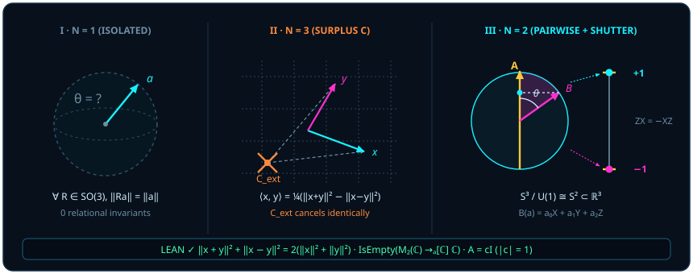

# Chapter 1 Quantum as Pairwise Measurement: From Static Noun to Relational Verb

> *"What on earth is a quantum, or a quantum gate? Though I study them day in and day out, I still do not understand them."*
>
> *"I truly do not understand — all I can grasp right now is that a quantum state is a vector on a sphere, and derive everything from there."*

If all the conceptual fog bequeathed by twentieth-century physics had to be condensed into a single word, that word would be "**quantum**" read as a static noun. The instant the word is spoken, the mind conjures up tiny pellets of energy, pre-packaged grains of sand rattling inside an invisible sack — as if the microscopic world were a warehouse of miniature Lego bricks and the task of physics were merely to read off the private serial numbers stamped onto each brick before we look.

In classical Chinese, the character *liàng* (量) preserves an older wisdom through two distinct tones. Spoken in the falling fourth tone (**liàng**), it is a completed noun: a discrete share, a ration, a counted packet. Spoken in the rising second tone (**liáng**), it is a living verb between two things: to measure, to gauge, to lay one rod alongside another and test their alignment.

This chapter takes our first step in breaking metaphysical illusions. Using concrete geometric mechanisms backed by theorems verified in the Lean kernel, we establish a simple principle: **first comes the relational verb of two states measuring one another (*liáng*); only afterward appears the discrete click on the detector screen (*liàng*).** Every celebrated "paradox" of introductory quantum mechanics begins the moment we invert cause and effect, projecting the outcome of a relational act backward in time and hardening it into the private possession of an isolated thing.

## 1.1 One Is Too Few, Three Is Redundant {#sec-ch01-1}

Begin with the simplest possible thought experiment. Wipe away the laboratory bench, the Earth, the fixed stars, and every sheet of graph paper in your pocket, leaving only an utterly homogeneous, isotropic void. Into that void, place **one** directed arrow $A$.

Now ask: at what angle does $A$ point? Is it "spin up" or "spin down"? Is it in a "definite state" or a "superposition"?

Geometrically, the question is nonsense. In an empty isotropic space devoid of any second reference, a solitary arrow points neither north nor east, neither straight nor askew. "**One is too few**" — an isolated monad cannot even define a direction, let alone carry an observable physical state. Metaphysics loves to ask what a "thing-in-itself" looks like before anything else encounters it; geometry replies that without a partner to compare against, a lone arrow has nothing to say.

How does direction come into being? Introduce a **second** arrow $B$. The instant two arrows meet, however the surrounding void may tumble as a whole, the relative angle $\theta$ spanned between them becomes an invariant, coordinate-free geometric fact.

Yet right here, Cartesian habit commits the opposite sin. Faced with two arrows $A$ and $B$, standard textbooks immediately summon an imaginary **third reference point $C$** from outside the system: an external origin equipped with three coordinate axes $(x, y, z)$, assigning three numbers $(a_1, a_2, a_3)$ to $A$ and three numbers $(b_1, b_2, b_3)$ to $B$ — as though $A$ and $B$ could not interact physically without first registering their addresses with an external notary $C$.

"**Three is redundant**" — that smuggled-in external coordinate frame is the breeding ground of gauge redundancy and formal clutter. To see that two vectors need no outside origin $C$ to determine their mutual geometry, look at the foundational norm identity of any inner-product space: the parallelogram law.

::: {.theorem #thm-parallelogram-norm-law title="Parallelogram Norm Law in Real Inner-Product Spaces" lean="D5/S3/QuantumContext/ParallelogramNormLaw.inner_product_norm_parallelogram_law"}
Let $E$ be any real inner-product space. For all vectors $x, y \in E$,

$$
\norm{x + y}^2 + \norm{x - y}^2 = 2\bigl(\norm{x}^2 + \norm{y}^2\bigr).
$$
:::

::: proof
In a real inner-product space $E$, squared norm is given by self-pairing, $\norm{u}^2 = \langle u, u\rangle$. Expanding the two diagonals by bilinearity and symmetry of the real inner product gives

$$
\begin{aligned}
\norm{x + y}^2 &= \norm{x}^2 + 2\langle x, y\rangle + \norm{y}^2, \\
\norm{x - y}^2 &= \norm{x}^2 - 2\langle x, y\rangle + \norm{y}^2.
\end{aligned}
$$

Adding the two equations cancels the opposite interference cross-terms $+2\langle x, y\rangle$ and $-2\langle x, y\rangle$, leaving $2(\norm{x}^2 + \norm{y}^2)$. The Lean declaration [`inner_product_norm_parallelogram_law`](lean:D5/S3/QuantumContext/ParallelogramNormLaw.inner_product_norm_parallelogram_law) establishes this universal identity directly on `InnerProductSpace ℝ E`. The full proof is checked by the Lean kernel.
:::

Pause over the physical meaning of the two expansions inside the proof of [@thm-parallelogram-norm-law]. Adding the two diagonals cancels the cross-term $\langle x, y\rangle$ and conserves the total squared-norm budget. Conversely, **subtracting** the second line from the first locks down the inner product directly from the contrast between constructive and destructive superposition (the polarization identity), without a single external coordinate axis in sight:

$$
\langle x, y\rangle = \frac{1}{4}\bigl(\norm{x + y}^2 - \norm{x - y}^2\bigr).
$$

In an optical Mach–Zehnder interferometer or a Ramsey microwave sequence, an experimentalist never reaches for a cosmic protractor floating in absolute space: combining two states in phase measures $\norm{x + y}^2$, combining them out of phase measures $\norm{x - y}^2$, their brightness difference *is* the inner product $\langle x, y\rangle$, and their sum never budges from $2(\norm{x}^2 + \norm{y}^2)$.

Check this on a concrete numerical example. Suppose two unit real vectors $\norm{x} = \norm{y} = 1$ enter a beam splitter in a windowless room where no external axes are marked, and the two output ports register bright intensity $\norm{x + y}^2 = 3$ and dark intensity $\norm{x - y}^2 = 1$. First verify [@thm-parallelogram-norm-law]: $3 + 1 = 4 = 2(1^2 + 1^2)$, conserving the total norm budget; next subtract the two readings to extract their inner-product overlap on the spot:

$$
\langle x, y\rangle = \frac{3 - 1}{4} = \frac{1}{2} = \cos 60^\circ!
$$

Without drawing a single coordinate axis, the $60^\circ$ inclination between $x$ and $y$ steps straight out of the port contrast. Two states meeting in the dark carry their own ruler; every third reference frame $C$ is scaffolding waiting to be dismantled ([Chapter 2](ch02-born-rule.md)).

> One monad alone is mute; three points breed coordinate mirages; two arrows meeting in the dark suffice to measure the world.

## 1.2 From Measuring (liáng) to Discrete Quanta (liàng) {#sec-ch01-2}

If the underlying reality is a continuous geometric angle between two arrows, why do Geiger counters, photomultiplier tubes, and superconducting readout resonators always answer in crisp, binary clicks ($+1$ or $-1$)?

Picture a mechanical device after Feynman's heart. On a bench spins a smooth, continuous flywheel whose rim can point at any angle around the $360^\circ$ circle. Your probe, however, is a **one-dimensional two-way sorting shutter** — like a Stern–Gerlach magnet splitting a beam along a single vertical axis $\vv{e}_3$ into an upper port ($+1$) and a lower port ($-1$). Every trial forced through that narrow slit must exit through either the upper channel or the lower channel.

When you **measure** (*liáng*) a continuous wheel through a one-dimensional binary shutter, the readout necessarily emerges in discrete **quanta** (*liàng*). Discreteness at the exit port does not mean the wheel was secretly a bag of pre-labeled $+1$ and $-1$ marbles before it hit the slit; **a discrete quantum is the echo left when continuous spherical geometry is forced through a one-dimensional idempotent slit.**

What happens if we refuse this lesson and cling to naive classical realism? Suppose we insist that prior to measurement, the system carries an omniscient hidden ledger $\chi$ assigning a definite complex value $\chi(A)$ to every observable matrix $A$, faithfully preserving algebraic structure ($\chi(I) = 1$, $\chi(A + B) = \chi(A) + \chi(B)$, and $\chi(AB) = \chi(A)\chi(B)$).

No philosophical debate is needed to test that hypothesis — three lines of $2\times 2$ matrix arithmetic shatter it completely. Inside the qubit matrix algebra $M_2(\mathbb{C})$ ([`QubitMatrix`](lean:D5/S3/Quantum/FiniteDimensional.QubitMatrix) in Lean), examine the two fundamental orthogonal shutters, the Pauli bit-flip matrix $X$ and phase-flip matrix $Z$:

$$
X = \begin{pmatrix} 0 & 1 \\ 1 & 0 \end{pmatrix}, \qquad Z = \begin{pmatrix} 1 & 0 \\ 0 & -1 \end{pmatrix}.
$$

Let us first record the five exact algebraic properties of this Weyl pair.

::: {.lemma #lem-qubit-weyl-star title="Anticommutation, Self-Adjointness, and Involution of Pauli X and Z" lean="D5/S3/Quantum/FiniteDimensional.qubit_weyl_star"}
For the $2\times 2$ complex matrices $X = \begin{pmatrix} 0 & 1 \\ 1 & 0 \end{pmatrix}$ and $Z = \begin{pmatrix} 1 & 0 \\ 0 & -1 \end{pmatrix}$, writing $A^*$ for the conjugate transpose and $I$ for the $2\times 2$ identity matrix, all five identities hold:

$$
ZX = -XZ, \qquad X^* = X, \qquad Z^* = Z, \qquad X^2 = I, \qquad Z^2 = I.
$$
:::

::: proof
Direct $2\times 2$ multiplication gives

$$
ZX = \begin{pmatrix} 1 & 0 \\ 0 & -1 \end{pmatrix}\begin{pmatrix} 0 & 1 \\ 1 & 0 \end{pmatrix} = \begin{pmatrix} 0 & 1 \\ -1 & 0 \end{pmatrix}, \qquad
XZ = \begin{pmatrix} 0 & 1 \\ 1 & 0 \end{pmatrix}\begin{pmatrix} 1 & 0 \\ 0 & -1 \end{pmatrix} = \begin{pmatrix} 0 & -1 \\ 1 & 0 \end{pmatrix} = -ZX.
$$

Because both $X$ and $Z$ have real entries symmetric across the main diagonal, conjugate transposition leaves each invariant ($X^* = X$, $Z^* = Z$), and squaring either yields $X^2 = Z^2 = I$. Lean verifies each conjunct by finite case analysis over indices in `Fin 2`. The full proof is checked by the Lean kernel.
:::

Look closely at the minus sign in $ZX = -XZ$. Geometrically there is nothing spooky about it: reflecting a plane vector across a horizontal line and then across a $45^\circ$ diagonal rotates it counterclockwise by $90^\circ$; reversing the order of the two reflections rotates it clockwise by $90^\circ$, differing by $180^\circ$ — a factor of $-1$ in spinor half-angle representation! Yet the moment one tries to flatten those noncommuting geometric operations into a commutative numerical ledger $\chi : M_2(\mathbb{C}) \to \mathbb{C}$, that minus sign triggers an immediate collapse.

::: {.theorem #thm-qubit-no-character title="The Qubit Matrix Algebra Admits No Algebraic Character" lean="D5/S3/Quantum/FiniteDimensional.qubit_matrix_algebra_has_no_character"}
The type of unital $\mathbb{C}$-algebra homomorphisms from the $2\times 2$ complex matrix algebra $M_2(\mathbb{C})$ to $\mathbb{C}$ is empty; that is, there exists no map $\chi : M_2(\mathbb{C}) \to \mathbb{C}$ preserving the identity matrix, addition, scalar multiplication, and matrix multiplication.
:::

::: proof
Suppose such a unital $\mathbb{C}$-algebra homomorphism $\chi$ existed. Applying $\chi$ to the anticommutation identity $ZX = -XZ$ from [@lem-qubit-weyl-star] and using commutativity of multiplication in $\mathbb{C}$ yields

$$
\chi(X)\chi(Z) = \chi(Z)\chi(X) = \chi(ZX) = \chi(-XZ) = -\chi(X)\chi(Z).
$$

Any complex number equal to its own negation is zero, so $\chi(X)\chi(Z) = 0$, forcing either $\chi(X) = 0$ or $\chi(Z) = 0$. On the other hand, applying $\chi$ to $X^2 = I$ and $Z^2 = I$ gives

$$
\chi(X)^2 = \chi(X^2) = \chi(I) = 1, \qquad \chi(Z)^2 = \chi(Z^2) = \chi(I) = 1.
$$

In either case ($\chi(X) = 0$ or $\chi(Z) = 0$), substitution yields the contradiction $0 = 1$. Hence no such character exists. The full proof is checked by the Lean kernel.
:::

[@thm-qubit-no-character] is the sharpest algebraic prototype of noncommutative geometry and quantum contextuality (a single-qubit ancestor of the higher-dimensional Kochen–Specker theorem): **noncommuting geometric actions cannot be pre-compiled into a static lookup table of pre-existing numbers.**

One might still ask for a weaker refuge: even if no global valuation assigns numbers to *all* matrices at once, could a nonzero state vector $\psi \neq 0$ simultaneously possess a definite $X$-reading $x$ and a definite $Z$-reading $z$? The next corollary closes that door too.

::: {.corollary #cor-pauli-no-common-eigenvector title="Pauli X and Z Share No Nonzero Common Eigenvector" lean="D5/S3/Quantum/QubitWitnesses.pauli_observables_have_no_common_eigenvector"}
Let $\psi = (\psi_0, \psi_1) \in \mathbb{C}^2$ and $x, z \in \mathbb{C}$. If $X\psi = x\psi$ and $Z\psi = z\psi$, then $\psi = 0$.
:::

::: proof
Writing out $X\psi = x\psi$ and $Z\psi = z\psi$ component by component gives four scalar equations:

$$
\psi_1 = x\psi_0, \qquad \psi_0 = x\psi_1, \qquad \psi_0 = z\psi_0, \qquad -\psi_1 = z\psi_1.
$$

Suppose $\psi_0 \neq 0$. Then the second equation forces $\psi_1 \neq 0$ (otherwise $\psi_0 = x \cdot 0 = 0$), while cancelling $\psi_0 \neq 0$ in the third equation gives $z = 1$. Substituting $z = 1$ into the fourth equation yields $-\psi_1 = \psi_1$, hence $\psi_1 = 0$, a contradiction. Therefore $\psi_0 = 0$, and the first equation immediately gives $\psi_1 = x \cdot 0 = 0$, so $\psi = 0$. The full proof is checked by the Lean kernel.
:::

Geometrically, [@cor-pauli-no-common-eigenvector] is transparently obvious: on a sphere, the $Z$ shutter demands that an arrow point strictly along the north–south axis ($\pm\vv{e}_3$), whereas the $X$ shutter demands that the very same arrow point strictly along the east–west axis ($\pm\vv{e}_1$). The only vector that points "purely north and purely east at once" is the zero vector $\psi = 0$, which has no length and points nowhere at all! Every measurement yields a discrete click (*liàng*) precisely because each act of measuring (*liáng*) must commit to a single axis on the sphere.

## 1.3 Farewell to Complex Column Vectors {#sec-ch01-3}

If the true stage of a single qubit is an ordinary unit sphere $S^2$ in three-dimensional real space, why does nearly every textbook open by handing students an abstract two-component complex column vector

$$
\lvert\psi\rangle = \begin{pmatrix} \alpha \\ \beta \end{pmatrix} \in \mathbb{C}^2, \qquad \alpha = a + bi,\quad \beta = c + di \quad (a, b, c, d \in \mathbb{R})?
$$

Let us audit the real degrees of freedom honestly. At first glance, $(\alpha, \beta)$ carries $4$ real numbers $(a, b, c, d) \in \mathbb{R}^4$ — one dimension more than three-dimensional space! Yet two layers of pure bookkeeping redundancy are hiding inside those four numbers:

1. **Normalization removes one dimension ($\mathbb{R}^4 \to S^3$)**: Directional comparison cares only where the arrow points, not whether we draw its shaft an inch or a yard long. Enforcing $|\alpha|^2 + |\beta|^2 = a^2 + b^2 + c^2 + d^2 = 1$ slices four-dimensional space down to the three-sphere $S^3$, leaving $3$ real parameters.
2. **Global phase invariance removes a second dimension ($S^3 / U(1) \cong S^2$)**: Multiplying both components simultaneously by a unit complex phase $e^{i\gamma}$ ($\gamma \in \mathbb{R}$) spins $\alpha$ and $\beta$ by the exact same angle $\gamma$ in lockstep. Because no external cosmic clock keeps an absolute "zero-phase origin" for the universe, $\lvert\psi\rangle$ and $e^{i\gamma}\lvert\psi\rangle$ are physically indistinguishable in every conceivable experiment. Quotienting $S^3$ by this $U(1)$ phase circle (the celebrated Hopf fibration) strips away one more parameter, leaving $3 - 1 = 2$ real angles — an honest two-dimensional unit sphere $S^2 \subset \mathbb{R}^3$!

To turn the slogan "physical states are projective rays and global phase is the sole unobservable unitary freedom" into a rigorous theorem across arbitrary finite dimensions, let us examine when a unitary matrix preserves rays (one-dimensional complex lines).

::: {.definition #def-preserves-ray title="Ray Preservation" lean="D5/S3/Quantum/Foundation/RayPhaseRigidity.PreservesRay"}
Let $\iota$ be a finite index type, $A \in M_\iota(\mathbb{C})$ a complex square matrix, and $x : \iota \to \mathbb{C}$ a vector. We say that $A$ **preserves the ray of $x$** (`PreservesRay A x`) if the image $Ax$ lies in the complex line spanned by $x$:

$$
Ax \in \operatorname{span}_{\mathbb{C}}\{x\},
$$

meaning there exists $d \in \mathbb{C}$ with $Ax = dx$ (which holds automatically at $x = 0$).
:::

If a unitary matrix $A$ merely preserves the isolated coordinate rays $\{e_i\}_{i \in \iota}$, it can still multiply different coordinate axes by independent phases $e^{i\gamma_i}$, tilting superposition directions. Remarkably, we do not even need to test *all* rays in $\mathbb{C}^\iota$ to lock those phases together: testing any family of superposition rays whose nonzero supports form a connected overlap graph ([`RaySupportConnected`](lean:D5/S3/Quantum/Foundation/RayPhaseRigidity.RaySupportConnected), meaning any two indices $i, j \in \iota$ are joined by a finite chain of test vectors each simultaneously nonzero on consecutive indices) forces $A$ to be a single global phase multiple of the identity!

::: {.theorem #thm-ray-phase-rigidity title="Unitary Global-Phase Rigidity from Connected Ray Tests" lean="D5/S3/Quantum/Foundation/RayPhaseRigidity.unitary_phase_of_connected_ray_tests"}
Let $\iota$ be any finite index type with decidable equality (including the empty type), let $A \in U(\iota, \mathbb{C})$ be a unitary matrix, and let $T \subseteq (\iota \to \mathbb{C})$ be a set of test vectors. Suppose:

1. For every coordinate index $i \in \iota$, $A$ preserves the ray of the standard basis vector $e_i$ ($1$ at $i$ and $0$ elsewhere);
2. For every test vector $x \in T$, $A$ preserves the ray of $x$;
3. The test family $T$ is support-connected (for all $i, j \in \iota$, $i$ and $j$ are linked by the reflexive-transitive closure of the overlap relation $\exists x \in T,\; x_i \neq 0 \land x_j \neq 0$).

Then there exists a complex scalar $c \in \mathbb{C}$ with $\norm{c} = 1$ such that $A = cI$.
:::

::: proof
If $\iota$ is empty, $M_\iota(\mathbb{C})$ is a singleton and $c = 1$ works trivially. When $\iota$ is nonempty, condition 1 implies $Ae_j = d_j e_j$ for each $j \in \iota$, so every off-diagonal entry $A_{ij}$ ($i \neq j$) vanishes and $A$ is diagonal. Next, whenever $x \in T$ satisfies $x_i \neq 0$ and $x_j \neq 0$, condition 2 provides $d \in \mathbb{C}$ with $Ax = dx$; comparing components $i$ and $j$ gives $A_{ii} x_i = d x_i$ and $A_{jj} x_j = d x_j$, and cancelling the nonzero scalars $x_i, x_j$ yields $A_{ii} = d = A_{jj}$. Inducting along the finite overlap chain of condition 3 equates all diagonal entries to a single constant $c$, giving $A = cI$. Finally, unitarity $A^* A = I$ evaluated at any diagonal entry gives $\bar{c}c = 1$, hence $\norm{c} = 1$. The full proof is checked by the Lean kernel.
:::

Notice also the operational economy built into [@thm-ray-phase-rigidity]: no single test vector needs full support across all coordinates, nor do we need a continuum of rays. In an $N$-mode optical network, merely $N - 1$ sparse nearest-neighbor superpositions

$$
T = \bigl\{\, e_0 + e_1,\; e_1 + e_2,\; \dots,\; e_{N-2} + e_{N-1} \,\bigr\}
$$

chain consecutive modes together ($A_{00} = A_{11} = \cdots = A_{N-1,N-1} = c$) and banish every relative phase twist. Conversely, if the overlap graph breaks into disconnected islands (as under a superselection rule forbidding coherent superpositions between two sectors), independent phases $c_1 \neq c_2$ on the two islands become physically undetectable across any allowed ray test — confirming once again that **without pairwise overlapping comparison, even relative phase has no physical meaning.**

At the same time, [@thm-ray-phase-rigidity] gives us a clean license to retire complex column vectors. Because physical distinguishability resides entirely in the ray modulo $c \in U(1)$, replacing $\lvert\psi\rangle$ by its rank-one projector $\rho = \lvert\psi\rangle\langle\psi\rvert$ annihilates global phase automatically: $(c\lvert\psi\rangle)(\bar{c}\langle\psi\rvert) = |c|^2 \lvert\psi\rangle\langle\psi\rvert = \lvert\psi\rangle\langle\psi\rvert$.

Better still, for a single qubit, the traceless directional part of every such $2\times 2$ Hermitian matrix corresponds bijectively to an ordinary real vector $\vv{a} = (a_0, a_1, a_2) \in \mathbb{R}^3$. With the three Pauli matrices

$$
\sigma_X = \begin{pmatrix} 0 & 1 \\ 1 & 0 \end{pmatrix}, \qquad
\sigma_Y = i XZ = \begin{pmatrix} 0 & -i \\ i & 0 \end{pmatrix}, \qquad
\sigma_Z = \begin{pmatrix} 1 & 0 \\ 0 & -1 \end{pmatrix},
$$

the Lean module `QubitBloch` defines the Bloch linear combination [`B`](lean:D5/S3/Quantum/Measurement/Bloch/QubitBloch.B) of $a = (a_0, a_1, a_2) \in \mathbb{R}^3$ by $B(a) = a_0 \sigma_X + a_1 \sigma_Y + a_2 \sigma_Z$.

::: {.proposition #prop-qubit-bloch-core title="Explicit Matrix Form of the Real Qubit Bloch Map" lean="D5/S3/Quantum/Measurement/Bloch/QubitBloch.B_formula_core"}
For every real vector $a = (a_0, a_1, a_2) \in \mathbb{R}^3$, the Bloch combination $B(a) = a_0 \sigma_X + a_1 \sigma_Y + a_2 \sigma_Z$ equals the explicit $2\times 2$ complex matrix

$$
B(a) = \begin{pmatrix} a_2 & a_0 - i a_1 \\ a_0 + i a_1 & -a_2 \end{pmatrix}.
$$
:::

::: proof
Summing $a_0 \sigma_X = \begin{pmatrix} 0 & a_0 \\ a_0 & 0 \end{pmatrix}$, $a_1 \sigma_Y = \begin{pmatrix} 0 & -i a_1 \\ i a_1 & 0 \end{pmatrix}$, and $a_2 \sigma_Z = \begin{pmatrix} a_2 & 0 \\ 0 & -a_2 \end{pmatrix}$ entry by entry across the four positions of `Fin 2 × Fin 2` yields the stated matrix. The full proof is checked by the Lean kernel.
:::

Adding one-half of the identity matrix (corresponding to [`scalarB`](lean:D5/S3/Quantum/Measurement/Bloch/QubitBloch.scalarB) in Lean) turns every pure qubit ray $\lvert\psi\rangle\langle\psi\rvert$ into a concrete **real unit vector** $\vv{a} = (a_0, a_1, a_2) \in S^2$ ($a_0^2 + a_1^2 + a_2^2 = 1$):

$$
\rho_{\vv{a}} = \frac{1}{2}\bigl(I + B(\vv{a})\bigr) = \frac{1}{2}\begin{pmatrix} 1 + a_2 & a_0 - i a_1 \\ a_0 + i a_1 & 1 - a_2 \end{pmatrix}.
$$

Everything opaque in the $2\times 2$ matrix suddenly turns visual: the diagonal entries $\frac{1 \pm a_2}{2}$ record the arrow's vertical height along $\vv{e}_3$, while the off-diagonal pair $a_0 \mp i a_1$ records its horizontal shadow in the equatorial plane $(\vv{e}_1, \vv{e}_2)$! Let us work through the six cardinal poles by hand to cement this dictionary once and for all.

::: {.example #ex-bloch-six-poles title="Explicit Calculation of the Six Cardinal Bloch Poles and Phase Cancellation"}
For polar angle $\theta \in [0, \pi]$ and azimuthal angle $\phi \in [0, 2\pi)$, multiply the normalized column vector $\lvert\psi(\theta, \phi)\rangle = \begin{pmatrix} \cos(\theta/2) \\ e^{i\phi}\sin(\theta/2) \end{pmatrix}$ by an arbitrary global phase $e^{i\gamma}$ ($\gamma \in \mathbb{R}$). Forming the outer product cancels $e^{i\gamma} e^{-i\gamma} = 1$ on the spot:

$$
\begin{aligned}
\bigl(e^{i\gamma}\lvert\psi\rangle\bigr)\bigl(e^{-i\gamma}\langle\psi\rvert\bigr)
&= \begin{pmatrix} \cos^2(\theta/2) & e^{-i\phi}\cos(\theta/2)\sin(\theta/2) \\ e^{i\phi}\cos(\theta/2)\sin(\theta/2) & \sin^2(\theta/2) \end{pmatrix} \\
&= \frac{1}{2}\begin{pmatrix} 1 + \cos\theta & \sin\theta\cos\phi - i\sin\theta\sin\phi \\ \sin\theta\cos\phi + i\sin\theta\sin\phi & 1 - \cos\theta \end{pmatrix}.
\end{aligned}
$$

Matching entries against $\frac{1}{2}(I + B(\vv{a}))$ from [@prop-qubit-bloch-core] reads off the ordinary spherical unit vector $\vv{a} = (\sin\theta\cos\phi,\, \sin\theta\sin\phi,\, \cos\theta) \in S^2$. In particular, the six cardinal poles of the Bloch sphere (grouped into three antipodal orthogonal pairs) are:

| Unit Direction $\vv{a} \in S^2$ | Standard Ket (up to $e^{i\gamma}$) | Projector $\rho_{\vv{a}} = \frac{1}{2}(I + B(\vv{a}))$ | Geometric Location |
| :---: | :---: | :---: | :--- |
| $+\vv{e}_3 = (0, 0, 1)$ | $\lvert 0\rangle = \binom{1}{0}$ | $\begin{pmatrix} 1 & 0 \\ 0 & 0 \end{pmatrix}$ | North pole ($+Z$) |
| $-\vv{e}_3 = (0, 0, -1)$ | $\lvert 1\rangle = \binom{0}{1}$ | $\begin{pmatrix} 0 & 0 \\ 0 & 1 \end{pmatrix}$ | South pole ($-Z$) |
| $+\vv{e}_1 = (1, 0, 0)$ | $\lvert +\rangle = \frac{1}{\sqrt{2}}\binom{1}{1}$ | $\frac{1}{2}\begin{pmatrix} 1 & 1 \\ 1 & 1 \end{pmatrix}$ | East pole ($+X$) |
| $-\vv{e}_1 = (-1, 0, 0)$ | $\lvert -\rangle = \frac{1}{\sqrt{2}}\binom{1}{-1}$ | $\frac{1}{2}\begin{pmatrix} 1 & -1 \\ -1 & 1 \end{pmatrix}$ | West pole ($-X$) |
| $+\vv{e}_2 = (0, 1, 0)$ | $\lvert +i\rangle = \frac{1}{\sqrt{2}}\binom{1}{i}$ | $\frac{1}{2}\begin{pmatrix} 1 & -i \\ i & 1 \end{pmatrix}$ | Front/Y pole ($+Y$) |
| $-\vv{e}_2 = (0, -1, 0)$ | $\lvert -i\rangle = \frac{1}{\sqrt{2}}\binom{1}{-i}$ | $\frac{1}{2}\begin{pmatrix} 1 & i \\ -i & 1 \end{pmatrix}$ | Back/Y pole ($-Y$) |

Notice the most revealing geometric clue in this table: $\lvert 0\rangle$ and $\lvert 1\rangle$, which are orthogonal in Hilbert space ($\langle 0\mid 1\rangle = 0$, $90^\circ$), do not sit at right angles on the Bloch sphere — they sit at **opposite poles**, North $+\vv{e}_3$ and South $-\vv{e}_3$, separated by $\theta = 180^\circ$! Why is the Hilbert-space angle $\theta/2$ half the physical angle $\theta$ on the sphere? That famous factor of one-half is a direct consequence of zero-redundancy inner-product projection, as the next chapter will reveal.
:::

With this, our first conceptual housecleaning is complete: there are no isolated "quantum pellets" floating in a void, only directional rays encountering and measuring one another on a sphere; and there are no ghostly four-parameter complex column vectors, only real unit arrows $\vv{a} \in S^2$ stripped of normalization and global-phase redundancy. When two such real arrows $\vv{a}$ and $\vv{b}$ meet face to face, how do they compute transition probabilities directly without borrowing any external coordinate frame? Let us open the door to [Chapter 2](ch02-born-rule.md).
