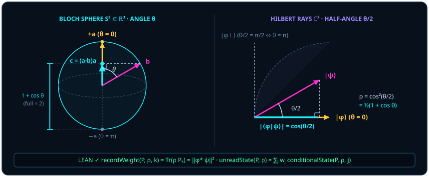

# Chapter 2 Eliminating the Third Point C: Self-Referential Basis and Inner-Product Projection

> *"In truth, point $C$ is not a given input, but the projection of a compatibility point — for a single definite quantum state can determine only a line, whereas it takes a family of quantum states to correspond to an area."*

At the close of [Chapter 1](ch01-measurement.md), we liberated the single qubit from complex column vectors with two components (four real coordinates) and restored it to what it truly is: a real unit arrow $\vv{a}$ on the two-sphere $S^2 \subset \mathbb{R}^3$. Now we confront the central quantitative law of quantum mechanics: when a prepared state $\vv{a}$ meets a probing direction $\vv{b}$, why does the detector report agreement with probability equal to the squared cosine of the Hilbert-space half-angle $\cos^2(\theta/2)$ — or equivalently $\frac{1 + \cos\theta}{2}$ on the Bloch sphere?

In conventional textbooks, Born's rule ($p = |\langle\phi\mid\psi\rangle|^2$) arrives like a tablet carried down from the mountain: an independent statistical postulate bolted onto linear algebra because "experiments happen to match the modulus squared." In this chapter we take Occam's razor to the redundant "third point $C$" and show that Born's rule is no external patch — it is the **canonical basis-free trace pairing induced by pairwise inner-product projection and Pythagorean norm conservation** (with [@thm-born-probability-skeleton] establishing **sufficiency** of the trace pairing for the probability axioms, while the additional frame- or effect-additivity hypotheses required for **uniqueness** are delineated in [@rem-gleason-literature]).

## 2.1 The Measurement Basis Under Occam's Razor {#sec-ch02-1}

Why do calculations of transition probabilities between two arbitrary states feel so clunky to beginners? Because habit bows before the idol of an **external third point $C$**: students first pick an arbitrary laboratory basis $C = \{\lvert 0\rangle, \lvert 1\rangle\}$ unrelated to the problem, expand state $A$ relative to $C$ via some unitary $U_A\lvert 0\rangle$, expand probe $B$ relative to $C$ via another unitary $U_B\lvert 0\rangle$, and finally multiply the two coordinate matrices back together as $U_B^* U_A$. That is like measuring the angle between two pencils lying on your desk by first surveying the latitude and longitude of each pencil relative to the Greenwich Royal Observatory!

Raise Occam's razor and **cut out the third point $C$**.

Compare the two routes on a concrete classroom calculation. Suppose two arrows lie on the same meridian of the sphere: state $A$ tilted at $\theta_A = 60^\circ$ from the laboratory ceiling, and probe $B$ tilted at $\theta_B = 120^\circ$ from the laboratory ceiling.

- **The redundant Point-$C$ coordinate detour**: Treating the ceiling as an external $Z$ axis, you first write $\lvert\psi_A\rangle = \binom{\cos 30^\circ}{\sin 30^\circ} = \binom{\sqrt{3}/2}{1/2}$, next write $\lvert\psi_B\rangle = \binom{\cos 60^\circ}{\sin 60^\circ} = \binom{1/2}{\sqrt{3}/2}$, multiply four components to get $\langle\psi_B\mid\psi_A\rangle = \frac{\sqrt{3}}{4} + \frac{\sqrt{3}}{4} = \frac{\sqrt{3}}{2}$, and square to obtain $\frac{3}{4}$ — and if azimuthal angles $\phi_A, \phi_B$ are nonzero as well, eight trigonometric products and complex exponentials flood the page!
- **The zero-redundancy self-referential shortcut**: What does the ceiling have to do with these two arrows? When only a known premise state $A$ and a target state $B$ exist, what deserves to serve as the principal axis? **State $A$ itself!** Align your zero-degree reference directly along $A$; then $B$ sits at the single intrinsic angle $\theta = 120^\circ - 60^\circ = 60^\circ$, and half a second of mental arithmetic gives $\cos^2(60^\circ/2) = \cos^2 30^\circ = \frac{3}{4}$!

In finite-dimensional matrix algebra, which operation natively erases every trace of an external basis $C$? Literally the **matrix trace** ($\Tr X = \sum_i X_{ii}$). By cyclicity, $\Tr(U^{-1} X U) = \Tr(X U U^{-1}) = \Tr(X)$ for every invertible basis change $U$: twist the external scaffolding $C$ however you please, and the trace pairing $\Tr(\rho P)$ between a state $\rho$ and a projector $P$ never flickers! Zero-redundancy comparison between $\rho$ and $P$ is therefore naturally expressed via the canonical basis-free trace pairing.

::: {.definition #def-born-probability title="Finite-Dimensional Born Trace Weight" lean="D5/S3/Quantum/FiniteDimensional.bornProbability"}
Let $n$ be a finite index type. For any complex square matrices $\rho, P \in M_n(\mathbb{C})$, the **Born trace weight** assigned by $\rho$ to $P$ (`bornProbability rho P` in Lean) is the trace of their matrix product:

$$
\operatorname{bornProbability}(\rho, P) = \Tr(\rho P) \in \mathbb{C}.
$$
:::

At the level of [@def-born-probability], $\Tr(\rho P)$ has codomain $\mathbb{C}$. Why does it automatically shed its imaginary part and land in $[0, 1]$ as an additive, normalized real probability whenever $\rho$ is a valid density state (positive semidefinite of trace $1$) and $P$ is a valid yes/no shutter (self-adjoint and idempotent)? The next theorem establishes this complete probability skeleton.

::: {.theorem #thm-born-probability-skeleton title="Probability-Measure Skeleton of Born Trace Pairing" lean="D5/S3/Quantum/FiniteDimensional.born_probability_skeleton"}
Let $n$ be a finite index type with decidable equality, and let $\rho \in M_n(\mathbb{C})$ be a positive semidefinite matrix with $\Tr(\rho) = 1$. Then the functional of [@def-born-probability] satisfies:

1. **Normalization**: $\operatorname{bornProbability}(\rho, I) = 1$;
2. **Finite additivity**: for all matrices $P, Q \in M_n(\mathbb{C})$,

   $$
   \operatorname{bornProbability}(\rho, P + Q) = \operatorname{bornProbability}(\rho, P) + \operatorname{bornProbability}(\rho, Q);
   $$

3. **Real nonnegativity on projections**: for every matrix $P \in M_n(\mathbb{C})$ satisfying self-adjointness $P^* = P$ and idempotence $P^2 = P$, we have in the complex partial order

   $$
   0 \le \operatorname{bornProbability}(\rho, P),
   $$

   meaning $\Tr(\rho P)$ has zero imaginary part and nonnegative real part.
:::

::: proof
Property 1 follows from $\rho I = \rho$ and $\Tr(\rho) = 1$. Property 2 follows from distributivity $\rho(P + Q) = \rho P + \rho Q$ and linearity of the trace. Property 3 rests on the interplay between idempotence $P = P^2$, self-adjointness $P^* = P$, and trace cyclicity:

$$
\Tr(\rho P) = \Tr(\rho P^2) = \Tr(\rho P P^*) = \Tr(P^* \rho P) = \Tr(P \rho P^*).
$$

Because $\rho$ is positive semidefinite, $\langle v, P \rho P^* v\rangle = \langle P^* v, \rho(P^* v)\rangle \ge 0$ for every $v \in \mathbb{C}^n$, so the sandwich compression $P \rho P^*$ is positive semidefinite (`PosSemidef.mul_mul_conjTranspose_same` in Lean). Every diagonal entry of a positive semidefinite matrix is real and nonnegative, hence so is its trace. Combined with properties 1 and 2 applied to the complementary projector $I - P$, this also bounds $\Tr(\rho P) = 1 - \Tr(\rho(I - P)) \le 1$. The full proof is checked by the Lean kernel.
:::

Watch how property 3 works under the hood: simply because a sharp shutter obeys the idempotent law $P = P^2 = P P^*$ ("asking the same question twice gives the same answer"), the seemingly asymmetric one-sided product $\rho P$ cycles inside the trace into the symmetric positive compression $P \rho P^*$! Sharp projective measurements yield real, nonnegative probabilities directly from this self-adjoint idempotent sandwich structure.

Two quick $2\times 2$ counterexamples illustrate why property 3 of [@thm-born-probability-skeleton] requires both $P^* = P$ and $P^2 = P$ as sufficient conditions for sharp projectors:

- **Drop self-adjointness ($P^* \neq P$)**: Take the oblique idempotent $Q = \begin{pmatrix} 1 & 1 \\ 0 & 0 \end{pmatrix}$ ($Q^2 = Q$, $Q^* \neq Q$) against the $+Y$ state $\rho_{+Y} = \frac{1}{2}\begin{pmatrix} 1 & -i \\ i & 1 \end{pmatrix}$; the trace immediately acquires a nonzero imaginary part:

  $$
  \Tr(\rho_{+Y} Q) = \frac{1 + i}{2} \notin \mathbb{R}!
  $$

- **Drop idempotence without maintaining positivity ($P^2 \neq P$)**: Take the self-adjoint Pauli reflection $Z = \begin{pmatrix} 1 & 0 \\ 0 & -1 \end{pmatrix}$ ($Z^* = Z$, $Z^2 = I \neq Z$) against the south-pole state $\rho_1 = \begin{pmatrix} 0 & 0 \\ 0 & 1 \end{pmatrix}$; the trace plunges below zero:

  $$
  \Tr(\rho_1 Z) = -1 < 0!
  $$

To state the exact converse boundary: for a general operator $E \in M_n(\mathbb{C})$, $\Tr(\rho E) \in [0, 1]$ holds across all density states $\rho$ if and only if $E$ is a self-adjoint **POVM effect** obeying the operator bound $0 \le E \le I$ (for instance, the unsharp fair-coin effect $E = \frac{1}{2}I$ is non-idempotent, $E^2 = \frac{1}{4}I \neq E$, yet still yields $\Tr(\rho E) = \frac{1}{2} \in [0, 1]$ for every state, as discussed in [@rem-gleason-literature]). Within the convex effect interval $\{E : 0 \le E \le I\}$, self-adjointness $P^* = P$ paired with idempotence $P^2 = P$ (restricting eigenvalues strictly to $\{0, 1\}$) both guarantees $0 \le P \le I$ and characterizes **sharp, repeatable (extremal projective) yes/no questions** — tests free of intrinsic noise that confirm the exact same answer upon immediate repetition.

## 2.2 What Is "Point C" Really? {#sec-ch02-2}

Once the external coordinate origin $C$ has been shaved away, an instructive puzzle remains: why, whenever we sketch the inner product of two unit vectors $\vv{a}$ and $\vv{b}$ on a blackboard, does our chalk still naturally label a third point $C$ — namely, the **foot of the perpendicular** dropped from the tip of $\vv{b}$ onto the line of $\vv{a}$?

Here lies the decisive turn from external metaphysics to relational geometry: **the true "point $C$" was never an independent third judge standing outside $A$ and $B$; it is the endogenous compatibility shadow cast by $B$ onto $A$!**

Take the unit vector $\vv{a}$ as principal axis. Orthogonal projection of the unit vector $\vv{b}$ onto $\vv{a}$ produces the vector

$$
\vv{c} = (\vv{a} \cdot \vv{b})\,\vv{a} = (\cos\theta)\,\vv{a}.
$$

Observe that $\vv{c}$ possesses zero degrees of freedom independent of $\vv{a}$ and $\vv{b}$: its direction is borrowed wholly from $\vv{a}$, and its signed length $\vv{a} \cdot \vv{b} = \cos\theta$ measures purely how compatible $\vv{b}$ is with $\vv{a}$ (**compatibility** in our controlled glossary). Meanwhile, the perpendicular rejection vector rising from the foot $\vv{c}$ to the tip of $\vv{b}$,

$$
\vv{b}_\perp = \vv{b} - \vv{c} = \vv{b} - (\vv{a} \cdot \vv{b})\,\vv{a},
$$

satisfies $\vv{a} \cdot \vv{b}_\perp = \vv{a}\cdot\vv{b} - (\vv{a}\cdot\vv{b})(\vv{a}\cdot\vv{a}) = 0$ with squared norm $\norm{\vv{b}_\perp}^2 = 1 - \cos^2\theta = \sin^2\theta$ (in Part II, Chapter 5, we will recognize this $\sin\theta$ rejection leg as the generator of the oriented bivector area $\vv{a} \wedge \vv{b}$). "Point $C$" is born on the spot from the encounter of $A$ and $B$. The error of classical coordinate thinking was never drawing the foot of a perpendicular — it was mistaking that relational shadow for an absolute stage existing prior to the actors!

This also resolves the dimensional question posed in our opening epigraph about lines versus areas. A single pure state $A$ fixes only a one-dimensional ray $\vv{a}$. Even two non-collinear states $A$ and $B$ together span only a **planar wedge sector** inside the flat disc of their great circle (whose oriented bivector area $\vv{a} \wedge \vv{b}$ drives planar gate rotations in Part II, Chapter 5); on the spherical shell $S^2$ itself, the geodesic arc joining $A$ and $B$ remains a one-dimensional curve enclosing **zero spherical-triangle surface area** ($\Omega = 0$). A genuine **spherical surface area (solid angle $\Omega$)** emerges only when an external reference axis $C$ (such as the laboratory pole $\lvert 0\rangle$) or a third non-coplanar state direction is introduced so that three non-coplanar rays enclose a spherical triangle on $S^2$ (whose intrinsic multi-state geometry is governed by the Gram matrix in Part III, Chapter 10). That is why dragging an external axis $\lvert 0\rangle$ into a purely pairwise measurement manufactures spurious spherical-triangle phase area out of thin air!

> Seek no third judge outside the two arrows: when the first serves as ruler for the second, the shadow cast upon the ruler is itself the third point.

Let us verify how this squared projection shadow appears in arbitrary finite dimension $\mathbb{C}^n$. When a pure state is represented by the rank-one outer product $\rho = \psi\psi^* = \lvert\psi\rangle\langle\psi\rvert$ and outcome branch $k$ is represented by the rank-one projector $P_k = \phi\phi^* = \lvert\phi\rangle\langle\phi\rvert$ (`Matrix.vecMulVec u (star u)` in Lean, with branch weight [`recordWeight`](lean:D5/S3/Observer/Conditioning.recordWeight) defined as `recordWeight P rho k := bornProbability rho (P k)`), what does the coordinate-free trace $\Tr(\rho P_k)$ evaluate to?

::: {.theorem #thm-born-modulus-square title="Rank-One Pure-State Reduction to Squared Overlap Modulus" lean="D5/S3/Observer/BornReduction.rank_one_pure_state_modulus_square_reduction"}
Let $n$ be a finite index type, $\kappa$ an outcome index type, $P : \kappa \to M_n(\mathbb{C})$ a family of matrices, $\rho \in M_n(\mathbb{C})$, $k \in \kappa$, and $\phi, \psi \in \mathbb{C}^n$. If branch $k$ and state $\rho$ admit the rank-one outer-product representations

$$
P_k = \phi\phi^* = \lvert\phi\rangle\langle\phi\rvert, \qquad \rho = \psi\psi^* = \lvert\psi\rangle\langle\psi\rvert,
$$

then the record weight reduces to the squared norm of the complex inner product $\langle\phi\mid\psi\rangle = \phi^* \cdot \psi$ (coerced from $\mathbb{R}$ into $\mathbb{C}$):

$$
\operatorname{recordWeight}(P, \rho, k) = \norm{\langle\phi\mid\psi\rangle}^2.
$$
:::

::: proof
Substitute $P_k = \lvert\phi\rangle\langle\phi\rvert$ and $\rho = \lvert\psi\rangle\langle\psi\rvert$ into $\operatorname{recordWeight}(P, \rho, k) = \Tr(\rho P_k)$. Multiplying the two rank-one outer products (`Matrix.vecMulVec_mul_vecMulVec`) contracts the adjacent bra $\langle\psi\rvert$ and ket $\lvert\phi\rangle$ into the scalar $\langle\psi\mid\phi\rangle$:

$$
\rho P_k = \bigl(\lvert\psi\rangle\langle\psi\rvert\bigr)\bigl(\lvert\phi\rangle\langle\phi\rvert\bigr) = \langle\psi\mid\phi\rangle\,\lvert\psi\rangle\langle\phi\rvert.
$$

Taking the trace of the remaining outer product $\lvert\psi\rangle\langle\phi\rvert$ (`Matrix.trace_vecMulVec`) yields the reverse overlap $\Tr(\lvert\psi\rangle\langle\phi\rvert) = \langle\phi\mid\psi\rangle$. Because $\langle\psi\mid\phi\rangle = \overline{\langle\phi\mid\psi\rangle}$, their product is the conjugate square

$$
\Tr(\rho P_k) = \overline{\langle\phi\mid\psi\rangle}\,\langle\phi\mid\psi\rangle = \norm{\langle\phi\mid\psi\rangle}^2.
$$

The full proof is checked by the Lean kernel.
:::

Notice the clarity of [@thm-born-modulus-square]. In ket notation, multiplying an amplitude $\langle\phi\mid\psi\rangle$ by its complex conjugate $\overline{\langle\phi\mid\psi\rangle}$ often looks like an ad hoc trick invented to force a complex number to become real and positive. In the zero-redundancy projector picture, the "forward projection" $\langle\phi\mid\psi\rangle$ and the "return projection" $\langle\psi\mid\phi\rangle$ are simply the two halves of the closed trace loop $\Tr(\rho P_k)$!

Gauge geometry confirms why a bare open overlap $\langle\phi\mid\psi\rangle$ can never be an observable by itself: if Alice re-phases $\lvert\psi'\rangle = e^{i\alpha}\lvert\psi\rangle$ and Bob independently re-phases $\lvert\phi'\rangle = e^{i\beta}\lvert\phi\rangle$, the physical rays of [Chapter 1](ch01-measurement.md) do not budge ($\rho' = \rho$, $P_k' = P_k$), yet the one-way overlap picks up an arbitrary gauge artifact $\langle\phi'\mid\psi'\rangle = e^{i(\alpha - \beta)}\langle\phi\mid\psi\rangle$! Only by closing the round-trip loop $\lvert\psi\rangle \to \lvert\phi\rangle \to \lvert\psi\rangle$ do the outgoing phase $e^{+i(\alpha - \beta)}$ and returning phase $e^{-i(\alpha - \beta)}$ cancel identically:

$$
\langle\psi'\mid\phi'\rangle\langle\phi'\mid\psi'\rangle = e^{-i(\alpha-\beta)}e^{+i(\alpha-\beta)}\norm{\langle\phi\mid\psi\rangle}^2 = \Tr(\rho P_k).
$$

(And here is a preview worth savoring: when the round trip visits *three* rays $\psi \to \phi \to \chi \to \psi$ enclosing an oriented geodesic triangle on $S^2$, with nonzero overlaps between adjacent states, the argument of the three-point Bargmann trace $\Tr(P_\psi P_\chi P_\phi)$ equals $-\Omega/2$ modulo $2\pi$ under the spin-up and orientation conventions of [Part III, Chapter 10](ch10-gram-geometry-and-order.md#sec-spherical-order-and-berry) — the **geometric Berry phase**!)

## 2.3 The Purely Geometric Origin of Born's Rule {#sec-ch02-3}

Now place the single branch $P_k$ inside a complete family of mutually orthogonal record channels $\{P_j\}_{j \in \kappa}$ (`IsRecordMeasurement P`, formalized via [`IsRecordMeasurement`](lean:D5/S3/Observer/Conditioning.IsRecordMeasurement) and studied in full in [Chapter 3](ch03-projectors-and-duality.md)), satisfying $P_j^* = P_j$, $P_j^2 = P_j$, $P_j P_l = 0$ ($j \neq l$), and $\sum_{j \in \kappa} P_j = I$. Before the observer reads which detector clicked, the post-measurement ensemble is the unread state $\operatorname{unreadState}(P, \rho) = \sum_j P_j \rho P_j$; upon reading outcome $j$ with nonzero weight, the state updates to the normalized [`conditionalState`](lean:D5/S3/Observer/Conditioning.conditionalState) $\rho_{|j} = \operatorname{recordWeight}(P, \rho, j)^{-1} P_j \rho P_j$.

The next theorem unifies the squared transition modulus, the basis-free trace pairing, and the conditional ensemble decomposition in a single statement.

::: {.theorem #thm-rank-one-born-pairing title="Born Pairing and Conditional Ensemble for a Rank-One Branch of a Record Measurement" lean="D5/S3/Observer/Conditioning/RankOneBornPairingWeight.rank_one_born_pairing_weight"}
Let $n$ and $\kappa$ be finite index types (with decidable equality on $n$), let $P : \kappa \to M_n(\mathbb{C})$ be a complete orthogonal record measurement (`IsRecordMeasurement P`), and let $\rho \in M_n(\mathbb{C})$ be positive semidefinite with $\Tr(\rho) = 1$. For a branch $k \in \kappa$ and vectors $\phi, \psi \in \mathbb{C}^n$, if $P_k = \lvert\phi\rangle\langle\phi\rvert$ and $\rho = \lvert\psi\rangle\langle\psi\rvert$, then all three identities hold:

1. **Squared-modulus reduction**: $\operatorname{recordWeight}(P, \rho, k) = \norm{\langle\phi\mid\psi\rangle}^2$;
2. **State–projection trace pairing**: $\operatorname{recordWeight}(P, \rho, k) = \Tr(\rho P_k)$;
3. **Weighted conditional ensemble identity**:

   $$
   \operatorname{unreadState}(P, \rho) = \sum_{j \in \kappa} \operatorname{recordWeight}(P, \rho, j)\,\operatorname{conditionalState}(P, \rho, j).
   $$

:::

::: proof
Claim 1 applies [@thm-born-modulus-square] directly; claim 2 unfolds `recordWeight` and `bornProbability` by reflexivity; claim 3 checks each summand $j \in \kappa$ by cases on $w_j = \operatorname{recordWeight}(P, \rho, j)$. When $w_j \neq 0$, scalar cancellation gives $w_j \cdot (w_j^{-1} P_j \rho P_j) = P_j \rho P_j$. When $w_j = 0$, the positive semidefinite matrix $P_j \rho P_j$ has trace $\Tr(P_j \rho P_j) = \Tr(\rho P_j) = w_j = 0$, which forces $P_j \rho P_j = 0$, so $0 \cdot \operatorname{conditionalState}(P, \rho, j) = 0 = P_j \rho P_j$ holds in this case as well. Summing over $j \in \kappa$ recovers $\operatorname{unreadState}(P, \rho)$. The full proof is checked by the Lean kernel.
:::

Let us check all three clauses of [@thm-rank-one-born-pairing] by hand on a skewed single-qubit pure state. Prepare the $60^\circ$-tilted state $\lvert\psi\rangle = \binom{\sqrt{3}/2}{1/2}$, whose outer-product density matrix is

$$
\rho = \lvert\psi\rangle\langle\psi\rvert = \begin{pmatrix} 3/4 & \sqrt{3}/4 \\ \sqrt{3}/4 & 1/4 \end{pmatrix} \qquad \bigl(\Tr\rho = \tfrac{3}{4} + \tfrac{1}{4} = 1\bigr),
$$

and probe it with the complete orthogonal East and West $X$-basis shutters $P_+ = \lvert +\rangle\langle +\rvert = \frac{1}{2}\bigl(\begin{smallmatrix} 1 & 1 \\ 1 & 1 \end{smallmatrix}\bigr)$ and $P_- = \lvert -\rangle\langle -\rvert = \frac{1}{2}\bigl(\begin{smallmatrix} 1 & -1 \\ -1 & 1 \end{smallmatrix}\bigr)$:

1. **Verifying clauses 1 and 2 (modulus squared equals trace pairing)**: The inner product $\langle +\mid\psi\rangle = \frac{\sqrt{3} + 1}{2\sqrt{2}}$ has squared modulus $\frac{4 + 2\sqrt{3}}{8} = \frac{2 + \sqrt{3}}{4}$; directly taking the matrix product trace gives $\Tr(\rho P_+) = \frac{1}{2}\bigl(\frac{3}{4} + \frac{\sqrt{3}}{4} + \frac{\sqrt{3}}{4} + \frac{1}{4}\bigr) = \frac{2 + \sqrt{3}}{4}$! Likewise $w_- = \Tr(\rho P_-) = \frac{2 - \sqrt{3}}{4}$, with $w_+ + w_- = 1$.
2. **Verifying clause 3 (unread state as weighted conditional mixture)**: The two normalized conditioned states are $\rho_{|+} = P_+$ and $\rho_{|-} = P_-$. Weighting them by $w_+$ and $w_-$ leaves off-diagonal coherence $\frac{w_+ - w_-}{2} = \frac{\sqrt{3}}{4}$ and levels the diagonals to $\frac{w_+ + w_-}{2} = \frac{1}{2}$:

   $$
   \operatorname{unreadState}(P, \rho) = w_+ P_+ + w_- P_- = \begin{pmatrix} 1/2 & \sqrt{3}/4 \\ \sqrt{3}/4 & 1/2 \end{pmatrix} = P_+ \rho P_+ + P_- \rho P_-!
   $$

Pause now to ask the deeper question every thoughtful student eventually asks: **why must nature weight orthogonal branches by the *second* power ($L^2$ norm squared) of the projection length, rather than the first power $|\cos(\theta/2)|$ or the fourth power $\cos^4(\theta/2)$?**

Glance back at the parallelogram and Pythagorean law of [Chapter 1](ch01-measurement.md) ([@thm-parallelogram-norm-law]): the answer has been sitting in Euclidean geometry for twenty-five centuries! When a unit state vector $\lvert\psi\rangle$ ($\norm{\psi} = 1$) is resolved into an aligned component $\cos(\theta/2)$ and a perpendicular component $\sin(\theta/2)$ across two orthogonal measurement ports, which power sums to $1$ at every angle?

- First powers give $\cos(\theta/2) + \sin(\theta/2) = \sqrt{2} \approx 1.414 \neq 1$ at $\theta = 90^\circ$, creating $41\%$ excess probability out of thin air;
- Fourth powers give $\cos^4(\theta/2) + \sin^4(\theta/2) = \frac{1}{4} + \frac{1}{4} = \frac{1}{2} \neq 1$ at $\theta = 90^\circ$, losing half of reality;
- **Only the second power** satisfies $\cos^2(\theta/2) + \sin^2(\theta/2) \equiv 1$ identically for every angle $\theta$!

**Born's rule unites Pythagoras's theorem with the canonical basis-free trace pairing.** Among power-law candidates $|\langle\phi\mid\psi\rangle|^p$ of the projection overlap, conservation of total weight $1$ across orthogonal channels singles out the exponent $p = 2$; at the general operator level, [@thm-born-probability-skeleton] establishes **sufficiency** (that $\Tr(\rho P)$ satisfies normalization, additivity, and nonnegativity), whereas ruling out arbitrary non-Born assignments across all frames or effects (**uniqueness**) requires the cross-basis frame- or effect-additivity hypotheses recorded in [@rem-gleason-literature].

Let us now combine [@prop-qubit-bloch-core] and [@thm-rank-one-born-pairing] to fulfill the promise made at the end of Chapter 1 and resolve the factor-of-two relation between the Bloch sphere angle $\theta$ and the Hilbert-space half-angle $\theta/2$.

::: {.example #ex-bloch-half-angle title="Deriving the Bloch Half-Angle Law: Why Antipodal Means Orthogonal"}
Let a single qubit be prepared along the real unit vector $\vv{a} = (a_0, a_1, a_2) \in S^2$ and probed along the real unit vector $\vv{b} = (b_0, b_1, b_2) \in S^2$ at spatial angle $\theta \in [0, \pi]$, so that their Euclidean dot product is $\vv{a} \cdot \vv{b} = a_0 b_0 + a_1 b_1 + a_2 b_2 = \cos\theta$.

By [@prop-qubit-bloch-core], their rank-one projectors are $\rho_{\vv{a}} = \frac{1}{2}(I + B(\vv{a}))$ and $P_{\vv{b}} = \frac{1}{2}(I + B(\vv{b}))$. Without touching a single complex ket, evaluate the trace pairing $\Tr(\rho_{\vv{a}} P_{\vv{b}})$ of [@thm-rank-one-born-pairing]:

$$
\Tr(\rho_{\vv{a}} P_{\vv{b}}) = \frac{1}{4}\Tr\bigl(I + B(\vv{a}) + B(\vv{b}) + B(\vv{a})B(\vv{b})\bigr).
$$

Here $\Tr(I) = 2$, while the diagonal entries $a_2$ and $-a_2$ in [@prop-qubit-bloch-core] give $\Tr(B(\vv{a})) = \Tr(B(\vv{b})) = 0$. Computing the two diagonal entries of $B(\vv{a})B(\vv{b})$ directly gives

$$
\begin{aligned}
\bigl(B(\vv{a})B(\vv{b})\bigr)_{00} &= a_2 b_2 + (a_0 - i a_1)(b_0 + i b_1) = (a_0 b_0 + a_1 b_1 + a_2 b_2) + i(a_0 b_1 - a_1 b_0), \\
\bigl(B(\vv{a})B(\vv{b})\bigr)_{11} &= (a_0 + i a_1)(b_0 - i b_1) + (-a_2)(-b_2) = (a_0 b_0 + a_1 b_1 + a_2 b_2) - i(a_0 b_1 - a_1 b_0).
\end{aligned}
$$

When we add the two diagonal entries to form the trace, the imaginary cross-product terms $\pm i(a_0 b_1 - a_1 b_0)$ cancel identically, leaving $2(\vv{a} \cdot \vv{b})$! Substituting this back and applying the half-angle identity $1 + \cos\theta = 2\cos^2(\theta/2)$ yields

$$
\Tr(\rho_{\vv{a}} P_{\vv{b}}) = \frac{1}{4}\bigl(2 + 0 + 0 + 2\,\vv{a}\cdot\vv{b}\bigr) = \frac{1 + \vv{a}\cdot\vv{b}}{2} = \frac{1 + \cos\theta}{2} = \cos^2\Bigl(\frac{\theta}{2}\Bigr).
$$

Every piece of the puzzle clicks into place:

1. **Collinear alignment ($\theta = 0^\circ$)**: $\vv{a} \cdot \vv{b} = +1$, giving probability $\frac{1 + 1}{2} = 1$ (certain passage);
2. **Spatial orthogonality ($\theta = 90^\circ$, e.g., North $\lvert 0\rangle$ tested along East $\lvert +\rangle$)**: $\vv{a} \cdot \vv{b} = 0$, zero directional bias, giving the fair-coin midpoint $\frac{1 + 0}{2} = \frac{1}{2}$;
3. **Spatial opposition ($\theta = 180^\circ$, e.g., North $\lvert 0\rangle$ tested along South $\lvert 1\rangle$)**: in three-dimensional space, two opposite outcomes point antipodally ($\theta = 180^\circ$, $\cos 180^\circ = -1$), whereas in probability and inner-product geometry, mutual exclusion requires zero overlap ($\cos 90^\circ = 0$). The affine rescaling $x \mapsto \frac{1 + x}{2}$ maps $[-1, +1]$ onto $[0, 1]$, which trigonometrically halves $\theta$ into $\cos^2(\theta/2)$!

For ready reference in later chapters, the benchmark angles across both pictures are collected below:

| Bloch Angle $\theta$ | Hilbert Half-Angle $\theta/2$ | Compatibility $\vv{a}\cdot\vv{b} = \cos\theta$ | Born Weight $\Tr(\rho_{\vv{a}} P_{\vv{b}}) = \cos^2(\theta/2)$ | Geometric Reading |
| :---: | :---: | :---: | :---: | :--- |
| $0^\circ$ | $0^\circ$ | $+1$ | $1$ | Collinear alignment; deterministic passage |
| $60^\circ$ | $30^\circ$ | $+1/2$ | $3/4$ | Acute alignment (classic Bell-test angle) |
| $90^\circ$ | $45^\circ$ | $0$ | $1/2$ | Orthogonal equator; unbiased $50:50$ split |
| $120^\circ$ | $60^\circ$ | $-1/2$ | $1/4$ | Obtuse opposition (symmetric trine angle) |
| $180^\circ$ | $90^\circ$ | $-1$ | $0$ | Antipodal on $S^2$ $\leftrightarrow$ orthogonal in $\mathbb{C}^2$ |
:::

The table above goes angle by angle. Ask a different question: if the direction of the target state $\vv{b}$ is random, uniformly distributed on the sphere, how is the compatibility weight $p = \cos^2\frac{\theta}{2}$ distributed? Intuition may guess that it favours the middle, or the two ends. Neither is right.

::: {.example #ex-uniform-born-weight title="The Born Weight in a Random Direction Is Uniformly Distributed: Archimedes' Hat-Box Theorem"}
This example is an elementary computation, not formalized in this book; the higher-dimensional formula is a literature result.

**The hat-box theorem.** On the unit sphere, the band of points with height in $[z,\ z + \mathrm{d}z]$ has circumference $2\pi\sin\theta$ and width $\mathrm{d}\theta = \mathrm{d}z / \sin\theta$ along a meridian, hence area $2\pi\,\mathrm{d}z$, independent of latitude. So for a uniformly random point of the sphere, the height $z = \cos\theta$ is uniformly distributed on $[-1, 1]$.

**The Born weight.** Take the known state $\vv{a}$ to be the north pole. The half-angle formula gives $p = \cos^2\frac{\theta}{2} = \frac{1 + \cos\theta}{2} = \frac{1 + z}{2}$, an affine function of $z$, and therefore

$$
p \ \text{is uniform on}\ [0, 1], \qquad \mathbb{E}[p] = \frac{1}{2}, \qquad \operatorname{Var}[p] = \frac{1}{12}, \qquad \Pr[p \ge t] = 1 - t .
$$

| condition | equivalent range of the angle | probability |
| :---: | :---: | :---: |
| $p \ge \frac{1}{2}$ | $\theta \le 90^\circ$ | $\frac{1}{2}$ |
| $p \ge \frac{3}{4}$ | $\theta \le 60^\circ$ | $\frac{1}{4}$ |
| $p \ge 0.9$ | $\theta \le 36.87^\circ$ | $0.1$ |
| $p \ge \frac{2 + \sqrt{3}}{4} \approx 0.933$ | $\theta \le 30^\circ$ | $\frac{2 - \sqrt{3}}{4} \approx 0.067$ |

**Numerical check.** With one million uniformly random directions: sample mean $0.5001$, sample variance $0.08323$ ($\frac{1}{12} \approx 0.08333$); the frequencies of $p$ falling in $[0, 0.1)$, $[0.25, 0.75)$, $[0.9, 1]$ are $0.0996$, $0.5009$, $0.1004$.

**Comparison with higher dimensions.** For a uniformly random pure state in a $d$-dimensional Hilbert space, its overlap weight with a fixed state satisfies $\Pr[p > t] = (1 - t)^{d-1}$, with mean $\frac{1}{d}$. For $d = 2$ this is the uniform distribution above; for $d = 4$, $\Pr[p > \frac{1}{2}] = \frac{1}{8}$; for $d = 16$, $\Pr[p > \frac{1}{2}] = 2^{-15} \approx 3\times10^{-5}$. A simulation with four hundred thousand samples gives means $0.5000$, $0.2498$, $0.0626$, in agreement with $\frac{1}{d}$.
:::

The single qubit is the only "fair" case: point in an arbitrary direction, and the compatibility weight is equally likely to take any value between $0$ and $1$. As soon as the dimension grows, a randomly chosen direction is almost surely nearly orthogonal to the reference state. The equatorial concentration and the barren plateaus discussed in [Chapter 12](ch12-measurement-computation-and-gradients.md) start from this fact.

::: {.remark #rem-gleason-literature title="Gleason's Theorem and Busch's Theorem (Literature Result, Not Formalized in This Book)"}
**Literature result, not formalized in this book.** In this chapter, [@thm-born-probability-skeleton] proves **sufficiency**: every positive semidefinite trace-one matrix $\rho$ defines, via the canonical basis-free trace pairing $P \mapsto \Tr(\rho P)$, a normalized, finitely additive, nonnegative measure on projections. Establishing **uniqueness** (that every probability assignment obeying suitable additivity axioms must take the trace-pairing form) requires classical converse theorems and their exact dimensional and domain hypotheses:

- **Gleason's theorem** (A. M. Gleason, *Measures on the closed subspaces of a Hilbert space*, J. Math. Mech. **6**, 885–893, 1957): Requires Hilbert-space dimension **$\dim\mathcal{H} \ge 3$**. On any separable Hilbert space of dimension $\dim\mathcal{H} \ge 3$, every countably additive probability measure $\mu$ on the lattice of orthogonal projections (reducing to finite additivity on pairwise orthogonal projections when $3 \le \dim\mathcal{H} < \infty$) has the form $\mu(P) = \Tr(\rho P)$ for a unique density operator $\rho$. **Gleason's theorem fails on the projection lattice alone when $\dim\mathcal{H} = 2$**: because each two-dimensional orthonormal basis consists solely of an antipodal pair $\{P_{\vv{n}}, P_{-\vv{n}}\}$ sharing no common rank-one projectors with other bases, non-Born frame functions on $S^2$ satisfying $\mu(P_{\vv{n}}) + \mu(P_{-\vv{n}}) = 1$ exist in abundance.
- **Busch's theorem** (P. Busch, *Quantum states and generalized observables: A simple proof of Gleason's theorem*, Phys. Rev. Lett. **91**, 120403, 2003): Extending additivity from sharp projections to positive POVM effects ($0 \le E_i \le I$ with $\mu(\sum_i E_i) = \sum_i \mu(E_i)$ whenever $\sum_i E_i \le I$) restores uniqueness for **all $\dim\mathcal{H} \ge 2$** (including a single qubit, $\dim\mathcal{H} = 2$): every generalized probability measure has the form $E \mapsto \Tr(\rho E)$ for a unique density operator $\rho$.

Our pinned repository focuses on constructive finite-dimensional matrix reductions ([@thm-born-probability-skeleton], [@thm-born-modulus-square], and [@thm-rank-one-born-pairing]); these converse uniqueness theorems are cited from the classical literature and are not claimed in the book's Lean verification ledger.
:::

Having eliminated the external third point $C$ and derived $\cos^2(\theta/2) = \frac{1 + \cos\theta}{2}$ from pure trace geometry, we now turn the spotlight onto the ruler itself — the **idempotent projector** $P^2 = P$ that appeared in every theorem of this chapter. Why do "detecting a particle," "naming a logical concept," and "experiencing a tick of classical linear time" all reduce to the single equation $P^2 = P$? Let us step into [Chapter 3](ch03-projectors-and-duality.md).
