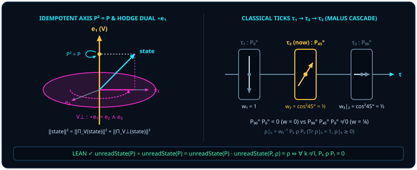

# Chapter 3 Existence as an Idempotent Line ($P^2 = P$): Particles, Concepts, and the Classical Time Axis

> *"Even the concept of 'quantum' is a particle, and even the concept of 'existence' is a particle."*

Across the first two chapters we saw that a solitary monad cannot define a direction and two states need no external reference point $C$ to compare themselves; meanwhile, within the convex interval of general yes/no effects $0 \le E \le I$, **sharp, repeatable (extremal projective) yes/no questions** $P$ both guarantee real nonnegativity $\Tr(\rho P) \in [0, 1]$ in [@thm-born-probability-skeleton] and owe their noiseless, once-and-for-all repeatability to a single algebraic law — **self-adjoint idempotence**:

$$
P^* = P, \qquad P^2 = P.
$$

Linear-algebra textbooks routinely treat $P^2 = P$ as a dry technical definition ("a matrix whose eigenvalues are $0$ and $1$"). Yet in the genealogical interpretation developed in this book, examining the operational structure of "being," "substance," "logical concepts," and "sequential classical records" brings an illuminating thread into focus: **across these seemingly disparate classical categories runs the shared algebraic signature $P^2 = P$.**

## 3.1 Why Even "Existence" Itself Is a Particle {#sec-ch03-1}

Ask a deceptively simple operational question: **what does it actually take for something to count as an existing thing?**

Imagine an ocean of continuously turning phases. If you point at a region and declare, "Here is an electron," or "Here is a white cat," yet a microsecond later an identical check under the exact same criterion yields something altogether unrelated — if the phenomenon cannot survive a second look and confirm itself upon immediate re-examination — human language cannot coin a noun for it, and physics cannot register it as a "particle."

More than two millennia ago, Aristotle laid down the **law of identity** ($A = A$) as the first axiom of rational thought. In 1854, George Boole founded symbolic logic on the algebraic equation $x^2 = x$: selecting "all cats" twice in succession ("all cats among all cats") isolates the exact same class as selecting once. In 1932, John von Neumann identified every sharp physical proposition in quantum mechanics with an orthogonal projection operator $P^2 = P$.

In the geometric interpretation of this book, these three insights share **one and the same idempotent operational structure**. On a smooth isotropic sphere there are no pre-cut "particles" or pre-drawn conceptual fences. When a measurement apparatus selects a one-dimensional discrimination axis $P$ through the sphere, whatever component $Px$ passes the slit on the first check is guaranteed to pass a second identical check unchanged — $P(Px) = P^2 x = Px$! From this interpretive standpoint, **a "particle" may be understood as a stable fixed point condensed out of continuous geometry by an idempotent projection; even the operational concept of "existence" itself (Latin *ex-sistere*, "to stand out") corresponds geometrically to an idempotent discrimination line $P^2 = P$.**

> To name chaos is to drive a stake $P^2 = P$ into the sphere; "substance" is whatever survives being measured twice by the same rod without flinching.

In an actual laboratory apparatus we rarely erect a single ray in isolation; instead we partition the space into a mutually exclusive, exhaustive family of orthogonal readout ports $\{P_k\}_{k \in \kappa}$ (such as the upper and lower beams of a Stern–Gerlach magnet or a multi-port polarizing splitter). In the Lean module `Observer/Conditioning`, this complete ruler is formalized as a **record measurement**.

::: {.definition #def-record-measurement title="Finite Complete Orthogonal Record Measurement and Unread State" lean="D5/S3/Observer/Conditioning.IsRecordMeasurement"}
Let $n$ and $\kappa$ be finite index types (with decidable equality on $n$). A family of complex square matrices $P : \kappa \to M_n(\mathbb{C})$ is a **record measurement** (`IsRecordMeasurement P` in Lean) if it satisfies four axioms:

1. **Branchwise self-adjointness**: for all $k \in \kappa$, $P_k^* = P_k$;
2. **Branchwise idempotence**: for all $k \in \kappa$, $P_k^2 = P_k$;
3. **Pairwise orthogonality**: for all $k, l \in \kappa$ with $k \neq l$, $P_k P_l = 0$;
4. **Completeness**: $\sum_{k \in \kappa} P_k = I$.

For any matrix $\rho \in M_n(\mathbb{C})$, the **unread state** ([`unreadState`](lean:D5/S3/Observer/Conditioning.unreadState), also called Lüders pinching) obtained by performing the measurement and discarding the outcome label is

$$
\operatorname{unreadState}(P, \rho) = \sum_{k \in \kappa} P_k \rho P_k.
$$
:::

Pause here to clarify a pair of matrix equations beginners often conflate: how does an **involution** $M^2 = I$ (such as the Pauli shutters $X^2 = I$ and $Z^2 = I$ of [Chapter 1](ch01-measurement.md), [@lem-qubit-weyl-star]) relate to an **idempotent projection** $P^2 = P$? Geometrically, a self-adjoint involution ($M^* = M$, $M^2 = I$) is a **two-sided lossless mirror** (eigenvalues $+1$ and $-1$, a reversible unitary gate), whereas a self-adjoint idempotent ($P^* = P$, $P^2 = P$) is a **one-way sorting slit** (eigenvalues $1$ and $0$, an irreversible line of existence). An elementary affine bridge translates directly between the two:

$$
P_\pm = \frac{1}{2}(I \pm M) \qquad\Longleftrightarrow\qquad M = P_+ - P_-,\quad I = P_+ + P_-.
$$

Check it in one line: whenever $M^* = M$ and $M^2 = I$,

$$
P_\pm^2 = \frac{1}{4}(I \pm 2M + M^2) = \frac{1}{4}(2I \pm 2M) = P_\pm, \qquad P_+ P_- = \frac{1}{4}(I - M^2) = 0!
$$

Every binary observable $M$ (such as $X$ or $Z$) is simply the signed difference of two back-to-back orthogonal idempotent lines $\{P_+, P_-\}$ forming an `IsRecordMeasurement`!

Once each branch satisfies $P_k^2 = P_k$ and distinct branches annihilate one another ($P_k P_l = 0$), idempotence automatically lifts from the operator level to the **superoperator** level on density matrices: pinching a quantum state through an unread measurement channel twice is identical to pinching it once!

::: {.theorem #thm-pinching-idempotent title="Functional Idempotence of Finite Record Pinching" lean="D5/S3/Observer/Conditioning/FiniteRecordPinchingIdempotence.finite_record_pinching_idempotent"}
Let $n$ and $\kappa$ be finite index types (with decidable equality on $n$), and let $P : \kappa \to M_n(\mathbb{C})$ satisfy `IsRecordMeasurement P`. Viewed as an endomorphism of $M_n(\mathbb{C})$, the unread-state map is idempotent under function composition:

$$
\operatorname{unreadState}(P) \circ \operatorname{unreadState}(P) = \operatorname{unreadState}(P).
$$
:::

::: proof
For any $\rho \in M_n(\mathbb{C})$, evaluate the left product $P_k \cdot \operatorname{unreadState}(P, \rho) = \sum_{l \in \kappa} P_k P_l \rho P_l$. By pairwise orthogonality in [@def-record-measurement], every cross-term $l \neq k$ vanishes via $P_k P_l = 0$; only $l = k$ survives, simplifying via $P_k^2 = P_k$ to $P_k \rho P_k$. Multiplying on the right by $P_k$ and using $P_k^2 = P_k$ a second time gives

$$
P_k\,\operatorname{unreadState}(P, \rho)\,P_k = (P_k \rho P_k) P_k = P_k \rho P_k^2 = P_k \rho P_k.
$$

Summing over all $k \in \kappa$ shows $\operatorname{unreadState}(P, \operatorname{unreadState}(P, \rho)) = \operatorname{unreadState}(P, \rho)$ for every $\rho$, establishing the composition identity by function extensionality. The full proof is checked by the Lean kernel.
:::

Which states $\rho$ pass through this pinching sieve completely unscathed ($\operatorname{unreadState}(P, \rho) = \rho$), qualifying as "classical objective states" relative to the conceptual frame $P$? The next theorem provides an exact block-diagonal characterization.

::: {.theorem #thm-unread-fixed-iff title="Block-Diagonal Criterion for Fixed Points of the Unread State" lean="D5/S3/Observer/Conditioning.unreadState_fixed_iff"}
Let $n$ and $\kappa$ be finite index types (with decidable equality on $n$), let $P : \kappa \to M_n(\mathbb{C})$ satisfy `IsRecordMeasurement P`, and let $\rho \in M_n(\mathbb{C})$. Then $\rho$ is fixed by the unread-state map if and only if all off-diagonal coherence blocks between distinct branches vanish:

$$
\operatorname{unreadState}(P, \rho) = \rho \quad\Longleftrightarrow\quad \forall k, l \in \kappa,\; k \neq l \implies P_k \rho P_l = 0.
$$
:::

::: proof
**($\Rightarrow$)**: Suppose $\rho = \operatorname{unreadState}(P, \rho)$. For any $k \neq l$, left-multiplying by $P_k$ yields $P_k \rho = P_k \rho P_k$ as in the proof of [@thm-pinching-idempotent]; right-multiplying by $P_l$ and applying orthogonality $P_k P_l = 0$ immediately gives $P_k \rho P_l = P_k \rho(P_k P_l) = 0$.

**($\Leftarrow$)**: Conversely, assume $P_k \rho P_l = 0$ whenever $k \neq l$. Using completeness $I = \sum_{l \in \kappa} P_l$, expand $P_k \rho = P_k \rho I = \sum_{l \in \kappa} P_k \rho P_l$; every $l \neq k$ term vanishes, leaving $P_k \rho = P_k \rho P_k$. Summing over $k \in \kappa$ and invoking completeness once more yields

$$
\operatorname{unreadState}(P, \rho) = \sum_{k \in \kappa} P_k \rho P_k = \sum_{k \in \kappa} P_k \rho = \Bigl(\sum_{k \in \kappa} P_k\Bigr)\rho = \rho.
$$

The full proof is checked by the Lean kernel.
:::

[@thm-unread-fixed-iff] exposes the birth of classical probability inside quantum geometry: once a record frame $P$ is chosen, matrices with vanishing inter-branch coherence $P_k \rho P_l = 0$ ($k \neq l$) behave as non-interfering classical ledgers. Classicality is not a separate realm of nature — it is the **fixed-point subspace** of an idempotent pinching map $\operatorname{unreadState}(P)$.

## 3.2 The Inseparable Fate of Line and Plane (Hodge Duality) {#sec-ch03-2}

Yet driving a one-dimensional idempotent axis into a three-dimensional sphere carries an immediate geometric consequence: it automatically singles out an inseparable twin.

Hold up your right hand in three-dimensional Euclidean space $\mathbb{R}^3$ (equipped with unit volume trivector $I_3 = \vv{e}_1 \wedge \vv{e}_2 \wedge \vv{e}_3$) and point your thumb upward along the measurement axis $\vv{e}_3$. Without uttering a word about horizontal directions, your curled fingers have already swept out the unique **two-dimensional equatorial plane** $\vv{e}_1 \wedge \vv{e}_2$ orthogonal to $\vv{e}_3$!

In differential geometry and Clifford exterior algebra, this canonical pairing between $k$-dimensional subspaces and $(d - k)$-dimensional orthogonal complements inside $d$-dimensional space is **Hodge duality** ($\star$). In $\mathbb{R}^3$, the Hodge dual of every one-dimensional line is an oriented two-dimensional plane, and vice versa:

$$
\star\vv{e}_1 = \vv{e}_2 \wedge \vv{e}_3, \qquad \star\vv{e}_2 = \vv{e}_3 \wedge \vv{e}_1, \qquad \star\vv{e}_3 = \vv{e}_1 \wedge \vv{e}_2.
$$

Stripped of century-old mystification, **wave–particle duality** is simply Hodge duality on the sphere:

- When your apparatus locks onto a one-dimensional normal axis $\vv{e}_3$ to extract idempotent clicks, what registers along the line is discrete **particle** bias ($r_z$);
- What lies hidden in the orthogonal complement of that slit is the entire two-dimensional equatorial plane $\vv{e}_1 \wedge \vv{e}_2 = \star\vv{e}_3$, where continuous phase rotation $\phi$ and interference amplitude $r_x^2 + r_y^2$ — **wave** behavior — reside!

Without erecting the particle line, no orthogonal wave plane is defined; once the particle line is erected, the wave plane automatically retreats into its orthogonal blind spot $V^\perp$. Better still, in any complete inner-product space, the visible particle deviation along $V$ and the invisible wave coherence in $V^\perp$ obey an exact **Pythagorean conservation law**. In the Lean module `ComplementaryContextProbabilityPythagoras`, the squared norm in the orthogonal complement of a closed subspace $V \subseteq E$ is defined as [`residualMass`](lean:D5/S3/Quantum/Tomography/ComplementaryContextProbabilityPythagoras.residualMass): $\operatorname{residualMass}(V, s) = \norm{P_{V^\perp}(s)}^2$.

::: {.theorem #thm-complementary-pythagoras title="Pythagorean Decomposition of Complementary Context Probabilities and Residual Mass" lean="D5/S3/Quantum/Tomography/ComplementaryContextProbabilityPythagoras.complementary_context_probability_pythagoras"}
Let $d$ be a nonempty finite dimension index type (of cardinality $|d|$), $L$ a finite context index type, $E$ a complete real inner-product space, and $V \subseteq E$ a closed real linear subspace (with orthogonal projections $P_V$ onto $V$ and $P_{V^\perp}$ onto $V^\perp$). For a matrix $\rho \in M_d(\mathbb{C})$, a state vector $s \in E$, and a probability table $p : L \to d \to \mathbb{R}$, suppose:

1. **Purity excess representation**: $\operatorname{Re}\Tr(\rho^2) - |d|^{-1} = \norm{s}^2$;
2. **Visible coordinate calibration**: $\norm{P_V(s)}^2 = \sum_{l \in L} \sum_{j \in d} \bigl(p_{l,j} - |d|^{-1}\bigr)^2$.

Then the purity excess splits orthogonally into the total squared probability deviation on the visible contexts plus the complementary residual mass:

$$
\operatorname{Re}\Tr(\rho^2) - |d|^{-1} = \sum_{l \in L} \sum_{j \in d} \bigl(p_{l,j} - |d|^{-1}\bigr)^2 + \operatorname{residualMass}(V, s).
$$
:::

::: proof
Applying the Hilbert-space orthogonal projection theorem (`Submodule.norm_sq_eq_add_norm_sq_starProjection` in Mathlib) to the closed subspace $V \subseteq E$ decomposes $\norm{s}^2$ into

$$
\norm{s}^2 = \norm{P_V(s)}^2 + \norm{P_{V^\perp}(s)}^2.
$$

Substituting hypothesis 1 on the left and hypothesis 2 together with $\operatorname{residualMass}(V, s) = \norm{P_{V^\perp}(s)}^2$ on the right yields the identity immediately. The full proof is checked by the Lean kernel.
:::

Instantiate [@thm-complementary-pythagoras] on a single qubit ($|d| = 2$) with Bloch vector $\vv{r} = (r_x, r_y, r_z) \in \mathbb{R}^3$ and watch wave–particle complementarity become elementary geometry!

For $\rho_{\vv{r}} = \frac{1}{2}(I + B(\vv{r}))$, the trace computation of [Chapter 2](ch02-born-rule.md) ([@ex-bloch-half-angle] with $\vv{a} = \vv{b} = \vv{r}$) gives $\Tr(\rho_{\vv{r}}^2) = \frac{1 + \norm{\vv{r}}^2}{2}$, so the **purity excess** on the left-hand side is

$$
\Tr(\rho_{\vv{r}}^2) - \frac{1}{2} = \frac{1}{2}\norm{\vv{r}}^2 = \frac{1}{2}\bigl(r_x^2 + r_y^2 + r_z^2\bigr),
$$

represented in $E = \mathbb{R}^3$ by $s = \frac{1}{\sqrt{2}}(r_x, r_y, r_z)$. Now commit to a **single measurement context** ($|L| = 1$) along the vertical axis $\vv{e}_3$ ($V = \operatorname{span}\{\vv{e}_3\}$). Its two Born probabilities are $p_0 = \frac{1 + r_z}{2}$ and $p_1 = \frac{1 - r_z}{2}$, whose squared deviations from the uniform baseline $\frac{1}{2}$ sum to

$$
\Bigl(p_0 - \frac{1}{2}\Bigr)^2 + \Bigl(p_1 - \frac{1}{2}\Bigr)^2 = \Bigl(\frac{r_z}{2}\Bigr)^2 + \Bigl(-\frac{r_z}{2}\Bigr)^2 = \frac{1}{2}r_z^2 = \norm{P_V(s)}^2!
$$

And what sits in the orthogonal complement $\operatorname{residualMass}(V, s)$? Precisely the equatorial coherence mass in the Hodge-dual plane $V^\perp = \operatorname{span}\{\vv{e}_1, \vv{e}_2\} = \star\vv{e}_3$:

$$
\operatorname{residualMass}(V, s) = \frac{1}{2}\bigl(r_x^2 + r_y^2\bigr)!
$$

On the pure shell $\norm{\vv{r}}^2 = 1$, $r_z^2 + (r_x^2 + r_y^2) = 1$: the sharper the particle bias $|r_z| \to 1$ along the chosen line, the smaller the wave interference $r_x^2 + r_y^2$ left in the equatorial plane, and conversely. **Wave and particle never contradict one another; they are the two orthogonal legs cut from a single unit hypotenuse by an axis $V$ and its Hodge dual $\star V$.**

Translate this single-qubit Pythagorean split into the language of a Mach–Zehnder interferometer, and you obtain at one stroke the celebrated **quantitative path-predictability / fringe-visibility law** of quantum optics:

- Define the *a priori* which-way path predictability between the two arms as $D_{\mathrm{pred}} = |p_0 - p_1| = |r_z|$;
- Recombine the two arms while sweeping a relative phase $\varphi \in [0, 2\pi)$ (probing along the equatorial axis $\vv{n}_\varphi = (\cos\varphi, \sin\varphi, 0)$ with output intensity $I(\varphi) = \frac{1 + r_x\cos\varphi + r_y\sin\varphi}{2}$), and read off the interference fringe visibility $V_{\mathrm{vis}} = \frac{I_{\max} - I_{\min}}{I_{\max} + I_{\min}} = \sqrt{r_x^2 + r_y^2}$.

Multiplying both sides of [@thm-complementary-pythagoras] by $2$ yields an exact identity valid for every pure or mixed single-qubit state:

$$
D_{\mathrm{pred}}^2 + V_{\mathrm{vis}}^2 = r_z^2 + \bigl(r_x^2 + r_y^2\bigr) = \norm{\vv{r}}^2 = 2\Tr(\rho_{\vv{r}}^2) - 1 \le 1!
$$

Equality $D_{\mathrm{pred}}^2 + V_{\mathrm{vis}}^2 = 1$ holds if and only if the state lies on the pure spherical shell ($\norm{\vv{r}} = 1$): demanding $D_{\mathrm{pred}} = 0.8$ of particle path bias geometrically caps wave fringe contrast at $V_{\mathrm{vis}} = \sqrt{1 - 0.8^2} = 0.6$!

Even better, the context index set $L$ in [@thm-complementary-pythagoras] maps out the entire dimensional ladder of **quantum state tomography** at a glance:

| Measured Pauli Contexts $L$ | Visible Subspace $V \subseteq \mathbb{R}^3$ | Visible Deviation $\norm{P_V(s)}^2$ | Blind Complement $V^\perp$ | Residual Mass $\operatorname{residualMass}(V, s)$ |
| :--- | :---: | :---: | :---: | :---: |
| Single axis $\{Z\}$ ($|L|=1$) | 1D line $\operatorname{span}\{\vv{e}_3\}$ | $\frac{1}{2}r_z^2$ | 2D equator $\star\vv{e}_3 = \vv{e}_1 \wedge \vv{e}_2$ | $\frac{1}{2}(r_x^2 + r_y^2)$ |
| Two axes $\{Z, X\}$ ($|L|=2$) | 2D meridian plane $\operatorname{span}\{\vv{e}_3, \vv{e}_1\}$ | $\frac{1}{2}(r_z^2 + r_x^2)$ | 1D normal $\star(\vv{e}_3 \wedge \vv{e}_1) = \vv{e}_2$ | $\frac{1}{2}r_y^2$ |
| Full triad $\{X, Y, Z\}$ ($|L|=3$) | Full 3D ball space $\mathbb{R}^3$ | $\frac{1}{2}(r_x^2 + r_y^2 + r_z^2)$ | Zero subspace $\{\vv{0}\}$ | $0$ (blind spot eliminated) |

Notice why measuring only two complementary bases $\{Z, X\}$ still leaves a chirality ambiguity $\pm r_y$: the Hodge dual of a two-dimensional plane inside $\mathbb{R}^3$ is a one-dimensional normal line $\star(\vv{e}_3 \wedge \vv{e}_1) = \vv{e}_2$ carrying residual mass $\frac{1}{2}r_y^2$. Only when all three mutually orthogonal axes $\{X, Y, Z\}$ are probed (foreshadowing Part III, Chapter 9) does the residual blind spot vanish identically!

## 3.3 The True Face of Classical Linear Time {#sec-ch03-3}

If a single idempotent projection $P^2 = P$ defines a repeatable operational event, how does a sequential **operational record ordering** ($\tau_1 \to \tau_2 \to \tau_3$) work along a laboratory logbook?

Inside an isolated sphere, unitary evolution is reversible rigid rotation: rotate $30^\circ$ left, rotate $30^\circ$ right, and the excursion reverses without singling out discrete ticks. Discrete operational ticks arise when an apparatus performs a record measurement $P^{(1)}$ at $\tau_1$, **conditions on a retained nonzero outcome $k_1$**, and promotes the normalized surviving state to serve as the premise for $\tau_2$! (We distinguish strictly here between **operational conditional record ordering** and a **fundamental or thermodynamic arrow of time**: this section establishes sequential state conditioning given retained classical outcomes, not underlying dynamical irreversibility — indeed, Chapter 4 proves that global system–register coupling is unitarily reversible, whereas genuine thermodynamic irreversibility from discarding or erasing environment records requires Landauer's principle in Part II, Chapter 8.)

For a chain of discrete historical ticks $\rho \xrightarrow{k_1} \rho_{|k_1} \xrightarrow{k_2} (\rho_{|k_1})_{|k_2} \to \cdots$ to remain well-defined step after step, mathematics must guarantee one essential closure property: whenever outcome $k$ occurs with nonzero Born weight, the conditioned matrix $\operatorname{conditionalState}(P, \rho, k) = \operatorname{recordWeight}(P, \rho, k)^{-1} P_k \rho P_k$ is itself a valid positive semidefinite trace-one quantum state.

::: {.theorem #thm-conditional-state-valid title="State Validity of Nonzero Conditioned Record Branches" lean="D5/S3/Observer/Conditioning.conditionalState_isState"}
Let $n$ and $\kappa$ be finite index types (with decidable equality on $n$), let $P : \kappa \to M_n(\mathbb{C})$ satisfy `IsRecordMeasurement P`, and let $\rho \in M_n(\mathbb{C})$ be positive semidefinite with $\Tr(\rho) = 1$. For any branch $k \in \kappa$ with nonzero record weight $\operatorname{recordWeight}(P, \rho, k) \neq 0$, the conditioned state

$$
\operatorname{conditionalState}(P, \rho, k) = \operatorname{recordWeight}(P, \rho, k)^{-1} P_k \rho P_k
$$

is positive semidefinite and satisfies $\Tr\bigl(\operatorname{conditionalState}(P, \rho, k)\bigr) = 1$.
:::

::: proof
Write $w_k = \operatorname{recordWeight}(P, \rho, k) = \Tr(\rho P_k)$. Since $P_k^* = P_k$ and $P_k^2 = P_k$ by [@def-record-measurement], the compressed matrix $P_k \rho P_k = P_k \rho P_k^*$ is positive semidefinite, and trace cyclicity with idempotence gives $\Tr(P_k \rho P_k) = \Tr(P_k^2 \rho) = \Tr(\rho P_k) = w_k$. By [@thm-born-probability-skeleton] in [Chapter 2](ch02-born-rule.md), $0 \le w_k$ in the complex partial order (so $w_k$ is a nonnegative real number); combined with $w_k \neq 0$, its inverse $w_k^{-1}$ is strictly positive real. Scaling by a positive real preserves positive semidefiniteness, and linearity of the trace gives $\Tr(w_k^{-1} P_k \rho P_k) = w_k^{-1} w_k = 1$. The full proof is checked by the Lean kernel.
:::

When an observer chains [@thm-conditional-state-valid] across non-collinear axes $\tau_1 \to \tau_2 \to \tau_3$, something extraordinary happens: a transition that was $100\%$ forbidden becomes open simply because an intermediate projection reset the reference line! Feynman loved pulling three cheap Polaroid sheets from his pocket to demonstrate this right before his students' eyes.

To extend the three-sheet calculation to any finite number of sheets, first examine what survives when ordered outer products are multiplied.

::: {.theorem #thm-rank-one-chain-trace title="Trace of an Ordered Outer-Product Chain" lean="D5/S3/Quantum/Information/BargmannImaginaryMaximizers.bargmann_path_product"}
For every natural number $n$ and arbitrary vectors $v_0,\ldots,v_n\in\mathbb{C}^2$, let $R_j=v_jv_j^\dagger$, with inner product $\langle u,v\rangle=u^\dagger v$. Multiplication in the displayed order gives

$$
\Tr(R_0\cdots R_n)
=\left(\prod_{j=0}^{n-1}\langle v_j,v_{j+1}\rangle\right)\langle v_n,v_0\rangle.
$$

For $n=0$, the empty product is $1$ and the identity reads $\Tr(R_0)=\langle v_0,v_0\rangle$. No normalization or nonzero assumption is imposed: $R_j$ may be zero and need not be a projector.
:::

::: proof
Direct multiplication gives $(uu^\dagger)(ww^\dagger)=\langle u,w\rangle uw^\dagger$. Applying this identity along the finite chain leaves one consecutive inner product at each step and the final outer product $v_0v_n^\dagger$. Taking its trace supplies the closing factor $\Tr(v_0v_n^\dagger)=\langle v_n,v_0\rangle$. This expands the ordered outer-product trace `bargmann` in the cited statement; a single outer product supplies the induction base. The full proof is checked by the Lean kernel.
:::

The trace of a general ordered chain is complex and is not itself a probability. The transmission weight below comes from a particular palindrome of unit vectors.

::: {.example #ex-malus-three-polarizers title="Feynman's Three-Polarizer Cascade: How Sequential Idempotent Projections Rewrite History"}
Send a beam of horizontally polarized photons onto an optical bench. (Note a helpful factor of two in optics: when an electric-field polarization axis rotates in physical space by angle $\alpha$, horizontal $\alpha = 0^\circ$ and vertical $\alpha = 90^\circ$ are already mutually orthogonal states; thus the spatial optical angle $\alpha$ equals the Hilbert-space half-angle $\theta/2$, corresponding to Bloch angle $\theta = 2\alpha$.) The rank-one projector onto linear polarization at spatial angle $\alpha$ is

$$
P(\alpha) = \begin{pmatrix} \cos\alpha \\ \sin\alpha \end{pmatrix}\begin{pmatrix} \cos\alpha & \sin\alpha \end{pmatrix} = \begin{pmatrix} \cos^2\alpha & \cos\alpha\sin\alpha \\ \cos\alpha\sin\alpha & \sin^2\alpha \end{pmatrix},
$$

satisfying $P(\alpha)^* = P(\alpha)$ and $P(\alpha)^2 = P(\alpha)$.

**Setup A (Two crossed polarizers, $\tau_1 \to \tau_3$)**: Polarizer 1 is horizontal ($\alpha_1 = 0^\circ$), preparing $\rho_1 = P(0^\circ) = \begin{pmatrix} 1 & 0 \\ 0 & 0 \end{pmatrix}$ (Bloch North $+\vv{e}_3$). Directly behind it stands vertical Polarizer 3 ($\alpha_3 = 90^\circ$), $P(90^\circ) = \begin{pmatrix} 0 & 0 \\ 0 & 1 \end{pmatrix}$ (Bloch South $-\vv{e}_3$, $\theta = 180^\circ$). By Malus's law ([@thm-rank-one-born-pairing]), the transmission weight is

$$
\Tr\bigl(P(0^\circ) P(90^\circ)\bigr) = \cos^2(90^\circ - 0^\circ) = 0.
$$

Total darkness: zero photons emerge. Were polarizers passive classical sieves merely filtering out photons that lacked a pre-existing "vertical ticket," slipping a *third* absorbing sheet between two crossed sheets could only keep the output pitch black.

**Setup B (Inserting a $45^\circ$ polarizer in between, $\tau_1 \to \tau_2 \to \tau_3$)**: Leave the $0^\circ$ and $90^\circ$ sheets untouched, and slide a diagonal sheet at $\alpha_2 = 45^\circ$ — $P(45^\circ) = \frac{1}{2}\begin{pmatrix} 1 & 1 \\ 1 & 1 \end{pmatrix}$ (Bloch East $+\vv{e}_1$, $\theta = 90^\circ$) — midway between them! Follow the two sequential updates via [@thm-conditional-state-valid]:

1. **First tick ($\tau_1 \to \tau_2$, $0^\circ \to 45^\circ$)**: Photons arriving in state $\rho_1 = P(0^\circ)$ pass the $45^\circ$ sheet with weight $w_2 = \Tr\bigl(P(0^\circ) P(45^\circ)\bigr) = \cos^2 45^\circ = \frac{1}{2}$. Every surviving photon is idempotently reset to the new premise $\rho_2 = \operatorname{conditionalState}\bigl(P(45^\circ), \rho_1\bigr) = P(45^\circ)$ — its old memory of having started at $0^\circ$ is wiped clean!
2. **Second tick ($\tau_2 \to \tau_3$, $45^\circ \to 90^\circ$)**: Carrying their fresh $45^\circ$ identity $\rho_2 = P(45^\circ)$, those photons meet the $90^\circ$ vertical sheet and pass with weight $w_3 = \Tr\bigl(P(45^\circ) P(90^\circ)\bigr) = \cos^2(90^\circ - 45^\circ) = \frac{1}{2}$.

Across the two ticks, light blazes back through the previously dark exit port with net transmission

$$
w_{\mathrm{total}} = w_2 \cdot w_3 = \frac{1}{2} \times \frac{1}{2} = \frac{1}{4} = 25\%!
$$

[@thm-rank-one-chain-trace] explains this multiplication for any finite cascade. To count the sheets, now label the horizontal preparation by $0$: for any $m\in\mathbb{N}$, choose real angles $\alpha_0=0,\alpha_1,\ldots,\alpha_m$, and let $v_j=v(\alpha_j)=(\cos\alpha_j,\sin\alpha_j)\in\mathbb{C}^2$ be unit vectors, with $P_j=v_jv_j^\dagger$. Starting from the prepared state $P_0$, the branch that passes all subsequent $m$ sheets has unnormalized state

$$
X_m=P_m\cdots P_1P_0P_1\cdots P_m.
$$

Apply the theorem with $n=2m$ to the vector palindrome $(v_m,\ldots,v_1,v_0,v_1,\ldots,v_m)$. The closing factor is $\langle v_m,v_m\rangle=1$, and the consecutive overlaps pair with their complex conjugates. The probability of this branch, conditional on the prepared horizontal input, is therefore

$$
\begin{aligned}
\Tr(X_m)&=\prod_{j=1}^{m}|\langle v_j,v_{j-1}\rangle|^2\\
&=\prod_{j=1}^{m}\cos^2(\alpha_j-\alpha_{j-1}).
\end{aligned}
$$

Along a history with nonzero weights, the factors are successive conditional transmission weights; their multiplication requires no independence assumption. The unnormalized formula also holds when a factor vanishes, without defining a normalized conditional state on a zero-probability branch.

For $N\in\mathbb{N}$ equally spaced intermediate sheets between the horizontal and final vertical sheets, take $m=N+1\ge1$ and $\alpha_j=j\pi/(2m)$. The finite chain gives

$$
w_N=\left[\cos^2\!\left(\frac{\pi}{2(N+1)}\right)\right]^{N+1}.
$$

$N=0$ gives $0$, while $N=1$ gives the $1/4$ above. All these ratios refer to the prepared horizontal beam. If the incident beam before preparation is unpolarized, with state $I/2$, horizontal preparation contributes a separate factor $1/2$, so the three-sheet experiment transmits $1/8$ of that original beam.
:::

::: {.remark #rem-polarizer-ideal-limit title="The Ideal Polarizer-Chain Limit (Literature Result, Not Formalized in This Book)"}
Kidambi, Widom, Lerner, and Srivastava give the finite formula and scalar limit for the ideal projection model in [*Photon Polarization Measurements without the Quantum Zeno Effect*](https://arxiv.org/pdf/quant-ph/9902080v1), p. 2, Eqs. (7)–(8). Their $N$ corresponds to $m=N+1$ in this example:

$$
\lim_{N\to\infty}w_N=1.
$$

This classical limit is not formalized in this book and is not part of the finite algebraic identity in [@thm-rank-one-chain-trace]. It assumes the prepared horizontal input and ideal filters. Relative to an unpolarized beam before preparation, the ideal transmission ratio instead tends to $1/2$. Immediately after the limit, the paper explicitly notes attenuation in real experiments with many polarizers; the ideal limit therefore gives no guarantee of lossless transmission through real filters.
:::

[@ex-malus-three-polarizers] brings out the operational geometry of sequential record conditioning: a chain of recorded laboratory measurements is not a conveyor belt carrying pre-labeled pebbles past passive checkpoints, but a **sequence of conditional idempotent re-basings** $P(\tau_1), P(\tau_2), P(\tau_3)$ in which each retained outcome resets the conditioned state for the next probe (while the global fate of unmonitored branches and the thermodynamic cost of erasing records are established by unitary dilation in Chapter 4 and Landauer's principle in Chapter 8, respectively).

One last mystery of Part I now demands an answer. In [@def-record-measurement] and [@thm-pinching-idempotent], what happens when an interaction *does* record which branch occurred, yet our gaze turns away — when the record flies off into an unmonitored environment so that we retain only the unread mixture $\operatorname{unreadState}(P, \rho)$, whose Bloch vector shrinks inside the ball ($\norm{\vv{r}} < 1$)? Where did the missing length $1 - \norm{\vv{r}}$ go, and is quantum information ever truly destroyed? Let us enter [Chapter 4](ch04-decoherence.md).
