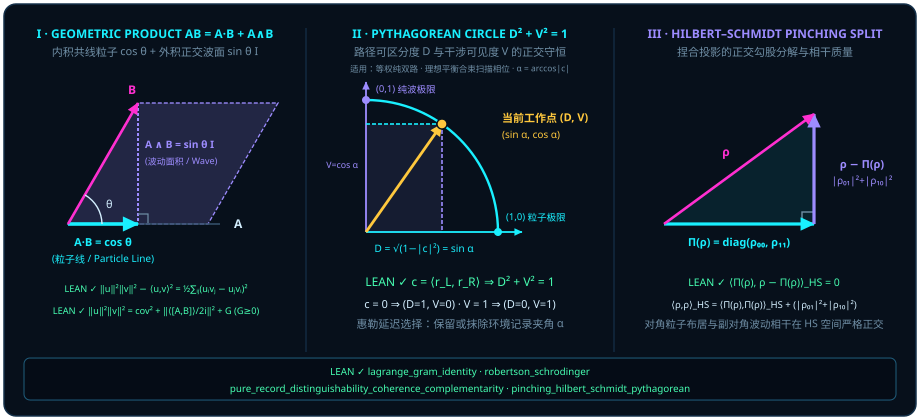

# Chapter 6 The Geometric Product $\vv{A}\vv{B} = \vv{A}\cdot\vv{B} + \vv{A}\wedge\vv{B}$: The Ultimate Suture of Wave-Particle Duality {#ch06-geometric-product}

As the author of this monograph observes:

> *"Area is the wave and the particle is the line; if both the line and the area are projections of a single state, that looks like a remarkably clean explanation of wave–particle duality."*
>
> *"Then area and line, wave and particle, are in essence a single field."*

No conceptual wound in twentieth-century physics runs deeper than **wave–particle duality**. Electrons and photons sometimes behave like localized pellets that trigger a single detector click (particles), and at other times behave like extended ripples that paint bright and dark interference fringes across a screen (waves). Niels Bohr elevated this tension into his principle of *complementarity*, declaring that wave and particle are mutually exclusive classical pictures that can never be beheld within a single unified geometric frame.

Look back, however, from the orthogonal ladder we have already climbed: in Part I ([Chapter 1](ch01-measurement.md) through [Chapter 4](ch04-decoherence.md)) we proved that **particle counting stems from the pairwise inner product** $\vv{A}\cdot\vv{B} = \cos\theta$, while in [Chapter 5](ch05-complex-phase-and-rotors.md) we proved that **wave phase rotation stems from the pairwise exterior bivector area** $\vv{A}\wedge\vv{B} = \sin\theta\,\vv{I}$. If "the particle is the line and the area is the wave," why did standard linear algebra sever a single relational comparison into two disconnected operations — the scalar dot product and the exterior wedge/cross product?

This chapter achieves the central synthesis of Part II: **we suture the inner product and the exterior product back into a single unified operation — Clifford's geometric product**:

$$
\vv{A}\vv{B} = \vv{A}\cdot\vv{B} + \vv{A}\wedge\vv{B} = \cos\theta + \sin\theta\,\vv{I}!
$$

Before this six-symbol identity, wave–particle duality, the Robertson–Schrödinger uncertainty relation, double-slit interference, Wheeler's delayed-choice experiment, and the five disconnected postulates of textbook quantum mechanics all collapse into a single elementary geometric law: **Pythagorean conservation $\cos^2\theta + \sin^2\theta = 1$ between the cosine particle line and the sine wave area**.

## 6.1 Why Is the Inner Product $\vv{A}\cdot\vv{B}$ the "Particle" and the Exterior Product $\vv{A}\wedge\vv{B}$ the "Wave"? {#sec-inner-particle-outer-wave}

Follow the author's intuition as we place the meeting of two quantum states under a geometric magnifying glass:

> *"A quantum state itself — a directional vector on an isotropic sphere — should already be something particle-like. And there will also be a corresponding wave-like counterpart."*

When two unit rays $\vv{A}$ and $\vv{B}$ ($\|\vv{A}\| = \|\vv{B}\| = 1$, separated by angle $\theta$) meet on the sphere, their complete relational geometry splits into two orthogonal parts and nothing more:

1. **The symmetric collinear part — the inner product $\vv{A}\cdot\vv{B} := \frac{1}{2}(\vv{A}\vv{B} + \vv{B}\vv{A}) = \cos\theta$ (Particle / Line)**:
   It measures the **collinear shadow length** cast by $\vv{B}$ along the reference axis $\vv{A}$ (the endogenous compatibility vector $\vv{c} = (\vv{A}\cdot\vv{B})\vv{A}$ of [Chapter 2](ch02-born-rule.md)). It changes no direction; it simply reports how much of $\vv{B}$ aligns with the ruler $\vv{A}$, condensing under idempotent projection $P_{\vv{A}}^2 = P_{\vv{A}}$ into a repeatable detector click ([Chapter 3](ch03-projectors-and-duality.md)). **That is the exact algebraic meaning of "the particle is the line": particle nature is the grade-0 scalar (collinear projection) component of the geometric product.**
2. **The antisymmetric orthogonal part — the exterior product $\vv{A}\wedge\vv{B} := \frac{1}{2}(\vv{A}\vv{B} - \vv{B}\vv{A}) = \sin\theta\,\vv{I}$ (Wave / Area)**:
   It measures the **oriented parallelogram area** spanned by $\vv{B}$ perpendicular to $\vv{A}$. Because swapping the order reverses orientation ($\vv{B}\wedge\vv{A} = -\vv{A}\wedge\vv{B}$), it naturally carries signed phase coherence and the planar rotation generator $\vv{I}^2 = -1$ ([Chapter 5](ch05-complex-phase-and-rotors.md)), governing interference between paths and unitary gate rotations. **That is the exact algebraic meaning of "area is the wave": wave nature is the grade-2 bivector (orthogonal wedge area) component of the geometric product.**

Adding the symmetric collinear particle part and the antisymmetric orthogonal wave part recovers the **geometric product** introduced by Clifford in 1878:

$$
\vv{A}\vv{B} = \underbrace{\frac{\vv{A}\vv{B} + \vv{B}\vv{A}}{2}}_{\vv{A}\cdot\vv{B}\text{ (collinear particle scalar)}} + \underbrace{\frac{\vv{A}\vv{B} - \vv{B}\vv{A}}{2}}_{\vv{A}\wedge\vv{B}\text{ (orthogonal wave bivector)}}.
$$

Why does the author remark, *"Then area and line, wave and particle, are in essence a single field"*? Because no inner-product line exists in isolation from its exterior wedge area, and no wedge area floats free of its inner-product line — they are simply **the grade-0 scalar slice and the grade-2 bivector slice of one and the same multivector field $\vv{A}\vv{B}$**! Read out diagonal populations alone, and you see the cosine line $\cos\theta$; recombine two branches in an interferometer, and you see the sine bivector area $\sin\theta\,\vv{I}$.

Even better, this single geometric product unifies the **five textbook postulates** of quantum mechanics into a single coherent table:

| The Five Textbook Postulates | Zero-Redundancy Geometric Reconstruction | Kernel-Verified Theorems & Chapters |
| :--- | :--- | :--- |
| **Postulate 1: State Space** (Pure states are rays in a complex Hilbert space) | Quotienting invisible global phase $U(1)$ turns a single-qubit pure state into a real unit ray $\vv{a} \in S^2$, and a mixed state into a truncated interior chord $\norm{\vv{r}} \le 1$ | [@thm-ray-phase-rigidity], [@prop-qubit-bloch-core] ([Chapter 1](ch01-measurement.md)) |
| **Postulate 2: Observables** (Physical quantities are Hermitian operators $A^* = A$) | Every sharp yes/no question is an idempotent line $P^2 = P = P^*$; every rotation plane $J^2 = -I$ multiplied by $i$ is dual to a Hermitian involution axis $(iJ)^* = iJ$ | [@def-record-measurement] ([Chapter 3](ch03-projectors-and-duality.md)), [@thm-relative-complex-structure-square] ([Chapter 5](ch05-complex-phase-and-rotors.md)) |
| **Postulate 3: Born's Rule** (Measurement probability $p = \Tr(\rho P) = |\langle\phi\mid\psi\rangle|^2$) | Eliminating the external point $C$ and taking $\vv{A}$ itself as basis extracts the inner-product projection $\vv{A}\cdot\vv{B} = \cos\theta$ ($\cos^2(\theta/2)$ in Hilbert half-angle) | [@thm-born-modulus-square], [@thm-rank-one-born-pairing] ([Chapter 2](ch02-born-rule.md)) |
| **Postulate 4: Unitary Evolution** (Quantum gates & Schrödinger flow $\rho \mapsto U\rho U^*$) | Two-sided rigid rotation by the Clifford rotor $R(\theta) = \exp(-\vv{B}\theta/2)$ generated by the exterior bivector area $\vv{A}\wedge\vv{B} = \sin\theta\,\vv{I}$ | [@thm-balanced-sum-skew-adjoint] ([Chapter 5](ch05-complex-phase-and-rotors.md)), [@thm-calibrated-unitary-group] ([Chapter 7](ch07-geometric-time-and-speed-limits.md)) |
| **Postulate 5: Projective Collapse & Decoherence** (State update upon measurement) | Partial trace over an orthogonally coupled environment register performs an orthogonal Hilbert–Schmidt pinching projection $\Pi(\rho)$, discarding transverse bivector coherence | [@thm-nonselective-marginal] ([Chapter 4](ch04-decoherence.md)), [@cor-pinching-pythagorean] (this chapter) |

## 6.2 Pythagorean Conservation $\cos^2\theta + \sin^2\theta = 1$: The Trade-Off Between Particle Certainty and Wave Interference Area {#sec-pythagorean-complementarity}

If the geometric product $\vv{A}\vv{B}$ houses both the particle inner product $\vv{A}\cdot\vv{B}$ and the wave exterior product $\vv{A}\wedge\vv{B}$, what quantitative conservation law binds the two halves together?

In finite-dimensional real Euclidean space $\mathbb{R}^n$, take any two vectors $\vv{u} = (u_i)_{i \in s}$ and $\vv{v} = (v_i)_{i \in s}$. Subtract the squared inner product $(\vv{u}\cdot\vv{v})^2$ from the product of their squared norms $\|\vv{u}\|^2\|\vv{v}\|^2$. What remains? Lagrange's classic algebraic identity reveals that the difference equals one-half the sum of squares of all $2\times 2$ oriented area determinants $u_i v_j - u_j v_i$ across every coordinate plane $(i, j)$ — which is literally the squared norm $\|\vv{u}\wedge\vv{v}\|^2$ of the exterior bivector!

In the Lean module `QuantumBounds/LagrangeGramIdentity`, this foundational bridge between inner-product lines and exterior-product areas is verified for any finite index set $s : \mathrm{Finset}\,\iota$.

::: {.theorem #thm-lagrange-gram-identity title="Lagrange–Gram Identity Relating Inner-Product Square and Exterior Bivector Area Square" lean="D5/S3/QuantumBounds/LagrangeGramIdentity.lagrange_gram_identity"}
Let $\iota$ be an index type, let $s : \mathrm{Finset}\,\iota$ be a finite index set, and let $u, v : \iota \to \mathbb{R}$ be real-valued functions. Then the product of their squared norms minus the square of their inner product equals one-half the double sum of squared $2\times 2$ exterior determinants $(u_i v_j - u_j v_i)^2$:

$$
\left(\sum_{i \in s} u_i^2\right)\left(\sum_{i \in s} v_i^2\right) - \left(\sum_{i \in s} u_i v_i\right)^2 = \frac{1}{2}\sum_{i \in s}\sum_{j \in s} (u_i v_j - u_j v_i)^2.
$$
:::

::: proof
Expand each summand $(u_i v_j - u_j v_i)^2 = u_i^2 v_j^2 - 2 u_i v_i u_j v_j + u_j^2 v_i^2$ inside the double sum over $i, j \in s$ and split by linearity into three double sums. Both $\sum_{i \in s}\sum_{j \in s} u_i^2 v_j^2$ and $\sum_{i \in s}\sum_{j \in s} u_j^2 v_i^2$ factor into $\bigl(\sum_{i \in s} u_i^2\bigr)\bigl(\sum_{i \in s} v_i^2\bigr)$, while the middle cross-term $-2\sum_{i \in s}\sum_{j \in s} (u_i v_i)(u_j v_j)$ factors into $-2\bigl(\sum_{i \in s} u_i v_i\bigr)^2$. Summing the three pieces and dividing by $2$ yields $\bigl(\sum_{i \in s} u_i^2\bigr)\bigl(\sum_{i \in s} v_i^2\bigr) - \bigl(\sum_{i \in s} u_i v_i\bigr)^2$. The full proof is checked by the Lean kernel.
:::

Look at what [@thm-lagrange-gram-identity] says when rearranged:

$$
\underbrace{\|\vv{u}\|^2 \|\vv{v}\|^2}_{\text{total geometric capacity}} = \underbrace{(\vv{u}\cdot\vv{v})^2}_{\text{squared particle inner projection}} + \underbrace{\frac{1}{2}\sum_{i, j} (u_i v_j - u_j v_i)^2}_{\|\vv{u}\wedge\vv{v}\|^2\text{ (squared wave wedge area)}}!
$$

For unit vectors ($\|\vv{u}\| = \|\vv{v}\| = 1$), this is literally $\cos^2\theta + \sin^2\theta = 1$; and because the sum of squares $\|\vv{u}\wedge\vv{v}\|^2 \ge 0$ on the right is manifestly nonnegative, dropping it immediately yields the Cauchy–Schwarz inequality $(\vv{u}\cdot\vv{v})^2 \le \|\vv{u}\|^2\|\vv{v}\|^2$ — **the nonnegative "slack" in the Cauchy–Schwarz inequality is nothing other than the squared exterior bivector area $\|\vv{u}\wedge\vv{v}\|^2$!**

Now lift this exact Lagrange–Gram decomposition into a complex inner-product space $E$ (Lean module `QuantumBounds/RobertsonSchrodinger`). For any two vectors $u, v \in E$, the helper theorem [`gram_wedge_identity`](lean:D5/S3/QuantumBounds/RobertsonSchrodinger.gram_wedge_identity) proves that the product of squared norms splits into the squared modulus of the complex inner product plus a nonnegative Gram wedge defect $G := \|u\|^2\|v\|^2 - \|\langle u, v\rangle_{\mathbb{C}}\|^2 \ge 0$:

$$
\|u\|^2\|v\|^2 = \|\langle u, v\rangle_{\mathbb{C}}\|^2 + G, \qquad G \ge 0.
$$

Inside the complex inner product $\langle u, v\rangle_{\mathbb{C}} = \operatorname{Re}\langle u, v\rangle_{\mathbb{C}} + i\operatorname{Im}\langle u, v\rangle_{\mathbb{C}}$, what do the real and imaginary parts represent when $u = A\psi - \langle\psi, A\psi\rangle_{\mathbb{C}}\psi$ and $v = B\psi - \langle\psi, B\psi\rangle_{\mathbb{C}}\psi$ are the centered fluctuation vectors of two symmetric observables $A, B : E \to_l E$ in a unit state $\psi \in E$ ($\|\psi\| = 1$)?

- The **real part** $\operatorname{Re}\langle u, v\rangle_{\mathbb{C}}$ is the symmetrized **quantum covariance** $\operatorname{cov}(A, B)_\psi = \frac{1}{2}\operatorname{Re}\langle\psi, (AB + BA)\psi\rangle_{\mathbb{C}} - \operatorname{Re}\langle\psi, A\psi\rangle_{\mathbb{C}}\operatorname{Re}\langle\psi, B\psi\rangle_{\mathbb{C}}$;
- The **imaginary part** $\operatorname{Im}\langle u, v\rangle_{\mathbb{C}}$ is the oriented bivector area generated by the **commutator** $\frac{1}{2i}\langle\psi, (AB - BA)\psi\rangle_{\mathbb{C}}$!

Combining $\|\langle u, v\rangle_{\mathbb{C}}\|^2 = (\operatorname{Re}\langle u, v\rangle_{\mathbb{C}})^2 + (\operatorname{Im}\langle u, v\rangle_{\mathbb{C}})^2$ with $G \ge 0$ yields the exact **Robertson–Schrödinger uncertainty identity**!

::: {.theorem #thm-robertson-schrodinger title="Robertson–Schrödinger Exact Conservation of Variance, Covariance, Commutator Area, and Gram Defect" lean="D5/S3/QuantumBounds/RobertsonSchrodinger.robertson_schrodinger"}
Let $E$ be a complex inner-product space, let $A, B : E \to_l E$ be symmetric linear operators ($\forall x, y \in E,\, \langle Ax, y\rangle_{\mathbb{C}} = \langle x, Ay\rangle_{\mathbb{C}}$ and $\langle Bx, y\rangle_{\mathbb{C}} = \langle x, By\rangle_{\mathbb{C}}$), and let $\psi \in E$ be a unit state vector ($\|\psi\| = 1$). Define the centered fluctuation vectors, symmetrized covariance, half-commutator expectation, and Gram wedge defect by

$$
\begin{aligned}
u &:= A\psi - \langle\psi, A\psi\rangle_{\mathbb{C}}\psi, \qquad v := B\psi - \langle\psi, B\psi\rangle_{\mathbb{C}}\psi, \\
\mathrm{cov} &:= \frac{1}{2}\operatorname{Re}\bigl\langle\psi, (AB + BA)\psi\bigr\rangle_{\mathbb{C}} - \operatorname{Re}\langle\psi, A\psi\rangle_{\mathbb{C}}\operatorname{Re}\langle\psi, B\psi\rangle_{\mathbb{C}} \in \mathbb{R}, \\
C_{1/2} &:= \frac{1}{2i}\bigl\langle\psi, (AB - BA)\psi\bigr\rangle_{\mathbb{C}} \in \mathbb{C}, \\
G &:= \|u\|^2\|v\|^2 - \|\langle u, v\rangle_{\mathbb{C}}\|^2 \in \mathbb{R}.
\end{aligned}
$$

Then all three statements hold:

1. **Four-term Pythagorean conservation**: $\|u\|^2\|v\|^2 = \mathrm{cov}^2 + \|C_{1/2}\|^2 + G$;
2. **Nonnegativity of the Gram defect**: $G \ge 0$ ([`gram_wedge_identity`](lean:D5/S3/QuantumBounds/RobertsonSchrodinger.gram_wedge_identity));
3. **Exact identification of real and imaginary inner-product components**: $\operatorname{Re}\langle u, v\rangle_{\mathbb{C}} = \mathrm{cov}$ and $(\operatorname{Im}\langle u, v\rangle_{\mathbb{C}} : \mathbb{C}) = C_{1/2}$.
:::

::: proof
First expand $\langle u, v\rangle_{\mathbb{C}}$. Symmetry of $A$ and $B$ implies $\langle\psi, A\psi\rangle_{\mathbb{C}} = \overline{\langle\psi, A\psi\rangle_{\mathbb{C}}}$, so both expectation values $\langle\psi, A\psi\rangle_{\mathbb{C}}$ and $\langle\psi, B\psi\rangle_{\mathbb{C}}$ are real; using $\|\psi\| = 1$ ($\langle\psi, \psi\rangle_{\mathbb{C}} = 1$) to expand $\langle A\psi - \langle\psi, A\psi\rangle_{\mathbb{C}}\psi,\, B\psi - \langle\psi, B\psi\rangle_{\mathbb{C}}\psi\rangle_{\mathbb{C}}$ simplifies the cross-terms to

$$
\langle u, v\rangle_{\mathbb{C}} = \langle A\psi, B\psi\rangle_{\mathbb{C}} - \operatorname{Re}\langle\psi, A\psi\rangle_{\mathbb{C}}\operatorname{Re}\langle\psi, B\psi\rangle_{\mathbb{C}}.
$$

By operator symmetry, $\langle A\psi, B\psi\rangle_{\mathbb{C}} = \langle\psi, AB\psi\rangle_{\mathbb{C}}$ and $\overline{\langle A\psi, B\psi\rangle_{\mathbb{C}}} = \langle B\psi, A\psi\rangle_{\mathbb{C}} = \langle\psi, BA\psi\rangle_{\mathbb{C}}$. Splitting $z = \langle\psi, AB\psi\rangle_{\mathbb{C}}$ into $\operatorname{Re} z = \frac{1}{2}\operatorname{Re}(z + \overline{z})$ and $(\operatorname{Im} z : \mathbb{C}) = \frac{z - \overline{z}}{2i}$ establishes $\operatorname{Re}\langle u, v\rangle_{\mathbb{C}} = \mathrm{cov}$ and $(\operatorname{Im}\langle u, v\rangle_{\mathbb{C}} : \mathbb{C}) = C_{1/2}$ (claim 3). Consequently $\|\langle u, v\rangle_{\mathbb{C}}\|^2 = (\operatorname{Re}\langle u, v\rangle_{\mathbb{C}})^2 + (\operatorname{Im}\langle u, v\rangle_{\mathbb{C}})^2 = \mathrm{cov}^2 + \|C_{1/2}\|^2$. Combining this with $\|u\|^2\|v\|^2 = \|\langle u, v\rangle_{\mathbb{C}}\|^2 + G$ and $G \ge 0$ from [`gram_wedge_identity`](lean:D5/S3/QuantumBounds/RobertsonSchrodinger.gram_wedge_identity) (by Cauchy–Schwarz $\|\langle u, v\rangle_{\mathbb{C}}\| \le \|u\|\|v\|$) proves claims 1 and 2. The full proof is checked by the Lean kernel.
:::

[@thm-robertson-schrodinger] strips away every trace of mysticism from Heisenberg–Robertson uncertainty: the variance product $\Delta A^2\,\Delta B^2 = \|u\|^2\|v\|^2$ is the sum of three nonnegative squares $\mathrm{cov}^2 + \|C_{1/2}\|^2 + G$, so whenever the noncommuting bivector area $\|C_{1/2}\|^2 = \frac{1}{4}|\langle[A, B]\rangle|^2$ is nonzero, the fluctuation product can never drop below that area!

[@thm-robertson-schrodinger] assumes a unit vector $\psi$, that is, a pure state. After [Chapter 4](ch04-decoherence.md), the mixed states near the centre of the ball are equally legitimate states. Does the uncertainty relation survive there? It does, and its proof is still one Cauchy–Schwarz inequality: replace the state vector $\psi$ by the matrix $\sqrt{\rho}$ and the inner product of vectors by the Hilbert–Schmidt inner product of matrices. The module `D5/S3/QuantumBounds/Designs/MixedStateRobertson` at the pinned commit freezes this statement.

::: {.theorem #thm-mixed-state-robertson title="The Robertson Uncertainty Relation for Mixed States" lean="D5/S3/QuantumBounds/Designs/MixedStateRobertson.mixed_state_robertson_uncertainty"}
Let $d$ be a finite index type (`[Fintype d]`, `[DecidableEq d]`), let $\rho$ be a density state on $d$ (`DensityState d`: a positive semidefinite $d \times d$ complex matrix of trace $1$), and let $A, B$ be Hermitian $d \times d$ complex matrices (`A.IsHermitian`, `B.IsHermitian`). Write $\sqrt{\rho}$ for the positive semidefinite square root of $\rho$ (`CFC.sqrt`) and set

$$
u := \bigl(A - \Tr(\rho A)\cdot 1\bigr)\sqrt{\rho}, \qquad v := \bigl(B - \Tr(\rho B)\cdot 1\bigr)\sqrt{\rho} .
$$

With matrices measured in the Hilbert–Schmidt norm $\norm{X} = \sqrt{\Tr(X^{\dagger}X)}$ (induced in the Lean module by the inner product $\langle X, Y\rangle = \Tr(X^{\dagger}Y)$),

$$
\norm{u}\,\norm{v} \;\ge\; \frac{1}{2}\,\bigl\lvert \Tr\bigl(\rho\,(AB - BA)\bigr) \bigr\rvert .
$$
:::

::: proof
Put $a = \Tr(\rho A)$ and $b = \Tr(\rho B)$; these are real because $A, B$ are Hermitian and $\rho$ is positive semidefinite. By cyclicity of the trace, $\langle u, v\rangle = \Tr\bigl(\sqrt{\rho}\,(A - a)(B - b)\sqrt{\rho}\bigr) = \Tr\bigl(\rho\,(A - a)(B - b)\bigr)$, and likewise $\langle v, u\rangle = \Tr\bigl(\rho\,(B - b)(A - a)\bigr)$. Subtracting, all constant terms cancel: $\langle u, v\rangle - \langle v, u\rangle = \Tr\bigl(\rho\,(AB - BA)\bigr)$. Since $\langle v, u\rangle = \overline{\langle u, v\rangle}$, the left-hand side equals $2i\operatorname{Im}\langle u, v\rangle$. Therefore $\frac{1}{2}\lvert\Tr(\rho\,(AB - BA))\rvert = \lvert\operatorname{Im}\langle u, v\rangle\rvert \le \lvert\langle u, v\rangle\rvert \le \norm{u}\,\norm{v}$, the last step being the Cauchy–Schwarz inequality. The full proof is checked by the Lean kernel.
:::

The quantity $\norm{u}$ in the theorem is the standard deviation. Again by cyclicity of the trace (a one-line manual derivation),

$$
\norm{u}^2 \;=\; \Tr\bigl(\sqrt{\rho}\,(A - a)^2\sqrt{\rho}\bigr) \;=\; \Tr\bigl(\rho\,(A - a)^2\bigr) \;=\; \Tr(\rho A^2) - \Tr(\rho A)^2 \;=\; \sigma_A^2 ,
$$

so [@thm-mixed-state-robertson] reads $\sigma_A\,\sigma_B \ge \frac{1}{2}\lvert\langle[A, B]\rangle_\rho\rvert$, the same form as for pure states. The difference hides in the slack: once the state is mixed, by how much does the inequality loosen? For one qubit the answer can be computed in full.

::: {.example #ex-mixed-qubit-robertson-slack title="A Mixed Qubit: the Slack of the Inequality Is Exactly Mixedness Plus Squared Covariance"}
Take the qubit state $\rho = \frac{1}{2}(I + r_x\sigma_x + r_y\sigma_y + r_z\sigma_z)$ with Bloch vector $\vv{r} = (r_x, r_y, r_z)$, $\norm{\vv{r}} \le 1$, together with $A = \sigma_x$ and $B = \sigma_y$.

**Three quantities.** From $\sigma_x^2 = I$ and $\Tr(\rho\,\sigma_x) = r_x$: $\sigma_A^2 = 1 - r_x^2$, and likewise $\sigma_B^2 = 1 - r_y^2$. From $\sigma_x\sigma_y - \sigma_y\sigma_x = 2i\sigma_z$: $\frac{1}{2}\lvert\Tr(\rho\,(AB - BA))\rvert = \lvert r_z\rvert$. In this case [@thm-mixed-state-robertson] asserts

$$
\sqrt{(1 - r_x^2)(1 - r_y^2)} \;\ge\; \lvert r_z\rvert .
$$

**The slack identity.** Squaring both sides, subtracting and expanding (a manual derivation):

$$
(1 - r_x^2)(1 - r_y^2) - r_z^2 \;=\; \bigl(1 - \norm{\vv{r}}^2\bigr) \;+\; r_x^2\,r_y^2 .
$$

Both terms on the right are nonnegative, which proves the inequality once more, and each has a meaning:

- $r_x^2 r_y^2$ is the squared covariance. Since $\sigma_x\sigma_y + \sigma_y\sigma_x = 0$, the symmetrized covariance is $\frac{1}{2}\langle AB + BA\rangle - \langle A\rangle\langle B\rangle = -r_x r_y$. This term is already present for pure states; it is the $\mathrm{cov}^2$ of [@thm-robertson-schrodinger].
- $1 - \norm{\vv{r}}^2 = 2\bigl(1 - \Tr(\rho^2)\bigr)$ is the mixedness, and it is exactly the Gram defect $\norm{u}^2\norm{v}^2 - \lvert\langle u, v\rangle\rvert^2$ of the two matrices $u, v$. For a pure state it vanishes: the two fluctuation vectors of a pure qubit both lie in the one-dimensional subspace orthogonal to $\psi$ and are therefore parallel. The further the state is from the sphere, the larger this term.

**Numerical table.** Each row was cross-checked by computing $u$, $v$ and both sides directly with $2 \times 2$ matrices; values are rounded to the digits shown:

| $\vv{r}$ | $\sigma_A\sigma_B$ | $\lvert r_z\rvert$ | $1 - \norm{\vv{r}}^2$ | $r_x^2 r_y^2$ | $(\sigma_A\sigma_B)^2 - r_z^2$ |
| :---: | :---: | :---: | :---: | :---: | :---: |
| $(0, 0, 1)$ | $1$ | $1$ | $0$ | $0$ | $0$ |
| $(0.6, 0, 0.8)$ | $0.8$ | $0.8$ | $0$ | $0$ | $0$ |
| $\frac{1}{\sqrt{3}}(1, 1, 1)$ | $0.6667$ | $0.5774$ | $0$ | $0.1111$ | $0.1111$ |
| $(0, 0, 0.6)$ | $1$ | $0.6$ | $0.64$ | $0$ | $0.64$ |
| $(0.5, 0.5, 0.5)$ | $0.75$ | $0.5$ | $0.25$ | $0.0625$ | $0.3125$ |
| $(0, 0, 0)$ | $1$ | $0$ | $1$ | $0$ | $1$ |

The first three rows are pure states: the slack comes from the covariance alone, and the first two rows attain equality. The last three rows are mixed states: in the fourth row the state has moved inward along the $z$ axis, the commutator expectation has dropped from $1$ to $0.6$, and the product of the two standard deviations is still $1$; the last row is the centre of the ball, where the commutator expectation vanishes and the inequality becomes $1 \ge 0$.
:::

On the sphere the uncertainty relation can be attained. Toward the centre the variances do not shrink, while the commutator expectation shortens together with $r_z$; the gap between the two is filled exactly by the mixedness.

## 6.3 Pure Geometric Dissection of Double-Slit Interference and Wheeler's Delayed Choice: Discarding or Preserving the Area? {#sec-double-slit-delayed-choice}

Equipped with this Pythagorean decomposition, let us step into the **double-slit experiment** and John Archibald Wheeler's **delayed-choice thought experiment**.

When a quantum passes through a left path $\lvert L\rangle$ and a right path $\lvert R\rangle$ while an environmental register (or which-way detector) couples to the two paths, the left branch prepares a unit environmental record vector $r_L \in E$ ($\|r_L\| = 1$) and the right branch prepares a unit environmental record vector $r_R \in E$ ($\|r_R\| = 1$).

Examine the complex overlap $c := \langle r_L, r_R\rangle_{\mathbb{C}}$ between the two environmental record arrows:

- **Coherence visibility** $V := \|c\| = |\langle r_L, r_R\rangle_{\mathbb{C}}| = \cos\alpha \in [0, 1]$ is the **inner-product cosine** measuring how collinear the two environmental records remain;
- **Record distinguishability** $D := \sqrt{1 - V^2} = \sin\alpha \in [0, 1]$ is the **exterior-product sine area** measuring how orthogonally separated the two records are!

In the Lean module `Quantum/PureState/RecordCoherenceComplementarity`, the following theorem proves the exact Pythagorean conservation law $D^2 + V^2 = 1$ together with the extreme particle and wave endpoints.

::: {.theorem #thm-record-coherence-complementarity title="Pythagorean Complementarity Between Pure-State Record Distinguishability and Coherence Visibility" lean="D5/S3/Quantum/PureState/RecordCoherenceComplementarity.pure_record_distinguishability_coherence_complementarity"}
Let $E$ be a complex inner-product space, and let $r_L, r_R \in E$ be unit environmental record states ($\|r_L\| = 1$ and $\|r_R\| = 1$). Define the record overlap, coherence visibility, and record distinguishability by

$$
c := \langle r_L, r_R\rangle_{\mathbb{C}} \in \mathbb{C}, \qquad V := \|c\| \in \mathbb{R}, \qquad D := \sqrt{1 - V^2} \in \mathbb{R}.
$$

Then all five complementarity statements hold:

1. **Exact Pythagorean circle**: $D^2 + V^2 = 1$;
2. **Orthogonal records yield the pure-particle limit**: if $c = 0$, then $D = 1$ and $V = 0$;
3. **Collinear records yield the pure-wave limit**: if $V = 1$, then $D = 0$ and $V = 1$;
4. **Full path distinguishability annihilates interference**: if $D = 1$, then $V = 0$ and $\forall a \in \mathbb{C},\, c \cdot a = 0$;
5. **Full fringe visibility precludes path distinguishability**: if $V = 1$, then $D = 0$.
:::

::: proof
By the Cauchy–Schwarz inequality and $\|r_L\| = \|r_R\| = 1$, we have $0 \le V = \|\langle r_L, r_R\rangle_{\mathbb{C}}\| \le \|r_L\|\|r_R\| = 1$, so $1 - V^2 \ge 0$. Squaring $D = \sqrt{1 - V^2}$ gives $D^2 = 1 - V^2$, hence $D^2 + V^2 = 1$ (claim 1). If $c = 0$, then $V = \|0\| = 0$ and $D = \sqrt{1 - 0} = 1$ (claim 2). If $V = 1$, then $D = \sqrt{1 - 1^2} = 0$ (claims 3 and 5). Conversely, if $D = 1$, then claim 1 implies $1 + V^2 = 1$, so $V^2 = 0 \implies V = \|c\| = 0 \implies c = 0$, whence $c \cdot a = 0 \cdot a = 0$ for every $a \in \mathbb{C}$ (claim 4). The full proof is checked by the Lean kernel.
:::

Simultaneously, on the $2\times 2$ qubit density matrix $\rho \in M_2(\mathbb{C})$ (recalling [@thm-pinching-pythagorean] from [Chapter 4](ch04-decoherence.md)), standard-basis pinching $\Pi(\rho)$ ([`pinching`](lean:D5/S3/QuantumChannels/Pinching.pinching)) decomposes $\rho$ into a diagonal particle part $\Pi(\rho)$ and an off-diagonal wave residual $\rho - \Pi(\rho)$ that are strictly orthogonal under the Hilbert–Schmidt inner product ([`hilbertSchmidtInner`](lean:D5/S3/QuantumChannels/Pinching.hilbertSchmidtInner), [`pinching_hilbert_schmidt_orthogonal`](lean:D5/S3/QuantumChannels/PinchingProjection.pinching_hilbert_schmidt_orthogonal)):

::: {.corollary #cor-pinching-pythagorean title="Hilbert–Schmidt Orthogonal Decomposition and Discarded Off-Diagonal Coherence Mass Under Qubit Pinching" lean="D5/S3/QuantumChannels/PinchingProjection.pinching_hilbert_schmidt_pythagorean D5/S3/QuantumChannels/PinchingProjection.pinching_discarded_coherence_mass"}
For every $2\times 2$ qubit matrix $\rho \in M_2(\mathbb{C})$ and the diagonal pinching projection $\Pi(\rho)_{ij} = \delta_{ij}\rho_{ij}$ ([`pinching`](lean:D5/S3/QuantumChannels/Pinching.pinching)), the diagonal part $\Pi(\rho)$ and the off-diagonal residual $\rho - \Pi(\rho)$ are orthogonal with respect to the Hilbert–Schmidt inner product $\langle X, Y\rangle_{\mathrm{HS}} = \Tr(X^* Y)$ ($\langle \Pi(\rho),\, \rho - \Pi(\rho)\rangle_{\mathrm{HS}} = 0$, [`pinching_hilbert_schmidt_orthogonal`](lean:D5/S3/QuantumChannels/PinchingProjection.pinching_hilbert_schmidt_orthogonal)), yielding the Pythagorean identity

$$
\langle \rho, \rho\rangle_{\mathrm{HS}} = \langle \Pi(\rho), \Pi(\rho)\rangle_{\mathrm{HS}} + \langle \rho - \Pi(\rho),\, \rho - \Pi(\rho)\rangle_{\mathrm{HS}},
$$

with discarded off-diagonal coherence mass

$$
\langle \rho - \Pi(\rho),\, \rho - \Pi(\rho)\rangle_{\mathrm{HS}} = |\rho_{01}|^2 + |\rho_{10}|^2.
$$
:::

::: proof
By [`pinching_hilbert_schmidt_orthogonal`](lean:D5/S3/QuantumChannels/PinchingProjection.pinching_hilbert_schmidt_orthogonal), the cross-terms $\langle \Pi(\rho),\, \rho - \Pi(\rho)\rangle_{\mathrm{HS}} = 0$ and $\langle \rho - \Pi(\rho),\, \Pi(\rho)\rangle_{\mathrm{HS}} = 0$ vanish, so expanding $\langle \Pi(\rho) + (\rho - \Pi(\rho)),\, \Pi(\rho) + (\rho - \Pi(\rho))\rangle_{\mathrm{HS}}$ yields the Pythagorean split. Evaluating $\Tr((\rho - \Pi(\rho))^*(\rho - \Pi(\rho)))$ on the $2\times 2$ off-diagonal matrix $\rho - \Pi(\rho) = \bigl(\begin{smallmatrix} 0 & \rho_{01} \\ \rho_{10} & 0 \end{smallmatrix}\bigr)$ gives $|\rho_{01}|^2 + |\rho_{10}|^2$. The full proof is checked by the Lean kernel.
:::

With [@thm-record-coherence-complementarity] and [@cor-pinching-pythagorean] in hand, Wheeler's delayed-choice experiment loses all retrocausal mystery:

::: {.example #ex-wheeler-delayed-choice-tradeoff title="Quantitative Ledger of a Two-Path Interferometer and Wheeler's Delayed Choice at α = 0, π/3, π/2"}
Consider a two-path interferometer preparing the joint state $\frac{1}{\sqrt{2}}(\lvert 0\rangle\otimes\lvert r_L\rangle + \lvert 1\rangle\otimes\lvert r_R\rangle)$ where the unit environmental record states meet at angle $\alpha \in [0, \pi/2]$ with overlap $c = \langle r_L, r_R\rangle = \cos\alpha$. Tracing out the environment leaves the reduced qubit density matrix

$$
\rho(\alpha) = \frac{1}{2}\begin{pmatrix} 1 & \cos\alpha \\ \cos\alpha & 1 \end{pmatrix}.
$$

Evaluating [@thm-record-coherence-complementarity] and [@cor-pinching-pythagorean] across three representative angles $\alpha = 0, \pi/3, \pi/2$ gives the exact trade-off between path distinguishability $D$, fringe visibility $V$, and off-diagonal coherence mass $|\rho_{01}|^2 + |\rho_{10}|^2 = \frac{1}{2}\cos^2\alpha$:

| Record Angle $\alpha$ | Overlap $c = \cos\alpha$ | Visibility $V$ | Distinguishability $D = \sin\alpha$ | Check $D^2 + V^2$ | Off-Diagonal Mass $|\rho_{01}|^2 + |\rho_{10}|^2$ | Physical Regime (Delayed Choice) |
| :---: | :---: | :---: | :---: | :---: | :---: | :--- |
| **$\alpha = 0$** (Quantum eraser / beam combiner) | $1$ | $1$ | $0$ | $0 + 1 = 1$ | $\frac{1}{4} + \frac{1}{4} = \frac{1}{2}$ | Collinear records preserve $100\%$ of the 2D wave area |
| **$\alpha = \frac{\pi}{3} = 60^\circ$** (Partial tagging) | $\frac{1}{2}$ | $\frac{1}{2}$ | $\frac{\sqrt{3}}{2} \approx 0.866$ | $\frac{3}{4} + \frac{1}{4} = 1$ | $\frac{1}{16} + \frac{1}{16} = \frac{1}{8}$ | Partial wave–particle regime: $50\%$ fringes with $86.6\%$ path info |
| **$\alpha = \frac{\pi}{2} = 90^\circ$** (Orthogonal tagging) | $0$ | $0$ | $1$ | $1 + 0 = 1$ | $0$ ($\frac{1}{2}$ transferred to env prior to trace) | Orthogonal records pinch local state to $\frac{1}{2}I_2$; fringes vanish |

Nothing in Wheeler's delayed choice reaches backward in time: prior to the final measurement, the joint state $\frac{1}{\sqrt{2}}(\lvert 0\rangle\lvert r_L\rangle + \lvert 1\rangle\lvert r_R\rangle)$ is a single unified geometric-product field containing both diagonal populations and off-diagonal coherence blocks; choosing whether to read out orthogonal which-way records or recombine the beams at the exit port simply chooses **whether to project that field onto its diagonal particle line or preserve its transverse bivector area**!
:::

::: {.remark #rem-englert-greenberger-literature title="Wootters–Zurek, Greenberger–Yasin, and Englert Wave–Particle Duality Inequalities (Literature Result, Not Formalized in This Book)"}
**Literature result, not formalized in this book.** In this chapter, [@thm-record-coherence-complementarity] proves the exact pure-record equality $D^2 + V^2 = 1$ where $V = |\langle r_L, r_R\rangle|$ and $D = \sqrt{1 - V^2}$ is defined from the unit record overlap. In the interferometry literature, the historical development and mixed-state generalizations proceed through three landmarks:

1. **Wootters–Zurek double-slit information analysis (W. K. Wootters & W. H. Zurek, 1979)**: *Complementarity in the double-slit experiment: Quantum nonseparability and a quantitative statement of Bohr's principle* (Phys. Rev. D **19**, 473–484, 1979) first demonstrated quantitatively that substantial interference visibility survives alongside partial which-way information (as seen at $\alpha = \pi/3$ in [@ex-wheeler-delayed-choice-tradeoff], where $D \approx 86.6\%$ coexists with $V = 50\%$).
2. **Greenberger–Yasin predictability duality (D. M. Greenberger & A. Yasin, 1988) and Jaeger–Shimony–Vaidman (1995)**: For unbalanced prior path populations $p_0 \neq p_1$, the a priori predictability $P := |p_0 - p_1|$ and visibility $V = 2|\rho_{01}|$ obey $P^2 + V^2 \le 1$ (with equality for pure states, matching the Bloch-sphere identity $r_z^2 + (r_x^2 + r_y^2) = \|\vv{r}\|^2 \le 1$ derived from [@thm-complementary-pythagoras] in [Chapter 3](ch03-projectors-and-duality.md)).
3. **Englert's general mixed-environment inequality (B.-G. Englert, 1996)**: In *Fringe visibility and which-way information: An inequality* (Phys. Rev. Lett. **77**, 2154–2157, 1996), Englert defined unbiased path distinguishability independently for arbitrary mixed environmental states $\rho_L, \rho_R$ via the trace distance $D_{\mathrm{tr}} := \frac{1}{2}\Tr|\rho_L - \rho_R|$, proving that for any mixed initial environment state (derived in Englert's original 1996 paper via polar decomposition and the Cauchy–Schwarz inequality, and equivalently obtained in modern quantum information proofs via the Fuchs–van de Graaf trace-distance–fidelity bound)
   $$
   D_{\mathrm{tr}}^2 + V^2 \le 1,
   $$
   where when the interferometer paths have equal prior weights ($p_0 = p_1 = \frac{1}{2}$) and both the system state and the initial environment state are pure (as in the equal-prior pure-record model of [@thm-record-coherence-complementarity], where $\frac{1}{2}\Tr|\lvert r_L\rangle\langle r_L\rvert - \lvert r_R\rangle\langle r_R\rvert| = \sqrt{1 - |\langle r_L, r_R\rangle|^2} = D$), the inequality saturates to the exact unit circle $D_{\mathrm{tr}}^2 + V^2 = 1$; whereas for mixed states $D_{\mathrm{tr}}^2 + V^2 \le 1$ in general (noting that equality can also trivially occur for mixed environments when the conditional marking unitaries are identical so $D_{\mathrm{tr}} = 0, V = 1$).

Englert's trace-distance inequality for general mixed environmental states is cited from the physics literature and is not claimed in the book's Lean verification ledger.
:::

## 6.4 Interactive Laboratory: Hands-On Exploration of the Pairwise Geometric Product, Particle Inner Line, and Wave Wedge Area {#sec-interactive-qubit-geometry}

Experience this geometry directly in the interactive laboratory **`ORTHO//QUBIT` (Qubit Rotor Ledger)** below. Drag the polar angle $\theta$ and azimuth $\varphi$ of the initial state and the angle $\alpha$ of a probe rotor, and append single-qubit gates one at a time (`X`, `Y`, `Z`, `H`, `S`, `T`, `I`):

- On the Bloch stage, with $\vv{A} = \vv{e}_3$, watch the amber current state vector $\vv{B} = \vv{r}$ split in real time into the cyan collinear inner-product line $\vv{A}\cdot\vv{B} = \cos\theta$ and the violet orthogonal exterior parallelogram $\vv{A}\wedge\vv{B} = \sin\theta\,\vv{I}$; that their squares sum to 1 is a case of [@thm-lagrange-gram-identity];
- In the rotor action ledger, every gate is a rotor $R_{\hat n}(\alpha) = \cos(\alpha/2) - B_{\hat n}\sin(\alpha/2)$, and each row records the Bloch vector $\vv{r} \mapsto R\,\vv{r}\,R^\dagger$ together with the four components of the accumulated rotor; the sign tape shows which of the two rotors $\pm R$ of the same turn has been reached. $HZH$ and $X$, for instance, are the same turn of the sphere, yet their rotors differ by $-1$: this is the spinor double cover $R(2\pi) = -1$;
- On the phase map at the right, see how $\langle\sigma_z\rangle$, $\langle\sigma_x\rangle$ and $\langle\sigma_y\rangle$ are distributed over the $(\theta, \varphi)$ plane and the path the circuit takes, and click the map to pick the initial state.

::: {.viz src="qubit-geometry" height="560"}
Interactive laboratory `ORTHO//QUBIT`: set the initial state $(\theta, \varphi)$ and the probe angle $\alpha$, append single-qubit gates `X, Y, Z, H, S, T` one at a time, and check step by step the geometric product $\vv{A}\vv{B} = \vv{A}\cdot\vv{B} + \vv{A}\wedge\vv{B}$, the rotor action $\vv{r} \mapsto R\,\vv{r}\,R^\dagger$ and the spinor double cover $R(2\pi) = -1$.
:::

If the particle is the line, the wave is the area, and both belong to a single geometric-product field, what happens when this oriented area sweeps continuously across the sphere? Why did the author's intuition declare, *"the line is classical time, and the area is quantum time"*? Let us turn to [Chapter 7](ch07-geometric-time-and-speed-limits.md).
