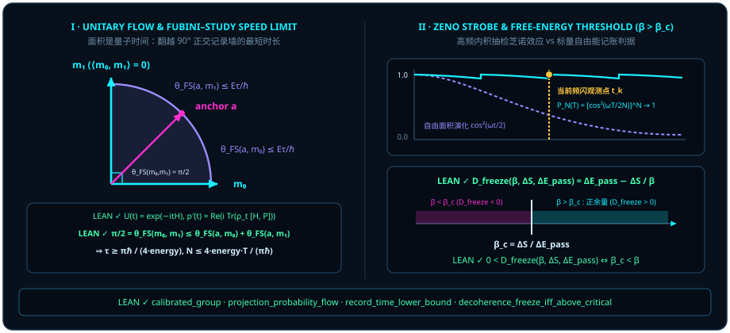

# Chapter 7 The Duality of Time: Why the Line Is Classical Time and the Area Is Quantum Time {#ch07-geometric-time-and-speed-limits}

As the author of this monograph observes:

> *"My intuition is that the line is classical time, and the area is quantum time."*
>
> *"When we bring the observer in endogenously, whether we see a particle or a wave seems to be a question of the observer's attention."*

In [Chapter 6](ch06-geometric-product.md), Clifford's geometric product $\vv{A}\vv{B} = \vv{A}\cdot\vv{B} + \vv{A}\wedge\vv{B}$ sutured wave and particle in space: **the particle is the collinear inner-product projection line ($\cos\theta$), and the wave is the orthogonal exterior bivector area ($\sin\theta\,\vv{I}$)**. Take one more step along this orthogonal thread, and one of the deepest riddles in natural philosophy — **what is time?** — reveals its dual geometric face!

In Newtonian mechanics and everyday life, time is pictured as a one-dimensional scalar line $t \in \mathbb{R}$: a pendulum ticks off a single file of discrete records, like holes punched along a paper tape. In the microscopic realm governed by the Schrödinger equation $i\hbar\frac{d}{dt}\lvert\psi(t)\rangle = H\lvert\psi(t)\rangle$, however, as long as no projective measurement punches the tape, the state vector rotates smoothly across two-dimensional phase planes and interferes coherently across multiple histories at once!

Why does one and the same universe wear two such different faces of time? This chapter establishes the author's geometric diagnosis — **"the line is classical time, and the area is quantum time"**:

1. **Quantum time is oriented bivector area**: The infinitesimal generator $G = -(i/\hbar)H_{\mathrm{op}}$ of any norm-preserving unitary flow $U(t) = \exp\bigl((-it/\hbar)H_{\mathrm{op}}\bigr)$ is necessarily **skew-adjoint** ($G^* = -G$); what the Hamiltonian $H_{\mathrm{op}} = i\hbar G$ measures is the **rate at which bivector rotation area is swept per unit time**;
2. **Classical time is the one-dimensional idempotent projection line**: Only when an observer intercepts that sweeping area with an idempotent projector $P^2 = P$ — crossing a $90^\circ$ orthogonal wall ($\langle m_0, m_1\rangle = 0$) to register an unmistakable discrete tick — does continuous two-dimensional quantum area condense into a sequential one-dimensional timeline!

## 7.1 Geometric Translation of the Schrödinger Equation: The Hamiltonian $H$ as the Bivector Area Swept per Unit Time {#sec-schrodinger-bivector-rate}

Open any standard quantum mechanics textbook and the Schrödinger equation $i\hbar\partial_t\psi = H\psi$ arrives with two seemingly arbitrary features: why does the imaginary unit $i$ sit on the left-hand side, and why must the energy operator (the Hamiltonian $H$) be self-adjoint ($H^* = H$)?

Translate the equation into the bivector language of [Chapter 5](ch05-complex-phase-and-rotors.md), and both features become self-evident.

Consider a continuous inner-product-preserving evolution $U(t)$ parameterized by $t \in \mathbb{R}$: it starts at the identity $U(0) = I$, obeys the additive group law $U(s + t) = U(s)U(t)$, and preserves norms everywhere via $U(t)^* U(t) = I$. Let $G := U'(0)$ be its instantaneous rate of change (generator) at $t = 0$. Differentiating the norm-preservation identity $U(t)^* U(t) = I$ at $t = 0$ by the product rule immediately gives:

$$
\left.\frac{d}{dt}\bigl(U(t)^* U(t)\bigr)\right|_{t=0} = G^* U(0) + U(0)^* G = G^* + G = 0 \quad\Longrightarrow\quad G^* = -G!
$$

Look at that result: **the true geometric generator $G$ of any norm-preserving continuous flow is automatically skew-adjoint ($G^* = -G$) — it is a planar bivector rotation generator!**

Physicists write a self-adjoint Hamiltonian $H_{\mathrm{op}}$ ($H_{\mathrm{op}}^* = H_{\mathrm{op}}$) only because we prefer real eigenvalues on energy dials: multiplying the skew-adjoint rotation generator $G$ by the $90^\circ$ factor $i\hbar$ (where $\hbar \neq 0$ calibrates radians per second into joules) defines

$$
H_{\mathrm{op}} := (i\hbar) G \quad\Longleftrightarrow\quad G = -\frac{i}{\hbar} H_{\mathrm{op}}!
$$

Because both $i$ and $G$ flip sign under conjugate transposition ($(-i)(-G) = +iG$), the two minus signs cancel, repackaging the skew-adjoint **bivector area rate $G$** as a self-adjoint **Hermitian Hamiltonian $H_{\mathrm{op}}$**! The Schrödinger equation is nothing more than the rigid-body angular-velocity equation: **instantaneous turning rate equals bivector area $G$ swept per unit time**.

In the Lean 4 module `Quantum/Dynamics/CalibratedUnitaryGroup`, the following theorem proves on a complete complex inner-product space $H$ that calibrating the generator $G$ of a one-parameter unitary group by $i\hbar$ yields a self-adjoint Hamiltonian $H_{\mathrm{op}}$, an exponential rotor flow $U(t) = \exp((-it/\hbar)H_{\mathrm{op}})$, and the exact operator Schrödinger equation at every time $t$.

::: {.theorem #thm-calibrated-unitary-group title="Calibrated Self-Adjoint Hamiltonian and Exponential Schrödinger Law of a Unitary Group" lean="D5/S3/Quantum/Dynamics/CalibratedUnitaryGroup.calibrated_group"}
Let $H$ be a complete complex inner-product space, let $U : \mathbb{R} \to (H \to_L[\mathbb{C}] H)$ be a one-parameter family of continuous linear operators, and let $G : H \to_L[\mathbb{C}] H$ be the derivative of $U$ at $t = 0$ (`HasDerivAt U G 0`). Suppose $U$ satisfies the unitary group axioms:

1. **Identity at the origin**: $U(0) = 1$;
2. **One-parameter group law**: $\forall s, t \in \mathbb{R},\, U(s + t) = U(s)U(t)$;
3. **Left-unitarity everywhere**: $\forall t \in \mathbb{R},\, U(t)^* U(t) = 1$.

Then for every nonzero real calibration constant $\hbar \in \mathbb{R}$ ($\hbar \neq 0$), defining the calibrated Hamiltonian $H_{\mathrm{op}} := (i\hbar)\cdot G$, all three conclusions hold:

1. **Self-adjointness of the calibrated Hamiltonian**: $H_{\mathrm{op}}$ is self-adjoint (`IsSelfAdjoint H_op`, i.e., $H_{\mathrm{op}}^* = H_{\mathrm{op}}$);
2. **Exponential rotor representation**: for all $t \in \mathbb{R}$,
   $$
   U(t) = \exp\Bigl(\bigl(-\frac{it}{\hbar}\bigr) H_{\mathrm{op}}\Bigr);
   $$
3. **Global Schrödinger differential equation**: for all $t \in \mathbb{R}$, $U$ has derivative $-\frac{i}{\hbar} H_{\mathrm{op}} U(t)$ at $t$ (`HasDerivAt U ((-Complex.I / ↑ℏ) • (H_op * U t)) t`).
:::

::: proof
First derive skew-adjointness of the generator $G$ inside the proof: differentiate the bilinear product $t \mapsto U(t)^* U(t)$ at $t = 0$. Using $U(0) = 1$ and the product rule gives derivative $G^* \cdot 1 + 1^* \cdot G = G^* + G$, while differentiating the constant map $U(t)^* U(t) = 1$ gives $0$, so uniqueness of derivatives forces $G^* + G = 0$, i.e., $G^* = -G$. Taking the adjoint of $H_{\mathrm{op}} = (i\hbar)G$ for real $\hbar$ then yields $H_{\mathrm{op}}^* = \overline{i\hbar}\,G^* = (-i\hbar)(-G) = (i\hbar)G = H_{\mathrm{op}}$ (claim 1). Next, translating the derivative $G$ at $s = 0$ via $U(t + s) = U(t)U(s)$ and invoking uniqueness of the Banach-algebra initial-value problem $f'(t) = G f(t),\, f(0) = 1$ gives $U(t) = \exp(t G)$. Since $\hbar \neq 0$ implies $\bigl(-\frac{it}{\hbar}\bigr)(i\hbar) = -i^2 t = t$, we have $\bigl(-\frac{it}{\hbar}\bigr)H_{\mathrm{op}} = t G$, establishing claims 2 and 3. The full proof is checked by the Lean kernel.
:::

Now suppose that while the two-dimensional rotor $U(t) = e^{-itH}$ ($\hbar = 1$, [`hamiltonianPropagator`](lean:D5/S3/Quantum/Dynamics/ProjectionProbabilityFlow.hamiltonianPropagator)) turns continuously, an observer monitors a fixed one-dimensional idempotent line $P$ ($P^2 = P = P^*$). How does the **particle detection probability** $p(t) := \operatorname{Re}\operatorname{bornProbability}(\rho_t, P)$ ([`projectionProbability`](lean:D5/S3/Quantum/Dynamics/ProjectionProbabilityFlow.projectionProbability)) of the evolved density matrix $\rho_t := e^{-itH}\rho e^{itH}$ ([`evolvedDensity`](lean:D5/S3/Quantum/Dynamics/ProjectionProbabilityFlow.evolvedDensity)) change with time?

The next proposition proves a striking identity: **the rate of change $p'(t)$ of particle probability along the line $P$ is driven entirely by the commutator bivector area $[H, P] = HP - PH$ between the Hamiltonian $H$ and the projector $P$!**

::: {.proposition #prop-projection-probability-flow title="Commutator Current Formula and Conservation Law for Projection Probability Flow" lean="D5/S3/Quantum/Dynamics/ProjectionProbabilityFlow.projection_probability_flow"}
Let $n$ be a finite index type with decidable equality, let $H, P \in M_n(\mathbb{C})$ satisfy $H^* = H$ and the star-projection condition $P^2 = P = P^*$, and let $\rho : \mathrm{DensityState}\,n$ be a density state. Write $\rho_t := e^{-itH}\rho e^{itH}$ ([`evolvedDensity`](lean:D5/S3/Quantum/Dynamics/ProjectionProbabilityFlow.evolvedDensity)) and $p(t) := \operatorname{Re}\operatorname{bornProbability}(\rho_t, P)$ ([`projectionProbability`](lean:D5/S3/Quantum/Dynamics/ProjectionProbabilityFlow.projectionProbability)). Then:

1. **Real-valued Born trace pairing**: for all $t \in \mathbb{R}$, $(p(t) : \mathbb{C}) = \operatorname{bornProbability}(\rho_t, P) = \Tr(\rho_t P)$;
2. **Commutator probability-current derivative**: for all $t \in \mathbb{R}$, $p(t)$ has derivative at $t$ given by
   $$
   p'(t) = \operatorname{Re}\Bigl(i\Tr\bigl(\rho_t (H P - P H)\bigr)\Bigr),
   $$
   and $i\Tr\bigl(\rho_t(H P - P H)\bigr)$ is already purely real: $\bigl(\operatorname{Re}(i\Tr(\rho_t(HP - PH))) : \mathbb{C}\bigr) = i\Tr\bigl(\rho_t(HP - PH)\bigr)$;
3. **Conservation under commuting projection**: if $H P - P H = 0$, then $\forall t \in \mathbb{R},\, p(t) = p(0)$.
:::

::: proof
For claim 1, unitarity of $e^{-itH}$ preserves the density-state axioms on $\rho_t$, so $P^2 = P = P^*$ and the Born reality theorem of [Chapter 2](ch02-born-rule.md) ensure that $\Tr(\rho_t P)$ is real. For claim 2, differentiating $\rho_t = e^{-itH}\rho e^{itH}$ via [`hamiltonianGenerator`](lean:D5/S3/Quantum/Dynamics/ProjectionProbabilityFlow.hamiltonianGenerator) $-iH$ yields $\frac{d}{dt}\rho_t = -i(H\rho_t - \rho_t H)$; multiplying by $P$ and applying trace linearity and cyclicity $\Tr(H\rho_t P) = \Tr(\rho_t P H)$ gives

$$
\frac{d}{dt}\Tr(\rho_t P) = -i\Tr\bigl((H\rho_t - \rho_t H)P\bigr) = i\Tr\bigl(\rho_t(HP - PH)\bigr).
$$

Conjugate symmetry of $\rho_t, H, P$ implies that $i\Tr(\rho_t(HP - PH))$ equals its own complex conjugate and is therefore real. Finally, if $HP - PH = 0$, then $p'(t) = 0$ for all $t \in \mathbb{R}$, so $p(t) = p(0)$ is constant (claim 3). The full proof is checked by the Lean kernel.
:::

In particular, when $\psi$ is an energy eigenstate ($H\psi = E\psi$), theorems [`energy_eigenstate_stationary`](lean:D5/S3/Quantum/Dynamics/EnergyEigenstateStationarity.energy_eigenstate_stationary) and [`energy_eigenstate_variance_zero`](lean:D5/S3/Quantum/Dynamics/EnergyEigenstateStationarity.energy_eigenstate_variance_zero) in `Quantum/Dynamics/EnergyEigenstateStationarity` prove that its energy variance vanishes and $\psi(t) = e^{-itE/\hbar}\psi$ acquires only an unobservable global phase, leaving its rank-one projector and all expectation values stationary for all $t \in \mathbb{R}$! **Without a nonzero commutator bivector area $[H, P] \neq 0$, no classical tick can ever register along the line $P$!**

## 7.2 Quantum Speed Limits (Mandelstam–Tamm and Margolus–Levitin): The Minimum Time to Cross a $90^\circ$ Orthogonal Wall {#sec-quantum-speed-limit}

If "the line is classical time and the area is quantum time," **what is the minimum duration required to convert continuous two-dimensional quantum rotation into two genuinely distinguishable ticks of a classical clock?**

Pose the question geometrically. When do two target states $m_0$ and $m_1$ constitute two truly distinct, non-overlapping clock records? Only when they are ** mutually orthogonal** ($\langle m_0, m_1\rangle_{\mathbb{C}} = 0$), so that their Fubini–Study geodesic angle ([`fsAngle`](lean:D5/S3/QuantumBounds/FubiniStudyRecordTime.fsAngle) $\theta_{\mathrm{FS}}(x, y) := \arccos\|\langle x, y\rangle_{\mathbb{C}}\|$) equals a full right angle:

$$
\theta_{\mathrm{FS}}(m_0, m_1) = \arccos\|0\| = \frac{\pi}{2} = 90^\circ!
$$

In other words: **every unmistakable tick of classical linear time requires the quantum state to traverse a $90^\circ$ ($\pi/2$ radian) orthogonal wall on the projective sphere!**

In the Lean module `QuantumBounds/FubiniStudyRecordTime`, we first establish the Fubini–Study spherical triangle inequality $\theta_{\mathrm{FS}}(a, c) \le \theta_{\mathrm{FS}}(a, b) + \theta_{\mathrm{FS}}(b, c)$ for unit vectors ([`fs_angle_triangle`](lean:D5/S3/QuantumBounds/FubiniStudyRecordTime.fs_angle_triangle)). Whenever the angular displacements from an anchor state $a$ to two orthogonal target records $m_0, m_1$ ($\langle m_0, m_1\rangle_{\mathbb{C}} = 0$) obey the speed-limit bounds $\theta_{\mathrm{FS}}(a, m_k) \le \mathrm{energy}\cdot\tau / \hbar$ ($k = 0, 1$), the two legs must bridge the $\pi/2$ orthogonal separation, locking in both a universal lower bound on the step duration $\tau$ and an upper bound on the number of sequential records $N$ achievable in total time $T$!

::: {.theorem #thm-fubini-study-record-time title="Fubini–Study Lower Bound on Orthogonal Record Time and Upper Bound on Sequential Record Count" lean="D5/S3/QuantumBounds/FubiniStudyRecordTime.record_time_lower_bound"}
Let $E$ be a complex inner-product space, and let $a, m_0, m_1 \in E$ be unit vectors ($\|a\| = \|m_0\| = \|m_1\| = 1$) with orthogonal target records $\langle m_0, m_1\rangle_{\mathbb{C}} = 0$. Write $\theta_{\mathrm{FS}}(x, y) := \arccos\|\langle x, y\rangle_{\mathbb{C}}\|$ ([`fsAngle`](lean:D5/S3/QuantumBounds/FubiniStudyRecordTime.fsAngle)). Let $\mathrm{energy} > 0$, $\hbar > 0$, and $\tau \in \mathbb{R}$. If the Fubini–Study angles from the anchor state $a$ to $m_0$ and $m_1$ satisfy the speed-limit bounds

$$
\theta_{\mathrm{FS}}(a, m_0) \le \frac{\mathrm{energy}\cdot\tau}{\hbar}, \qquad \theta_{\mathrm{FS}}(a, m_1) \le \frac{\mathrm{energy}\cdot\tau}{\hbar},
$$

then the record step duration $\tau$ obeys the lower bound

$$
\tau \ge \frac{\pi \hbar}{4 \cdot \mathrm{energy}}.
$$

Furthermore, for any step count $N \in \mathbb{N}$, indexed families $a, m_0, m_1 : \mathrm{Fin}\,N \to E$, step durations $\tau : \mathrm{Fin}\,N \to \mathbb{R}$, and total time $T \in \mathbb{R}$, if every step $i \in \mathrm{Fin}\,N$ satisfies $\|a(i)\| = \|m_0(i)\| = \|m_1(i)\| = 1$, $\langle m_0(i), m_1(i)\rangle_{\mathbb{C}} = 0$, $\theta_{\mathrm{FS}}(a(i), m_0(i)) \le \frac{\mathrm{energy}\cdot\tau(i)}{\hbar}$, and $\theta_{\mathrm{FS}}(a(i), m_1(i)) \le \frac{\mathrm{energy}\cdot\tau(i)}{\hbar}$ under the total time budget $\sum_{i \in \mathrm{Fin}\,N} \tau(i) \le T$ (with $\mathrm{energy} > 0, \hbar > 0$), then the total record count satisfies ([`record_count_upper_bound`](lean:D5/S3/QuantumBounds/FubiniStudyRecordTime.record_count_upper_bound)):

$$
N \le \frac{4 \cdot \mathrm{energy} \cdot T}{\pi \hbar}.
$$
:::

::: proof
Since $\langle m_0, m_1\rangle_{\mathbb{C}} = 0$, we have $\theta_{\mathrm{FS}}(m_0, m_1) = \arccos 0 = \frac{\pi}{2}$. Applying the spherical triangle inequality [`fs_angle_triangle`](lean:D5/S3/QuantumBounds/FubiniStudyRecordTime.fs_angle_triangle) to the unit triple $(m_0, a, m_1)$ and using symmetry $\theta_{\mathrm{FS}}(m_0, a) = \theta_{\mathrm{FS}}(a, m_0)$ gives

$$
\frac{\pi}{2} = \theta_{\mathrm{FS}}(m_0, m_1) \le \theta_{\mathrm{FS}}(a, m_0) + \theta_{\mathrm{FS}}(a, m_1) \le \frac{\mathrm{energy}\cdot\tau}{\hbar} + \frac{\mathrm{energy}\cdot\tau}{\hbar} = \frac{2\cdot\mathrm{energy}\cdot\tau}{\hbar}.
$$

Since $\mathrm{energy} > 0$ and $\hbar > 0$, multiplying both sides by $\frac{\hbar}{2\cdot\mathrm{energy}} > 0$ yields $\tau \ge \frac{\pi\hbar}{4\cdot\mathrm{energy}}$. For the indexed family, each step $i \in \mathrm{Fin}\,N$ obeys $\tau(i) \ge \frac{\pi\hbar}{4\cdot\mathrm{energy}}$ by the single-step bound; summing over $i \in \mathrm{Fin}\,N$ gives $N \cdot \frac{\pi\hbar}{4\cdot\mathrm{energy}} \le \sum_{i \in \mathrm{Fin}\,N} \tau(i) \le T$, and multiplying by $\frac{4\cdot\mathrm{energy}}{\pi\hbar} > 0$ yields [`record_count_upper_bound`](lean:D5/S3/QuantumBounds/FubiniStudyRecordTime.record_count_upper_bound): $N \le \frac{4\cdot\mathrm{energy}\cdot T}{\pi\hbar}$. The full proof is checked by the Lean kernel.
:::

[@thm-fubini-study-record-time] makes the relationship between quantum area and classical time crystal clear: two-dimensional quantum area rotates at angular rate $\mathrm{energy}/\hbar$, while the discrete tick count $N$ of a classical clock simply counts how many orthogonal $\pi/2$ walls have been crossed!

## 7.3 The Quantum Zeno Effect: Exterior-Area Evolution Frozen by High-Frequency Inner-Product Measurements {#sec-quantum-zeno-effect}

Now ask the converse question: what happens if a state begins sweeping out exterior area $\vv{A}\wedge\vv{B} = \sin(\omega t/2)\,\vv{I}$ in a plane, but an impatient observer refuses to wait for it to reach $90^\circ$ — repeatedly projecting the state back onto the initial axis $\vv{A}$ via $P_{\vv{A}}^2 = P_{\vv{A}}$ at tiny intervals $\delta t = T / N$?

The result is the celebrated **Quantum Zeno Effect** — a watched pot never boils!

In our line-and-area geometry, the mechanism is completely elementary: **over a tiny step $\delta t = T/N \ll 1$, the exterior wedge altitude grows at first order as $\sin(\omega\delta t/2) \approx \frac{\omega T}{2N}$, whereas the inner-product survival probability along the initial line $\vv{A}$ drops only at second order as $\cos^2(\omega\delta t/2) = 1 - \sin^2(\omega\delta t/2) \approx 1 - \frac{\omega^2 T^2}{4N^2}$!** When high-frequency inner-product projections repeatedly flatten the incipient first-order wedge area back onto the reference line, $N$ second-order losses accumulate to only $N \times O(N^{-2}) = O(N^{-1}) \to 0$, freezing the state in place!

::: {.example #ex-zeno-strobe-freezing title="Analytical Formula and Numerical Ledger (N = 1, 4, 16, 64) for Stroboscopic Quantum Zeno Freezing"}
Prepare a single qubit at the north pole $\lvert 0\rangle$ under the Hamiltonian $H = \frac{\hbar\omega}{2}\sigma_x$, which rotates the Bloch vector uniformly about the $X$ axis at angular speed $\omega$. Over total duration $T = \pi / \omega$ (which would flip an unmeasured qubit by $180^\circ$ straight to the orthogonal south pole $\lvert 1\rangle$), insert $N$ equally spaced projective checks onto $\lvert 0\rangle\langle 0\rvert$ at intervals $\delta t = \frac{T}{N} = \frac{\pi}{\omega N}$:

1. **Single-step survival probability**: Over one step $\delta t$, the Bloch angle advances by $\delta\theta = \omega\delta t = \frac{\pi}{N}$, so Born's half-angle law ([Chapter 2](ch02-born-rule.md)) gives survival probability
   $$
   p_1 = \cos^2\Bigl(\frac{\omega T}{2N}\Bigr) = \cos^2\Bigl(\frac{\pi}{2N}\Bigr) = 1 - \frac{\pi^2}{4N^2} + O(N^{-4}).
   $$
2. **$N$-step cumulative survival probability**: Surviving all $N$ stroboscopic checks occurs with probability
   $$
   P_N(T) = \left[\cos^2\Bigl(\frac{\pi}{2N}\Bigr)\right]^N = \left(1 - \frac{\pi^2}{4N^2} + O(N^{-4})\right)^N = 1 - \frac{\pi^2}{4N} + O(N^{-2}) \;\xrightarrow{\;N \to \infty\;}\; 1!
   $$

Evaluating $P_N(T)$ at $N = 1, 4, 16, 64$ shows how rapid inner-product polling freezes exterior-area rotation:

| Strobe Count $N$ | Step Angle $\delta\theta = \frac{180^\circ}{N}$ | Single-Step Survival $\cos^2(\frac{\pi}{2N})$ | Cumulative Survival $P_N = [\cos^2(\frac{\pi}{2N})]^N$ | Asymptotic $1 - \frac{\pi^2}{4N}$ | Geometric Diagnosis |
| :---: | :---: | :---: | :---: | :---: | :--- |
| **$N = 1$** (end only) | $180^\circ$ | $0.0000$ | **$0.0000$ ($0.0\%$)** | — | Uninterrupted area sweep reaches $\lvert 1\rangle$ |
| **$N = 4$** | $45^\circ$ | $0.8536$ | **$0.5308$ ($53.1\%$)** | $0.3831$ | Over half the ensemble is pulled back to North $\lvert 0\rangle$ |
| **$N = 16$** | $11.25^\circ$ | $0.9904$ | **$0.8569$ ($85.7\%$)** | $0.8458$ | Incipient wedge area is sheared off at $11.25^\circ$ steps |
| **$N = 64$** | $2.8125^\circ$ | $0.9994$ | **$0.9622$ ($96.2\%$)** | $0.9614$ | High-frequency inner-product checks lock the state at $\lvert 0\rangle$ |
:::

## 7.4 Observer Attention and Scalar Free-Energy Accounting: When to Read Out Particle Ticks and When to Audit Thermodynamic Cost {#sec-observer-attention-freeze}

Place the quantum speed limit of Section 7.2 alongside the Zeno effect of Section 7.3, and re-read the second epigraph at the head of this chapter:

> *"When we bring the observer in endogenously, whether we see a particle or a wave seems to be a question of the observer's attention."*

- When the observer **relaxes the sampling rate** (allowing $\tau \ge \frac{\pi\hbar}{4\cdot\mathrm{energy}}$ without projective interruption), the state has room to unfold its two-dimensional **exterior wave area** $\vv{A}\wedge\vv{B}$, executing coherent interference and unitary gate rotations;
- When the observer **ramps up the sampling frequency** ($\delta t \ll \frac{\hbar}{\mathrm{energy}}$, demanding continual yes/no particle readings along a fixed axis), the incipient two-dimensional area is repeatedly pinched back onto the **one-dimensional particle line**.

We must keep two distinct notions cleanly separated: the projective Zeno effect of Section 7.3 is a dynamical survival phenomenon under stroboscopic projective measurements, whereas on the thermodynamic accounting side we often ask an independent scalar question — when a candidate transition incurs a passive energy cost $\Delta E_{\mathrm{pass}} > 0$ against an entropy tax $\Delta S \in \mathbb{R}$ at inverse temperature $\beta = 1/(k_B T) > 0$, when is its **scalar free-energy accounting deposit** ([`freezeDeposit`](lean:D5/S3/QuantumChannels/DecoherenceFreeze.freezeDeposit) in Lean module `QuantumChannels/DecoherenceFreeze`),

$$
D_{\mathrm{freeze}}(\beta, \Delta S, \Delta E_{\mathrm{pass}}) := \Delta E_{\mathrm{pass}} - \frac{\Delta S}{\beta},
$$

strictly positive relative to the **critical inverse temperature** ([`criticalInverseTemperature`](lean:D5/S3/QuantumChannels/DecoherenceFreeze.criticalInverseTemperature))

$$
\beta_c(\Delta S, \Delta E_{\mathrm{pass}}) := \frac{\Delta S}{\Delta E_{\mathrm{pass}}}?
$$

The theorem below establishes this **scalar free-energy accounting criterion**: for positive scalars $\beta > 0$ and $\Delta E_{\mathrm{pass}} > 0$, the net deposit $D_{\mathrm{freeze}} = \Delta E_{\mathrm{pass}} - \Delta S/\beta$ is strictly positive if and only if $\beta > \beta_c = \Delta S/\Delta E_{\mathrm{pass}}$. (Note that the Lean theorem certifies only this scalar algebraic equivalence; it does not by itself dynamically arrest state evolution or suppress decoherence without an additional physical bath or barrier model.)

::: {.theorem #thm-decoherence-freeze-critical title="Scalar Free-Energy Accounting Criterion for a Positive Deposit Above Critical Inverse Temperature" lean="D5/S3/QuantumChannels/DecoherenceFreeze.decoherence_freeze_iff_above_critical"}
Let the inverse temperature $\beta \in \mathbb{R}$ satisfy $\beta > 0$, let the passive energy shift $\Delta E_{\mathrm{pass}} \in \mathbb{R}$ satisfy $\Delta E_{\mathrm{pass}} > 0$, and let $\Delta S \in \mathbb{R}$ be the entropy tax. Define the scalar accounting deposit and critical inverse temperature by ([`freezeDeposit`](lean:D5/S3/QuantumChannels/DecoherenceFreeze.freezeDeposit), [`criticalInverseTemperature`](lean:D5/S3/QuantumChannels/DecoherenceFreeze.criticalInverseTemperature))

$$
D_{\mathrm{freeze}}(\beta, \Delta S, \Delta E_{\mathrm{pass}}) := \Delta E_{\mathrm{pass}} - \frac{\Delta S}{\beta}, \qquad \beta_c(\Delta S, \Delta E_{\mathrm{pass}}) := \frac{\Delta S}{\Delta E_{\mathrm{pass}}}.
$$

Then the scalar deposit is strictly positive if and only if $\beta$ strictly exceeds the critical threshold $\beta_c$:

$$
0 < D_{\mathrm{freeze}}(\beta, \Delta S, \Delta E_{\mathrm{pass}}) \;\Longleftrightarrow\; \beta_c(\Delta S, \Delta E_{\mathrm{pass}}) < \beta.
$$
:::

::: proof
By definition, $0 < \Delta E_{\mathrm{pass}} - \frac{\Delta S}{\beta}$ holds if and only if $\frac{\Delta S}{\beta} < \Delta E_{\mathrm{pass}}$. Since $\beta > 0$ and $\Delta E_{\mathrm{pass}} > 0$, multiplying both sides by $\frac{\beta}{\Delta E_{\mathrm{pass}}} > 0$ preserves the strict inequality and shows that $\frac{\Delta S}{\beta} < \Delta E_{\mathrm{pass}}$ holds if and only if $\frac{\Delta S}{\Delta E_{\mathrm{pass}}} < \beta$, i.e., $\beta_c(\Delta S, \Delta E_{\mathrm{pass}}) < \beta$. By the same rearrangement, $D_{\mathrm{freeze}} = 0 \iff \beta = \beta_c$ and $D_{\mathrm{freeze}} < 0 \iff \beta < \beta_c$. The full proof is checked by the Lean kernel.
:::

::: {.remark #rem-qsl-zeno-literature title="Mandelstam–Tamm, Margolus–Levitin Dynamical Speed Limits, and the Misra–Sudarshan Zeno Theorem (Literature Result, Not Formalized in This Book)"}
**Literature result, not formalized in this book.** In this chapter, [@thm-fubini-study-record-time] derives $\tau \ge \frac{\pi\hbar}{4\cdot\mathrm{energy}}$ and $N \le \frac{4\cdot\mathrm{energy}\cdot T}{\pi\hbar}$ in Lean 4 from the Fubini–Study spherical triangle inequality [`fs_angle_triangle`](lean:D5/S3/QuantumBounds/FubiniStudyRecordTime.fs_angle_triangle) taking the single-leg displacement bound $\theta_{\mathrm{FS}}(a, m_k) \le \mathrm{energy}\cdot\tau/\hbar$ as an explicit hypothesis. In the quantum-dynamics literature, the differential derivation of those displacement bounds and the continuous Zeno limit are established in three classic theorems:

1. **Mandelstam–Tamm energy-variance speed limit (L. Mandelstam & I. Tamm, 1945)**: In *The uncertainty relation between energy and time in non-relativistic quantum mechanics* (J. Phys. USSR **9**, 249–254, 1945) and the Anandan–Aharonov geometric formulation (Phys. Rev. Lett. **65**, 1697, 1990), the instantaneous Fubini–Study speed along a Schrödinger trajectory equals the energy standard deviation divided by $\hbar$, $\frac{ds_{\mathrm{FS}}}{dt} = \frac{\Delta H}{\hbar}$. Integrating across the orthogonal separation $\theta_{\mathrm{FS}} = \frac{\pi}{2}$ yields the minimum orthogonalization time
   $$
   \tau_\perp \ge \frac{\pi\hbar}{2\,\Delta H}.
   $$
   Choosing the anchor $a$ in [@thm-fubini-study-record-time] at the geodesic midpoint between $m_0$ and $m_1$ (each half-leg of length $\frac{\pi}{4}$) with $\mathrm{energy} = \Delta H$ matches this bound directly.
2. **Margolus–Levitin mean-energy speed limit (N. Margolus & L. B. Levitin, 1998)**: In *The maximum speed of dynamical evolution* (Physica D **120**, 188–195, 1998), bounding the spectral expansion via $\cos x \ge 1 - \frac{2}{\pi}(x + \sin x)$ shows that the mean energy $\langle H\rangle$ above the ground state $E_0 = 0$ imposes the complementary bound
   $$
   \tau_\perp \ge \frac{\pi\hbar}{2\,\langle H\rangle}.
   $$
3. **Misra–Sudarshan dynamical quantum Zeno theorem (B. Misra & E. C. G. Sudarshan, 1977)**: In *The Zeno's paradox in quantum theory* (J. Math. Phys. **18**, 756–763, 1977), for a self-adjoint Hamiltonian $H$ with finite energy expectation and a projection $P$, the $N$-fold stroboscopic evolution converges in the strong operator topology as $N \to \infty$ to the projected unitary group $\lim_{N\to\infty} (P e^{-iHT/\hbar N} P)^N = P e^{-i(PHP)T/\hbar} P$, halting transitions into $I - P$.

These dynamical path-integral bounds and strong-operator limits are cited from the physics literature and are not claimed in the book's Lean verification ledger.
:::

We have now seen the first half of time's duality: as long as the exterior bivector area $\vv{A}\wedge\vv{B}$ rotates unitarily, quantum time is reversible; the moment an observer projects onto an idempotent line $P$ to record a classical tick, that transverse area is flattened onto the diagonal.

One urgent question remains: **where does the flattened two-dimensional coherence area go, and why does writing down classical ticks give birth to an irreversible thermodynamic arrow of time?** Turn to the closing chapter of Part II — [Chapter 8](ch08-erasure-and-time-arrows.md).
