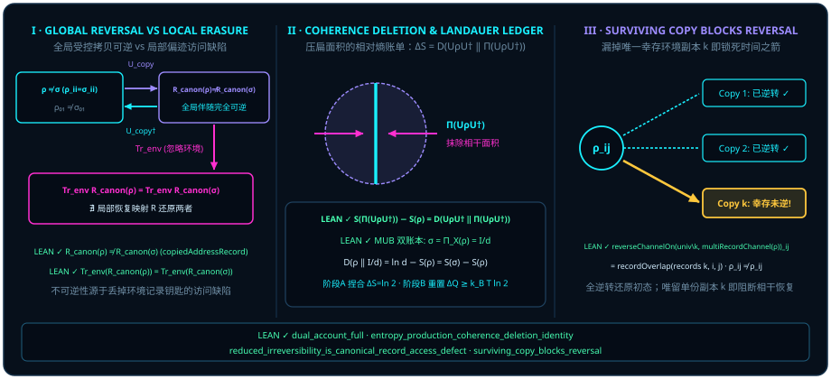

# Chapter 8 The Cost of Erasure: Landauer's Principle and the Thermodynamic Arrow of Time {#ch08-erasure-and-time-arrows}

As the author of this monograph observes:

> *"Then in essence the field is time — or rather, linear time is merely the particle of the field, while the time wave corresponds to the area; as a whole it is a single field, and everything is a time field."*
>
> *"So everything is settled, without a single exception — even the structure of the observer works this way."*

In [Chapter 7](ch07-geometric-time-and-speed-limits.md), we uncovered the duality of time: the continuously sweeping two-dimensional bivector area $\vv{A}\wedge\vv{B}$ is **quantum time (the time wave)**, whereas the sequence of orthogonal ticks sliced out by an idempotent projector $P^2 = P$ is **classical time (the particle of linear time)**. As the author summarizes in the first epigraph above: *"linear time is merely the particle of the field, while the time wave corresponds to the area; as a whole it is a single field, and everything is a time field."*

Place these two faces of time side by side, however, and Loschmidt's classic reversibility paradox confronts us immediately: **if the underlying unitary rotation $U(t) = \exp((-it/\hbar)H_{\mathrm{op}})$ is $100\%$ reversible — reversed without residue by turning through the opposite angle $R(-\theta) = R(\theta)^\dagger$ — why do macroscopic experience and observer memory obey an unyielding, one-way thermodynamic arrow of time? Why can we remember yesterday but never tomorrow?**

Closing Part II (*Unfolding Wings — From Line to Plane*), this chapter settles the information-theoretic and thermodynamic ledger of flattening a two-dimensional area into a one-dimensional line through four theorems verified in the Lean 4 kernel:

1. **Unitary rotation produces zero entropy; only basis pinching of off-diagonal area produces entropy**: Across any unitary rotation $U$ followed by computational-basis diagonal pinching $\Pi$, the system von Neumann entropy production $\Delta S_{\mathrm{pinch}} = S(\Pi(U\rho U^*)) - S(\rho)$ equals the exact quantum relative entropy of deleted coherence $D(U\rho U^* \,\|\, \Pi(U\rho U^*)) \ge 0$;
2. **Flattening a $1$-bit orthogonal area produces $\ln 2$ nats of system entropy, while resetting that mixed state back to a pure reference state dissipates Landauer heat**: Pinching a $d$-dimensional $Z$-record state in a mutually unbiased $X$-basis (a unital operation) drives it straight to the maximally mixed center $I_d/d$ at relative-entropy and von Neumann entropy-increase cost $\ln d - S(\rho)$ ($\ln 2 \approx 0.6931\text{ nats} = 1\text{ bit}$ for a pure qubit); in the subsequent non-unital reset step compressing that $\ln 2$ nats of mixture back to a pure reference state $\lvert 0\rangle\langle 0\rvert$, the thermodynamics-of-computation literature ([@rem-landauer-thermodynamic-bridge-literature]) dictates that at least $\Delta Q \ge k_B T \ln 2$ of heat must be expelled into a thermal bath at temperature $T$;
3. **Not even the observer is exempt**: Even if an observer coherently reverses every environmental record copy except a **single** surviving copy $k$ whose branch overlap differs from $1$ (with unimodular overlaps on the reversed copies), the initial nonzero off-diagonal coherence cannot be restored!

## 8.1 Unitary Rotational Reversibility versus the Irreversibility of Information Erasure {#sec-unitary-reversibility-vs-erasure}

Why does a pure quantum gate rotation never generate an arrow of time? Because unitary conjugation $\rho \mapsto U\rho U^*$ rotates the Bloch ball rigidly: pure states remain on the spherical shell, interior ellipsoids keep their principal semi-axes, the eigenvalue spectrum of $\rho$ is invariant, and the von Neumann entropy $S(U\rho U^*) = -\Tr(U\rho U^* \ln(U\rho U^*)) = S(\rho)$ is strictly conserved!

When, then, is irreversible entropy born? At the exact instant when an observer — in order to register a definite classical tick along a line — performs a **diagonal pinching projection** $\Pi_P(\sigma) = \sum_k P_k \sigma P_k$ that discards the transverse exterior coherence blocks $P_j \sigma P_k$ ($j \neq k$) from the local ledger!

Let us first audit the sharpest case: complete erasure across **mutually unbiased bases (MUB)**. Suppose a $d$-dimensional system sits in a state $\rho$ already diagonal in a rank-one record basis $Z$ ($\Pi_Z(\rho) = \rho$). Now let an apparatus rotated by $90^\circ$ into a mutually unbiased rank-one record basis $X$ (where every pair of basis projectors has uniform overlap $|\langle z_j, x_k\rangle|^2 = \frac{1}{d}$) pinch $\rho$ into the unread state $\sigma = \Pi_X(\rho)$.

In the Lean module `Quantum/Divergence/DualAccountFull`, the **Dual Account Full Theorem** proves that pinching a $Z$-diagonal state in a mutually unbiased $X$-basis erases all prior bias in a single stroke, driving the state to the maximally mixed center $\omega = I_d / d$, while the Umegaki quantum relative entropy $D(\rho \,\|\, \sigma) := \Tr(\rho(\ln\rho - \ln\sigma))$ equals the exact von Neumann entropy increase $S(\sigma) - S(\rho) = \ln d - S(\rho)$!

::: {.theorem #thm-dual-account-full title="Dual-Account Relative Entropy and Maximal Entropy Production Across Mutually Unbiased Record Bases" lean="D5/S3/Quantum/Divergence/DualAccountFull.dual_account_full"}
Let $d \in \mathbb{N}$ satisfy $d \ge 1$ (`[NeZero d]`), and let $Z, X : \mathrm{RankOneContext}\,d$ be two rank-one measurement contexts whose projector families are complete orthogonal record measurements (`IsRecordMeasurement Z.projector`, `IsRecordMeasurement X.projector`) satisfying mutual unbiasedness:

$$
\forall j, k \in \mathrm{Fin}\,d, \qquad \operatorname{overlap}(Z, X, j, k) = \frac{1}{d}.
$$

Let $\rho, \sigma : \mathrm{DensityState}\,(\mathrm{Fin}\,d)$ be density states such that $\rho$ is diagonal in the $Z$ basis ($\operatorname{unreadState}(Z.\mathrm{projector}, \rho) = \rho$) and $\sigma$ is the unread state of $\rho$ pinched in the $X$ basis ($\operatorname{unreadState}(X.\mathrm{projector}, \rho) = \sigma$). Write $\omega := \operatorname{gibbsState}(0) = \frac{1}{d}I_d$ for the maximally mixed state. Then all five statements hold:

1. **Mutually unbiased pinching reaches the maximally mixed center**: $\sigma = \omega$;
2. **Relative-entropy reference equivalence**: $D(\rho \,\|\, \sigma) = D(\rho \,\|\, \omega)$;
3. **Entropy-freedom identity**: $D(\rho \,\|\, \sigma) = \ln d - S(\rho)$ (paired with $0 \le S(\rho) \le \ln d$ and $D(\rho \,\|\, \sigma) \ge 0$ in [`entropy_freedom_segment`](lean:D5/S3/Quantum/Divergence/DualAccountFull.entropy_freedom_segment));
4. **Equality of relative entropy and von Neumann entropy production**:
   $$
   S(\sigma) - S(\rho) = D(\rho \,\|\, \sigma);
   $$
5. **Uniqueness of the cross-basis fixed point**: $\operatorname{unreadState}(X.\mathrm{projector}, \rho) = \rho \iff \rho = \omega$.
:::

::: proof
Because $\rho$ is diagonal in the rank-one basis $Z$, it expands as $\rho = \sum_j p_j Z_j$ with $\sum_j p_j = 1$. Pinching in the $X$ basis assigns to channel $k$ the weight $\sum_j p_j \operatorname{overlap}(Z, X, j, k) = \sum_j p_j \frac{1}{d} = \frac{1}{d}$; summing over $\sum_k X_k = I_d$ yields $\sigma = \frac{1}{d}I_d = \omega$ (claim 1), whence $D(\rho \,\|\, \sigma) = D(\rho \,\|\, \omega)$ (claim 2). Evaluating the relative entropy against $\omega = \frac{1}{d}I_d$ gives $-\Tr(\rho\ln\omega) = \ln d \cdot \Tr(\rho) = \ln d = S(\omega)$, so $D(\rho \,\|\, \omega) = \ln d - S(\rho) = S(\omega) - S(\rho) = S(\sigma) - S(\rho)$ (claims 3 and 4). Finally, if $\rho$ is fixed by $X$-pinching as well, then $\rho = \sigma = \omega$, while $\omega = \frac{1}{d}I_d$ is trivially fixed by any complete projective pinching (claim 5). The full proof is checked by the Lean kernel.
:::

Specialize [@thm-dual-account-full] to a single qubit ($d = 2$) starting in a pure record state ($S(\rho) = 0$): pinching in a mutually unbiased basis raises the system's von Neumann entropy from $0$ to $\ln 2$, converting the deleted coherence area into

$$
\Delta S_{\mathrm{pinch}} = S(\sigma) - S(\rho) = D(\rho \,\|\, \omega) = \ln 2 \text{ nats} \;\;(1\text{ bit})!
$$

## 8.2 Two-Stage Geometric Picture of Coherence-Deletion Entropy Production and Landauer's Principle ($\Delta Q \ge k_B T \ln 2$) {#sec-landauer-principle-geometry}

In 1961, Rolf Landauer formulated the foundational principle of the thermodynamics of computation — **Landauer's principle**: *information is physical*, and irreversibly erasing $1$ bit of information in an environment at temperature $T$ must dissipate at least $\Delta Q \ge k_B T \ln 2$ of heat.

In quantum information and thermodynamics, a complete cycle of "unread measurement followed by register reset" starting from a pure superposition comprises two distinct stages that must be kept cleanly separate:

1. **Stage A (Unital basis pinching / coherence deletion, formalized in our Lean modules)**: A reversible unitary gate $U$ rotates a state into $\rho_U := U\rho U^*$ ([`unitaryConjugateState`](lean:D5/S3/Quantum/Dynamics/EntropyProductionCoherenceDeletionIdentity.unitaryConjugateState)) at zero entropy cost ($S(\rho_U) = S(\rho)$); computational-basis diagonal pinching $\Pi(\rho_U) := \operatorname{basisPinchingState}(\rho_U)$ ([`basisPinchingState`](lean:D5/S3/Quantum/Dynamics/EntropyProductionCoherenceDeletionIdentity.basisPinchingState), whose diagonal entropy expansion is given by [`von_neumann_entropy_basisPinchingState`](lean:D5/S3/Quantum/Dynamics/EntropyProductionCoherenceDeletionIdentity.von_neumann_entropy_basisPinchingState)) then crushes the two-dimensional transverse coherence area flat onto the diagonal. Stage A ([@thm-entropy-production-coherence-deletion], [`entropy_production_coherence_deletion_identity`](lean:D5/S3/Quantum/Dynamics/EntropyProductionCoherenceDeletionIdentity.entropy_production_coherence_deletion_identity)) establishes the **dimensionless system von Neumann entropy increase** $\Delta S_{\mathrm{pinch}} = S(\Pi(\rho_U)) - S(\rho) = D(\rho_U \,\|\, \Pi(\rho_U)) \ge 0$ ($+\ln 2$ nats for $\lvert +\rangle\langle +\rvert \mapsto \frac{1}{2}I_2$) under unital computational-basis pinching ($\Pi(I_n) = I_n$); this formal theorem does not specify a system Hamiltonian, thermal bath, or Landauer reset heat cost (in the physical model and literature layer, a zero-heat dephasing realization additionally requires a degenerate system Hamiltonian $H_S \propto I_n$, as noted in [@rem-landauer-thermodynamic-bridge-literature]);
2. **Stage B (Non-unital logical reset / Landauer heat dissipation, cited from the physics literature in [@rem-landauer-thermodynamic-bridge-literature])**: To reset the pinched mixed register ($\frac{1}{2}I_2$, $S = \ln 2$) back to a pure reference state $\lvert 0\rangle\langle 0\rvert$ ($S = 0$) for reuse, the system's entropy must be compressed by $\Delta S_S := S(\rho_{\mathrm{init}}) - S(\rho_{\mathrm{final}}) = +\ln 2$. By Landauer's principle and the Reeb–Wolf finite-bath identity $\beta\Delta Q_{\mathrm{bath}} = \Delta S_S + I(S':E') + D(\rho_E'\,\|\,\rho_E) \ge \Delta S_S$, the $\ln 2$ nats of mixture generated by Stage A coherence deletion must ultimately be expelled during Stage B reset as at least $\Delta Q_{\min} = k_B T \ln 2$ of heat into a thermal bath at temperature $T$!

In the Lean module `Quantum/Dynamics/EntropyProductionCoherenceDeletionIdentity`, the diagonal functional-calculus theorems [`cfc_diagonal`](lean:D5/S3/Quantum/Dynamics/EntropyProductionCoherenceDeletionIdentity.cfc_diagonal), [`cfc_log_diagonal`](lean:D5/S3/Quantum/Dynamics/EntropyProductionCoherenceDeletionIdentity.cfc_log_diagonal), and [`von_neumann_entropy_basisPinchingState`](lean:D5/S3/Quantum/Dynamics/EntropyProductionCoherenceDeletionIdentity.von_neumann_entropy_basisPinchingState) culminate in the main theorem below: **along any discrete trajectory $\rho(k+1) = \Pi(U\rho(k)U^*)$ generated by alternating unitary conjugation $U$ and computational-basis pinching $\Pi$, each step's von Neumann entropy increase equals the quantum relative entropy of deleted coherence $D\bigl(\rho_U(k) \,\big\|\, \Pi(\rho_U(k))\bigr) \ge 0$, and the cumulative $N$-step entropy production equals the sum of single-step coherence-deletion divergences!**

::: {.theorem #thm-entropy-production-coherence-deletion title="Single-Step and Cumulative Entropy Production of Unitary Evolution Followed by Basis Pinching" lean="D5/S3/Quantum/Dynamics/EntropyProductionCoherenceDeletionIdentity.entropy_production_coherence_deletion_identity"}
Let $n$ be a finite index type with decidable equality (`[Fintype n] [DecidableEq n]`), let $U \in U(n, \mathbb{C})$ be a unitary matrix (`hU : U ∈ Matrix.unitaryGroup n ℂ`), and let $\rho : \mathbb{N} \to \mathrm{DensityState}\,n$ be a discrete-time sequence of density states. Write $\rho_U(k) := \operatorname{unitaryConjugateState}(U, h_U, \rho(k))$ ([`unitaryConjugateState`](lean:D5/S3/Quantum/Dynamics/EntropyProductionCoherenceDeletionIdentity.unitaryConjugateState)) for the unitarily evolved state at step $k$ and $\Pi := \operatorname{basisPinchingState}$ ([`basisPinchingState`](lean:D5/S3/Quantum/Dynamics/EntropyProductionCoherenceDeletionIdentity.basisPinchingState)) for computational-basis diagonal pinching. If the trajectory obeys the step recursion

$$
\forall k \in \mathbb{N}, \qquad \rho(k + 1) = \Pi\bigl(\rho_U(k)\bigr),
$$

then both the single-step and cumulative $N$-step entropy-production identities hold:

1. **Single-step coherence-deletion identity and nonnegativity**: for every step $k \in \mathbb{N}$,
   $$
   S\bigl(\rho(k + 1)\bigr) - S\bigl(\rho(k)\bigr) = D\Bigl(\rho_U(k) \,\Big\|\, \Pi\bigl(\rho_U(k)\bigr)\Bigr) \qquad\text{and}\qquad 0 \le D\Bigl(\rho_U(k) \,\Big\|\, \Pi\bigl(\rho_U(k)\bigr)\Bigr);
   $$
2. **Cumulative $N$-step telescoping identity**: for every horizon $N \in \mathbb{N}$,
   $$
   S\bigl(\rho(N)\bigr) - S\bigl(\rho(0)\bigr) = \sum_{k \in \mathrm{Finset.range}\,N} D\Bigl(\rho_U(k) \,\Big\|\, \Pi\bigl(\rho_U(k)\bigr)\Bigr).
   $$
:::

::: proof
For any step state $\sigma = \rho(k)$, unitary conjugation preserves the eigenvalue spectrum and thus von Neumann entropy: $S(\rho_U(k)) = S(\rho(k))$. Next, by the diagonal logarithm functional calculus [`cfc_log_diagonal`](lean:D5/S3/Quantum/Dynamics/EntropyProductionCoherenceDeletionIdentity.cfc_log_diagonal) and the pinched-state entropy formula [`von_neumann_entropy_basisPinchingState`](lean:D5/S3/Quantum/Dynamics/EntropyProductionCoherenceDeletionIdentity.von_neumann_entropy_basisPinchingState), computational-basis diagonal pinching $\Pi = \operatorname{basisPinchingState}$ satisfies the diagonal projection trace identity $\Tr\bigl(\rho_U(k)\ln\Pi(\rho_U(k))\bigr) = \Tr\bigl(\Pi(\rho_U(k))\ln\Pi(\rho_U(k))\bigr) = -S\bigl(\Pi(\rho_U(k))\bigr)$, which yields $D\bigl(\rho_U(k) \,\big\|\, \Pi(\rho_U(k))\bigr) = S\bigl(\Pi(\rho_U(k))\bigr) - S(\rho_U(k))$. Combining this with $S(\rho_U(k)) = S(\rho(k))$ and the step recursion $\rho(k+1) = \Pi(\rho_U(k))$ gives the single-step identity $S(\rho(k+1)) - S(\rho(k)) = D\bigl(\rho_U(k) \,\big\|\, \Pi(\rho_U(k))\bigr)$, while concavity of the logarithm (Klein's inequality) guarantees $0 \le D\bigl(\rho_U(k) \,\big\|\, \Pi(\rho_U(k))\bigr)$ (claim 1). Finally, induction over $N \in \mathbb{N}$ telescopes $\sum_{k=0}^{N-1} \bigl(S(\rho(k+1)) - S(\rho(k))\bigr) = S(\rho(N)) - S(\rho(0))$, establishing claim 2. The full proof is checked by the Lean kernel.
:::

Here lies the geometric origin of the Second Law in quantum mechanics: **every irreversible pinching entropy increase is the exact geometric remainder $D\bigl(\rho_U(k) \,\big\|\, \Pi(\rho_U(k))\bigr) \ge 0$ sliced off when a two-dimensional oriented area $\vv{A}\wedge\vv{B}$ is flattened onto a one-dimensional diagonal line!**

::: {.example #ex-landauer-one-bit-ledger title="Two-Stage 1-Bit (ln 2) Ledger: Hadamard Wave Creation, Unital Z-Basis Pinching, and Non-Unital Landauer Reset"}
Follow a single qubit starting at the pure north pole $\rho_0 = \lvert 0\rangle\langle 0\rvert$, rotated by Hadamard $H = \frac{1}{\sqrt{2}}(X + Z)$ to the equatorial superposition $\rho_H = H\rho_0 H^* = \lvert +\rangle\langle +\rvert$, pinched in the computational $Z$ basis to $\Pi(\rho_H) = \frac{1}{2}I_2$, and finally reset to $\lvert 0\rangle\langle 0\rvert$ in a room-temperature bath:

1. **Unitary preparation (Hadamard rotation $\rho_0 \mapsto \rho_H$)**:
   $$
   \rho_0 = \begin{pmatrix} 1 & 0 \\ 0 & 0 \end{pmatrix} \;\xrightarrow{\;H\,\cdot\,H^*\;}\; \rho_H = \frac{1}{2}\begin{pmatrix} 1 & 1 \\ 1 & 1 \end{pmatrix}.
   $$
   Unitary rotation preserves the eigenvalue spectrum and is isentropic: $S(\rho_H) = S(\rho_0) = 0$, purity remains $\Tr(\rho_H^2) = 1$, and off-diagonal coherence $\rho_{01} = \rho_{10} = \frac{1}{2}$ is opened.
2. **Stage A (Unital computational-basis pinching $\rho_H \mapsto \Pi(\rho_H) = \frac{1}{2}I_2$, Lean-formalized)**:
   - **Hilbert–Schmidt coherence mass ([@cor-pinching-pythagorean])**: Total squared norm $\langle\rho_H, \rho_H\rangle_{\mathrm{HS}} = 1$ splits orthogonally into diagonal population norm $\langle\Pi(\rho_H), \Pi(\rho_H)\rangle_{\mathrm{HS}} = (\frac{1}{2})^2 + (\frac{1}{2})^2 = \frac{1}{2}$ and discarded off-diagonal coherence mass $|\rho_{01}|^2 + |\rho_{10}|^2 = (\frac{1}{2})^2 + (\frac{1}{2})^2 = \frac{1}{2}$;
   - **System von Neumann entropy production ([@thm-dual-account-full] & [@thm-entropy-production-coherence-deletion])**: Unital pinching deletes the off-diagonal coherence area and raises the **system's own** dimensionless von Neumann entropy by
     $$
     \Delta S_{\mathrm{pinch}} = S\bigl(\Pi(\rho_H)\bigr) - S(\rho_0) = D\Bigl(\lvert +\rangle\langle +\rvert \,\Big\|\, \frac{1}{2}I_2\Bigr) = \ln 2 \approx 0.693147\text{ nats} = 1\text{ bit}.
     $$
3. **Stage B (Non-unital logical reset $\frac{1}{2}I_2 \mapsto \lvert 0\rangle\langle 0\rvert$ at $T = 300\text{ K}$, literature bridge in [@rem-landauer-thermodynamic-bridge-literature])**:
   Compressing the maximally mixed register $\frac{1}{2}I_2$ ($S = \ln 2$) back to the pure reference state $\lvert 0\rangle\langle 0\rvert$ ($S = 0$) reduces system entropy by $\Delta S_S = S(\frac{1}{2}I_2) - S(\lvert 0\rangle\langle 0\rvert) = +\ln 2$. By Landauer's principle and the Reeb–Wolf finite-bath bound $\beta\Delta Q_{\mathrm{bath}} \ge \Delta S_S = \ln 2$, multiplying by Boltzmann's constant $k_B \approx 1.380649 \times 10^{-23}\text{ J/K}$ at $T = 300\text{ K}$ gives the minimum heat expelled into the bath:
   $$
   \Delta Q_{\min} = k_B T \ln 2 \approx (1.380649 \times 10^{-23}\text{ J/K}) \times (300\text{ K}) \times 0.693147 \approx 2.87 \times 10^{-21}\text{ J}\;(\approx 17.9\text{ meV}).
   $$
:::

## 8.3 Observer Memory and the Arrow of Time: Why "Remembering the Past" Must Consume Free Energy {#sec-observer-memory-time-arrow}

Now turn the lens onto the **observer's own memory register**, confirming the second epigraph of this chapter: *"So everything is settled, without a single exception — even the structure of the observer works this way."*

In the Lean module `Quantum/Decoherence/CanonicalRecordAccessRecovery`, theorems [`canonical_copied_address_record_eq_prior`](lean:D5/S3/Quantum/Decoherence/CanonicalRecordAccessRecovery.canonical_copied_address_record_eq_prior) and [`reduced_irreversibility_is_canonical_record_access_defect`](lean:D5/S3/Quantum/Decoherence/CanonicalRecordAccessRecovery.reduced_irreversibility_is_canonical_record_access_defect) establish global unitary reversibility alongside local partial-trace non-recoverability for the canonical copied-address joint state $R_{\mathrm{canon}}(\tau) := \operatorname{controlledRecordJointState}(\mathrm{copiedAddressRecord}, \tau)$:

::: {.theorem #thm-reduced-irreversibility-access-defect title="Canonical Controlled-Record Marginal Coincidence and Impossibility of Local Recovery" lean="D5/S3/Quantum/Decoherence/CanonicalRecordAccessRecovery.reduced_irreversibility_is_canonical_record_access_defect"}
Let $\rho, \sigma \in M_2(\mathbb{C})$ (`QubitMatrix`) be two single-qubit matrices with identical diagonal entries ($\forall i \in \mathrm{Fin}\,2,\, \rho_{ii} = \sigma_{ii}$) but distinct off-diagonal coherence ($\exists i, j \in \mathrm{Fin}\,2,\, i \neq j \land \rho_{ij} \neq \sigma_{ij}$). Write $U_{\mathrm{copy}} := \mathrm{copyUnitary}$ for the controlled address-copy unitary, $B(\tau) := \operatorname{blankEnvironmentJointState}(\tau)$ for the blank-environment embedding, $R_{\mathrm{canon}}(\tau) := \operatorname{controlledRecordJointState}(\mathrm{copiedAddressRecord}, \tau)$ for the canonical copied-address joint state ([`canonical_copied_address_record_eq_prior`](lean:D5/S3/Quantum/Decoherence/CanonicalRecordAccessRecovery.canonical_copied_address_record_eq_prior)), and $\Tr_{\mathrm{env}} := \mathrm{traceEnvironment}$ for the environment partial trace. Then all six groups (eight conjuncts) of statements hold:

1. **Global unitarity**: $U_{\mathrm{copy}} \in U(\mathrm{Fin}\,2 \times \mathrm{Fin}\,2, \mathbb{C})$;
2. **Forward unitary writing of canonical records**: $\operatorname{unitaryEvolution}(U_{\mathrm{copy}}, B(\rho)) = R_{\mathrm{canon}}(\rho)$ and $\operatorname{unitaryEvolution}(U_{\mathrm{copy}}, B(\sigma)) = R_{\mathrm{canon}}(\sigma)$;
3. **Coincidence of reduced marginals**:
   $$
   \Tr_{\mathrm{env}}\bigl(R_{\mathrm{canon}}(\rho)\bigr) = \Tr_{\mathrm{env}}\bigl(R_{\mathrm{canon}}(\sigma)\bigr);
   $$
4. **Global joint records remain distinct**: $R_{\mathrm{canon}}(\rho) \neq R_{\mathrm{canon}}(\sigma)$;
5. **No reduced-state recovery map**: there exists no recovery map $\mathcal{R} : M_2(\mathbb{C}) \to M_{\mathrm{Fin}\,2 \times \mathrm{Fin}\,2}(\mathbb{C})$ on the reduced system state alone satisfying both $\mathcal{R}\bigl(\Tr_{\mathrm{env}}(R_{\mathrm{canon}}(\rho))\bigr) = R_{\mathrm{canon}}(\rho)$ and $\mathcal{R}\bigl(\Tr_{\mathrm{env}}(R_{\mathrm{canon}}(\sigma))\bigr) = R_{\mathrm{canon}}(\sigma)$;
6. **Exact global unitary reversal**: $\operatorname{unitaryEvolution}(U_{\mathrm{copy}}^*, R_{\mathrm{canon}}(\rho)) = B(\rho)$ and $\operatorname{unitaryEvolution}(U_{\mathrm{copy}}^*, R_{\mathrm{canon}}(\sigma)) = B(\sigma)$.
:::

::: proof
By [`canonical_copied_address_record_eq_prior`](lean:D5/S3/Quantum/Decoherence/CanonicalRecordAccessRecovery.canonical_copied_address_record_eq_prior), the canonical copied-address record `copiedAddressRecord` coincides with the permutation-copy record `priorCopiedRecord` of [@thm-reduced-access-defect] (`reduced_state_irreversibility_is_record_access_defect`), from which all eight conjuncts follow directly by rewriting. In particular, for claim 3, because the two branch records of `copiedAddressRecord` are orthogonal (Kronecker-delta overlap $\delta_{ij}$), tracing out the environment $\Tr_{\mathrm{env}}(R_{\mathrm{canon}}(\tau))$ zeroes out off-diagonal entries and retains the diagonal $\tau_{ii}$ (equaling standard-basis pinching $\Pi(\tau)$); since $\rho_{ii} = \sigma_{ii}$, we obtain $\Tr_{\mathrm{env}}(R_{\mathrm{canon}}(\rho)) = \Tr_{\mathrm{env}}(R_{\mathrm{canon}}(\sigma))$, whereas $R_{\mathrm{canon}}(\rho) \neq R_{\mathrm{canon}}(\sigma)$ precludes any single-valued map $\mathcal{R}$ from recovering both global states from the same reduced input (claims 4 and 5). The full proof is checked by the Lean kernel.
:::

Why, then, can't a macroscopic observer simply apply $U_{\mathrm{copy}}^*$ (claim 6) to run time backward? Because in the real world a system does not copy its record into a single isolated ancilla; it broadcasts redundant records across a finite copy family $\mathrm{Copy}$ of environmental degrees of freedom (photons, phonons, air molecules, detector pointers, and the observer's own memory cells)!

In the Lean module `ObserverMemory/JointCoherentReversal`, we formalize this multi-copy memory structure on a finite copy index type $\mathrm{Copy}$ (`[Fintype Copy] [DecidableEq Copy]`) with single-qubit record carrier $\mathrm{EnvironmentRecord} := \mathrm{Fin}\,2 \to \mathrm{Fin}\,2 \to \mathbb{C}$, record family $\mathrm{records} : \mathrm{Copy} \to \mathrm{EnvironmentRecord}$, and single-qubit matrix $\rho \in M_2(\mathbb{C})$ (`QubitMatrix`). The forward multi-record channel $\operatorname{multiRecordChannel}(\mathrm{records}, \rho)$ multiplies entry $(i, j)$ by $\prod_{l \in \mathrm{Copy}} \operatorname{recordOverlap}(\mathrm{records}(l), i, j)$, while $\operatorname{reverseChannelOn}(S, \mathrm{records}, \cdot)$ ([`reverseChannelOn`](lean:D5/S3/ObserverMemory/JointCoherentReversal.reverseChannelOn), built from [`reverseRecord`](lean:D5/S3/ObserverMemory/JointCoherentReversal.reverseRecord) and [`reverseOn`](lean:D5/S3/ObserverMemory/JointCoherentReversal.reverseOn)) applies time-reversed records on the subset $S \subseteq \mathrm{Copy}$:

- Lemma [`reverse_record_overlap`](lean:D5/S3/ObserverMemory/JointCoherentReversal.reverse_record_overlap) proves that reversing a record **conjugates** its branch overlap:
  $$
  \operatorname{recordOverlap}\bigl(\operatorname{reverseRecord}(r), i, j\bigr) = \overline{\operatorname{recordOverlap}(r, i, j)};
  $$
  consequently, whenever a reversed copy $l$ has a **unimodular** branch overlap ($\overline{\operatorname{recordOverlap}(\mathrm{records}(l), i, j)} \cdot \operatorname{recordOverlap}(\mathrm{records}(l), i, j) = 1$), the reversed overlap factor cancels its forward counterpart to $1$! Reversing **all** copies ($S = \mathrm{Finset.univ}$) under unimodular overlaps recovers $\rho_{ij}$ identically ([`joint_coherent_reversal`](lean:D5/S3/ObserverMemory/JointCoherentReversal.joint_coherent_reversal));
- Yet if even a **single surviving copy** $k \in \mathrm{Copy}$ escapes reversal ($S = \mathrm{Finset.univ.erase}\,k$, with unimodular overlaps $\overline{c_l} c_l = 1$ on all reversed copies $l \neq k$) and carries a nontrivial branch overlap $\operatorname{recordOverlap}(\mathrm{records}(k), i, j) \neq 1$, theorem [`one_surviving_copy_composition_apply`](lean:D5/S3/ObserverMemory/JointCoherentReversal.one_surviving_copy_composition_apply) and the proposition below prove that **no nonzero coherence entry $\rho_{ij} \neq 0$ can be restored! (See also the explicit two-copy certificate [`two_copy_joint_reversal_certificate`](lean:D5/S3/ObserverMemory/JointCoherentReversal.two_copy_joint_reversal_certificate).)**

::: {.proposition #prop-surviving-copy-blocks-reversal title="A Single Surviving Unreversed Environmental Copy Blocks Coherent Reversal" lean="D5/S3/ObserverMemory/JointCoherentReversal.surviving_copy_blocks_reversal"}
Let $\mathrm{Copy}$ be a finite copy index type with decidable equality (`[Fintype Copy] [DecidableEq Copy]`), let $\mathrm{records} : \mathrm{Copy} \to \mathrm{EnvironmentRecord}$ be a family of single-qubit environmental records, let $\rho \in M_2(\mathbb{C})$ (`QubitMatrix`) be a single-qubit matrix, let $i, j \in \mathrm{Fin}\,2$ be matrix indices, and let $k \in \mathrm{Copy}$ be a distinguished copy. Assume:

1. **Unimodular overlaps on all other copies**:
   $$
   \forall l \in \mathrm{Copy},\quad l \neq k \implies \overline{\operatorname{recordOverlap}\bigl(\mathrm{records}(l), i, j\bigr)} \cdot \operatorname{recordOverlap}\bigl(\mathrm{records}(l), i, j\bigr) = 1;
   $$
2. **Nontrivial witness overlap on copy $k$**: $\operatorname{recordOverlap}\bigl(\mathrm{records}(k), i, j\bigr) \neq 1$;
3. **Nonzero initial matrix entry**: $\rho_{ij} \neq 0$.

Then applying the reversal channel [`reverseChannelOn`](lean:D5/S3/ObserverMemory/JointCoherentReversal.reverseChannelOn) on all copies except $k$ (`Finset.univ.erase k`) to the forward state $\operatorname{multiRecordChannel}(\mathrm{records}, \rho)$ fails to restore entry $(i, j)$:

$$
\operatorname{reverseChannelOn}\Bigl(\mathrm{Finset.univ.erase}\,k,\, \mathrm{records},\, \operatorname{multiRecordChannel}(\mathrm{records}, \rho)\Bigr)_{ij} \neq \rho_{ij}.
$$
:::

::: proof
By [`one_surviving_copy_composition_apply`](lean:D5/S3/ObserverMemory/JointCoherentReversal.one_surviving_copy_composition_apply) (which uses [`reverse_record_overlap`](lean:D5/S3/ObserverMemory/JointCoherentReversal.reverse_record_overlap) to replace each reversed copy's overlap for $l \in \mathrm{Finset.univ.erase}\,k$ by $\overline{\operatorname{recordOverlap}(\mathrm{records}(l), i, j)}$ and cancels $\overline{c_l} c_l = 1$ via hypothesis 1), every factor $l \neq k$ reduces to $1$, leaving only the unreversed overlap factor of copy $k$:

$$
\operatorname{reverseChannelOn}\Bigl(\mathrm{Finset.univ.erase}\,k,\, \mathrm{records},\, \operatorname{multiRecordChannel}(\mathrm{records}, \rho)\Bigr)_{ij} = \operatorname{recordOverlap}\bigl(\mathrm{records}(k), i, j\bigr) \cdot \rho_{ij}.
$$

If the left-hand side equaled $\rho_{ij}$, then $\operatorname{recordOverlap}(\mathrm{records}(k), i, j) \cdot \rho_{ij} = 1 \cdot \rho_{ij}$. Since $\mathbb{C}$ has no zero divisors and $\rho_{ij} \neq 0$ (hypothesis 3), right cancellation would yield $\operatorname{recordOverlap}(\mathrm{records}(k), i, j) = 1$, contradicting hypothesis 2 ($\operatorname{recordOverlap}(\mathrm{records}(k), i, j) \neq 1$). The full proof is checked by the Lean kernel.
:::

[@prop-surviving-copy-blocks-reversal] explains why the macroscopic arrow of time is operationally irreversible: a single photon escaping into the night sky acts as the unreversed witness copy $k$, locking the measurement into the past! Meanwhile, for an observer's finite memory register to record new ticks tomorrow, old memory cells must first undergo Stage A unital pinching (producing system entropy $\Delta S_{\mathrm{pinch}} = D(\rho_U \,\|\, \Pi(\rho_U)) \ge 0$ by [@thm-entropy-production-coherence-deletion]) and then Stage B non-unital reset to $\lvert 0\rangle\langle 0\rvert$ (compressing that entropy and expelling at least $k_B T \Delta S_S$ of Landauer heat into the thermal bath per [@rem-landauer-thermodynamic-bridge-literature]).

::: {.remark #rem-landauer-thermodynamic-bridge-literature title="Landauer's Principle, Bennett's Reversible Computing, and the Reeb–Wolf Finite-Bath Inequality (Literature Result, Not Formalized in This Book)"}
**Literature result, not formalized in this book.** In this chapter, [@thm-dual-account-full] and [@thm-entropy-production-coherence-deletion] formalize **Stage A (unital basis pinching / coherence deletion)** as the exact dimensionless von Neumann / Umegaki relative-entropy identities $S(\Pi(U\rho U^*)) - S(\rho) = D(U\rho U^* \,\|\, \Pi(U\rho U^*)) \ge 0$ and $\ln d - S(\rho)$ ($\ln 2$ nats of system entropy increase for a pinched pure qubit). In **Stage B (non-unital logical reset, e.g., compressing $\frac{1}{2}I_2 \mapsto \lvert 0\rangle\langle 0\rvert$)**, the physical bridge converting the system entropy reduction $\Delta S_S := S(\rho_S) - S(\rho_S')$ into joules of dissipated heat $\Delta Q_{\mathrm{bath}}$ in a thermal bath at temperature $T$ comes from the thermodynamics-of-computation literature:

1. **Landauer's erasure principle (R. Landauer, 1961) and Bennett's reversible computation (C. H. Bennett, 1973, 1982)**: Rolf Landauer (*Irreversibility and heat generation in the computing process*, IBM J. Res. Dev. **5**, 183–191, 1961) showed that logically irreversible many-to-one non-unital reset operations (such as $\frac{1}{2}I_2 \mapsto \lvert 0\rangle\langle 0\rvert$) compress register entropy and must expel at least $\Delta Q \ge k_B T \ln 2$ of heat per erased bit into a thermal environment at temperature $T$. Charles H. Bennett (IBM J. Res. Dev. **17**, 525–532, 1973; Int. J. Theor. Phys. **21**, 905–940, 1982) demonstrated that computation itself can be performed reversibly via unitary/bijective gates at zero fundamental entropy cost (matching the isentropic property $S(U\rho U^*) = S(\rho)$ of [`unitaryConjugateState`](lean:D5/S3/Quantum/Dynamics/EntropyProductionCoherenceDeletionIdentity.unitaryConjugateState)), and resolved Maxwell's demon by showing that the demon pays the Landauer heat cost when resetting its own memory register.
2. **Reeb–Wolf exact finite-bath quantum Landauer identity and bound (D. Reeb & M. M. Wolf, 2014)**: In *An improved Landauer principle with finite-size corrections* (New J. Phys. **16**, 103011, 2014), for an initially uncorrelated system $\rho_S$ and a finite-dimensional thermal bath in a Gibbs state $\rho_E = e^{-\beta H_E}/Z_E$ at inverse temperature $\beta = 1/(k_B T)$ evolving under any joint unitary $\rho_{SE}' = U(\rho_S \otimes \rho_E)U^*$, the heat absorbed by the bath $\beta\Delta Q_{\mathrm{bath}} := \beta\Tr\bigl(H_E(\rho_E' - \rho_E)\bigr)$ and the system entropy reduction $\Delta S_S := S(\rho_S) - S(\rho_S')$ obey the exact identity
   $$
   \beta\Delta Q_{\mathrm{bath}} = \Delta S_S + I(S' : E') + D(\rho_E' \,\|\, \rho_E) \ge \Delta S_S,
   $$
   where both the final mutual information $I(S' : E') \ge 0$ and bath relative entropy $D(\rho_E' \,\|\, \rho_E) \ge 0$ are nonnegative, implying $\Delta Q_{\mathrm{bath}} \ge k_B T \Delta S_S$ without any thermodynamic-limit approximation.

These Stage B physical conversion formulas involving $k_B$, bath Hamiltonians $H_E$, and joules of heat $\Delta Q_{\mathrm{bath}}$ are cited from the physics literature and are not claimed in the book's Lean verification ledger.
:::

## 8.4 Part II Summary and Bridge: When a Single Plane Cannot Hold Three Orthogonal Bifurcations, Leap to the Three-Dimensional Sphere {#sec-part2-summary-bridge}

Across the four chapters of Part II (*Unfolding Wings — From Line to Plane*), backed by sixteen Lean-verified theorems, lemmas, propositions, and corollaries, we have unfolded the geometry of two-dimensional oriented area:

- **Chapter 5** demystified the imaginary unit $i$, deriving the skew-adjoint relative complex structure $J := 2AB^*$ satisfying $J^2 = -I$ from a balanced unitary sum $S = A + B$ ([@thm-balanced-sum-skew-adjoint], [@lemma-skew-adjoint-unitary-square], [@thm-relative-complex-structure-square]) alongside the phase-locked real factorization ([@prop-phase-locked-overlap]), and turning all standard single-qubit gates into three-dimensional Clifford rotors $R(\theta) = \cos(\theta/2) - \vv{B}\sin(\theta/2)$;
- **Chapter 6** unified wave–particle duality and the five textbook postulates through the geometric product $\vv{A}\vv{B} = \vv{A}\cdot\vv{B} + \vv{A}\wedge\vv{B}$, anchored by the Lagrange–Gram identity ([@thm-lagrange-gram-identity]), the Robertson–Schrödinger conservation identity ([@thm-robertson-schrodinger]), the pure-record complementarity circle $D^2 + V^2 = 1$ ([@thm-record-coherence-complementarity]), the Hilbert–Schmidt pinching Pythagorean split ([@cor-pinching-pythagorean]), and the live interactive laboratory `ORTHO//QUBIT`;
- **Chapter 7** established the duality of time — "the line is classical time, and the area is quantum time" — proving that any calibrated unitary group satisfies Hamiltonian self-adjointness, exponential generation, and the infinitesimal derivative law ([@thm-calibrated-unitary-group]), projection probability flow is driven by commutator area ([@prop-projection-probability-flow]), crossing a $90^\circ$ orthogonal wall obeys the Fubini–Study speed limit ([@thm-fubini-study-record-time]), alongside stroboscopic Zeno dynamics and the scalar free-energy accounting threshold criterion for critical inverse temperature ([@thm-decoherence-freeze-critical]);
- **Chapter 8** audited the information-theoretic and thermodynamic ledger of flattening an area into a line, proving that mutually unbiased pinching produces $\ln d - S(\rho)$ of relative entropy and entropy increase ([@thm-dual-account-full]), single-step and cumulative basis-pinching entropy production equal the relative entropy of deleted coherence ([@thm-entropy-production-coherence-deletion]), local irreversibility stems from environment-record access defect ([@thm-reduced-irreversibility-access-defect]), and even a single surviving environmental copy blocks coherent time reversal ([@prop-surviving-copy-blocks-reversal]).

Now stand at the threshold between Part II and Part III and ask the question that forces our next dimensional leap: **if only a single two-dimensional plane $\operatorname{span}\{\vv{e}_1, \vv{e}_2\}$ existed, once you turned by $90^\circ$ from $\vv{e}_1$ to $\vv{e}_2$, where could you find a third direction simultaneously orthogonal at $90^\circ$ to both $\vv{e}_1$ and $\vv{e}_2$?**

A single plane has no room left! To step orthogonally a second time — realizing the author's observation:

> *"At the core of this is how isotropy reaches another point through orthogonality: one is orthogonal once, and the other is orthogonal twice, because the triad is pairwise orthogonal"*

— we must step out of a single plane and let three pairwise orthogonal bivector planes close into a complete **three-dimensional sphere $S^2$**! In **Part III (*Closing the Loop — From Plane to Sphere*)**, we will see how triad orthogonality ($X, Y, Z$) addresses the entire sphere in two orthogonal steps, how Berry curvature measures spherical solid angle, and how equatorial measure concentration on high-dimensional spheres shapes variational quantum algorithms!
