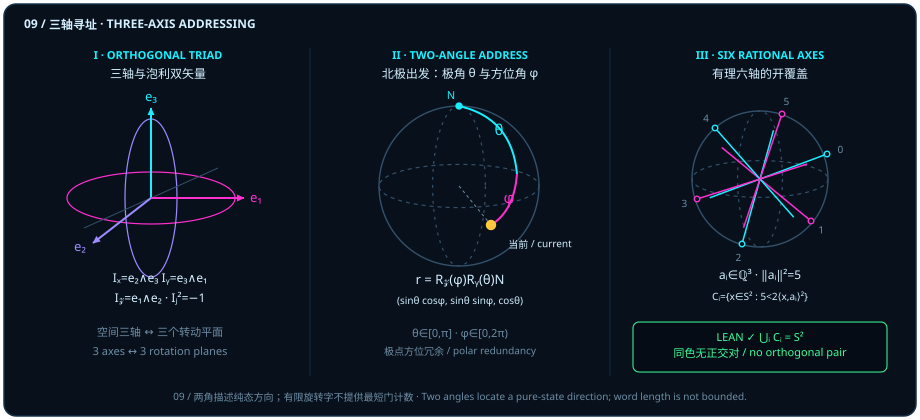

# Mutually Orthogonal Triads: Why One and Two Orthogonal Steps Reach the Whole Sphere

> *"The key is how isotropy lets us reach another point through orthogonal relations: one orthogonal step, then a second, because the three directions are mutually orthogonal."*

Across Part I ([Chapter 1](ch01-measurement.md) through [Chapter 4](ch04-decoherence.md)) and Part II, we climbed the first two rungs of the dimensional ladder — from point to line, and from line to plane. First we restored the isolated "quantum" to a pairwise inner-product projection $\vv{a}\cdot\vv{b} = \cos\theta$ between two directional rays; then we restored complex phase and single-axis quantum gates to oriented area rotations $\vv{a}\wedge\vv{b} = \sin\theta\,\hat{I}$ within a two-dimensional plane. Now Part III takes the decisive step that closes the loop in three dimensions: **assembling flat rotation planes into the full two-sphere $S^2$**.

Start with an elementary geometric question. If an observer commands only a single flat turntable — say, a phase gate rotating about one fixed axis — can that observer reach every direction in three-dimensional space? Never: a single plane traces only a one-dimensional circle. To step off that circle and reach every point on the unit sphere $S^2 \subset \mathbb{R}^3$, how many mutually orthogonal axes must the ambient space provide? And starting from the north-pole reference state, why do **one orthogonal step, then a second** suffice to address every pure-state direction on the globe?

::: {.viz src="two-angle-addressing" preset="tilt" height="500"}
**One turn draws only one circle.** Turning about $\vv{e}_2$ alone, the amber point runs once round the violet dashed meridian and comes back to the north pole $N$; the white line, the road it travelled, never leaves that one circle.
:::

This chapter turns that intuitive maxim into four precise geometric and topological results: from the existence of a unit normal perpendicular to any pair of vectors in $\mathbb{R}^3$, through two-angle addressing from the North Pole and finite-word generation of $\mathrm{SO}(3)$ from any two noncollinear axes, to an explicit rational six-axis open cover of $S^2$ free of orthogonal pairs (where each strict superlevel condition $2\langle x, a_i\rangle_{\mathbb{R}}^2 > 5\norm{x}^2$ defines a pair of antipodal open spherical caps around $\pm a_i/\norm{a_i}$, giving 6 antipodal pairs = 12 open caps on $S^2$) and its matching topological six-color lower bound.

## Three Axes and Three Bivector Planes {#sec-three-axis-pauli-bivectors}

Why does the Bloch sphere of a single qubit live in **three-dimensional** real Euclidean space $\mathbb{R}^3$, and why do the Pauli operators come in a triad $\sigma_x, \sigma_y, \sigma_z$ of **three**?

Perform a basic dimensional audit in three-dimensional real Euclidean space $\mathrm{Space} = \mathbb{R}^3$ (`EuclideanSpace ℝ (Fin 3)` in Lean). Hand someone *any* two vectors $a, b \in \mathbb{R}^3$ whatsoever — even if neither is normalized, even if they meet at an oblique angle, and even if one vanishes or the two are parallel. Three-dimensional space always has room for at least a third orthogonal direction, guaranteeing a **unit normal vector** $n$ perpendicular to both $a$ and $b$.

::: {.lemma #lemma-three-axis-normal title="Existence of a Common Unit Normal to Any Pair of Vectors in Three-Space" lean="D5/S3/Geometry/TwoAxisFiniteRotation.unit_perpendicular_pair"}
Let $\mathrm{Space} = \mathbb{R}^3$ be three-dimensional real Euclidean space. For any two vectors $a, b \in \mathrm{Space}$, there exists a vector $n \in \mathrm{Space}$ such that

$$
\norm{n} = 1, \qquad \langle a, n\rangle_{\mathbb{R}} = 0, \qquad \langle b, n\rangle_{\mathbb{R}} = 0.
$$
:::

::: proof
Let $W = \operatorname{span}_{\mathbb{R}}\{a, b\} \subseteq \mathbb{R}^3$ be the real linear subspace spanned by $a$ and $b$. Because $W$ is generated by two vectors, its dimension satisfies $\dim_{\mathbb{R}} W \le 2 < 3 = \dim_{\mathbb{R}} \mathbb{R}^3$ (with $\dim_{\mathbb{R}} W = 2$ when $a, b$ are linearly independent and $\dim_{\mathbb{R}} W \le 1$ when they are collinear or vanish). Its orthogonal complement $W^\perp = \{v \in \mathbb{R}^3 \mid \forall w \in W,\; \langle w, v\rangle_{\mathbb{R}} = 0\}$ therefore has dimension at least $3 - 2 = 1$ and contains a nonzero vector $v \neq 0$. Normalizing to $n = \norm{v}^{-1} v$ yields $\norm{n} = 1$, while $a, b \in W$ gives $\langle a, n\rangle_{\mathbb{R}} = 0$ and $\langle b, n\rangle_{\mathbb{R}} = 0$. The full proof is checked by the Lean kernel.
:::

Notice the exact scope of [@lemma-three-axis-normal]: no normalization, nonzero, or pairwise-orthogonality hypothesis is imposed on the inputs $a, b \in \mathbb{R}^3$. When $a$ and $b$ are collinear and not both zero ($\dim_{\mathbb{R}}\operatorname{span}\{a, b\} = 1$), the common unit normals form a unit circle $S^1$ in the orthogonal plane; when $a = b = 0$, the orthogonality constraints are vacuous and the common unit normals form the entire unit sphere $S^2$. The lemma asserts the existence of at least one unit vector perpendicular to both without selecting an orientation.

Once we fix the standard orthonormal triad $\vv{e}_1 = (1, 0, 0)$, $\vv{e}_2 = (0, 1, 0)$, $\vv{e}_3 = (0, 0, 1)$, this duality between pairs of axes and normal directions locks into a clean geometric architecture:

1. **Three one-dimensional orthogonal axes**: $\vv{e}_1, \vv{e}_2, \vv{e}_3$ satisfy $\langle \vv{e}_i, \vv{e}_j\rangle_{\mathbb{R}} = \delta_{ij}$, anchoring the six cardinal poles $\pm\vv{e}_1, \pm\vv{e}_2, \pm\vv{e}_3$ on $S^2$ ([Chapter 1](ch01-measurement.md), [@ex-bloch-six-poles]);
2. **Three two-dimensional orthogonal bivector planes**: Inside the Euclidean Clifford algebra $\mathrm{Cl}_{3,0}$, each pair of orthonormal axes spans a unit oriented rotation plane:

   $$
   I_x = \vv{e}_2 \vv{e}_3 = \vv{e}_2 \wedge \vv{e}_3, \qquad
   I_y = \vv{e}_3 \vv{e}_1 = \vv{e}_3 \wedge \vv{e}_1, \qquad
   I_z = \vv{e}_1 \vv{e}_2 = \vv{e}_1 \wedge \vv{e}_2.
   $$

   Because $\vv{e}_j^2 = +1$ and distinct axes anticommute ($\vv{e}_j \vv{e}_k = -\vv{e}_k \vv{e}_j$ for $j \neq k$), every unit coordinate bivector squares to $-1$:

   $$
   I_x^2 = I_y^2 = I_z^2 = -1, \qquad I_x I_y = -I_y I_x = -I_z.
   $$

   With orientation fixed, these three unit bivectors correspond to the single-qubit Pauli operators via the convention $I_j = i\sigma_j$ ($j \in \{x, y, z\}$).

Panel I of Figure 09 displays this exact correspondence: **rotating about the axis $\vv{e}_3$ means turning inside the equatorial plane $I_z = \vv{e}_1 \wedge \vv{e}_2$; rotating about the axis $\vv{e}_2$ means turning inside the meridian plane $I_y = \vv{e}_3 \wedge \vv{e}_1$.** Three mutually orthogonal axes and three mutually perpendicular rotation planes are Hodge duals of one another.

> One plane traces a circle; three interlocked orthogonal planes close a sphere.

## Two-Angle Addressing from the North Pole {#sec-two-angle-state-address}

Armed with the orthonormal triad $(\vv{e}_1, \vv{e}_2, \vv{e}_3)$, stand at the North Pole reference direction $N = \vv{e}_3 = (0, 0, 1)$ (corresponding to the computational basis projector $\lvert 0\rangle\langle 0\rvert$) and ask how two orthogonal steps address any point on $S^2$ (Panel II of Figure 09):

- **First orthogonal step (tilting by polar angle $\theta$ in the $\vv{e}_3 \wedge \vv{e}_1$ meridian plane)**: Rotate about the horizontal axis $\vv{e}_2 \perp \vv{e}_3$ by polar angle $\theta \in [0, \pi]$. This carries $N = (0, 0, 1)$ down the prime meridian to vertical height $\cos\theta$ and horizontal projection $\sin\theta$:

  $$
  R_y(\theta) N = (\sin\theta,\; 0,\; \cos\theta).
  $$

- **Second orthogonal step (sweeping by azimuthal angle $\varphi$ in the $\vv{e}_1 \wedge \vv{e}_2$ equatorial plane)**: Next rotate about the vertical axis $\vv{e}_3$ — whose rotation plane meets the first meridian plane at a $90^\circ$ dihedral angle — by azimuthal angle $\varphi \in [0, 2\pi)$. Preserving vertical height $\cos\theta$, this sweeps the horizontal projection around the latitude circle to land on the target direction:

  $$
  \vv{r}(\theta, \varphi) = R_z(\varphi) R_y(\theta) N = (\sin\theta\cos\varphi,\; \sin\theta\sin\varphi,\; \cos\theta) \in S^2.
  $$

::: {.viz src="two-angle-addressing" preset="address" height="500"}
**Tilt once, twist once, and any point is reached.** First tilt by $\theta = 60^\circ$ about $\vv{e}_2$, then twist by $\varphi = 45^\circ$ about the vertical axis $\vv{e}_3$: the second turn runs along the violet dashed latitude circle at the fixed height $\cos\theta = \frac{1}{2}$, and the amber point stops in the white target ring at $x = \bigl(\frac{\sqrt{6}}{4}, \frac{\sqrt{6}}{4}, \frac{1}{2}\bigr)$, the point of [@ex-two-angle-six-axis].
:::

Why is no "third orthogonal step" needed to locate a state on the sphere? Because $S^2 \subset \mathbb{R}^3$ is a two-dimensional surface: the polar angle $\theta \in [0, \pi]$ selects the latitude circle and the azimuthal angle $\varphi \in [0, 2\pi)$ selects the meridian, so two orthogonal turns already reach every unit vector on $S^2$. (Synthesizing an arbitrary *unitary gate* in $\mathrm{SO}(3)$ or $\mathrm{SU}(2)$, as opposed to addressing a state on $S^2$, is treated in [@rem-axes-literature] and in the kernel-verified ZYZ compiler of [Chapter 26](ch26-single-qubit-rotor-compilation.md).)

Two essential geometric distinctions must be kept sharp whenever we use this two-angle address:

1. **Bloch angle $\theta$ versus spinor half-angle $\theta/2$**: On the real sphere $S^2$, $R_y(\theta)N$ rotates through the full physical angle $\theta$. In the two-component complex spinor space $\mathbb{C}^2$, by Born's half-angle law ([Chapter 2](ch02-born-rule.md)), the corresponding normalized state ket (up to global phase) uses the half-angle $\theta/2$:

   $$
   \lvert\psi(\theta, \varphi)\rangle = \cos\frac{\theta}{2}\lvert 0\rangle + e^{i\varphi}\sin\frac{\theta}{2}\lvert 1\rangle = \begin{pmatrix} \cos(\theta/2) \\ e^{i\varphi}\sin(\theta/2) \end{pmatrix}.
   $$

2. **Azimuthal redundancy at the poles**: At $\theta = 0$ (North Pole $N$) and $\theta = \pi$ (South Pole $-N$), $\sin\theta = 0$, so $\vv{r}(0, \varphi) = (0, 0, 1)$ and $\vv{r}(\pi, \varphi) = (0, 0, -1)$ for *every* $\varphi \in [0, 2\pi)$. Thus $\varphi$ is redundant at both poles, and $(\theta, \varphi)$ is a surjective coordinate parametrization rather than a global nonsingular chart on $S^2$.

::: {.viz src="two-angle-addressing" preset="pole" height="500"}
**At the south pole the twist does nothing.** Tilt by $\theta = 180^\circ$ to the south pole, then twist a full turn about the vertical axis: the amber point stays exactly where it is, and only the white flag sweeps round the dashed circle. At the poles every $\varphi$ names the same point.
:::

## Initial Structure and Finite Rotation Words {#sec-finite-axis-words}

In the two-angle formula above, our two rotation axes $\vv{e}_2$ and $\vv{e}_3$ met at a strict $90^\circ$ right angle. What if a hardware platform provides two control axes $a, b \in \mathbb{R}^3$ that are *not* mutually perpendicular — say, two skew drive fields meeting at an oblique angle? Can finite sequences of rotations drawn from the two continuous axis circles still generate every rotation $R \in \mathrm{SO}(3)$?

In the Lean module `TwoAxisFiniteRotation`, let $\mathrm{Orthogonal} = (\mathrm{Space} \simeq_{\ell i}[\mathbb{R}] \mathrm{Space})$ denote the group of real linear isometric equivalences of $\mathbb{R}^3$, with $\operatorname{determinant}(R) = \det(R)$. For any vector $a \in \mathrm{Space}$, the subgroup of orientation-preserving rotations fixing $a$ is

$$
\operatorname{axisCircle}(a) = \bigl\{\, R \in \mathrm{Orthogonal} \;\big|\; \operatorname{determinant}(R) = 1 \;\land\; R(a) = a \,\bigr\},
$$

and a list $l : \operatorname{List}\,\mathrm{Orthogonal}$ is a two-axis word (`IsAxisWord a b l`) when every factor belongs to one of the two axis circles:

$$
\operatorname{IsAxisWord}(a, b, l) \;\Longleftrightarrow\; \forall Q \in l,\quad Q \in \operatorname{axisCircle}(a) \;\lor\; Q \in \operatorname{axisCircle}(b).
$$

The next theorem proves that whenever $a$ and $b$ have strictly positive Gram determinant $\langle a, b\rangle_{\mathbb{R}}^2 < \norm{a}^2 \norm{b}^2$ (strict Cauchy–Schwarz inequality, meaning $a$ and $b$ are nonzero and noncollinear), finite words from their two continuous axis circles generate the entire special orthogonal group $\mathrm{SO}(3)$.

::: {.theorem #thm-two-axis-finite-word title="Finite-Word Generation of Three-Dimensional Rotations from Two Noncollinear Axes" lean="D5/S3/Geometry/TwoAxisFiniteRotation.two_axis_finite_word"}
Let $a, b \in \mathrm{Space} = \mathbb{R}^3$ satisfy the strict Cauchy–Schwarz inequality

$$
\langle a, b\rangle_{\mathbb{R}}^2 < \norm{a}^2 \cdot \norm{b}^2.
$$

Then for every real linear isometric equivalence $R \in \mathrm{Orthogonal}$ with $\operatorname{determinant}(R) = 1$, there exists a finite list $l : \operatorname{List}\,\mathrm{Orthogonal}$ such that

$$
\operatorname{IsAxisWord}(a, b, l) \qquad\text{and}\qquad l.\mathrm{prod} = R.
$$
:::

::: proof
The hypothesis $\langle a, b\rangle_{\mathbb{R}}^2 < \norm{a}^2 \norm{b}^2$ ensures $a \neq 0$, $b \neq 0$, and $|\langle \hat{a}, \hat{b}\rangle_{\mathbb{R}}| < 1$ for the normalized directions $\hat{a} = \norm{a}^{-1}a$ and $\hat{b} = \norm{b}^{-1}b$. Alternating rotations from $\operatorname{axisCircle}(a)$ and $\operatorname{axisCircle}(b)$ expand the reachable latitude band on $S^2$ by a fixed positive angular increment controlled by $\sqrt{1 - \langle\hat{a},\hat{b}\rangle_{\mathbb{R}}^2} > 0$ at each stage, so finitely many alternating factors carry any unit vector to $\hat{a}$ and conjugate rotations about any axis into $\operatorname{axisCircle}(a)$. Concatenating the finite stabilizing word with the remaining axial rotation yields a finite list $l$ whose elements all lie in $\operatorname{axisCircle}(a) \cup \operatorname{axisCircle}(b)$ and whose product equals $R$. The full proof is checked by the Lean kernel.
:::

::: {.viz src="two-angle-addressing" preset="skew" height="500"}
**Skew axes get there too, with more turns.** The violet axes are only $30^\circ$ apart: each turn about $b$ pushes the point at most $60^\circ$ further out, and the cyan dashed circle is the farthest it can be so far. Four turns, alternating about $b$ and about $a$, bring the amber point to the white target ring $110^\circ$ from $N$. The page builds this word on the spot by a greedy rule; [@thm-two-axis-finite-word] only guarantees that such a finite word exists.
:::

Keep the mathematical contract of [@thm-two-axis-finite-word] exact:

1. **Why initial structure matters (and the zero-vector degenerate case)**: The inputs $a, b$ need not be unit vectors or mutually orthogonal; they only need $\langle a, b\rangle_{\mathbb{R}}^2 < \norm{a}^2 \norm{b}^2$. When Cauchy–Schwarz holds with equality ($\langle a, b\rangle_{\mathbb{R}}^2 = \norm{a}^2 \norm{b}^2$), two distinct degenerate cases arise: if $a \neq 0$ and $b \neq 0$ are **nonzero collinear axes** ($a \parallel b$), both axis circles collapse into the same abelian circle subgroup $\operatorname{axisCircle}(a) = \operatorname{axisCircle}(b) \cong \mathrm{SO}(2)$ and finite words cannot leave a single plane; if instead $a = 0$ or $b = 0$, then by the total definition $\operatorname{axisCircle}(0) = \{R \in \mathrm{Orthogonal} \mid \operatorname{determinant}(R) = 1 \land R(0) = 0\} = \mathrm{SO}(3)$ (since every linear map fixes $0$), so the stabilizer of $0$ is already all of $\mathrm{SO}(3)$ and every rotation is trivially a one-letter word even though $0$ defines no geometric rotation axis.

::: {.viz src="two-angle-addressing" preset="collinear" height="500"}
**Collinear axes are stuck in place.** At $\alpha = 0$ the violet axes $a$ and $b$ coincide: a turn about $a$ and a turn about $b$ are the same kind of turn, and both fix $N$. The amber point stays put; the white flag only turns in the horizontal plane.
:::

2. **Existence versus word-length bounds and discrete gates**: [@thm-two-axis-finite-word] allows arbitrary continuous rotations from the full subgroups $\operatorname{axisCircle}(a)$ and $\operatorname{axisCircle}(b)$ and asserts the existence of a finite list $l$ with $l.\mathrm{prod} = R$. It does **not** assert a universal word length of $2$ or $3$ for skew axes (as the angle between $a$ and $b$ shrinks, more alternating steps are needed), does **not** assert that two fixed discrete gates reach every state, and provides **no** minimal-length bound or constructive synthesis algorithm.

::: {.viz src="two-angle-addressing" preset="narrow" height="500"}
**The smaller the angle, the more the turns.** With the violet axes only $10^\circ$ apart, each turn about $b$ pushes the point at most $20^\circ$ further out, and the cyan dashed circle creeps outward one step at a time; the same target, $110^\circ$ from $N$, now takes twelve turns. This is the page's construction, not a shortest word.
:::

## A Rational Six-Axis Cover and the Six-Color Lower Bound {#sec-rational-six-axis-atlas}

Because two-angle coordinates $(\theta, \varphi)$ become singular at the poles and any single reference axis $\vv{a}$ leaves an orthogonal equator $\{x \in S^2 \mid \langle x, \vv{a}\rangle_{\mathbb{R}} = 0\}$ where inner-product overlap vanishes ([Chapter 1](ch01-measurement.md) and [Chapter 2](ch02-born-rule.md)), a natural topological question arises:

**What is the minimum number of relatively open sets $U_0, \dots, U_{k-1} \subseteq S^2$ required to cover the entire unit two-sphere $S^2$ so that no single open set $U_i$ contains an orthogonal pair of vectors ($\langle x, y\rangle_{\mathbb{R}} \neq 0$ for all $x, y \in U_i$)?**

Can we construct such an orthogonality-free open atlas explicitly using only axes with integer coordinates? Panel III of Figure 09 shows that **six rational axes** suffice. In the Lean module `RationalSixAxisCover`, let $\mathrm{UnitSphere} = \{x \in \mathbb{R}^3 \mid \norm{x} = 1\}$ and define the six rational vectors `axis` in exact index order $i \in \{0, 1, 2, 3, 4, 5\}$:

$$
\begin{aligned}
a_0 &= (1, 2, 0), &\quad a_1 &= (1, -2, 0), &\quad a_2 &= (0, 1, 2), \\
a_3 &= (0, 1, -2), &\quad a_4 &= (2, 0, 1), &\quad a_5 &= (-2, 0, 1).
\end{aligned}
$$

Notice that these six rational vectors are *not* the coordinate axes $\pm\vv{e}_j$, and they are unnormalized, each having squared Euclidean norm $\norm{a_i}^2 = 1^2 + 2^2 + 0^2 = 5$. Geometrically, why do we choose $(1, \pm 2, 0)$, $(0, 1, \pm 2)$, and $(\pm 2, 0, 1)$ rather than the three coordinate axes $\vv{e}_1, \vv{e}_2, \vv{e}_3$?

Because three coordinate axes only yield three antipodal pairs of $45^\circ$ caps, which fail to cover the eight octant diagonals $(\pm 1, \pm 1, \pm 1)/\sqrt{3}$ where $\langle x, \vv{e}_j\rangle_{\mathbb{R}}^2 = 1/3 < 1/2$! By tilting two axes into each coordinate plane with cyclic $1:2$ integer slopes, the six rational axes distribute twelve open $45^\circ$ caps symmetrically around the sphere so that no gap remains anywhere on $S^2$.

For each index $i \in \operatorname{Fin} 6$, define the strict superlevel set

$$
\operatorname{color}(i) = \bigl\{\, x \in \mathrm{UnitSphere} \;\big|\; 5 < 2\,\langle x, a_i\rangle_{\mathbb{R}}^2 \,\bigr\}.
$$

Since $\norm{a_i}^2 = 5$ and $\norm{x}^2 = 1$ on $\mathrm{UnitSphere}$, the homogeneous inequality $2\langle x, a_i\rangle_{\mathbb{R}}^2 > 5\norm{x}^2$ (i.e. $5 < 2\langle x, a_i\rangle_{\mathbb{R}}^2$) is equivalent to $\langle x, \hat{a}_i\rangle_{\mathbb{R}}^2 > \frac{1}{2}$ for the unit direction $\hat{a}_i = a_i / \norm{a_i} = a_i / \sqrt{5}$. Geometrically, each $\operatorname{color}(i)$ is a **pair of antipodal open spherical caps** of angular radius $45^\circ$ around $\pm\hat{a}_i$ (so the 6 colors form 6 antipodal pairs = 12 open caps on $S^2$, where each contained point lies at an angle strictly below $45^\circ$ from $+\hat{a}_i$ or $-\hat{a}_i$):

- It is **disconnected** (the northern cap around $+\hat{a}_i$ and the southern cap around $-\hat{a}_i$ are disjoint);
- It **contains obtuse pairs** (picking $x$ near $+\hat{a}_i$ and $y$ near $-\hat{a}_i$ gives $\langle x, y\rangle_{\mathbb{R}} < -1/2 < 0$);
- Yet **no two vectors inside the same $\operatorname{color}(i)$ can ever be orthogonal** ($\langle x, y\rangle_{\mathbb{R}} \neq 0$), because every vector in $\operatorname{color}(i)$ has more than half of its squared norm aligned with the single line $\mathbb{R}a_i$, leaving strictly less than half of its squared norm in the two-dimensional orthogonal plane $a_i^\perp$.

::: {.viz src="two-angle-addressing" preset="three" height="500"}
**The caps of the three coordinate axes leave gaps on the diagonals.** With only the $45^\circ$ caps around $\pm\vv{e}_1, \pm\vv{e}_2, \pm\vv{e}_3$, the amber point reaches the octant diagonal $(1, 1, 1)/\sqrt{3}$, where none of the three grey pairs of circles holds it: it sits in the magenta gap, where $\langle x, \vv{e}_j\rangle_{\mathbb{R}}^2 = 1/3 < 1/2$. The magenta dots are the gaps the page finds by sampling a grid on the sphere.
:::

::: {.proposition #prop-rational-six-axis-cover title="Rational Six-Axis Orthogonality-Free Open Cover of the Two-Sphere" lean="D5/S3/Geometry/Orthogonality/RationalSixAxisCover.rational_six_axis_open_cover"}
For the six subsets $\operatorname{color} : \operatorname{Fin} 6 \to \mathcal{P}(\mathrm{UnitSphere})$ defined by the rational axes $a_0, \dots, a_5$ above, all three properties hold:

1. **Relative openness**: For every $i \in \operatorname{Fin} 6$, $\operatorname{color}(i)$ is open in $\mathrm{UnitSphere}$;
2. **No orthogonal pairs within a color**: For every $i \in \operatorname{Fin} 6$ and all $x, y \in \operatorname{color}(i)$, $\langle x, y\rangle_{\mathbb{R}} \neq 0$;
3. **Complete coverage**: The union of the six colors covers the entire sphere, $\bigcup_{i \in \operatorname{Fin} 6} \operatorname{color}(i) = \mathrm{UnitSphere}$.
:::

::: proof
1. For each $i \in \operatorname{Fin} 6$, the map $x \mapsto 2\langle x, a_i\rangle_{\mathbb{R}}^2$ is continuous on $\mathrm{UnitSphere}$, so the strict superlevel set $\{x \mid 5 < 2\langle x, a_i\rangle_{\mathbb{R}}^2\}$ is open.
2. Given $x, y \in \operatorname{color}(i)$, we have $2\langle x, a_i\rangle_{\mathbb{R}}^2 > 5$ and $2\langle y, a_i\rangle_{\mathbb{R}}^2 > 5$. If $\langle x, y\rangle_{\mathbb{R}} = 0$, then $(x, y)$ is an orthonormal pair in $\mathbb{R}^3$, so Bessel's inequality (`Orthonormal.sum_inner_products_le`) gives $\langle x, a_i\rangle_{\mathbb{R}}^2 + \langle y, a_i\rangle_{\mathbb{R}}^2 \le \norm{a_i}^2 = 5$, contradicting $2\bigl(\langle x, a_i\rangle_{\mathbb{R}}^2 + \langle y, a_i\rangle_{\mathbb{R}}^2\bigr) > 10$ (equivalently, decomposing along $u = a_i/\sqrt{5}$ gives $|\langle x_\perp, y_\perp\rangle_{\mathbb{R}}| < \frac{1}{2} < |\langle x, u\rangle_{\mathbb{R}}\langle y, u\rangle_{\mathbb{R}}|$). Hence $\langle x, y\rangle_{\mathbb{R}} \neq 0$.
3. For any $x = (x_0, x_1, x_2) \in \mathbb{R}^3$, note that simply summing over all six axes gives $\sum_{i=0}^5 2\langle x, a_i\rangle_{\mathbb{R}}^2 = 20\norm{x}^2 \le 30\norm{x}^2$ (since $\sum_{i=0}^5 a_i a_i^{\mathsf{T}} = 10 I_3$), which does not by itself contradict the six upper bounds; instead, the frozen proof (`signed_square`, `cyclic_max_square`, `large_projection`) establishes an explicit maximum-projection polynomial certificate. Set $a = |x_0|, b = |x_1|, c = |x_2| \ge 0$ (with $a^2 + b^2 + c^2 = \norm{x}^2$) and define the cyclic maximum
   $$
   M = \max\bigl(a + 2b,\; b + 2c,\; c + 2a\bigr) = \max\bigl(|x_0| + 2|x_1|,\; |x_1| + 2|x_2|,\; |x_2| + 2|x_0|\bigr).
   $$
   With $u = M - a - 2b \ge 0$, $v = M - b - 2c \ge 0$, and $w = M - c - 2a \ge 0$, the polynomial identity (`cyclic_max_square`)
   $$
   3M^2 - 9(a^2 + b^2 + c^2) = uv + vw + wu + 6(aw + bu + cv) + \frac{(a - b)^2 + (b - c)^2 + (c - a)^2}{2} \ge 0
   $$
   yields $M^2 \ge 3(a^2 + b^2 + c^2) = 3\norm{x}^2$. By `signed_square`, for any $s, t \in \mathbb{R}$, $(|s| + 2|t|)^2$ equals $(s + 2t)^2$ or $(s - 2t)^2$ according to whether $s$ and $t$ have the same or opposite signs. Pairing the maximizing cyclic sum with its matching sign choice among the six axes $(a_0, a_1), (a_2, a_3), (a_4, a_5)$ gives (`large_projection`) an index $i \in \operatorname{Fin} 6$ with $\langle x, a_i\rangle_{\mathbb{R}}^2 = M^2 \ge 3\norm{x}^2$, hence $2\langle x, a_i\rangle_{\mathbb{R}}^2 \ge 2M^2 \ge 6\norm{x}^2 > 5\norm{x}^2$. For $x \in \mathrm{UnitSphere}$ ($\norm{x} = 1$), $2\langle x, a_i\rangle_{\mathbb{R}}^2 \ge 6 > 5$, so $x \in \operatorname{color}(i)$. The full proof is checked by the Lean kernel.
:::

Could five or four orthogonality-free open sets ever suffice to cover $S^2$? In the Lean module `SphereOrthogonalityCover`, a subset $U \subseteq S^2$ is called `OrthogonalityFree U` when

$$
\operatorname{OrthogonalityFree}(U) \;\Longleftrightarrow\; \forall x \in U,\; \forall y \in U,\quad \langle x, y\rangle_{\mathbb{R}} \neq 0.
$$

The next corollary proves that **six colors are strictly necessary**.

::: {.corollary #cor-six-colors-necessary title="Six-Color Lower Bound for Open Orthogonality-Free Covers of the Two-Sphere" lean="D5/S3/Topology/SphereOrthogonalityCover.sphere_two_open_orthogonality_free_cover_lower_six"}
Let $k \in \mathbb{N}$ and let $U : \operatorname{Fin} k \to \mathcal{P}(S^2)$ be a family of subsets of the unit sphere $S^2 \subset \mathbb{R}^3$. Suppose:

1. For every $i \in \operatorname{Fin} k$, $U_i$ is open in $S^2$;
2. Every point $x \in S^2$ belongs to $U_i$ for some $i \in \operatorname{Fin} k$;
3. For every $i \in \operatorname{Fin} k$, $U_i$ satisfies $\operatorname{OrthogonalityFree}(U_i)$.

Then

$$
6 \le k.
$$
:::

::: proof
The frozen proof proceeds in two concrete steps (`sphere_three_absent_colors` and `open_cover_contractible_of_multiplicity_lt`):

1. **Restriction to the perpendicular unit circle forces at least $3$ absent colors at every point**: For any $x \in S^2$, its orthogonal complement $x^\perp \subset \mathbb{R}^3$ contains the equatorial unit circle $S^1_x = \{y \in S^2 \mid \langle x, y\rangle_{\mathbb{R}} = 0\}$. By `OrthogonalityFree`, no color $U_i$ containing $x$ can meet $S^1_x$, so $S^1_x$ is covered by the preimages of the colors that *omit* $x$. Applying the general dimension lower bound `sphere_open_orthogonality_free_cover_lower_bound` ($2n - 1$ for ambient dimension $n \ge 2$) to the unit circle in $\mathbb{R}^2$ ($n = 2$) shows that covering $S^1_x$ requires at least $2(2) - 1 = 3$ orthogonality-free open sets; hence at every $x \in S^2$, at least $3$ indices $i \in \operatorname{Fin} k$ satisfy $x \notin U_i$.
2. **Point multiplicity at most $2$ forces an impossible contraction of $S^2$**: Suppose $k < 6$ ($k \le 5$). Since at least $3$ colors are absent at each $x \in S^2$, every point $x$ belongs to at most $k - 3 \le 2 < 3 = \dim_{\mathbb{R}}\mathbb{R}^3$ sets $U_i$. Refining each $U_i$ into its open acute connected components (`exists_finite_acute_refinement`) and normalizing a subordinate partition-of-unity combination of component representatives (`acute_cover_normalized_map`) produces a continuous map $g : S^2 \to S^2$ homotopic to $\mathrm{id}_{S^2}$ whose value $g(x)$ at each point lies in the span of at most $2$ vectors. Because a finite union of proper subspaces cannot cover $\mathbb{R}^3$, $g$ omits some point $p \in S^2$ (`map_omits_point_of_small_spans`), which via stereographic projection would make $S^2$ contractible (`ContractibleSpace`), contradicting `SphereBrouwerObstruction.not_contractible_unit_sphere`. Therefore $6 \le k$. The full proof is checked by the Lean kernel.
:::

Together, [@prop-rational-six-axis-cover] and [@cor-six-colors-necessary] pin down the exact minimal size of an open orthogonality-free cover of $S^2$ at $k = 6$. Let us check both two-angle addressing and rational six-axis membership on a single explicit vector.

::: {.example #ex-two-angle-six-axis title="One State Checked by Two Angles and Six Rational Axes"}
Fix the standard basis $\vv{e}_1 = (1, 0, 0)$, $\vv{e}_2 = (0, 1, 0)$, $\vv{e}_3 = (0, 0, 1)$, north pole $N = \vv{e}_3$, and Euclidean $\mathrm{Cl}_{3,0}$ bivectors $I_x = \vv{e}_2\vv{e}_3$, $I_y = \vv{e}_3\vv{e}_1$, $I_z = \vv{e}_1\vv{e}_2$ with $I_j^2 = -1$ and Pauli convention $I_j = i\sigma_j$.

1. **Two-angle address on $S^2$**: Choose $\theta = \frac{\pi}{3}$ and $\varphi = \frac{\pi}{4}$. Since $\sin\frac{\pi}{3} = \frac{\sqrt{3}}{2}$, $\cos\frac{\pi}{3} = \frac{1}{2}$, and $\cos\frac{\pi}{4} = \sin\frac{\pi}{4} = \frac{\sqrt{2}}{2}$, we obtain

   $$
   x = R_z\Bigl(\frac{\pi}{4}\Bigr) R_y\Bigl(\frac{\pi}{3}\Bigr) N
   = \bigl(\sin\theta\cos\varphi,\; \sin\theta\sin\varphi,\; \cos\theta\bigr)
   = \Bigl(\frac{\sqrt{6}}{4},\; \frac{\sqrt{6}}{4},\; \frac{1}{2}\Bigr),
   $$

   with unit squared norm $\norm{x}^2 = \frac{3}{8} + \frac{3}{8} + \frac{1}{4} = 1$. (At the poles $\theta \in \{0, \pi\}$, $\varphi$ is redundant, so $(\theta, \varphi)$ is not a global nonsingular chart.)
2. **Spinor half-angle ket**: The corresponding pure qubit state uses the half-angle $\theta/2 = \frac{\pi}{6}$:

   $$
   \lvert\psi\rangle = \cos\frac{\pi}{6}\lvert 0\rangle + e^{i\pi/4}\sin\frac{\pi}{6}\lvert 1\rangle = \Bigl(\frac{\sqrt{3}}{2},\; \frac{1}{2}e^{i\pi/4}\Bigr),
   $$

   distinguishing the spinor half-angle $\theta/2$ from the Bloch angle $\theta$.
3. **Membership in the six rational colors**: In the frozen axis order $0, \dots, 5$, where each $a_i \in \mathbb{Q}^3$ is unnormalized with $\norm{a_i}^2 = 5$ (and is *not* a coordinate axis $\pm\vv{e}_j$), the squared inner products $(x \cdot a_i)^2$ are

   $$
   \begin{aligned}
   (x \cdot a_0)^2 &= \frac{27}{8}, &\quad 2(x \cdot a_0)^2 &= \frac{27}{4} = 6.75 > 5, \\
   (x \cdot a_1)^2 &= \frac{3}{8}, &\quad 2(x \cdot a_1)^2 &= \frac{3}{4} = 0.75 < 5, \\
   (x \cdot a_2)^2 &= \frac{11}{8} + \frac{\sqrt{6}}{2}, &\quad 2(x \cdot a_2)^2 &= \frac{11}{4} + \sqrt{6} \approx 5.199 > 5, \\
   (x \cdot a_3)^2 &= \frac{11}{8} - \frac{\sqrt{6}}{2}, &\quad 2(x \cdot a_3)^2 &= \frac{11}{4} - \sqrt{6} \approx 0.301 < 5, \\
   (x \cdot a_4)^2 &= \frac{7}{4} + \frac{\sqrt{6}}{2}, &\quad 2(x \cdot a_4)^2 &= \frac{7}{2} + \sqrt{6} \approx 5.949 > 5, \\
   (x \cdot a_5)^2 &= \frac{7}{4} - \frac{\sqrt{6}}{2}, &\quad 2(x \cdot a_5)^2 &= \frac{7}{2} - \sqrt{6} \approx 1.051 < 5.
   \end{aligned}
   $$

   Under the strict membership condition $5 < 2(x \cdot a_i)^2$, precisely colors $0, 2, 4$ contain $x$.
:::

::: {.viz src="two-angle-addressing" preset="six" height="500"}
**Six rational axes cover everything.** Addressed by two angles, the amber point stops at $x = \bigl(\frac{\sqrt{6}}{4}, \frac{\sqrt{6}}{4}, \frac{1}{2}\bigr)$, inside the cyan caps of colours $0, 2, 4$, as computed by hand above; the white dashed line is the great circle orthogonal to $x$, and it enters no cap of those three colours ([@prop-rational-six-axis-cover]).
:::

::: {.remark #rem-axes-literature title="Two-Angle Parametrization, Euler Gate Decomposition, and the Six-Axis Open Cover (Literature Result, Not Formalized in This Book)"}
**Literature result, not formalized in this book.** Three scope distinctions govern the classical and topological background of this chapter:

1. **Two-angle state rays versus three-parameter single-qubit gates** (M. A. Nielsen & I. L. Chuang, *Quantum Computation and Quantum Information*, 10th Anniversary Ed., Cambridge University Press, 2010, §1.2 and §4.2): The coordinate formula $\vv{r}(\theta, \varphi) = (\sin\theta\cos\varphi, \sin\theta\sin\varphi, \cos\theta)$ and spinor correspondence $\lvert\psi\rangle = \cos(\theta/2)\lvert 0\rangle + e^{i\varphi}\sin(\theta/2)\lvert 1\rangle$ parametrize pure-state rays. Arbitrary single-qubit gates $U \in U(2)$ require a third Euler rotation parameter and possibly a global phase factor $e^{i\alpha}$.
2. **Finite word existence versus gate-count complexity**: [@thm-two-axis-finite-word] proves only that a finite word in the two full continuous axis circles $\operatorname{axisCircle}(a)$ and $\operatorname{axisCircle}(b)$ exists for each $R \in \mathrm{SO}(3)$. It does not provide an optimal gate count, a discrete-alphabet compiler, or any resolution of $\mathrm{P}$ versus $\mathrm{NP}$.
3. **Provenance and scope of the rational six-axis cover**: The rational six-axis construction in [@prop-rational-six-axis-cover] cites D. Feldman & A. Wilce, arXiv:2608.13320v1, Question 3, as recorded in the Lean source module; no claim of original novelty is made. Moreover, [@prop-rational-six-axis-cover] and [@cor-six-colors-necessary] concern open sets containing no orthogonal pair of unit vectors, not a global smooth tangent frame on $S^2$ (which is obstructed by the Hairy Ball Theorem studied in [Chapter 10](ch10-gram-geometry-and-order.md)).
:::

::: {.viz src="two-angle-addressing" height="560"}
**The full lab for two-angle addressing and rotation words.** Drag the white target ring and change the angle $\alpha$ between the two violet axes to see which rotation word carries the amber point there, and how the cyan dashed circle caps how far from the north pole each step can reach; switch to the “Cover” scene to compare, on the same sphere, the $45^\circ$ caps of six rational axes with those of the three coordinate axes. The green boxes cite only [@thm-two-axis-finite-word], [@prop-rational-six-axis-cover] and [@cor-six-colors-necessary]; the construction of the words and the sampling of the sphere are the page's numerical illustration.
:::

Having established how two orthogonal steps address the sphere and how six rational axis caps cover it without orthogonal blind spots, we now confront a deeper puzzle: **if sequential rotations on $S^2$ manifestly depend on order ($R_x R_y \neq R_y R_x$), what does it mean to say that pairwise quantum comparisons are globally consistent and order-independent?** Let us turn to [Chapter 10](ch10-gram-geometry-and-order.md).
