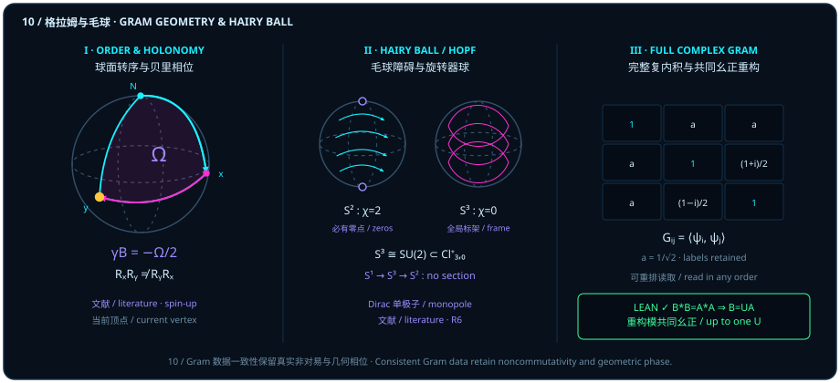

# Pairwise Comparison, Always Consistent, Order-Independent: Dissolving the Non-Commutativity Illusion and Berry Phase

> *"I keep feeling that the essence of quantum theory is this: compare things pairwise, always consistently, regardless of order."*

At first sight, the opening epigraph sounds like heresy to anyone trained in standard quantum mechanics: **"How could quantum theory possibly be order-independent?! Isn't noncommutativity $AB \neq BA$ the hallmark separating quantum mechanics from classical physics? On the three-dimensional sphere, rotating by $90^\circ$ about $X$ and then $90^\circ$ about $Y$ lands at a completely different point from rotating about $Y$ first and $X$ second! And transporting a state around a closed spherical triangle accumulates a path-dependent Berry geometric phase!"**

That apparent clash exposes a foundational distinction between two things that textbooks routinely conflate: **a time-ordered sequence of active physical operations that transform a state**, versus **the global Gram ledger of pairwise inner products among a family of states**.

Across four sections, this chapter makes the boundary between the two completely rigorous:

1. **Sequential spherical rotations and projective shutters genuinely fail to commute** ($R_x R_y \neq R_y R_x$, $P_0 P_+ \neq P_+ P_0$), and closed loops on $S^2$ genuinely carry a nonzero Berry phase $\gamma_B = -\Omega/2$;
2. **Sequential quantum instruments depend strictly on operational order and post-measurement updates**, which cannot be inferred from static single-step POVM effects alone ([@prop-static-sequential-separation] proves a parameter-free qubit counterexample where two instruments share identical static effects yet yield sequential joint probabilities $0$ and $1$);
3. **Why local coordinate charts on $S^2$ look path-tangled**: on the two-dimensional base sphere $S^2$, the Hairy Ball Theorem ($\chi(S^2) = 2$) forbids any nowhere-vanishing continuous tangent field, while the nontrivial Hopf circle bundle $S^1 \hookrightarrow S^3 \to S^2$ (first Chern number $|c_1| = 1$) forbids any continuous global phase section; by contrast, the three-dimensional rotor sphere $S^3 \cong \mathrm{SU}(2) \subset \mathrm{Cl}^+_{3,0}$ ($\chi(S^3) = 0$) carries an explicit nowhere-vanishing global tangent frame $(pI_x, pI_y, pI_z)$;
4. **Where true order-independent pairwise consistency lives**: when we retain the labeled **full complex Gram matrix** $G_{ij} = \langle\psi_i, \psi_j\rangle$ (with complex phases intact, not merely squared moduli $|G_{ij}|^2$), reading its pairwise entries in any order reconstructs the entire family of state vectors uniquely up to a single common ambient unitary $U$ ([@thm-gram-unitary-reconstruction] and [@lemma-unit-gram-equality]) — and even the Pancharatnam–Berry phase of an oriented spherical geodesic triangle is already encoded inside $G$ by the cyclic triple product $\Delta = G_{01}G_{12}G_{20}$ via the exact sign relation $\gamma_B \equiv -\arg\Delta = -\frac{\Omega}{2} \pmod{2\pi}$ (minus half the signed solid angle under the spin-up convention)!

## Rotation Order and Berry Solid Angle {#sec-spherical-order-and-berry}

Begin by honoring genuine noncommutativity where it actually occurs.

Take the Bloch sphere in Panel I of Figure 10 and apply active right-hand rotations to the North Pole $\vv{e}_3 = (0, 0, 1)$:

- If we **rotate first about $Y$ by $+90^\circ$ and second about $X$ by $+90^\circ$**, the first step $R_y(\pi/2)\vv{e}_3 = \vv{e}_1$ carries North to the east pole $+X$, and the second rotation about the $X$ axis leaves $+X$ fixed:

  $$
  R_x(\pi/2)\,R_y(\pi/2)\,\vv{e}_3 = \vv{e}_1.
  $$

- If we **reverse the order — rotating first about $X$ by $+90^\circ$ and second about $Y$ by $+90^\circ$** — the first step $R_x(\pi/2)\vv{e}_3 = -\vv{e}_2$ carries North to $-\vv{e}_2$, which is then fixed by the $Y$-axis rotation:

  $$
  R_y(\pi/2)\,R_x(\pi/2)\,\vv{e}_3 = -\vv{e}_2 \neq \vv{e}_1!
  $$

Likewise, the north projector $P_0 = \begin{pmatrix} 1 & 0 \\ 0 & 0 \end{pmatrix}$ and east projector $P_+ = \frac{1}{2}\begin{pmatrix} 1 & 1 \\ 1 & 1 \end{pmatrix}$ do not commute:

$$
P_0 P_+ = \frac{1}{2}\begin{pmatrix} 1 & 1 \\ 0 & 0 \end{pmatrix} \neq \frac{1}{2}\begin{pmatrix} 1 & 0 \\ 1 & 0 \end{pmatrix} = P_+ P_0.
$$

Furthermore, if a qubit state traverses the closed octant geodesic triangle $N(\vv{e}_3) \to +X(\vv{e}_1) \to +Y(\vv{e}_2) \to N(\vv{e}_3)$ enclosing oriented solid angle $\Omega = \frac{\pi}{2}$ (one-eighth of the $4\pi$ sphere), the real direction $\vv{r}$ returns to $N$, yet under the standard spin-up eigenline convention its transported spinor acquires **Berry's geometric phase** equal to minus one-half of the oriented solid angle:

$$
\gamma_B = -\frac{\Omega}{2} = -\frac{\pi}{4}.
$$

Does capturing this geometric phase require integrating differential equations along a path? Not at all: if we retain the **pairwise complex overlaps** $G_{ij} = \langle\psi_i, \psi_j\rangle$ among the three vertices $\psi_0, \psi_1, \psi_2$, the cyclic three-vertex Bargmann invariant

$$
\Delta(\psi_0, \psi_1, \psi_2) = \langle\psi_0, \psi_1\rangle\langle\psi_1, \psi_2\rangle\langle\psi_2, \psi_0\rangle = G_{01} G_{12} G_{20}
$$

is invariant under independent vertex phase rephasings $\psi_k \mapsto e^{i\alpha_k}\psi_k$, and its complex phase encodes the solid angle directly via $\gamma_B \equiv -\arg\Delta = -\frac{\Omega}{2} \pmod{2\pi}$.

To compute complex overlaps along any latitude circle cleanly, the Lean module `BargmannImaginaryMaximizers` defines, for $t \in \mathbb{R}$ and $z \in \mathbb{C}$, the two-component complex vector

$$
\operatorname{latitude}(t, z) = \bigl(\sqrt{1 - t},\; \sqrt{t}\,z\bigr) \in (\operatorname{Fin} 2 \to \mathbb{C}).
$$

::: {.corollary #cor-latitude-complex-overlap title="Complex Conjugate Dot Pairing on a Latitude Circle" lean="D5/S3/Quantum/Information/BargmannImaginaryMaximizers.Latitude.latitude_dot"}
Let $t \in \mathbb{R}$ satisfy $0 \le t \le 1$, and let $z, w \in \mathbb{C}$ be arbitrary complex numbers. Then the complex conjugate dot product satisfies

$$
\operatorname{star}\bigl(\operatorname{latitude}(t, z)\bigr) \cdot_v \operatorname{latitude}(t, w)
= (1 - t) + t\,\bar{z}\,w.
$$
:::

::: proof
Expanding the dot product over `Fin 2`, the first component contributes $\overline{\sqrt{1-t}}\sqrt{1-t} = 1 - t$ since $1 - t \ge 0$, and the second component contributes $\overline{\sqrt{t}\,z}\,(\sqrt{t}\,w) = t\bar{z}w$ since $t \ge 0$. Adding the two terms gives $(1 - t) + t\bar{z}w$. The full proof is checked by the Lean kernel.
:::

Note the exact contract of [@cor-latitude-complex-overlap]: it holds for all complex $z, w \in \mathbb{C}$ without assuming $|z| = |w| = 1$ (unit normalization of `latitude t z` requires $|z| = 1$ unless $t = 0$), and it computes inner-product overlaps rather than Berry holonomy itself. On the equator $t = \frac{1}{2}$ with $z = 1$ ($+X$) and $w = i$ ($+Y$), [@cor-latitude-complex-overlap] immediately evaluates the overlap $\langle\psi_1, \psi_2\rangle = \frac{1 + i}{2} = \frac{1}{\sqrt{2}}e^{i\pi/4}$, exhibiting the angle $\frac{\pi}{4}$ directly inside the pairwise Gram entry.

## Keeping Instruments and Time Order {#sec-instruments-preserve-order}

Before turning to global Gram reconstruction, let us enforce a crucial operational boundary: **pairwise consistency of state overlaps never makes sequential physical operations commute, nor does it allow sequential measurement statistics to be deduced from static single-step effects alone.**

In quantum measurement theory, a binary qubit instrument is specified by Kraus operators $K_b \in M_2(\mathbb{C})$ ($b \in \mathrm{Bool}$). Its static POVM effects are $E_b = K_b^* K_b$ (summing to $I$), whereas its post-measurement branch update on state $\rho$ is $\rho \mapsto K_b \rho K_b^*$. If we left-multiply each Kraus operator by a unitary such as Pauli $X$, the static effects $L_b^* L_b = K_b^* X^* X K_b = K_b^* K_b$ remain completely unchanged — yet the post-measurement state is flipped! The following frozen proposition gives a hypothesis-free counterexample where two instruments have identical static effects for every outcome, but produce two-step joint Born weights $0$ and $1$.

::: {.proposition #prop-static-sequential-separation title="Separation of Two-Step Sequential Joint Laws Under Identical Static Effects" lean="D5/S3/Quantum/Measurement/StaticEffectSequentialSeparation.same_effects_different_two_step_joint_law"}
In $\mathrm{QubitMatrix} = M_2(\mathbb{C})$, let $P_0 = \operatorname{basisZeroDensity} = \begin{pmatrix} 1 & 0 \\ 0 & 0 \end{pmatrix}$ and $X = \operatorname{qubitX} = \begin{pmatrix} 0 & 1 \\ 1 & 0 \end{pmatrix}$. Define two $\mathrm{Bool}$-indexed instruments

$$
\begin{aligned}
\operatorname{projectiveKraus}(\mathrm{outcome}) &= \begin{cases} I - P_0, & \mathrm{outcome} = \mathrm{true}, \\ P_0, & \mathrm{outcome} = \mathrm{false}, \end{cases} \\
\operatorname{flippedKraus}(\mathrm{outcome}) &= X \cdot \operatorname{projectiveKraus}(\mathrm{outcome}),
\end{aligned}
$$

along with $\operatorname{effect}(K, b) = K(b)^* K(b)$, $\operatorname{branch}(K, b, \rho) = K(b)\rho K(b)^*$, and $\operatorname{secondEffect} = I - P_0$. Then all five statements hold:

1. For every $\mathrm{outcome} \in \mathrm{Bool}$, $\operatorname{effect}(\operatorname{projectiveKraus}, \mathrm{outcome}) = \operatorname{effect}(\operatorname{flippedKraus}, \mathrm{outcome})$;
2. $\sum_{\mathrm{outcome}} \operatorname{effect}(\operatorname{projectiveKraus}, \mathrm{outcome}) = I$;
3. $\sum_{\mathrm{outcome}} \operatorname{effect}(\operatorname{flippedKraus}, \mathrm{outcome}) = I$;
4. $\operatorname{bornProbability}\bigl(\operatorname{branch}(\operatorname{projectiveKraus}, \mathrm{false}, P_0),\, \operatorname{secondEffect}\bigr) = 0$;
5. $\operatorname{bornProbability}\bigl(\operatorname{branch}(\operatorname{flippedKraus}, \mathrm{false}, P_0),\, \operatorname{secondEffect}\bigr) = 1$.
:::

::: proof
Since $X^* = X$ and $X^2 = I$, every outcome $b \in \mathrm{Bool}$ satisfies

$$
\operatorname{flippedKraus}(b)^* \operatorname{flippedKraus}(b) = K_b^* X^* X K_b = K_b^* K_b,
$$

establishing conjuncts 1–3. For the initial state $P_0$ and first outcome $\mathrm{false}$, the projective instrument leaves the branch state $P_0 P_0 P_0^* = P_0$, whose product with $\operatorname{secondEffect} = I - P_0$ has trace $0$; the flipped instrument sends $P_0$ to $X P_0 X = I - P_0$, whose product with $I - P_0$ equals $I - P_0$ and has trace $1$. The full proof is checked by the Lean kernel.
:::

## Hairy Ball, Hopf Fibers, and the Rotor Sphere {#sec-hairy-ball-hopf-rotors}

Why does local coordinate descriptions on the Bloch sphere $S^2$ inevitably run into gauge patches, phase twists, and singular poles? Why can we not simply assign a smooth tangent ruler and a smooth unit spinor $\lvert\psi(p)\rangle$ to every direction $p \in S^2$ once and for all?

Panel II of Figure 10 contrasts the two distinct topological obstructions on the base sphere $S^2$ with the global parallelizability of the rotor sphere $S^3$:

1. **The Hairy Ball obstruction on the tangent bundle $TS^2$ ($\chi(S^2) = 2$)**: By the Poincaré–Hopf theorem, for any smooth tangent vector field with isolated zeros on a compact oriented manifold $M$, the sum of its zero indices equals the Euler characteristic $\chi(M)$. Because $\chi(S^2) = 2 \neq 0$, every continuous tangent vector field on $S^2$ must vanish somewhere. Explicitly, the meridian tangent field

   $$
   v(p) = \vv{e}_3 - (p \cdot \vv{e}_3)\,p \qquad (p \in S^2)
   $$

   equals $\vv{e}_3$ at $p = \vv{e}_1$ and vanishes at the two isolated poles $p = \pm\vv{e}_3$; each zero has index $+1$, summing to $1 + 1 = 2 = \chi(S^2)$.
2. **The Hopf bundle obstruction to a global phase section ($|c_1| = 1$)**: Distinct from the tangent bundle $TS^2$ (Euler number $2$) is the **Hopf principal circle bundle**

   $$
   S^1 \hookrightarrow S^3 \xrightarrow{\;\pi\;} S^2,
   $$

   projecting unit spinors in $S^3 \subset \mathbb{C}^2$ onto pure-state rays in $S^2 \cong \mathbb{CP}^1$. Choosing a continuous phase convention $p \mapsto \lvert\psi(p)\rangle \in S^3$ across all $p \in S^2$ would define a **global continuous section** $s : S^2 \to S^3$ of this principal $S^1$-bundle. Because a principal bundle admits a global continuous section if and only if it is trivial, and the Hopf bundle has first Chern number of magnitude $1$ ($\pm 1 \neq 0$), no continuous global section exists. In the Dirac monopole connection convention, the northern gauge potential $A_N = \frac{1}{2}(1 - \cos\theta)\,d\varphi$ and southern gauge potential $A_S = -\frac{1}{2}(1 + \cos\theta)\,d\varphi$ differ on the equatorial overlap by $A_N - A_S = d\varphi$, with curvature $F = \frac{1}{2}\sin\theta\,d\theta\wedge d\varphi$ integrating to $\frac{1}{2\pi}\int_{S^2} F = 1$.
3. **Global parallelizability of the rotor sphere $S^3 \cong \mathrm{SU}(2) \subset \mathrm{Cl}^+_{3,0}$ ($\chi(S^3) = 0$)**: Step up from the base sphere $S^2$ to the total space $S^3$ — realized geometrically as the norm-one **rotor group** inside the even Clifford algebra $\mathrm{Cl}^+_{3,0}$ (or unit quaternions). Here $\chi(S^3) = 0$, and multiplying any unit rotor $p \in S^3$ by the three bivectors $I_x, I_y, I_z$ of [Chapter 9](ch09-axes-and-state-addressing.md) produces an explicit, smooth, nowhere-vanishing global orthonormal tangent frame:

   $$
   \bigl(\, p I_x,\;\; p I_y,\;\; p I_z \,\bigr).
   $$

   Remember two essential distinctions: the homomorphism $\mathrm{SU}(2) \to \mathrm{SO}(3)$ is a $2:1$ double cover rather than an isomorphism, and global parallelizability of the total space $S^3$ trivializes $TS^3$ without providing a global section over the base sphere $S^2$.

> Singularities arise when we try to flatten the phase fiber onto $S^2$; on the rotor sphere $S^3$, the global frame never vanishes.

## Reconstruction from the Full Complex Gram Matrix {#sec-complex-gram-reconstruction}

We are now ready to state the exact mathematical theorem behind *"compare things pairwise, always consistently, regardless of order"* (Panel III of Figure 10).

Suppose we have a finite family of complex state vectors arranged as the columns of an $m \times n$ matrix $A \in \mathbb{C}^{m \times n}$. Instead of referencing an external basis $C$ or cutting a singular phase chart on $S^2$, record the **full complex Gram matrix** of pairwise inner products:

$$
G = A^* A, \qquad G_{ij} = \langle \psi_i, \psi_j\rangle = \psi_i^* \psi_j \qquad (i, j \in n).
$$

Whenever a second $m \times n$ matrix $B \in \mathbb{C}^{m \times n}$ has the exact same complex Gram matrix $B^* B = A^* A$, the following frozen theorem guarantees a **single common ambient unitary matrix** $U \in U(m)$ such that $B = UA$.

::: {.theorem #thm-gram-unitary-reconstruction title="Ambient Unitary Reconstruction from Equal Complex Gram Matrices" lean="D5/S3/Quantum/Algebra/GramUnitaryExtension.exists_unitary_mul_eq_of_conjTranspose_mul_eq"}
Let $m$ be a finite index type with decidable equality (`Fintype m`, `DecidableEq m`) and let $n$ be any finite index type (`Finite n`). For any two complex matrices $B, A \in M_{m \times n}(\mathbb{C})$, if their complex Gram matrices are equal,

$$
B^* B = A^* A,
$$

then there exists an ambient unitary matrix $U \in \operatorname{unitaryGroup}(m, \mathbb{C})$ such that

$$
B = U A.
$$
:::

::: proof
The equality $B^* B = A^* A$ implies $\norm{Bv}^2 = v^* B^* B v = v^* A^* A v = \norm{Av}^2$ for every column coefficient vector $v \in \mathbb{C}^n$. Hence the linear assignment $Av \mapsto Bv$ is a well-defined linear isometry from the column space $\operatorname{range}(A) \subseteq \mathbb{C}^m$ onto $\operatorname{range}(B) \subseteq \mathbb{C}^m$. Because $\mathbb{C}^m$ is finite-dimensional, the orthogonal complements $\operatorname{range}(A)^\perp$ and $\operatorname{range}(B)^\perp$ have equal dimension and admit a linear isometry between them; combining the two orthogonal summands yields a unitary matrix $U \in U(m)$ satisfying $B = UA$. The full proof is checked by the Lean kernel.
:::

Note the precise mathematical contract of [@thm-gram-unitary-reconstruction]:

1. **No extra hypotheses**: Neither normalization, invertibility, full column rank, a spanning assumption, nor nonemptiness of the index types is required;
2. **Uniqueness up to a common ambient unitary**: Neither $U$ nor coordinates are unique in general; this is an existence theorem, not a numerical reconstruction algorithm;
3. **Full complex overlaps and labels retained**: Reconstruction requires the full complex Gram equality $B^* B = A^* A$ with index labels preserved, not merely transition probabilities $|G_{ij}|^2$.

Let us pause to appreciate why [@thm-gram-unitary-reconstruction] resolves the apparent tension between path-dependent rotations and order-independent pairwise consistency:

- **Why solo local coordinate charts look path-dependent**: When an observer insists on describing each state $\psi_i$ separately by picking a single reference axis and a local phase chart on $S^2$, the Hairy Ball and Hopf bundle obstructions force singular poles and path-dependent gauge jumps.
- **Why the full complex Gram matrix $G = A^* A$ is globally consistent and order-independent**: Instead of projecting states onto an arbitrary external basis $C$, $G_{ij} = \langle\psi_i, \psi_j\rangle$ records the direct relation between state $i$ and state $j$ for every pair $(i, j)$. Reading or verifying the entries of this Hermitian table in any order — whether row by row, column by column, or along a triangle $(0,1) \to (1,2) \to (2,0)$ — always refers to the same globally consistent inner-product geometry, which [@thm-gram-unitary-reconstruction] guarantees can be realized in $\mathbb{C}^m$ uniquely up to a single common ambient unitary $U \in U(m)$.
- **Why full complex phases matter**: If one discards complex phases and keeps only the real transition probabilities $|G_{ij}|^2$, then the octant triangle $(\psi_0, \psi_1, \psi_2)$ and its mirror-reflected conjugate triangle share the exact same squared moduli $|G_{ij}|^2$, losing the sign of the solid angle $\Omega = \pm\pi/2$. Retaining the full complex Gram entries $G_{ij}$ preserves the cyclic Bargmann product $\Delta = G_{01}G_{12}G_{20}$ and hence the exact geometric phase!

Moreover, for any family of normalized vectors $\norm{\operatorname{record}(i)} = 1$ in an inner-product space over $\mathbb{K} \in \{\mathbb{R}, \mathbb{C}\}$, unit overlap $\langle \operatorname{record}(i), \operatorname{record}(j)\rangle_{\mathbb{K}} = 1$ characterizes literal equality of records and defines an equivalence relation.

::: {.lemma #lemma-unit-gram-equality title="Unit-Overlap Characterization of Equality for Normalized Records" lean="D5/S3/Quantum/PureState/UnitGramIndistinguishability.unit_gram_overlap_characterization"}
Let $\mathbb{K}$ be a real or complex scalar field (`RCLike 𝕜`), let $E$ be a normed inner-product space over $\mathbb{K}$, let $\mathrm{Index}$ be any index type, and let $\operatorname{record} : \mathrm{Index} \to E$ satisfy $\norm{\operatorname{record}(i)} = 1$ for all $i \in \mathrm{Index}$. Then:

1. For all $i, j \in \mathrm{Index}$, $\langle \operatorname{record}(i),\, \operatorname{record}(j)\rangle_{\mathbb{K}} = 1 \;\Longleftrightarrow\; \operatorname{record}(i) = \operatorname{record}(j)$;
2. The relation $(i, j) \mapsto \bigl(\langle \operatorname{record}(i),\, \operatorname{record}(j)\rangle_{\mathbb{K}} = 1\bigr)$ is an equivalence relation on $\mathrm{Index}$.
:::

::: proof
For unit vectors $u, v \in E$, expanding $\norm{u - v}^2 = \norm{u}^2 - 2\operatorname{Re}\langle u, v\rangle_{\mathbb{K}} + \norm{v}^2 = 2(1 - \operatorname{Re}\langle u, v\rangle_{\mathbb{K}})$ shows that $\langle u, v\rangle_{\mathbb{K}} = 1$ implies $\norm{u - v}^2 = 0$, hence $u = v$; the converse is immediate from $\norm{u} = 1$. Since the relation coincides with equality of records, reflexivity, symmetry, and transitivity follow immediately. The full proof is checked by the Lean kernel.
:::

Notice that [@lemma-unit-gram-equality] requires overlap equal to $1$, not modulus $|\langle u, v\rangle_{\mathbb{K}}| = 1$ (which identifies rays rather than vectors in the complex case), and requires neither completeness nor finite dimensionality.

::: {.example #ex-octant-berry-gram title="An Octant Triangle, a Complex Gram Matrix, and an Order Counterexample"}
1. **Octant vertices, complex Gram matrix, and Berry phase**: In $\mathbb{C}^2$, take the three unit column vectors corresponding to North $+\vv{e}_3$, east $+\vv{e}_1$, and $+\vv{e}_2$:

   $$
   \psi_0 = \begin{pmatrix} 1 \\ 0 \end{pmatrix}, \qquad
   \psi_1 = \frac{1}{\sqrt{2}}\begin{pmatrix} 1 \\ 1 \end{pmatrix}, \qquad
   \psi_2 = \frac{1}{\sqrt{2}}\begin{pmatrix} 1 \\ i \end{pmatrix}.
   $$

   With $a = 1/\sqrt{2}$, [@cor-latitude-complex-overlap] at $t = 1/2, z = 1, w = i$ gives $\langle\psi_1, \psi_2\rangle = (1+i)/2$, so the $3\times 3$ complex Gram matrix $G = A^* A$ (for $A = [\psi_0, \psi_1, \psi_2] \in \mathbb{C}^{2\times 3}$) is

   $$
   G = \begin{pmatrix}
   1 & a & a \\
   a & 1 & (1+i)/2 \\
   a & (1-i)/2 & 1
   \end{pmatrix}.
   $$

   The cyclic Bargmann product is

   $$
   \Delta = G_{01}G_{12}G_{20} = \frac{1}{\sqrt{2}} \cdot \frac{1+i}{2} \cdot \frac{1}{\sqrt{2}} = \frac{1+i}{4} = \frac{\sqrt{2}}{4}\,e^{i\pi/4},
   $$

   with modulus $\sqrt{2}/4$ and argument $\arg\Delta = +\pi/4$. Its geodesic Bloch triangle has oriented solid angle $\Omega = \pi/2$. Under the chosen spin-up Berry convention, $\gamma_B = -\Omega/2 = -\pi/4$ (distinguishing $\arg\Delta = +\pi/4$ from the opposite sign in this Berry convention).
2. **Simultaneous unitary versus label permutation**: Applying $U = \operatorname{diag}(1, i)$ to the column matrix $A = [\psi_0, \psi_1, \psi_2]$ gives $B = UA$ with $B^* B = A^* U^* U A = A^* A = G$. A label permutation $P$ transforms the Gram matrix to $G' = P^* G P$ rather than leaving entries literally equal in the original indexing, and full complex phases $(1 \pm i)/2$ are essential — $|G_{ij}|^2$ alone loses the orientation sign.
3. **Noncommuting rotations and projectors**: Active right-hand rotations obey $R_x(\pi/2)R_y(\pi/2)\vv{e}_3 = \vv{e}_1$ whereas $R_y(\pi/2)R_x(\pi/2)\vv{e}_3 = -\vv{e}_2$. Likewise $P_0 P_+ \neq P_+ P_0$ for $P_0 = \operatorname{diag}(1, 0)$ and $P_+ = \frac{1}{2}\begin{pmatrix} 1 & 1 \\ 1 & 1 \end{pmatrix}$.
4. **Sequential instrument counterexample**: For $K_0 = P_0$, $K_1 = I - P_0$, and $L_j = X K_j$, both instruments share identical static effects $K_j^* K_j = L_j^* L_j = P_j$. Starting at $\rho = P_0$, conditioning on first outcome $0$, and reading second effect $P_1$, the unnormalized joint Born weights are $0$ for $K$ and $1$ for $L$.
5. **Hairy-ball zeros and global rotor frame**: On $S^2$, $v(p) = \vv{e}_3 - (p\cdot\vv{e}_3)p$ is tangent, equals $\vv{e}_3$ at $p = \vv{e}_1$, and vanishes only at $p = \pm\vv{e}_3$, where both isolated zeros have index $+1$, totaling $2 = \chi(S^2)$. On the unit quaternion/rotor sphere $S^3$, $(pI_x, pI_y, pI_z)$ forms a global nowhere-vanishing tangent frame.
:::

::: {.remark #rem-gram-hairy-ball-literature title="Hairy Ball and Hopf Obstructions: Literature Result, Not Formalized in This Book"}
**Literature result, not formalized in this book.** Four classical results from differential topology and mathematical physics frame the geometric discussion in Sections 1 and 3:

1. **Poincaré–Hopf index theorem and the Hairy Ball Theorem** (J. W. Milnor, *Topology from the Differentiable Viewpoint*, University Press of Virginia, 1965): For any smooth tangent vector field with isolated zeros on a compact oriented manifold $M$, the sum of the indices at its zeros equals the Euler characteristic $\chi(M)$. Because $\chi(S^{2n}) = 2$ for all $n \ge 1$, every continuous tangent field on $S^{2n}$ has a zero (the continuous case follows by smooth approximation), as illustrated on $S^2$ by the two-zero field $v(p) = \vv{e}_3 - (p\cdot\vv{e}_3)p$ of total index $1 + 1 = 2$.
2. **Hopf principal circle bundle and Dirac monopole potentials** (P. A. M. Dirac, *Proc. R. Soc. A* **133**, 60–72, 1931, DOI `10.1098/rspa.1931.0130`; M. Nakahara, *Geometry, Topology and Physics*, 2nd Ed., 2003): The Hopf fibration $S^1 \hookrightarrow S^3 \to S^2$ is a principal circle bundle whose first Chern number has magnitude $1$. Because a global continuous section would trivialize the bundle, no such section exists. With the Dirac monopole connection potentials $A_N = \frac{1}{2}(1 - \cos\theta)\,d\varphi$ and $A_S = -\frac{1}{2}(1 + \cos\theta)\,d\varphi$, one has $A_N - A_S = d\varphi$ and curvature $F = \frac{1}{2}\sin\theta\,d\theta\wedge d\varphi$ with $\frac{1}{2\pi}\int_{S^2} F = 1$ (under this connection convention; spin-up Berry curvature for $\gamma_B = -\Omega/2$ has the opposite sign). Do not conflate the tangent bundle $TS^2$ (Euler number $2$) with the Hopf line bundle (Chern number $\pm 1$).
3. **Parallelizability of the rotor group $S^3 \cong \mathrm{SU}(2) \subset \mathrm{Cl}^+_{3,0}$**: Unit rotors form the norm-one sphere $S^3 \cong \mathrm{SU}(2)$ in the even Clifford algebra $\mathrm{Cl}^+_{3,0}$, which has $\chi(S^3) = 0$ and is globally parallelized by the explicit frame $(pI_x, pI_y, pI_z)$ (rather than inferring parallelizability from $\chi(S^3) = 0$ alone). The map $\mathrm{SU}(2) \to \mathrm{SO}(3)$ is a double cover, not an isomorphism, and parallelizability of the total space $S^3$ does not yield a global section over $S^2$.
4. **Berry phase as bundle holonomy** (M. V. Berry, *Proc. R. Soc. A* **392**, 45–57, 1984, DOI `10.1098/rspa.1984.0023`; B. Simon, *Phys. Rev. Lett.* **51**, 2167, 1983, DOI `10.1103/PhysRevLett.51.2167`): For the adiabatically transported spin-up eigenline with dynamical phase removed and orientation fixed, the geometric phase is $\gamma_B = -\Omega/2$. This holonomy persists when all complex information is retained, and pairwise Gram consistency never erases physical noncommutativity.
:::

Now that we understand how rotations, phases, and Gram matrices fit together on the sphere, how does an actual superconducting quantum processor execute these spherical rotations in hardware? Why do $X$ and $Y$ gates require tens of nanoseconds of microwave pulse area, whereas a $Z$ gate can be executed in **zero analog duration**? Let us step into [Chapter 11](ch11-pulses-and-virtual-z.md).
