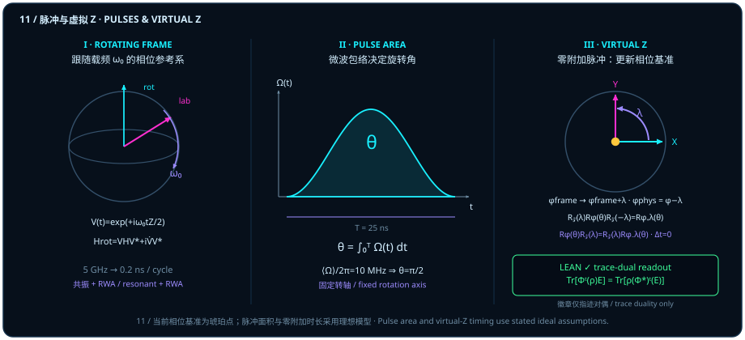

# Quantum Gates in Hardware: Microwave Pulse Area and Zero-Duration Virtual Z Gates

> *"A quantum state is a direction, and a quantum gate turns that direction; perhaps a gate can be understood as a geometric structure with area."*

Across our first ten chapters, we stripped away matrix mystique and restored every single-qubit gate to a rigid rotation on the unit sphere $S^2$ — or, in the even Clifford algebra $\mathrm{Cl}^+_{3,0}$, a rotor $U(\theta) = \cos(\theta/2) - \hat{I}\sin(\theta/2)$ driven by an oriented bivector area. Yet when a theorist trained on blackboard symbols first steps into a superconducting transmon lab or an NMR facility, no chip labeled "unitary matrix multiplier" is anywhere in sight. Instead, racks of arbitrary waveform generators (AWGs), local oscillators (LOs), and IQ mixers send tens-of-nanoseconds microwave voltage envelopes $\Omega(t)\cos(\omega_d t + \varphi)$ down coaxial lines into a dilution refrigerator.

**In real hardware, the epigraph's intuition — that a quantum gate is a geometric structure with area — turns out to be literal in two complementary ways:**

1. To rotate a qubit state about an equatorial axis ($X$ or $Y$) by angle $\theta$, engineers apply a microwave drive resonant with the qubit transition; in the frame rotating with the carrier and under the rotating-wave approximation (RWA), the Bloch rotation angle $\theta$ is literally the **integrated pulse area under the envelope**, $\theta = \int_0^T \Omega(t)\,dt$!
2. Conversely, to rotate the state about the vertical energy axis ($Z$) by angle $\lambda$, how many nanoseconds of analog microwave pulse must be applied? **Zero!** Because the energy eigenaxis defines the rotating frame's own phase reference, a $Z$ rotation requires no physical microwave pulse on the qubit at all — only an instantaneous update $\phi_{\mathrm{frame}} \mapsto \phi_{\mathrm{frame}} + \lambda$ to the passive software phase register (which, when commuting a preceding $R_z(\lambda)$ forward toward final $Z$-basis readout, shifts the physical drive phase of subsequent equatorial pulses by $\varphi_{\mathrm{phys}} = \varphi - \phi_{\mathrm{frame}}$, i.e. $\varphi \mapsto \varphi - \lambda$). This is the celebrated **zero-duration virtual $Z$ gate**.

This chapter builds the bridge between exact formal dynamics and hardware pulse physics: from matrix exponentials on eigenlines and the stationarity of energy eigenstates, through rotating-frame carrier cancellation and resonant pulse area, to an explicit trace error bound for ordered three-pulse kernels and the trace-duality pullback identity linking state evolution to reference-frame updates.

## Rotating Frames and Carrier Removal {#sec-rotating-frame-calibration}

In a superconducting quantum processor, a qubit begins with a static energy-splitting Hamiltonian (setting $\hbar = 1$):

$$
H_0 = \frac{1}{2}\omega_0 Z = \frac{1}{2}\omega_0 \begin{pmatrix} 1 & 0 \\ 0 & -1 \end{pmatrix},
$$

with a typical transition frequency $\omega_0 / (2\pi) \approx 5\,\mathrm{GHz}$. In the laboratory frame, even when no gate is being applied, the qubit's Bloch vector precesses around the vertical $Z$ axis five billion times per second (one full revolution every $0.2\,\mathrm{ns}$).

To see how energy eigenstates behave under matrix exponentiation, we start with the general algebraic lemma in the Lean module `EnergyEigenstateStationarity`: whenever $Av = \mu v$, the matrix exponential $\exp(A)$ acts on $v$ simply as scalar multiplication by $e^\mu$.

::: {.lemma #lemma-exponential-on-eigenline title="Action of the Matrix Exponential on an Eigenvector" lean="D5/S3/Quantum/Dynamics/EnergyEigenstateStationarity.exp_mulVec_of_eigenvector"}
Let $n$ be a finite index type with decidable equality (`Fintype n`, `DecidableEq n`), let $A \in M_n(\mathbb{C})$ be an arbitrary complex square matrix, let $v : n \to \mathbb{C}$ be a vector, and let $\mu \in \mathbb{C}$ be a complex scalar. If $A v = \mu v$, then

$$
\exp(A)\,v = e^\mu v.
$$
:::

::: proof
By induction on $k \in \mathbb{N}$, the eigenvalue relation $Av = \mu v$ implies $A^k v = \mu^k v$. Passing the continuous linear map $M \mapsto Mv$ through the norm-convergent exponential series $\exp(A) = \sum_{k=0}^\infty \frac{1}{k!} A^k$ yields

$$
\exp(A)\,v = \sum_{k=0}^\infty \frac{1}{k!} A^k v = \Bigl(\sum_{k=0}^\infty \frac{\mu^k}{k!}\Bigr) v = e^\mu v.
$$

The full proof is checked by the Lean kernel.
:::

Notice that [@lemma-exponential-on-eigenline] assumes neither Hermiticity of $A$ nor normalization of $v$ ($v = 0$ is allowed). Specializing to a Hermitian matrix $H = H^*$, a unit eigenvector $v^* v = 1$ with real eigenvalue $E \in \mathbb{R}$, and real time $t \in \mathbb{R}$ ($\hbar = 1$), the propagator $U = \exp((-it)H)$ multiplies $v$ by the pure phase $e^{-itE}$. On the rank-one density matrix $\rho = v v^*$ (encoded via [`pureDensityState`](lean:D5/S3/Quantum/Dynamics/EnergyEigenstateStationarity.pureDensityState)), the conjugate phases $e^{-itE} e^{+itE} = 1$ cancel identically, leaving the eigenstate stationary!

::: {.theorem #thm-hermitian-eigenstate-stationary title="Unitarity and Stationarity of Energy Eigenstate Density Matrices" lean="D5/S3/Quantum/Dynamics/EnergyEigenstateStationarity.energy_eigenstate_stationary"}
Let $n$ be a finite index type with decidable equality, let $H \in M_n(\mathbb{C})$ be Hermitian (`H.IsHermitian`), let $v : n \to \mathbb{C}$ satisfy $v^* \cdot_v v = 1$, and let $E, t \in \mathbb{R}$ satisfy $H v = E v$. Setting

$$
U = \exp\bigl((-i t) H\bigr), \qquad \rho = v v^* \quad (\text{via }\operatorname{pureDensityState}(v, hv)),
$$

both properties hold:

$$
U \in \operatorname{unitary}\bigl(M_n(\mathbb{C})\bigr) \qquad\text{and}\qquad U \rho U^* = \rho.
$$
:::

::: proof
Because $H$ is Hermitian and $t$ is real, $(-it)H$ is skew-Hermitian, so $U = \exp((-it)H)$ belongs to $\operatorname{unitary}(M_n(\mathbb{C}))$ with $U^* = \exp((+it)H)$. By [@lemma-exponential-on-eigenline] with $\mu = -itE$, $Uv = e^{-itE}v$. Conjugating $\rho = v v^*$ therefore gives

$$
U \rho U^* = (Uv)(Uv)^* = \bigl(e^{-itE} v\bigr)\bigl(e^{+itE} v^*\bigr) = |e^{-itE}|^2\, v v^* = \rho.
$$

The full proof is checked by the Lean kernel.
:::

[@thm-hermitian-eigenstate-stationary] motivates the transition to the **rotating frame** (Panel I of Figure 11). Under $H_0 = \frac{1}{2}\omega_0 Z$, the basis states $\lvert 0\rangle$ and $\lvert 1\rangle$ are stationary rays while equatorial states precess at angular frequency $\omega_0$. Defining the rotating-frame state $\lvert\psi_{\mathrm{rot}}(t)\rangle = V(t)\lvert\psi_{\mathrm{lab}}(t)\rangle$ with $V(t) = e^{+i\omega_0 t Z / 2}$, the Schrödinger equation transforms to

$$
H_{\mathrm{rot}}(t) = V(t) H_{\mathrm{lab}}(t) V(t)^* + i\dot{V}(t) V(t)^* = V(t) H_{\mathrm{lab}}(t) V(t)^* - \frac{1}{2}\omega_0 Z,
$$

canceling the $5\,\mathrm{GHz}$ carrier Hamiltonian $H_0 = \frac{1}{2}\omega_0 Z$ identically.

## Resonant Drives and Pulse Area {#sec-resonant-pulse-area}

Now apply a resonant transverse microwave drive ($\omega_d = \omega_0$) with real envelope $\Omega(t)$ and phase $\varphi$:

$$
H_{\mathrm{drive}}^{\mathrm{lab}}(t) = \Omega(t)\cos(\omega_0 t + \varphi)\,X.
$$

Conjugating by $V(t) = e^{+i\omega_0 t Z/2}$ uses $V(t) X V(t)^* = \cos(\omega_0 t) X - \sin(\omega_0 t) Y$. Applying the product-to-sum identities splits the drive into two parts: a counter-rotating term oscillating at $2\omega_0 / (2\pi) \approx 10\,\mathrm{GHz}$ that averages out over tens of nanoseconds, and a co-rotating term that stands still at azimuth $\varphi$ on the equator of the rotating frame. Under resonance ($\omega_d = \omega_0$), an isolated two-level model, and the **rotating-wave approximation (RWA)**, dropping the rapid $2\omega_0$ oscillation yields the effective rotating-frame Hamiltonian (Panel II of Figure 11):

$$
H_{\mathrm{rot}}(t) = \frac{1}{2}\Omega(t)\bigl(\cos\varphi\, X + \sin\varphi\, Y\bigr).
$$

(Writing the in-phase and quadrature envelopes as $I(t) = \Omega(t)\cos\varphi$ and $Q(t) = \Omega(t)\sin\varphi$ alongside a general detuning $\Delta(t) = \omega_0 - \omega_d$, the linear combination $\frac{1}{2}(I\sigma_x + Q\sigma_y + \Delta\sigma_z)$ expands entrywise in the $2\times 2$ complex matrix ring — `ext i j; fin_cases i <;> fin_cases j` — as $\frac{1}{2}\begin{pmatrix} \Delta & I - iQ \\ I + iQ & -\Delta \end{pmatrix}$, whose diagonal vanishes at exact resonance $\Delta = 0$.)

Inspect what happens whenever the drive phase $\varphi$ is held constant during the pulse window $t \in [0, T]$:

- Even though the envelope amplitude $\Omega(t)$ rises and falls over time (whether shaped as a rectangular pulse, a Gaussian, or a raised-cosine envelope), the generator $H_{\mathrm{rot}}(t)$ points along the **same fixed equatorial axis** $\vv{n}_\varphi = (\cos\varphi, \sin\varphi, 0)$ at every instant $t \in [0, T]$;
- Because scalar multiples of a single fixed matrix commute with one another, the Hamiltonians at any two times commute:
  $$
  \bigl[H_{\mathrm{rot}}(t_1),\, H_{\mathrm{rot}}(t_2)\bigr] = 0 \qquad (\forall\, t_1, t_2 \in [0, T]);
  $$
- Consequently, no Dyson time-ordering series is needed, and the time-evolution propagator integrates directly to
  $$
  U_{\mathrm{rot}}(T) = \exp\Bigl(-i\int_0^T H_{\mathrm{rot}}(t)\,dt\Bigr) = \exp\Bigl(-\frac{i}{2}\theta\bigl(\cos\varphi\, X + \sin\varphi\, Y\bigr)\Bigr) = R_\varphi(\theta),
  $$
  where the rotation angle on the Bloch sphere is given by the **pulse area**:
  $$
  \theta = \int_0^T \Omega(t)\,dt.
  $$

In this idealized fixed-axis RWA model, the Bloch rotation angle $\theta$ is governed solely by the **integrated area** $\int_0^T \Omega(t)\,dt$ under the microwave envelope! An area of $\pi/2$ executes a quarter-turn (carrying the North Pole $\lvert 0\rangle$ to the equator), while an area of $\pi$ executes a half-turn bit flip ($\lvert 0\rangle \to \lvert 1\rangle$).

## Ordered Pulses and an Error Bound {#sec-ordered-pulse-control}

When three distinct generators $A, B, C$ are applied sequentially in finite steps $t > 0$ rather than along a single commuting axis, higher-order noncommuting corrections appear. In the Lean module `OrderedThreePulseTrace`, for a finite decidable index type $I$, a complex matrix $X \in M_I(\mathbb{C})$, and real parameter $s \in \mathbb{R}$, define the integrated kernel

$$
\operatorname{pulse0}(X, s) = \int_0^1 \exp\bigl(s r i X\bigr)\,X\,dr.
$$

The next frozen proposition gives the exact $s = 0$ and $s \neq 0$ formulas for `pulse0` together with an explicit $(5/4)L^5 t^2$ bound on the real trace deviation of three ordered kernels when $A, B, C \in M_I(\mathbb{R})$ are real symmetric matrices with **Frobenius** norms at most $L \ge 0$.

::: {.proposition #prop-ordered-pulse-error title="Closed Form and Real-Trace Error Bound for Three Ordered Pulse Kernels" lean="D5/S3/Quantum/Dynamics/OrderedThreePulseTrace.ordered_three_pulse_real_trace_bound"}
Let $I$ be a finite index type with decidable equality (`Fintype I`, `DecidableEq I`), let $A, B, C \in M_I(\mathbb{R})$ be real symmetric matrices (`A.IsSymm`, `B.IsSymm`, `C.IsSymm`), let $L \in \mathbb{R}$ satisfy $0 \le L$ with Frobenius-norm bounds

$$
\norm{A}_F \le L, \qquad \norm{B}_F \le L, \qquad \norm{C}_F \le L,
$$

and let $A_{\mathbb{C}}, B_{\mathbb{C}}, C_{\mathbb{C}} \in M_I(\mathbb{C})$ denote their complexifications. Then for every real $t > 0$:

1. For all $X \in M_I(\mathbb{C})$, $\operatorname{pulse0}(X, 0) = X$;
2. For all $X \in M_I(\mathbb{C})$ and all $s \in \mathbb{R}$ with $s \neq 0$,

   $$
   \operatorname{pulse0}(X, s) = (s i)^{-1}\bigl(\exp(s i X) - I\bigr);
   $$

3. The real part of the ordered three-kernel trace satisfies

   $$
   \Bigl|\operatorname{Re}\Tr\bigl(\operatorname{pulse0}(A_{\mathbb{C}}, t)\,\operatorname{pulse0}(B_{\mathbb{C}}, t)\,\operatorname{pulse0}(C_{\mathbb{C}}, t)\bigr) - \Tr(A B C)\Bigr|
   \le \frac{5}{4}\,L^5\,t^2.
   $$
:::

::: proof
Integrating the constant matrix $X$ over $[0, 1]$ gives $\operatorname{pulse0}(X, 0) = X$. For $s \neq 0$, applying the fundamental theorem of calculus to $r \mapsto (si)^{-1}\exp(sriX)$ on $[0, 1]$ yields

$$
\operatorname{pulse0}(X, s) = (s i)^{-1}\bigl(\exp(s i X) - I\bigr).
$$

Expanding each factor $\operatorname{pulse0}(X_{\mathbb{C}}, t) = X_{\mathbb{C}} + \frac{it}{2}X_{\mathbb{C}}^2 + R_2(X_{\mathbb{C}}, t)$ to second order in $t$, the first-order terms $i\frac{t}{2}\bigl(\Tr(A^2BC) + \Tr(AB^2C) + \Tr(ABC^2)\bigr)$ multiply real traces of real symmetric matrix products by $i$ and are therefore purely imaginary, vanishing identically under $\operatorname{Re}\Tr(\cdots)$. Bounding the remaining $O(t^2)$ tail via the L2 operator norm (which is dominated by the Frobenius norm $\le L$) yields the explicit $(5/4)L^5 t^2$ bound. The full proof is checked by the Lean kernel.
:::

Notice the geometric reason why the trace error scales as $O(t^2)$ rather than $O(t)$: for real symmetric generators $A, B, C$, the first-order drift is purely imaginary, so taking the real part $\operatorname{Re}\Tr(\cdots)$ projects out the $O(t)$ term orthogonally! Keep the mathematical contract of [@prop-ordered-pulse-error] clear: `pulse0` is an integrated exponential-times-matrix kernel (where `NormedSpace.exp` uses the local L2 operator norm while the hypotheses bound Frobenius norms), not a unitary propagator, microwave envelope, or hardware gate fidelity.

## Virtual Z and Phase-Reference Updates {#sec-virtual-z-phase-reference}

Whereas an equatorial rotation $R_\varphi(\theta) = \exp\bigl[-\frac{i}{2}\theta(\cos\varphi\, X + \sin\varphi\, Y)\bigr]$ requires a physical microwave pulse of nonzero duration, a vertical rotation $R_z(\lambda) = \exp(-i\lambda Z/2)$ obeys both the exact conjugation identity and the right-commutation identity (Panel III of Figure 11):

$$
R_z(\lambda)\,R_\varphi(\theta)\,R_z(-\lambda) = R_{\varphi + \lambda}(\theta) \quad\Longleftrightarrow\quad R_\varphi(\theta)\,R_z(\lambda) = R_z(\lambda)\,R_{\varphi - \lambda}(\theta).
$$

To implement virtual $Z$ gates without sign ambiguity, we must sharply distinguish the **passive frame offset** from the **physical drive phase replacement**:

1. **Conjugation identity and the passive frame register $\phi_{\mathrm{frame}}$**: The conjugation identity $R_z(\lambda) R_\varphi(\theta) R_z(-\lambda) = R_{\varphi + \lambda}(\theta)$ shows that rotating the reference frame actively by $+\lambda$ around $Z$ carries an axis at azimuth $\varphi$ to azimuth $\varphi + \lambda$ (for instance, at $\lambda = \pi/2$ and $\varphi = 0$, conjugating $R_0(\theta) = R_x(\theta)$ yields $R_{\pi/2}(\theta) = R_y(\theta)$). In control software, each virtual $R_z(\lambda)$ instruction increments a **passive frame phase register** by
   $$
   \phi_{\mathrm{frame}} \longmapsto \phi_{\mathrm{frame}} + \lambda.
   $$
2. **Commuting a preceding $R_z(\lambda)$ to final $Z$ readout uses $\varphi_{\mathrm{phys}} = \varphi - \phi_{\mathrm{frame}}$**: When an active gate $R_z(\lambda)$ precedes a subsequent equatorial pulse $R_\varphi(\theta)$ in a circuit (acting first on the ket from the right), omitting the physical $Z$ pulse and pushing $R_z(\lambda)$ to the left past $R_\varphi(\theta)$ toward a final $Z$-basis measurement uses the right-commutation identity
   $$
   R_\varphi(\theta)\,R_z(\lambda) = R_z(\lambda)\,R_{\varphi - \lambda}(\theta).
   $$
   Under our fixed physical drive convention $R_\varphi(\theta) = \exp\bigl[-\frac{i}{2}\theta(\cos\varphi\, X + \sin\varphi\, Y)\bigr]$, incrementing the passive frame register by $\phi_{\mathrm{frame}} \mapsto \phi_{\mathrm{frame}} + \lambda$ therefore maps a logical gate angle $\varphi$ to the **physical microwave drive phase**
   $$
   \varphi_{\mathrm{phys}} = \varphi - \phi_{\mathrm{frame}} \qquad (\text{a single-step shift }\varphi \longmapsto \varphi - \lambda),
   $$
   while the accumulated $R_z(\phi_{\mathrm{frame}})$ pushed to the end of the circuit is absorbed by the final $Z$-basis projective readout $\lvert 0\rangle\langle 0\rvert, \lvert 1\rangle\langle 1\rvert$ (since $R_z(-\phi_{\mathrm{frame}})\lvert b\rangle\langle b\rvert R_z(\phi_{\mathrm{frame}}) = \lvert b\rangle\langle b\rvert$ by [@thm-hermitian-eigenstate-stationary]), executing a **virtual $Z$ gate** with **zero additional analog pulse duration** ($\Delta t_{\mathrm{analog}} = 0$) in ideal pulse scheduling!
3. **Observable sign check on $\lvert +\rangle$**: Suppose we prepare $\lvert +\rangle = (\lvert 0\rangle + \lvert 1\rangle)/\sqrt{2}$, apply $R_z(\pi/2)$ followed by $R_x(\pi/2) = R_0(\pi/2)$, and measure in the $Z$ basis. By the commutation identity,
   $$
   R_x(\pi/2)\,R_z(\pi/2)\lvert +\rangle = R_z(\pi/2)\,R_{-\pi/2}(\pi/2)\lvert +\rangle = e^{-i\pi/4}\lvert 0\rangle,
   $$
   yielding outcome $\lvert 0\rangle$ with probability $P(0) = 1$: omitting $R_z(\pi/2)$ and shifting the physical drive phase by $-\lambda = -\pi/2$ (an $R_{-\pi/2}(\pi/2) = R_{-y}(\pi/2)$ pulse) rotates $\lvert +\rangle$ to the North Pole $\lvert 0\rangle$ and reproduces $P(0) = 1$, whereas shifting the physical drive phase by $+\pi/2$ ($+Y$ pulse) would rotate $\lvert +\rangle$ to the South Pole $\lvert 1\rangle$ and give the wrong probability $P(0) = 0$.

At the operator-algebraic level, pushing a state forward by $t$ discrete channel steps (Schrödinger picture) versus pulling the measurement effect back by $t$ adjoint iterates (Heisenberg reference-frame update) is certified by the frozen trace-duality identity in `ObserverPullbackTraceIdentity`. Here `MatrixAlgebra d` is the complex square CStar-matrix algebra, `DensityState d` is its positive trace-one subtype, `QuantumChannel d d` carries a completely positive trace-preserving map, and `evolvedState channel t rho` iterates `QuantumChannel.mapState` $t \in \mathbb{N}$ times.

::: {.corollary #cor-frame-pullback-readout title="Observer Pullback Trace Identity Across Discrete Channel Iterations" lean="D5/S3/Quantum/Dynamics/ObserverPullbackTraceIdentity.observer_pullback_trace_identity"}
Let $d$ be a finite index type with decidable equality, let $\mathrm{channel} : \mathrm{QuantumChannel}\,d\,d$ be a quantum channel, and let $\mathrm{heisenberg} : \mathrm{MatrixAlgebra}\,d \to_{\mathrm{CP}} \mathrm{MatrixAlgebra}\,d$ be a completely positive map satisfying the explicit trace-duality premise (`hduality`):

$$
\forall\,\mathrm{state},\, \mathrm{effect} \in \mathrm{MatrixAlgebra}\,d,\qquad
\Tr\bigl(\mathrm{channel}(\mathrm{state}) \cdot \mathrm{effect}\bigr) = \Tr\bigl(\mathrm{state} \cdot \mathrm{heisenberg}(\mathrm{effect})\bigr).
$$

Then for every natural number $t \in \mathbb{N}$, density state $\rho \in \mathrm{DensityState}\,d$, and matrix effect $\mathrm{effect} \in \mathrm{MatrixAlgebra}\,d$,

$$
\Tr\bigl(\operatorname{evolvedState}(\mathrm{channel}, t, \rho).1 \cdot \mathrm{effect}\bigr)
= \Tr\bigl(\rho.1 \cdot \mathrm{heisenberg}^{[t]}(\mathrm{effect})\bigr).
$$
:::

::: proof
By induction on $t \in \mathbb{N}$. The base case $t = 0$ is immediate. For the inductive step from $t$ to $t + 1$, applying `hduality` once transfers one step of $\mathrm{channel}$ from the evolved state to $\mathrm{heisenberg}$ on the effect, after which the induction hypothesis completes the $t$-fold iterate $\mathrm{heisenberg}^{[t+1]}(\mathrm{effect})$. The full proof is checked by the Lean kernel.
:::

Note that in [@cor-frame-pullback-readout], $t \in \mathbb{N}$ counts discrete channel iterations rather than physical seconds, and the theorem certifies trace-dual readout under the explicit `hduality` premise (of which unitary frame conjugation is a special case); it makes no claim about analog pulse duration or hardware error rates.

We can now compare the three elementary single-qubit rotations in superconducting hardware side by side:

1. **Rotation $R_x(\theta)$ about the $X$ axis**: Executed by a resonant microwave pulse at phase $\varphi = 0$ (in-phase channel $I$), with rotation angle set by the envelope area $\theta = \int_0^T \Omega(t)\,dt$ over a typical analog duration $T \approx 10\text{–}40\,\mathrm{ns}$;
2. **Rotation $R_y(\theta)$ about the $Y$ axis**: Executed by a resonant microwave pulse at phase $\varphi = \pi/2$ (quadrature channel $Q$, shifted by a quarter carrier cycle relative to $I$), with rotation angle $\theta = \int_0^T \Omega(t)\,dt$ over $T \approx 10\text{–}40\,\mathrm{ns}$;
3. **Rotation $R_z(\lambda)$ about the $Z$ axis (Virtual $Z$ gate)**: Executed by updating the passive software frame register $\phi_{\mathrm{frame}} \mapsto \phi_{\mathrm{frame}} + \lambda$ (and, when commuting a preceding $R_z(\lambda)$ to final $Z$-basis readout, shifting the physical drive phase of subsequent equatorial pulses to $\varphi_{\mathrm{phys}} = \varphi - \phi_{\mathrm{frame}}$, i.e. $\varphi \mapsto \varphi - \lambda$ via $R_\varphi(\theta)R_z(\lambda) = R_z(\lambda)R_{\varphi-\lambda}(\theta)$), requiring **zero additional analog pulse duration** ($\Delta t_{\mathrm{analog}} = 0$) in ideal pulse scheduling!

Let us check all four aspects — $5\,\mathrm{GHz}$ carrier removal, a $25\,\mathrm{ns}$ quarter-turn pulse, a virtual-$Z$ phase shift, and the dimensionless `pulse0` trace bound — in a single concrete numerical example.

::: {.example #ex-five-ghz-pi-over-two title="A 25 ns Quarter-Turn on a 5 GHz Carrier and a Virtual Z"}
1. **Carrier cancellation at $5\,\mathrm{GHz}$**: Set $\hbar = 1$, $H_0 = \omega_0 Z/2$, and $\omega_0 = 2\pi\,(5 \times 10^9)\,\mathrm{rad\,s}^{-1}$ (carrier period $T_0 = 0.2\,\mathrm{ns}$). With $\lvert\psi_{\mathrm{rot}}\rangle = V\lvert\psi_{\mathrm{lab}}\rangle$ and $V = e^{+i\omega_0 t Z/2}$, the transformed Hamiltonian $H_{\mathrm{rot}} = V H_{\mathrm{lab}} V^* + i\dot{V}V^*$ cancels $H_0$ exactly, while the drive reduction uses resonance and the rotating-wave approximation.
2. **A $25\,\mathrm{ns}$ quarter-turn pulse**: For fixed drive phase $\varphi$, the ideal effective Hamiltonian $H_{\mathrm{rot}}(t) = \Omega(t)(\cos\varphi\, X + \sin\varphi\, Y)/2$ commutes across times, giving $U = \exp[-i\theta(\cos\varphi\, X + \sin\varphi\, Y)/2]$ with $\theta = \int_0^T \Omega(t)\,dt$. Choosing rectangular $\Omega = 2\pi\,(10 \times 10^6)\,\mathrm{rad\,s}^{-1}$ and $T = 25\,\mathrm{ns}$ gives

   $$
   \theta = \Omega T = 2\pi \times 10^7 \times 25 \times 10^{-9} = \frac{\pi}{2}, \qquad P(1 \mid 0) = \sin^2\Bigl(\frac{\pi}{4}\Bigr) = \frac{1}{2}.
   $$

   Since the $5\,\mathrm{GHz}$ carrier period is $0.2\,\mathrm{ns}$, $125$ carrier cycles fit inside the $25\,\mathrm{ns}$ envelope, and any smooth pulse of equal integral produces the same ideal fixed-axis rotation within this effective approximation.
3. **Virtual-$Z$ phase shift and physical drive sign**: With $R_z(\lambda) = e^{-i\lambda Z/2}$ and $R_\varphi(\theta) = e^{-i\theta(\cos\varphi\, X + \sin\varphi\, Y)/2}$, one checks both the conjugation identity and the right-commutation identity:

   $$
   R_z(\lambda)\,R_\varphi(\theta)\,R_z(-\lambda) = R_{\varphi + \lambda}(\theta) \quad\Longleftrightarrow\quad R_\varphi(\theta)\,R_z(\lambda) = R_z(\lambda)\,R_{\varphi - \lambda}(\theta).
   $$

   In the active conjugation formula $R_z(\lambda)R_\varphi(\theta)R_z(-\lambda) = R_{\varphi+\lambda}(\theta)$, setting $\lambda = \pi/2$ and $\varphi = 0$ rotates the reference axis from $X$ ($\varphi = 0$) to $+Y$ ($\varphi + \lambda = \pi/2$). In circuit compilation with zero additional analog pulse duration in ideal scheduling ($\Delta t_{\mathrm{analog}} = 0$), software increments the passive frame offset $\phi_{\mathrm{frame}} \mapsto \phi_{\mathrm{frame}} + \lambda$, while commuting a preceding $R_z(\lambda)$ past $R_\varphi(\theta)$ toward final $Z$-basis readout sets the physical drive phase to $\varphi_{\mathrm{phys}} = \varphi - \phi_{\mathrm{frame}} = \varphi - \lambda$. On $\lvert +\rangle$, an active physical $R_z(\pi/2)$ rotates the Bloch vector to $+y$; if followed by $R_x(\pi/2)$ and $Z$-basis readout, $R_x(\pi/2)R_z(\pi/2)\lvert +\rangle = R_z(\pi/2)R_{-\pi/2}(\pi/2)\lvert +\rangle$ gives $P(0) = 1$, confirming that a passive frame update leaves the physical state untouched and must consistently transform subsequent physical drive phases ($\varphi_{\mathrm{phys}} = -\pi/2$) and readout ([@cor-frame-pullback-readout]).
4. **Dimensionless `pulse0` bound check**: Instantiating [@prop-ordered-pulse-error] with Frobenius-norm bound $L = 1$ and step parameter $t = 0.1$ gives

   $$
   \frac{5}{4}L^5 t^2 = 1.25 \times 1^5 \times (0.1)^2 = 0.0125,
   $$

   bounding the real trace deviation of three integrated `pulse0` kernels (not a hardware gate infidelity or the microwave-area formula).
:::

::: {.remark #rem-pulses-literature title="Rabi Pulse Area and Virtual Z Gates (Literature Result, Not Formalized in This Book)"}
**Literature result, not formalized in this book.** Two hardware-control results from the quantum-engineering literature frame this chapter:

1. **Virtual $Z$ gates and pulse scheduling** (D. C. McKay et al., “Efficient Z Gates for Quantum Processors,” *Phys. Rev. A* **96**, 022330, 2017, DOI `10.1103/PhysRevA.96.022330`; single-qubit rotations in M. A. Nielsen & I. L. Chuang, 2010, §4.2): Implementing $Z$-axis rotations via software phase-reference updates $\phi_{\mathrm{frame}} \mapsto \phi_{\mathrm{frame}} + \lambda$ (which shifts the physical drive phase of subsequent equatorial pulses to $\varphi_{\mathrm{phys}} = \varphi - \phi_{\mathrm{frame}}$ when commuting $R_z(\lambda)$ to final $Z$ readout) adds zero analog pulse duration in ideal scheduling conventions. Zero additional analog duration is a scheduling convention, not zero classical digital latency or $0\%$ total physical error.
2. **Assumptions behind the simple pulse-area law**: The formula $\theta = \int_0^T \Omega(t)\,dt$ requires resonance ($\omega_d = \omega_0$), a fixed phase/rotation axis during the pulse, an isolated effective two-level model, and the rotating-wave approximation. Time-dependent phase $\varphi(t)$ or detuning generally requires time ordering. Meanwhile, [@cor-frame-pullback-readout] applies under its explicit `hduality` premise and makes no claim about pulse duration, drive calibration, decoherence, leakage, or gate error rates.
:::

If a $Z$ gate can be executed simply by shifting the observer's phase reference, can we go one step further and perform **all** quantum computation by shifting the observer's measurement axes across an entangled resource state? Let us enter [Chapter 12](ch12-measurement-computation-and-gradients.md).
