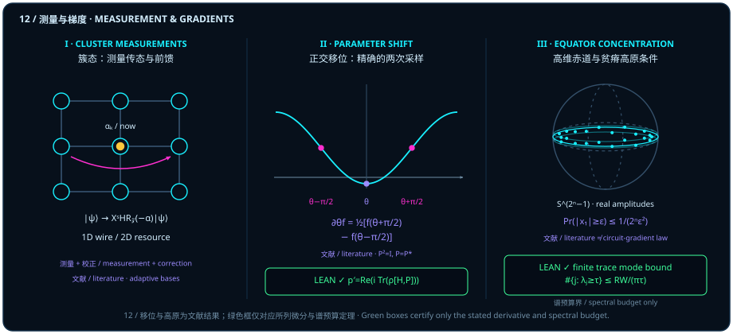

# Attention as Computation: Measurement-Based Quantum Computing and Spherical Natural Gradients

> *"If we make the observer part of the picture, whether something appears as a particle or a wave seems to depend on the observer’s attention."*

At the end of [Chapter 11](ch11-pulses-and-virtual-z.md), we saw a striking reversal in hardware control: a virtual $Z$ gate rotates a qubit around its energy axis without firing a single nanosecond of microwave pulse, simply by shifting the phase reference of the observer's future control and readout axes. Closing Part III (*From Plane to Sphere*), this chapter follows that clue — treating the observer's measurement orientation as an active computational resource — across three major pillars of modern quantum information:

1. **Measurement-Based Quantum Computing (MBQC)**: Once an entangled cluster resource state is prepared, no further unitary gates need to be applied during the computation. By sequentially choosing equatorial measurement angles $\alpha$ (steering the observer's attention) and feeding classical measurement outcomes forward to adapt later measurement axes, projective measurements alone drive universal quantum logic!
2. **The Pauli Parameter-Shift Rule**: When optimizing a parametrized quantum circuit, evaluating the analytical gradient $\partial_\theta f(\theta)$ of an expectation value with respect to a single Pauli rotation angle $\theta$ requires no finite-difference limit $\delta\theta \to 0$. Because a single Pauli rotation slices a pure first-order sinusoid on the sphere, evaluating (or estimating from repeated measurement shots) the expectation value at two **orthogonal $\pm 90^\circ$ parameter settings** $\theta \pm \frac{\pi}{2}$ yields the exact analytical derivative with zero finite-difference truncation error (while finite-shot estimation retains ordinary statistical sampling uncertainty)!

::: {.viz src="parameter-shift" preset="noise" height="500"}
**The same number of shots, scatters more than ten times apart.** At $\theta = 60^\circ$ with only 100 shots per setting, each trial drops one cyan dot (half the difference a quarter turn each way) and one magenta dot (the $\pm 6^\circ$ small-step difference) on the gauge. The cyan dots crowd the dashed tangent slope with a width of about 0.035; the magenta dots spread about 0.58, some of them off the gauge. Both scatters are shot noise, and the small step magnifies it ([@rem-parameter-shift-rule-literature]).
:::

3. **Riemannian Natural Gradients and Equatorial Concentration**: Along a negative Riemannian gradient flow on a manifold, potential energy dissipates at a rate equal to the integrated squared norm of the velocity ([@thm-riemannian-gradient-dissipation]). Yet as qubit count $n$ grows and ambient dimension scales as $d = 2^n$, measure on high-dimensional spheres concentrates overwhelmingly into a narrow **equatorial belt** orthogonal to any fixed measurement axis — setting the geometric stage (under specific random-circuit design assumptions) for barren plateaus; separately, as a standalone spectral counting result for nonnegative summable sequences, a finite trace identity $\sum_j \lambda_j = RW/\pi$ supplies a sufficient upper bound on the number of modes above any threshold $\tau > 0$ ([@cor-finite-trace-mode-budget]).

## Cluster Measurements and Classical Feedforward {#sec-cluster-measurement-feedforward}

In the standard circuit model, computation is pictured as unitary gates pushing a state vector forward in time, while measurement merely reads out the final answer at the end. In **one-way quantum computing (MBQC)** (for the literature result, see [@rem-mbqc-gradients-literature]), **the sequence of measurements itself drives the computation**.

We begin with the foundational trace-conservation law for projective record measurements in the Lean module `Conditioning`. For a finite decidable index type $n$ and a finite outcome type $\kappa$ (`DecidableEq kappa` is omitted from this theorem), a family $P : \kappa \to M_n(\mathbb{C})$ satisfies `IsRecordMeasurement P` when each $P_k$ is self-adjoint ($P_k^* = P_k$), idempotent ($P_k^2 = P_k$), pairwise orthogonal ($P_k P_l = 0$ for $k \neq l$), and complete ($\sum_k P_k = I$). For any complex matrix $\rho \in M_n(\mathbb{C})$, the outcome weight is $\operatorname{recordWeight}(P, \rho, k) = \operatorname{bornProbability}(\rho, P_k) = \Tr(\rho P_k)$.

::: {.lemma #lemma-measurement-branch-sum title="Sum of Record-Measurement Branch Weights Equals the Matrix Trace" lean="D5/S3/Observer/Conditioning.recordWeight_sum"}
Let $n$ be a finite index type with decidable equality, let $\kappa$ be a finite index type, and let $P : \kappa \to M_n(\mathbb{C})$ satisfy $\operatorname{IsRecordMeasurement}(P)$. Then for every complex matrix $\rho \in M_n(\mathbb{C})$,

$$
\sum_{k \in \kappa} \operatorname{recordWeight}(P, \rho, k) = \Tr(\rho).
$$
:::

::: proof
Expanding $\operatorname{recordWeight}(P, \rho, k) = \Tr(\rho P_k)$ and using linearity of the matrix trace together with completeness $\sum_{k \in \kappa} P_k = I$ gives

$$
\sum_{k \in \kappa} \Tr(\rho P_k) = \Tr\Bigl(\rho \sum_{k \in \kappa} P_k\Bigr) = \Tr(\rho I) = \Tr(\rho).
$$

The full proof is checked by the Lean kernel.
:::

Note the mathematical contract of [@lemma-measurement-branch-sum]: it holds for an arbitrary complex matrix $\rho \in M_n(\mathbb{C})$ (weights are complex until positivity and unit trace of $\rho$ are supplied separately, at which point the branch weights sum to $1$), and it certifies branch-weight conservation rather than cluster-state preparation or MBQC universality.

Now watch how measuring one qubit of a two-qubit entangled link turns the observer's chosen angle $\alpha$ into a unitary gate on the unmeasured qubit (Panel I of Figure 12):

1. **Entangle input and ancilla**: Prepare qubit 1 in $\lvert\psi\rangle = a\lvert 0\rangle + b\lvert 1\rangle$ and qubit 2 in $\lvert +\rangle = (\lvert 0\rangle + \lvert 1\rangle)/\sqrt{2}$, and apply $\mathrm{CZ} = \operatorname{diag}(1, 1, 1, -1)$ to obtain $a\lvert 0\rangle\lvert +\rangle + b\lvert 1\rangle\lvert -\rangle$.
2. **Project along equatorial angle $\alpha$**: Measure qubit 1 in the equatorial basis $\lvert\pm_\alpha\rangle = (\lvert 0\rangle \pm e^{i\alpha}\lvert 1\rangle)/\sqrt{2}$, with outcome $s \in \{0, 1\}$. Contracting qubit 1 against $\langle s_\alpha\rvert$ leaves qubit 2 in the unnormalized state

   $$
   \frac{1}{\sqrt{2}}\,X^s H \operatorname{diag}(1, e^{-i\alpha})\lvert\psi\rangle,
   $$

   with probability $1/2$ for each outcome $s \in \{0, 1\}$ when $\lvert\psi\rangle$ is normalized.
3. **Classical feedforward correction**: Up to a global phase, correcting the byproduct operator $X^s$ yields $H R_z(-\alpha)\lvert\psi\rangle$. Because $X R_z(-\beta) = e^{i\gamma} R_z(+\beta) X$, later measurement angles in a multi-qubit cluster must adapt to earlier random outcomes $s$ via classical feedforward.

## Pauli Angles and Exact Parameter Shift {#sec-pauli-parameter-shift}

How does a measurement probability change as a Hamiltonian generator $H$ acts for real time $t \in \mathbb{R}$? In the Lean module `ProjectionProbabilityFlow` (cross-referencing Chapter 7's `#prop-projection-probability-flow`), for a finite decidable type $n$, a density state $\rho \in \mathrm{DensityState}\,n$, a Hermitian matrix $H \in M_n(\mathbb{C})$, and a star projection $P \in M_n(\mathbb{C})$ (`IsStarProjection P`, meaning $P^* = P$ and $P^2 = P$), define the evolved density $\rho_t = \operatorname{evolvedDensity}(H, \rho, t) = e^{-itH}\rho e^{itH}$ and real readout $\operatorname{projectionProbability}(H, \rho, P, t) = \operatorname{Re}\bigl(\operatorname{bornProbability}(\rho_t, P)\bigr)$.

::: {.proposition #prop-measurement-gradient-flow title="Commutator Derivative and Conservation of Projection Probability Flow" lean="D5/S3/Quantum/Dynamics/ProjectionProbabilityFlow.projection_probability_flow"}
Let $n$ be a finite index type with decidable equality, let $H, P \in M_n(\mathbb{C})$, and let $\rho \in \mathrm{DensityState}\,n$. If $H$ is Hermitian (`H.IsHermitian`) and $P$ is a star projection (`IsStarProjection P`), then all three properties hold:

1. **Coercion equality with complex Born trace**: For every $t \in \mathbb{R}$,

   $$
   \bigl(\operatorname{projectionProbability}(H, \rho, P, t) : \mathbb{C}\bigr) = \operatorname{bornProbability}(\rho_t, P);
   $$

2. **Exact commutator derivative and realness**: For every $t \in \mathbb{R}$, $\operatorname{projectionProbability}(H, \rho, P)$ has derivative at $t$ equal to

   $$
   \operatorname{Re}\Bigl(i\,\Tr\bigl(\rho_t\,(H P - P H)\bigr)\Bigr),
   $$

   and this complex trace expression is purely real:

   $$
   \Bigl(\operatorname{Re}\bigl(i\,\Tr(\rho_t\,(H P - P H))\bigr) : \mathbb{C}\Bigr) = i\,\Tr\bigl(\rho_t\,(H P - P H)\bigr);
   $$

3. **Conservation under commutation**: If $H P - P H = 0$, then for every $t \in \mathbb{R}$,

   $$
   \operatorname{projectionProbability}(H, \rho, P, t) = \operatorname{projectionProbability}(H, \rho, P, 0).
   $$
:::

::: proof
Positivity and Hermiticity of $\rho_t$ and $P$ ensure that $\Tr(\rho_t P)$ is real, establishing claim 1. Differentiating $\rho_t = e^{-itH}\rho e^{itH}$ gives $\frac{d}{dt}\rho_t = -i(H\rho_t - \rho_t H)$; multiplying by $P$, taking the trace, and cycling $\Tr(H\rho_t P) = \Tr(\rho_t PH)$ yields $\frac{d}{dt}\Tr(\rho_t P) = i\Tr(\rho_t(HP - PH))$, which is purely real since $i(HP - PH)$ and $\rho_t$ are Hermitian. When $HP - PH = 0$, the derivative vanishes for all $t \in \mathbb{R}$, so the probability remains constant. The full proof is checked by the Lean kernel.
:::

When a circuit parameter $\theta$ enters a single occurrence of an involutory Pauli rotation, the classical two-sample shift formula paired with [@prop-measurement-gradient-flow] is recorded below (Panel II of Figure 12; [@rem-parameter-shift-rule-literature]).

::: {.viz src="parameter-shift" preset="shift" height="500"}
**A quarter turn each way: half the difference is the slope.** With $f = \cos\theta$ the amber point sits at $\theta = 60^\circ$ and the two cyan points at $-30^\circ$ and $150^\circ$, at heights $0.866$ and $-0.866$; half their difference, $-0.866$, is exactly the slope of the dashed tangent, which is computed from the commutator formula of [@prop-measurement-gradient-flow]. In the dial the two cyan arrows are perpendicular to the amber one, and their heights on the measured axis are these two values.
:::

::: {.remark #rem-parameter-shift-rule-literature title="Two-Sample Parameter-Shift Rule for a Single Involutory Pauli Rotation (Literature Result, Not Formalized in This Book)"}
**Literature result, not formalized in this book.** For a **single occurrence** of a Pauli rotation $R_P(\theta) = e^{-i\theta P_{\mathrm{gen}}/2}$ with $P_{\mathrm{gen}}^* = P_{\mathrm{gen}}$ and $P_{\mathrm{gen}}^2 = I$, the involution $P_{\mathrm{gen}}^2 = I$ collapses the matrix exponential into Euler's formula $R_P(\theta) = \cos(\theta/2)I - i\sin(\theta/2)P_{\mathrm{gen}}$. Conjugating any observable $O$ by $R_P(\theta)$ produces products of $\cos(\theta/2)$ and $\sin(\theta/2)$ of degree two, which by double-angle trigonometry contain only the zeroth and first harmonics $1, \cos\theta, \sin\theta$:

$$
f(\theta) = \Tr\bigl(R_P(\theta)\,\rho\,R_P(\theta)^* O\bigr) = c + a\cos\theta + b\sin\theta.
$$

On any pure first-harmonic sinusoid $c + a\cos\theta + b\sin\theta$, shifting the angle by $\pm\frac{\pi}{2}$ uses $\cos(\theta \pm \frac{\pi}{2}) = \mp\sin\theta$ and $\sin(\theta \pm \frac{\pi}{2}) = \pm\cos\theta$, canceling the constant $c$ and turning the derivative $\partial_\theta f(\theta) = -a\sin\theta + b\cos\theta$ into the two-sample **parameter-shift identity** (Schuld et al., 2019; see [@rem-mbqc-gradients-literature]):

$$
\partial_\theta f(\theta) = \frac{1}{2}\Bigl[f\Bigl(\theta + \frac{\pi}{2}\Bigr) - f\Bigl(\theta - \frac{\pi}{2}\Bigr)\Bigr].
$$

Geometrically, instead of nudging the sphere by a tiny angle $\delta\theta \ll 1$, the observer evaluates the expectation value at two **orthogonal $90^\circ$ shifts** on the sphere. Keep the boundary explicit: [@prop-measurement-gradient-flow] certifies the infinitesimal commutator derivative and its realness, whereas the finite $\pm\pi/2$ shift rule relies additionally on the single-gate involutory Pauli frequency expansion ([@rem-mbqc-gradients-literature]).
:::

::: {.viz src="parameter-shift" preset="anywhere" height="500"}
**Another angle, another curve: still exact.** A tilted state and measured axis give the curve $f = c + a\cos\theta + b\sin\theta$, raised by the constant $c$ and shifted in phase. As $\theta$ sweeps a full turn, the cyan bar on the gauge stays on the dashed tangent line while the magenta bar (the $\pm 30^\circ$ small-step difference) always falls short; the constant $c$ cancels in the difference ([@rem-parameter-shift-rule-literature]).
:::

::: {.viz src="parameter-shift" height="560"}
**The parameter-shift rule: the full lab.** Two scenes on one rail: the curve (drag the curve or the arrow in the dial to set the angle, switch the curve, change the small step $h$) and the shots (change the number of shots $N$ per setting and watch how the two scatters change with $N$ and $h$).
:::

## Riemannian Gradients and Dissipation {#sec-riemannian-natural-gradient}

Once gradients are evaluated on a curved state manifold $M$, steepest descent follows the intrinsic **Riemannian gradient** rather than Euclidean coordinate differences. In the Lean module `GradientDissipation`, let $E$ be a finite-dimensional real inner-product space and let $M$ be a Hausdorff (`T2Space M`), connected (`ConnectedSpace M`) smooth manifold modeled on $\mathbb{I} = \mathcal{I}(\mathbb{R}, E)$ (with $\mathrm{IR} = \mathcal{I}(\mathbb{R}, \mathbb{R})$) and equipped with a continuous Riemannian tangent-bundle structure (`RiemannianBundle`, `IsContinuousRiemannianBundle`). At $p \in M$, the Riesz gradient of $V : M \to \mathbb{R}$ is

$$
\operatorname{actualGradient}(V, p) = \bigl(\operatorname{toDual}_{\mathbb{R}}(T_p M)\bigr)^{-1}\bigl(\operatorname{mfderiv}_{\mathbb{I},\mathrm{IR}}\,V\,p\bigr).
$$

The next frozen theorem proves that for any $C^1$ potential $V$ and any $C^1$ curve $x$ on $[0, T]$ ($T > 0$) whose closed-interval within-derivative (continuous on $[0, T]$, corresponding in coordinates to `ContinuousOn (fun t => derivWithin x (Set.Icc 0 T) t) (Set.Icc 0 T)`) equals $-\operatorname{actualGradient}(V, x(t))$, the full-derivative speed and squared speed are interval-integrable and the potential drop $V(x(0)) - V(x(T))$ equals the integrated squared speed.

::: {.theorem #thm-riemannian-gradient-dissipation title="Riemannian Gradient-Flow Speed Integrability and Exact Energy Dissipation" lean="D5/S3/Geometry/Riemannian/GradientDissipation.S2_dissipation"}
Let $E$ be a finite-dimensional real inner-product space, and let $M$ be a Hausdorff connected smooth manifold modeled on $E$ with a continuous Riemannian tangent bundle. For real $T > 0$, a $C^1$ potential $V : M \to \mathbb{R}$ (`ContMDiff 𝕀 IR 1 V`), and a $C^1$ curve $x : \mathbb{R} \to M$ on $[0, T]$ (`ContMDiffOn IR 𝕀 1 x (Icc 0 T)`), suppose that at every $t \in [0, T]$ the closed-interval within-derivative satisfies

$$
\operatorname{mfderivWithin}_{\mathrm{IR},\mathbb{I}}\,x\,[0, T]\,t\,1 = -\operatorname{actualGradient}\bigl(V, x(t)\bigr).
$$

Then all three conclusions hold:

1. $t \mapsto \norm{\operatorname{mfderiv}_{\mathrm{IR},\mathbb{I}}\,x\,t\,1}$ is interval-integrable on $[0, T]$ with respect to Lebesgue `volume`;
2. $t \mapsto \norm{\operatorname{mfderiv}_{\mathrm{IR},\mathbb{I}}\,x\,t\,1}^2$ is interval-integrable on $[0, T]$ with respect to Lebesgue `volume`;
3. The potential difference across $[0, T]$ satisfies

   $$
   V\bigl(x(0)\bigr) - V\bigl(x(T)\bigr) = \int_0^T \norm{\operatorname{mfderiv}_{\mathrm{IR},\mathbb{I}}\,x\,t\,1}^2\,dt.
   $$
:::

::: proof
The frozen proof (`S2_dissipation`) proceeds in three steps without assuming that the arbitrary total extension $x : \mathbb{R} \to M$ has a continuous full derivative at the endpoints $0$ and $T$:

1. **Closed-interval continuity of the within-interval speed (`within_velocity_norm_continuous`)**: From `hx : ContMDiffOn IR 𝕀 1 x (Set.Icc 0 T)` (whose 1D coordinate counterpart is `ContinuousOn (fun t => derivWithin x (Set.Icc 0 T) t) (Set.Icc 0 T)`) and the continuous Riemannian bundle metric, the within-interval speed $t \mapsto \norm{\operatorname{mfderivWithin}_{\mathrm{IR},\mathbb{I}}\,x\,[0, T]\,t\,1}$ and its square are continuous on the compact closed interval $[0, T]$ (`ContinuousOn ... (Set.Icc 0 T)`), hence `IntervalIntegrable` on $[0, T]$.
2. **Transfer of integrability to the full speed via interior agreement (`within_velocity_eq_velocity`)**: On the open interior $t \in (0, T)$, $[0, T]$ is a neighborhood of $t$, so `mfderivWithin` agrees with the full derivative `mfderiv`: $\operatorname{mfderivWithin}_{\mathrm{IR},\mathbb{I}}\,x\,[0, T]\,t\,1 = \operatorname{mfderiv}_{\mathrm{IR},\mathbb{I}}\,x\,t\,1$. Because the two endpoints have Lebesgue measure zero, `IntervalIntegrable.congr_uIoo` transfers interval integrability on $[0, T]$ to $t \mapsto \norm{\operatorname{mfderiv}_{\mathrm{IR},\mathbb{I}}\,x\,t\,1}$ and its square (claims 1 and 2).
3. **Interior chain rule and fundamental theorem of calculus**: The composite $V \circ x$ is continuous on the closed interval $[0, T]$ (`ContinuousOn (V ∘ x) (Set.Icc 0 T)`), while at every interior point $t \in (0, T)$ the curve $x$ is differentiable with $\operatorname{mfderiv}_{\mathrm{IR},\mathbb{I}}\,x\,t\,1 = -\operatorname{actualGradient}(V, x(t))$, so the chain rule and Riesz pairing (`actual_gradient_flow_chain_rule`) give $\frac{d}{dt}(V \circ x)(t) = -\norm{\operatorname{mfderiv}_{\mathrm{IR},\mathbb{I}}\,x\,t\,1}^2$ for all $t \in (0, T)$. Applying `intervalIntegral.integral_eq_sub_of_hasDerivAt_of_le` over $[0, T]$ yields $V(x(0)) - V(x(T)) = \int_0^T \norm{\operatorname{mfderiv}_{\mathrm{IR},\mathbb{I}}\,x\,t\,1}^2\,dt$. The full proof is checked by the Lean kernel.
:::

Note the mathematical contract of [@thm-riemannian-gradient-dissipation]: endpoints need not have two-sided derivatives for the arbitrary total extension $x : \mathbb{R} \to M$, and the theorem makes no claim of asymptotic convergence, global optimality, or geodesic shortest paths.

## Equator Concentration and Conditions for Barren Plateaus {#sec-equator-concentration-limits}

When we scale from a single qubit to $n$ qubits with dimension $d = 2^n$, why do high-dimensional state spaces become overwhelmingly orthogonal to any fixed measurement axis (Panel III of Figure 12; [@rem-sphere-equator-markov-literature])?

::: {.remark #rem-sphere-equator-markov-literature title="Second-Moment and Markov Equatorial Concentration Bound on the Real Unit Sphere (Literature Result, Not Formalized in This Book)"}
**Literature result, not formalized in this book.** On the restricted real-amplitude unit sphere $S^{d-1} \subset \mathbb{R}^d$ ($d = 2^n$), for a uniform real unit vector $x = (x_1, \dots, x_d) \in S^{d-1}$, symmetry across the $d$ coordinates gives $\mathbb{E}[x_1^2] = \frac{1}{d}$, so Markov's inequality yields

$$
\Pr\bigl(|x_1| \ge \varepsilon\bigr) \le \frac{1}{d\,\varepsilon^2} = \frac{1}{2^n \varepsilon^2}.
$$

At $n = 20$ qubits ($d = 1{,}048{,}576$) and $\varepsilon = 0.1$, at least $99.9904633\%$ of the sphere lies inside the narrow equatorial band $|x_1| < 0.1$ (for the separate random-circuit barren-plateau hypotheses, see [@rem-mbqc-gradients-literature]).
:::

Separately from uniform sphere measure and random-circuit gradient laws, when a nonnegative summable sequence $\lambda_j \ge 0$ obeys a finite trace identity $\sum_{j=0}^\infty \lambda_j = \frac{R W}{\pi}$, the frozen theorem in `FiniteRankConcentrationModeBound` provides a **sufficient counting upper bound** on the number of modes above any threshold $\tau > 0$. (Keep its scope exact: summability is a sufficient condition for the upper bound $RW/(\pi\tau)$, not a necessary condition even for finite superlevel sets — for instance, the non-summable harmonic sequence $\lambda_j = 1/(j+1)$ also has finitely many terms above each $\tau > 0$ — and a finite trace budget neither prevents zero gradients nor provides an escape from barren plateaus, as finite-dimensional density matrices already have unit trace.)

::: {.corollary #cor-finite-trace-mode-budget title="Finiteness and Cardinality Bound for Super-Threshold Concentration Modes" lean="D5/S3/Observer/Tomography/FiniteRankConcentrationModeBound.finite_rank_concentration_mode_bound"}
Let $\lambda = \operatorname{concentrationEigenvalue} : \mathbb{N} \to \mathbb{R}$ be a real sequence, and let $R = \operatorname{intervalRadius}$, $W = \operatorname{frequencyMeasure}$, and $\tau = \operatorname{threshold}$ be real numbers such that:

1. For all $j \in \mathbb{N}$, $0 \le \lambda_j$;
2. $\operatorname{Summable}(\lambda)$;
3. $\sum_{j=0}^\infty \lambda_j = \frac{R \cdot W}{\pi}$;
4. $0 < \tau$.

Then the superlevel set $S_\tau = \{j \in \mathbb{N} \mid \tau \le \lambda_j\}$ is finite (`Set.Finite`), and its cardinality satisfies

$$
\bigl(\operatorname{ncard}(S_\tau) : \mathbb{R}\bigr) \le \frac{R \cdot W}{\pi \cdot \tau}.
$$
:::

::: proof
Summability of $\lambda$ with $\tau > 0$ implies that only finitely many indices $j \in \mathbb{N}$ can satisfy $\tau \le \lambda_j$. Summing $\tau \le \lambda_j$ over the finite set $S_\tau$ gives $\operatorname{ncard}(S_\tau)\,\tau \le \sum_{j \in S_\tau} \lambda_j \le \sum_{j=0}^\infty \lambda_j = \frac{R W}{\pi}$, and dividing by $\tau > 0$ yields the stated bound. The full proof is checked by the Lean kernel.
:::

Note that [@cor-finite-trace-mode-budget] does not separately assume $R > 0$ or $W > 0$ (the trace identity $\sum_j \lambda_j = RW/\pi$ with $\lambda_j \ge 0$ implies only that the product satisfies $R W \ge 0$, not that $R \ge 0$ and $W \ge 0$ individually — for instance, $R = -\pi$ and $W = -1$ satisfy all hypotheses), and it concerns a sufficient spectral superlevel counting bound rather than learnability, uniform sphere measure, random-circuit gradients, or a barren-plateau tail bound.

::: {.example #ex-cluster-shift-and-gradient title="One Teleportation, Two Shifts, and One Spherical Descent"}
1. **Cluster teleportation and adaptive feedforward**: Set input $\lvert\psi\rangle = a\lvert 0\rangle + b\lvert 1\rangle$, ancilla $\lvert +\rangle$, and entangle by $\mathrm{CZ}$. Measuring the first qubit in $\lvert\pm_\alpha\rangle = (\lvert 0\rangle \pm e^{i\alpha}\lvert 1\rangle)/\sqrt{2}$ with outcome $s \in \{0, 1\}$ leaves the unnormalized second qubit

   $$
   \frac{1}{\sqrt{2}}\,X^s H \operatorname{diag}(1, e^{-i\alpha})\lvert\psi\rangle,
   $$

   with probability $1/2$ per branch for normalized input. Up to global phase, the byproduct-corrected output is $H R_z(-\alpha)\lvert\psi\rangle$. With input $\lvert 0\rangle$ and $\alpha = \pi/3$, both corrected branches give $\lvert +\rangle$. Because $X$ flips the sign of subsequent $Z$-rotation angles, later measurement bases require outcome-dependent adaptation; a 1D wire is not by itself a universal entangling resource, whereas a suitable 2D cluster state is universal.
2. **Exact parameter shift for a single Pauli rotation**: For a single occurrence of $R_P(\theta) = e^{-i\theta P/2}$ ($P = P^*$, $P^2 = I$) and a fixed state and observable, $f(\theta) = c + a\cos\theta + b\sin\theta$ satisfies $\partial_\theta f = \frac{1}{2}[f(\theta + \pi/2) - f(\theta - \pi/2)]$. For $f(\theta) = \langle 0\rvert R_y(\theta)^* Z R_y(\theta)\lvert 0\rangle = \cos\theta$ at $\theta = \pi/3$, we have $f(\pi/3) = 1/2$, $f(5\pi/6) = -\sqrt{3}/2$, $f(-\pi/6) = \sqrt{3}/2$, and

   $$
   \partial_\theta f\Bigl(\frac{\pi}{3}\Bigr) = \frac{1}{2}\Bigl(-\frac{\sqrt{3}}{2} - \frac{\sqrt{3}}{2}\Bigr) = -\frac{\sqrt{3}}{2} \approx -0.8660254038
   $$

   (while $p_0 = (1 + f)/2$ has derivative $-\sqrt{3}/4$, with instantaneous Bloch speed $|\dot{\vv{r}}| = 1$ and Fubini–Study speed $ds_{\mathrm{FS}}/d\theta = 1/2$). A shared parameter appearing in multiple gates requires a sum of partial derivatives, and a general generator has different shifts and weights; moreover, this example illustrates the two-term parameter-shift identity ([@rem-mbqc-gradients-literature]) and instantaneous Fubini–Study / Bloch speed rather than a pure-ket derivative theorem requiring a horizontal gauge hypothesis $\langle\psi(\theta)\mid\psi'(\theta)\rangle = 0$ (whereas the centered rotors $R_y(\theta)\lvert 0\rangle = (\cos\frac{\theta}{2}, \sin\frac{\theta}{2})^\top$ and $R_z(\theta)\lvert +\rangle = \frac{1}{\sqrt{2}}(e^{-i\theta/2}, e^{i\theta/2})^\top$ satisfy $\langle\psi(\theta)\mid\psi'(\theta)\rangle = 0$, an uncentered equator lift $\lvert\psi_{\mathrm{eq}}(\theta)\rangle = \frac{1}{\sqrt{2}}(1, e^{-i\theta})^\top$ has $\langle\psi_{\mathrm{eq}}(\theta)\mid\psi'_{\mathrm{eq}}(\theta)\rangle = -i/2 \neq 0$ and an asymmetric relative-phase parameterization $\lvert\psi_{\mathrm{rel}}(\theta)\rangle = (\cos\frac{\theta}{2}, e^{i\theta}\sin\frac{\theta}{2})^\top$ has $\langle\psi_{\mathrm{rel}}(\theta)\mid\psi'_{\mathrm{rel}}(\theta)\rangle = i\sin^2\frac{\theta}{2}$, equal to $i/4 \neq 0$ at $\theta = \pi/3$, whereas the density-matrix commutator flow [@prop-measurement-gradient-flow] is automatically invariant under local phase choices).
3. **Spherical gradient and discrete retraction**: On unit $S^2$, take $V(r) = r_z$ at $r = (\sqrt{3}/2, 0, 1/2)$. The induced-sphere gradient is

   $$
   \operatorname{grad}_{S^2} V(r) = \vv{e}_3 - r_z r = \Bigl(-\frac{\sqrt{3}}{4},\; 0,\; \frac{3}{4}\Bigr), \qquad \norm{\operatorname{grad}_{S^2} V(r)}^2 = \frac{3}{4},
   $$

   so along $\dot{r} = -\operatorname{grad} V$ one has $dV/dt = -3/4$ at this point. Taking a discrete step $\eta = 0.1$ followed by norm retraction (a discrete illustration rather than the exact continuous flow of [@thm-riemannian-gradient-dissipation]) gives

   $$
   r' = \Bigl(\frac{21\sqrt{3}}{2\sqrt{403}},\; 0,\; \frac{17}{2\sqrt{403}}\Bigr) \approx (0.90593576,\; 0,\; 0.42341516), \qquad V(r') \approx 0.42341516 < 0.5.
   $$

   Notice also that the tangent gradient field $\operatorname{grad}_{S^2} V(r) = \vv{e}_3 - r_z r$ vanishes at the north and south poles $r = \pm \vv{e}_3$ ($r_z = \pm 1$), with Poincaré–Hopf index sum $1 + 1 = 2 = \chi(S^2)$ — a direct manifestation of the **Hairy Ball Theorem** of [Chapter 10](ch10-gram-geometry-and-order.md) (`#rem-gram-hairy-ball-literature`, literature result, not formalized in this book) in spherical variational optimization: because $\chi(S^2) = 2 \neq 0$, $S^2$ admits no nowhere-vanishing smooth tangent descent field, so every smooth spherical cost landscape necessarily harbors critical equilibria (extrema or saddle singularities) where the Riemannian gradient vanishes.

4. **Equatorial concentration on $S^{2^n - 1}$**: For a uniform real unit vector in $\mathbb{R}^d$ with $d = 2^n$, symmetry gives $\mathbb{E}[x_1^2] = 1/d$, hence $\Pr(|x_1| \ge \varepsilon) \le 1/(d\varepsilon^2)$. With $n = 20$ and $\varepsilon = 0.1$,

   $$
   \Pr\bigl(|x_1| \ge 0.1\bigr) \le \frac{100}{1{,}048{,}576} \approx 9.53674316 \times 10^{-5},
   $$

   so at least $99.9904633\%$ of the sphere lies in the equatorial belt $|x_1| < 0.1$ (a literature second-moment/Markov bound, not a proven circuit-gradient law or a universal $99.999\%$ statement).
5. **Explicit check of the frozen spectral mode bound**: Instantiating [@cor-finite-trace-mode-budget] with $\lambda_j = 2^{-(j+1)}$, $R = \pi$, $W = 1$, and $\tau = 1/8$, the eigenvalues sum to $1 = RW/\pi$, precisely $j \in \{0, 1, 2\}$ satisfy $\lambda_j \ge 1/8$, and $3 \le RW/(\pi\tau) = 8$.
:::

::: {.remark #rem-mbqc-gradients-literature title="One-Way Quantum Computing, Parameter Shift, Natural Gradients, and Barren Plateaus (Literature Result, Not Formalized in This Book)"}
**Literature result, not formalized in this book.** Four bodies of literature govern the algorithms and high-dimensional asymptotics discussed in this chapter:

1. **Measurement-based quantum computing (MBQC)** (R. Raussendorf & H. J. Briegel, *Phys. Rev. Lett.* **86**, 5188, 2001, DOI `10.1103/PhysRevLett.86.5188`): Universal MBQC requires resource entanglement (such as a 2D cluster state), destructive single-qubit measurements, outcome randomness, Pauli byproduct corrections, and adaptive classical feedforward. The frozen branch-sum identity [@lemma-measurement-branch-sum] does not prove teleportation or computational universality.
2. **Parameter-shift rule** (M. Schuld et al., *Phys. Rev. A* **99**, 032331, 2019, DOI `10.1103/PhysRevA.99.032331`): The exact two-sample shift rule $\partial_\theta f = \frac{1}{2}[f(\theta + \pi/2) - f(\theta - \pi/2)]$ requires a single occurrence of the parameter $\theta$ in a gate $e^{-i\theta P/2}$ generated by a Hermitian involution $P = P^*, P^2 = I$. [@prop-measurement-gradient-flow] (cross-referencing Chapter 7's `#prop-projection-probability-flow`) certifies the infinitesimal commutator derivative and its realness, not the two-sample finite-shift identity.
3. **Quantum natural gradient** (J. Stokes et al., *Quantum* **4**, 269, 2020, DOI `10.22331/q-2020-05-25-269`): On pure-state rays, natural gradient descent uses the Fubini–Study metric (up to a stated constant); for $\lvert\psi(\theta, \varphi)\rangle$, $ds_{\mathrm{FS}}^2 = (d\theta^2 + \sin^2\theta\,d\varphi^2)/4$, so the unit-Bloch-sphere gradient and Fubini–Study gradient differ by a factor of four in these coordinates, and singular parameter-space metrics require quotient or pseudoinverse regularization. [@thm-riemannian-gradient-dissipation] is conditional on the negative Riesz gradient ODE and does not prove convergence, global optimality, or geodesic trajectories.
4. **Measure concentration and barren plateaus** (J. R. McClean et al., *Nat. Commun.* **9**, 4812, 2018, DOI `10.1038/s41467-018-07090-4`; M. Cerezo et al., *Nat. Commun.* **12**, 1791, 2021, DOI `10.1038/s41467-021-21728-w`): Exponentially vanishing gradient variance in parametrized quantum circuits depends on the random-circuit distribution, unitary $2$-design assumptions, observable locality, and circuit depth. The real-amplitude sphere $S^{2^n - 1}$ is a restricted state model (general normalized complex $n$-qubit vectors lie on $S^{2^{n+1} - 1}$, with physical rays in $\mathbb{CP}^{2^n - 1}$), and neither equator concentration by itself nor the spectral trace budget [@cor-finite-trace-mode-budget] proves exponentially small circuit gradients.
:::

---

### Summary of Part III: One Sphere Closed, Many Spheres Ready to Entangle

Across Part III ([Chapter 9](ch09-axes-and-state-addressing.md) through Chapter 12), backed by sixteen Lean-verified theorems, we have closed the single-qubit sphere from static axes to dynamical hardware and measurement-driven computation:

- **Chapter 9** established the existence of a common unit normal to any vector pair in $\mathbb{R}^3$ ([@lemma-three-axis-normal]), traced two-angle addressing from the North Pole, proved finite-word generation of $\mathrm{SO}(3)$ from any two noncollinear axes ([@thm-two-axis-finite-word]), and locked the minimal size of an open orthogonality-free cover of $S^2$ at $6$ via an explicit rational six-axis cover ([@prop-rational-six-axis-cover]) and matching topological lower bound ([@cor-six-colors-necessary]);
- **Chapter 10** separated sequential instrument order ([@prop-static-sequential-separation]) and the Hairy Ball / Hopf obstructions on $S^2$ from the global rotor frame on $S^3$, proved that equal full complex Gram matrices $B^* B = A^* A$ reconstruct state families up to a common ambient unitary $U$ ([@thm-gram-unitary-reconstruction], [@lemma-unit-gram-equality]), and computed complex latitude overlaps ([@cor-latitude-complex-overlap]);
- **Chapter 11** proved eigenvector exponentiation ([@lemma-exponential-on-eigenline]) and energy-eigenstate stationarity ([@thm-hermitian-eigenstate-stationary]), juxtaposed the rotating-frame microwave pulse-area model ([Chapter 11](ch11-pulses-and-virtual-z.md) `#rem-rwa-pulse-area-literature`), bounded the real trace error of three ordered pulse kernels ([@prop-ordered-pulse-error]), and established the observer pullback trace identity ([@cor-frame-pullback-readout]) alongside passive virtual-$Z$ phase-reference scheduling ([Chapter 11](ch11-pulses-and-virtual-z.md) `#rem-virtual-z-scheduling-literature`);
- **Chapter 12** connected record-measurement branch conservation ([@lemma-measurement-branch-sum]) and commutator probability flow ([@prop-measurement-gradient-flow]) to MBQC and parameter-shift gradients, proved the Riemannian gradient-dissipation identity ([@thm-riemannian-gradient-dissipation]), and contrasted high-dimensional equatorial concentration with finite-trace spectral mode bounds ([@cor-finite-trace-mode-budget]).

In **Part IV (*Entangled Resonance — Many Spheres*)**, we step beyond a single Bloch sphere to see how multiple spheres lock together through tensor-product correlation planes to produce Bell entanglement, the $45^\circ$ CHSH inequality violation, stabilizer codes, and the grand unification of quantum algorithms.
