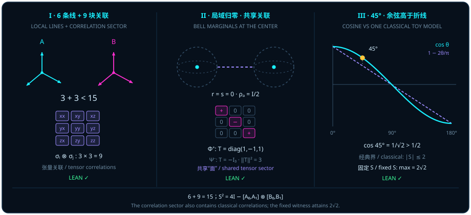

# Quantum Entanglement and the Bell 45° Violation: How the Cosine Arc Defeats the Classical Polygonal Line

> *"Point C is not actually a known quantity; it is a projection onto a point of compatibility. A single definite quantum state determines only a line; a collection of quantum states is needed to determine an area."*

In Part I ([Chapter 1](ch01-measurement.md) through [Chapter 4](ch04-decoherence.md)), we uncovered the complete geometric portrait of a single qubit: stripped of norm and global-phase redundancy, every pure single-qubit state is a directed unit arrow $\vv{r}$ on the unit sphere $S^2 \subset \mathbb{R}^3$; and in the specific [Chapter 4](ch04-decoherence.md) model where an equatorial state couples via a symmetric CNOT/Bell record to an environment (or under unital isotropic depolarizing noise), tracing out the environment shrinks the transverse arrow by the environmental-overlap cosine factor toward the maximally mixed origin $\vv{r} = \vv{0}$ ($\frac{1}{2}I_2$; whereas general open-system channels behave differently: pure dephasing maps $(r_x, r_y, r_z) \mapsto (\eta r_x, \eta r_y, r_z)$ while preserving $r_z$, and amplitude damping attracts states toward the pure north pole $\lvert 0\rangle$).

Now suppose the second qubit coupled to our system is not a stray particle lost in a thermal bath, but a partner qubit carefully held in a distant laboratory. When Alice and Bob each inspect their own qubit locally, both of their local Bloch arrows may vanish completely at the center of the ball ($\vv{r} = \vv{s} = \vv{0}$). Yet the moment they bring their measurement logs together and compare joint outcomes, $100\%$ of the **non-identity purity excess** $\Tr(\rho^2) - \frac{1}{4} = \frac{3}{4}$ above the maximally mixed baseline $\frac{1}{4}I_4$ (namely $\frac{1}{4}\norm{T}_{\mathrm{F}}^2 = \frac{3}{4}$, invisible on the two individual three-dimensional spheres) reappears intact inside a higher-dimensional **correlation tensor sector** spanning both particles!

This chapter opens Part IV, *Higher-Dimensional Spheres — Entanglement, Topology, and Quantum Algorithms*. Starting from the orthogonal sector decomposition of bipartite Hermitian operator space, we pass through the central marginal blind spot of Bell states and Landau's commutator-area identity for the squared CHSH operator, culminating in the $2\sqrt{2}$ maximum at the $45^\circ$ ($\pi/4$) symmetric quarter-right angle.

## Local Lines and Correlation Areas: 6 + 9 = 15 {#sec-pauli-local-correlation}

Why can "an arrow $\vv{r} \in \mathbb{R}^3$ on Alice's sphere" plus "an arrow $\vv{s} \in \mathbb{R}^3$ on Bob's sphere" never account for a bipartite quantum state? Let us begin with a rigorous audit of real dimensions and orthogonal operator subspaces.

For any natural-number dimension $d \in \mathbb{N}$, the space of $d \times d$ complex Hermitian matrices forms a $d^2$-dimensional real vector space, denoted `HermitianSpace d`. Equipped with the canonical real Hilbert–Schmidt inner product

$$
\langle A, B\rangle_{\mathrm{HS}} = \operatorname{Re}\Tr(A^* B) = \operatorname{Re}\Tr(AB),
$$

`HermitianSpace d` is a real inner-product space. Within it, real scalar multiples of the identity matrix span the $1$-dimensional scalar subspace $\mathrm{scalarHermitian}\,d = \mathbb{R}\cdot I_d$, while the traceless $d\times d$ Hermitian matrices form its $(d^2 - 1)$-dimensional orthogonal complement $\mathrm{traceZeroHermitian}\,d = \{A \in \mathrm{HermitianSpace}\,d \mid \Tr A = 0\}$ (since $\langle A, I_d\rangle_{\mathrm{HS}} = \operatorname{Re}\Tr(A) = 0$).

Now consider a composite system formed by an $m$-dimensional subsystem $A$ and an $n$-dimensional subsystem $B$ ($m, n \in \mathbb{N}$ with $1 \le m$, $1 \le n$, and $1 < mn$), living in the real tensor product space

$$
\mathcal{H}_{m,n}^{\mathrm{Herm}} = \mathrm{HermitianSpace}\,m \otimes_{\mathbb{R}} \mathrm{HermitianSpace}\,n
$$

equipped with the induced real Hilbert–Schmidt tensor inner product. For subspaces $P \le \mathrm{HermitianSpace}\,m$ and $Q \le \mathrm{HermitianSpace}\,n$, the source module defines the embedded sector $\mathrm{tensorSector}(P, Q) = \operatorname{range}(\mathrm{TensorProduct.mapIncl}\,P\,Q) \le \mathcal{H}_{m,n}^{\mathrm{Herm}}$ as the range of their canonical inclusion into the ambient tensor product (note that the carrier is this embedded submodule inside $\mathcal{H}_{m,n}^{\mathrm{Herm}}$, a distinction that cannot be elided). The bipartite traceless space $\mathrm{bipartiteTraceZero}\,m\,n = (\mathrm{scalarSector}\,m\,n)^\perp$ — the orthogonal complement of the $1$-dimensional global identity line $\mathrm{scalarSector}\,m\,n = \mathrm{tensorSector}(\mathrm{scalarHermitian}\,m, \mathrm{scalarHermitian}\,n)$, of total real dimension $m^2 n^2 - 1$ — then splits naturally into three operationally distinct sectors:

1. **The local $A$ sector** $\mathrm{localASector}\,m\,n = \mathrm{tensorSector}(\mathrm{traceZeroHermitian}\,m,\, \mathrm{scalarHermitian}\,n)$: operators of the form $A_0 \otimes I_n$ ($\Tr A_0 = 0$), which interrogate subsystem $A$ alone and are blind to subsystem $B$, of real dimension $m^2 - 1$;
2. **The local $B$ sector** $\mathrm{localBSector}\,m\,n = \mathrm{tensorSector}(\mathrm{scalarHermitian}\,m,\, \mathrm{traceZeroHermitian}\,n)$: operators of the form $I_m \otimes B_0$ ($\Tr B_0 = 0$), which interrogate subsystem $B$ alone, of real dimension $n^2 - 1$;
3. **The bipartite correlation sector** $\mathrm{correlationSector}\,m\,n = \mathrm{tensorSector}(\mathrm{traceZeroHermitian}\,m,\, \mathrm{traceZeroHermitian}\,n)$: spanned by joint traceless tensor products $A_0 \otimes B_0$ ($\Tr A_0 = \Tr B_0 = 0$), of real dimension $(m^2 - 1)(n^2 - 1)$.

At the concrete two-qubit matrix level ($m = n = 2$, with matrix type $\mathrm{TwoQubitMatrix} = M_{\mathrm{Fin}\,2 \times \mathrm{Fin}\,2}(\mathbb{C})$), we also define the maximally entangled Bell state vector $\mathrm{bellVector} = \lvert\Phi^+\rangle = \frac{1}{\sqrt{2}}(\lvert 00\rangle + \lvert 11\rangle)$ (with entries $\delta_{ij}/\sqrt{2}$ on $(i, j) \in \mathrm{Fin}\,2 \times \mathrm{Fin}\,2$), its rank-one outer-product density matrix

$$
\mathrm{bellDensity} = \lvert\Phi^+\rangle\langle\Phi^+\rvert = \frac{1}{2}\begin{pmatrix} 1 & 0 & 0 & 1 \\ 0 & 0 & 0 & 0 \\ 0 & 0 & 0 & 0 \\ 1 & 0 & 0 & 1 \end{pmatrix},
$$

and the decohered classical diagonally correlated mixture

$$
\mathrm{classicalCorrelatedDensity} = \frac{1}{2}\bigl(\lvert 00\rangle\langle 00\rvert + \lvert 11\rangle\langle 11\rvert\bigr) = \operatorname{diag}\Bigl(\frac{1}{2},\, 0,\, 0,\, \frac{1}{2}\Bigr).
$$

Writing $\mathrm{traceEnvironment}(\rho)_{i,j} = \sum_a \rho_{(i,a),(j,a)}$ for the partial trace over the second factor and $\mathrm{traceFirstFactor}(\rho)_{i,j} = \sum_a \rho_{(a,i),(a,j)}$ for the partial trace over the first factor, the following theorem combines the general $(m, n)$ orthogonal sector decomposition with the two-qubit marginal blind-spot witnesses.

::: {.theorem #thm-local-correlation-sectors title="Orthogonal Decomposition of Local and Correlation Sectors and the Marginal Blind Spot" lean="D5/S3/Quantum/Entanglement/LocalMarginalCorrelationBlindSpot.local_marginal_correlation_blind_spot"}
Let $m, n \in \mathbb{N}$ satisfy $1 \le m$, $1 \le n$, and $1 < mn$. In the real tensor product space $\mathrm{HermitianSpace}\,m \otimes_{\mathbb{R}} \mathrm{HermitianSpace}\,n$ equipped with the real Hilbert–Schmidt inner product, together with the two-qubit density witnesses, all of the following hold:

1. **Exhaustive decomposition of the traceless bipartite space**:

   $$
   \mathrm{localASector}\,m\,n \sqcup \mathrm{localBSector}\,m\,n \sqcup \mathrm{correlationSector}\,m\,n = \mathrm{bipartiteTraceZero}\,m\,n;
   $$

2. **Real dimension of the combined local sector**:

   $$
   \operatorname{finrank}_{\mathbb{R}}\bigl(\mathrm{localASector}\,m\,n \sqcup \mathrm{localBSector}\,m\,n\bigr) = (m^2 - 1) + (n^2 - 1);
   $$

3. **Real dimension of the correlation sector**:

   $$
   \operatorname{finrank}_{\mathbb{R}}\bigl(\mathrm{correlationSector}\,m\,n\bigr) = (m^2 - 1)(n^2 - 1);
   $$

4. **Dimension ratio of the correlation sector to the traceless bipartite space**: coerced from $\mathbb{N}$ into $\mathbb{R}$,

   $$
   \frac{\operatorname{finrank}_{\mathbb{R}}(\mathrm{correlationSector}\,m\,n)}{\operatorname{finrank}_{\mathbb{R}}(\mathrm{bipartiteTraceZero}\,m\,n)} = \frac{((m^2 - 1)(n^2 - 1) : \mathbb{N})}{((m^2 n^2 - 1) : \mathbb{N})};
   $$

5. **Mutual orthogonality of the local and correlation sectors**: over $\mathbb{R}$,

   $$
   \operatorname{IsOrtho}_{\mathbb{R}}\bigl(\mathrm{localASector}\,m\,n \sqcup \mathrm{localBSector}\,m\,n,\; \mathrm{correlationSector}\,m\,n\bigr);
   $$

6. **Pure-state properties of the Bell density matrix**: $\mathrm{bellDensity}$ is positive semidefinite, $\Tr(\mathrm{bellDensity}) = 1$, and $\operatorname{rank}(\mathrm{bellDensity}) = 1$;
7. **Mixed-state properties of the classically correlated density matrix**: $\mathrm{classicalCorrelatedDensity}$ is positive semidefinite, $\Tr(\mathrm{classicalCorrelatedDensity}) = 1$, and is non-idempotent:

   $$
   \mathrm{classicalCorrelatedDensity} \cdot \mathrm{classicalCorrelatedDensity} \neq \mathrm{classicalCorrelatedDensity};
   $$

8. **Identical local marginals despite distinct global states**:

   $$
   \begin{aligned}
   \mathrm{traceEnvironment}(\mathrm{bellDensity}) &= \mathrm{traceEnvironment}(\mathrm{classicalCorrelatedDensity}), \\
   \mathrm{traceFirstFactor}(\mathrm{bellDensity}) &= \mathrm{traceFirstFactor}(\mathrm{classicalCorrelatedDensity}), \\
   \mathrm{bellDensity} &\neq \mathrm{classicalCorrelatedDensity}.
   \end{aligned}
   $$
:::

::: proof
In each factor $\mathrm{HermitianSpace}\,d$, the scalar line $\mathbb{R}\cdot I_d$ and the traceless subspace $\mathrm{traceZeroHermitian}\,d$ form an orthogonal direct sum, splitting the full tensor product into four mutually orthogonal embedded sectors: the scalar sector, local $A$ sector, local $B$ sector, and correlation sector. Removing the $1$-dimensional scalar sector leaves the supremum of the remaining three orthogonal sectors equal to $\mathrm{bipartiteTraceZero}\,m\,n$, with $\mathrm{localASector} \sqcup \mathrm{localBSector}$ orthogonal to $\mathrm{correlationSector}$ (conjuncts 1 and 5). Because $\operatorname{finrank}_{\mathbb{R}}(\mathrm{traceZeroHermitian}\,d) = d^2 - 1$, orthogonal direct-sum and tensor dimension formulas give $(m^2 - 1) + (n^2 - 1)$ for the combined local sector, $(m^2 - 1)(n^2 - 1)$ for the correlation sector, and $m^2 n^2 - 1$ for $\mathrm{bipartiteTraceZero}\,m\,n$, yielding the stated ratio (conjuncts 2, 3, and 4). For the two-qubit witnesses, $\mathrm{bellDensity} = \lvert\Phi^+\rangle\langle\Phi^+\rvert$ is a rank-one self-adjoint outer product of a unit vector, hence positive semidefinite of trace $1$ and rank $1$ (conjunct 6); the diagonal matrix $\mathrm{classicalCorrelatedDensity} = \operatorname{diag}(1/2, 0, 0, 1/2)$ has nonnegative entries summing to $1$, while its square $\operatorname{diag}(1/4, 0, 0, 1/4)$ differs from $\mathrm{classicalCorrelatedDensity}$ (conjunct 7). Finally, summing over the second or first index gives $\frac{1}{2}I_2$ for both marginals of both states, whereas entry $((0,0),(1,1))$ equals $1/2$ in $\mathrm{bellDensity}$ and $0$ in $\mathrm{classicalCorrelatedDensity}$ (conjunct 8). The full proof is checked by the Lean kernel.
:::

Specializing [@thm-local-correlation-sectors] to two qubits ($m = n = 2$) reveals the dimensional accounting immediately (Figure 13, Panel I):

- Alice's single-qubit traceless observables ($\sigma_X \otimes I_2,\, \sigma_Y \otimes I_2,\, \sigma_Z \otimes I_2$) span $2^2 - 1 = 3$ real dimensions;
- Bob's single-qubit traceless observables ($I_2 \otimes \sigma_X,\, I_2 \otimes \sigma_Y,\, I_2 \otimes \sigma_Z$) likewise span $2^2 - 1 = 3$ real dimensions;
- Together, the **local lines** accessible to Alice and Bob acting separately span only $3 + 3 = 6$ real dimensions;
- Yet the full traceless two-qubit Hermitian space has dimension $4^2 - 1 = 15$! The remaining $(2^2 - 1)(2^2 - 1) = 3 \times 3 = 9$ orthogonal dimensions — a full $\frac{9}{15} = 60\%$ of the traceless state space — live inside the **correlation sector** $\mathrm{correlationSector}\,2\,2$ spanned by the nine joint Pauli products $\{\sigma_i \otimes \sigma_j\}_{i,j \in \{X,Y,Z\}}$!

This gives rigorous operator-space meaning to our opening epigraph: on a single sphere, a state determines only a local direction line ($\vv{r}$ or $\vv{s}$, totaling $6$ real parameters), whereas between two spheres stretches a $3 \times 3 = 9$-cell correlation tensor grid $T_{ij} = \Tr\bigl(\rho(\sigma_i \otimes \sigma_j)\bigr)$.

Two strict mathematical boundaries in [@thm-local-correlation-sectors] must be kept in mind:

1. **The correlation sector includes classical correlations and must not be called an "entanglement subspace"**: $\mathrm{correlationSector}\,m\,n$ is an orthogonal summand of the observable tensor space, not a set of entangled states. Indeed, the separable classical mixture $\mathrm{classicalCorrelatedDensity} = \frac{1}{2}(\lvert 00\rangle\langle 00\rvert + \lvert 11\rangle\langle 11\rvert) = \frac{1}{4}(I_4 + \sigma_Z \otimes \sigma_Z)$ in conjuncts 7 and 8 has zero entanglement, yet its traceless part $\frac{1}{4}\sigma_Z \otimes \sigma_Z$ lies entirely inside the $(Z, Z)$ coordinate of $\mathrm{correlationSector}\,2\,2$!
2. **The operator tensor sector is not the ordinary outer product of two Bloch vectors in $\mathbb{R}^3$**: for an uncorrelated product state $\rho_A \otimes \rho_B$, the correlation matrix collapses to a rank-at-most-one outer product $T_{ij} = r_i s_j$ determined by the $6$ local coordinates; only general bipartite states can independently populate higher-rank configurations across $\mathrm{correlationSector}\,2\,2$ (such as $\lvert\Phi^+\rangle$, which simultaneously excites $\sigma_X \otimes \sigma_X$, $-\sigma_Y \otimes \sigma_Y$, and $\sigma_Z \otimes \sigma_Z$).

## Bell States: Central Marginals and Shared Correlations {#sec-bell-local-zero}

Let us now zoom in on the Bell pure state $\mathrm{bellVector} = \lvert\Phi^+\rangle = \frac{1}{\sqrt{2}}(\lvert 00\rangle + \lvert 11\rangle)$ and its density matrix $\mathrm{bellDensity} = \lvert\Phi^+\rangle\langle\Phi^+\rvert$ from [@thm-local-correlation-sectors].

If a classical observer believes that "a whole is nothing more than the sum of its local parts," then hearing that a two-qubit system is in a globally pure, rank-one, idempotent state ($\rho^2 = \rho$) would lead them to expect each individual qubit to point along some definite pure direction on its own Bloch sphere. The next lemma establishes the exact opposite via seven matrix conjuncts: when the two qubits are maximally interwoven into the Bell state, each local marginal collapses all the way to the center of the ball!

::: {.lemma #lemma-bell-mixed-marginal title="The Bell Pure State Has a Maximally Mixed Marginal" lean="D5/S3/Quantum/Entanglement/BellPureStateMixedMarginal.bell_pure_state_has_maximally_mixed_marginal"}
For the fixed two-qubit Bell state vector $\mathrm{bellVector} = \frac{1}{\sqrt{2}}(\lvert 00\rangle + \lvert 11\rangle)$ and the fixed $4\times 4$ complex density matrix $\mathrm{bellDensity} = \mathrm{vecMulVec}\,\mathrm{bellVector}\,(\mathrm{star}\,\mathrm{bellVector})$, all seven properties hold:

1. **Unit vector normalization**: $\mathrm{star}\,\mathrm{bellVector} \mathbin{\cdot_{\mathrm{v}}} \mathrm{bellVector} = 1$;
2. **Global positive semidefiniteness**: $\mathrm{bellDensity}.\mathrm{PosSemidef}$;
3. **Global unit trace**: $\Tr(\mathrm{bellDensity}) = 1$;
4. **Global rank one**: $\operatorname{rank}(\mathrm{bellDensity}) = 1$;
5. **Global projective idempotence**: $\mathrm{bellDensity} \cdot \mathrm{bellDensity} = \mathrm{bellDensity}$;
6. **Maximally mixed marginal upon tracing out the second factor**:

   $$
   \mathrm{traceEnvironment}(\mathrm{bellDensity}) = \Bigl(\frac{1}{2} : \mathbb{C}\Bigr) \cdot (1 : \mathrm{QubitMatrix}) = \frac{1}{2}I_2;
   $$

7. **Strict non-idempotence of the reduced marginal**:

   $$
   \mathrm{traceEnvironment}(\mathrm{bellDensity}) \cdot \mathrm{traceEnvironment}(\mathrm{bellDensity}) \neq \mathrm{traceEnvironment}(\mathrm{bellDensity}).
   $$
:::

::: proof
Expanding over the four basis indices $(0,0), (0,1), (1,0), (1,1)$, $\mathrm{bellVector}$ takes value $1/\sqrt{2}$ at $(0,0)$ and $(1,1)$ and $0$ elsewhere, so its inner product with itself is $(1/\sqrt{2})^2 + (1/\sqrt{2})^2 = 1$ (property 1). Its rank-one outer product $\mathrm{bellDensity}$ is therefore positive semidefinite, has trace $1$ and rank $1$, and satisfies $(\lvert\Phi^+\rangle\langle\Phi^+\rvert)^2 = \langle\Phi^+\mid\Phi^+\rangle\lvert\Phi^+\rangle\langle\Phi^+\rvert = \mathrm{bellDensity}$ (properties 2–5). Summing over the second index $a \in \mathrm{Fin}\,2$ in $\mathrm{traceEnvironment}(\mathrm{bellDensity})_{i,j} = \sum_{a \in \{0,1\}} (\mathrm{bellDensity})_{(i,a),(j,a)}$ gives $1/2 + 0 = 1/2$ for $i = j = 0$, $0 + 1/2 = 1/2$ for $i = j = 1$, and $0$ for $i \neq j$ because $\mathrm{bellVector}$ has support only on diagonal pairs $(0,0)$ and $(1,1)$. Hence $\mathrm{traceEnvironment}(\mathrm{bellDensity}) = \frac{1}{2}I_2$ (property 6). Squaring gives $(\frac{1}{2}I_2)(\frac{1}{2}I_2) = \frac{1}{4}I_2 \neq \frac{1}{2}I_2$, proving non-idempotence of the marginal (property 7). The full proof is checked by the Lean kernel.
:::

Measured against the criterion of [Chapter 3](ch03-projectors-and-duality.md) ("existence as an idempotent line $P^2 = P$"), properties 5 and 7 of [@lemma-bell-mixed-marginal] form a striking contrast (Figure 13, Panel II):

- Globally in $4\times 4$ space, $\mathrm{bellDensity}^2 = \mathrm{bellDensity}$ holds strictly — the pair is an uncompromising rank-one idempotent projector;
- Locally in $2\times 2$ space, $(\frac{1}{2}I_2)^2 = \frac{1}{4}I_2 \neq \frac{1}{2}I_2$ — Alice's local Bloch vector $\vv{r} = \vv{0}$ and Bob's local Bloch vector $\vv{s} = \vv{0}$ both vanish at the center of $S^2$!

Where did the global purity go? Expanding $\rho_{\Phi^+} = \mathrm{bellDensity}$ in the four Pauli sectors tells the whole story:

$$
\rho_{\Phi^+} = \frac{1}{4}\bigl(I_2 \otimes I_2 + \sigma_X \otimes \sigma_X - \sigma_Y \otimes \sigma_Y + \sigma_Z \otimes \sigma_Z\bigr).
$$

Every local coefficient along $\sigma_i \otimes I_2$ and $I_2 \otimes \sigma_j$ is $0$, while inside the $9$-dimensional correlation sector $\sigma_i \otimes \sigma_j$, the three diagonal cells $(X,X)$, $(Y,Y)$, and $(Z,Z)$ carry unit correlation entries $+1$, $-1$, and $+1$, forming the correlation matrix $T_{\Phi^+} = \operatorname{diag}(+1, -1, +1)$!

When applying [@lemma-bell-mixed-marginal], two precise boundaries must be respected:

1. **Distinguishing the frozen triplet $\lvert\Phi^+\rangle$ from the singlet $\lvert\Psi^-\rangle$**: The declaration [@lemma-bell-mixed-marginal] is proved for the triplet Bell state $\mathrm{bellVector} = \lvert\Phi^+\rangle = \frac{1}{\sqrt{2}}(\lvert 00\rangle + \lvert 11\rangle)$, whose correlation tensor is $T_{\Phi^+} = \operatorname{diag}(+1, -1, +1)$ (because $\sigma_Y \otimes \sigma_Y$ contains two factors of $-i$ whose product $(-i)^2 = -1$ gives a minus sign on $\lvert 00\rangle \leftrightarrow \lvert 11\rangle$). By contrast, since $i\sigma_Y\lvert 0\rangle = -\lvert 1\rangle$ and $i\sigma_Y\lvert 1\rangle = \lvert 0\rangle$, the antisymmetric singlet state obeys the exact vector identity $\lvert\Psi^-\rangle = \frac{1}{\sqrt{2}}(\lvert 01\rangle - \lvert 10\rangle) = \bigl(I_2 \otimes (-i\sigma_Y)\bigr)\lvert\Phi^+\rangle = (i\sigma_Y \otimes I_2)\lvert\Phi^+\rangle$ (whereas $(I_2 \otimes i\sigma_Y)\lvert\Phi^+\rangle = -\lvert\Psi^-\rangle$ differs by a global $-1$ phase while yielding the same density matrix $\rho_{\Psi^-}$), and has Pauli decomposition

   $$
   \rho_{\Psi^-} = \frac{1}{4}\bigl(I_2 \otimes I_2 - \sigma_X \otimes \sigma_X - \sigma_Y \otimes \sigma_Y - \sigma_Z \otimes \sigma_Z\bigr), \qquad T_{\Psi^-} = -I_3 = \operatorname{diag}(-1, -1, -1).
   $$

   While $\lvert\Psi^-\rangle$ exhibits isotropic anti-correlation $\langle(\vv{n}\cdot\vv{\sigma})\otimes(\vv{n}\cdot\vv{\sigma})\rangle_{\Psi^-} = -1$ along every shared axis $\vv{n} \in S^2$, $\lvert\Phi^+\rangle$ exhibits positive correlation $+1$ along every shared axis in the real $(Z, X)$ meridian plane ($n_y = 0$) and $-1$ along the $Y$ axis. The Pauli signs of $\lvert\Phi^+\rangle$ and $\lvert\Psi^-\rangle$ are converted into one another by the local rotation $-i\sigma_Y = \sigma_X \sigma_Z$ on Bob's qubit (or $i\sigma_Y = \sigma_Z \sigma_X$ on Alice's qubit) and must never be conflated.
2. **A vanishing local Bloch line ($\frac{1}{2}I_2$) does not by itself imply entanglement for arbitrary states**: Only when the global state is already known to be **pure** ($\operatorname{rank}\rho = 1$, $\Tr(\rho^2) = 1$) does a maximally mixed marginal $\frac{1}{2}I_2$ certify maximal two-qubit entanglement. For general mixed states — such as $\mathrm{classicalCorrelatedDensity} = \frac{1}{4}(I_4 + \sigma_Z \otimes \sigma_Z)$ ($T = \operatorname{diag}(0,0,1)$) in [@thm-local-correlation-sectors] or the completely maximally mixed state $\frac{1}{4}I_4$ ($T = 0$) — the local marginals are also $\frac{1}{2}I_2$ without any entanglement whatsoever.

## The CHSH Square: Its Commutator Area Term {#sec-chsh-commutator-area}

Since the classical mixture $\mathrm{classicalCorrelatedDensity}$ also has local marginals $\frac{1}{2}I_2$ and occupies the $\sigma_Z \otimes \sigma_Z$ cell of the correlation sector, how can an experiment distinguish a "one-dimensional classical correlation line" from a "higher-dimensional coherent correlation area"?

In 1969, Clauser, Horne, Shimony, and Holt (CHSH) introduced a four-correlator probe: Alice chooses between two dichotomic observables $A_0, A_1$ (Hermitian involutions satisfying $A_0^2 = A_1^2 = I$), Bob chooses between two dichotomic observables $B_0, B_1$ ($B_0^2 = B_1^2 = I$), and together they form the CHSH operator

$$
S = A_0 \otimes_{\mathrm{K}} B_0 + A_0 \otimes_{\mathrm{K}} B_1 + A_1 \otimes_{\mathrm{K}} B_0 - A_1 \otimes_{\mathrm{K}} B_1,
$$

where $\otimes_{\mathrm{K}}$ denotes the matrix Kronecker product.

If $A_0, A_1$ and $B_0, B_1$ were commuting numbers $\pm 1$, factoring $S = A_0(B_0 + B_1) + A_1(B_0 - B_1)$ would immediately force $S^2 = 4$ (since one of $B_0 \pm B_1$ is $\pm 2$ and the other is $0$). What extra term appears when we square the operator $S$ in a noncommutative matrix algebra? Landau's operator identity gives the exact answer: the excess over $4I$ is minus the Kronecker product of Alice's commutator $[A_0, A_1] = A_0 A_1 - A_1 A_0$ and Bob's commutator $[B_0, B_1] = B_0 B_1 - B_1 B_0$!

::: {.proposition #prop-landau-area-square title="Landau's Commutator Identity for the Squared CHSH Operator" lean="D5/S3/QuantumBounds/LandauIdentity.landau_identity"}
Let $m$ and $n$ be arbitrary finite index types with decidable equality (`[Fintype m] [DecidableEq m] [Fintype n] [DecidableEq n]`), and let $A_0, A_1 \in M_m(\mathbb{C})$ and $B_0, B_1 \in M_n(\mathbb{C})$ be complex square matrices, each Hermitian and involutive:

$$
\begin{aligned}
A_0.\mathrm{IsHermitian} \land A_0^2 = 1, &\qquad A_1.\mathrm{IsHermitian} \land A_1^2 = 1, \\
B_0.\mathrm{IsHermitian} \land B_0^2 = 1, &\qquad B_1.\mathrm{IsHermitian} \land B_1^2 = 1.
\end{aligned}
$$

Define the Kronecker-product operators $S, C \in M_{m \times n}(\mathbb{C})$ by

$$
\begin{aligned}
S &:= A_0 \otimes_{\mathrm{K}} B_0 + A_0 \otimes_{\mathrm{K}} B_1 + A_1 \otimes_{\mathrm{K}} B_0 - A_1 \otimes_{\mathrm{K}} B_1, \\
C &:= -\bigl((A_0 A_1 - A_1 A_0) \otimes_{\mathrm{K}} (B_0 B_1 - B_1 B_0)\bigr).
\end{aligned}
$$

Then

$$
S^2 = 4 \cdot (1 : M_{m \times n}(\mathbb{C})) + C.
$$
:::

::: proof
Using the mixed-product property $(X \otimes_{\mathrm{K}} Y)(X' \otimes_{\mathrm{K}} Y') = (XX') \otimes_{\mathrm{K}} (YY')$ and bilinearity of the Kronecker product, expand the square of $S = A_0 \otimes_{\mathrm{K}} (B_0 + B_1) + A_1 \otimes_{\mathrm{K}} (B_0 - B_1)$ into four block terms:

1. **The $A_0^2$ block**: $(A_0^2) \otimes_{\mathrm{K}} (B_0 + B_1)^2 = I_m \otimes_{\mathrm{K}} (B_0^2 + B_1^2 + B_0 B_1 + B_1 B_0) = 2 I_{m\times n} + I_m \otimes_{\mathrm{K}} (B_0 B_1 + B_1 B_0)$;
2. **The $A_1^2$ block**: $(A_1^2) \otimes_{\mathrm{K}} (B_0 - B_1)^2 = I_m \otimes_{\mathrm{K}} (B_0^2 + B_1^2 - B_0 B_1 - B_1 B_0) = 2 I_{m\times n} - I_m \otimes_{\mathrm{K}} (B_0 B_1 + B_1 B_0)$;
   Adding these first two blocks cancels the anticommutator $B_0 B_1 + B_1 B_0$ and leaves $4 I_{m\times n}$.
3. **The $A_0 A_1$ and $A_1 A_0$ cross blocks**: Since $B_0^2 = B_1^2 = I_n$, we have $(B_0 + B_1)(B_0 - B_1) = B_0^2 - B_1^2 - B_0 B_1 + B_1 B_0 = -(B_0 B_1 - B_1 B_0)$ and $(B_0 - B_1)(B_0 + B_1) = +(B_0 B_1 - B_1 B_0)$. Summing the two cross blocks gives

   $$
   A_0 A_1 \otimes_{\mathrm{K}} \bigl(-(B_0 B_1 - B_1 B_0)\bigr) + A_1 A_0 \otimes_{\mathrm{K}} (B_0 B_1 - B_1 B_0) = -\bigl((A_0 A_1 - A_1 A_0) \otimes_{\mathrm{K}} (B_0 B_1 - B_1 B_0)\bigr) = C.
   $$

Combining the diagonal sum $4 I_{m\times n}$ with the cross sum $C$ yields $S^2 = 4 I_{m\times n} + C$. The full proof is checked by the Lean kernel.
:::

Two features of [@prop-landau-area-square] deserve special emphasis:

First, the index types $m$ and $n$ are **arbitrary finite types with decidable equality** — they are not assumed to have cardinality $2$. Whether Alice and Bob hold single qubits, multi-qubit registers, or general finite-dimensional systems, operators on distinct factors automatically commute under Kronecker lifting, and $S^2 = 4I - [A_0, A_1] \otimes_{\mathrm{K}} [B_0, B_1]$ holds universally whenever the four observables are Hermitian involutions.

Second, when we specialize by hand to single-qubit Pauli observables $A_0 = \vv{a}_0\cdot\vv{\sigma}$, $A_1 = \vv{a}_1\cdot\vv{\sigma}$ and $B_0 = \vv{b}_0\cdot\vv{\sigma}$, $B_1 = \vv{b}_1\cdot\vv{\sigma}$ ($\vv{a}_i, \vv{b}_j \in S^2$), the Pauli product rule $(\vv{u}\cdot\vv{\sigma})(\vv{v}\cdot\vv{\sigma}) = (\vv{u}\cdot\vv{v})I_2 + i(\vv{u}\times\vv{v})\cdot\vv{\sigma}$ turns each commutator into twice the oriented parallelogram area (cross product) spanned by the two measurement axes:

$$
[A_0, A_1] = 2i(\vv{a}_0 \times \vv{a}_1)\cdot\vv{\sigma}, \qquad [B_0, B_1] = 2i(\vv{b}_0 \times \vv{b}_1)\cdot\vv{\sigma}.
$$

Substituting these into $C = -[A_0, A_1] \otimes_{\mathrm{K}} [B_0, B_1]$ cancels the minus sign via $-(2i)(2i) = +4$:

$$
S^2 = 4 I_4 + 4\bigl((\vv{a}_0 \times \vv{a}_1)\cdot\vv{\sigma}\bigr) \otimes_{\mathrm{K}} \bigl((\vv{b}_0 \times \vv{b}_1)\cdot\vv{\sigma}\bigr)!
$$

(Note that this Pauli cross-product expansion is an explicit hand calculation for $2\times 2$ Pauli directions and does not alter the general hypotheses of [@prop-landau-area-square]; likewise, [@prop-landau-area-square] itself is an operator identity, not the classical hidden-variable probability bound.) Geometrically, if either Alice's two axes are collinear ($\vv{a}_0 \times \vv{a}_1 = \vv{0}$, zero area) or Bob's two axes are collinear ($\vv{b}_0 \times \vv{b}_1 = \vv{0}$, zero area), the commutator area term $C$ vanishes and $S^2 = 4I_4$. Only when Alice spans a unit orthogonal square ($\vv{a}_0 \perp \vv{a}_1$) **and** Bob spans a unit orthogonal square ($\vv{b}_0 \perp \vv{b}_1$) does their joint area product boost the top eigenvalue of $S^2$ from $4$ to $4 + 4 = 8 = (2\sqrt{2})^2$!

## The 45° Cosine and the Fixed CHSH Maximum {#sec-bell-45-tsirelson}

To reach the peak $\sqrt{8} = 2\sqrt{2}$ on a two-qubit state, at what relative angle should Alice and Bob orient their orthogonal measurement crosses?

The answer is **$45^\circ$ ($\pi/4$)**. In the source module `CHSHWitness`, Alice fixes her two observables along the orthogonal axes $Z$ and $X$, while Bob rotates his orthogonal cross by $45^\circ$ in the $(Z, X)$ plane to the diagonal bisectors

$$
B_0 = \mathrm{bobObservable0} = \frac{Z + X}{\sqrt{2}}, \qquad B_1 = \mathrm{bobObservable1} = \frac{Z - X}{\sqrt{2}},
$$

defining the fixed two-qubit CHSH witness operator

$$
\mathrm{CHSHWitness.chshOperator} = Z \otimes_{\mathrm{K}} B_0 + Z \otimes_{\mathrm{K}} B_1 + X \otimes_{\mathrm{K}} B_0 - X \otimes_{\mathrm{K}} B_1.
$$

The next corollary proves that across the subtype of all valid $4\times 4$ two-qubit density matrices (positive semidefinite of trace $1$), the set of real expectation values of this fixed operator has greatest element $2\sqrt{2}$.

::: {.corollary #cor-fixed-chsh-tsirelson title="The Fixed Two-Qubit CHSH Operator Achieves Maximum Expectation Value 2√2" lean="D5/S3/QuantumBounds/TsirelsonTightness.bell_chsh_state_expectation_is_greatest"}
Let $\mathcal{S}_2 = \{\rho : \mathrm{CHSHWitness.TwoQubitMatrix} \mid \rho.\mathrm{PosSemidef} \land \Tr(\rho) = 1\}$ be the subtype of two-qubit density matrices. Then $2\sqrt{2}$ is the greatest element (`IsGreatest`) of the range of the real expectation map

$$
\rho \longmapsto \operatorname{Re}\Tr\bigl(\rho \cdot \mathrm{CHSHWitness.chshOperator}\bigr)
$$

over $\mathcal{S}_2$: that is, there exists $\rho \in \mathcal{S}_2$ with $\operatorname{Re}\Tr(\rho \cdot \mathrm{CHSHWitness.chshOperator}) = 2\sqrt{2}$, and every $\rho \in \mathcal{S}_2$ satisfies

$$
\operatorname{Re}\Tr\bigl(\rho \cdot \mathrm{CHSHWitness.chshOperator}\bigr) \le 2\sqrt{2}.
$$
:::

::: proof
In Mathlib, `IsGreatest s a` means $a \in s \land \forall x \in s,\, x \le a$. The source module verifies both clauses:

1. **Achievability ($2\sqrt{2} \in \operatorname{range}$)**: Take the valid density state $\rho = \mathrm{bellDensity} = \lvert\Phi^+\rangle\langle\Phi^+\rvert \in \mathcal{S}_2$ from [@thm-local-correlation-sectors] and [@lemma-bell-mixed-marginal]. Grouping terms simplifies $\mathrm{chshOperator}$ to $\sqrt{2}(Z \otimes_{\mathrm{K}} Z + X \otimes_{\mathrm{K}} X)$. Since $(Z \otimes_{\mathrm{K}} Z)\lvert\Phi^+\rangle = \lvert\Phi^+\rangle$ and $(X \otimes_{\mathrm{K}} X)\lvert\Phi^+\rangle = \lvert\Phi^+\rangle$, direct trace evaluation gives $\operatorname{Re}\Tr(\mathrm{bellDensity} \cdot \mathrm{chshOperator}) = \sqrt{2}(1 + 1) = 2\sqrt{2}$.
2. **Upper bound over all states ($\le 2\sqrt{2}$)**: For every $\rho \in \mathcal{S}_2$, because $Z \otimes_{\mathrm{K}} Z$ and $X \otimes_{\mathrm{K}} X$ are Hermitian involutions, the upper-bound difference matrix decomposes as a sum of positive semidefinite operators $2\sqrt{2}I_4 - \mathrm{chshOperator} = \sqrt{2}(I_4 - Z\otimes_{\mathrm{K}} Z) + \sqrt{2}(I_4 - X\otimes_{\mathrm{K}} X) \ge 0$ (meanwhile, by [@prop-landau-area-square] with $[Z, X] = 2iY$ and $[B_0, B_1] = -2iY$, the exact operator square is $(\mathrm{chshOperator})^2 = 4(I_4 - Y \otimes_{\mathrm{K}} Y) \le 8I_4$ with spectrum $\{8, 8, 0, 0\}$, taking eigenvalue $8$ on $\operatorname{span}\{\lvert\Phi^+\rangle, \lvert\Psi^-\rangle\}$ and $0$ on $\operatorname{span}\{\lvert\Phi^-\rangle, \lvert\Psi^+\rangle\}$). Pairing any positive semidefinite state $\rho$ of trace $1$ with this positive semidefinite difference yields $\operatorname{Re}\Tr(\rho \cdot \mathrm{chshOperator}) \le 2\sqrt{2}\operatorname{Re}\Tr(\rho) = 2\sqrt{2}$. The full proof is checked by the Lean kernel.
:::

Observe the exact quantifier scope of [@cor-fixed-chsh-tsirelson]: the frozen theorem optimizes over all $4\times 4$ positive semidefinite trace-one density matrices $\rho$ for the **fixed** operator `CHSHWitness.chshOperator` (with Alice's observables fixed at $Z, X$ and Bob's at $(Z\pm X)/\sqrt{2}$). It does not quantify over arbitrary measurement directions or arbitrary Hilbert spaces; the general Tsirelson bound across arbitrary observables is placed in [@rem-bell-chsh-literature].

[@cor-fixed-chsh-tsirelson] pins the quantum summit at $2\sqrt{2}$. To call this a defeat of the classical side, the classical ceiling has to be pinned just as firmly. The rules for the classical opponent are these: Alice and Bob share a hidden variable $\lambda$ in advance (called a fiber address, `Fiber`, in Lean); afterwards each of them looks only at their own measurement setting and at $\lambda$ and answers $\pm 1$, and neither sees which setting the other chose.

::: {.definition #def-deterministic-fiber-model title="Deterministic Local Fiber Models and the Classical CHSH Value" lean="D5/S3/QuantumBounds/ClassicalFiberBound.boolValue D5/S3/QuantumBounds/ClassicalFiberBound.DeterministicFiberModel D5/S3/QuantumBounds/ClassicalFiberBound.observable D5/S3/QuantumBounds/ClassicalFiberBound.chshAt D5/S3/QuantumBounds/ClassicalFiberBound.classicalCHSH"}
In the module `ClassicalFiberBound`:

1. [`boolValue`](lean:D5/S3/QuantumBounds/ClassicalFiberBound.boolValue) $: \mathrm{Bool} \to \mathbb{R}$ reads `false` as $-1$ and `true` as $+1$;
2. A **deterministic fiber model** [`DeterministicFiberModel`](lean:D5/S3/QuantumBounds/ClassicalFiberBound.DeterministicFiberModel) $\mathrm{Fiber}$ is a structure consisting of two answer tables $\mathrm{alice},\ \mathrm{bob} : \operatorname{Fin} 2 \to \mathrm{Fiber} \to \mathrm{Bool}$: one Boolean answer for each of the two measurement settings and each fiber address;
3. [`observable`](lean:D5/S3/QuantumBounds/ClassicalFiberBound.observable) turns an answer table $\mathrm{answer} : \mathrm{Fiber} \to \mathrm{Bool}$ into the real-valued function $\lambda \mapsto \operatorname{boolValue}(\mathrm{answer}(\lambda))$;
4. The CHSH value at a single fiber address, [`chshAt`](lean:D5/S3/QuantumBounds/ClassicalFiberBound.chshAt), is defined as

   $$
   \operatorname{chshAt}(\mathrm{model}, \lambda) \;=\; A_0 B_0 + A_0 B_1 + A_1 B_0 - A_1 B_1,
   $$

   where $A_x = \operatorname{observable}(\mathrm{model.alice}\ x)(\lambda)$ and $B_y = \operatorname{observable}(\mathrm{model.bob}\ y)(\lambda)$;
5. For a finite type $\mathrm{Fiber}$ and weights $\mu : \mathrm{Fiber} \to \mathbb{R}$, the **classical CHSH value** [`classicalCHSH`](lean:D5/S3/QuantumBounds/ClassicalFiberBound.classicalCHSH) is defined as

   $$
   \operatorname{classicalCHSH}(\mu, \mathrm{model}) \;=\; \sum_{\lambda \in \mathrm{Fiber}} \mu(\lambda)\,\operatorname{chshAt}(\mathrm{model}, \lambda).
   $$
:::

::: {.theorem #thm-classical-chsh-bound-exact title="The Absolute CHSH Bound for Finite Deterministic Local Fiber Models Is Exactly 2" lean="D5/S3/QuantumBounds/ClassicalFiberBound.classical_chsh_bound_is_exact D5/S3/QuantumBounds/ClassicalFiberBound.classical_chsh_abs_le_two"}
Let $\mathrm{Fiber}$ be a finite type (`[Fintype Fiber]`) and let the weights $\mu : \mathrm{Fiber} \to \mathbb{R}$ be nonnegative (`hmu_nonneg`: $0 \le \mu(\lambda)$ for every $\lambda$) and normalized (`hmu_sum`: $\sum_\lambda \mu(\lambda) = 1$). Then:

1. For every deterministic fiber model $\mathrm{model}$ ([@def-deterministic-fiber-model]),

   $$
   \bigl\lvert \operatorname{classicalCHSH}(\mu, \mathrm{model}) \bigr\rvert \;\le\; 2 ;
   $$

2. The set $\bigl\{\, \lvert\operatorname{classicalCHSH}(\mu, \mathrm{model})\rvert \;\big|\; \mathrm{model} : \operatorname{DeterministicFiberModel}\ \mathrm{Fiber} \,\bigr\}$ has greatest element $2$ (`IsGreatest`): $2$ belongs to the set, and every element of the set is at most $2$.
:::

::: proof
Start with a single fiber address. Four real numbers with values $\pm 1$ commute pairwise and square to $1$, so they satisfy Mathlib's commutative CHSH inequality `CHSH_inequality_of_comm`, which gives $\operatorname{chshAt} \le 2$. Negating both of Alice's answers flips the sign of $\operatorname{chshAt}$; applying the same inequality to the flipped model gives $-2 \le \operatorname{chshAt}$. Now multiply termwise by the nonnegative weights $\mu(\lambda)$, sum, and insert $\sum_\lambda \mu(\lambda) = 1$ to get $-2 \le \operatorname{classicalCHSH} \le 2$, which is claim 1 (`classical_chsh_abs_le_two`). For attainment, take the constant model in which Alice and Bob answer `true` for every setting and every fiber address: at each address $\operatorname{chshAt} = 1 + 1 + 1 - 1 = 2$, and the weighted sum equals $2$ (`classical_chsh_eq_two_exists`). Together these give claim 2. The full proof is checked by the Lean kernel.
:::

The step at a single address can be counted out by hand.

::: {.example #ex-sixteen-deterministic-chsh-tables title="The CHSH Value of the Sixteen Deterministic Answer Tables: Eight Give +2 and Eight Give −2"}
At one fixed fiber address, Alice's two answers $a_0, a_1$ and Bob's two answers $b_0, b_1$ each take the values $\pm 1$, for $2^4 = 16$ combinations. Rewrite the CHSH value as

$$
a_0 b_0 + a_0 b_1 + a_1 b_0 - a_1 b_1 \;=\; a_0\,(b_0 + b_1) + a_1\,(b_0 - b_1).
$$

Bob's two answers stand in one of only two relations:

| Bob's answers | $b_0 + b_1$ | $b_0 - b_1$ | CHSH value | combinations |
| :---: | :---: | :---: | :---: | :---: |
| $b_0 = b_1$ | $\pm 2$ | $0$ | $2\,a_0 b_0 = \pm 2$ | $8$ |
| $b_0 = -b_1$ | $0$ | $\pm 2$ | $2\,a_1 b_0 = \pm 2$ | $8$ |

In each row the product that decides the sign takes the values $+1$ and $-1$ in half of the combinations each, so exactly eight of the sixteen combinations give $+2$ and eight give $-2$; none lies outside $[-2, 2]$ and none lies strictly inside. Any probabilistic mixture merely takes a weighted average between $-2$ and $+2$, hence $\lvert S\rvert \le 2$, in agreement with [@thm-classical-chsh-bound-exact].
:::

Both ends are now pinned: the CHSH value of a finite deterministic local model cannot leave the segment $[-2, 2]$ ([@thm-classical-chsh-bound-exact]), while the expectation of the fixed CHSH operator on quantum states reaches $2\sqrt{2}$ ([@cor-fixed-chsh-tsirelson]). Their ratio is $\sqrt{2}$, the factor by which the $45^\circ$ arc exceeds the polyline. Mind the quantifier scope of each theorem: the classical side concerns deterministic $\pm 1$ answer tables over a finite set of fibers, and the quantum side concerns one fixed two-qubit operator; for the general forms see [@rem-bell-chsh-literature] at the end of the chapter.

Why is $\theta = 45^\circ$ the symmetric CHSH working angle? In a symmetric four-setting configuration (three adjacent pairs separated by $\theta$ and one pair separated by $3\theta$), the four-correlator combination is $3\cos\theta - \cos(3\theta)$, whose derivative $-3\sin\theta + 3\sin(3\theta) = 0$ attains its global maximum $2\sqrt{2}$ at $\theta = 45^\circ$ ($\pi/4$)! (Keep this four-setting optimization distinct from maximizing the single-chord pointwise difference $g(\theta) = \cos\theta - (1 - 2\theta/\pi)$ against the linear toy model: the pointwise derivative $-\sin\theta + 2/\pi = 0$ peaks at $\theta = \arcsin(2/\pi) \approx 39.5402^\circ$ with a single-chord gap of $\approx 0.2105$, whereas at the symmetric CHSH working angle $\theta = 45^\circ$ each single-chord gap is $\frac{\sqrt{2}-1}{2} \approx 0.2071$, four of which sum to $2\sqrt{2} - 2 \approx 0.8284$.) Let us now work through the complete numerical checklist connecting $\rho_{\Phi^+}$, $\rho_{\Psi^-}$, the four $45^\circ$ CHSH correlators, and the comparison between the cosine arc and a specific linear toy model.

::: {.example #ex-bell-chsh-45deg title="Complete Hand-Calculated Checklist for Bell Marginals, the 45° CHSH Value 2√2, and the Cosine Arc"}
This example provides a three-part verification checklist for the two-qubit Bell states and the $45^\circ$ CHSH configuration:

**Step 1: Explicit $4\times 4$ matrix, partial traces, correlation tensor $T$, and purity check for $\rho_{\Phi^+}$ and $\rho_{\Psi^-}$.**
In the standard basis $\{\lvert 00\rangle, \lvert 01\rangle, \lvert 10\rangle, \lvert 11\rangle\}$, the Bell density matrix $\rho_{\Phi^+} = \mathrm{bellDensity}$ is

$$
\rho_{\Phi^+} = \frac{1}{2}\begin{pmatrix} 1 & 0 & 0 & 1 \\ 0 & 0 & 0 & 0 \\ 0 & 0 & 0 & 0 \\ 1 & 0 & 0 & 1 \end{pmatrix}.
$$

Both partial traces equal the maximally mixed state $\Tr_B(\rho_{\Phi^+}) = \Tr_A(\rho_{\Phi^+}) = \frac{1}{2}I_2$, so the local Bloch vectors vanish: $\vv{r} = \vv{s} = (0, 0, 0)$. Evaluating the $3\times 3$ correlation matrix $T_{ij} = \Tr\bigl(\rho(\sigma_i \otimes \sigma_j)\bigr)$ ($i, j \in \{X, Y, Z\}$) gives:

- For the triplet $\rho_{\Phi^+}$: $T_{\Phi^+} = \operatorname{diag}(+1, -1, +1)$, with Frobenius squared norm $\norm{T_{\Phi^+}}_{\mathrm{F}}^2 = \sum_{i,j} T_{ij}^2 = 1^2 + (-1)^2 + 1^2 = 3$;
- For the singlet $\rho_{\Psi^-} = \lvert\Psi^-\rangle\langle\Psi^-\rvert$ ($\lvert\Psi^-\rangle = \frac{1}{\sqrt{2}}(\lvert 01\rangle - \lvert 10\rangle)$): all three diagonal correlations are negative, $T_{\Psi^-} = -I_3 = \operatorname{diag}(-1, -1, -1)$, also with $\norm{T_{\Psi^-}}_{\mathrm{F}}^2 = (-1)^2 + (-1)^2 + (-1)^2 = 3$ (one must never copy the $+X, -Y, +Z$ signs of $\Phi^+$ onto $\Psi^-$!).

Substituting into the two-qubit purity identity $\Tr(\rho^2) = \frac{1}{4}\bigl(1 + \norm{\vv{r}}^2 + \norm{\vv{s}}^2 + \norm{T}_{\mathrm{F}}^2\bigr)$ gives

$$
\Tr(\rho^2) = \frac{1 + 0 + 0 + 3}{4} = 1,
$$

confirming that above the maximally mixed identity baseline $\frac{1}{4}$ (and with $\frac{1}{4}(\norm{\vv{r}}^2 + \norm{\vv{s}}^2) = 0$ from the vanishing local Bloch vectors), $100\%$ of the **non-identity purity excess** $\Tr(\rho^2) - \frac{1}{4} = \frac{3}{4}$ is carried by the correlation term $\frac{1}{4}\norm{T}_{\mathrm{F}}^2 = \frac{3}{4}$ ($\norm{T}_{\mathrm{F}}^2 = 3$). (Note: depicting $T_{ij}$ as a "shared correlation area" is a visualization of the $3\times 3$ correlation entries, not a general entanglement monotone across arbitrary mixed states.)

**Step 2: The four $45^\circ$ correlators and $S = 2\sqrt{2}$.**
On $\rho_{\Phi^+}$, set Alice's observables to $A_0 = Z$, $A_1 = X$ and Bob's observables to $B_0 = \frac{Z + X}{\sqrt{2}}$, $B_1 = \frac{Z - X}{\sqrt{2}}$. Using $\langle Z \otimes Z\rangle_{\Phi^+} = +1$, $\langle X \otimes X\rangle_{\Phi^+} = +1$, and $\langle Z \otimes X\rangle_{\Phi^+} = \langle X \otimes Z\rangle_{\Phi^+} = 0$, the four individual correlators $E_{ij} = \Tr\bigl(\rho_{\Phi^+}(A_i \otimes B_j)\bigr)$ are:

$$
\begin{aligned}
E_{00} &= \frac{1}{\sqrt{2}}\bigl(\langle Z\otimes Z\rangle + \langle Z\otimes X\rangle\bigr) = +\frac{1}{\sqrt{2}}, &\qquad
E_{01} &= \frac{1}{\sqrt{2}}\bigl(\langle Z\otimes Z\rangle - \langle Z\otimes X\rangle\bigr) = +\frac{1}{\sqrt{2}}, \\
E_{10} &= \frac{1}{\sqrt{2}}\bigl(\langle X\otimes Z\rangle + \langle X\otimes X\rangle\bigr) = +\frac{1}{\sqrt{2}}, &\qquad
E_{11} &= \frac{1}{\sqrt{2}}\bigl(\langle X\otimes Z\rangle - \langle X\otimes X\rangle\bigr) = -\frac{1}{\sqrt{2}}.
\end{aligned}
$$

Combining them with the minus sign on $E_{11}$ yields

$$
\langle S\rangle_{\Phi^+} = E_{00} + E_{01} + E_{10} - E_{11} = \frac{1}{\sqrt{2}} + \frac{1}{\sqrt{2}} + \frac{1}{\sqrt{2}} - \Bigl(-\frac{1}{\sqrt{2}}\Bigr) = \frac{4}{\sqrt{2}} = 2\sqrt{2} \approx 2.8284271247461903,
$$

which exceeds the classical local hidden-variable bound $|S_{\mathrm{cl}}| \le 2$ by $2\sqrt{2} - 2 \approx 0.8284271247461903$.

**Step 3: Comparing the cosine curve $C_{\mathrm{q}}(\theta) = \cos\theta$ with the specific toy-model polygonal line $C_{\mathrm{cl}}(\theta) = 1 - \frac{2\theta}{\pi}$.**
In Figure 13, Panel III, we plot the positive-correlation convention $C_{\mathrm{q}}(\theta) = \cos\theta$ ($0 \le \theta \le \pi$): for $\rho_{\Phi^+}$, when Alice and Bob choose directions $\vv{a}, \vv{b}$ in the $(Z, X)$ plane separated by angle $\theta$, their correlator is directly $\langle(\vv{a}\cdot\vv{\sigma})\otimes(\vv{b}\cdot\vv{\sigma})\rangle_{\Phi^+} = \cos\theta$; for the singlet $\rho_{\Psi^-}$, the raw correlator is $E_{\Psi^-}(\theta) = -\cos\theta$, so plotting $+\cos\theta$ requires explicitly flipping Bob's outcome sign ($b \mapsto -b$).

We compare $C_{\mathrm{q}}(\theta) = \cos\theta$ against a specific uniform-direction hidden-variable toy model in which each pair carries a shared unit vector $\vv{\lambda}$ distributed uniformly on the circle (or sphere) and outputs $\operatorname{sgn}(\vv{a}\cdot\vv{\lambda})$ and $\operatorname{sgn}(\vv{b}\cdot\vv{\lambda})$. Because the two hemicircles disagree on two wedges of angle $\theta$ out of $\pi$, this specific toy model produces the piecewise-linear curve

$$
C_{\mathrm{cl}}(\theta) = \Bigl(1 - \frac{\theta}{\pi}\Bigr)(+1) + \Bigl(\frac{\theta}{\pi}\Bigr)(-1) = 1 - \frac{2\theta}{\pi} \qquad (0 \le \theta \le \pi).
$$

(We emphasize that $1 - 2\theta/\pi$ is the correlation function of this particular isotropic toy model, not the only curve attainable by general classical local models.) At the benchmark angles:

| Relative Angle $\theta$ | Quantum Cosine $C_{\mathrm{q}}(\theta) = \cos\theta$ | Toy-Model Line $C_{\mathrm{cl}}(\theta) = 1 - 2\theta/\pi$ | Gap $C_{\mathrm{q}}(\theta) - C_{\mathrm{cl}}(\theta)$ | Geometric Interpretation |
| :---: | :---: | :---: | :---: | :--- |
| $0^\circ$ ($0$) | $+1$ | $+1$ | $0$ | Collinear alignment; exact agreement |
| $45^\circ$ ($\pi/4$) | $\frac{\sqrt{2}}{2} \approx 0.7071067811865476$ | $0.5$ | $+0.2071067811865476$ | **Cosine arc bulges above the chord (CHSH point)** |
| $90^\circ$ ($\pi/2$) | $0$ | $0$ | $0$ | Orthogonal equator; zero correlation |
| $135^\circ$ ($3\pi/4$) | $-\frac{\sqrt{2}}{2} \approx -0.7071067811865476$ | $-0.5$ | $-0.2071067811865476$ | Symmetric negative bulge (gives $E_{11}$) |
| $180^\circ$ ($\pi$) | $-1$ | $-1$ | $0$ | Antipodal opposition; exact agreement |

At the cardinal angles $0^\circ, 90^\circ, 180^\circ$, both curves coincide at $+1, 0, -1$; at $\theta = 45^\circ$, the cosine arc $0.7071067811865476 > 0.5$ rises above the linear chord, and summing four such $45^\circ/135^\circ$ contributions lifts $4 \times 0.5 = 2$ to $4 \times \frac{\sqrt{2}}{2} = 2\sqrt{2}$!
:::

::: {.remark #rem-bell-chsh-literature title="The General Classical Local-Hidden-Variable Bound, the General Tsirelson Theorem, and No-Signaling (Literature Result, Not Formalized in This Book)"}
**Literature result, not formalized in this book.** To situate the frozen theorems of this chapter within the broader foundations literature, three classical results and physical boundaries should be kept distinct:

1. **The classical CHSH bound $|S_{\mathrm{LHV}}| \le 2$ as the convex hull of deterministic models** (J. F. Clauser, M. A. Horne, A. Shimony, and R. A. Holt, *Proposed experiment to test local hidden-variable theories*, Phys. Rev. Lett. **23**, 880–884, 1969, doi:10.1103/PhysRevLett.23.880): The linear sawtooth $C_{\mathrm{cl}}(\theta) = 1 - 2\theta/\pi$ in [@ex-bell-chsh-45deg] is a specific illustrative toy model, not Bell's theorem itself. The general CHSH inequality holds for **every** local stochastic hidden-variable model $\int \bar{A}_i(\lambda)\bar{B}_j(\lambda)\,d\mu(\lambda)$ with $\bar{A}_i(\lambda), \bar{B}_j(\lambda) \in [-1, 1]$: because a multilinear expression on $[-1, 1]^4$ attains its extrema at the vertices $a_0, a_1, b_0, b_1 \in \{\pm 1\}$ where one of $b_0 \pm b_1$ is $\pm 2$ and the other is $0$, every deterministic assignment satisfies $a_0(b_0 + b_1) + a_1(b_0 - b_1) = \pm 2$, and convex averaging over any probability distribution $\mu$ enforces $|S_{\mathrm{LHV}}| \le 2$. The case of a finite set of hidden variables with deterministic $\pm 1$ responses is verified by [@thm-classical-chsh-bound-exact]; the general form, with an arbitrary probability measure and stochastic response functions valued in $[-1, 1]$, remains a literature result: passing from the former to the latter requires writing stochastic responses as convex combinations of deterministic ones and replacing finite sums by integrals, and neither step is formalized in this book.
2. **The general Tsirelson bound $|\langle S\rangle| \le 2\sqrt{2}$ for arbitrary observables and Hilbert spaces** (B. S. Cirel'son, *Quantum generalizations of Bell's inequality*, Lett. Math. Phys. **4**, 93–100, 1980, doi:10.1007/BF00417500): Whereas [@cor-fixed-chsh-tsirelson] proves that $2\sqrt{2}$ is the greatest expectation value of the **fixed** two-qubit operator `CHSHWitness.chshOperator`, Cirel'son's general theorem holds over any Hilbert space $\mathcal{H}$, any state $\rho$, and **any** four Hermitian involutions $A_0, A_1, B_0, B_1$ with $[A_i, B_j] = 0$: bounding the commutator norms by $\norm{[A_0, A_1]}_{\mathrm{op}} \le 2$ and $\norm{[B_0, B_1]}_{\mathrm{op}} \le 2$ in Landau's identity $S^2 = 4I - [A_0, A_1][B_0, B_1]$ gives $\norm{S^2}_{\mathrm{op}} \le 8$, hence $|\langle S\rangle| \le 2\sqrt{2}$ universally.
3. **No controllable superluminal signaling**: Violation of the CHSH inequality (verified across loophole-free Bell experiments) manifests only in joint correlation statistics when Alice's and Bob's records are brought together afterward. As shown in [@thm-local-correlation-sectors] and [@lemma-bell-mixed-marginal], Bob's local reduced state remains fixed at $\frac{1}{2}I_2$ regardless of Alice's measurement choice, so quantum entanglement never permits controllable faster-than-light communication.
:::

We have now seen the first great lesson of higher-dimensional quantum geometry: local single-qubit lines can be completely drained ($\vv{r} = \vv{s} = \vv{0}$) while $100\%$ of the state's non-identity purity excess ($\Tr(\rho^2) - \frac{1}{4} = \frac{1}{4}\norm{T}_{\mathrm{F}}^2 = \frac{3}{4}$ on top of the $\frac{1}{4}I_4$ baseline) is stored in the non-local correlation tensor $T_{ij}$. That geometric fact suggests a decisive engineering strategy for fault-tolerant quantum computing: **if environmental noise attacks local lines one qubit at a time, can we intentionally evacuate fragile logical information from local lines and hide it inside higher-dimensional stabilizer correlation areas and topological braids?** Let us step into [Chapter 14](ch14-cloning-codes-and-braids.md).
