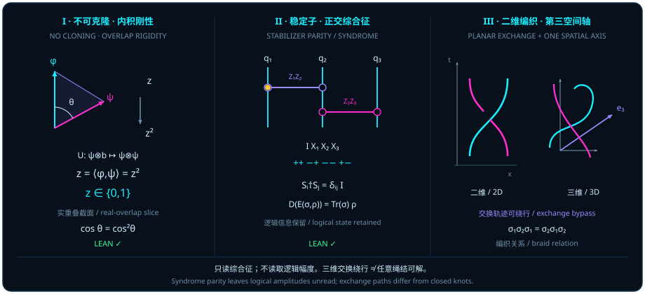

# Hiding Fragile Lines in Higher-Dimensional Areas: Quantum Error-Correcting Codes and Anyonic Topological Braids

> *"Area is wave, and particle is line. If line and area are both projections of a state, this seems a promising explanation of wave–particle duality."*

In [Chapter 13](ch13-entanglement-and-chsh.md), we saw how a two-qubit Bell state drains both single-qubit local Bloch lines to zero ($\vv{r} = \vv{s} = \vv{0}$) while storing all of the non-identity purity excess $\Tr(\rho^2) - \frac{1}{4} = \frac{3}{4}$ above the $\frac{1}{4}I_4$ baseline (namely $\frac{1}{4}\norm{T}_{\mathrm{F}}^2 = \frac{3}{4}$) inside the $9$-dimensional correlation tensor sector $\mathcal{W}_{\mathrm{corr}}$. In this chapter we turn that geometric insight into the foundational defense strategy of quantum information engineering: **quantum error correction and topological braiding**.

In classical digital hardware, protecting information against noise is straightforward — **copy it**. To guard a classical bit against thermal flips, a repetition circuit duplicates $0 \mapsto 000$ and $1 \mapsto 111$ and takes a majority vote. Before quantum error correction can even begin, however, an uncompromising law of inner-product geometry bars the classical copying strategy: **an unknown quantum superposition cannot be cloned**. Since we cannot duplicate a fragile local direction line into two independent local lines, our only recourse is to evacuate logical information from local lines altogether, encoding it into multi-qubit Pauli stabilizer correlation areas and worldline braids that local noise cannot silently corrupt.

## No Cloning: Preserving an Overlap and Squaring It {#sec-no-cloning-overlap}

Why can a classical xerox machine copy a printed page effortlessly, whereas no unitary machine can duplicate an arbitrary unknown quantum state $\psi$ into $\psi \otimes \psi$?

Popular accounts often blame "measurement disturbance," but measurement is not even involved. The obstruction sits directly in the clash between two elementary properties of inner products:

1. **A linear isometry preserves inner products**: If a cloning process is implemented by a complex linear isometry $U$ on $H \otimes_{\mathbb{C}} H$, then for any two input states $\psi$ and $\phi$, their inner-product overlap $z = \langle\phi, \psi\rangle_{\mathbb{C}}$ must remain equal to $z$ after $U$ acts;
2. **Tensor-product duplication squares inner products**: If $\psi$ and $\phi$ are mapped to the duplicated tensor products $\psi \otimes \psi$ and $\phi \otimes \phi$, the inner product of the outputs is the product of the factor inner products, $\langle\phi, \psi\rangle_{\mathbb{C}} \cdot \langle\phi, \psi\rangle_{\mathbb{C}} = z^2$!

Demanding both "preserve $z$" and "square $z$ to $z^2$" forces the algebraic equation $z = z^2$. Across the entire complex plane $\mathbb{C}$, the only numbers equal to their own square are **$z = 1$ (identical vectors) and $z = 0$ (orthogonal vectors)**!

The following theorem formalizes this inner-product criterion on any complex inner-product space $H$ without assuming completeness or finite dimensionality (where Mathlib's `inner Complex` is conjugate-linear in the first slot and $U$ is a complex linear isometric equivalence `LinearIsometryEquiv` on $H \otimes_{\mathbb{C}} H$).

::: {.theorem #thm-no-cloning-overlap title="Inner-Product Criterion for Quantum No-Cloning" lean="D5/S3/Quantum/PureState/NoCloningInnerProductCriterion.no_cloning_inner_product_criterion"}
Let $H$ be any complex inner-product space (`[NormedAddCommGroup H] [InnerProductSpace Complex H]`), and let $U : (H \otimes_{\mathbb{C}} H) \simeq_{\mathrm{li}}[\mathbb{C}] (H \otimes_{\mathbb{C}} H)$ be a complex linear isometric equivalence on $H \otimes_{\mathbb{C}} H$. Let $\psi, \phi, \mathrm{blank} \in H$ be unit vectors satisfying

$$
\norm{\psi} = 1, \qquad \norm{\phi} = 1, \qquad \norm{\mathrm{blank}} = 1.
$$

If the same operator $U$ and the same blank state $\mathrm{blank}$ satisfy the two exact vector cloning equations

$$
U\bigl(\psi \otimes_{\mathbb{C}} \mathrm{blank}\bigr) = \psi \otimes_{\mathbb{C}} \psi, \qquad
U\bigl(\phi \otimes_{\mathbb{C}} \mathrm{blank}\bigr) = \phi \otimes_{\mathbb{C}} \phi,
$$

then the complex inner product of $\phi$ and $\psi$ equals its own square, and the two vectors are either identical or orthogonal:

$$
\langle\phi, \psi\rangle_{\mathbb{C}} = \langle\phi, \psi\rangle_{\mathbb{C}}^2 \;\land\; \bigl(\phi = \psi \lor \langle\phi, \psi\rangle_{\mathbb{C}} = 0\bigr).
$$
:::

::: proof
Set $z = \langle\phi, \psi\rangle_{\mathbb{C}}$. Because $U$ is a complex linear isometry, it preserves the inner product on $H \otimes_{\mathbb{C}} H$:

$$
\bigl\langle \phi \otimes_{\mathbb{C}} \mathrm{blank},\; \psi \otimes_{\mathbb{C}} \mathrm{blank}\bigr\rangle_{\mathbb{C}}
= \bigl\langle U(\phi \otimes_{\mathbb{C}} \mathrm{blank}),\; U(\psi \otimes_{\mathbb{C}} \mathrm{blank})\bigr\rangle_{\mathbb{C}}.
$$

Evaluating both sides via $\langle x_1 \otimes y_1, x_2 \otimes y_2\rangle_{\mathbb{C}} = \langle x_1, x_2\rangle_{\mathbb{C}}\langle y_1, y_2\rangle_{\mathbb{C}}$ gives $\langle\phi, \psi\rangle_{\mathbb{C}}\norm{\mathrm{blank}}^2 = z \cdot 1 = z$ on the left and $\langle\phi \otimes_{\mathbb{C}} \phi,\; \psi \otimes_{\mathbb{C}} \psi\rangle_{\mathbb{C}} = \langle\phi, \psi\rangle_{\mathbb{C}}^2 = z^2$ on the right, establishing $z = z^2$.

Since $\mathbb{C}$ is an integral domain, $z(z - 1) = 0$ implies $z = 1$ or $z = 0$. If $z = 0$, the right disjunct $\langle\phi, \psi\rangle_{\mathbb{C}} = 0$ holds immediately. If $z = \langle\phi, \psi\rangle_{\mathbb{C}} = 1$, expanding the squared norm of the difference gives

$$
\norm{\phi - \psi}^2 = \norm{\phi}^2 - 2\operatorname{Re}\langle\phi, \psi\rangle_{\mathbb{C}} + \norm{\psi}^2 = 1 - 2(1) + 1 = 0,
$$

which forces $\phi - \psi = 0$, hence $\phi = \psi$. The full proof is checked by the Lean kernel.
:::

Look at Figure 14, Panel I: on a real nonnegative overlap slice $z = \cos\vartheta \in [0, 1]$, isometric evolution requires the overlap to stay on the diagonal line $y = z$, whereas tensor duplication pulls it down onto the parabola $y = z^2$. The two curves meet only at the endpoints $(0, 0)$ and $(1, 1)$; at every tilted superposition angle in between (such as $\vartheta = 45^\circ$, where $z = \frac{1}{\sqrt{2}} \approx 0.7071$ while $z^2 = 0.5$), a positive gap $z - z^2 > 0$ forbids joint cloning!

Four precise boundaries govern [@thm-no-cloning-overlap]:

1. **Complex overlap $z \in \mathbb{C}$ versus the real slice $z = \cos\vartheta$**: In general, $z = \langle\phi, \psi\rangle_{\mathbb{C}}$ is a complex number; only on a slice where the inner product is real and nonnegative ($z = \cos\vartheta \in [0, 1]$) does $z = z^2$ take the form $\cos\vartheta = \cos^2\vartheta$. Moreover, never confuse the Hilbert-space overlap angle $\vartheta$ with the Bloch-sphere angle $\theta_{\mathrm{Bloch}}$: by the half-angle formula $|\langle\phi, \psi\rangle|^2 = \cos^2(\theta_{\mathrm{Bloch}}/2)$ of [Chapter 2](ch02-born-rule.md), the Bloch-sphere angle between two pure qubit states is twice their Hilbert ray angle ($\theta_{\mathrm{Bloch}} = 2\vartheta$).
2. **Exact vector equality versus projective rays**: Because the hypotheses of [@thm-no-cloning-overlap] require exact **vector equality** $U(\psi \otimes \mathrm{blank}) = \psi \otimes \psi$ and $U(\phi \otimes \mathrm{blank}) = \phi \otimes \phi$ with the same $U$ and the same $\mathrm{blank}$, the case $z = 1$ yields strict vector equality $\phi = \psi$ ("identical or orthogonal"), not collinearity up to an arbitrary phase; the projective-ray formulation allowing state-dependent output phases $e^{i\alpha(\psi)}$ requires separate phase-gauge bookkeeping.
3. **General inner-product spaces**: The theorem holds on any `NormedAddCommGroup` equipped with `InnerProductSpace Complex`, with no assumption of finite dimension or completeness.
4. **Necessary criterion, not a cloner construction**: The condition $z \in \{0, 1\}$ is a **necessary** compatibility requirement for a pair of states to be cloned by $U$; it must not be misread as constructing a universal cloner.

Boundary 4 says that [@thm-no-cloning-overlap] is only a necessary condition. So ask the converse question: since exact cloning is impossible, how well can approximate cloning do, and where does the cost land? The question has an explicit answer.

Bužek and Hillery (1996) constructed a $1 \to 2$ cloning machine that treats every input alike. It uses three qubits: the input, a blank copy, and an auxiliary "machine" qubit $M$. For a unit vector $\psi$, let $\psi^\perp$ be a unit vector orthogonal to it; the cloning isometry sends the input to

$$
\lvert\psi\rangle \;\longmapsto\; \sqrt{\tfrac{2}{3}}\;\lvert\psi\rangle\lvert\psi\rangle\lvert\psi^\perp\rangle_M \;-\; \sqrt{\tfrac{1}{3}}\;\frac{\lvert\psi\rangle\lvert\psi^\perp\rangle + \lvert\psi^\perp\rangle\lvert\psi\rangle}{\sqrt{2}}\;\lvert\psi\rangle_M ,
$$

where the three factors are clone one, clone two, and the machine qubit. Tracing out the two clones leaves the machine qubit in $\frac{1}{3}\lvert\psi\rangle\langle\psi\rvert + \frac{2}{3}\lvert\psi^\perp\rangle\langle\psi^\perp\rvert$. The Lean module `D5/S3/Quantum/CloningMachine` defines this matrix directly and proves that its spectrum does not depend on the input.

::: {.definition #def-cloning-machine-reduced-state title="The Orthogonal Qubit, the Machine Reduced State of the Cloner, and the Machine Entropy" lean="D5/S3/Quantum/CloningMachine.orthogonalQubit D5/S3/Quantum/CloningMachine.machineReducedState D5/S3/Quantum/CloningMachine.binaryEntropyBits D5/S3/Quantum/CloningMachine.machineEntropy"}
In the module `CloningMachine` (`QubitState` is $\operatorname{Fin} 2 \to \mathbb{C}$ and `QubitMatrix` is the type of complex $2 \times 2$ matrices):

1. The **orthogonal qubit** [`orthogonalQubit`](lean:D5/S3/Quantum/CloningMachine.orthogonalQubit) $\psi = \bigl(-\overline{\psi_1},\ \overline{\psi_0}\bigr)$;
2. The **machine reduced state** [`machineReducedState`](lean:D5/S3/Quantum/CloningMachine.machineReducedState) is defined as

   $$
   \operatorname{machineReducedState}\ \psi \;=\; \frac{1}{3}\,\psi\,\psi^{*} \;+\; \frac{2}{3}\,\psi^\perp\,(\psi^\perp)^{*}, \qquad \psi^\perp = \operatorname{orthogonalQubit}\ \psi,
   $$

   where $v\,v^{*}$ denotes the outer-product matrix `Matrix.vecMulVec v (star v)`;
3. The binary entropy in bits [`binaryEntropyBits`](lean:D5/S3/Quantum/CloningMachine.binaryEntropyBits) $p = -p\log_2 p - (1 - p)\log_2(1 - p)$, and the **machine entropy** [`machineEntropy`](lean:D5/S3/Quantum/CloningMachine.machineEntropy) $= \operatorname{binaryEntropyBits}\ \frac{1}{3}$.
:::

::: {.theorem #thm-cloning-machine-spectrum title="The Input-Independent Spectrum of the Cloner's Machine Reduced State and the Closed Form of the Machine Entropy" lean="D5/S3/Quantum/CloningMachine.orthogonal_qubit_inner D5/S3/Quantum/CloningMachine.machine_reduced_is_density D5/S3/Quantum/CloningMachine.machine_reduced_det D5/S3/Quantum/CloningMachine.machine_reduced_spectrum D5/S3/Quantum/CloningMachine.machine_entropy_closed_form"}
Let $\psi$ be a `QubitState`, with the notation of [@def-cloning-machine-reduced-state].

1. **Orthogonality** (no normalization needed): $\psi^{*} \cdot \operatorname{orthogonalQubit}\ \psi = 0$, that is, `star ψ ⬝ᵥ orthogonalQubit ψ = 0`.

If moreover $\psi$ is normalized (`hUnit : star ψ ⬝ᵥ ψ = 1`), then:

2. **It is a density matrix**: $\operatorname{machineReducedState}\ \psi$ is positive semidefinite and has trace $1$;
3. **Determinant**: $\det\bigl(\operatorname{machineReducedState}\ \psi\bigr) = \frac{2}{9}$;
4. **Spectrum**: the spectrum of $\operatorname{machineReducedState}\ \psi$ over $\mathbb{C}$ is exactly $\bigl\{\frac{1}{3},\ \frac{2}{3}\bigr\}$.

In addition, without reference to $\psi$:

5. **Closed form of the machine entropy**: $\operatorname{machineEntropy} = \log_2 3 - \frac{2}{3}$.
:::

::: proof
Claim 1 expands the dot product and simplifies by ring arithmetic. Claim 2: the two outer products $\psi\psi^{*}$ and $\psi^\perp(\psi^\perp)^{*}$ are each positive semidefinite, and a combination with nonnegative coefficients remains so; passing to the orthogonal qubit preserves the squared norm, so the trace equals $\frac{1}{3} + \frac{2}{3} = 1$. Claim 3: write $\psi^\perp(\psi^\perp)^{*}$ as an explicit $2 \times 2$ matrix, expand the determinant, and simplify with the normalization to get $\frac{2}{9}$. Claim 4: the characteristic polynomial of a $2 \times 2$ matrix is determined by its trace and determinant, here $X^2 - X + \frac{2}{9} = \bigl(X - \frac{1}{3}\bigr)\bigl(X - \frac{2}{3}\bigr)$ (`machine_reduced_charpoly`), and the spectrum is its set of roots. Claim 5: substitute $\log_2\frac{1}{3} = -\log_2 3$ and $\log_2\frac{2}{3} = 1 - \log_2 3$ into $\operatorname{binaryEntropyBits}\ \frac{1}{3}$ and simplify. The full proof is checked by the Lean kernel.
:::

[@thm-cloning-machine-spectrum] proves properties of the matrix in [@def-cloning-machine-reduced-state]; that this matrix is the machine marginal of the Bužek–Hillery isometry is shown by hand in the example below and is a literature result.

::: {.example #ex-buzek-hillery-three-marginals title="The Three Marginals of the Bužek–Hillery Cloner: Clone Fidelity 5/6, Machine Qubit Reversed and Shrunk to 1/3"}
The cloning isometry and its optimality are literature results (V. Bužek and M. Hillery, Phys. Rev. A **54**, 1844, 1996; for optimality see N. Gisin and S. Massar, Phys. Rev. Lett. **79**, 2153, 1997), not formalized in this book. The marginals below are obtained from the isometry by direct partial traces and were checked numerically on random input states.

Write the output state as $\lvert\Omega\rangle = \sqrt{\frac{2}{3}}\,\lvert\psi\psi\rangle\lvert\psi^\perp\rangle_M - \sqrt{\frac{1}{3}}\,\lvert S\rangle\lvert\psi\rangle_M$ with $\lvert S\rangle = \frac{1}{\sqrt{2}}\bigl(\lvert\psi\psi^\perp\rangle + \lvert\psi^\perp\psi\rangle\bigr)$.

- **The machine qubit.** $\lvert\psi\psi\rangle$ and $\lvert S\rangle$ are orthogonal, so the cross terms vanish when the two clones are traced out, leaving $\rho_M = \frac{2}{3}\lvert\psi^\perp\rangle\langle\psi^\perp\rvert + \frac{1}{3}\lvert\psi\rangle\langle\psi\rvert$, which is exactly $\operatorname{machineReducedState}\ \psi$ of [@def-cloning-machine-reduced-state].
- **A single clone.** The machine factors $\lvert\psi^\perp\rangle$ and $\lvert\psi\rangle$ of the two terms are orthogonal, so after tracing out the machine the pair of clones is in the mixture $\frac{2}{3}\lvert\psi\psi\rangle\langle\psi\psi\rvert + \frac{1}{3}\lvert S\rangle\langle S\rvert$. Tracing out the other clone as well, $\lvert\psi\psi\rangle$ contributes $\lvert\psi\rangle\langle\psi\rvert$ and $\lvert S\rangle$ contributes $\frac{1}{2}\bigl(\lvert\psi\rangle\langle\psi\rvert + \lvert\psi^\perp\rangle\langle\psi^\perp\rvert\bigr)$, for a total of

  $$
  \rho_{\mathrm{clone}} \;=\; \Bigl(\frac{2}{3} + \frac{1}{6}\Bigr)\lvert\psi\rangle\langle\psi\rvert + \frac{1}{6}\,\lvert\psi^\perp\rangle\langle\psi^\perp\rvert \;=\; \frac{5}{6}\,\lvert\psi\rangle\langle\psi\rvert + \frac{1}{6}\,\lvert\psi^\perp\rangle\langle\psi^\perp\rvert .
  $$

Let the Bloch vector of the input be the unit vector $\vv{r}$ (so that $\lvert\psi^\perp\rangle$ corresponds to $-\vv{r}$):

| subsystem | eigenvalues of the reduced state | Bloch vector | fidelity with the input $\langle\psi\rvert\rho\lvert\psi\rangle$ | entropy (bits) |
| :---: | :---: | :---: | :---: | :---: |
| input | $1,\ 0$ | $\vv{r}$ | $1$ | $0$ |
| clone one, clone two | $\frac{5}{6},\ \frac{1}{6}$ | $\frac{2}{3}\,\vv{r}$ | $\frac{5}{6} \approx 0.8333$ | $0.6500$ |
| machine qubit | $\frac{2}{3},\ \frac{1}{3}$ | $-\frac{1}{3}\,\vv{r}$ | $\frac{1}{3}$ | $\log_2 3 - \frac{2}{3} \approx 0.9183$ |

The eigenvalues and the entropy in the machine row are claims 4 and 5 of [@thm-cloning-machine-spectrum]. Numerical check (three random input states): clone fidelity $0.833333$; Bloch shrinking factors $0.666667$ for the clones and $-0.333333$ for the machine; machine spectrum $\{0.333333,\ 0.666667\}$; determinant $0.222222$. The linear extension of the formula from the computational basis agrees with the expression for general $\psi$ up to a global phase, and it preserves inner products.
:::

So no-cloning does not mean that nothing can be copied. Exact cloning demands that the overlap satisfy $z = z^2$; the universal cloner gives up exactness and shrinks the Bloch vector of each clone uniformly to $\frac{2}{3}$. What is shrunk away does not disappear: the machine qubit carries a reversed Bloch vector of length $\frac{1}{3}$ together with an entropy of about $0.918$ bits that does not depend on the direction of the input. The global state is still pure, and the mixedness of all three marginals comes from the entanglement among them.

## Pauli Words and Stabilizer Syndromes {#sec-pauli-syndrome-parity}

If [@thm-no-cloning-overlap] forbids duplicating an unknown superposition $\alpha\lvert 0\rangle + \beta\lvert 1\rangle$ into $(\alpha\lvert 0\rangle + \beta\lvert 1\rangle)^{\otimes 3}$, how does quantum error correction protect quantum information?

The key is to **embed orthogonal basis states into a multi-body entangled subspace** — for instance extending $\lvert 0\rangle \mapsto \lvert 000\rangle$ and $\lvert 1\rangle \mapsto \lvert 111\rangle$ linearly to $\alpha\lvert 0\rangle + \beta\lvert 1\rangle \mapsto \alpha\lvert 000\rangle + \beta\lvert 111\rangle$ — and then measure only multi-body **Pauli words** that check joint parity without ever probing the single-qubit amplitudes $\alpha, \beta$!

To formalize this algebra across arbitrary mode count $N \in \mathbb{N}$ and arbitrary local level count $p \in \mathbb{N}$ with `[NeZero p]` (note that **$p$ is not required to be prime, and $N$ may be $0$**), the source module `StabilizerGenuineEntanglementCommutationRank` defines the structure `PauliWord N p` with three fields:

- A discrete phase exponent $\mathrm{phase} : \mathrm{ZMod}\,p$;
- A shift (flip) exponent vector $x : \mathrm{Fin}\,N \to \mathrm{ZMod}\,p$;
- A clock (phase) exponent vector $z : \mathrm{Fin}\,N \to \mathrm{ZMod}\,p$.

Writing $\omega_p = \mathrm{windowRoot}\,p = \exp(2\pi i / p)$, on a single $p$-level qudit ($M_{\mathrm{Fin}\,p}(\mathbb{C})$) the cyclic shift matrix $X$ and the diagonal clock matrix $Z = \operatorname{diag}(\omega_p^{j.\mathrm{val}})$ form the single-site Weyl operator $D(e, f) = X^{e.\mathrm{val}} Z^{f.\mathrm{val}}$ (ordered with $Z$ on the right and $X$ on the left). A Pauli word $w : \mathrm{PauliWord}\,N\,p$ then defines the $N$-qudit matrix operator `pauliWordOperator w` on $(\mathrm{Fin}\,N \to \mathrm{Fin}\,p)$ with entries

$$
\bigl(\mathrm{pauliWordOperator}(w)\bigr)_{u, v} = \omega_p^{w.\mathrm{phase}.\mathrm{val}} \prod_{n \in \mathrm{Fin}\,N} D(w.x_n, w.z_n)_{u_n, v_n},
$$

while the formal word product `wordMul a b` adds each field coordinatewise in $\mathrm{ZMod}\,p$:

$$
\mathrm{wordMul}(a, b) = \bigl(a.\mathrm{phase} + b.\mathrm{phase},\; a.x + b.x,\; a.z + b.z\bigr).
$$

When two Pauli-word operators multiply, on each mode $n$ the factor $Z^{a.z_n}$ on the left must pass across $X^{b.x_n}$ on the right to reach normal form $X^{a.x_n + b.x_n} Z^{a.z_n + b.z_n}$, picking up the Weyl commutation phase $Z^{a.z_n} X^{b.x_n} = \omega_p^{(a.z_n b.x_n).\mathrm{val}} X^{b.x_n} Z^{a.z_n}$. The next lemma captures this exact multiplication law.

::: {.lemma #lemma-pauli-word-phase title="Multiplication and Cross-Phase Law for Generalized Pauli Words" lean="D5/S3/Quantum/Codes/StabilizerGenuineEntanglementCommutationRank.pauli_word_mul"}
Let $N, p \in \mathbb{N}$ with `[NeZero p]`. For any two Pauli words $a, b : \mathrm{PauliWord}\,N\,p$, the product of their matrix operators satisfies

$$
\mathrm{pauliWordOperator}(a) \cdot \mathrm{pauliWordOperator}(b) = \mathrm{windowRoot}(p)^{\bigl(\sum_{n \in \mathrm{Fin}\,N} a.z_n \cdot b.x_n\bigr).\mathrm{val}} \bullet \mathrm{pauliWordOperator}\bigl(\mathrm{wordMul}(a, b)\bigr).
$$
:::

::: proof
On each mode $n \in \mathrm{Fin}\,N$, multiplying the single-site Weyl operators gives $D(a.x_n, a.z_n) D(b.x_n, b.z_n) = X^{a.x_n.\mathrm{val}} Z^{a.z_n.\mathrm{val}} X^{b.x_n.\mathrm{val}} Z^{b.z_n.\mathrm{val}}$. Moving $Z^{a.z_n.\mathrm{val}}$ past $X^{b.x_n.\mathrm{val}}$ via the clock–shift relation $Z^{a.z_n.\mathrm{val}} X^{b.x_n.\mathrm{val}} = \omega_p^{(a.z_n \cdot b.x_n).\mathrm{val}} X^{b.x_n.\mathrm{val}} Z^{a.z_n.\mathrm{val}}$ and reducing the shift and clock powers modulo $p$ yields $\omega_p^{(a.z_n \cdot b.x_n).\mathrm{val}} D(a.x_n + b.x_n, a.z_n + b.z_n)$. Taking the product over all $n \in \mathrm{Fin}\,N$ sums the cross-phase exponents in $\mathrm{ZMod}\,p$ to $\sum_n a.z_n \cdot b.x_n$, while the intrinsic phase factors $\omega_p^{a.\mathrm{phase}.\mathrm{val}} \omega_p^{b.\mathrm{phase}.\mathrm{val}} = \omega_p^{(a.\mathrm{phase} + b.\mathrm{phase}).\mathrm{val}}$ combine into the `phase` field of `wordMul a b`. The full proof is checked by the Lean kernel.
:::

Two critical points in [@lemma-pauli-word-phase] must be observed:

1. **Never drop the external cross-phase scalar**: In the source definition, `wordMul a b` only adds the intrinsic phases `a.phase + b.phase`; the entire noncommutative cross-phase $\omega_p^{(\sum_n a.z_n b.x_n).\mathrm{val}}$ stands **outside** as a scalar multiplier $\bullet$ and must never be omitted. Even for qubits ($p = 2$, $\omega_2 = -1$), the single-site operator order remains $X^{x_n} Z^{z_n}$, so every site where $a.z_n = 1$ and $b.x_n = 1$ contributes a minus sign from $ZX = -XZ$.
2. **Binary symplectic parity check at $p = 2$**: Because $\mathrm{wordMul}(a, b) = \mathrm{wordMul}(b, a)$, comparing $\mathrm{pauliWordOperator}(a)\mathrm{pauliWordOperator}(b)$ with $\mathrm{pauliWordOperator}(b)\mathrm{pauliWordOperator}(a)$ shows that their commutation phase is governed by the difference $\sum_n (a.z_n b.x_n - b.z_n a.x_n)$ in $\mathrm{ZMod}\,p$. At $p = 2$, this reduces to the binary symplectic inner product

   $$
   \langle a, b\rangle_{\mathrm{symp}} = \sum_{n \in \mathrm{Fin}\,N} \bigl(a.z_n b.x_n + a.x_n b.z_n\bigr) \pmod 2,
   $$

   which determines whether a stabilizer check $a$ commutes ($+1$) or anticommutes ($-1$) with a Pauli error $b$. Note that [@lemma-pauli-word-phase] itself is the operator multiplication identity; turning syndromes into guaranteed logical recovery requires the orthogonal-syndrome decoding structure developed next.

## Logical Recovery from Orthogonal Syndromes {#sec-orthogonal-syndrome-recovery}

Once environmental errors kick an encoded logical state $\rho \in M_d(\mathbb{C})$ into distinct error channels, how does recovery strip away the error matrix $\sigma$ and restore $\rho$ intact?

Geometrically, the mechanism relies on **mutually orthogonal syndrome subspaces** (Figure 14, Panel II). Let $s$ (syndrome indices), $n$ (physical dimension), and $d$ (logical code dimension) be finite index types with `[DecidableEq s]` and `[DecidableEq d]` ($n$ requires no explicit `DecidableEq` instance). In `OrthogonalSyndromeDecoding`, a family of embedding matrices $S : s \to M_{n \times d}(\mathbb{C})$ satisfies `OrthogonalSyndromes S` if

$$
\forall i, j : s,\qquad S_i^* S_j = \begin{cases} I_d & \text{if } i = j, \\ 0 & \text{if } i \neq j. \end{cases}
$$

Each $S_i$ isometrically embeds the $d$-dimensional logical space into the $i$-th syndrome subspace ($S_i^* S_i = I_d$), while distinct syndrome subspaces are strictly orthogonal ($S_i^* S_j = 0$ for $i \neq j$).

For any syndrome coefficient matrix $\sigma \in M_s(\mathbb{C})$ and any logical matrix $\rho \in M_d(\mathbb{C})$, the **syndrome encoding map** is

$$
\mathrm{syndromeEncoding}(S, \sigma, \rho) = \sum_{j \in s} \sum_{k \in s} \sigma_{jk}\, S_j \rho S_k^* \in M_n(\mathbb{C}),
$$

and the **syndrome decoding map** is

$$
\mathrm{syndromeDecoding}(S, \mathrm{state}) = \sum_{i \in s} S_i^* \,\mathrm{state}\, S_i \in M_d(\mathbb{C}).
$$

The next proposition proves that decoding any syndrome-encoded state collapses all cross-syndrome terms and returns $\Tr(\sigma) \bullet \rho$.

::: {.proposition #prop-orthogonal-syndrome-recovery title="Exact Logical Recovery from Orthogonal Syndrome Subspaces" lean="D5/S3/Quantum/Recovery/OrthogonalSyndromeDecoding.orthogonal_syndrome_recovery"}
Let $s, n, d$ be finite index types (with `[DecidableEq s]` and `[DecidableEq d]`), and let $S : s \to M_{n \times d}(\mathbb{C})$ satisfy `OrthogonalSyndromes S`. Then for every complex matrix $\sigma \in M_s(\mathbb{C})$ and every complex matrix $\rho \in M_d(\mathbb{C})$,

$$
\mathrm{syndromeDecoding}\bigl(S,\, \mathrm{syndromeEncoding}(S, \sigma, \rho)\bigr) = \Tr(\sigma) \bullet \rho.
$$
:::

::: proof
Substituting the double sum of $\mathrm{syndromeEncoding}(S, \sigma, \rho)$ into $\mathrm{syndromeDecoding}$ and expanding by linearity gives

$$
\mathrm{syndromeDecoding}\bigl(S,\, \mathrm{syndromeEncoding}(S, \sigma, \rho)\bigr)
= \sum_{i \in s} \sum_{j \in s} \sum_{k \in s} \sigma_{jk}\, (S_i^* S_j)\, \rho\, (S_k^* S_i).
$$

By `OrthogonalSyndromes S`, $S_i^* S_j = \delta_{ij} I_d$ and $S_k^* S_i = (S_i^* S_k)^* = \delta_{ik} I_d$. For each fixed $i \in s$, every term with $j \neq i$ or $k \neq i$ vanishes, leaving only the $j = k = i$ term $\sigma_{ii}(I_d \rho I_d) = \sigma_{ii}\rho$. Summing over $i \in s$ yields $\bigl(\sum_{i \in s} \sigma_{ii}\bigr)\rho = \Tr(\sigma) \bullet \rho$. The full proof is checked by the Lean kernel.
:::

Two important domain boundaries apply to [@prop-orthogonal-syndrome-recovery]:

1. **No positivity, unit-trace, or diagonality assumption on $\sigma$ or $\rho$**: The identity holds for **arbitrary** complex matrices $\sigma \in M_s(\mathbb{C})$ and $\rho \in M_d(\mathbb{C})$. In particular, off-diagonal coherent error superpositions $\sigma_{jk}$ ($j \neq k$) between distinct syndrome subspaces are automatically annihilated by $S_i^* S_j = \delta_{ij}I_d$ and $S_k^* S_i = \delta_{ik}I_d$, and when $\Tr(\sigma) = 1$, exact unscaled recovery $\mathrm{syndromeDecoding}(S, \mathrm{syndromeEncoding}(S, \sigma, \rho)) = \rho$ follows as a special case.
2. **Algebraic decoding on the syndrome support versus a globally trace-preserving channel**: $\mathrm{syndromeDecoding}(S, \cdot) = \sum_{i \in s} S_i^* (\cdot) S_i$ is an algebraic recovery formula on the direct sum $\bigoplus_{i \in s} \operatorname{range}(S_i)$. Whenever $|s|d < n$ so that $\sum_{i \in s} S_i S_i^* \neq I_n$, one cannot unconditionally claim that $\{S_i^*\}_{i \in s}$ alone defines a trace-preserving (CPTP) channel on the entire physical space $M_n(\mathbb{C})$; a full physical channel requires completing the Kraus operators on the orthogonal complement $I_n - \sum_{i \in s} S_i S_i^*$.

## Planar Braids and the Third Orthogonal Direction {#sec-braids-and-third-axis}

Beyond active syndrome measurement, nature offers a passive topological mechanism for fault-tolerant gates: **braiding particle worldlines in $(2+1)$-dimensional spacetime**.

Why does exchanging two particles twice in a two-dimensional plane $(e_1, e_2)$ trace a nontrivial braid in $(2+1)$ dimensions, whereas exchanging two point particles twice in three-dimensional space $(e_1, e_2, e_3)$ can be smoothly untangled?

As illustrated in Figure 14, Panel III, the difference is the **third orthogonal spatial axis $e_3$**! When non-colliding point particles are confined to a plane, their worldlines in $(x, t)$ spacetime behave like taut strands: passing strand $1$ over strand $2$ ($\mathrm{crossing}$) is topologically distinct from passing it under ($\mathrm{crossingInv}$). On three strands $(x, (y, z))$, sliding the middle strand past the crossing of the outer two yields the fundamental **three-strand braid relation (the Yang–Baxter equation)** $\sigma_1 \sigma_2 \sigma_1 = \sigma_2 \sigma_1 \sigma_2$.

In the source module `D5/S0/Certificates/Quandles/BraidColoringTransport.lean`, this braid invariance is formalized algebraically via rack-coloring transport. Let $Q$ be any type equipped with a `Rack Q` instance, providing a binary operation $\star : Q \to Q \to Q$ (`act`) and inverse operation $\star^{-1} : Q \to Q \to Q$ (`invAct`) that is left-action bijective — for each fixed first argument $x \in Q$, the left translation map $L_x : y \mapsto x \star y$ is a bijection with inverse $L_x^{-1} : y \mapsto x \star^{-1} y$ (`Function.LeftInverse (invAct x) (act x)` and `Function.RightInverse (invAct x) (act x)`, so $x \star^{-1}(x \star y) = y$ and $x \star (x \star^{-1} y) = y$) — and obeys left self-distributivity:

$$
(x \star y) \star (x \star z) = x \star (y \star z) \qquad (\forall x, y, z \in Q).
$$

The two-strand crossing and its inverse are defined by

$$
\mathrm{crossing}(x, y) = (x \star y,\, x), \qquad \mathrm{crossingInv}(u, v) = (v,\, v \star^{-1} u),
$$

so that $\mathrm{crossingInv}\bigl(\mathrm{crossing}(x, y)\bigr) = \mathrm{crossingInv}(x \star y, x) = \bigl(x,\, x \star^{-1}(x \star y)\bigr) = (x, y)$, and their three-strand lifts on $Q \times (Q \times Q)$ are

$$
\mathrm{crossing}_1\bigl(x, (y, z)\bigr) = \bigl(x \star y,\, (x, z)\bigr), \qquad
\mathrm{crossing}_2\bigl(x, (y, z)\bigr) = \bigl(x,\, (y \star z,\, y)\bigr).
$$

The next corollary proves that $\mathrm{crossing}_1$ and $\mathrm{crossing}_2$ satisfy the exact Yang–Baxter braid identity on every rack $Q$.

::: {.corollary #cor-braid-yang-baxter title="Three-Strand Yang–Baxter Braid Identity for Rack Colorings" lean="D5/S0/Certificates/Quandles/BraidColoringTransport.crossing_yang_baxter"}
Let $Q$ be any type equipped with `[Rack Q]`. For all $x, y, z \in Q$, the adjacent three-strand crossing maps satisfy

$$
\mathrm{crossing}_1\bigl(\mathrm{crossing}_2\bigl(\mathrm{crossing}_1(x, (y, z))\bigr)\bigr) = \mathrm{crossing}_2\bigl(\mathrm{crossing}_1\bigl(\mathrm{crossing}_2(x, (y, z))\bigr)\bigr).
$$
:::

::: proof
Unfolding $\mathrm{crossing}_1$ and $\mathrm{crossing}_2$ on the left-hand side step by step gives

$$
\begin{aligned}
(x, (y, z))
&\xrightarrow{\;\mathrm{crossing}_1\;} \bigl(x \star y,\, (x, z)\bigr) \\
&\xrightarrow{\;\mathrm{crossing}_2\;} \bigl(x \star y,\, (x \star z,\, x)\bigr) \\
&\xrightarrow{\;\mathrm{crossing}_1\;} \Bigl((x \star y) \star (x \star z),\; (x \star y,\, x)\Bigr).
\end{aligned}
$$

Unfolding the right-hand side step by step gives

$$
\begin{aligned}
(x, (y, z))
&\xrightarrow{\;\mathrm{crossing}_2\;} \bigl(x,\, (y \star z,\, y)\bigr) \\
&\xrightarrow{\;\mathrm{crossing}_1\;} \bigl(x \star (y \star z),\, (x, y)\bigr) \\
&\xrightarrow{\;\mathrm{crossing}_2\;} \Bigl(x \star (y \star z),\; (x \star y,\, x)\Bigr).
\end{aligned}
$$

The trailing pairs $(x \star y, x)$ are identical on both sides, and the leading entries $(x \star y) \star (x \star z)$ and $x \star (y \star z)$ agree by the rack self-distributivity axiom. The full proof is checked by the Lean kernel.
:::

Three boundaries must be respected when interpreting [@cor-braid-yang-baxter]:

1. **Algebraic coloring realization versus full topological classification**: [@cor-braid-yang-baxter] is an algebraic rack-coloring realization of the three-strand braid relation on an arbitrary `Rack Q` (with no topological space, spacetime dimension, or particle statistics in its hypotheses). It does not prove that all planar braids are nontrivial, nor does it classify the full fundamental group of configuration space.
2. **Distinguishing point-particle exchange paths from closed knots in $\mathbb{R}^3$**: As shown in Figure 14, Panel III, adding a third spatial axis $e_3$ allows a point-particle **exchange loop** (a path in configuration space where one point particle loops around another) to detour along $e_3$, reducing the exchange group from the braid group $B_n$ to the symmetric group $S_n$. **This is completely different from a closed $1$-dimensional knot embedded in $\mathbb{R}^3$** (such as a trefoil knot), which still cannot pass through itself and remains knotted in three dimensions!
3. **Anyonic statistics and topological fault-tolerance belong to the physics literature**: Configuration-space homotopy groups, non-Abelian anyons, and physical error bounds are summarized in [@rem-error-correction-anyons-literature].

Let us now work through the four-part numerical and matrix calculation connecting no-cloning, the three-qubit bit-flip code, local Bloch expectations, and $8\times 2$ orthogonal syndrome recovery.

::: {.example #ex-repetition-code-syndrome title="Numerical No-Cloning Gap, Three-Qubit Repetition Syndromes, and 8×2 Orthogonal Recovery"}
This example verifies the four concrete calculations of Chapter 14:

**Step 1: Numerical no-cloning gap at $45^\circ$ versus exact CNOT copying of an orthogonal pair.**
In $H = \mathbb{C}^2$, choose $\lvert\psi\rangle = \lvert 0\rangle = \binom{1}{0}$, $\lvert\phi\rangle = \lvert +\rangle = \frac{1}{\sqrt{2}}\binom{1}{1}$, and $\lvert\mathrm{blank}\rangle = \lvert 0\rangle$. The input inner product is

$$
z = \langle\phi, \psi\rangle_{\mathbb{C}} = \frac{1}{\sqrt{2}} \approx 0.7071067811865476,
$$

whereas the target cloned states $\lvert\phi\rangle\otimes\lvert\phi\rangle$ and $\lvert\psi\rangle\otimes\lvert\psi\rangle$ have inner product

$$
z^2 = \Bigl(\frac{1}{\sqrt{2}}\Bigr)^2 = \frac{1}{2} = 0.5.
$$

The nonzero gap $z - z^2 = \frac{\sqrt{2} - 1}{2} \approx 0.2071067811865476 \neq 0$ violates $z = z^2$ in [@thm-no-cloning-overlap], so no linear isometry $U$ can clone both $\lvert 0\rangle$ and $\lvert +\rangle$. By contrast, for the orthogonal pair $\lvert 0\rangle, \lvert 1\rangle$ ($z = \langle 1, 0\rangle_{\mathbb{C}} = 0 = 0^2$), $\mathrm{CNOT}$ with $\lvert\mathrm{blank}\rangle = \lvert 0\rangle$ exactly achieves $\mathrm{CNOT}\lvert 00\rangle = \lvert 00\rangle$ and $\mathrm{CNOT}\lvert 10\rangle = \lvert 11\rangle$ — covering only that specific orthogonal basis pair.

**Step 2: Three-qubit bit-flip repetition code and binary symplectic parity checks.**
Set $N = 3, p = 2$, and define the logical encoding isometry $V : \mathbb{C}^2 \to \mathbb{C}^8$ by $V\lvert 0\rangle = \lvert 000\rangle$ and $V\lvert 1\rangle = \lvert 111\rangle$, stabilized by

$$
g_1 = Z_1 Z_2 = Z \otimes Z \otimes I, \qquad g_2 = Z_2 Z_3 = I \otimes Z \otimes Z.
$$

In `PauliWord 3 2`, $g_1$ and $g_2$ have shift vector $x = (0, 0, 0)$ and binary $z$-check rows $z^{(1)} = (1, 1, 0)$ and $z^{(2)} = (0, 1, 1)$. For the four candidate bit-flip errors $E \in \{I, X_1, X_2, X_3\}$ with $z = (0, 0, 0)$ and binary $x$-vectors $(0,0,0), (1,0,0), (0,1,0), (0,0,1)$, the mod-$2$ dot products $(z^{(1)}\cdot x^{(E)}, z^{(2)}\cdot x^{(E)})$ from [@lemma-pauli-word-phase] uniquely identify each error:

| Error $E$ | Binary $x$-Vector $x^{(E)} \in (\mathrm{ZMod}\,2)^3$ | Mod-$2$ Parity $\bigl(z^{(1)}\cdot x^{(E)},\; z^{(2)}\cdot x^{(E)}\bigr)$ | Eigenvalue Syndrome $(g_1, g_2)$ | Shifted Basis Pair $\{E\lvert 000\rangle, E\lvert 111\rangle\}$ |
| :---: | :---: | :---: | :---: | :---: |
| $E_0 = I$ | $(0, 0, 0)$ | $(0, 0)$ | $(+1, +1)$ | $\{\lvert 000\rangle, \lvert 111\rangle\}$ |
| $E_1 = X_1$ | $(1, 0, 0)$ | $(1, 0)$ | $(-1, +1)$ | $\{\lvert 100\rangle, \lvert 011\rangle\}$ |
| $E_2 = X_2$ | $(0, 1, 0)$ | $(1, 1)$ | $(-1, -1)$ | $\{\lvert 010\rangle, \lvert 101\rangle\}$ |
| $E_3 = X_3$ | $(0, 0, 1)$ | $(0, 1)$ | $(+1, -1)$ | $\{\lvert 001\rangle, \lvert 110\rangle\}$ |

**Step 3: Local Bloch vectors of encoded states (special $\lvert +_L\rangle$ versus general $\alpha\lvert 0_L\rangle + \beta\lvert 1_L\rangle$).**
For the specific logical state $\lvert +_L\rangle = V\lvert +\rangle = \frac{\lvert 000\rangle + \lvert 111\rangle}{\sqrt{2}}$, all three single-qubit marginals equal $\frac{1}{2}I_2$, so $\vv{r}_1 = \vv{r}_2 = \vv{r}_3 = \vv{0}$. However, for a general logical state $\lvert\psi_L\rangle = \alpha\lvert 000\rangle + \beta\lvert 111\rangle$, the local $Z$ expectation is

$$
\langle Z_i\rangle_{\psi_L} = |\alpha|^2 - |\beta|^2 \qquad (i = 1, 2, 3),
$$

which is nonzero whenever $|\alpha| \neq |\beta|$! One must therefore never claim that "every stabilizer code drains every local Bloch direction on all logical states"; here $\langle Z_i\rangle$ can be nonzero because the three-qubit bit-flip code has $Z$-distance $1$ ($Z_1$ is already a logical $\bar{Z}$ operator). Only when a stabilizer code is a **pure (non-degenerate) code of distance $d_{\mathrm{code}} \ge 2$ with no weight-$1$ stabilizer generator** (unlike a code augmented by a fixed $\lvert 0\rangle$ ancilla where $Z_i \in \mathcal{S}$) does every single-qubit Pauli operator $P_i \in \{X_i, Y_i, Z_i\}$ anticommute with at least one generator $g \in \mathcal{S}$, forcing $P_{\mathcal{C}} P_i P_{\mathcal{C}} = 0$ and $\rho_i = \frac{1}{2}I_2$ for every logical state.

**Step 4: Explicit $8\times 2$ verification of [@prop-orthogonal-syndrome-recovery] and phase-error boundary.**
Set $s = \mathrm{Fin}\,4$, $n = \mathrm{Fin}\,8$, $d = \mathrm{Fin}\,2$, and define the four $8\times 2$ syndrome embeddings $S_j = E_j V$ ($j \in \{0, 1, 2, 3\}$). Because the four shifted basis pairs in Step 2 partition the $8$ basis vectors of $\mathbb{C}^8$ into mutually orthogonal $2$-dimensional subspaces, $S_i^* S_j = V^* E_i^* E_j V = \delta_{ij} I_2$ (`OrthogonalSyndromes S`). Taking $\sigma = \operatorname{diag}\bigl(\frac{1}{2}, \frac{1}{4}, \frac{1}{8}, \frac{1}{8}\bigr)$ ($\Tr\sigma = 1$) and $\rho = \lvert +\rangle\langle +\rvert = \begin{pmatrix} 1/2 & 1/2 \\ 1/2 & 1/2 \end{pmatrix}$, [@prop-orthogonal-syndrome-recovery] gives

$$
\mathrm{syndromeDecoding}\bigl(S,\, \mathrm{syndromeEncoding}(S, \sigma, \rho)\bigr)
= \Bigl(\frac{1}{2} + \frac{1}{4} + \frac{1}{8} + \frac{1}{8}\Bigr)\begin{pmatrix} 1/2 & 1/2 \\ 1/2 & 1/2 \end{pmatrix} = \rho.
$$

Note the scope of this code: it corrects only single $X$ bit-flip errors; a single phase flip $Z_1 = Z \otimes I \otimes I$ commutes with both $g_1$ and $g_2$ and acts as an undetected logical phase error $\bar{Z}\lvert +_L\rangle = \lvert -_L\rangle$, so this code does not correct arbitrary single-qubit noise.
:::

::: {.remark #rem-error-correction-anyons-literature title="Knill–Laflamme Conditions, Stabilizer Codes, and Anyonic Braiding (Literature Result, Not Formalized in This Book)"}
**Literature result, not formalized in this book.** Beyond the frozen algebraic results of this chapter ([@thm-no-cloning-overlap], [@lemma-pauli-word-phase], [@prop-orthogonal-syndrome-recovery], and [@cor-braid-yang-baxter]), four foundational results from the quantum error-correction and topological physics literature should be noted:

1. **The Knill–Laflamme error-correction conditions** (E. Knill and R. Laflamme, *Theory of quantum error-correcting codes*, Phys. Rev. A **55**, 900–911, 1997, doi:10.1103/PhysRevA.55.900): A code projector $P_{\mathcal{C}} = V V^*$ admits exact CPTP recovery from a set of error operators $\{E_i\}$ if and only if $P_{\mathcal{C}} E_i^* E_j P_{\mathcal{C}} = \alpha_{ij} P_{\mathcal{C}}$ for a Hermitian matrix $\alpha_{ij}$ independent of the logical state. Diagonalizing $\alpha_{ij}$ yields the orthogonal-syndrome condition $S_i^* S_j = \delta_{ij} I_d$ of [@prop-orthogonal-syndrome-recovery] on the correctable subspace while ensuring that syndrome extraction leaks zero information about logical amplitudes.
2. **Stabilizer codes** (D. Gottesman, *Stabilizer Codes and Quantum Error Correction*, Caltech Ph.D. thesis, 1997, arXiv:quant-ph/9705052): An Abelian subgroup $\mathcal{S} \subset \mathcal{P}_N$ of cardinality $|\mathcal{S}| = 2^{N-k}$ generated by $N - k$ independent commuting Pauli operators and not containing $-I^{\otimes N}$ defines a $2^k$-dimensional code space $\mathcal{C}$ via its joint $+1$ eigenspace. Pauli errors anticommuting with at least one generator of $\mathcal{S}$ are diagnosed via the binary symplectic inner product; quotienting out the central scalar phase subgroup $\langle i I^{\otimes N}\rangle = \{\pm I^{\otimes N}, \pm i I^{\otimes N}\}$, operators in $N(\mathcal{S}) \setminus (\langle i I^{\otimes N}\rangle \cdot \mathcal{S})$ represent nontrivial logical classes in $N(\mathcal{S}) / (\langle i I^{\otimes N}\rangle \cdot \mathcal{S})$ (excluding central scalar multiples such as $-I^{\otimes N}$ of weight $0$), and the code distance $d_{\mathrm{code}}$ is the minimum Pauli weight among all $E \in N(\mathcal{S}) \setminus (\langle i I^{\otimes N}\rangle \cdot \mathcal{S})$.
3. **Configuration-space braid groups in 2D versus 3D** (J. M. Leinaas and J. Myrheim, *On the theory of identical particles*, Nuovo Cimento B **37**, 1–23, 1977, doi:10.1007/BF02727953): For $n$ indistinguishable non-colliding point particles in $\mathbb{R}^d$, the fundamental group of configuration space is the symmetric group $S_n$ for $d \ge 3$ (permitting only bosons and fermions), but expands to the infinite Artin braid group $B_n$ for $d = 2$.
4. **Non-Abelian anyons and physical limits of topological protection** (C. Nayak, S. H. Simon, A. Stern, M. Freedman, and S. Das Sarma, *Non-Abelian anyons and topological quantum computation*, Rev. Mod. Phys. **80**, 1083–1159, 2008, doi:10.1103/RevModPhys.80.1083): In gapped 2D topological phases, braiding non-Abelian anyons induces unitary transformations on degenerate fusion spaces protected against local perturbations up to exponentially small splitting $\propto e^{-L/\xi}$. As emphasized in the text, the triviality of point-particle double exchange in $\mathbb{R}^3$ does not mean closed $1$-dimensional knots in $\mathbb{R}^3$ untie themselves, nor does topological protection imply strictly zero error in finite-temperature hardware subject to thermally excited quasiparticles.
:::

With our logical states shielded inside higher-dimensional error-correcting subspaces, we are ready to put those fault-tolerant registers to work. **How do flagship quantum algorithms harness invariant-plane rotations and Fourier phase gears to find targets and hidden periods across exponentially large state spaces?** Let us proceed to [Chapter 15](ch15-grover-qft-and-period-finding.md).
