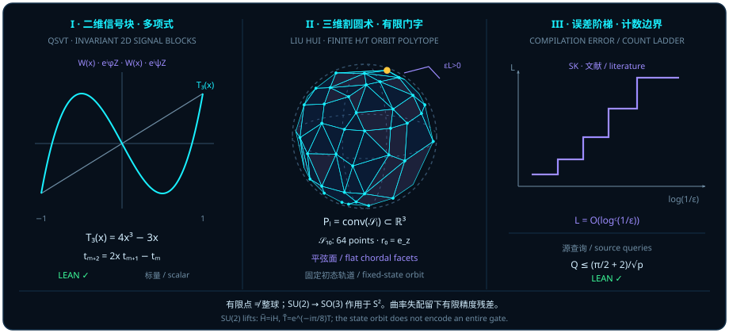

# Grand Unification of Quantum Algorithms (QSVT), Quantum Walks, and Gate-Compilation Polytopes

> *"P/NP depends on the initial structure; some initial structures can yield P=NP. Handling infinity is essentially a matter of factorization: finding how to “cancel” infinity, continually building on known results about infinity to cancel it away. P/NP is related to lookup algorithms, order, and the order of memory. Count everything in quantum gates. The central question is really a general way to prove a proposition."*

At the close of [Chapter 15](ch15-grover-qft-and-period-finding.md), we posed a unifying question: why do quantum algorithms from Grover search to phase estimation repeatedly alternate between unitary block embeddings and phase rotations? In this concluding chapter of Part IV (*Higher-Dimensional Spheres — Entanglement, Topology, and Quantum Algorithms*), we bring together algebraic recurrences, quantum walks on graphs, and discrete gate compilation (note that the `P/NP` remarks in the opening epigraph record the author's original philosophical reflections on initial structure, memory order, and gate counting, and do not claim a mathematical resolution of the open $\mathrm{P} \stackrel{?}{=} \mathrm{NP}$ problem).

We establish and examine four interconnected themes:

1. **The commutative-ring recurrence behind Chebyshev polynomials and QSVT**: In any commutative ring $R$, the power sums $t_m = a^m + b^m$ of any reciprocal pair $a b = 1$ obey the second-order recurrence $t_{m+2} = (a+b)t_{m+1} - t_m$; embedding this scalar recurrence into $2\times 2$ $\mathrm{SU}(2)$ signal blocks $W(x)$ forms the algebraic starting point of Quantum Singular Value Transformation (QSVT);
2. **Maximal multi-mode entanglement of balanced-coin quantum walks and their algorithmic limits**: On the $p$-cycle $\mathrm{ZMod}\,p$, the balanced symmetric coin $c_* = (1, i)/\sqrt{2}$ maximizes the all-mode single-excitation W-state geometric entanglement across all unit coin spinors, while the algorithmic speedup of quantum walks remains strictly governed by graph symmetry and problem structure;
3. **Continuous two-axis generation versus finite-word $\{H, T\}$ polytope approximation (Liu Hui's three-dimensional 割圆术)**: While continuous rotations around any two non-collinear axes generate $\mathrm{SO}(3)$ in finitely many steps, restricting to words of length $\le L$ over the discrete gate set $\{H, T\}$ applied to a fixed initial Bloch state $\vv{r}_0 \in S^2$ produces a finite point set $\mathcal{S}_L \subset S^2$ whose Euclidean convex hull $P_L = \operatorname{conv}(\mathcal{S}_L)$ is a flat-faced inscribed polytope with strictly positive covering residual $\varepsilon_L > 0$;
4. **Exact coin-assisted source-query counts versus asymptotic gate compilation length**: When the initial success probability $p \in (0, 1]$ is known, an auxiliary coin rotation eliminates discrete overshoot and achieves exact amplitude amplification in at most $\frac{\pi/2 + 2}{\sqrt{p}}$ source queries — a query count (`sourceQueries`) that must be kept strictly distinct from the Solovay–Kitaev $\{H, T\}$ compilation length $O(\log^c(1/\varepsilon))$.

## QSVT: Two-Dimensional Blocks and Chebyshev Recurrences {#sec-qsvt-chebyshev-blocks}

Why can contemporary quantum algorithms unify search, eigenvalue filtering, Hamiltonian simulation, and matrix inversion into polynomial transformations of singular values? Because inside a unitary operator, a natural bounded scalar input is a projection cosine $x = \cos\theta \in [-1, 1]$; iterating a two-dimensional rotation block $m$ times multiplies the rotation angle from $\theta$ to $m\theta$, turning the top-left entry into the degree-$m$ **Chebyshev polynomial of the first kind**, $T_m(x) = \cos(m\arccos x)$!

At the purely algebraic level, the three-term Chebyshev recurrence requires neither trigonometry nor analysis: it is a universal identity for power sums $a^m + b^m$ of any two elements satisfying $a \cdot b = 1$ in a commutative ring $R$, as formalized in `D5/S1/Recurrence/NormOneTraceAddition.lean`.

::: {.theorem #thm-chebyshev-trace-recurrence title="Second-Order Power-Sum Recurrence for Reciprocal Pairs in a Commutative Ring" lean="D5/S1/Recurrence/NormOneTraceAddition.trace_recurrence"}
Let $R$ be any commutative ring, let $a, b \in R$ satisfy $a \cdot b = 1$, and let $m \in \mathbb{N}$ be any natural number. Then

$$
a^{m + 2} + b^{m + 2} = (a + b)\bigl(a^{m + 1} + b^{m + 1}\bigr) - (a^m + b^m).
$$
:::

::: proof
Expanding the product on the right-hand side in the commutative ring $R$ gives

$$
\begin{aligned}
(a + b)\bigl(a^{m + 1} + b^{m + 1}\bigr)
&= a^{m + 2} + a b^{m + 1} + b a^{m + 1} + b^{m + 2} \\
&= a^{m + 2} + b^{m + 2} + (a \cdot b)\bigl(a^m + b^m\bigr).
\end{aligned}
$$

Substituting $a \cdot b = 1$ reduces the cross term to $1 \cdot (a^m + b^m) = a^m + b^m$, which cancels against $-(a^m + b^m)$ and leaves $a^{m + 2} + b^{m + 2}$. The full proof is checked by the Lean kernel.
:::

Let us now construct the explicit hand-calculated bridge from the scalar ring identity [@thm-chebyshev-trace-recurrence] to two-dimensional signal blocks (Figure 16, Panel I):

Setting $t_m = a^m + b^m$ ($ab = 1$) gives $t_0 = 2$, $t_1 = a + b$, and $t_{m+2} = (a + b)t_{m+1} - t_m$. Taking $R = \mathbb{C}$ with $a = e^{i\theta}$ and $b = e^{-i\theta}$ for $x = \cos\theta \in [-1, 1]$ satisfies $ab = 1$ and $a + b = 2\cos\theta = 2x$, so $t_m = 2\cos(m\theta) = 2 T_m(x)$ and

$$
T_0(x) = 1, \qquad T_1(x) = x, \qquad T_{m+2}(x) = 2x\,T_{m+1}(x) - T_m(x).
$$

In a two-dimensional quantum signal block, the $\mathrm{SU}(2)$ rotation matrix

$$
W(x) = \begin{pmatrix} x & i\sqrt{1 - x^2} \\ i\sqrt{1 - x^2} & x \end{pmatrix} = \begin{pmatrix} \cos\theta & i\sin\theta \\ i\sin\theta & \cos\theta \end{pmatrix} = \exp(i\theta \sigma_X) \in \mathrm{SU}(2) \qquad (x \in [-1, 1])
$$

has eigenvalues $a = e^{i\theta}$ and $b = e^{-i\theta}$ ($\det W(x) = ab = 1$, $\Tr W(x) = 2x$), so its $m$-th power $W(x)^m$ carries $T_m(x) = \cos(m\theta)$ in its top-left entry!

**Strict mathematical boundary**: [@thm-chebyshev-trace-recurrence] is a scalar recurrence in an arbitrary commutative ring $R$ with $ab = 1$ and makes no assumptions about matrices, singular values, or phase sequences; connecting it to $W(x) \in \mathrm{SU}(2)$ is an explicit hand calculation, not a formalization of the full QSVT theorem. In particular, one cannot realize an arbitrary polynomial from this recurrence alone: a real polynomial $P(x)$ realizable in QSVT must obey degree, definite-parity, and $[-1, 1]$ supremum-norm constraints (detailed in [@rem-qsvt-walks-literature]).

## Quantum Walks: Coherent Superposition and Its Limits {#sec-quantum-walk-interference}

When a quantum state carries a two-level internal coin and steps coherently across the vertices of a graph, we obtain a **discrete-time quantum walk**.

In the source module `D5/S3/Quantum/Walks/SymmetricCoinMaximalWalkEntanglement.lean`, the walk takes place on the $p$-vertex cycle $\mathrm{ZMod}\,p$ ($p \in \mathbb{N}, 1 \le p$) with coin space $\mathrm{Fin}\,2$. The single-step Hadamard walk operator `hadamardStep p` acts on wavefunctions $\psi : \mathrm{Fin}\,2 \times \mathrm{ZMod}\,p \to \mathbb{C}$ by

$$
\mathrm{hadamardStep}(p)(\psi)(j) = \begin{cases}
\dfrac{\psi(0, j.2 + 1) + \psi(1, j.2 + 1)}{\sqrt{2}} & \text{if } j.1 = 0, \\[8pt]
\dfrac{\psi(0, j.2 - 1) - \psi(1, j.2 - 1)}{\sqrt{2}} & \text{if } j.1 = 1.
\end{cases}
$$

Starting at site $j.2 = 0$ with initial coin spinor $c : \mathrm{Fin}\,2 \to \mathbb{C}$ satisfying `UnitSpinor c` ($\sum_{b \in \mathrm{Fin}\,2} \mathrm{Complex.normSq}(c_b) = 1$), the $n$-step walk state is

$$
\mathrm{walkState}(p, n, c) = \bigl(\mathrm{hadamardStep}(p)\bigr)^{[n]}\bigl(j \mapsto \text{if } j.2 = 0 \text{ then } c(j.1) \text{ else } 0\bigr),
$$

and the balanced symmetric coin spinor is

$$
\mathrm{cStar} = c_* = \begin{pmatrix} 1/\sqrt{2} \\ i/\sqrt{2} \end{pmatrix}.
$$

To quantify multi-mode entanglement across the entire mode set $\iota = \mathrm{Fin}\,2 \times \mathrm{ZMod}\,p$, the source maps any amplitude profile $\lambda : \iota \to \mathbb{C}$ to the single-excitation W-state `wState(λ)` on Boolean occupation configurations $s : \iota \to \mathrm{Bool}$ (assigning $\lambda_k$ when $s$ is `true` at $k$ alone and $0$ otherwise), defines modewise product states $\mathrm{productState}(z)(s) = \prod_{k \in \iota} z_k(\text{if } s_k \text{ then } 1 \text{ else } 0)$ over tuples of unit spinors `unitFactors z`, and defines the inner-product overlap helper $\mathrm{overlap}(\lambda, z)$ (taking the amplitude profile $\lambda : \iota \to \mathbb{C}$ first and the spinor family $z : \iota \to \mathrm{Fin}\,2 \to \mathbb{C}$ second) and maximum squared overlap:

$$
\begin{aligned}
\mathrm{overlap}(\lambda, z) &= \sum_{s : \iota \to \mathrm{Bool}} \overline{\mathrm{productState}(z, s)}\,\mathrm{wState}(\lambda, s), \\
\mathrm{gMax}(\lambda) &= \sup\Bigl\{\,\mathrm{Complex.normSq}\bigl(\mathrm{overlap}(\lambda, z)\bigr) \;\Big|\; \mathrm{unitFactors}(z)\,\Bigr\}, \qquad
\mathrm{geometricEntanglement}(\lambda) = 1 - \mathrm{gMax}(\lambda).
\end{aligned}
$$

The next lemma (whose source header is `theorem result : claim`) proves that for every $p \ge 1$, every step count $n \in \mathbb{N}$, and every unit coin spinor $c$, the symmetric coin $\mathrm{cStar} = (1, i)/\sqrt{2}$ maximizes `geometricEntanglement`.

::: {.lemma #lemma-symmetric-coin-walk title="The Symmetric Coin Maximizes Multi-Mode Geometric Entanglement in the Cycle Hadamard Walk" lean="D5/S3/Quantum/Walks/SymmetricCoinMaximalWalkEntanglement.result"}
Unfolding `claim` in the declaration `theorem result : claim`: for every $p \in \mathbb{N}$ with $1 \le p$ (supplying `NeZero p`), every step count $n \in \mathbb{N}$, and every coin spinor $c : \mathrm{Fin}\,2 \to \mathbb{C}$ satisfying `UnitSpinor c`,

$$
\mathrm{geometricEntanglement}\bigl(\mathrm{walkState}(p, n, c)\bigr) \le \mathrm{geometricEntanglement}\bigl(\mathrm{walkState}(p, n, \mathrm{cStar})\bigr).
$$
:::

::: proof
In `SymmetricCoinMaximalWalkEntanglement`, `walk_linearity` and `walk_reflection` establish `walk_pair_probabilities`: for every site $x \in \mathrm{ZMod}\,p$ and every unit coin $c$, the mirror mode pair $(0, x)$ and $(1, -x)$ has fixed total probability $|\mathrm{walkState}(p, n, c)(0, x)|^2 + |\mathrm{walkState}(p, n, c)(1, -x)|^2 = a^2 + b^2$, while the circularly polarized coin $\mathrm{cStar} = (1/\sqrt{2}, i/\sqrt{2})$ equalizes the two weights to $(a^2 + b^2)/2$. Applying the fixed-sum pair-balancing lemmas `pair_balancing` and `pair_average_le` across all pairs $((0, x), (1, -x))$ proves $\mathrm{gMax}\bigl(\mathrm{walkState}(p, n, \mathrm{cStar})\bigr) \le \mathrm{gMax}\bigl(\mathrm{walkState}(p, n, c)\bigr)$, and subtracting from $1$ yields $\mathrm{geometricEntanglement}\bigl(\mathrm{walkState}(p, n, c)\bigr) \le \mathrm{geometricEntanglement}\bigl(\mathrm{walkState}(p, n, \mathrm{cStar})\bigr)$. The full proof is checked by the Lean kernel.
:::

Two strict boundaries apply to [@lemma-symmetric-coin-walk]:

1. **All-mode single-excitation W-state geometric entanglement versus coin–position bipartite entropy**: Here `geometricEntanglement` measures the single-excitation W-state across all $2p$ modes $\iota = \mathrm{Fin}\,2 \times \mathrm{ZMod}\,p$ relative to modewise product states (`1 - gMax`); it is **not** the reduced von Neumann entropy of the coin after tracing out position.
2. **Scope of quantum-walk interference**: [@lemma-symmetric-coin-walk] analyzes coin-phase symmetry on the cycle $\mathrm{ZMod}\,p$; it does **not** prove exponential speedup on general mazes, does **not** imply that all backtracking paths cancel to zero on arbitrary graphs, and is **not** the glued-trees oracle separation theorem.

::: {.remark #rem-qsvt-walks-literature title="Full QSVT Realizability and the Glued-Trees Quantum-Walk Separation (Literature Result, Not Formalized in This Book)"}
**Literature result, not formalized in this book.** Two landmark theorems from the quantum algorithms literature govern the full scope of QSVT and quantum walks:

1. **Quantum Singular Value Transformation (QSVT): complex unitary completion versus real-polynomial extraction** (A. Gilyén, Y. Su, G. H. Low, and N. Wiebe, *Quantum singular value transformation and beyond: exponential improvements for quantum matrix arithmetics*, Proc. 51st ACM STOC, 193–204, 2019, doi:10.1145/3313276.3316366, Theorem 3 and Theorem 17 / Corollary 18): Given a block encoding $\tilde{\Pi} U \Pi = A$ ($\norm{A}_{\mathrm{op}} \le 1$), the literature distinguishes two levels of polynomial realizability:
   - **Direct two-dimensional complex QSP (Theorem 3)**: A pair of complex polynomials $(P_{\mathrm{c}}, Q_{\mathrm{c}}) \in \mathbb{C}[x]^2$ is realized directly as the matrix entries of a single phase-modulated sequence $U_{\Phi}(x)$ if and only if $\deg(P_{\mathrm{c}}) \le d$, $\deg(Q_{\mathrm{c}}) \le d - 1$, $P_{\mathrm{c}}$ has parity $d \bmod 2$, $Q_{\mathrm{c}}$ has opposite parity $(d - 1) \bmod 2$, and $|P_{\mathrm{c}}(x)|^2 + (1 - x^2)|Q_{\mathrm{c}}(x)|^2 = 1$ for all $x \in [-1, 1]$.
   - **General bounded real-polynomial QSVT via complex completion and real-part extraction (Theorem 17 / Corollary 18)**: For a general real target polynomial $P_{\mathrm{target}} \in \mathbb{R}[x]$ of degree $\le d$, definite parity $d \bmod 2$, and uniform bound $\max_{x \in [-1, 1]} |P_{\mathrm{target}}(x)| \le 1$ (for instance $P_{\mathrm{target}}(x) = x/2$, where $P_{\mathrm{target}}(1)^2 = 1/4 < 1$ precludes any real completion $P_{\mathrm{target}}(x)^2 + (1 - x^2)Q(x)^2 = 1$), Fejér–Riesz factorization constructs a complex completion pair $(P_{\mathrm{c}}, Q_{\mathrm{c}}) \in \mathbb{C}[x]^2$ satisfying Theorem 3 with $\operatorname{Re} P_{\mathrm{c}}(x) = P_{\mathrm{target}}(x)$ and $|P_{\mathrm{c}}(x)|^2 + (1 - x^2)|Q_{\mathrm{c}}(x)|^2 = 1$. Introducing one additional $\lvert +\rangle$ control ancilla to superpose the forward and negated phase sequences $\frac{1}{2}(U_{\Phi} + U_{-\Phi})$, followed by ancilla $\langle +\rvert$ projection and the parity-dependent block projection ($\tilde{\Pi}(\cdot)\Pi$ for odd $d$, $\Pi(\cdot)\Pi$ for even $d$), extracts the exact real transformation $P_{\mathrm{target}}^{(\mathrm{SV})}(A)$ across every singular-value $2\times 2$ block using $d$ queries to $U$ and $U^*$.
2. **Exponential quantum-walk speedup on glued trees and its structural limits** (A. M. Childs, R. Cleve, E. Deotto, E. Farhi, S. Gutmann, and D. A. Spielman, *Exponential algorithmic speedup by a quantum walk*, Proc. 35th ACM STOC, 59–68, 2003, doi:10.1145/780542.780552, arXiv:quant-ph/0209131): On two depth-$n$ binary trees joined by a random cycle of alternating edges at the leaves, a continuous-time quantum walk starting at the entrance root remains confined to the $(2n+2)$-dimensional symmetric column subspace and reaches the `EXIT` root in $\mathrm{poly}(n)$ time, whereas Childs et al. prove that any classical algorithm making at most $2^{n/6}$ oracle queries finds the `EXIT` vertex with probability at most $4\cdot 2^{-n/6}$ (yielding a $2^{\Omega(n)}$ classical query lower bound for bounded success probability). This exponential separation relies critically on graph symmetry, oracle access, and task definition; on general unstructured graphs, interference does not automatically cancel all backtracking paths.
:::

## Finite Gate Words and Three-Dimensional Polytope Approximation {#sec-finite-gate-polytope}

So far we have treated rotation angles $\theta$ and $\phi_k$ as continuous real parameters. In fault-tolerant quantum architectures ([Chapter 14](ch14-cloning-codes-and-braids.md)), however, hardware provides only a **finite discrete gate alphabet** — typically the Clifford+$T$ pair $\{H, T\}$.

To contrast **exact generation by continuous two-axis circles** with **polytope approximation by finite words over a discrete gate set**, let us first state the continuous two-axis theorem from `D5/S3/Geometry/TwoAxisFiniteRotation.lean`. Let $\mathrm{Space} = \mathrm{EuclideanSpace}\,\mathbb{R}\,(\mathrm{Fin}\,3) \cong \mathbb{R}^3$ and $\mathrm{Orthogonal} = \mathrm{Space} \simeq_{\mathrm{li}}[\mathbb{R}] \mathrm{Space}$, with $\mathrm{determinant}(R) = \mathrm{LinearMap.det}(R.\mathrm{toLinearMap})$. For any vector $a \in \mathrm{Space}$, the full **continuous axis circle** is

$$
\mathrm{axisCircle}(a) = \bigl\{R : \mathrm{Orthogonal} \;\big|\; \mathrm{determinant}(R) = 1 \land R(a) = a\bigr\},
$$

and `IsAxisWord a b l` means every element of $l : \mathrm{List}\,\mathrm{Orthogonal}$ lies in $\mathrm{axisCircle}(a)$ or $\mathrm{axisCircle}(b)$ (where `wordGroup` takes finite products without topological closure). Whenever $a, b$ have strictly positive Gram determinant ($\langle a, b\rangle_{\mathbb{R}}^2 < \norm{a}^2\norm{b}^2$, with no normalization assumption on $a, b$), every proper rotation $R \in \mathrm{SO}(3)$ is an exact finite product of letters from $\mathrm{axisCircle}(a) \cup \mathrm{axisCircle}(b)$.

::: {.proposition #prop-two-axis-finite-word title="Exact Finite-Word Generation of SO(3) by Two Non-Collinear Continuous Axis Circles" lean="D5/S3/Geometry/TwoAxisFiniteRotation.two_axis_finite_word"}
Let $a, b \in \mathrm{Space}$ satisfy the strict Cauchy–Schwarz inequality

$$
\langle a, b\rangle_{\mathbb{R}}^2 < \norm{a}^2 \cdot \norm{b}^2.
$$

Then for every orthogonal linear isometry $R : \mathrm{Orthogonal}$ with $\mathrm{determinant}(R) = 1$, there exists a finite list $l : \mathrm{List}\,\mathrm{Orthogonal}$ such that

$$
\mathrm{IsAxisWord}(a, b, l) \;\land\; l.\mathrm{prod} = R.
$$
:::

::: proof
The strict inequality $\langle a, b\rangle_{\mathbb{R}}^2 < \norm{a}^2 \norm{b}^2$ ensures that $a$ and $b$ are linearly independent in $\mathbb{R}^3$. Because each letter may be chosen with an **arbitrary continuous rotation angle** from the full circle $\mathrm{axisCircle}(a)$ or $\mathrm{axisCircle}(b)$, alternating a finite number of rotations around $a$ and $b$ (generalized Euler-angle factorization) transports the axis $a$ to $R(a)$ and then aligns the orthogonal plane via a final rotation in $\mathrm{axisCircle}(a)$, yielding $l.\mathrm{prod} = R$ exactly. The full proof is checked by the Lean kernel.
:::

**Crucial distinction: never confuse continuous two-axis generation ([@prop-two-axis-finite-word]) with discrete $\{H, T\}$ gate compilation!**

In [@prop-two-axis-finite-word], each step chooses any continuous angle from $\mathrm{axisCircle}(a)$ or $\mathrm{axisCircle}(b)$, giving no bound on word length $L$ or discretization error $\varepsilon$. For a finite discrete gate set $\{H, T\}$, we use distinct notation to formulate **the finite-$L$ state orbit and Liu Hui's three-dimensional 割圆术 (polytope approximation)** (Figure 16, Panel II):

1. **Operator groups $\mathrm{SU}(2)/\mathrm{PU}(2)$ versus the Bloch sphere $S^2$**: Let $H = (X + Z)/\sqrt{2}$ and $T = \operatorname{diag}(1, e^{i\pi/4})$. Modulo global phase, $[H], [T] \in \mathrm{PU}(2) \cong \mathrm{SO}(3)$; in $\mathrm{SU}(2)$, we take unimodular lifts $\tilde{H} = i H$ and $\tilde{T} = e^{-i\pi/8} T$ with $\det\tilde{H} = \det\tilde{T} = 1$. Recall that $\mathrm{SU}(2) \to \mathrm{SO}(3)$ is a $2$-to-$1$ cover with $\mathrm{SU}(2) \cong S^3$ and $\mathrm{SO}(3) \cong \mathbb{R}\mathrm{P}^3$ — neither $3$-dimensional group manifold equals the $2$-sphere $S^2$!
2. **The finite-word reachable orbit $\mathcal{S}_L \subset S^2$ of a fixed initial state**: Fix an initial Bloch vector $\vv{r}_0 \in S^2$ (e.g., $\vv{r}_0 = \vv{e}_z$). For each word-length budget $L \in \mathbb{N}$, define the word set $\mathcal{W}_L = \{w \in \{H, T\}^* : |w| \le L\}$ (including the empty word) and the reachable state orbit

   $$
   \mathcal{S}_L = \bigl\{R_w \vv{r}_0 \;\big|\; w \in \mathcal{W}_L\bigr\} \subset S^2.
   $$

   Note that $\mathcal{S}_L$ is the orbit of a **fixed initial state $\vv{r}_0$**, not the full $3$-parameter gate space; using $|w| \le L$ ensures monotonic nesting $\mathcal{S}_L \subseteq \mathcal{S}_{L+1}$ with $|\mathcal{S}_L| \le \sum_{j=0}^L 2^j = 2^{L+1} - 1$ (with collisions reducing the count).
3. **The Euclidean convex hull $P_L = \operatorname{conv}(\mathcal{S}_L)$ and geodesic polytopes**: The Euclidean convex hull $P_L = \operatorname{conv}(\mathcal{S}_L) \subset \mathbb{R}^3$ is a finite-vertex convex polytope inscribed in the unit ball. For small $L$ ($L = 0, 1, 2$), $P_L$ degenerates to a point, segment, or planar polygon (do not claim $P_L$ is $3$-dimensional for every $L$!). When $P_L$ is $3$-dimensional, its facets are **flat Euclidean chordal polygons** (never call them intrinsically flat faces of $S^2$). When $0 \in \operatorname{int}(P_L)$, radially projecting the edges and faces of $P_L$ onto $S^2$ yields a spherical mesh of great-circle arcs called a **geodesic polytope** — a term referring strictly to the radial projection mesh on $S^2$, while $P_L = \operatorname{conv}(\mathcal{S}_L)$ itself remains a flat-faced Euclidean polytope.
4. **Strict positivity of the covering residual $\varepsilon_L > 0$ and curvature mismatch**: Because $S^2$ is compact and $\mathcal{S}_L$ is finite, the worst-case geodesic covering radius

   $$
   \varepsilon_L = \max_{\vv{r} \in S^2}\, \min_{\vv{s} \in \mathcal{S}_L} \arccos(\vv{r} \cdot \vv{s}) > 0
   $$

   is **strictly positive** for every finite $L$ and monotonically non-increasing ($\varepsilon_{L+1} \le \varepsilon_L$; asymptotic compilation properties of universal discrete gate sets are documented separately in [@rem-solovay-kitaev-literature] and do not follow from [@prop-two-axis-finite-word]). The unit sphere $S^2$ has Gaussian curvature $K = 1$, whereas the interior of each flat chordal facet of $P_L$ has $K = 0$ (intrinsic curvature of a convex polyhedron is concentrated at the vertices as angle deficits, while extrinsic normal jumps occur across edges — never claim that every edge carries equal intrinsic Gaussian curvature). Along any outward unit facet normal $\vv{n} \in S^2$ with support height $h = \max_{\vv{s} \in \mathcal{S}_L} (\vv{n} \cdot \vv{s}) < 1$, a positive **radial support gap** $1 - h > 0$ separates the chordal face from the sphere, even though the vertices $\vv{s} \in \mathcal{S}_L$ lie exactly on $S^2$.
5. **Liu Hui's three-dimensional 割圆术 analogy and state versus operator error**: Just as Liu Hui's third-century *circle-cutting method* (割圆术) approximates a smooth circle by inscribed flat chords, increasing $L$ refines the inscribed chordal polytope $P_L$ inside $S^2$ (with three distinct layers in Figure 16, Panel II: finite vertices $\mathcal{S}_L$, flat chordal faces of $P_L$, and the sphere $S^2$). This is a pedagogical geometric analogy, not a historical claim about quantum compilation or the Solovay–Kitaev exponent. Finally, because the stabilizer circle of $\vv{r}_0$ hides one rotation angle around $\vv{r}_0$, the single-state covering error $\varepsilon_L$ on $S^2$ cannot replace the full operator compilation error $\delta(U, V) = \min_{\varphi}\norm{U - e^{i\varphi}V}_{\mathrm{op}}$ on $\mathrm{PU}(2)/\mathrm{SU}(2)$.

## Compilation Error, Query Counts, and Asymptotic Gate Length {#sec-compilation-error-and-count}

When the initial success probability $p \in (0, 1]$ in amplitude amplification is known and we are allowed an auxiliary coin rotation `coinRotation q`, we can eliminate the integer-step overshoot of [Chapter 15](ch15-grover-qft-and-period-finding.md) completely and bound the exact number of source queries.

In `CoherentUniformAmplification`, given $J \in M_{l \times s}(\mathbb{C})$, $C, P \in M_{l \times l}(\mathbb{C})$, and $q \in \mathbb{R}$, the $2l$-dimensional auxiliary-coin block matrices are

$$
\begin{aligned}
\mathrm{coinEmbed}(J) &= \begin{pmatrix} J \\ 0 \end{pmatrix}, &\qquad
\mathrm{coinLift}(C) &= \begin{pmatrix} C & 0 \\ 0 & C \end{pmatrix}, \\
\mathrm{coinRotation}(q) &= \begin{pmatrix} \sqrt{q}\,I_l & -\sqrt{1-q}\,I_l \\ \sqrt{1-q}\,I_l & \sqrt{q}\,I_l \end{pmatrix}, &\qquad
\mathrm{coinGood}(P) &= \begin{pmatrix} P & 0 \\ 0 & 0 \end{pmatrix}.
\end{aligned}
$$

The six constructors of `AmplificationGate` are `.source`, `.sourceAdjoint`, `.coin`, `.coinAdjoint`, `.initializedReflection`, and `.goodReflection`, mapped by `gateMatrix` to $\mathrm{coinLift}(C)$, $\mathrm{coinLift}(C)^*$, $\mathrm{coinRotation}(q)$, $\mathrm{coinRotation}(q)^*$, $2 K K^* - I_{2l}$ ($K = \mathrm{coinEmbed}(J)$), and $I_{2l} - 2\,\mathrm{coinGood}(P)$. `evaluateWord J C P q w` maps `gateMatrix` over $w$ and takes `List.prod` (rightmost gate acts first); `reflectionBlock` is `[.coin, .source, .initializedReflection, .sourceAdjoint, .coinAdjoint, .goodReflection]`; `amplificationWord 0` is `[.coin, .source]` and `amplificationWord (n+1)` prepends `reflectionBlock` on the left; and `sourceQueries w` counts occurrences of `.source` plus `.sourceAdjoint` (with $w = [\mathrm{.source}]$ when $p = 1$).

::: {.corollary #cor-exact-source-query-count title="Exact Coherent Amplitude Amplification and Source-Query Upper Bound" lean="D5/S3/Quantum/Recovery/CoherentUniformAmplification.exact_coherent_amplification"}
Let $s, l$ be finite index types with decidable equality, and let $J \in M_{l \times s}(\mathbb{C})$, $C, P \in M_{l \times l}(\mathbb{C})$, and $p \in \mathbb{R}$ satisfy

$$
J^* J = 1, \quad C^* C = 1, \quad P^* = P, \quad P^2 = P, \quad
\bigl(P(CJ)\bigr)^*\bigl(P(CJ)\bigr) = (p : \mathbb{C}) \bullet (1 : M_s(\mathbb{C})), \quad 0 < p \le 1.
$$

Let

$$
\begin{aligned}
n &:= \Bigl\lceil \frac{\pi}{4\arcsin(\sqrt{p})} - \frac{1}{2} \Bigr\rceil_+, &\qquad
r &:= \sin^2\Bigl(\frac{\pi}{4(n : \mathbb{R}) + 2}\Bigr), \qquad q := \frac{r}{p}, \\
w &:= \text{if } p = 1 \text{ then } [\mathrm{AmplificationGate.source}] \text{ else } \mathrm{amplificationWord}(n), \\
V &:= \mathrm{evaluateWord}(J, C, P, q, w) \cdot \mathrm{coinEmbed}(J).
\end{aligned}
$$

Then all six clauses hold:

1. **Exact target hit**: $V = \mathrm{coinEmbed}\bigl(\mathrm{success}(CJ, P, p)\bigr)$;
2. **Zero failure block**: $\bigl(1 - \mathrm{coinGood}(P)\bigr) V = 0$;
3. **Kronecker reference identity**: for every type $z$ and matrix $R \in M_z(\mathbb{C})$,

   $$
   V \otimes_{\mathrm{K}} R = \mathrm{coinEmbed}\bigl(\mathrm{success}(CJ, P, p)\bigr) \otimes_{\mathrm{K}} R;
   $$

4. **Source-query upper bound**:

   $$
   \bigl(\mathrm{sourceQueries}(w) : \mathbb{R}\bigr) \le \frac{\pi/2 + 2}{\sqrt{p}};
   $$

5. **Unitarity of the evaluated word**: $\bigl(\mathrm{evaluateWord}(J, C, P, q, w)\bigr)^* \cdot \mathrm{evaluateWord}(J, C, P, q, w) = 1$;
6. **Branch parameters**: if $p = 1$, then $\mathrm{sourceQueries}(w) = 1$; otherwise ($0 < p < 1$),

   $$
   \begin{aligned}
   &0 < r \;\land\; r \le p \;\land\; r < 1 \;\land\; 0 < q \;\land\; q \le 1 \\
   &\land\; \bigl(2(n : \mathbb{R}) + 1\bigr)\arcsin(\sqrt{r}) = \frac{\pi}{2} \;\land\; \mathrm{sourceQueries}(w) = 2n + 1 \\
   &\land\; \bigl(\mathrm{coinRotation}(q)\bigr)^* \mathrm{coinRotation}(q) = 1 \\
   &\land\; \mathrm{success}\Bigl(\bigl(\mathrm{coinRotation}(q)\cdot\mathrm{coinLift}(C)\bigr)\cdot\mathrm{coinEmbed}(J),\, \mathrm{coinGood}(P),\, r\Bigr) = \mathrm{coinEmbed}\bigl(\mathrm{success}(CJ, P, p)\bigr).
   \end{aligned}
   $$
:::

::: proof
When $p = 1$, $w = [\mathrm{.source}]$ uses $1$ source query and $\mathrm{coinLift}(C)\cdot\mathrm{coinEmbed}(J) = \mathrm{coinEmbed}(\mathrm{success}(CJ, P, 1))$. When $0 < p < 1$, choosing $n = \lceil \frac{\pi}{4\arcsin\sqrt{p}} - \frac{1}{2}\rceil_+$ ensures $0 < r = \sin^2(\frac{\pi}{4n+2}) \le p < 1$ and $0 < q = r/p \le 1$. The modified preparation $U_q = (\mathrm{coinRotation}(q)\cdot\mathrm{coinLift}(C))\cdot\mathrm{coinEmbed}(J)$ has success Gram matrix $q p I_s = r I_s$ and normalized success block $\mathrm{coinEmbed}(\mathrm{success}(CJ, P, p))$. Since $(2n + 1)\arcsin(\sqrt{r}) = \frac{\pi}{2}$, applying [@thm-grover-uniform-rotation] to $U_q$ at step $n$ gives $\sin(\pi/2) = 1$ and $\cos(\pi/2) = 0$, proving $V = \mathrm{coinEmbed}(\mathrm{success}(CJ, P, p))$ and $(1 - \mathrm{coinGood}(P))V = 0$. Finally, $\mathrm{amplificationWord}(n)$ contains $1 + 2n$ occurrences of `.source` and `.sourceAdjoint`, and $n < \frac{\pi}{4\arcsin\sqrt{p}} + \frac{1}{2}$ with $\arcsin\sqrt{p} \ge \sqrt{p}$ bounds $2n + 1 \le \frac{\pi/2 + 2}{\sqrt{p}}$. The full proof is checked by the Lean kernel.
:::

**Critical distinction (Figure 16, Panel III)**: `sourceQueries(w)` in [@cor-exact-source-query-count] counts **only** `.source` and `.sourceAdjoint` calls ($1$ for $p = 1$, $2n + 1$ for $p < 1$) using the continuous coin rotation `coinRotation q` for known $p$; it is not the total gate count and **must never be confused with the Solovay–Kitaev $\{H, T\}$ compilation gate length**.

Let us now verify all four numerical examples of this chapter.

::: {.example #ex-finite-ht-polytope title="Chebyshev Recurrence at x=1/2, the Five-Vertex L=3 {H,T} Polytope, and Exact Source-Query Counts"}
This example provides a four-part numerical verification:

**Step 1: Chebyshev recurrence at $x = 1/2 = \cos(\pi/3)$ and $W(1/2)^3 = -I_2$.**
With $a = e^{i\pi/3}$, $b = e^{-i\pi/3}$ ($ab = 1$, $a + b = 2x = 1$), [@thm-chebyshev-trace-recurrence] gives $t_0 = 2$, $t_1 = 1$, $t_2 = 1(1) - 2 = -1$, and $t_3 = 1(-1) - 1 = -2$, matching $T_3(1/2) = 4(1/2)^3 - 3(1/2) = -1 = t_3/2$ and $W(1/2)^3 = \begin{pmatrix} 1/2 & i\sqrt{3}/2 \\ i\sqrt{3}/2 & 1/2 \end{pmatrix}^3 = -I_2$.

**Step 2: Exact $\{H, T\}$ orbit $\mathcal{S}_L$ for $L = 0, 1, 2, 3$ from $\vv{r}_0 = \vv{e}_z$.**
On $\mathbb{R}^3$, $R_H(x, y, z) = (z, -y, x)$ and $R_T(x, y, z) = \bigl(\frac{x - y}{\sqrt{2}}, \frac{x + y}{\sqrt{2}}, z\bigr)$. Starting from $\mathcal{S}_0 = \{\vv{e}_z\}$ and applying $R_H, R_T$ cumulatively:

- $L = 0$ ($1$ point): $\mathcal{S}_0 = \{\vv{e}_z\}$;
- $L = 1$ ($2$ points): $\mathcal{S}_1 = \{\vv{e}_z,\, \vv{e}_x\}$;
- $L = 2$ ($3$ points): $\mathcal{S}_2 = \{\vv{e}_z,\, \vv{e}_x,\, \frac{\vv{e}_x + \vv{e}_y}{\sqrt{2}}\}$;
- $L = 3$ ($5$ points): $\mathcal{S}_3 = \bigl\{\vv{e}_z,\, \vv{e}_x,\, \frac{\vv{e}_x + \vv{e}_y}{\sqrt{2}},\, \vv{e}_y,\, \frac{\vv{e}_z - \vv{e}_y}{\sqrt{2}}\bigr\}$.

Thus the point counts for $L = 0, 1, 2, 3$ are **$1, 2, 3, 5$**. At $L = 3$, $P_3 = \operatorname{conv}(\mathcal{S}_3)$ becomes $3$-dimensional for the first time, and $0 \notin \operatorname{int}(P_3)$ because all five vertices satisfy $x \ge 0$ and $z \ge 0$ (Figure 16, Panel II illustrates a larger-$L$ polyhedral hull rather than claiming these five points enclose the origin).

**Step 3: Support gap of $P_3$ and chordal facet gap of the reference regular octahedron.**
On $\mathcal{S}_3$, the support maximum in direction $+\vv{e}_y$ is $1$, whereas in direction $-\vv{e}_x$ it is $0$, leaving a directional support gap of $1 - 0 = 1$ against $S^2$; hence $L = 3$ is not an all-direction small-error approximation. For an independent reference octahedron $\operatorname{conv}\{\pm\vv{e}_x, \pm\vv{e}_y, \pm\vv{e}_z\}$ (not claiming all six axial poles are reached at $L = 3$), the facet normal $\vv{n} = (1, 1, 1)/\sqrt{3}$ has support height $1/\sqrt{3}$ and radial gap $1 - 1/\sqrt{3} \approx 0.4226497308103742$.

**Step 4: Exact source-query staircase for $p = 1/4, 1/16, 1/64$ from [@cor-exact-source-query-count].**

| Initial Probability $p$ | Step Count $n$ | $\mathrm{sourceQueries} = 2n+1$ | Modified $r = \sin^2\bigl(\frac{\pi}{4n+2}\bigr)$ | Coin Ratio $q = r/p \in (0, 1]$ | Bound $\dfrac{\pi/2 + 2}{\sqrt{p}}$ |
| :---: | :---: | :---: | :---: | :---: | :---: |
| $1/4 = 0.25$ | $1$ | $3$ | $0.25$ | $1$ | $\approx 7.14159265$ |
| $1/16 = 0.0625$ | $3$ | $7$ | $\approx 0.049515566048790434$ | $\approx 0.7922490567806469$ | $\approx 14.28318531$ |
| $1/64 = 0.015625$ | $6$ | $13$ | $\approx 0.014529091286973985$ | $\approx 0.9298618423663351$ | $\approx 28.56637061$ |

Each row satisfies $0 < q \le 1$, $(2n+1)\arcsin\sqrt{r} = \pi/2$, and $2n + 1 \le \frac{\pi/2 + 2}{\sqrt{p}}$. This counts amplitude-amplification source queries for known $p$, not Solovay–Kitaev compilation gate counts.
:::

<!-- alias: #rem-qsvt-solovay-kitaev-literature -->
::: {.remark #rem-solovay-kitaev-literature title="The Solovay–Kitaev Compilation Theorem and Polylogarithmic Gate Length (Literature Result, Not Formalized in This Book)"}
**Literature result, not formalized in this book.** When compiling arbitrary single-qubit gates into words over a finite discrete gate set, the asymptotic gate length is governed by the **Solovay–Kitaev theorem** (see C. M. Dawson and M. A. Nielsen, *The Solovay–Kitaev algorithm*, Quantum Inf. Comput. **6**, 81–95, 2006, arXiv:quant-ph/0505030):

1. **Polylogarithmic gate length $L = O(\log^c(1/\varepsilon))$**: For any finite, inverse-closed gate set $\mathcal{G} \subset \mathrm{SU}(2)$ generating a dense subgroup of $\mathrm{SU}(2)$, every target $U \in \mathrm{SU}(2)$ and sufficiently small $\varepsilon > 0$ admit an approximating word $w \in \mathcal{G}^*$ of length $L = O(\log^c(1/\varepsilon))$ within operator error $\varepsilon$, with classical recursive exponent $c = \ln 5 / \ln(3/2) \approx 3.97$ (constants depending on the gate set and metric).
2. **Inverse closure of $\{H, T\}$ and projective lifts**: Because $H^{-1} = H$ and $T^{-1} = T^7$ in $\mathrm{PU}(2)$ (with unimodular $\mathrm{SU}(2)$ lifts $\tilde{H} = iH, \tilde{T} = e^{-i\pi/8}T$ requiring consistent tracking of central signs $\pm I_2$), inverses cost a constant factor, so the projective compilation problem inherits the $O(\log^c(1/\varepsilon))$ scaling up to constant prefactors.
3. **Scaling of the group commutator**: In $\exp(A)\exp(B)\exp(-A)\exp(-B) = \exp([A, B] + O(\norm{A}^3 + \norm{B}^3))$, choosing $A, B = O(\sqrt{\varepsilon})$ produces a correction $[A, B]$ of order $O(\varepsilon)$ with residual $O(\varepsilon^{3/2})$ (one must never misstate the commutator as linear in an $O(\varepsilon)$ step).
4. **Nonzero worst-case finite-$L$ residual**: The Solovay–Kitaev theorem is an asymptotic scaling theorem as $\varepsilon \to 0$; while discrete gate words already belonging to $\mathcal{W}_{\le L}$ (such as $I, H, T$) trivially have zero error at depth $L$, the worst-case covering radius across the continuous group or sphere remains strictly positive ($\varepsilon_L > 0$) at every finite word length $L < \infty$, so worst-case target gates outside $\mathcal{W}_{\le L}$ always incur a nonzero compilation residual; nor does the theorem equate the single-state $S^2$ covering radius $\varepsilon_L$ with full $\mathrm{SU}(2)/\mathrm{PU}(2)$ operator compilation.
:::

With this chapter, Part IV (*Higher-Dimensional Spheres — Entanglement, Topology, and Quantum Algorithms*) is complete. Across Chapters 13 through 16, we have traced how quantum geometry rises from single spheres to bipartite correlation sectors, stabilizer subspaces, invariant-plane rotations, Fourier annihilator lattices, and finite-word inscribed polytopes $P_L$ whose positive residual $\varepsilon_L > 0$ leaves the door open to the observer thermodynamics and self-referential fixed points of Parts V and VI.
