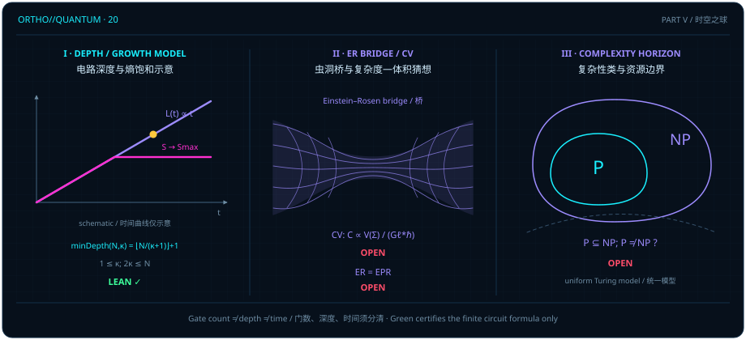

# Gate Complexity as Volume: Black-Hole Interior Growth, Wormhole Bridges, and Computational Complexity Boundaries

> *"P/NP depends on the initial structure; some initial structures can yield P=NP. Handling infinity is, at heart, factorization: finding how to “cancel” infinity by repeatedly building on known results about it. P/NP also concerns lookup algorithms, order, and the order of memory. Count everything in quantum gates. The central problem is a general method for proving a proposition."*

In the [previous chapter](ch19-tensor-networks-and-holography.md), we proved that across a width-three bridge tensor network on the ordered quadratic cone, the quantum max-flow equals the quantum min-cut $\min(ad, bc)$ ([@thm-bridge-quantum-maxflow-mincut]), and we saw in logarithmic bond-capacity coordinates how piecewise-affine polyhedral facets meet along the bottleneck seam $ad = bc$. In this closing chapter of Part V, "The Spacetime Sphere," we confront a question at the frontier of quantum gravity and theoretical computer science: **once the entanglement entropy of a many-body system has saturated its min-cut ceiling (thermal equilibrium), what geometric quantity can unitary evolution continue to build? And when we measure evolution in quantum gate counts and parallel circuit depth, where is the exact boundary between theorems verified by the Lean kernel and open conjectures?**

Before taking a single step, we state the epistemological status of the opening epigraph plainly: it preserves the author's verbatim reflection on initial structures, lookup order, and gate counting as an attributed philosophical epigraph, and **does not establish $\mathrm{P} = \mathrm{NP}$**. Throughout this chapter, our three-tier epistemological contract is enforced without compromise:

1. **Tier 1 (Green `LEAN ✓`)**: We prove four frozen theorems — the exact minimum parallel depth formula $\operatorname{minDepth}(N, \kappa) = \lfloor N/(\kappa + 1)\rfloor + 1$ for an open-boundary integrable circuit family ([@thm-open-circuit-min-depth]), the explicit refutation of two depth formulas proposed in the literature ([@lemma-open-circuit-depth-refutation]), the exponential worst-case CNOT gate-count lower bound $2^{2n-1} + 2n - 2$ for synthesizing $2n$-qubit reflection-symmetric diagonal unitaries over $\{\mathrm{CNOT}, R_z\}$ ([@prop-reflection-cnot-lower-bound]), and the exact walk length $2(n+2)$ of the canonical closed traversal on a bipartite even cycle graph ([@cor-even-cycle-length]);
2. **Tier 2 (Literature remarks)**: In [@rem-complexity-growth-literature] and [@rem-computational-model-literature], we clarify the definitions of state complexity, Nielsen geometry, post-thermalization growth windows, uniform Turing complexity classes, and the accounting of lookup-table preprocessing costs;
3. **Tier 3 (Red `OPEN`)**: We formulate three celebrated open problems — **Complexity = Volume (CV)** ([@conj-complexity-equals-volume]), **$\mathrm{ER}=\mathrm{EPR}$** ([@conj-er-equals-epr]), and **$\mathrm{P}\neq\mathrm{NP}$** ([@conj-p-neq-np]) — inside `conjecture` environments carrying no `lean` attribute.

## Gate count, parallel depth, and growth models {#sec-circuit-depth-growth}

Whenever we ask how "complex" a quantum circuit is, our first duty is to keep four distinct notions separate: **total gate count** (the total number of elementary gates in a circuit list), **parallel circuit depth** (the minimum number of time layers required when gates on disjoint sites execute simultaneously), **continuous Nielsen geodesic length** on the unitary group, and laboratory **physical time $t$**.

Begin with an exact parallel-depth problem solved completely in the Lean module `D5.S3.Quantum.Dynamics.OpenIntegrableCircuitMinDepth`. Consider a one-dimensional open-boundary chain of $N$ sites $\{1, 2, \dots, N\}$, whose elementary gate alphabet `Gate` has three constructors:

- Two-site nearest-neighbor bulk gates $\operatorname{Gate.U}(j)$ acting on sites $\{j, j+1\}$ ($1 \le j \le N - 1$);
- A right-boundary single-site gate $\operatorname{Gate.K1}$ acting on site $\{1\}$;
- A left-boundary single-site gate $\operatorname{Gate.KN}$ acting on site $\{N\}$.

For any subset $S \subseteq \{1, \dots, N\}$ of cardinality $|S| = \kappa$ (recording the sites carrying spectral parameter $-\kappa$), the module defines the time-ordered integrable transfer-matrix gate list `circuit N S`. A gate list $w$ fits in $L$ parallel layers (`RunsIn N w L`) if there exists a layer assignment $f : \mathbb{N} \to \{0, 1, \dots, L - 1\}$ such that any two gates sharing a site preserve their sequential order ($i < j \implies f(i) < f(j)$). Writing $\operatorname{depth}(N, w)$ for the least $L$ with `RunsIn N w L`, the **configuration-optimal minimum parallel depth** `minDepth` is defined by minimizing over all subsets $S$ of size $\kappa$:

$$
\operatorname{minDepth}(N, \kappa) = \inf\bigl\{\, \operatorname{depth}\bigl(N, \operatorname{circuit}(N, S)\bigr) \;\big|\; S \subseteq \{1, \dots, N\},\; |S| = \kappa \,\bigr\}.
$$

By packing non-overlapping bulk and boundary gates into parallel layers, our first theorem establishes the exact closed-form formula for $\operatorname{minDepth}(N, \kappa)$.

::: {.theorem #thm-open-circuit-min-depth title="Minimum open-boundary circuit depth" lean="D5/S3/Quantum/Dynamics/OpenIntegrableCircuitMinDepth.result"}
Let $N, \kappa \in \mathbb{N}$ be natural numbers satisfying $1 \le \kappa$ and $2\kappa \le N$. Then the minimum parallel depth over configurations of size $\kappa$ in the open-boundary integrable circuit family is

$$
\operatorname{minDepth}(N, \kappa) = N / (\kappa + 1) + 1,
$$

where $N / (\kappa + 1)$ denotes natural-number integer division ($\lfloor N / (\kappa + 1)\rfloor$).
:::

::: proof
In [`OpenIntegrableCircuitMinDepth.result`](lean:D5/S3/Quantum/Dynamics/OpenIntegrableCircuitMinDepth.result), all $N + 1$ gates of $\operatorname{circuit}(N, S)$ (the right-boundary gate $\operatorname{K1}$ at $k = 0$, the bulk two-site gates $\operatorname{U}(k)$ at $1 \le k \le N - 1$, and the left-boundary gate $\operatorname{KN}$ at $k = N$) are indexed by $\{0, 1, \dots, N\}$ via $\operatorname{pathGate}(N, k)$ and ordered according to $\operatorname{pathOrder}(N, S)$ (indices $k \notin S$ in decreasing order followed by indices $k \in S$ in increasing order; `circuit_eq_pathOrder`). Because consecutive path indices $k$ and $k + 1$ ($0 \le k < N$) always share site $k + 1$ (`adjacent_overlap`), the gate list runs in $L$ layers (`RunsIn N (circuit N S) L`) if and only if there exists a path-layer assignment $g : \{0, \dots, N\} \to \{0, \dots, L - 1\}$ such that for every step $0 \le k < N$, $g(k) < g(k + 1)$ when $k + 1 \in S$ and $g(k + 1) < g(k)$ when $k + 1 \notin S$ (`runsIn_iff_pathLayers`).

The lower and upper bounds then follow in two steps:

1. **Strict inequality and integer-division lower bound (`pathLayers_lower` and `depth_lower`)**: Induction on $n \in \{0, \dots, N\}$ establishes the layer-accounting invariant

$$
n + g(n) \le \bigl|S \cap \{1, \dots, n\}\bigr| \cdot L + g(0).
$$

(When $n + 1 \notin S$, $g(n + 1) < g(n)$ gives $g(n + 1) + 1 \le g(n)$, preserving the right-hand side; when $n + 1 \in S$, $g(n + 1) < L$ gives $g(n + 1) + 1 \le L + g(n)$, incrementing $|S \cap \{1, \dots, n+1\}|$ by $1$ and adding $L$ to the right-hand side.) Evaluating at $n = N$ with $|S| = \kappa$, $g(N) \ge 0$, and $g(0) < L$ yields the strict inequality

$$
N \le N + g(N) \le \kappa L + g(0) < \kappa L + L = (\kappa + 1)L.
$$

Geometrically, the $N$ nearest-neighbor dependencies across the $N + 1$ path gates are partitioned by the $\kappa$ reversal points in $S$ into $\kappa + 1$ monotone causal slices, forcing at least one slice to span at least $\lfloor N / (\kappa + 1)\rfloor + 1$ serial layers; by natural-number division, $N < (\kappa + 1)L$ directly implies $L \ge \lfloor N / (\kappa + 1)\rfloor + 1$.

2. **Explicit upper bound via recursive split placement (`exists_pathLayers` and `minDepth_upper`)**: Fixing $q = \lfloor N / (\kappa + 1)\rfloor$, `exists_pathLayers` recurses on the remaining split count $k$ (and current remaining prefix length $n$ satisfying $2k \le n \le (k + 1)q + k$): at $k = 0$ it takes $S = \emptyset$ and $g(i) = n - i < q + 1$; at the successor step $k = j + 1$, it sets

$$
d = \min(q,\, n - 2j - 1), \qquad M = n - d - 1,
$$

recurses on prefix length $M$ with $j$ remaining splits to obtain $(S_0, g_0)$ (with $g_0(M) = 0$), inserts the split point $M + 1$ into $S_0$ ($S = S_0 \cup \{M + 1\}$), and defines $g(i) = g_0(i)$ for $i \le M$ and $g(i) = n - i \le d \le q$ for $i > M$. (For instance, at $N = 5, \kappa = 2, q = 1$: the outer step $j = 1, n = 5$ sets $d = \min(1, 5 - 2 - 1) = 1, M = 3$ and inserts $M + 1 = 4$; the inner step $j = 0, n = 3$ sets $d = \min(1, 3 - 0 - 1) = 1, M = 1$ and inserts $M + 1 = 2$, yielding $S = \{2, 4\}$ and the valid two-layer assignment $g = [1, 0, 1, 0, 1, 0] < 2$.) Instantiating this recursion at $n = N$ and $k = \kappa$ constructs a valid layer assignment strictly below $q + 1 = \lfloor N / (\kappa + 1)\rfloor + 1$, proving $\operatorname{minDepth}(N, \kappa) = \lfloor N / (\kappa + 1)\rfloor + 1$. The full proof is checked by the Lean kernel.
:::

Keep the contract of [@thm-open-circuit-min-depth] sharp: $\operatorname{minDepth}(N, \kappa)$ is the optimal parallel layer depth over configurations $|S| = \kappa$ within the **fixed open-boundary integrable circuit family** `circuit N S`; it is neither the unconstrained minimum gate count to synthesize an arbitrary unitary operator nor physical time $t$. Let us write out the explicit layer schedules at $\kappa = 2$ for $N = 8$ and $N = 11$.

::: {.example #ex-open-circuit-depths title="Explicit Layer Schedules and Minimum Depths for N = 8 and N = 11 at κ = 2"}
Fix $\kappa = 2$ (so $1 \le \kappa$ and $2\kappa = 4 \le N$). Evaluating $\lfloor N / 3\rfloor + 1$ from [@thm-open-circuit-min-depth] gives:

1. **Three-layer schedule at $N = 8, \kappa = 2$**: The formula yields $\operatorname{minDepth}(8, 2) = \lfloor 8 / 3\rfloor + 1 = 2 + 1 = 3$. Selecting $S = \{3, 6\} \subseteq \{1, \dots, 8\}$ (with $8 \notin S$) produces the $9$-gate circuit list

$$
\operatorname{circuit}(8, \{3, 6\}) = \bigl[\operatorname{KN},\; \operatorname{U}(7),\; \operatorname{U}(5),\; \operatorname{U}(4),\; \operatorname{U}(2),\; \operatorname{U}(1),\; \operatorname{K1},\; \operatorname{U}(3),\; \operatorname{U}(6)\bigr].
$$

With layers indexed from $0$, the explicit layer assignment

$$
[0,\; 1,\; 0,\; 1,\; 0,\; 1,\; 2,\; 2,\; 2]
$$

schedules all $9$ gates into $3$ parallel layers:

- **Layer $0$**: $\operatorname{KN}$ (site $\{8\}$), $\operatorname{U}(5)$ (sites $\{5, 6\}$), and $\operatorname{U}(2)$ (sites $\{2, 3\}$) act on pairwise disjoint sites;
- **Layer $1$**: $\operatorname{U}(7)$ (sites $\{7, 8\}$), $\operatorname{U}(4)$ (sites $\{4, 5\}$), and $\operatorname{U}(1)$ (sites $\{1, 2\}$) act on pairwise disjoint sites after their layer-$0$ dependencies;
- **Layer $2$**: $\operatorname{K1}$ (site $\{1\}$), $\operatorname{U}(3)$ (sites $\{3, 4\}$), and $\operatorname{U}(6)$ (sites $\{6, 7\}$) act on pairwise disjoint sites.

2. **Four-layer schedule at $N = 11, \kappa = 2$**: The formula yields $\operatorname{minDepth}(11, 2) = \lfloor 11 / 3\rfloor + 1 = 3 + 1 = 4$. Selecting $S = \{4, 8\} \subseteq \{1, \dots, 11\}$ produces a $12$-gate circuit scheduled into $4$ layers (indexed $0, 1, 2, 3$) by the explicit layer map

$$
[0,\; 1,\; 2,\; 0,\; 1,\; 2,\; 0,\; 1,\; 2,\; 3,\; 3,\; 3].
$$

Remember that these combinatorial layer counts inside a specific integrable circuit family are not empirical measurements of black-hole interior volume.
:::

## Black-hole interiors and the complexity–volume conjecture {#sec-complexity-volume-conjecture}

Why is formal verification indispensable even for finite combinatorial circuit depths? Because small-parameter patterns can easily mislead intuition.

In the literature (`arXiv:2607.02093v1`), two linear subtraction formulas were conjectured for $\operatorname{minDepth}(N, \kappa)$: `conjectureOne` proposed $(N + 3)/2 - \kappa$ for odd $N$, and `conjectureTwo` proposed $(N + 4)/2 - \kappa$ for even $N$. At $\kappa = 1$, both formulas agree with $\lfloor N / 2\rfloor + 1$; at $\kappa = 2$, however, partitioning the chain into $\kappa + 1 = 3$ parallel segments lowers the true depth slope from $1/2$ to $1/3$. The two schedules we just exhibited in [@ex-open-circuit-depths] ($N = 8, \kappa = 2$ and $N = 11, \kappa = 2$) refute both conjectured formulas directly.

::: {.lemma #lemma-open-circuit-depth-refutation title="Refutation of two proposed depth formulas" lean="D5/S3/Quantum/Dynamics/OpenIntegrableCircuitDepthRefutation.result"}
Define the two depth propositions and their disjunction `claim` for the open-boundary integrable circuit minimum depth $\operatorname{minDepth}(N, \kappa)$ by

$$
\begin{aligned}
\operatorname{conjectureOne} &:\iff \forall N, \kappa \in \mathbb{N},\; \operatorname{Odd}(N) \to 0 < \kappa \to \kappa \le (N - 1) / 2 \to \operatorname{minDepth}(N, \kappa) = (N + 3) / 2 - \kappa, \\
\operatorname{conjectureTwo} &:\iff \forall N, \kappa \in \mathbb{N},\; \operatorname{Even}(N) \to 0 < \kappa \to \kappa \le N / 2 \to \operatorname{minDepth}(N, \kappa) = (N + 4) / 2 - \kappa, \\
\operatorname{claim} &:\iff \operatorname{conjectureOne} \lor \operatorname{conjectureTwo}.
\end{aligned}
$$

Then $\neg\operatorname{claim}$ holds (both $\operatorname{conjectureOne}$ and $\operatorname{conjectureTwo}$ are false).
:::

::: proof
To prove $\neg(\operatorname{conjectureOne} \lor \operatorname{conjectureTwo})$, we exhibit an explicit counterexample to each disjunct:

1. **Refuting $\operatorname{conjectureTwo}$**: Take even $N = 8$ and $\kappa = 2$ (satisfying $\operatorname{Even}(8)$, $0 < 2$, and $2 \le 8/2 = 4$). The formula predicts $(8 + 4)/2 - 2 = 4$, whereas $S = \{3, 6\}$ in [@ex-open-circuit-depths] runs in $3$ layers, giving $\operatorname{minDepth}(8, 2) \le 3 < 4$.
2. **Refuting $\operatorname{conjectureOne}$**: Take odd $N = 11$ and $\kappa = 2$ (satisfying $\operatorname{Odd}(11)$, $0 < 2$, and $2 \le (11 - 1)/2 = 5$). The formula predicts $(11 + 3)/2 - 2 = 5$, whereas $S = \{4, 8\}$ runs in $4$ layers, giving $\operatorname{minDepth}(11, 2) \le 4 < 5$.

The full proof is checked by the Lean kernel.
:::

Note the strict scope of [@lemma-open-circuit-depth-refutation]: it refutes only the two combinatorial depth formulas `conjectureOne` and `conjectureTwo` from `arXiv:2607.02093v1`; it is **not** a refutation of Complexity=Volume, $\mathrm{ER}=\mathrm{EPR}$, or $\mathrm{P}\neq\mathrm{NP}$.

Before stating the open Complexity=Volume conjecture, we summarize the literature conventions governing state complexity growth in the following remark.

::: {.remark #rem-complexity-growth-literature title="Quantum State Complexity Definitions, Nielsen Geometry, and Post-Thermalization Growth (Literature result, not formalized in this book)"}
**Literature result, not formalized in this book.** In quantum information and holographic gravity, defining the circuit complexity of a state $\lvert\psi(t)\rangle$ requires specifying five pieces of data: a **reference state** $\lvert\psi_{\mathrm{ref}}\rangle$, an **allowed gate set** $\mathcal{G}$, **locality constraints** (such as $k$-local gates), an **error tolerance** $\varepsilon \ge 0$, and a **resource cost model**. Total gate count, parallel circuit depth, continuous **Nielsen geometric length** with respect to a right-invariant penalty metric on the unitary group, and physical time $t$ are distinct quantities that must not be conflated.

In particular, one must distinguish **$\varepsilon$-approximate state complexity over a finite gate alphabet** from **exact complexity over a continuous gate family (or Nielsen geometry)**:

1. **Finite universal gate sets (such as Clifford + $T$) and positive tolerance $\varepsilon > 0$**: Over any finite gate set $\mathcal{G}$, the set of states reachable by finite circuits at zero error ($\varepsilon = 0$) is only countably infinite, whereas continuous-time evolution $\lvert\psi(t)\rangle = e^{-iHt/\hbar}\lvert\psi(0)\rangle$ sweeps through uncountably many states. Consequently, defining continuous-time state complexity $\mathcal{C}_\varepsilon(\lvert\psi(t)\rangle)$ over a finite gate alphabet **requires a fixed strictly positive approximation tolerance $\varepsilon > 0$** (requiring distance at most $\varepsilon$, as in S. Aaronson, `arXiv:1607.05256`, Definitions 3.2.1 & 3.3.1); at fixed $\varepsilon > 0$, multi-qubit state and unitary compilation complexities obey an exponential ceiling $\mathcal{C}_\varepsilon(\lvert\psi(t)\rangle) \le \exp(O(N))$ (such as $O(2^N \operatorname{poly}(\log(1/\varepsilon)))$ for state preparation or $O(4^N \operatorname{poly}(\log(1/\varepsilon)))$ for unitary compilation via two-qubit decomposition and Solovay–Kitaev compilation).
2. **Continuous two-qubit gate families or continuous Nielsen geometry ($\varepsilon = 0$)**: If arbitrary continuous single- and two-qubit gates $\mathcal{G} = \mathrm{SU}(4)$ are permitted at unit cost (or if complexity is measured by continuous Nielsen geodesic distance on the unitary manifold), exact synthesis ($\varepsilon = 0$) is well-defined for all states at all times $t$ and bounded above by an exponential ceiling $\exp(O(N))$ ($O(2^N)$ for state preparation and $O(4^N)$ for arbitrary unitary synthesis).

In chaotic many-body models and holographic black-hole narratives, after subsystem entanglement entropy saturates at its thermal value $S_{\mathrm{th}} \sim O(N)$ around the thermalization scale $t_{\mathrm{th}}$, $\varepsilon$-approximate state complexity (or continuous Nielsen complexity) is expected to grow approximately linearly with $t$ across an intermediate window $t_{\mathrm{th}} \ll t \ll e^{O(N)}$. In any closed system with a finite-dimensional Hilbert space and bounded spectrum, however, complexity is bounded above by $\exp(O(N))$ and, over longer model- and spectrum-dependent timescales (typically doubly exponential quantum Poincaré recurrence scales), saturates and undergoes recurrences rather than growing linearly forever as $t \to \infty$. See L. Susskind, *Fortschr. Phys.* **64**, 24–43 (2016), DOI: `10.1002/prop.201500092`; and S. Aaronson (2016), `arXiv:1607.05256`.
:::

::: {.conjecture #conj-complexity-equals-volume title="Complexity equals volume"}
Fix an applicable semiclassical holographic state, a boundary reference state, a local gate set, and a UV regularization and precision scheme. The **Complexity = Volume (CV) conjecture** proposes that, in units with $c = 1$, the renormalized circuit complexity $\mathcal{C}_V(\psi(t))$ of the boundary quantum state at boundary time $t$ is proportional to the maximal renormalized spatial volume $V_{\mathrm{ren}}(\Sigma_t)$ of a smooth spacelike codimension-one bulk hypersurface $\Sigma_t$ anchored at the boundary time slice $t$:

$$
\mathcal{C}_V\bigl(\psi(t)\bigr) = \frac{V_{\mathrm{ren}}(\Sigma_t)}{G_N \ell_* \hbar},
$$

where $G_N$ is the bulk Newton gravitational constant and $\ell_*$ is a characteristic bulk length scale (such as the AdS curvature radius $\ell_{\mathrm{AdS}}$) explicitly chosen for dimensional normalization.

Scope and open boundaries: $V_{\mathrm{ren}}(\Sigma_t)$ is the **spatial volume of a codimension-one slice**; it must not be confused with the distinct **Complexity = Action (CA) conjecture**, which relates circuit complexity to the **on-shell gravitational action** $\mathcal{C}_A(\psi(t)) = I_{\mathrm{WDW}} / (\pi\hbar)$ evaluated on the bulk **Wheeler–DeWitt (WDW) causal patch** anchored at the boundary slice (including Einstein–Hilbert bulk, Gibbons–Hawking–York boundary, and null-joint action terms, rather than bare four-dimensional spacetime volume). In both CV and CA, proportionality constants depend on gate-cost weighting and UV regularization conventions, and neither conjecture claims that exact discrete minimum gate counts equal continuum bulk quantities without regularization. See L. Susskind, *Fortschr. Phys.* **64**, 24–43 (2016), DOI: `10.1002/prop.201500092`; and A. R. Brown, D. A. Roberts, L. Susskind, B. Swingle & Y. Zhao, *Phys. Rev. Lett.* **116**, 191301 (2016), DOI: `10.1103/PhysRevLett.116.191301`.
:::

## Entanglement bridges and the scope of ER=EPR {#sec-er-epr-conjecture}

While holographic conjectures motivate studying how many gates are needed to build highly entangled states, what can we prove rigorously about worst-case two-qubit gate counts in finite-dimensional circuit synthesis?

In the Lean module `D5.S3.Quantum.Magic.ReflectionDiagonalCNOTLowerBound`, fix an even number of qubits $m = 2n$ ($n \ge 1$):

- Write $\operatorname{Qubits}(m) = (\operatorname{Fin} m \to \operatorname{Bool})$ for the $2^m$ computational basis bitstrings;
- Define the ancilla-free elementary gate type `gate m` as the sum type

$$
\operatorname{gate}(m) = \bigl\{\, (t, c) \in \operatorname{Fin} m \times \operatorname{Fin} m \;\big|\; t \neq c \,\bigr\} \;\oplus\; \bigl(\operatorname{Fin} m \times \mathbb{R}\bigr),
$$

where the left summand represents a $\operatorname{CNOT}(t, c)$ gate with target $t \neq c$ and the right summand represents a single-qubit diagonal rotation $R_z(q, \varphi) = \operatorname{diag}(e^{\mp i\varphi/2})$;
- For any gate list $\mathit{circuit} : \operatorname{List}(\operatorname{gate}(m))$, `circuitMatrix` is the ordered matrix product and `cnotCount` counts the number of $\mathrm{CNOT}$ gates in the list.

Our next proposition proves that for every $n \ge 1$, there exists a $2n$-qubit real phase function $\theta$ invariant under bitwise negation $\theta(\neg x) = \theta(x)$ such that any ancilla-free $\{\mathrm{CNOT}, R_z\}$ circuit synthesizing $\operatorname{diag}(e^{i\theta(x)})$ up to a complex scalar $c \in \mathbb{C}$ requires at least $2^{2n-1} + 2n - 2$ $\mathrm{CNOT}$ gates.

::: {.proposition #prop-reflection-cnot-lower-bound title="A CNOT lower bound for reflection symmetry" lean="D5/S3/Quantum/Magic/ReflectionDiagonalCNOTLowerBound.result"}
For every natural number $n \in \mathbb{N}$ with $1 \le n$, there exists a real phase function $\theta : \operatorname{Qubits}(2n) \to \mathbb{R}$ satisfying both of the following properties:

1. **Bitwise reflection symmetry**: For every bitstring $x \in \operatorname{Qubits}(2n)$, writing $(\neg x)(j) = \mathit{!}(x(j))$,

$$
\theta(\neg x) = \theta(x);
$$

2. **Exponential CNOT lower bound for exact synthesis**: For every ancilla-free circuit $\mathit{circuit} : \operatorname{List}(\operatorname{gate}(2n))$ built from $\mathrm{CNOT}$ and single-qubit real $R_z$ gates and every complex scalar $c \in \mathbb{C}$, if

$$
\operatorname{circuitMatrix}(\mathit{circuit}) = c \cdot \operatorname{diag}\bigl(x \mapsto \exp(i\theta(x))\bigr),
$$

then

$$
2^{2n - 1} + 2n - 2 \le \operatorname{cnotCount}(\mathit{circuit}).
$$
:::

::: proof
In [`ReflectionDiagonalCNOTLowerBound.result`](lean:D5/S3/Quantum/Magic/ReflectionDiagonalCNOTLowerBound.result) and its helper counting module `D5.S3.Quantum.Magic.ReflectionDiagonalParityCounting`, the proof proceeds in four exact $\mathbb{F}_2$-parity tracking steps:

1. **Explicit reflection-symmetric hard phase witness (`hardTheta` and `hardTheta_reflection`)**: On $m = 2n$ qubits, define the explicit phase function

$$
\theta_{\mathrm{hard}}(x) = \begin{cases} \pi/2, & \text{if } x = 0^{2n} \text{ or } x = 1^{2n}, \\ 0, & \text{otherwise}. \end{cases}
$$

Because bitwise negation $\neg$ swaps $0^{2n}$ and $1^{2n}$, $\theta_{\mathrm{hard}}(\neg x) = \theta_{\mathrm{hard}}(x)$ holds identically.

2. **Diagonal unitarity forces terminal wire-parity restoration (`diagonal_forces_identity`)**: Each wire $q \in \operatorname{Fin}(2n)$ starts with the unit odd-weight parity vector $e_q \in \mathbb{F}_2^{2n}$ (Hamming weight $1$). Each $\operatorname{CNOT}(t, c)$ updates target wire $t$ to $l_t \oplus l_c$, while each $R_z(q, \varphi)$ injects a phase $\exp(\mp i\varphi/2)$ along the current parity label $l_q$. Because $\operatorname{circuitMatrix}(\mathit{circuit})$ equals a nonzero scalar multiple $c$ of the diagonal matrix $\operatorname{diag}(e^{i\theta_{\mathrm{hard}}(x)})$, the terminal wire-parity matrix `wireLabels circuit` must return to the identity matrix $I_{2n}$ — every wire ends back in its single-qubit odd-weight state, and the count `evenWires` of wires carrying even-weight parities returns to $0$.

3. **Walsh–Hadamard character test and $2^{2n-1} - 1$ even-parity outputs (`hard_character` and `even_output_count`)**: For every nonzero even-weight parity vector $v \in \mathbb{F}_2^{2n} \setminus \{0\}$ ($\bigoplus_{j=0}^{2n-1} v_j = \mathrm{false}$), define the multiplicative character $\chi_v(f) = \prod_{x \in \operatorname{Qubits}(2n)} f(x)^{(-1)^{v \cdot x}}$. On any global scalar $c \neq 0$ (`character_global`) and on any single-qubit rotation $R_z(q, \varphi)$ along a parity label $w \neq v$ (`character_factor`), $\chi_v$ evaluates to $1$; on the target diagonal $\exp(i\theta_{\mathrm{hard}})$, however, both $0^{2n}$ and $1^{2n}$ have inner product $\mathrm{false}$ with $v$, giving $\chi_v(\exp(i\theta_{\mathrm{hard}})) = i \cdot i = -1 \neq 1$ (`hard_character`). Hence all $2^{2n-1} - 1$ nonzero even-weight parities must appear among the rotation wire labels (`rotation_labels`), and since all initial wire labels have odd weight, every nonzero even parity must appear in the list `evenOutputs` of even-weight $\mathrm{CNOT}$ step outputs (`even_mem_outputs`), forcing its list length to satisfy $|\operatorname{evenOutputs}| \ge 2^{2n-1} - 1$ (`even_output_count`).

4. **Parity birth-and-return balance (`ReflectionDiagonalParityCounting.count_bound`)**: Classify $\mathrm{CNOT}$ steps across the circuit (counted with step multiplicity) by how they change `evenWires`: every $\mathrm{CNOT}$ step whose target wire $l_t$ and control wire $l_c$ both carry odd-weight parities — so that their sum $l_t \oplus l_c$ has even weight and increments `evenWires` by $1$ — is recorded in the **even-birth list** `births`; every $\mathrm{CNOT}$ step whose target wire $l_t$ is even-weight and whose control wire $l_c$ is odd-weight — restoring an odd-weight label on the target wire and decrementing `evenWires` by $1$ — is counted in `returns`. Because all even outputs lie in the $\mathbb{F}_2$-linear span `listSpan births` (`span_outputs`), covering all $2^{2n-1}$ even parities forces the list length $|\operatorname{births}| \ge 2n - 1$ (`birth_count`). Since `evenWires` starts at $0$ and returns to $0$ at the end of the circuit (Step 2), the step-by-step balance inequality (`return_balance`: $|\operatorname{births}| \le \operatorname{evenWires}(\mathit{ls}) + \operatorname{returns}$) forces $\operatorname{returns} \ge |\operatorname{births}| \ge 2n - 1$. Because steps counted in `evenOutputs` produce even-weight labels while steps counted in `returns` produce odd-weight labels, the two sets of $\mathrm{CNOT}$ steps are strictly disjoint (`disjoint_counts`), yielding

$$
\operatorname{cnotCount}(\mathit{circuit}) \ge |\operatorname{evenOutputs}| + \operatorname{returns} \ge (2^{2n-1} - 1) + (2n - 1) = 2^{2n-1} + 2n - 2.
$$

(For example, at $n = 1$ on $2n = 2$ qubits, the single reflection pair $(0, 1)$ has $2^1 - 1 = 1$ nonzero even parity $z_0 \oplus z_1$, requiring at least $1$ even-birth $\mathrm{CNOT}$ step in `evenOutputs` to generate $z_0 \oplus z_1$ for the $R_z$ phase rotation and at least $2(1) - 1 = 1$ odd-return $\mathrm{CNOT}$ step in `returns` to restore the single-wire parities $[z_0, z_1]$, totaling at least $1 + 1 = 2$ $\mathrm{CNOT}$ gates.) The full proof is checked by the Lean kernel.
:::

Note the exact scope of [@prop-reflection-cnot-lower-bound]:

- It is an existential worst-case lower bound for **exact synthesis** (up to a scalar $c \in \mathbb{C}$) over the specified ancilla-free $\{\mathrm{CNOT}, R_z\}$ gate set;
- It does not bound approximate synthesis with error $\varepsilon > 0$ or arbitrary gate sets;
- It is a discrete parity-output and wire-restoration counting theorem for the explicit single witness $\theta_{\mathrm{hard}}$ (combining $2^{2n-1} - 1$ required nonzero even-parity outputs with $2n - 1$ odd-return steps via $\mathbb{F}_2$-span rank and parity balance), and **does not separate $\mathrm{P}$ from $\mathrm{NP}$**.

Alongside circuit synthesis bounds, we record the open $\mathrm{ER}=\mathrm{EPR}$ conjecture on the geometric interpretation of bipartite entanglement in semiclassical gravity.

::: {.conjecture #conj-er-equals-epr title="ER=EPR"}
In entangled bipartite systems that admit a semiclassical gravitational description (prototypically a two-sided eternal black hole in the thermofield double state), the **$\mathrm{ER}=\mathrm{EPR}$ conjecture** proposes that a non-traversable **Einstein–Rosen (ER) bridge** serves as the bulk geometric description of the **Einstein–Podolsky–Rosen (EPR) entanglement** between the two boundary subsystems.

Scope and open boundaries: This conjectural duality **does not imply** that an arbitrary pair of entangled laboratory qubits possesses a smooth classical spacetime wormhole, **does not permit** superluminal communication (respecting the quantum no-signaling principle), and requires additional direct coupling between the two boundaries to render a wormhole traversable. See J. Maldacena & L. Susskind, *Fortschr. Phys.* **61**, 781–811 (2013), DOI: `10.1002/prop.201300020`.
:::

## Computational models, resource bounds, and P≠NP {#sec-computational-complexity-boundary}

In this final section, we contrast exponential gate-synthesis bounds with linear graph traversals and standard Turing machine complexity classes.

First, beware of a classic terminological trap: in mathematical and formal-verification libraries, the identifier `circuit` is used in two completely unrelated senses. In [@thm-open-circuit-min-depth] and [@prop-reflection-cnot-lower-bound], `circuit` denotes a **list of quantum gates**. In the graph-theory module `D5.S3.Combinatorics.Graph.Walks.WeightedCycleWalk`, by contrast, `circuit n` denotes a **closed graph walk** on the bipartite even cycle graph `evenCycleGraph n` whose vertex set is $\operatorname{Fin}(n+2) \oplus \operatorname{Fin}(n+2)$.

Starting at the left vertex $\operatorname{inl}(0)$, the recursive walk `traversals n` alternates at each stage $m \mapsto m + 1$ between a cross-step $\operatorname{inl}(m) \to \operatorname{inr}(m+1)$ and a horizontal return step $\operatorname{inr}(m+1) \to \operatorname{inl}(m+1)$, closing the loop back to $\operatorname{inl}(0)$ after $n + 2$ stages to form `circuit n`.

::: {.corollary #cor-even-cycle-length title="Length of an actual even-cycle traversal" lean="D5/S3/Combinatorics/Graph/Walks/WeightedCycleWalk.circuit_length"}
For every natural number $n \in \mathbb{N}$, the canonical closed walk $\operatorname{circuit}(n)$ on $\operatorname{evenCycleGraph}(n)$ has length

$$
\bigl(\operatorname{circuit}(n)\bigr).\mathrm{length} = 2(n + 2).
$$
:::

::: proof
By induction on $m$, `traversals n 0` is `.nil` of length $0$, and each successor step appends two edges via `.concat`, increasing the walk length by $2$ so that `traversals n m` has length $2m$. Setting $m = n + 2$ and applying `.copy` (which preserves walk length) gives $(\operatorname{circuit}(n)).\mathrm{length} = 2(n + 2)$. The full proof is checked by the Lean kernel.
:::

Keep the distinction crystal clear: `circuit n` in [@cor-even-cycle-length] is a graph-theoretic closed walk on `evenCycleGraph n`, unrelated to quantum gate lists, and its linear symbolic length $2(n+2)$ in the graph parameter $n$ does not prove linear growth of black-hole complexity in physical time $t$. Let us compare the numerical values of these bounds alongside the toy schematic curves from Panel I of our chapter figure.

::: {.example #ex-cnot-and-cycle-bounds title="Numerical Comparison of Exponential CNOT Bounds, Linear Even-Cycle Lengths, and a Toy Saturation Curve"}
Compare three discrete numerical sequences side by side:

1. **Worst-case exact synthesis CNOT lower bounds** ([@prop-reflection-cnot-lower-bound]): For $n = 1, 2, 3$ (corresponding to $2n = 2, 4, 6$ qubits), the lower bound $2^{2n-1} + 2n - 2$ evaluates to
   - $n = 1$ ($2$ qubits): $2^1 + 2 - 2 = 2$;
   - $n = 2$ ($4$ qubits): $2^3 + 4 - 2 = 10$;
   - $n = 3$ ($6$ qubits): $2^5 + 6 - 2 = 36$.
2. **Even-cycle closed walk lengths** ([@cor-even-cycle-length]): For graph parameter $n = 0, 1, 2$ ($4, 6, 8$ vertices), the walk length $2(n+2)$ evaluates to $4, 6, 8$. Both combinatorial sequences depend on discrete size parameter $n$ and are independent of physical time $t$.
3. **Illustrative toy saturation curves**: In Panel I of the chapter figure, the toy functions $C(t) = 2t$ and $S(t) = \min(2t, 4)$ evaluated at $t = 0, 1, 2, 3$ produce the pairs

$$
(0, 0), \qquad (2, 2), \qquad (4, 4), \qquad (6, 4).
$$

This arithmetic toy model merely illustrates how an uncapped linear function $C(t)$ continues past a capped curve $S(t) \le 4$; it does not claim that minimum quantum circuit complexity must grow monotonically.
:::

Finally, let us address the computational question raised by the opening epigraph: does pre-computing answers into a lookup table or changing the initial basis prove $\mathrm{P} = \mathrm{NP}$, or does the exponential CNOT lower bound of [@prop-reflection-cnot-lower-bound] prove $\mathrm{P} \neq \mathrm{NP}$? Neither does.

::: {.remark #rem-computational-model-literature title="Uniform Computational Models, Lookup-Table Preprocessing Costs, and Complexity Class Boundaries (Literature result, not formalized in this book)"}
**Literature result, not formalized in this book.** In standard computational complexity theory, the classes $\mathrm{P}$ and $\mathrm{NP}$ are defined as classes of formal languages decidable in polynomial time $\operatorname{poly}(n)$ in the input bit-length $n = |x|$ on **uniform deterministic** and **uniform nondeterministic Turing machines** over a fixed finite alphabet. Two accounting principles are mandatory:

1. **Input encoding and preprocessing costs must be counted**: Every basis change, input re-encoding, or lookup-table construction must be charged for the time and space it consumes. For a Boolean formula (such as 3-SAT) of encoded bit-length $n = |x|$ in $k$ Boolean variables, pre-computing and storing the truth table of all $2^k$ variable assignments requires exponential $\Theta(2^k \operatorname{poly}(n))$ preprocessing time and $\Theta(2^k)$ memory (and pre-storing answers for all $2^n$ candidate input strings of length $n$ requires a table of size $\Theta(2^n)$); even if one passes to the **non-uniform class $\mathrm{P/poly}$** by granting input-length-dependent advice strings $a_n$, its definition strictly requires a **polynomial advice-length bound $|a_n| \le \operatorname{poly}(n)$** (equivalent to polynomial-size Boolean circuit families). An exponential-size lookup table does not even fit within the polynomial advice budget of $\mathrm{P/poly}$, and neither device proves $\mathrm{P} = \mathrm{NP}$ in the standard uniform Turing model.
2. **Exponential unitary-synthesis gate bounds do not prove $\mathrm{P} \neq \mathrm{NP}$**: In [@prop-reflection-cnot-lower-bound], any ancilla-free $\{\mathrm{CNOT}, R_z\}$ circuit synthesizing the explicit reflection-symmetric diagonal witness $\operatorname{diag}(e^{i\theta_{\mathrm{hard}}(x)})$ requires at least $2^{2n-1} + 2n - 2$ $\mathrm{CNOT}$ gates because $\theta_{\mathrm{hard}}$ evaluates to $-1$ on all $2^{2n-1} - 1$ nonzero even-weight Walsh–Hadamard characters, forcing the circuit to generate every nonzero even-weight parity output and execute at least $2n - 1$ odd-return steps to restore the terminal wire parities (while in the unformalized circuit-synthesis literature, such as V. V. Shende, S. S. Bullock & I. L. Markov, *Phys. Rev. A* **70**, 012310 (2004), synthesizing generic $m$-qubit unitaries in $\mathrm{U}(2^m)$ also requires $\Omega(4^m)$ two-qubit gates by continuous real parameter-dimension counting over a $4^m$-dimensional manifold). Neither a discrete parity-output counting bound for an explicit $2^{2n}\times 2^{2n}$ diagonal unitary nor generic continuous parameter-dimension counting rules out $\operatorname{poly}(n)$-time algorithms for succinctly encoded decision problems of input bit-length $n = |x|$ in $\mathrm{NP}$, and therefore neither proves $\mathrm{P} \neq \mathrm{NP}$.

See S. A. Cook, "The complexity of theorem-proving procedures," *Proc. 3rd Annual ACM Symposium on Theory of Computing (STOC)*, pp. 151–158 (1971), DOI: `10.1145/800157.805047`; and S. Aaronson, *The Complexity of Quantum States and Transformations: From Quantum Money to Black Holes* (2016), `arXiv:1607.05256`.
:::

::: {.conjecture #conj-p-neq-np title="P≠NP"}
Under the standard uniform Turing-machine computational model and a finite alphabet encoding, there exists a language in $\mathrm{NP}$ that does not belong to $\mathrm{P}$:

$$
\mathrm{P} \neq \mathrm{NP}.
$$

Scope and open boundaries: Both a proof and a refutation remain open; the answer cannot be deduced from choices of quantum measurement basis, uncounted lookup-table preprocessing, physical gate-synthesis counts, or gravitational spacetime geometry. See S. A. Cook, *Proc. 3rd Annual ACM STOC*, pp. 151–158 (1971), DOI: `10.1145/800157.805047`.
:::

### Attention Page Numbers in a Timeless Crystal: Wheeler–DeWitt Stationary States, Page–Wootters Slices, and Feynman Stationary-Phase Causality {#sec-timeless-crystal-page-numbers}

> **Author's Original Words**: *"The essence of order-independence is that sequential before-and-after time simply does not exist at all... and that is why causality is so necessary." This single sentence slices straight through the 2,500-year-old "riddle of time" and "Hume's knot of causality."*
>
> **Author's Original Words**: *"Because the observer is finite, the causality experienced is finite; the observer's choice is made within the causally compatible space, continuously picking points in the time field."*

As we bring the entire book to a close, let us unite the order-independent Gram geometry and Gram elliptope of Chapter 10 with the circuit depth bounds, tensor networks, and spacetime geometry of Part V to answer the overarching question of our journey: **if no sequential "before-and-after" flow of time exists at the base layer of quantum geometry, then what are our everyday experience of sequential time, mathematical deduction ($\text{Axioms} \implies \text{Theorems}$), circuit gate complexity $L$, and a finite observer's free choice of "continuously picking points in the time field"?**

Seven interlocking pillars bring this panorama into focus:

1. **The Wheeler–DeWitt Equation $H\mathbf{\Psi} = 0$ and Page–Wootters Conditional Time**
   From the global vantage point of quantum cosmology and holographic gravity, the **Wheeler–DeWitt equation** governing a closed quantum universe reads

   $$
   H\mathbf{\Psi} = 0.
   $$

   Look at the right-hand side: instead of a time derivative $i\hbar\frac{\partial}{\partial t}\mathbf{\Psi}$, there is an exact **$0$** — viewed from outside the sphere, the global state $\mathbf{\Psi}$ carries no external time parameter $t$ at all. How, then, does local sequential time ("before and after") emerge? Through the **pairwise measurement** (`两子丈量`) established in [Chapter 1](ch01-measurement.md) — known in quantum foundations as the **Page–Wootters mechanism** (Don N. Page and William K. Wootters, 1983): partitioning the timeless entangled state $\mathbf{\Psi}$ into a clock subsystem $\mathbf{C}$ and a target subsystem $\mathbf{S}$, and taking one-dimensional inner-product slices at different clock orientations $\tau_1, \tau_2, \tau_3$:

   $$
   |\psi_S(\tau)\rangle \propto \langle \mathbf{c}(\tau) | \mathbf{\Psi} \rangle.
   $$

   Sequential time is like an **already printed and bound book**: page 10 (the initial state or axioms) and page 100 (the final state or theorem) coexist timelessly inside the volume whether you flip to page 100 first or page 10 first; "before and after" is simply the **page number** scanned along the local observer's one-dimensional line of attention.

2. **Mathematical Deduction ($\text{Axioms} \implies \text{Theorems}$) and Gate Complexity $L$ as Facet Alignment**
   The printed-book picture immediately clarifies the geometric meaning of mathematical proof and circuit gate complexity $L$. Just as Spinoza's triangle timelessly locks its interior angles and the three-state Gram determinant $\det G(\mathbf{A},\mathbf{B},\mathbf{C}) = 1 - c_{AB}^2 - c_{BC}^2 - c_{AC}^2 + 2c_{AB}c_{BC}c_{AC} \ge 0$ of Chapter 10 timelessly locks pairwise inner products, a theorem is not "born" at the moment a prover writes the final line of a deduction. Axioms and theorems are preexisting facets of the same orthogonal crystal. Why, then, must a human prover take sequential steps, or a quantum circuit execute at least $L = \operatorname{minDepth}(N, \kappa) = \lfloor N/(\kappa+1)\rfloor + 1$ parallel layers (`exists_pathLayers` in [@thm-open-circuit-min-depth]) or at least $2^{2n-1} + 2n - 2$ $\mathrm{CNOT}$ gates (`ReflectionDiagonalCNOTLowerBound` in [@prop-reflection-cnot-lower-bound])? Because a local observer's measurement ruler can only rotate by elementary local steps — **circuit gate count and parallel depth $L$ measure not the effort required for the universe to "manufacture" an outcome in time, but the minimum number of elementary orthogonal rotations needed for a local observer's measurement ruler to align with a preexisting facet of the crystal!**

3. **Feynman Stationary-Phase Cancellation ($+\mathbf{\Omega} - \mathbf{\Omega} = 0$) and the Reconciliation of Determinism and Teleology in $\psi = \psi(\psi)$**
   Why does reality manifest only self-consistent causal structures while arbitrary inconsistent histories vanish? In the timeless geometric product sum (the Feynman path integral view), any non-self-consistent configuration is accompanied by neighboring configurations of equal area magnitude and opposite orthogonal chirality ($+\hat{\mathbf{I}}$ versus $-\hat{\mathbf{I}}$) whose oriented area phases cancel pairwise to zero ($+\mathbf{\Omega} - \mathbf{\Omega} = 0$). Only the stationary self-consistent configuration ($\delta S = 0$) obeying the self-referential fixed-point equation

   $$
   \psi = \psi(\psi)
   $$

   lacks an opposite-chirality partner to cancel it. Reading the Page–Wootters conditional slices **left-to-right** ($\tau_1 \to \tau_2 \to \tau_3$) looks like **mechanical determinism** ("the past pushes the present"); reading them **right-to-left** toward the fixed-point attractor $\theta^*$ looks like **teleology** ("the future attractor pulls the initial state"). From outside the sphere, there is neither a push from the past nor a pull from the future — only the timeless self-consistent fixed point $\psi = \psi(\psi)$.

4. **"Continuously Picking Points in the Time Field": PSD Matrix Completion ($G_{M+1} \succeq 0$) and Worldline Weaving**
   If the global time field is a static photographic plate of potential state points obeying pairwise consistency and order-independence, why is a living observer inside it not a pre-scripted automaton? The second epigraph above gives the exact geometric reason: **"Because the observer is finite, the causality experienced is finite; the observer's choice is made within the causally compatible space, continuously picking points in the time field."**
   - **Finite Polygonal Worldlines and Gate Count $L = k$**: Because a physical observer has bounded compute, lifetime, and memory capacity $M$, the experienced causal history is a finite polygonal chain sampled step by step across the static time field,
     $$\mathbf{P}_0 \longrightarrow \mathbf{P}_1 \longrightarrow \mathbf{P}_2 \longrightarrow \cdots \longrightarrow \mathbf{P}_k,$$
     whose step count equals the circuit gate count $L = k$;
   - **Present Choice as Positive-Semidefinite (PSD) Matrix Completion ($G_{M+1} \succeq 0$)**: Standing at $\mathbf{P}_k$ while carrying $M$ finite historical memory anchors, what is the mathematical act of picking the next point $\mathbf{P}_{k+1}$? It is **PSD matrix completion** — requiring the $(M+1)\times(M+1)$ extended Gram matrix formed by $\mathbf{P}_{k+1}$ and the $M$ memory anchors to remain positive semidefinite:
     $$G_{M+1} \succeq 0.$$
     Because those $M$ finite anchors lock only finitely many 1D inner products $\cos\theta$, the uncollapsed orthogonal area radii $\sin\theta$ carve out a convex **causally compatible bubble** (the higher-dimensional slice of Chapter 10's Gram elliptope). Anywhere inside that compatible bubble ($G_{M+1} \succeq 0$), the observer is free to choose the dihedral angle $\phi_k$; once $\mathbf{P}_{k+1}^*$ is chosen, $\phi_k$ solidifies into a new 1D historical inner-product coordinate, carving out the next compatible bubble for $\mathbf{P}_{k+2}$;
   - **The Three-Tier Balance — Omniscient Deadlock, Amnesiac Noise, and the Finite Self-Referential Observer**: This geometry contrasts three regimes cleanly: (i) **Omniscient Laplace Demon** ($\sin\theta \to 0 \implies \det G = 0$), where collapsing all orthogonal area shrinks the compatible bubble to a single frozen point of total determinism and zero freedom; (ii) **Zero-Memory Brownian Noise** ($\cos\theta \to 0$), where the absence of historical anchors leaves random drift without causal structure; and (iii) **Finite Self-Referential Observer** at the fixed point $\cos\theta^* = \theta^* \approx 0.739$, $\sin\theta^* \approx 0.674 \implies \det G > 0$, where a nonzero historical trunk $\cos\theta^*$ sustains causal necessity while a nonzero orthogonal area reserve $\sin\theta^* > 0$ preserves a causally compatible bubble for every present choice! One aphorism summarizes the entire spacetime vision: **"Globally timeless, hence eternal; finitely observed, hence new at every step."**

5. **"$\mathrm{P} = \mathrm{NP}$ in the Global Static Time Field, Yet $\mathrm{P} \neq \mathrm{NP}$ for a Finite Observer": The $90^\circ$ Orthogonal Horizon, the Gram Blind Spot, and the Firewall of Subjective Time**

   > **Author's Original Words**: *"In the global static time field, P=NP; yet for a finite observer, P!=NP."*

   Now let us bring this duality between the global timeless field and the finite observer to bear on the central question of this chapter: $\mathrm{P}$ versus $\mathrm{NP}$. Why did the opening epigraph intuit a global shortcut where infinity is factored out at once, while standard computational complexity theory confronts an exponential wall? The epigraph above draws the exact geometric dividing line: **in the global static time field, $\mathrm{P} = \mathrm{NP}$; yet for a finite observer inside the field, $\mathrm{P} \neq \mathrm{NP}$!**

   - **Part I: Why $\mathrm{P} = \mathrm{NP}$ in the Global Static Time Field**
     Consider a decision problem in $n$ Boolean variables ($N = 2^n$-dimensional state space) with $m = \operatorname{poly}(n)$ local constraints (such as 3-SAT clauses): verifying a candidate $\mathbf{X}$ takes $m$ 1D inner-product projections, while solving seeks the common intersection $\mathbf{S}^* = \bigcap_{j=1}^m H_j$. In the timeless global static field ($H\mathbf{\Psi} = 0$, order-independent):
     1. **Destructive interference completes the global intersection at once**: All $m$ constraint projectors act simultaneously; every branch violating any constraint carries equal-and-opposite bivector areas ($+\mathbf{\Omega} - \mathbf{\Omega} = 0$) that cancel to zero in the global geometric product, leaving only the self-consistent fixed point $\psi = \psi(\psi)$;
     2. **Aaronson's Theorem (Post-selection and CTC complexity collapse)**: Removing the restriction of one-way sequential causal sampling — either via zero-cost global static **post-selection** onto the self-consistent subspace or via **closed timelike curves (CTCs)** enforcing $\psi = \psi(\psi)$ — collapses computational complexity classes (S. Aaronson, *Proc. R. Soc. A* **461**, 3473–3482, 2005; S. Aaronson & J. Watrous, *Proc. R. Soc. A* **465**, 631–647, 2009):

        $$
        \mathrm{PostBQP} = \mathrm{PP} \supseteq \mathrm{NP}, \qquad \mathrm{P}_{\mathrm{CTC}} = \mathrm{PSPACE} \supseteq \mathrm{NP}.
        $$

        In the timeless static crystal, *"uniquely locked by polynomial constraints ($\mathrm{NP}$)"* and *"directly existing as a static cross-section ($\mathrm{P}$)"* are identical: **verification IS existence** ($\mathrm{P} = \mathrm{NP}$).

   - **Part II: Why $\mathrm{P} \neq \mathrm{NP}$ for a Finite Observer Inside the Field**
     Once we switch to a **finite observer** inside the field (bounded memory anchors $M$, single-step local orthogonal rotations obeying norm conservation $\cos^2\theta + \sin^2\theta = 1$), two geometric walls open an exponential gulf between $\mathrm{P}$ and $\mathrm{NP}$:
     1. **Wall 1: The $90^\circ$ Orthogonal Horizon of the High-Dimensional Sphere (No Free Post-Selection)**:
        On the $2^n$-dimensional sphere, the initial overlap and angle between the uniform starting state $\mathbf{P}_0$ and the hidden solution $\mathbf{S}^*$ satisfy

        $$
        \mathbf{P}_0 \cdot \mathbf{S}^* = \cos\theta_0 = \frac{1}{\sqrt{2^n}} = 2^{-n/2} \quad \implies \quad \theta_0 \approx \frac{\pi}{2} - 2^{-n/2}.
        $$

        The hidden solution $\mathbf{S}^*$ lies almost directly on the $90^\circ$ ($\frac{\pi}{2}$) **orthogonal equator**! Because a finite observer cannot violate norm conservation to amplify a $2^{-n}$ projection for free, even optimal Grover geodesic area rotation (Chapter 15) turns the pointer by at most $2\alpha \approx 2 \cdot 2^{-n/2}$ radians per gate, requiring $L = \frac{\pi}{4}2^{n/2}$ gates to cross $\frac{\pi}{2}$;
     2. **Wall 2: The Gram Blind Spot from "2-Body Plane ($\text{2-SAT} \in \mathrm{P}$)" to "3-Body Sphere ($\text{3-SAT} \in \text{NP-complete}$)"**:
        - **2-SAT ($\mathbf{e}_i \wedge \mathbf{e}_j$)** is a 2D tangent-plane implication chain ($A \Rightarrow B \Rightarrow C$) decidable in $O(n^2)$ steps along a 1D path;
        - **3-SAT ($\mathbf{e}_i \wedge \mathbf{e}_j \wedge \mathbf{e}_k$)** stitches local patches into a closed sphere with global topological frustration (like the Hairy Ball vortex of Chapter 10). By the **Grigoriev–Schoenebeck Theorem** (Sum-of-Squares / Gram matrix hierarchy lower bound; D. Grigoriev, *Theor. Comput. Sci.* **259**, 613–622, 2001; G. Schoenebeck, *FOCS 2008*, pp. 593–602), for random 3-XOR / 3-SAT instances containing a global contradiction, whenever the observer's finite memory window order satisfies $M \ll n$, **every measured local Gram matrix $G_M \succeq 0$ is strictly positive semidefinite and locally 100% consistent!** Global dead ends disguise themselves locally as open highways, hiding contradictions in $\Omega(n)$-order global exterior volumes.

   - **Part III: Ultimate Reversal — $\mathrm{P} \neq \mathrm{NP}$ Is the Firewall Protecting Finite Choice and Subjective Time**
     Putting the two perspectives side by side completes the architecture of Part V:

     | Perspective Tier | Temporal & Operational Structure | Geometric Mechanism of Constraint Solving | Complexity Relation & Meaning |
     | :--- | :--- | :--- | :--- |
     | **Global Static Time Field** ($H\mathbf{\Psi}=0$) | Timeless, all constraints simultaneous, fixed point $\psi = \psi(\psi)$ | Stationary-phase cancellation ($+\mathbf{\Omega}-\mathbf{\Omega}=0$) & post-selection/CTC collapse ($\mathrm{PostBQP}=\mathrm{PP}$) | **$\mathrm{P} = \mathrm{NP}$** (verification is static existence) |
     | **Finite Observer Inside the Field** ($M \ll n$) | Stepwise local unitary rotations obeying $\cos^2\theta+\sin^2\theta=1$ ($L=k$) | $\theta_0 \approx \frac{\pi}{2} - 2^{-n/2}$ orthogonal horizon + $G_M \succeq 0$ local Gram blind spot (Grigoriev–Schoenebeck bound) | **$\mathrm{P} \neq \mathrm{NP}$** (firewall protecting subjective time & compatible choice space) |

     If $\mathrm{P} = \mathrm{NP}$ held even for a finite observer, every axiom would collapse to its final theorem in zero steps, every compatible bubble $\sin\theta$ would vanish at the starting line, and the finite observer would freeze into an omniscient Laplace Demon! Thus: **the $\mathrm{P} = \mathrm{NP}$ of the global static field endows the universe with absolute self-consistent truth, while the $\mathrm{P} \neq \mathrm{NP}$ of the finite observer raises the $\frac{\pi}{2}$ orthogonal horizon to shield life from spoilers — stretching static truth into a magnificent journey worth measuring, proving, and choosing step by step.**

6. **"$\mathrm{P}$ Is a Field, $\mathrm{NP}$ Is a Line": Zero-Cross-Section Witness Threads, Pfaffian Bivector Fields, and Hairy-Ball Curl ($\nabla \wedge \mathbf{F} \neq 0$)**

   > **Author's Original Words**: *"P is a field; NP is a line."*

   Distilling the duality between the global static field and the finite observer into a single geometric image yields the six-character aphorism above: **"$\mathrm{P}$ is a field; $\mathrm{NP}$ is a line."** This insight overturns a visual illusion that has persisted in computer science textbooks for half a century:

   - **Part I: Why "$\mathrm{NP}$ Is a Line" (A Thread Without a Field, With Strictly Zero Cross-Sectional Area)**
     Textbooks routinely draw $\mathrm{P}$ as a single line and $\mathrm{NP}$ as a branching search tree — mistaking the trial-and-error cost of blind search for the ontological nature of $\mathrm{NP}$. Geometrically, the exact opposite holds: **$\mathrm{NP}$ is an isolated one-dimensional witness thread ($\mathbf{P}_0 \to \mathbf{P}_1 \to \dots \to \mathbf{P}_k$, like Ariadne's thread through a labyrinth or a completed Lean 4 formal proof script), whereas $\mathrm{P}$ is a space-filling global guiding field!**
     Why is an $\mathrm{NP}$ witness effortless to verify once handed to you, yet exponentially hard to find on your own? Because **a 1D line has strictly zero cross-sectional area**:
     - **Holding the line (verification)**: The finite observer simply checks pairwise local inner products $\mathbf{P}_i \cdot \mathbf{P}_{i+1}$ along the given thread in polynomial steps;
     - **Without the line (search)**: A zero-cross-section thread radiates **no long-range guiding gradient** into the surrounding $2^n$-dimensional orthogonal space — even 1 or 2 bit-flips away from the witness thread, a finite observer drops immediately onto the $90^\circ$ equatorial wasteland where $\cos\theta \approx 0$.

   - **Part II: Why "$\mathrm{P}$ Is a Field" (Abandoning the Line to Construct a Global Field)**
     A problem belongs to $\mathrm{P}$ when its local constraints integrate into a globally smooth, vortex-free **guiding field** (such as the Huygens wavefront potential in shortest paths, the negative gradient flow $-\nabla V$ in convex optimization, or subspace projection in Gaussian elimination). Every historic breakthrough proving a seemingly exponential problem into $\mathrm{P}$ has succeeded by **"escaping the 1D dead line and ascending in dimension to construct a global field"**:
     1. **Interior-Point Method in Linear Programming (Karmarkar's Algorithm)**: Instead of crawling along the 1D boundary edge-polyline of a polytope (where the simplex method takes $2^n$ steps on the Klee–Minty cube), Karmarkar's algorithm jumps into the interior volume of the polytope and follows a smooth logarithmic barrier **field** to reach the optimum in polynomial time;
     2. **Pfaffian Exterior Bivector Field in Planar Graph Matching (Kasteleyn's Theorem)**: Enumerating 1D perfect-matching lines one by one is `#P`-hard, yet Kasteleyn assigned orthogonal chiral orientations to the edges of a planar graph to lift them into a Clifford antisymmetric bivector 2-form **field** $\Omega = \sum A_{ij}\,\mathbf{e}_i \wedge \mathbf{e}_j$, where crossing mismatch cycles cancel automatically via $\mathbf{e}_i \wedge \mathbf{e}_j = -\mathbf{e}_j \wedge \mathbf{e}_i$ and collapse to $\sqrt{\det A}$ in polynomial time!

   - **Part III: Hairy-Ball Curl ($\nabla \wedge \mathbf{F} \neq 0$) and $\mathrm{P} \neq \mathrm{NP}$ — Why One Line Cannot Hold Up a Field**
     In the language of fields and lines, $\mathrm{P} \stackrel{?}{=} \mathrm{NP}$ becomes a sharp differential-topological question: *Does the existence of a single 1D witness thread ($\mathrm{NP}$) guarantee that one can comb a globally smooth, deadlock-free polynomial guiding field ($\mathrm{P}$) around it?*
     A $\mathrm{P}$-class guiding field $\mathbf{F}$ must be irrotational and frustration-free ($\nabla \wedge \mathbf{F} = 0$). In 3-SAT and three-body orthogonal constraint systems, however, local consistency twists into nonzero **topological curvature and frustration curl ($\nabla \wedge \mathbf{F} \neq 0$)** on the closed sphere!
     This yields the geometric law **"a line can thread the seam, while a field must tear" (`线能穿缝，场必撕裂`)**: a zero-width 1D witness line ($\mathrm{NP}$) slips through narrow saddle ridges between vortex singularities unharmed by the Hairy Ball Theorem, whereas any global field ($\mathrm{P}$) covering the manifold cross-section is torn by nonzero curvature curl $\nabla \wedge \mathbf{F} \neq 0$ and $\chi \neq 0$ into exponentially many local vortices and deadlock singularities (`毛球发旋`).

     | Perspective & Tier | Geometric Relation Between Line ($\mathrm{NP}$) and Field ($\mathrm{P}$) | Complexity Verdict & Physical Picture |
     | :--- | :--- | :--- |
     | **Global Static Time Field** (all lines coexisting *are* the field) | All $2^n$ 1D history lines coexist simultaneously and interfere to form the stationary field | **$\mathrm{P} = \mathrm{NP}$** (line and field are one in zero elapsed time) |
     | **Finite Observer Inside the Field** (a line does not imply a field) | A zero-cross-section witness thread ($\mathrm{NP}$) slips through saddle seams, while any global field ($\mathrm{P}$) is torn by curl $\nabla \wedge \mathbf{F} \neq 0$ into deadlock vortices | **$\mathrm{P} \neq \mathrm{NP}$** (**"Constructing the field is hard as scaling heaven; following the thread sees through in a single step."**) |

7. **Explicit Epistemic Boundary: Frozen Lean 4 Complexity Theorems vs. the Cosmological & Complexity Literature Layer**
   In strict adherence to our epistemic contract, we separate the theorems verified by the Lean 4 kernel in this chapter — the closed-form minimum parallel depth of open-boundary integrable circuits ([@thm-open-circuit-min-depth]), the refutation of two literature depth formulas ([@lemma-open-circuit-depth-refutation]), the exponential $\mathrm{CNOT}$ lower bound for reflection-symmetric diagonal unitaries ([@prop-reflection-cnot-lower-bound]), and the even-cycle closed walk length ([@cor-even-cycle-length]) — while $\mathrm{P} \neq \mathrm{NP}$ in the standard uniform Turing model remains an open Millennium problem ([@conj-p-neq-np]), from the literature and natural-philosophical layer encompassing post-selection complexity collapse $\mathrm{PostBQP} = \mathrm{PP}$ (Aaronson, 2005), closed timelike curve complexity $\mathrm{P}_{\mathrm{CTC}} = \mathrm{PSPACE}$ (Aaronson & Watrous, 2009), Sum-of-Squares / Gram hierarchy lower bounds (Grigoriev, 2001; Schoenebeck, 2008), interior-point linear programming (N. Karmarkar, *Combinatorica* **4**, 373–395, 1984), Pfaffian planar matching (P. W. Kasteleyn, *Physica* **27**, 1209–1225, 1961), the Wheeler–DeWitt equation (DeWitt, 1967), the Page–Wootters mechanism (Page & Wootters, 1983), and Feynman's stationary-phase path integral (Feynman, 1948), which are not formalized in the Lean codebase.

> Carve what is proved into the green ledger of the kernel, credit the classics in open literature remarks, and mark the unproven frontier with a red `OPEN` beacon — that is the pact between geometric intuition and formal rigor.

With this, all four chapters of Part V, "The Spacetime Sphere," are complete: from Minkowski null-cone rigidity ([Chapter 17](ch17-lorentz-geometry.md)), anticommuting spinor pairs and anchored loop-phase classification on graphs ([Chapter 18](ch18-spinors-and-gauge-curvature.md)), and the discrete width-three bridge quantum max-flow min-cut theorem ([Chapter 19](ch19-tensor-networks-and-holography.md)), to integrable circuit parallel depth, exponential CNOT lower bounds, and the three open conjectures of this final chapter.
