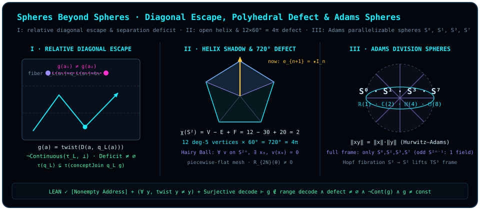

# Chapter 21 Spheres Beyond Spheres: Cantor Diagonalization, Gödel Escape, and Hairy-Ball Singularities

> *"Why is area existence? Because to express that existence, it must be inside another, larger existence. That is Gödel incompleteness: no one can obtain the entire sphere. Continue."*
>
> *"At the very moment we think we have obtained a sphere, we have in fact been enclosed inside a larger sphere."*

Across the first twenty chapters of this book, we climbed the dimensional ladder from points and lines to planes, spheres, multi-sphere entanglement, and holographic spacetime. At this vantage point, a classical metaphysical temptation naturally arises: since we now understand the geometric generators of spherical state spaces, can we not draw a single, all-encompassing "master sphere" that seals every definable concept, every decidable proposition, and every observable state inside one closed shell once and for all?

Part VI (*Crossing the Horizon — Spheres Beyond Spheres*) is devoted to shattering that idol of an omniscient closed sphere.

Recall the foundational geometric principle uncovered in the [Prelude](README.md) and [Chapter 3](ch03-projectors-and-duality.md): when you rotate an oriented two-dimensional area $\vv{e}_1 \wedge \vv{e}_2$ inside the equatorial plane $\operatorname{span}\{\vv{e}_1, \vv{e}_2\}$ and seek to name that area as a single one-dimensional "axis of existence" (a particle state or settled proposition), your vantage point cannot remain inside the two-dimensional sheet — for every vector inside the plane is coplanar with it and cannot serve as its normal. You condense a two-dimensional area into a one-dimensional normal arrow $\vv{e}_3 = \star_3(\vv{e}_1 \wedge \vv{e}_2)$ only because you already stand inside an **oriented three-dimensional ambient space** $\mathbb{R}^3$! By the exact same exterior-algebraic law, within oriented $\mathbb{R}^3$ alone, the Hodge dual of the top-degree volume element $I_3 = \vv{e}_1 \wedge \vv{e}_2 \wedge \vv{e}_3$ is merely a zero-degree scalar $\star_3 I_3 = 1$; to name the entire three-dimensional system itself as a new orthogonal normal axis $\vv{e}_4 = \star_4 I_3$, mathematics compels you to step into a **four-dimensional ambient space** $\mathbb{R}^4 = \mathbb{R}^3 \oplus \mathbb{R}\vv{e}_4$, turning the original two-sphere $S^2$ into the equatorial slice of a larger three-sphere $S^3$!

In this chapter we prove that this law — *to express the totality of a system as an entity, one must inhabit a larger ambient space* — is far more than a differential-geometric metaphor. At the foundation of set theory and observation topology, its abstract skeleton is captured by the **relative semantic diagonal and observation-topology refinement quartet** (`DiagonalTopologicalEscape`), verified here by the Lean 4 kernel, which mirrors in the classical metamathematical literature **Georg Cantor's diagonal construction**, **Kurt Gödel's first incompleteness theorem**, and **Alfred Tarski's undefinability of truth** (where Gödel's and Tarski's theorems additionally require recursive arithmetic axiomatization, Gödel numbering, syntactic provability predicates, and consistency hypotheses belonging to the classical literature and structural analogy layer). Whenever a complete decoder catalog over a nonempty address space attempts to exhaust all output maps within the fiber partition of a fixed latent coordinate, any fixed-point-free twist operator immediately rips across the old observation topology along the relative semantic diagonal, forcing the concept readout to refine strictly into a "sphere beyond spheres."

## 21.1 Why Naming an Area Requires Standing Outside It: Concept Readouts and Partition Topologies {#sec-ch21-1}

Let us first translate "observing the world through a fixed coordinate shell" into the clean language of sets and general topology.

Let $X$ (denoted `Address` in the formal declarations) be the space of objects or statement addresses under examination, and let $B$ (`Coordinate`) be the **latent coordinate readout space** currently available to the observer. In the Lean module `ConceptFiberDecomposition`, a **concept readout** ([`Concept`](lean:D5/S3/ConceptDynamics/ConceptFiberDecomposition.Concept) $X\ B$) is simply a function $q_L : X \to B$. Fixing a concept ruler $q_L$ slices the entire address space $X$ into pairwise disjoint **concept fibers** ([`ConceptFiber`](lean:D5/S3/ConceptDynamics/ConceptFiberDecomposition.ConceptFiber) $q_L\ b = \{x \in X \mid q_L(x) = b\}$), inducing a canonical dependent-sum decomposition ([`concept_fiber_decomposition`](lean:D5/S3/ConceptDynamics/ConceptFiberDecomposition.concept_fiber_decomposition)):

$$
X \;\simeq\; \sum_{b : B} \operatorname{ConceptFiber}(q_L, b).
$$

Geometrically, picture $q_L : X \to B$ as an orthogonal projection from a higher-dimensional sphere onto a lower-dimensional equatorial slice: any two addresses $x, y \in X$ lying on the same vertical projection fiber $q_L^{-1}(b)$ share the exact same coordinate reading $q_L(x) = q_L(y) = b$. To an internal observer who can see only $B$, $x$ and $y$ are **topologically inseparable** twins hiding inside the same blind spot!

To formalize this internal resolution using general topology, equip the coordinate space $B$ with the finest possible topology — the **discrete topology** $\bot$ (in Mathlib's lattice convention on `TopologicalSpace`, $\bot$ is the discrete topology in which every subset is open, meaning coordinate values themselves are sharply distinguishable) — and pull $\bot$ back along $q_L : X \to B$ to obtain the **partition topology** ([`partitionTopology`](lean:D5/S3/ConceptDynamics/Epistemic/PartitionKnowledgeNegativeIntrospection.partitionTopology) $q_L = \operatorname{induced}(q_L, \bot)$) on $X$. In $\tau(q_L)$, a subset $U \subseteq X$ is open if and only if it is a union of complete $q_L$-fibers, $U = q_L^{-1}(S)$ ($S \subseteq B$). Consequently, two addresses $x, y \in X$ are topologically inseparable in $\tau(q_L)$ (written $\operatorname{Inseparable}_{\tau(q_L)}(x, y)$) if and only if they lie in the same fiber: $q_L(x) = q_L(y)$ ([`partition_inseparable_iff_kernel`](lean:D5/S3/ConceptDynamics/ObservationTopology/PartitionTopologyKernel.partition_inseparable_iff_kernel)).

Now suppose the observer asks whether a target concept $q_T : X \to \mathrm{Output}$ can be contained entirely within the existing coordinate shell $q_L : X \to B$. In `ConceptJoinUniversal`, we say that $q_T$ **is refined by (factors through) $q_L$** ([`Refines`](lean:D5/S3/ConceptDynamics/ConceptJoinUniversal.Refines) $q_T\ q_L$, or equivalently [`TargetAdequate`](lean:D5/S3/ConceptDynamics/DefinitionEscape/LatentAdequacyCriterion.TargetAdequate) $q_L\ q_T$) if there exists a post-processing map $f : B \to \mathrm{Output}$ such that

$$
q_T = f \circ q_L \qquad (\forall x \in X,\; q_T(x) = f(q_L(x))).
$$

Assuming the address space $X$ is **nonempty** (`[Nonempty X]`), when can $q_T$ be factored through the coordinate shell $q_L$ in this way? If and only if $q_T$ is **continuous** as a map from the partition topology $(X, \tau(q_L))$ to the discrete output topology $(\mathrm{Output}, \bot)$ ([`target_factors_iff_continuous_partition`](lean:D5/S3/ConceptDynamics/ObservationTopology/TargetContinuityFactorization.target_factors_iff_continuous_partition), where `[Nonempty X]` provides a default witness in $X$ to define the post-processing map $f : B \to \mathrm{Output}$ on unhit coordinates $b \notin q_L(X)$)! Continuity demands that every point-preimage $q_T^{-1}(\{o\})$ be open in $\tau(q_L)$ — a union of whole $q_L$-fibers — so that $q_L(x) = q_L(y)$ always forces $q_T(x) = q_T(y)$. The instant a single old fiber is split in two by $q_T$ — two addresses coinciding on $q_L$ but disagreeing on $q_T$ — continuity shatters and a nonempty **topological separation deficit** emerges.

## 21.2 The Cantor–Gödel Relative Semantic Diagonal: A Formal Escape Quartet {#sec-ch21-2}

We are ready to assemble the relative semantic diagonal escape machine on arbitrary types `Address`, `Coordinate`, and `Output`.

Suppose a system erects an ostensibly all-inclusive **decoder catalog** (`decoderCatalog : Address → Coordinate → Output`): each address $a \in \mathrm{Address}$ is not merely an object under observation, but also indexes a candidate decoding rule $D_a : \mathrm{Coordinate} \to \mathrm{Output}$. What happens if this catalog is **complete** (`Function.Surjective decoderCatalog`, meaning every function $h : \mathrm{Coordinate} \to \mathrm{Output}$ appears as $D_{a_h}$ at some address $a_h \in \mathrm{Address}$), and the output space admits a **fixed-point-free twist** `twist : Output → Output` ($\forall o,\; \operatorname{twist}(o) \neq o$, such as Boolean negation $\neg : \{0, 1\} \to \{0, 1\}$, the Pauli-$X$ bit-flip restricted to the computational-basis bit labels $\{\lvert 0\rangle, \lvert 1\rangle\}$ — note that on the full Bloch sphere $S^2$ the continuous rotation $X$ fixes the $\pm x$ poles $\lvert \pm\rangle$, so one takes either discrete bit labels or global antipodal inversion $\vv{n} \mapsto -\vv{n}$)?

We simply instruct each address $a$ to feed **its own latent coordinate** $q_L(a)$ into **its own cataloged decoder** $D_a$, and then apply the fixed-point-free `twist`!

::: {.definition #def-relative-semantic-diagonal title="Relative Semantic Diagonal" lean="D5/S3/ConceptDynamics/DefinitionEscape/RelativeSemanticDiagonal.relativeSemanticDiagonal"}
Let `Address`, `Coordinate`, and `Output` be arbitrary types, let $\operatorname{twist} : \mathrm{Output} \to \mathrm{Output}$ be an output transformation, let $\operatorname{latent} : \operatorname{Concept}\ \mathrm{Address}\ \mathrm{Coordinate}$ be a latent concept readout, and let $\operatorname{decoderCatalog} : \mathrm{Address} \to \mathrm{Coordinate} \to \mathrm{Output}$ be a decoder catalog. The **relative semantic diagonal** (`relativeSemanticDiagonal twist latent decoderCatalog` in Lean) is the target concept readout $g : \operatorname{Concept}\ \mathrm{Address}\ \mathrm{Output}$ defined by

$$
g(a) \;:=\; \operatorname{twist}\bigl(\operatorname{decoderCatalog}(a, \operatorname{latent}(a))\bigr) \qquad (a \in \mathrm{Address}).
$$
:::

To measure how this diagonal $g$ tears across the latent partition topology $\tau(\operatorname{latent})$, we also record the formal definition of the topological separation deficit.

::: {.definition #def-separation-deficit title="Topological Separation Deficit" lean="D5/S3/ConceptDynamics/ObservationTopology/ResidualSeparationTopology.separationDeficit"}
Let `X`, `Current`, and `Target` be arbitrary types, with current concept readout $\operatorname{current} : \operatorname{Concept}\ X\ \mathrm{Current}$ and target concept readout $\operatorname{target} : \operatorname{Concept}\ X\ \mathrm{Target}$. The **topological separation deficit** of $\operatorname{current}$ relative to $\operatorname{target}$ (`separationDeficit current target` in Lean) is the subset of address pairs in $X \times X$:

$$
\begin{aligned}
\operatorname{separationDeficit}(\operatorname{current}, \operatorname{target})
\;:=\; \bigl\{\, (x, y) \in X \times X \;\big|\; &\operatorname{Inseparable}_{\tau(\operatorname{current})}(x, y) \\
&\land\; \neg\operatorname{Inseparable}_{\tau(\operatorname{target})}(x, y) \,\bigr\}.
\end{aligned}
$$
:::

Notice the trap sprung by [@def-relative-semantic-diagonal] and [@def-separation-deficit]: at every address $a \in \mathrm{Address}$, because $\operatorname{twist}$ has no fixed points, $g(a) \neq \operatorname{decoderCatalog}(a, \operatorname{latent}(a))$ ([`relative_semantic_diagonal_ne_listed_decode`](lean:D5/S3/ConceptDynamics/DefinitionEscape/RelativeSemanticDiagonal.relative_semantic_diagonal_ne_listed_decode)) — at its own address $a$, the diagonal $g$ always disagrees with the $a$-th cataloged decoder!

In the Lean module `DiagonalTopologicalEscape`, this mechanism yields four kernel-verified theorems proving that no complete internal catalog can contain its own diagonal without refining its observation topology.

::: {.theorem #thm-complete-diagonal-not-continuous title="Discontinuity of the Complete-Catalog Relative Semantic Diagonal" lean="D5/S3/ConceptDynamics/ObservationTopology/DiagonalTopologicalEscape.complete_diagonal_not_continuous"}
Let `Address`, `Coordinate`, and `Output` be types with `Address` nonempty (`[Nonempty Address]`). Given $\operatorname{twist} : \mathrm{Output} \to \mathrm{Output}$, $\operatorname{latent} : \operatorname{Concept}\ \mathrm{Address}\ \mathrm{Coordinate}$, and $\operatorname{decoderCatalog} : \mathrm{Address} \to \mathrm{Coordinate} \to \mathrm{Output}$, suppose:

1. **Fixed-point-free twist**: for every $o \in \mathrm{Output}$, $\operatorname{twist}(o) \neq o$;
2. **Complete (surjective) catalog**: $\operatorname{decoderCatalog}$ is surjective (`Function.Surjective decoderCatalog`).

Then the relative semantic diagonal $g = \operatorname{relativeSemanticDiagonal}(\operatorname{twist}, \operatorname{latent}, \operatorname{decoderCatalog})$ of [@def-relative-semantic-diagonal] is **not continuous** from the latent partition topology $\operatorname{partitionTopology}(\operatorname{latent})$ to the discrete output topology $\bot$:

$$
\neg\,\operatorname{Continuous}_{\tau(\operatorname{latent}) \to \bot}(g).
$$
:::

::: proof
Suppose toward a contradiction that $g$ is continuous from $\tau(\operatorname{latent})$ to $\bot$. By the factorization-continuity equivalence [`target_factors_iff_continuous_partition`](lean:D5/S3/ConceptDynamics/ObservationTopology/TargetContinuityFactorization.target_factors_iff_continuous_partition), continuity implies $\operatorname{Refines}(g, \operatorname{latent})$, meaning there exists a coordinate decoder $h : \mathrm{Coordinate} \to \mathrm{Output}$ such that $g(a) = h(\operatorname{latent}(a))$ for all $a \in \mathrm{Address}$. Because $\operatorname{decoderCatalog}$ is surjective, there exists an address $a_0 \in \mathrm{Address}$ with $\operatorname{decoderCatalog}(a_0) = h$. Evaluating at $a_0$ gives $g(a_0) = h(\operatorname{latent}(a_0)) = \operatorname{decoderCatalog}(a_0, \operatorname{latent}(a_0))$ on the one hand, and $g(a_0) = \operatorname{twist}(\operatorname{decoderCatalog}(a_0, \operatorname{latent}(a_0)))$ by definition of $g$ on the other. Setting $o_0 = \operatorname{decoderCatalog}(a_0, \operatorname{latent}(a_0))$ yields $\operatorname{twist}(o_0) = o_0$, contradicting `fixedPointFree` (encapsulated in Lean as [`relative_semantic_diagonal_target_inadequate_of_surjective`](lean:D5/S3/ConceptDynamics/DefinitionEscape/RelativeSemanticDiagonal.relative_semantic_diagonal_target_inadequate_of_surjective)). The full proof is checked by the Lean kernel.
:::

[@thm-complete-diagonal-not-continuous] establishes a sharp topological trade-off: **catalog completeness and internal continuity cannot coexist.** As soon as the decoder catalog is expressive enough to cover all functions on the latent coordinates, the diagonal target $g$ necessarily rips across the latent partition topology, leaving behind a concrete, nonempty separation deficit.

::: {.lemma #lem-complete-diagonal-separation-deficit title="Nonempty Separation Deficit of the Complete Relative Diagonal" lean="D5/S3/ConceptDynamics/ObservationTopology/DiagonalTopologicalEscape.complete_diagonal_separationDeficit_nonempty"}
Under the exact hypotheses of [@thm-complete-diagonal-not-continuous] (`Address` nonempty, $\operatorname{twist}$ fixed-point-free, and $\operatorname{decoderCatalog}$ surjective), the topological separation deficit of $\operatorname{latent}$ relative to $g = \operatorname{relativeSemanticDiagonal}(\operatorname{twist}, \operatorname{latent}, \operatorname{decoderCatalog})$ is nonempty:

$$
\bigl(\operatorname{separationDeficit}(\operatorname{latent},\; g)\bigr).\mathrm{Nonempty}.
$$
:::

::: proof
By [`relative_semantic_diagonal_target_inadequate_of_surjective`](lean:D5/S3/ConceptDynamics/DefinitionEscape/RelativeSemanticDiagonal.relative_semantic_diagonal_target_inadequate_of_surjective), the hypotheses imply $\neg\operatorname{Refines}(g, \operatorname{latent})$. By the target recovery criterion [`target_recovery_criterion`](lean:D5/S3/ConceptDynamics/Restoration/TargetRecoveryCriterion.target_recovery_criterion), failure of factorization is equivalent to nonemptiness of the kernel defect relation $\operatorname{defectRelation}(\operatorname{latent}, g) = \{(a_1, a_2) \mid \operatorname{latent}(a_1) = \operatorname{latent}(a_2) \land g(a_1) \neq g(a_2)\}$. Rewriting along the identity [`defectRelation_eq_separationDeficit`](lean:D5/S3/ConceptDynamics/ObservationTopology/ResidualSeparationTopology.defectRelation_eq_separationDeficit) yields nonemptiness of $\operatorname{separationDeficit}(\operatorname{latent}, g)$. The full proof is checked by the Lean kernel.
:::

Pause over the geometric content of [@lem-complete-diagonal-separation-deficit]: because $\operatorname{separationDeficit}(\operatorname{latent}, g)$ is nonempty, there **must exist at least one concrete pair of addresses $(a_1, a_2)$** that collapse to the exact same shadow under the old coordinate ruler ($\operatorname{latent}(a_1) = \operatorname{latent}(a_2)$) yet are pried apart by the diagonal ($g(a_1) \neq g(a_2)$)!

How can the observer resolve this blind spot? Only by **promoting the escaping diagonal $g$ itself into a new orthogonal coordinate axis**, forming the product readout [`conceptJoin`](lean:D5/S3/ConceptDynamics/ConceptJoinUniversal.conceptJoin):

$$
\operatorname{conceptJoin}(\operatorname{latent}, g) : a \;\longmapsto\; \bigl(\operatorname{latent}(a),\; g(a)\bigr) \in \mathrm{Coordinate} \times \mathrm{Output}.
$$

The next proposition proves that adjoining this escaping normal axis forces a **strict observation-topology refinement** ([`StrictObservationRefinement`](lean:D5/S3/ConceptDynamics/ObservationTopology/PrimitiveEscapeStrictRefinement.StrictObservationRefinement), meaning every open set of the coarse topology remains open in the fine topology, while the fine topology possesses at least one genuinely new open set).

::: {.proposition #prop-complete-diagonal-strict-refinement title="Strict Observation-Topology Refinement by Adjoining the Relative Diagonal" lean="D5/S3/ConceptDynamics/ObservationTopology/DiagonalTopologicalEscape.complete_diagonal_strict_topology_refinement"}
Under the exact hypotheses of [@thm-complete-diagonal-not-continuous] (`Address` nonempty, $\operatorname{twist}$ fixed-point-free, and $\operatorname{decoderCatalog}$ surjective), adjoining $g = \operatorname{relativeSemanticDiagonal}(\operatorname{twist}, \operatorname{latent}, \operatorname{decoderCatalog})$ to $\operatorname{latent}$ strictly refines the partition topology:

$$
\operatorname{StrictObservationRefinement}\Bigl(
  \operatorname{partitionTopology}(\operatorname{latent}),\;
  \operatorname{partitionTopology}\bigl(\operatorname{conceptJoin}(\operatorname{latent}, g)\bigr)
\Bigr).
$$
:::

::: proof
By [`coordinate_inadequate_iff_strict_join_refinement`](lean:D5/S3/ConceptDynamics/ObservationTopology/RedundantCoordinateTopology.coordinate_inadequate_iff_strict_join_refinement), the partition topology of $\operatorname{conceptJoin}(\operatorname{latent}, g)$ strictly refines $\operatorname{partitionTopology}(\operatorname{latent})$ if and only if $\operatorname{latent}$ is inadequate for $g$ ($\neg\operatorname{TargetAdequate}(\operatorname{latent}, g)$, i.e., $\neg\operatorname{Refines}(g, \operatorname{latent})$). Applying [`relative_semantic_diagonal_target_inadequate_of_surjective`](lean:D5/S3/ConceptDynamics/DefinitionEscape/RelativeSemanticDiagonal.relative_semantic_diagonal_target_inadequate_of_surjective) completes the proof. The full proof is checked by the Lean kernel.
:::

Combining non-factorization, discontinuity, nonempty separation deficit, and strict refinement yields the complete four-part settlement theorem.

::: {.corollary #cor-complete-diagonal-topological-settlement title="Four-Part Topological Settlement of Complete Relative Diagonalization" lean="D5/S3/ConceptDynamics/ObservationTopology/DiagonalTopologicalEscape.complete_diagonal_topological_settlement"}
Let `Address`, `Coordinate`, and `Output` be types with `Address` nonempty, let $\operatorname{twist} : \mathrm{Output} \to \mathrm{Output}$ satisfy $\forall o,\; \operatorname{twist}(o) \neq o$, and let $\operatorname{decoderCatalog} : \mathrm{Address} \to \mathrm{Coordinate} \to \mathrm{Output}$ be surjective. For $g = \operatorname{relativeSemanticDiagonal}(\operatorname{twist}, \operatorname{latent}, \operatorname{decoderCatalog})$, all four statements hold simultaneously:

1. **Non-factorization (escape from the latent closure)**: $\neg\operatorname{Refines}(g, \operatorname{latent})$;
2. **Discontinuity in the latent topology**: $\neg\,\operatorname{Continuous}_{\tau(\operatorname{latent}) \to \bot}(g)$;
3. **Nonempty separation deficit**: $\bigl(\operatorname{separationDeficit}(\operatorname{latent}, g)\bigr).\mathrm{Nonempty}$;
4. **Strict observation-topology refinement upon adjoining $g$**:

   $$
   \operatorname{StrictObservationRefinement}\Bigl(
     \operatorname{partitionTopology}(\operatorname{latent}),\;
     \operatorname{partitionTopology}\bigl(\operatorname{conceptJoin}(\operatorname{latent}, g)\bigr)
   \Bigr).
   $$
:::

::: proof
Conjoining [`relative_semantic_diagonal_target_inadequate_of_surjective`](lean:D5/S3/ConceptDynamics/DefinitionEscape/RelativeSemanticDiagonal.relative_semantic_diagonal_target_inadequate_of_surjective) with [@thm-complete-diagonal-not-continuous], [@lem-complete-diagonal-separation-deficit], and [@prop-complete-diagonal-strict-refinement] establishes all four conjuncts. The full proof is checked by the Lean kernel.
:::

Let us work through the smallest possible finite Boolean instance by hand so that every piece of [@cor-complete-diagonal-topological-settlement] becomes concretely visible.

::: {.example #ex-cantor-godel-diagonal-table title="Hand Calculation of Diagonal Escape and Fiber Splitting Over a 1-Bit Latent Coordinate"}
Take the 1-bit coordinate space $\mathrm{Coordinate} = \{0, 1\}$, output space $\mathrm{Output} = \{0, 1\}$, and fixed-point-free bit-flip $\operatorname{twist}(o) = 1 - o$ ($\operatorname{twist}(0) = 1 \neq 0$, $\operatorname{twist}(1) = 0 \neq 1$). Since there are $2^2 = 4$ functions from $\{0, 1\}$ to $\{0, 1\}$, choose a four-element address set $\mathrm{Address} = \{a_0, a_1, a_2, a_3\}$ to build a surjective catalog:

| Address $a$ | Decoder $D_a(0)$ | Decoder $D_a(1)$ | Latent Readout $\operatorname{latent}(a)$ | Self-Evaluation $D_a(\operatorname{latent}(a))$ | Diagonal $g(a) = 1 - D_a(\operatorname{latent}(a))$ |
| :---: | :---: | :---: | :---: | :---: | :---: |
| $a_0$ (constant $0$) | $0$ | $0$ | $0$ | $D_{a_0}(0) = 0$ | $\mathbf{1}$ |
| $a_1$ (identity) | $0$ | $1$ | $0$ | $D_{a_1}(0) = 0$ | $\mathbf{1}$ |
| $a_2$ (negation) | $1$ | $0$ | $0$ | $D_{a_2}(0) = 1$ | $\mathbf{0}$ |
| $a_3$ (constant $1$) | $1$ | $1$ | $1$ | $D_{a_3}(1) = 1$ | $\mathbf{0}$ |

Now verify each clause of [@cor-complete-diagonal-topological-settlement] directly from the table:

1. **Concrete separation-deficit witness**: Inspect addresses $a_1$ and $a_2$. They share the same latent coordinate $\operatorname{latent}(a_1) = 0 = \operatorname{latent}(a_2)$ and are therefore inseparable in the coarse partition topology $\tau(\operatorname{latent}) = \{\varnothing,\; \{a_0, a_1, a_2\},\; \{a_3\},\; \mathrm{Address}\}$. Yet the diagonal assigns them opposite outputs $g(a_1) = 1 \neq 0 = g(a_2)$, giving the explicit witness

   $$
   (a_1, a_2) \in \operatorname{separationDeficit}(\operatorname{latent}, g) \neq \varnothing.
   $$

2. **Discontinuity and non-factorization**: The preimage of the discrete open singleton $\{0\} \subseteq \mathrm{Output}$ under $g$ is $g^{-1}(\{0\}) = \{a_2, a_3\}$, which slices straight through the coarse fiber $\{a_0, a_1, a_2\}$ and is not open in $\tau(\operatorname{latent})$; hence $g$ is discontinuous and cannot factor as $h(\operatorname{latent}(a))$.
3. **Strict refinement upon adjoining $g$**: Forming $\operatorname{conceptJoin}(\operatorname{latent}, g)(a) = (\operatorname{latent}(a), g(a))$ maps $a_0 \mapsto (0, 1)$, $a_1 \mapsto (0, 1)$, $a_2 \mapsto (0, 0)$, and $a_3 \mapsto (1, 0)$. The three-element blind fiber $\{a_0, a_1, a_2\}$ splits cleanly into $\{a_0, a_1\}$ and $\{a_2\}$, strictly refining the partition topology from $2$ nonempty atomic open fibers to $3$!
:::

This quartet captures the pure abstract Lawvere–Cantor diagonal skeleton in observation topology, offering a clean structural analogy to Gödel's first incompleteness theorem and Tarski's undefinability of truth in the metamathematical literature (whereas in formal logic Gödel's and Tarski's theorems do not assume a surjection onto all semantic functions, but instead require effective arithmetic axiomatization, Gödel numbering, syntactic provability predicates, and consistency hypotheses). Within our abstract topological setting, whenever a system indexes a surjective family of candidate decoders `decoderCatalog` over its current latent coordinates and applies a fixed-point-free `twist` along the diagonal, the resulting self-referential target $g$ splits an equivalence fiber of the current language. Restoring continuity requires stepping out into the product readout $\operatorname{conceptJoin}(\operatorname{latent}, g)$; and **iterating this escape to a subsequent diagonal $g'$ over the expanded coordinate space $\mathrm{Coordinate}_{k+1} = \mathrm{Coordinate}_k \times \mathrm{Output}$ is conditional on re-establishing a new surjective catalog $\operatorname{decoderCatalog}_{k+1} : \mathrm{Address}_{k+1} \twoheadrightarrow (\mathrm{Coordinate}_{k+1} \to \mathrm{Output})$ on a suitably enlarged address space $\mathrm{Address}_{k+1}$** — for instance, in the four-address Boolean model of [@ex-cantor-godel-diagonal-table], the joined coordinate space has $4$ coordinate pairs ($2^4 = 16$ Boolean functions in total, and $2^3 = 8 > 4$ Boolean functions even on the $3$ realized nonempty fibers), so the original $4$ addresses cannot surjectively index the next stage unless `Address` itself is enlarged!

> A complete catalog necessarily cracks its own shell; whoever tries to exhaust the world from inside a single sphere is thrust outward along the diagonal normal.

## 21.3 Inscribed Polytopes, Taylor Remainder Seams, and the Open Helix {#sec-ch21-3}

If no fixed formal shell can seal all truth inside a static sphere, let us look back at the "spheres" of physics and computation with fresh eyes.

At the close of the [Prelude](README.md), we stated the book's central anti-Platonic thesis: **"In truth, every sphere is only an approximation: we think we have obtained a sphere, when all we ever hold is an approximate sphere."** Paired with diagonal escape, this anti-Platonic insight manifests across three distinct mathematical domains:

1. **The nonzero Taylor remainder seam $R_{2N}(\theta) \neq 0$**: Any finite algebraic circuit or digital processor can evaluate only a finite-degree polynomial approximation to the cosine projection $\cos\theta$. Truncating after $N$ even terms (degree $2N - 2$) leaves the remainder seam

   $$
   \cos\theta = \sum_{k=0}^{N-1} (-1)^k \frac{\theta^{2k}}{(2k)!} + R_{2N}(\theta), \qquad |R_{2N}(\theta)| \le \frac{|\theta|^{2N}}{(2N)!}.
   $$

   For every nonzero angle $\theta \in (0, 2]$, the alternating remainder $R_{2N}(\theta)$ is strictly nonzero! The polynomial represents what finitely many internal ring operations can close, whereas $R_{2N}(\theta)$ is the analytic escape seam separating any finite polynomial cage from the transcendental circle.
2. **Inscribed convex polytopes at finite gate count $L$**: In fault-tolerant quantum synthesis over a finite discrete gate alphabet $\mathcal{G}$ (such as $\{H, T\}$), at any finite gate count $L < \infty$ the reachable set $\mathcal{S}_L \subset S^2$ from $\lvert 0\rangle$ is a finite point set whose Euclidean convex hull $\operatorname{conv}(\mathcal{S}_L) \subset \mathbb{R}^3$ is an **inscribed convex polyhedron** rather than a smooth sphere — leaving curved spherical caps outside every flat facet until $L$ is increased.
3. **The open ascending helix projected as a circle**: Viewed heuristically, if each topological refinement $\operatorname{conceptJoin}(\operatorname{latent}, g)$ in [@prop-complete-diagonal-strict-refinement] is pictured as an ascent along a newly adjoined normal axis $\vv{e}_{n+1} = \star I_n$, then what looks to a flatland observer like a closed periodic circle $(\cos t, \sin t)$ is the axial shadow of an **open ascending helix** $(\cos t, \sin t, c\,t)$ in the ambient space: returning to $(\cos 2\pi, \sin 2\pi) = (1, 0)$ in the base plane actually lands one turn higher at $(1, 0, 2\pi c)$!

## 21.4 The Hairy Ball Theorem, Descartes's $720^\circ$ Angular Defect, and Adams's Division-Algebra Spheres {#sec-ch21-4}

Even if we refrain from constructing Gödelian diagonals and stay strictly on the smooth two-dimensional Bloch sphere $S^2 \subset \mathbb{R}^3$, topology itself plants an immovable singularity right on the surface of the sphere — governed by the **Poincaré–Brouwer Hairy Ball Theorem**, **Descartes's polyhedral angular-defect theorem**, and **Adams's parallelizability theorem**.

Why does every attempt to comb a smooth tangent vector field across the single-qubit Bloch sphere $S^2$ (assigning to each pure state $\vv{a} \in S^2$ a continuous unit tangent reference direction $\vv{v}(\vv{a}) \perp \vv{a}$) inevitably hit a vortex singularity where $\vv{v} = \vv{0}$? Why must every closed piecewise-flat equilateral triangulated polyhedral sphere with only degree-$5$ and degree-$6$ vertices (or its dual closed trivalent fullerene cage of pentagons and hexagons, such as $\mathrm{C}_{60}$) contain **invariably, exactly $12$ degree-$5$ vertices (or $12$ pentagonal defect faces)**? And when we ask not merely for a **single** nowhere-vanishing tangent vector field (which exists on every odd-dimensional sphere $S^{2n-1}$), but for a **full global frame of $m$ everywhere linearly independent tangent fields** trivializing the entire tangent bundle $TS^m$ (**parallelizability**), why do only the four spheres $S^0, S^1, S^3, S^7$ qualify?

The following literature note gathers these three classical pillars of combinatorics, differential topology, and algebraic K-theory.

::: {.remark #rem-hairy-ball-adams-literature title="Euler Characteristic, Descartes's 720° Angular Defect, the Hairy Ball Theorem, and Adams's Parallelizable Spheres (Literature Result, Not Formalized in This Book)"}
**Literature result, not formalized in this book.** Four classical theorems of geometry and topology govern the obstructions and exceptional parallelizability of spheres:

1. **Euler characteristic of the 2-sphere**: For any convex polyhedral cell decomposition of the two-sphere $S^2$ with $V$ vertices, $E$ edges, and $F$ faces, Euler's formula gives the topological invariant

   $$
   \chi(S^2) = V - E + F = 2.
   $$

   For a regular icosahedron ($V = 12$ vertices, $E = 30$ edges, $F = 20$ equilateral triangles), $12 - 30 + 20 = 2$.
2. **Descartes's total angular defect ($12 \times 60^\circ = 720^\circ = 4\pi$)**: One must distinguish **spherical geodesic triangles on a smooth round sphere** from **Euclidean planar triangles on a piecewise-flat polyhedral surface** — on a smooth round sphere $S^2$ of curvature $+1$, nondegenerate geodesic triangles have positive spherical excess $\alpha + \beta + \gamma > \pi$ (for instance, in a spherical icosahedral tiling, each spherical equilateral triangle has $72^\circ$ angles and five meet smoothly at $5 \times 72^\circ = 360^\circ$ around each vertex because the $4\pi$ Gauss–Bonnet curvature is distributed continuously across the curved faces). By contrast, consider a **closed piecewise-Euclidean (flat-faced) equilateral triangulated polyhedral surface** homeomorphic to $S^2$, where each face is a flat Euclidean equilateral triangle with interior angles $\pi/3 = 60^\circ$ and all curvature is concentrated as discrete angular defects at the vertices. At any degree-$6$ vertex, six flat $60^\circ$ triangles meet to form $6 \times 60^\circ = 360^\circ = 2\pi$, which has zero angular defect ($\delta_6 = 0$); a pure degree-$6$ triangulation can therefore tile only a flat plane or a flat torus ($\chi(T^2) = 0$) and can never close into a sphere! If a closed piecewise-flat equilateral triangulated polyhedral sphere has only degree-$5$ and degree-$6$ vertices, then at each degree-$5$ vertex five flat triangles sum to $5 \times 60^\circ = 300^\circ$, leaving a positive angular defect of

   $$
   \delta_5 = 2\pi - 5\times\frac{\pi}{3} = \frac{\pi}{3} = 60^\circ.
   $$

   By Descartes's Theorem on Total Angular Defect (the discrete ancestor of the Gauss–Bonnet theorem $\int_{S^2} K\,dA = 2\pi\chi(S^2) = 4\pi$), the sum of vertex angular defects over any closed polyhedron homeomorphic to $S^2$ is identically $2\pi\chi(S^2) = 4\pi = 720^\circ$. Since degree-$6$ vertices contribute $0^\circ$ and each degree-$5$ vertex contributes $60^\circ$, any such closed piecewise-flat degree-$5/6$ triangulated sphere must contain **precisely $720^\circ / 60^\circ = 12$ degree-$5$ defect vertices** ($12 \times 60^\circ = 720^\circ = 4\pi$)! Dually, for any **closed trivalent fullerene polyhedron** with $F_5$ pentagonal faces and $F_6$ hexagonal faces ($3V = 2E = 5F_5 + 6F_6$), Euler's formula $6(V - E + F) = 6F - 2E = (6 - 5)F_5 + (6 - 6)F_6 = 12$ forces **precisely $F_5 = 12$ pentagons**. Even in discrete polyhedral approximation, a finite piecewise-flat mesh cannot close into a sphere without concentrating $4\pi$ of curvature into twelve $60^\circ$ defect seams.
3. **Poincaré–Brouwer Hairy Ball Theorem and odd vs. even spheres**: The Euler characteristic of the $m$-sphere is $\chi(S^m) = 1 + (-1)^m$. Because every **even-dimensional sphere** has $\chi(S^{2n}) = 2 \neq 0$, the Poincaré–Hopf index theorem implies that every continuous tangent vector field $v : S^{2n} \to TS^{2n}$ vanishes at least at one point $x_0 \in S^{2n}$ ($v(x_0) = 0$); on the single-qubit Bloch sphere $S^2 \cong \mathbb{CP}^1$, this forbids any globally continuous, nowhere-vanishing tangent phase gauge (the topological root of the Dirac monopole bundle and Berry-phase holonomy). Conversely, every **odd-dimensional sphere** $S^{2n-1} \subset \mathbb{C}^n$ has $\chi(S^{2n-1}) = 0$ and admits **at least one** nowhere-vanishing unit tangent vector field — namely multiplication by the complex imaginary unit $v(z) = iz$ (or $v(x_1, x_2, \dots, x_{2n-1}, x_{2n}) = (-x_2, x_1, \dots, -x_{2n}, x_{2n-1})$, which is nowhere zero on $S^5$, $S^7$, etc.).
4. **Hurwitz's normed division algebras and Adams's parallelizability theorem (Adams, 1962)**: Notice the sharp distinction between admitting a **single** nowhere-zero tangent field (true for all odd-dimensional spheres $S^{2n-1}$) and being **parallelizable** — having a globally trivial tangent bundle $TS^m$ equipped with a **full frame of $m$ everywhere linearly independent continuous tangent vector fields**! For example, $S^5$ admits a nowhere-zero tangent field $v(z) = iz$ but cannot be fitted with $5$ everywhere linearly independent tangent fields. By Hurwitz's theorem, the only finite-dimensional normed division algebras over $\mathbb{R}$ satisfying $\|xy\| = \|x\|\|y\|$ have dimensions $1, 2, 4, 8$: the **reals $\mathbb{R}$, complexes $\mathbb{C}$, quaternions $\mathbb{H}$, and octonions $\mathbb{O}$**. Left multiplication by imaginary units furnishes complete global tangent frames on their unit spheres $S^0 \subset \mathbb{R}$, $S^1 \subset \mathbb{C}$, $S^3 \subset \mathbb{H}$, and $S^7 \subset \mathbb{O}$. In 1960–1962, J. Frank Adams resolved the Hopf-invariant-one problem via topological K-theory, proving that **among all positive-dimensional spheres, only $S^1, S^3$, and $S^7$ (together with the zero-dimensional companion $S^0$) are parallelizable!**
:::

Put items 3 and 4 of [@rem-hairy-ball-adams-literature] side by side and a deep mystery from [Chapter 1](ch01-measurement.md) clicks into place: **why is the observable two-sphere $S^2$ (even dimension $2 \notin \{0, 1, 3, 7\}$, $\chi(S^2) = 2$) unable to support even a single nowhere-vanishing tangent field, whereas the ambient three-sphere $S^3 \cong \mathrm{SU}(2)$ hovering above it via the Hopf fibration (the unit sphere of the quaternions $\mathbb{H}$, sitting squarely on Adams's parallelizable list $\{S^0, S^1, S^3, S^7\}$!) has a globally trivial tangent bundle $TS^3$?**

Because $S^2$ lacks a division-algebra group law, its $4\pi$ ($720^\circ$) total curvature defect forces a phase singularity on every internal tangent section; only by lifting to the larger ambient Lie-group sphere $S^3$ (whose round Riemannian metric still has constant positive sectional curvature $+1$, yet whose tangent bundle $TS^3$ is globally trivialized by left-invariant quaternion frames!) does the singular gauge on $S^2$ untwist into a globally parallelized frame! Whether in polyhedral $4\pi$ angular defects, tangent bundles on $S^2$, or relative semantic diagonalization ([@cor-complete-diagonal-topological-settlement]), geometry repeats the same lesson: **singularities and incompleteness inside a sphere can be resolved only from a sphere beyond the sphere.**

::: {.viz src="sphere-escape" height="640"}
Interactive visualization across the four canvas panels of `sphere-escape`: (1) **Polyhedral Gauss–Bonnet Defect & Open Helix Panel (`drawPoly`)**: switch among geodesic polyhedra ($V = 12, 42, 60, 162, 642$) to verify $V - E + F = 2$ and contrast the piecewise-Euclidean equilateral combinatorial model's $12 \times 60^\circ = 720^\circ = 4\pi$ pentagonal concentration with the actual radially projected inscribed mesh's metric angular defect summing strictly to $4\pi = 720^\circ$, alongside the 3D open-helix projection $t \mapsto (\cos t, \sin t, \eta t)$; (2) **Taylor Polynomial Truncation & Remainder Panel (`drawTaylor`)**: compare the even Taylor polynomial truncation of $\cos\theta$ against the exact unit-circle projection and the nonzero remainder $R_{2N}(\theta)$; (3) **Dottie Cosine Cobweb Panel (`drawCobweb`)**: trace the iterated self-projection $\theta_{k+1} = \cos\theta_k$ spiraling to the transcendental attractor $\theta^* \approx 0.739085$; and (4) **Convergence & Stabilization Ledger Panel (`drawLedger`)**: quantitatively compare the Dottie geometric contraction residuals $|\cos\theta_k - \theta_k|$, the golden-ratio reciprocal residuals $x_{k+1} = 1 + 1/x_k \to \varphi$, and finite-set contracting stabilization (`finite_contracting_updates_stabilize`), while the theory drawer and Lean evidence cards connect these four panels to the Lawvere–Cantor diagonal escape quartet and hairy-ball topology.
:::

As we step out into that infinite dimensional tower, what serves as the canonical orthogonal coordinate basis of arithmetic itself? When we examine the positive integers under "pairwise comparison, always consistent, independent of order," why does each prime number $p = 2, 3, 5, 7, \dots$ stand out as an independent orthogonal axis? Let us open [Chapter 22](ch22-primes-euler-products-and-zeros.md).
