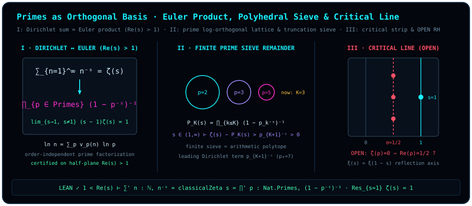

# Chapter 22 Primes as the Orthogonal Basis of Arithmetic: Euler Products and Riemann Zeros

> *"I keep feeling that the essence of the quantum is pairwise comparison: always consistent, independent of order."*

In [Chapter 21](ch21-diagonalization-and-escape.md) we saw that any formal shell attempting to seal all concepts within a fixed finite coordinate system is punctured along the relative semantic diagonal, launching an unending ascent through higher-dimensional spheres. Now let us turn our gaze toward the oldest infinite-dimensional edifice in human thought — **the multiplicative arithmetic of the positive integers** — and ask a direct geometric question:

When we speak of "pairwise comparison, always consistent, independent of order," which numbers inside the multiplicative monoid $\mathbb{N}_{\ge 1}$ actually serve as mutually independent **orthogonal basis axes**?

Along the additive number line, $1, 2, 3, 4, 5, 6, \dots$ look like uniformly spaced ticks on a single one-dimensional rod. Switch from addition to multiplication, however, and $6 = 2 \times 3$ is no longer an independent direction at all — it is the diagonal resultant of axis $2$ and axis $3$, while $12 = 2^2 \times 3$ takes two steps along axis $2$ and one step along axis $3$! By the Fundamental Theorem of Arithmetic (unique prime factorization), every positive integer $n \ge 1$ factors uniquely into prime powers, **always consistent and independent of the order in which the prime factors are multiplied**:

$$
n = \prod_{p \in \mathrm{Primes}} p^{v_p(n)} \quad\Longleftrightarrow\quad \ln n = \sum_{p \in \mathrm{Primes}} v_p(n)\,\ln p.
$$

Look at the geometric structure of that correspondence: unique prime factorization embeds every positive integer $n$ into the countably infinite **formal exponent lattice** $\bigoplus_{p \in \mathrm{Primes}} \mathbb{Z}\vv{e}_p$ spanned by formal basis vectors $\{\vv{e}_p\}_{p \in \mathrm{Primes}}$ (equipped with the formal inner product $\langle \vv{e}_p, \vv{e}_q\rangle = \delta_{pq}$, so that $v_p(n) \in \mathbb{N}$ is the nonnegative integer coordinate of $n$ along the $p$-th formal prime axis $\vv{e}_p$), while taking the natural logarithm defines a linear weight functional $\ln n = \sum_p v_p(n)\,\ln p$ whose weights $\ln 2, \ln 3, \ln 5, \dots$ are linearly independent over $\mathbb{Q}$ — no prime axis casts even the slightest rational divisibility shadow onto any other prime axis (throughout this chapter, our geometric language of "orthogonal prime axes" refers to this formal exponent-lattice basis paired with its $\mathbb{Q}$-linearly independent logarithmic weights).

Guided by this geometric realization of primes as orthogonal axes, this chapter establishes the Lean-verified identities linking the **Dirichlet natural-number series**, the **simple-pole residue at $s = 1$**, and the **Euler prime product** on the half-plane of absolute convergence $\operatorname{Re}(s) > 1$, examines the "polyhedral prime sieve" remainder under finite truncation, and demarcates the exact epistemic boundary separating these proved theorems from the open **Riemann Hypothesis**.

## 22.1 Orthogonal Prime Axes and Canceling Infinity by Factorization {#sec-ch22-1}

Why do the author's foundational notes observe that *"the essence of handling an infinite problem is factorization — seeing how to cancel infinity out"*?

Consider an infinite series summed over all positive integers $n = 1, 2, 3, \dots$. Viewed additively, each term $n^{-s}$ sits entangled with infinitely many composite neighbors. Once we apply order-independent unique prime factorization, however, every composite number $n = p_1^{a_1} \cdots p_r^{a_r}$ resolves into a product of independent components along the prime axes, $n^{-s} = p_1^{-a_1 s} \cdots p_r^{-a_r s}$. At that moment, **the global infinite sum over all natural numbers factorizes into an infinite product of one-dimensional geometric series along the individual prime axes!**

Along each single prime axis $p$, summing over the coordinate ticks $a = 0, 1, 2, 3, \dots$ is nothing more than a geometric series with ratio $p^{-s}$ (satisfying $|p^{-s}| = p^{-\operatorname{Re}(s)} < 1$ whenever $\operatorname{Re}(s) > 1$):

$$
1 + p^{-s} + p^{-2s} + p^{-3s} + \cdots \;=\; \frac{1}{1 - p^{-s}} \;=\; (1 - p^{-s})^{-1}.
$$

In a single algebraic stroke, the infinite sum $1 + p^{-s} + p^{-2s} + \cdots$ along axis $p$ collapses into the closed factor $(1 - p^{-s})^{-1}$! Multiplying those factors across all mutually orthogonal prime axes $p \in \mathrm{Primes}$ traverses every finitely supported exponent vector $(v_2, v_3, v_5, \dots)$ exactly once by the distributive law, identifying the Dirichlet sum over $\mathbb{N}$ with the Euler product over primes.

To state these theorems with complete formal precision in Lean 4, we first record the conventions of module `D5/S3/Weil/Convention`.

::: {.definition #def-classical-zeta title="Formal Convention for the Riemann Zeta Function and Simple-Pole Predicate" lean="D5/S3/Weil/Convention.classicalZeta D5/S3/Zeros/ZetaUpgrade.HasUniqueSimplePoleWithResidue"}
On the complex plane $\mathbb{C}$, let [`classicalZeta`](lean:D5/S3/Weil/Convention.classicalZeta) $: \mathbb{C} \to \mathbb{C}$ denote Mathlib's totalized Riemann zeta function `riemannZeta`. For any complex function $f : \mathbb{C} \to \mathbb{C}$, pole location $z \in \mathbb{C}$, and residue $\mathrm{residue} \in \mathbb{C}$, the predicate [`HasUniqueSimplePoleWithResidue`](lean:D5/S3/Zeros/ZetaUpgrade.HasUniqueSimplePoleWithResidue) $f\ z\ \mathrm{residue}$ is the conjunction of three conditions:

1. **Analyticity away from $z$**: $f$ is complex analytic on a neighborhood of the complement $\{z\}^c = \mathbb{C} \setminus \{z\}$ (`AnalyticOnNhd ℂ f ({z}ᶜ)`);
2. **First Laurent residue limit**: $(s - z)f(s) \to \mathrm{residue}$ along the punctured neighborhood filter $\mathcal{N}_{\neq}(z)$;
3. **Nonzero residue**: $\mathrm{residue} \neq 0$.
:::

## 22.2 Formal Identities for the Residue, Dirichlet Series, and Euler Product {#sec-ch22-2}

Before entering the half-plane $\operatorname{Re}(s) > 1$, we anchor the most prominent landmark of $\zeta(s)$ in the complex plane: its **unique simple pole at $s = 1$**, where the harmonic series diverges with unit residue.

Geometrically, as $s \to 1^+$, the divergence of $\sum_{n=1}^\infty n^{-s}$ reflects the unbounded accumulation of prime amplification factors $(1 - p^{-1})^{-1} = \frac{p}{p-1}$ across infinitely many orthogonal prime axes, scaled by $(s - 1)^{-1}$ with residue exactly $1$.

::: {.lemma #lem-riemann-zeta-residue-one title="Unit Residue of the Riemann Zeta Function at s = 1" lean="D5/S3/Zeros/ZetaIdentities.riemann_zeta_residue_one"}
For the Riemann zeta function $\operatorname{classicalZeta} : \mathbb{C} \to \mathbb{C}$ of [@def-classical-zeta], as $s \in \mathbb{C}$ approaches $1$ along the punctured neighborhood filter $\mathcal{N}_{\neq}(1)$,

$$
\lim_{\substack{s \to 1 \\ s \neq 1}} (s - 1)\,\operatorname{classicalZeta}(s) = 1.
$$
:::

::: proof
Unfolding [`classicalZeta`](lean:D5/S3/Weil/Convention.classicalZeta) in `ZetaIdentities` reduces the claim directly to Mathlib's theorem `riemannZeta_residue_one` (which in `ZetaUpgrade` is combined with analyticity on $\{1\}^c$ to form [`classical_zeta_unique_simple_pole_residue_one`](lean:D5/S3/Zeros/ZetaUpgrade.classical_zeta_unique_simple_pole_residue_one)). The full proof is checked by the Lean kernel.
:::

Now we enter the half-plane of absolute convergence $\operatorname{Re}(s) > 1$ (written explicitly as the hypothesis `hs : 1 < s.re` in Lean). In strict adherence to our formal verification contract, **every series and product theorem below retains the explicit half-plane hypothesis $\operatorname{Re}(s) > 1$**, where absolute convergence makes unconditional summation (`tsum`) and infinite multiplication (`tprod`) completely rigorous and order-independent.

::: {.proposition #prop-riemann-zeta-dirichlet-sum title="Dirichlet Series Representation of the Riemann Zeta Function for Re(s) > 1" lean="D5/S3/Zeros/ZetaIdentities.riemann_zeta_dirichlet_sum"}
Let $s \in \mathbb{C}$ satisfy $\operatorname{Re}(s) > 1$ (`1 < s.re`). Then the unconditionally summable series (`tsum`) over all natural numbers equals $\operatorname{classicalZeta}(s)$:

$$
\sum_{n : \mathbb{N}} (n : \mathbb{C})^{-s} = \operatorname{classicalZeta}(s).
$$
:::

::: proof
When $\operatorname{Re}(s) > 1$, we have $-s \neq 0$, so the $n = 0$ term evaluates to $(0 : \mathbb{C})^{-s} = 0$ in Mathlib's complex power convention; the `ℕ`-indexed `tsum` therefore coincides with the classical Dirichlet series over $n \ge 1$. Unfolding [`classicalZeta`](lean:D5/S3/Weil/Convention.classicalZeta) and applying Mathlib's `tsum_riemannZetaSummand` under `hs : 1 < s.re` yields the identity. The full proof is checked by the Lean kernel.
:::

On the exact same half-plane $\operatorname{Re}(s) > 1$, we now pass from additive summation over $\mathbb{N}$ to multiplicative factorization across `Nat.Primes`.

::: {.theorem #thm-riemann-zeta-euler-product title="Euler Prime Product Representation of the Riemann Zeta Function for Re(s) > 1" lean="D5/S3/Zeros/ZetaIdentities.riemann_zeta_euler_product"}
Let $s \in \mathbb{C}$ satisfy $\operatorname{Re}(s) > 1$ (`1 < s.re`). Then the infinite product (`tprod`) over the type of prime numbers `Nat.Primes` equals $\operatorname{classicalZeta}(s)$:

$$
\prod_{p : \mathrm{Nat.Primes}} \bigl(1 - (p : \mathbb{C})^{-s}\bigr)^{-1} = \operatorname{classicalZeta}(s).
$$
:::

::: proof
Under the half-plane hypothesis `hs : 1 < s.re`, $n \mapsto (n : \mathbb{C})^{-s}$ is a completely multiplicative, absolutely summable arithmetic function. By unique prime factorization and Mathlib's Euler product theorem `riemannZeta_eulerProduct_tprod`, the infinite product of local geometric-series factors $(1 - p^{-s})^{-1} = \sum_{k=0}^\infty p^{-ks}$ over $p : \mathrm{Nat.Primes}$ converges to `riemannZeta s = classicalZeta s`. The full proof is checked by the Lean kernel.
:::

Eliminating the intermediate symbol $\operatorname{classicalZeta}(s)$ joins [@prop-riemann-zeta-dirichlet-sum] and [@thm-riemann-zeta-euler-product] directly on $\operatorname{Re}(s) > 1$: the sum over all natural numbers equals the product over the prime orthogonal basis alone!

::: {.corollary #cor-dirichlet-sum-eq-euler-product title="Equality of the Natural-Number Dirichlet Series and Prime Euler Product for Re(s) > 1" lean="D5/S3/Zeros/ZetaUpgrade.riemann_zeta_dirichlet_sum_eq_euler_product"}
Let $s \in \mathbb{C}$ satisfy $\operatorname{Re}(s) > 1$ (`1 < s.re`). Then the natural-number Dirichlet series equals the prime-indexed Euler product:

$$
\sum_{n : \mathbb{N}} (n : \mathbb{C})^{-s}
\;=\;
\prod_{p : \mathrm{Nat.Primes}} \bigl(1 - (p : \mathbb{C})^{-s}\bigr)^{-1}.
$$
:::

::: proof
Under `hs : 1 < s.re`, transitivity of equality combines [@prop-riemann-zeta-dirichlet-sum] ($\sum'_{n : \mathbb{N}} n^{-s} = \operatorname{classicalZeta}(s)$) with the symmetry of [@thm-riemann-zeta-euler-product] ($\operatorname{classicalZeta}(s) = \prod'_{p : \mathrm{Nat.Primes}} (1 - p^{-s})^{-1}$). The full proof is checked by the Lean kernel.
:::

## 22.3 The Polyhedral Prime Sieve Remainder and Phase-Oscillator Hand Calculation {#sec-ch22-3}

Write the complex exponent as $s = \sigma + it$, where the real part $\sigma = \operatorname{Re}(s)$ governs radial damping and the imaginary part $t = \operatorname{Im}(s)$ governs rotational frequency. Each prime mode in [@cor-dirichlet-sum-eq-euler-product] acts as an independent complex rotor:

$$
p^{-s} = p^{-\sigma - it} = p^{-\sigma} e^{-i t \ln p} = p^{-\sigma}\bigl(\cos(t\ln p) - i\sin(t\ln p)\bigr).
$$

In the complex plane, each prime $p$ is an **independent phase clock** spinning at its intrinsic logarithmic angular frequency $\omega_p = \ln p$! Because the prime logarithms $\ln 2, \ln 3, \ln 5, \dots$ are linearly independent over $\mathbb{Q}$, their periods are mutually incommensurable — like an infinite gyroscope whose orthogonal rings wind densely across a high-dimensional torus by Kronecker's theorem.

Now apply the anti-Platonic lens of the [Prelude](README.md) and [Chapter 21](ch21-diagonalization-and-escape.md): what happens when a finite algorithm retains only the **first $K$ prime axes** $\{p_1, p_2, \dots, p_K\}$, building a finite-dimensional "**polyhedral prime sieve**" $P_K(s) = \prod_{k=1}^K (1 - p_k^{-s})^{-1}$? Let us work out the $K = 3$ sieve ($p \in \{2, 3, 5\}$) by hand and watch the first unfactored prime leak through the seam.

::: {.example #ex-prime-log-orthogonality-and-sieve title="Hand Calculation of the 3-Prime Euler Sieve (2, 3, 5) and the First Leaked Prime 7"}
For $\operatorname{Re}(s) > 1$, retain only the first $K = 3$ primes $p_1 = 2, p_2 = 3, p_3 = 5$ (the three orthogonal logarithmic axes $\ln 2, \ln 3, \ln 5$) and expand the truncated Euler product $P_{\le 5}(s)$:

$$
\begin{aligned}
P_{\le 5}(s)
&= (1 - 2^{-s})^{-1}(1 - 3^{-s})^{-1}(1 - 5^{-s})^{-1} \\
&= \bigl(1 + 2^{-s} + 4^{-s} + 8^{-s} + \cdots\bigr)\bigl(1 + 3^{-s} + 9^{-s} + \cdots\bigr)\bigl(1 + 5^{-s} + \cdots\bigr) \\
&= 1 + 2^{-s} + 3^{-s} + 4^{-s} + 5^{-s} + 6^{-s} + 8^{-s} + 9^{-s} + 10^{-s} + 12^{-s} + \cdots
\end{aligned}
$$

Subtract this three-axis arithmetic polytope $P_{\le 5}(s)$ from the full zeta series $\zeta(s) = \sum_{n=1}^\infty n^{-s}$. Between $1$ and $10$, every integer generated by $\{2, 3, 5\}$ — namely $1, 2, 3, 4 = 2^2, 5, 6 = 2\times 3, 8 = 2^3, 9 = 3^2, 10 = 2\times 5$ — cancels identically, leaving the exact truncation remainder Dirichlet series on $\operatorname{Re}(s) > 1$ (writing $P^+(n)$ for the largest prime factor of $n$):

$$
R_{> p_K}(s) \;:=\; \zeta(s) - \prod_{k=1}^K (1 - p_k^{-s})^{-1} \;=\; \sum_{\substack{n \ge 2 \\ P^+(n) > p_K}} n^{-s} \;=\; p_{K+1}^{-s} + \cdots
$$

For $K = 3$, the very first surviving term of the remainder series is **$7^{-s}$**! Because its leading Dirichlet coefficient at $n = p_{K+1}$ is $1 \neq 0$, $R_{> p_K}(s)$ is not identically zero on $\operatorname{Re}(s) > 1$; and **for every real exponent $s \in (1, \infty)$**, every omitted term $n^{-s} > 0$ is strictly positive with no oscillatory phase cancellation (whereas for complex $s = \sigma + it$ with $t \neq 0$, the phases $n^{-it}$ can interfere and cancel at isolated complex points), so on the real half-line $s > 1$ one has the pointwise strict inequality

$$
R_{> p_K}(s) \;>\; p_{K+1}^{-s} \;>\; 0 \qquad (\forall s \in \mathbb{R},\; s > 1).
$$

Check the numbers at the real point $s = 2$ ($s > 1$), where Euler's Basel identity gives $\zeta(2) = \frac{\pi^2}{6} \approx 1.644934$, while the three-prime product equals

$$
P_{\le 5}(2) = \frac{1}{1 - 1/4}\cdot\frac{1}{1 - 1/9}\cdot\frac{1}{1 - 1/25} = \frac{4}{3}\times\frac{9}{8}\times\frac{25}{24} = \frac{25}{16} = 1.5625.
$$

The strictly positive discrepancy $R_{> 5}(2) = \zeta(2) - P_{\le 5}(2) \approx 0.082434 > 0$ is led by the fourth orthogonal prime axis $7^{-2} = \frac{1}{49} \approx 0.020408$ (followed by $11^{-2} = \frac{1}{121} \approx 0.008264$, $13^{-2} = \frac{1}{169} \approx 0.005917$, and the mixed composite $14^{-2} = (2\times 7)^{-2} = \frac{1}{196} \approx 0.005102$).
:::

Notice the exact structural parallel between [@ex-prime-log-orthogonality-and-sieve] and the Euclidean–Gödelian escape of [Chapter 21](ch21-diagonalization-and-escape.md): any finite prime sieve spanned by $K$ prime axes $\{p_1, \dots, p_K\}$ is an arithmetic polytope whose remainder series $R_{> p_K}(s)$ leaks immediately at $n = p_{K+1}$ (and is strictly positive, $R_{> p_K}(s) > p_{K+1}^{-s} > 0$, for every real $s > 1$). Eliminating that leading term requires adjoining $p_{K+1}$ as a new orthogonal axis — and because the primes are inexhaustible, no finite truncation ever seals the arithmetic sphere.

> Composite numbers are the diagonal lattice points of the prime basis; Euler's product simply projects an entangled sum along the natural-number line onto its mutually orthogonal prime axes.

## 22.4 The Critical Symmetry Line $\sigma = 1/2$ and the Epistemic Boundary of the Riemann Hypothesis {#sec-ch22-4}

Inside the half-plane $\operatorname{Re}(s) > 1$, absolute convergence of the Euler product $\prod_p (1 - p^{-s})^{-1}$ ensures that $\zeta(s)$ never vanishes. Once $\zeta(s)$ is analytically continued leftward across the simple pole at $s = 1$ ([@lem-riemann-zeta-residue-one]) into the **critical strip** $0 < \operatorname{Re}(s) < 1$, however, the Dirichlet series and Euler product no longer converge absolutely; instead, coherent interference among the prime phase oscillators $p^{-\sigma} e^{-it\ln p}$ produces points of complete destructive cancellation where $\zeta(\rho) = 0$.

Why does every nontrivial zero ever computed lie on the vertical **critical line** $\operatorname{Re}(s) = \frac{1}{2}$ (recorded in `D5/S3/Weil/Convention` as the self-dual abscissa [`criticalAbscissa`](lean:D5/S3/Weil/Convention.criticalAbscissa) $= 1/2$)?

Geometrically, Riemann's completed zeta function $\xi(s) = \frac{1}{2}s(s-1)\pi^{-s/2}\Gamma(s/2)\zeta(s)$ obeys the reflection symmetry $\xi(s) = \xi(1 - s)$, whose fixed locus under $s \leftrightarrow 1 - \bar{s}$ is precisely the vertical axis $\operatorname{Re}(s) = \frac{1}{2}$ — the Fourier-dual balance line between primal scale and spectral frequency.

Yet aesthetic symmetry is not a proof. In strict compliance with our three-tier epistemic contract (`OPEN`), we state the Riemann Hypothesis as an open conjecture (carrying no `lean` attribute), followed by a literature audit delineating what the four frozen Lean theorems above do and do not certify.

::: {.conjecture #conj-riemann-hypothesis title="The Riemann Hypothesis"}
Every nontrivial zero of the analytically continued Riemann zeta function $\zeta(s)$ (that is, every zero $\rho \in \mathbb{C}$ lying in the critical strip $0 < \operatorname{Re}(\rho) < 1$) has real part equal to $\frac{1}{2}$:

$$
\forall \rho \in \mathbb{C},\qquad \bigl(0 < \operatorname{Re}(\rho) < 1 \;\land\; \zeta(\rho) = 0\bigr) \;\Longrightarrow\; \operatorname{Re}(\rho) = \frac{1}{2}.
$$

*(This statement is **OPEN**; the block intentionally carries no `lean` attribute.)*
:::

::: {.remark #rem-euler-zeta-literature title="Audit of Certified Half-Plane Identities vs. Analytic Continuation and the Riemann Hypothesis (Literature Result, Not Formalized in This Book)"}
**Literature result, not formalized in this book.** Readers should keep the three epistemic layers of this chapter sharply distinct:

1. **Kernel-verified frozen theorems in this book (`LEAN ✓`)**: The four formal blocks above — the unit residue at $s = 1$ ([@lem-riemann-zeta-residue-one]), the Dirichlet series identity on $\operatorname{Re}(s) > 1$ ([@prop-riemann-zeta-dirichlet-sum]), the Euler prime product identity on $\operatorname{Re}(s) > 1$ ([@thm-riemann-zeta-euler-product]), and their direct equality on $\operatorname{Re}(s) > 1$ ([@cor-dirichlet-sum-eq-euler-product]) — are fully verified by the Lean kernel. Note that the Euler product is invoked solely inside the absolute-convergence half-plane `1 < s.re` ($\operatorname{Re}(s) > 1$) supplied by the Lean hypotheses.
2. **Classical theorems of analytic number theory (proved in the literature, not formalized in this book)**:
   - **Analytic continuation and functional equation (Riemann, 1859)**: $\zeta(s)$ extends meromorphically to $\mathbb{C}$ with a single simple pole at $s = 1$, and the completed function $\xi(s) = \frac{1}{2}s(s-1)\pi^{-s/2}\Gamma(s/2)\zeta(s)$ is entire and satisfies $\xi(s) = \xi(1 - s)$, with trivial zeros of $\zeta(s)$ at $s = -2, -4, -6, \dots$;
   - **Nonvanishing on the line $\operatorname{Re}(s) = 1$ and the Prime Number Theorem (Hadamard, de la Vallée Poussin, 1896)**: $\zeta(1 + it) \neq 0$ for all nonzero real $t \in \mathbb{R} \setminus \{0\}$ (while $t = 0$, i.e. $s = 1$, is the simple pole), implying the Prime Number Theorem $\pi(x) \sim \frac{x}{\ln x}$;
   - **Explicit formulas (von Mangoldt, Weil)**: Fourier duality pairing prime-power logarithmic weights $\Lambda(n)$ with the spectral sum over nontrivial zeros $\rho$.
3. **Open conjecture (`OPEN`)**: [@conj-riemann-hypothesis] asserts that all nontrivial zeros lie on $\operatorname{Re}(\rho) = 1/2$ (equivalently $\pi(x) = \operatorname{Li}(x) + O(x^{1/2}\ln x)$). The four frozen theorems of this chapter certify the residue and the sum–product identity on $\operatorname{Re}(s) > 1$; they **do not certify the Riemann Hypothesis**.
:::

From the concept fibers of [Chapter 21](ch21-diagonalization-and-escape.md) to the prime orthogonal axes of this chapter, we have seen the rigid crystal structure of the integers $\mathbb{Z}$. What happens, however, when $\mathbb{Z}$ is submerged inside the dense continuum of the rational field $\mathbb{Q}$, where infinitely many fractions crowd between any two integers? Can first-order polynomial equations over $\mathbb{Q}$ still isolate the discrete integer skeleton $\mathbb{Z} \subset \mathbb{Q}$ — and why does the modern lock that achieves this rely on **quaternion norm spheres** and quadratic trace projections? Let us turn to [Chapter 23](ch23-diophantine-definability.md).
