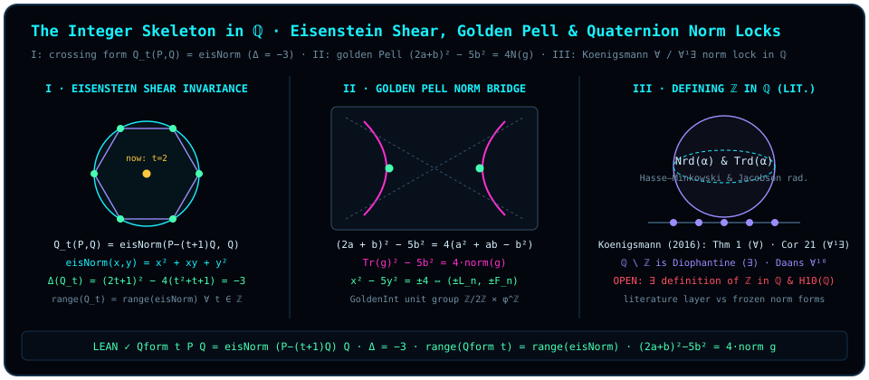

# Chapter 23 The Integer Skeleton Inside the Rationals: Quaternion Norms and Diophantine Definability

> *"The integers are Diophantine in the rationals; look up the latest research and analyse it together."*

In [Chapter 1](ch01-measurement.md) we asked how a continuously rotating arrow on a sphere produces discrete clicks (*liàng*) when passed through a one-dimensional shutter. Now let us pose the exact same geometric question inside the heart of number theory and mathematical logic:

Consider the field of rational numbers $\mathbb{Q}$. Between any two rationals $r_1 < r_2$ lie infinitely many further rationals $\frac{r_1 + r_2}{2}$; addition and multiplication are smoothly invertible everywhere away from zero, leaving no visible "steps" or "grid lines" at first glance. Yet submerged right inside this dense rational continuum sits an unyielding **discrete skeleton of integers** $\mathbb{Z} = \{\dots, -2, -1, 0, 1, 2, \dots\} \subset \mathbb{Q}$!

Suppose you are handed only the ring operations $+$ and $\times$, the constants $0$ and $1$, and first-order logical quantifiers over $\mathbb{Q}$ (the first-order language of fields $\mathcal{L}_{\mathrm{ring}} = \{+, -, \times, 0, 1\}$), with no external predicate telling you whether a numerator is divisible by a denominator. Can polynomial equations over $\mathbb{Q}$ alone sift the discrete integers $\mathbb{Z}$ out of the dense ocean of rationals?

What makes the answer deeply geometric is the tool that modern number theorists — from Julia Robinson (1949) and Bjorn Poonen (2009) to Jochen Koenigsmann's landmark 2016 theorem — use to lock $\mathbb{Z}$ inside $\mathbb{Q}$: **the reduced norm sphere $\operatorname{Nrd}(\alpha)$ and reduced trace projection $\operatorname{Trd}(\alpha)$ of quaternion algebras**, together with discriminant invariants of quadratic norm forms!

Following this geometric thread, this chapter first establishes four Lean-verified theorems governing two foundational quadratic integer norm locks — the one-parameter **Eisenstein (Löschian) crossing norm form** of constant discriminant $\Delta = -3$, and the **Golden Pell trace–norm identity** of discriminant $\Delta = +5$ — and then conducts a rigorous epistemic audit of Koenigsmann's 2016 theorem (*Defining $\mathbb{Z}$ in $\mathbb{Q}$*), explaining the critical boundary between universal ($\forall$), universal-existential ($\forall\exists$), and existential Diophantine ($\exists$) definitions and their connection to Hilbert's Tenth Problem over $\mathbb{Q}$ ($\mathrm{H10}(\mathbb{Q})$).

## 23.1 How Discrete Lattices Hide Inside a Continuum: Quadratic Norms and Trace Projections {#sec-ch23-1}

Why can linear equations $ax + b = 0$ never isolate $\mathbb{Z}$ inside $\mathbb{Q}$? Because linear equations are scale-fragile over a field: any nonzero denominator can be divided out. To obstruct arbitrary rational denominators using only field arithmetic, one must turn to **quadratic norm forms** — just as on the Bloch sphere, linear coordinates alone do not fix the state surface until the quadratic norm constraint $x_0^2 + x_1^2 + x_2^2 + x_3^2 = 1$ locks vectors onto the unit sphere!

In quadratic integer rings and quaternion orders, every algebraic element $g$ carries two canonical coordinate-free geometric invariants (matching the trace and determinant of $2\times 2$ matrices studied in [Chapter 1](ch01-measurement.md) and Part VII):

1. **Trace projection** $\operatorname{Tr}(g) = g + \bar{g}$: twice the orthogonal projection of the element onto the real identity axis (corresponding to the scalar part $2\cos(\theta/2)$ of a rotor);
2. **Norm** $\operatorname{N}(g) = g\bar{g}$: the quadratic squared length formed by multiplying the element with its conjugate.

When the norm $\operatorname{N}(g)$ is pinned to a discrete integer value (such as the unit circle or hyperbola $\operatorname{N}(g) = \pm 1$), the trace projection $\operatorname{Tr}(g)$ is quantized onto a discrete lattice of algebraic integers!

Let us begin with the most symmetric two-dimensional lattice in the complex plane: the **Eisenstein integer ring** $\mathbb{Z}[\omega]$ generated by the primitive cube root of unity $\omega = e^{2\pi i/3} = \frac{-1 + i\sqrt{3}}{2}$ ($\omega^2 + \omega + 1 = 0$), which tiles the plane in $60^\circ$ equilateral triangles.

In the Lean module `D5/S3/PrimeForms/Crossing/CrossingNormForm`, we study the principal Eisenstein (Löschian) norm form alongside a **one-parameter family of crossing binary quadratic forms** indexed by an arbitrary integer $t \in \mathbb{Z}$.

::: {.definition #def-qform-and-eisnorm title="One-Parameter Crossing Form Qform and Principal Eisenstein Norm Form eisNorm" lean="D5/S3/PrimeForms/Crossing/CrossingNormForm.Qform D5/S3/PrimeForms/Crossing/CrossingNormForm.eisNorm"}
For any integers $t, P, Q, x, y \in \mathbb{Z}$, define:

1. **One-parameter crossing quadratic form** [`Qform`](lean:D5/S3/PrimeForms/Crossing/CrossingNormForm.Qform):

   $$
   \operatorname{Qform}(t, P, Q) \;:=\; P^2 - (2t + 1)PQ + (t^2 + t + 1)Q^2 \in \mathbb{Z} \,;
   $$

2. **Principal Eisenstein (Löschian) norm form** [`eisNorm`](lean:D5/S3/PrimeForms/Crossing/CrossingNormForm.eisNorm) (the algebraic norm of $x - y\omega \in \mathbb{Z}[\omega]$):

   $$
   \operatorname{eisNorm}(x, y) \;:=\; x^2 + xy + y^2 \in \mathbb{Z}.
   $$
:::

At first glance, as the parameter $t \in \mathbb{Z}$ varies over infinitely many integers, the coefficients of $\operatorname{Qform}(t, P, Q) = P^2 - (2t+1)PQ + (t^2+t+1)Q^2$ grow quadratically in $t$, appearing to define infinitely many distinct quadratic forms. Viewed through the geometry of unimodular shear transformations in $\mathrm{SL}_2(\mathbb{Z})$, however, this entire infinite family is **the exact same hexagonal norm sphere** viewed in sheared bases!

## 23.2 Formal Proofs of Eisenstein Shear Invariance and the Golden Pell Identity {#sec-ch23-2}

Three kernel-verified theorems in `CrossingNormForm` establish the unimodular shear reduction, constant discriminant $\Delta = -3$, and identical value range of $\operatorname{Qform}(t, \cdot, \cdot)$.

::: {.theorem #thm-qform-eq-eisnorm title="Unimodular Shear Reduction of the Crossing Form to the Principal Eisenstein Norm" lean="D5/S3/PrimeForms/Crossing/CrossingNormForm.Qform_eq_eisNorm"}
For all integers $t, P, Q \in \mathbb{Z}$, the crossing form $\operatorname{Qform}(t, P, Q)$ reduces under the explicit unimodular substitution $(P, Q) \mapsto (P - (t + 1)Q,\; Q)$ to the principal Eisenstein norm form:

$$
\operatorname{Qform}(t, P, Q) \;=\; \operatorname{eisNorm}\bigl(P - (t + 1)Q,\; Q\bigr).
$$
:::

::: proof
Expanding the right-hand side according to [@def-qform-and-eisnorm] with $x = P - (t + 1)Q$ and $y = Q$ gives

$$
\begin{aligned}
\operatorname{eisNorm}\bigl(P - (t + 1)Q,\; Q\bigr)
&= \bigl(P - (t + 1)Q\bigr)^2 + \bigl(P - (t + 1)Q\bigr)Q + Q^2 \\
&= P^2 - 2(t + 1)PQ + (t + 1)^2 Q^2 + PQ - (t + 1)Q^2 + Q^2 \\
&= P^2 - (2t + 1)PQ + \bigl((t^2 + 2t + 1) - (t + 1) + 1\bigr)Q^2 \\
&= P^2 - (2t + 1)PQ + (t^2 + t + 1)Q^2 = \operatorname{Qform}(t, P, Q).
\end{aligned}
$$

In Lean, unfolding `Qform` and `eisNorm` followed by `ring` verifies the identity directly. The full proof is checked by the Lean kernel.
:::

Why does the integer shear $\begin{pmatrix} 1 & -(t+1) \\ 0 & 1 \end{pmatrix} \in \mathrm{SL}_2(\mathbb{Z})$ collapse $\operatorname{Qform}(t, P, Q)$ back to $x^2 + xy + y^2$ for every $t \in \mathbb{Z}$? Because its discriminant $\Delta = b^2 - 4ac$ is locked identically at $-3$, independent of $t$.

::: {.lemma #lem-qform-discriminant title="Constant Discriminant Δ = −3 of the Crossing Form Family" lean="D5/S3/PrimeForms/Crossing/CrossingNormForm.Qform_discriminant"}
For every integer $t \in \mathbb{Z}$, the discriminant of $\operatorname{Qform}(t, P, Q)$ is identically $-3$:

$$
(2t + 1)^2 - 4(t^2 + t + 1) = -3.
$$
:::

::: proof
Expanding $(2t + 1)^2 - 4(t^2 + t + 1) = (4t^2 + 4t + 1) - (4t^2 + 4t + 4)$ cancels $4t^2$ and $4t$ identically, leaving $-3$. The full proof is checked by the Lean kernel.
:::

Because the shear map $(P, Q) \mapsto (P - (t+1)Q, Q)$ is a bijection on $\mathbb{Z} \times \mathbb{Z}$ with explicit integer inverse $(x, y) \mapsto (x + (t+1)y, y)$, the set of integers represented by $\operatorname{Qform}(t, \cdot, \cdot)$ is independent of $t$ and coincides with the set of Eisenstein/Löschian norms.

::: {.corollary #cor-qform-range-eq-eisnorm title="Range Invariance: Every Crossing Form Represents Exactly the Eisenstein Norms" lean="D5/S3/PrimeForms/Crossing/CrossingNormForm.Qform_range_eq_eisNorm"}
For every integer $t \in \mathbb{Z}$, the range (`Set.range`) of $(P, Q) \mapsto \operatorname{Qform}(t, P, Q)$ on $\mathbb{Z} \times \mathbb{Z}$ equals the range of $(x, y) \mapsto \operatorname{eisNorm}(x, y)$:

$$
\operatorname{ Set.range }\bigl(\lambda p : \mathbb{Z} \times \mathbb{Z} \Rightarrow \operatorname{Qform}(t, p.1, p.2)\bigr)
\;=\;
\operatorname{ Set.range }\bigl(\lambda p : \mathbb{Z} \times \mathbb{Z} \Rightarrow \operatorname{eisNorm}(p.1, p.2)\bigr).
$$
:::

::: proof
By set extensionality: ($\subseteq$) if $n = \operatorname{Qform}(t, P, Q)$, then [@thm-qform-eq-eisnorm] gives $n = \operatorname{eisNorm}(P - (t+1)Q, Q)$ in the right-hand range; ($\supseteq$) if $n = \operatorname{eisNorm}(x, y)$, evaluating $\operatorname{Qform}(t, x + (t+1)y, y)$ via [@thm-qform-eq-eisnorm] and cancelling $(x + (t+1)y) - (t+1)y = x$ yields $\operatorname{eisNorm}(x, y) = n$. The full proof is checked by the Lean kernel.
:::

Alongside the positive-definite hexagonal norm lock of discriminant $\Delta = -3 < 0$, let us examine the **indefinite hyperbolic norm lock** of discriminant $\Delta = +5 > 0$ in the real quadratic ring of golden integers $\mathbb{Z}[\varphi]$ (where $\varphi = \frac{1 + \sqrt{5}}{2}$ satisfies $\varphi^2 = \varphi + 1$, whose uniqueness as a positive fixed point of $x \mapsto 1 + 1/x$ will be proved in [Chapter 24](ch24-cosine-fixed-points-and-self-reference.md)).

In `D5/S0/Carrier/Ring` and `D5/S0/Carrier/Norm`, golden integers and their field norm are formalized as follows.

::: {.definition #def-golden-int-and-norm title="The Golden Integer Ring GoldenInt and Its Quadratic Norm" lean="D5/S0/Carrier/Ring.GoldenInt D5/S0/Carrier/Norm.norm"}
A **golden integer** (the structure [`GoldenInt`](lean:D5/S0/Carrier/Ring.GoldenInt) in Lean) is a pair of integers $(a, b) \in \mathbb{Z} \times \mathbb{Z}$ representing $g = a + b\varphi \in \mathbb{Z}[\varphi]$, with componentwise addition and multiplication reduced by $\varphi^2 = \varphi + 1$:

$$
(a_1, b_1) \cdot (a_2, b_2) \;:=\; \bigl(a_1 a_2 + b_1 b_2,\; a_1 b_2 + b_1 a_2 + b_1 b_2\bigr).
$$

For any $g = (a, b) \in \mathrm{GoldenInt}$, its **golden norm** ([`norm`](lean:D5/S0/Carrier/Norm.norm) $g$, equal to the product of $g$ with its Galois conjugate $\bar{g} = (a + b) - b\varphi$) is

$$
\operatorname{norm}(g) \;:=\; a^2 + ab - b^2 \in \mathbb{Z}.
$$
:::

Because $\varphi + \bar{\varphi} = 1$, the **algebraic trace** of $g = a + b\varphi$ is the integer linear combination $\operatorname{trace}(g) = g + \bar{g} = 2a + b$. Subtracting $5b^2$ from the squared trace $(2a + b)^2$ yields the **Golden Pell identity** bridging trace coordinates and the quadratic norm.

::: {.proposition #prop-pell-form-eq-four-mul-norm title="The Golden Pell Discriminant Form Equals Four Times the Golden Norm" lean="D5/S3/Arith/GoldenPell.pell_form_eq_four_mul_norm"}
For every golden integer $g = (a, b) \in \mathrm{GoldenInt}$, the Pell quadratic form in the trace coordinate $2a + b$ and second coordinate $b$ equals four times $\operatorname{norm}(g)$:

$$
(2a + b)^2 - 5b^2 \;=\; 4\,\operatorname{norm}(g).
$$
:::

::: proof
Unfolding `norm_def` from [@def-golden-int-and-norm] gives $4\,\operatorname{norm}(g) = 4(a^2 + ab - b^2) = 4a^2 + 4ab - 4b^2$, which matches the expansion $(2a + b)^2 - 5b^2 = (4a^2 + 4ab + b^2) - 5b^2 = 4a^2 + 4ab - 4b^2$ in $\mathbb{Z}$. The full proof is checked by the Lean kernel.
:::

In `GoldenPell`, [@prop-pell-form-eq-four-mul-norm] serves as the exact bridge for the theorem [`pell_pm_four_iff_signed_lucas_fib`](lean:D5/S3/Arith/GoldenPell.pell_pm_four_iff_signed_lucas_fib): an integer pair $(x, y) \in \mathbb{Z}^2$ satisfies the Pell equation

$$
x^2 - 5y^2 = \pm 4
$$

**if and only if** $g = \bigl(\frac{x-y}{2}, y\bigr) \in \mathrm{GoldenInt}$ is a unit of norm $\operatorname{norm}(g) = \pm 1$ ([`isUnit_iff_norm_eq_one_or_neg_one`](lean:D5/S0/Carrier/Units.isUnit_iff_norm_eq_one_or_neg_one)), which holds **if and only if** $(x, y) = (\pm L_n, \pm F_n)$ is a simultaneously signed integer-indexed Lucas–Fibonacci pair!

Let us test both quadratic norm locks ($\Delta = -3$ and $\Delta = +5$) by hand on concrete integer coordinates.

::: {.example #ex-eisenstein-and-golden-pell-lattice title="Explicit Calculation of the Eisenstein Shear (t = 2) and Golden Pell Lucas–Fibonacci Lattice"}
**Part 1: $\Delta = -3$ Eisenstein crossing shear at $t = 2$.** From [@def-qform-and-eisnorm], setting $t = 2$ gives

$$
\operatorname{Qform}(2, P, Q) = P^2 - 5PQ + 7Q^2, \qquad \Delta = 5^2 - 4\times 7 = 25 - 28 = -3.
$$

At $(P, Q) = (8, 3)$, direct evaluation gives $\operatorname{Qform}(2, 8, 3) = 64 - 120 + 63 = 7$. Applying the unimodular shear of [@thm-qform-eq-eisnorm], $x = P - (t+1)Q = 8 - 3\times 3 = -1$ and $y = Q = 3$, immediately recovers the principal hexagonal norm:

$$
\operatorname{eisNorm}(-1, 3) = (-1)^2 + (-1)(3) + 3^2 = 1 - 3 + 9 = 7!
$$

For every $t \in \mathbb{Z}$, the represented values remain locked onto the Löschian norm set $\{0, 1, 3, 4, 7, 9, 12, 13, 16, 19, 21, \dots\}$.

**Part 2: $\Delta = +5$ Golden Pell hyperbola and Lucas–Fibonacci pairs.** Evaluate powers of the fundamental unit $\varphi^n = a_n + b_n\varphi \in \mathrm{GoldenInt}$:

| Index $n$ | Golden Coordinates $g_n = (a_n, b_n)$ | Norm $\operatorname{norm}(g_n) = a_n^2 + a_n b_n - b_n^2$ | Trace $x_n = 2a_n + b_n = L_n$ | Second Coord $y_n = b_n = F_n$ | Pell Identity $x_n^2 - 5y_n^2 = 4\operatorname{norm}(g_n)$ |
| :---: | :---: | :---: | :---: | :---: | :---: |
| $0$ | $(1, 0)$ | $+1$ | $2(1)+0 = 2$ | $0$ | $2^2 - 5(0)^2 = +4$ |
| $1$ | $(0, 1)$ | $-1$ | $2(0)+1 = 1$ | $1$ | $1^2 - 5(1)^2 = -4$ |
| $2$ | $(1, 1)$ | $+1$ | $2(1)+1 = 3$ | $1$ | $3^2 - 5(1)^2 = +4$ |
| $3$ | $(1, 2)$ | $-1$ | $2(1)+2 = 4$ | $2$ | $4^2 - 5(2)^2 = -4$ |
| $4$ | $(2, 3)$ | $+1$ | $2(2)+3 = 7$ | $3$ | $7^2 - 5(3)^2 = +4$ |
| $5$ | $(3, 5)$ | $-1$ | $2(3)+5 = 11$ | $5$ | $11^2 - 5(5)^2 = -4$ |

Pinning the golden norm to $\operatorname{norm}(g) = \pm 1$ via [@prop-pell-form-eq-four-mul-norm] locks $(x, y) = (2a + b, b)$ onto the discrete Lucas–Fibonacci lattice $(L_n, F_n)$!
:::

## 23.3 From Binary Quadratic Forms to Quaternion Norm Spheres: Defining $\mathbb{Z}$ in $\mathbb{Q}$ {#sec-ch23-3}

How does modern arithmetic geometry scale this norm-and-trace locking mechanism up from two-dimensional quadratic fields to four-dimensional **quaternion algebras** over $\mathbb{Q}$, isolating $\mathbb{Z}$ inside $\mathbb{Q}$?

In a four-dimensional quaternion algebra over $\mathbb{Q}$,

$$
H_{a, b}(\mathbb{Q}) \;=\; \mathbb{Q} \oplus \mathbb{Q}\mathbf{i} \oplus \mathbb{Q}\mathbf{j} \oplus \mathbb{Q}\mathbf{k} \qquad (\mathbf{i}^2 = a,\; \mathbf{j}^2 = b,\; \mathbf{i}\mathbf{j} = -\mathbf{j}\mathbf{i} = \mathbf{k}),
$$

every quaternion $\alpha = x_0 + x_1\mathbf{i} + x_2\mathbf{j} + x_3\mathbf{k} \in H_{a,b}(\mathbb{Q})$ carries a **reduced trace** and a quaternary quadratic **reduced norm**:

$$
\operatorname{Trd}(\alpha) = \alpha + \bar{\alpha} = 2x_0, \qquad
\operatorname{Nrd}(\alpha) = \alpha\bar{\alpha} = x_0^2 - a x_1^2 - b x_2^2 + ab x_3^2.
$$

Why do quaternion norm forms succeed globally over $\mathbb{Q}$ where binary quadratic forms alone do not suffice?

1. **The Hasse–Minkowski local-global principle and controlled ramification**: By the Hasse–Minkowski theorem, a quaternary quadratic form represents zero over $\mathbb{Q}$ if and only if it represents zero over $\mathbb{R}$ and over every $p$-adic completion $\mathbb{Q}_p$. Varying the parameters $(a, b) \in \mathbb{Q}^\times \times \mathbb{Q}^\times$ controls the finite set of primes $p$ at which $H_{a,b}(\mathbb{Q})$ ramifies (becomes a division algebra whose norm sphere has no nontrivial rational zeros), allowing $p$-adic valuation integrality $t \in \mathbb{Z}_{(p)}$ (no factor of $p$ in the denominator of $t$) to be encoded into quaternion norm-trace conditions!
2. **Intersecting all prime locks $\bigcap_p \mathbb{Z}_{(p)} = \mathbb{Z}$**: Using quadratic reciprocity and trace-norm sets of quaternion orders, Julia Robinson (1949), Bjorn Poonen (2009), and Jochen Koenigsmann (2016) showed how a single first-order formula quantifying over rational parameters sweeps across all primes $p$ simultaneously, intersecting the local valuation rings $\bigcap_{p} \mathbb{Z}_{(p)}$ down to the global integers $\mathbb{Z}$!

At this point, epistemic rigor demands that we draw a crystal-clear line between **existential Diophantine definability ($\exists$)** and **first-order definability ($\forall$, $\forall\exists$)**.

::: {.remark #rem-diophantine-z-in-q-literature title="Koenigsmann (2016) on Defining ℤ in ℚ, Quantifier Complexity, Quaternion Norm Locks, and H10(ℚ) (Literature Result, Not Formalized in This Book)"}
**Literature result, not formalized in this book.** To analyze the research landscape around defining $\mathbb{Z}$ in $\mathbb{Q}$ accurately and align it with our formal verification contract, three distinctions are essential:

1. **Existential Diophantine ($\exists$) vs. first-order ($\forall, \forall\exists$) definability and Hilbert's Tenth Problem over $\mathbb{Q}$**:
   - Strictly speaking, a subset $S \subseteq \mathbb{Q}$ is **Diophantine (existentially definable, $\exists$)** over $\mathbb{Q}$ if there exists a polynomial $P(t, x_1, \dots, x_m) \in \mathbb{Z}[t, x_1, \dots, x_m]$ such that

     $$
     t \in S \quad\Longleftrightarrow\quad \exists x_1, \dots, x_m \in \mathbb{Q},\; P(t, x_1, \dots, x_m) = 0.
     $$

   - A subset defined using both universal ($\forall$) and existential ($\exists$) quantifiers is **first-order definable** in the language of fields. The quantifier pattern is crucial: by the Matiyasevich–Robinson–Davis–Putnam theorem (1970), Hilbert's Tenth Problem over $\mathbb{Z}$ ($\mathrm{H10}(\mathbb{Z})$) is undecidable. If $\mathbb{Z}$ had a purely existential ($\Sigma_1$, i.e., $\exists$) Diophantine definition in $\mathbb{Q}$, any polynomial system over $\mathbb{Z}$ would translate into an existential polynomial system over $\mathbb{Q}$, immediately proving that $\mathrm{H10}(\mathbb{Q})$ is undecidable! Conversely, as explained in Bjorn Poonen's survey *"Mazur's work relating logic and arithmetic geometry"*, **Mazur's conjecture on the real topology of rational points** (which predicts that for any variety $V/\mathbb{Q}$, the topological closure of $V(\mathbb{Q})$ inside $V(\mathbb{R})$ has at most finitely many connected components) would **rule out** any existential Diophantine ($\Sigma_1$) definition of $\mathbb{Z}$ in $\mathbb{Q}$ (since $\mathbb{Z} \subset \mathbb{R}$ has infinitely many real connected components)! **Whether $\mathbb{Z}$ is existentially ($\exists$) Diophantine in $\mathbb{Q}$ — and whether $\mathrm{H10}(\mathbb{Q})$ is decidable — remains OPEN.**
2. **The quantifier-compression milestones of Robinson (1949), Poonen (2009), Koenigsmann (2016), and subsequent papers**:
   - **Julia Robinson (1949, *Journal of Symbolic Logic* 14(2), 98–114, "Definability and decision problems in arithmetic")**: gave the first first-order definition of $\mathbb{Z}$ in $\mathbb{Q}$ using quadratic forms and Hasse–Minkowski local-global conditions, with a $\Pi_3$ ($\forall\exists\forall$, three-block alternating) quantifier prefix;
   - **Bjorn Poonen (2009, *American Journal of Mathematics* 131(3), 675–682, "Characterizing integers among rational numbers with a universal-existential formula")**: used quaternion algebras to compress the definition of $\mathbb{Z}$ in $\mathbb{Q}$ to a $\Pi_2$ ($\forall^2\exists^7$) formula with $2$ universal and $7$ existential quantifiers;
   - **Jochen Koenigsmann (2016, *Annals of Mathematics* 183(1), 73–93, "Defining $\mathbb{Z}$ in $\mathbb{Q}$", `arXiv:1011.3424`)**: using quaternary quadratic forms / quaternion algebras, the Hasse–Minkowski local-global principle, existential definability of the **Jacobson radical** (§2 Step 3 of his proof), and quadratic reciprocity, proved **two distinct results**:
     1. **Theorem 1 ($\Pi_1$ universal definition of $\mathbb{Z}$ in $\mathbb{Q}$ / $\Sigma_1$ Diophantine definition of $\mathbb{Q} \setminus \mathbb{Z}$)**: the non-integers $\mathbb{Q} \setminus \mathbb{Z}$ are Diophantine ($\Sigma_1$, existentially definable with $418$ existential quantifiers) over $\mathbb{Q}$; taking its logical negation in the standard first-order language of rings (where negated equality $\neq$ is directly permitted) shows that **$\mathbb{Z}$ is universally ($\Pi_1$, one universal quantifier block) definable in $\mathbb{Q}$**:

        $$
        t \in \mathbb{Z} \quad\Longleftrightarrow\quad \forall x_1, \dots, x_{418} \in \mathbb{Q},\; g(t, x_1, \dots, x_{418}) \neq 0.
        $$

     2. **Corollary 21 (separate one-universal $\forall^1\exists$ construction)**: by a separate arithmetic encoding that compresses the prime-indexed local conditions into a single universally quantified variable (rather than a mere syntactic rewrite of $\neq 0$), $\mathbb{Z}$ is definable in $\mathbb{Q}$ by a $\forall\exists$ formula with **a single universal quantifier** ($\forall y\,\exists z_1, \dots, \exists z_M$).
   - **Subsequent named advances (Dittmann 2018; Daans 2021; Zhang–Sun 2022; Daans 2023/2024)**:
     1. **Philip Dittmann (2018, *Compositio Mathematica* 154(4), 761–772, "Irreducibility of polynomials over global fields is Diophantine", `DOI: 10.1112/S0010437X17007977`, `arXiv:1601.07829`)**: used quaternion-algebra norm forms and local-global Hasse principles to prove that irreducibility of polynomials over global fields is Diophantine, yielding universal ($\Pi_1$) definitions of valuation rings and $\mathcal{O}_K$ in global fields;
     2. **Nicolas Daans (2021, *Documenta Mathematica* 26, 1851–1869, "Universally defining finitely generated subrings of global fields", `DOI: 10.4171/dm/858`, `arXiv:1812.04372`)**: established universal definitions of finitely generated subrings of global fields and reduced the number of universal quantifiers needed to define $\mathbb{Z}$ in $\mathbb{Q}$ to **$37$** ($\forall^{37}$);
     3. **Geng-Rui Zhang and Zhi-Wei Sun (2022, *Bulletin of the Polish Academy of Sciences: Mathematics* 70(2), 93–106, "$\mathbb{Q}\setminus\mathbb{Z}$ is diophantine over $\mathbb{Q}$ with $32$ unknowns", `DOI: 10.4064/ba221231-19-3`, `arXiv:2104.02520`)**: proved that $\mathbb{Q}\setminus\mathbb{Z}$ is Diophantine over $\mathbb{Q}$ with $32$ unknowns, equivalently reducing the universal definition of $\mathbb{Z}$ in $\mathbb{Q}$ to **$32$** universal quantifiers ($\forall^{32}$);
     4. **Nicolas Daans (2023 preprint / 2024, *Journal of the London Mathematical Society* 109(2), e12864, "Universally defining $\mathbb{Z}$ in $\mathbb{Q}$ with $10$ quantifiers", `DOI: 10.1112/jlms.12864`, `arXiv:2301.02107`)**: combined quadratic-form norm equations with refined local-global reciprocity to compress the universal ($\Pi_1$) definition of $\mathbb{Z}$ in $\mathbb{Q}$ down to **only $10$ universal quantifiers** ($\forall^{10}$). These advances sharpen the $\Pi_1$ and $\Pi_2$ boundaries without resolving the open existential ($\Sigma_1$) Diophantine question for $\mathbb{Z} \subset \mathbb{Q}$.
3. **Exact scope of the four frozen Lean theorems in this chapter**: The four kernel-verified declarations above — [@thm-qform-eq-eisnorm] (`Qform_eq_eisNorm`), [@lem-qform-discriminant] (`Qform_discriminant`), [@cor-qform-range-eq-eisnorm] (`Qform_range_eq_eisNorm`), and [@prop-pell-form-eq-four-mul-norm] (`pell_form_eq_four_mul_norm`) — certify the exact integer quadratic norm-form identities for the $\Delta = -3$ Eisenstein crossing family and the $\Delta = +5$ Golden Pell form. They exhibit the concrete algebraic mechanism by which quadratic norms and traces lock integer lattices, **without claiming to formalize Koenigsmann's theorem on $\mathbb{Z} \subset \mathbb{Q}$**.
:::

> The ocean of rationals looks endlessly divisible, yet the moment a quadratic norm sphere and trace projection lock onto their target, the discrete skeleton of the integers steps out of the mist.

Across the first three chapters of Part VI, we have traversed topological diagonal escape ([Chapter 21](ch21-diagonalization-and-escape.md)), prime orthogonal axes ([Chapter 22](ch22-primes-euler-products-and-zeros.md)), and quadratic norm locks ([Chapter 23](ch23-diophantine-definability.md)). Now every thread of the book converges on the finale of Part VI — [Chapter 24](ch24-cosine-fixed-points-and-self-reference.md):

When the measuring operator ($\cos$) ceases to look for an external target and feeds its own compatibility reading directly back into itself as the next angle ($\cos\theta = \theta$), where did the outer $\cos$ come from? Why does self-measurement converge to the unique transcendental fixed point $\theta^* \approx 0.7390851332$ and fold into $\psi = \psi(\psi)$? Let us open [Chapter 24](ch24-cosine-fixed-points-and-self-reference.md).
