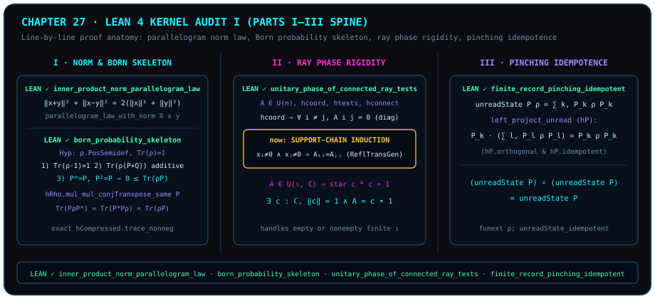

# Inside the Lean 4 Axiom Sanctuary (Part I): From the Parallelogram Law to Finite Record Pinching

> *"Build an academic theory of a universal machine for proposition proofs: define, state, prove."*

In conventional mathematical physics monographs, a "proof" relies on an unwritten pact between author and reader: a phrase such as *"it is easy to see"*, an implicit assumption that an index set is nonempty, or a quiet slide from coordinate-line invariance to a single global phase can hide subtle gaps. From [Chapter 1](ch01-measurement.md) onward, this book has operated under a stricter contract captured by our opening epigraph — **define, state, prove**: every formal `theorem`, `lemma`, `proposition`, and `corollary` carrying the green `LEAN ✓` badge is anchored to a declaration in `the-omega-institute/trureturing@dev` (pinned at commit `a660b9333c0f8d25aaa22af1bbbfab43c2f94a46`) that has been type-checked by the Lean 4 kernel and frozen without a single `sorry`.

In this chapter and [Chapter 28](ch28-reading-frozen-proofs-ii.md), we open the actual `.lean` source files of `trureturing@dev` and audit the formal proof scripts line by line:

1. In this chapter (Part I of our kernel audit), we dissect four foundational proofs underlying Parts I through III: **the real inner-product parallelogram norm law**, **the three-part Born probability skeleton on positive trace-one matrices**, **unitary global phase rigidity under support-connected ray tests**, and **idempotence of finite complete orthogonal record pinching**;
2. We trace the exact Mathlib lemmas and tactic chains (`parallelogram_law_with_norm`, `mul_mul_conjTranspose_same`, `Relation.ReflTransGen` induction, `Finset.sum_eq_single`) used in the kernel proofs, and conclude with a **comprehensive audit table of frozen declarations across Parts I–III**.



## Define, State, Prove: Inside the Lean 4 Kernel Audit {#sec-lean-kernel-audit-architecture}

In the `trureturing` verification pipeline, every green theorem in this book passes three machine-enforced stages:

1. **Define**: Every mathematical object — such as a real inner-product space `InnerProductSpace ℝ E`, a square complex matrix `Matrix n n ℂ`, the positive-semidefinite predicate `Matrix.PosSemidef`, or a projective record measurement `IsRecordMeasurement P` — is defined unambiguously in dependent type theory;
2. **State**: The theorem header specifies all typeclass instances and explicit hypotheses, producing a canonical SHA-256 `statement_id` recorded in `Golden/Frozen/state/<module>.lean.json` and locked in `trureturing.lock.json`;
3. **Prove**: The proof term is checked by the Lean 4 kernel with zero `sorry` placeholders and only standard foundational axioms (`propext`, `Classical.choice`, `Quot.sound`, verified in source files via `#print axioms`).

We begin by auditing two cornerstone declarations from Part I: the parallelogram norm identity and the finite-dimensional Born probability skeleton (Panel I of Figure 27).

::: {.theorem #thm-audit-parallelogram-law title="Parallelogram Norm Identity in Real Inner-Product Spaces (Kernel Audit)" lean="D5/S3/QuantumContext/ParallelogramNormLaw.inner_product_norm_parallelogram_law"}
Let $E$ be a normed additive commutative group equipped with a real inner product (`[NormedAddCommGroup E] [InnerProductSpace ℝ E]`). For any two vectors $x, y \in E$,

$$
\norm{x + y}^2 + \norm{x - y}^2 = 2\bigl(\norm{x}^2 + \norm{y}^2\bigr).
$$
:::

::: proof
In `D5/S3/QuantumContext/ParallelogramNormLaw.lean:22`, the frozen declaration is proved by a single exact term application:

```lean
theorem inner_product_norm_parallelogram_law {E : Type*} [NormedAddCommGroup E]
    [InnerProductSpace ℝ E] (x y : E) :
    ‖x + y‖ ^ 2 + ‖x - y‖ ^ 2 = 2 * (‖x‖ ^ 2 + ‖y‖ ^ 2) := by
  exact parallelogram_law_with_norm ℝ x y
```

In Mathlib's `Mathlib.Analysis.InnerProductSpace.Basic`, `parallelogram_law_with_norm` expands $\norm{x + y}^2$ and $\norm{x - y}^2$ via `norm_add_sq_real` and `norm_sub_sq_real` into $\norm{x}^2 \pm 2\langle x, y\rangle_{\mathbb{R}} + \norm{y}^2$, cancels the opposite inner-product cross terms $\pm 2\langle x, y\rangle_{\mathbb{R}}$, and rewrites the squares in `^ 2` form. Line 26 of the source file runs `#print axioms inner_product_norm_parallelogram_law` to confirm that no unverified axioms enter. The full proof is checked by the Lean kernel.
:::

Why must `parallelogram_law_with_norm` and `norm_add_sq_real` square 1D vectors into a 2D quadratic form before orthogonal cross terms disappear? Here lies the geometric synthesis formulated in the author's design notes:

> **Author's original words**: "Pythagoras — all things are number — the Pythagorean theorem (毕达哥拉斯 万物皆数 勾股定理)."

1. **From non-additive 1D lengths to grade-0 area scalars and canceling grade-2 bivector orientations**: In a positive-definite Euclidean inner-product space, let two orthogonal vectors $\vv{a} \perp \vv{b}$ have scalar norms $a = \norm{\vv{a}}, b = \norm{\vv{b}}, c = \norm{\vv{a} + \vv{b}}$. Their 1D lengths cannot add linearly ($a + b \neq c$) because they point along perpendicular axes. In positive-definite Euclidean Clifford geometric algebra, squaring the resultant $\vv{c} = \vv{a} + \vv{b}$ yields
   $$
   \vv{c}^2 = (\vv{a} + \vv{b})(\vv{a} + \vv{b}) = \vv{a}^2 + \vv{b}^2 + (\vv{a}\vv{b} + \vv{b}\vv{a}) = a^2 + b^2 + 2(\vv{a}\cdot\vv{b}) + (\vv{a}\wedge\vv{b} + \vv{b}\wedge\vv{a}).
   $$
   Here $\vv{a}^2 = a^2$, $\vv{b}^2 = b^2$, and $\vv{c}^2 = c^2$ are **grade-0 scalars** carrying squared-length (area) measure, whereas $\vv{a}\wedge\vv{b}$ and $\vv{b}\wedge\vv{a}$ are **grade-2 oriented-area bivectors**. Since $\vv{a}\cdot\vv{b} = 0$ and the oppositely oriented bivectors anticommute ($\vv{b}\wedge\vv{a} = -\vv{a}\wedge\vv{b}$), the grade-2 oriented areas cancel identically ($\vv{a}\wedge\vv{b} + \vv{b}\wedge\vv{a} = 0$), leaving the grade-0 Pythagorean identity $c^2 = a^2 + b^2$! This is the exact geometric meaning behind the vanishing cross term $2\langle x, y\rangle_{\mathbb{R}} = 0$ in `norm_add_sq_real` and the cancellation between $\norm{x+y}^2$ and $\norm{x-y}^2$ in [@thm-audit-parallelogram-law].
2. **Hippasus's $45^\circ$ triangle, 2-adic parity contradiction, and the canonical Pell continued-fraction approximants**: Setting $a = 1, b = 1$ on the unit integer lattice forces $c^2 = 1^2 + 1^2 = 2$, so $c = \sqrt{2}$. For any positive integers $m, n \in \mathbb{Z}_{>0}$ ($n \neq 0$), a putative rational solution $c = m/n \in \mathbb{Q}$ ($m^2 = 2n^2$) shatters against 2-adic valuation parity: $v_2(m^2) = 2v_2(m)$ is always **even**, whereas $v_2(2n^2) = 2v_2(n) + 1$ is always **odd** ($2v_2(m) \neq 2v_2(n) + 1$). While arbitrary rational sequences (such as decimal truncations $\lfloor 10^k\sqrt{2}\rfloor / 10^k$) can converge to $\sqrt{2}$, the **canonical best continued-fraction approximants** are the Pell convergents $m_k/n_k$ defined by $m_k + n_k\sqrt{2} = (1 + \sqrt{2})^k$ ($k \ge 1, n_k > 0$),
   $$
   \frac{m_k}{n_k} = \frac{1}{1},\; \frac{3}{2},\; \frac{7}{5},\; \frac{17}{12},\; \frac{41}{29},\; \frac{99}{70},\; \dots,
   $$
   which satisfy the alternating unit-gap Pell equation:
   $$
   m_k^2 - 2n_k^2 = (-1)^k = \pm 1 \qquad\Longleftrightarrow\qquad \left(\frac{m_k}{n_k}\right)^2 = 2 + \frac{(-1)^k}{n_k^2}.
   $$
   For every $k \ge 1$, an indestructible unit arithmetic crack $(-1)^k = \pm 1$ separates $m_k^2$ from $2n_k^2$. In this book's conceptual and philosophical synthesis, that unit crack propels the Chinese concept of *number* (`数`) from the discrete counting verb operator (`shǔ`, $\mathbb{N} \to \mathbb{Q}$) to the continuous geometric noun coordinate (`shù`), tracing a four-stage conceptual progression (note that this is a conceptual hierarchy rather than a chain of field inclusions $\pi \subset \theta^*$; the algebraic golden ratio $\varphi = \frac{1+\sqrt{5}}{2} \in \overline{\mathbb{Q}}$ satisfying $\varphi = 1 + 1/\varphi$ belongs to Stage 2, whereas Stage 4's $\theta^* \approx 0.739085$ denotes the transcendental self-referential cosine fixed point $\cos\theta^* = \theta^*$):
   $$
   \begin{aligned}
   &\mathbb{Q}\text{ (rational grid)} \\
   &\longrightarrow\; \overline{\mathbb{Q}}\text{ (algebraic numbers: $\sqrt{2}$ diagonal \& golden ratio $\varphi$)} \\
   &\longrightarrow\; \pi\text{ (transcendental circle rotation)} \\
   &\longrightarrow\; \theta^*\text{ (self-referential cosine fixed point $\cos\theta^* = \theta^*$)}.
   \end{aligned}
   $$

Next we inspect `born_probability_skeleton` in `D5/S3/Quantum/FiniteDimensional.lean:78`. For any finite index type `n` (`[Fintype n]`) and matrices $\rho, P \in M_n(\mathbb{C})$, the trace pairing is defined as

$$
\operatorname{bornProbability}(\rho, P) = \Tr(\rho \cdot P) \in \mathbb{C}.
$$

When $\rho$ is positive semidefinite (`hRho : rho.PosSemidef`) and has unit trace (`hTrace : Matrix.trace rho = 1`), the following frozen lemma establishes **normalization on the identity**, **additivity over matrix addition**, and **nonnegativity on self-adjoint idempotent projections** (in the complex partial order `0 ≤ z` from `ComplexOrder`, meaning $\operatorname{Re} z \ge 0$ and $\operatorname{Im} z = 0$).

::: {.lemma #lemma-audit-born-skeleton title="Born Probability Three-Part Skeleton on Positive Trace-One Matrices (Kernel Audit)" lean="D5/S3/Quantum/FiniteDimensional.born_probability_skeleton"}
Let $n$ be a finite index type with decidable equality (`[Fintype n] [DecidableEq n]`), and let $\rho \in M_n(\mathbb{C})$ satisfy `hRho : rho.PosSemidef` and `hTrace : Matrix.trace rho = 1`. Then all three properties hold:

1. **Identity normalization**: $\operatorname{bornProbability}(\rho, 1) = 1$;
2. **Additivity**: For all $P, Q \in M_n(\mathbb{C})$,
   $$
   \operatorname{bornProbability}(\rho, P + Q) = \operatorname{bornProbability}(\rho, P) + \operatorname{bornProbability}(\rho, Q);
   $$
3. **Nonnegativity on self-adjoint idempotent projections**: For every $P \in M_n(\mathbb{C})$, if $\operatorname{star}(P) = P$ and $P \cdot P = P$, then
   $$
   0 \le \operatorname{bornProbability}(\rho, P).
   $$
:::

::: proof
In `D5/S3/Quantum/FiniteDimensional.lean:78`:

- Conjunct 1 is discharged by `simpa [bornProbability] using hTrace` since $\rho \cdot 1 = \rho$;
- Conjunct 2 is discharged for arbitrary $P, Q$ by `simp [bornProbability, Matrix.mul_add]`, using distributivity $\rho(P+Q) = \rho P + \rho Q$ and trace linearity;
- Conjunct 3 uses a sandwich-compression trick to avoid spectral decomposition of the non-Hermitian product $\rho P$: given `hSelfAdjoint : star P = P` (rewritten as `hConjTranspose : Pᴴ = P`) and `hIdempotent : P * P = P`, the proof applies `hRho.mul_mul_conjTranspose_same P` to certify that the sandwiched matrix $P \rho P^*$ is positive semidefinite (`hCompressed : (P * rho * Pᴴ).PosSemidef`). A four-step `calc` block using `Matrix.trace_mul_cycle` and `Matrix.trace_mul_comm` then equates their traces:
  $$
  \Tr(P \rho P^*) = \Tr(P^* P \rho) = \Tr(P P \rho) = \Tr(P \rho) = \Tr(\rho P).
  $$
  Rewriting `bornProbability` via `← hTraceCompressed` and applying `exact hCompressed.trace_nonneg` completes the proof.

The full proof is checked by the Lean kernel.
:::

## Support-Chain Ray Phase Rigidity and Finite Record Pinching Idempotence {#sec-audit-ray-rigidity-and-pinching}

We now audit two structural theorems from Part I that showcase graph induction and block-diagonal projection algebra in Lean 4 (Panels II and III of Figure 27).

In `D5/S3/Quantum/Foundation/RayPhaseRigidity.lean:97`, a matrix $A \in M_\iota(\mathbb{C})$ preserves the ray of a vector $x : \iota \to \mathbb{C}$ when

$$
\operatorname{PreservesRay}(A, x) \;\Longleftrightarrow\; A *_{v} x \in \operatorname{Submodule.span}\,\mathbb{C}\,\{x\}.
$$

If $A$ preserves every coordinate basis ray $\vv{e}_i = \operatorname{Pi.single}\,i\,1$, then $A$ must be diagonal. To force all diagonal entries $A_{ii}$ to equal a **single common phase** $c$, no single full-support test vector is required; instead, `RaySupportConnected tests` requires only that every pair of indices $i, j \in \iota$ is connected by the reflexive-transitive closure `Relation.ReflTransGen` of pairwise support overlaps $(\exists x \in \mathrm{tests},\; x_i \neq 0 \land x_j \neq 0)$.

::: {.proposition #prop-audit-ray-phase-rigidity title="Unitary Global Phase Rigidity Under Connected Ray Tests (Kernel Audit)" lean="D5/S3/Quantum/Foundation/RayPhaseRigidity.unitary_phase_of_connected_ray_tests"}
Let $\iota$ be a finite index type with decidable equality (`[Fintype ι] [DecidableEq ι]`), let $A \in M_\iota(\mathbb{C})$ belong to the unitary group (`hA : A ∈ Matrix.unitaryGroup ι ℂ`), and let $\mathrm{tests} \subseteq (\iota \to \mathbb{C})$ be a set of test vectors. Suppose:

1. **Coordinate ray invariance** (`hcoord`): For every $i \in \iota$, $\operatorname{PreservesRay}\bigl(A, \operatorname{Pi.single}\,i\,1\bigr)$;
2. **Test ray invariance** (`htests`): For every $x \in \mathrm{tests}$, $\operatorname{PreservesRay}(A, x)$;
3. **Connected test supports** (`hconnect`): $\operatorname{RaySupportConnected}(\mathrm{tests})$.

Then there exists a complex scalar $c \in \mathbb{C}$ such that

$$
\norm{c} = 1 \qquad\text{and}\qquad A = c \bullet (1 : M_\iota(\mathbb{C})).
$$
:::

::: proof
In `D5/S3/Quantum/Foundation/RayPhaseRigidity.lean:97`, the proof proceeds in two stages:

1. **Private lemma `coordinate_shape_of_connected_ray_tests`**:
   - First, `hoff` proves $A_{ij} = 0$ for all $i \neq j$: unpacking `hcoord j` gives $A *_{v} \vv{e}_j = d\,\vv{e}_j$ for some $d \in \mathbb{C}$, whose $i$-th component ($i \neq j$) reduces to $A_{ij} = 0$.
   - Second, `hstep` proves that whenever some $x \in \mathrm{tests}$ satisfies $x_i \neq 0$ and $x_j \neq 0$, we have $A_{ii} = A_{jj}$: unpacking `htests x hx` gives $A *_{v} x = d\,x$, and because $A$ is diagonal (`Finset.sum_eq_single k` with `hoff`), each component $k$ obeys $A_{kk} x_k = d x_k$. Canceling $x_k \neq 0$ via `mul_right_cancel₀` gives $A_{ii} = d = A_{jj}$.
   - Third, `hchain` inducts over `Relation.ReflTransGen` (`| refl => rfl` and `| @tail j k _ hjk ih => exact ih.trans (hstep j k hjk)`), establishing $A_{ii} = A_{jj}$ for all $i, j \in \iota$.
2. **Main theorem and empty-type guard**: Splitting on `isEmpty_or_nonempty ι`:
   - If $\iota$ is empty (`inl hempty`), $c = 1$ satisfies `norm_one` and `Subsingleton.elim _ _`.
   - If $\iota$ is nonempty (`inr hnonempty`), setting `base := Classical.choice hnonempty` and $c := A_{\mathrm{base},\mathrm{base}}$ yields `hscalar : A = c • 1`. Substituting `hscalar` into $A^* A = 1$ (`Matrix.mem_unitaryGroup_iff'.mp hA`) at entry `(base, base)` gives $\bar{c} c = 1$, and taking norms with `nlinarith [norm_nonneg c]` proves $\norm{c} = 1$.

The full proof is checked by the Lean kernel.
:::

Our fourth audited declaration in this chapter is `finite_record_pinching_idempotent` in `D5/S3/Observer/Conditioning/FiniteRecordPinchingIdempotence.lean:30`, which proves functional idempotence of the unread Lüders pinching map

$$
\operatorname{unreadState}(P, \rho) = \sum_{k \in \kappa} P_k \rho P_k
$$

for any finite complete orthogonal projection family `IsRecordMeasurement P`.

::: {.corollary #cor-audit-pinching-idempotent title="Functional Idempotence of Finite Complete Record Pinching (Kernel Audit)" lean="D5/S3/Observer/Conditioning/FiniteRecordPinchingIdempotence.finite_record_pinching_idempotent"}
Let $n$ be a finite index type with decidable equality (`[Fintype n] [DecidableEq n]`), let $\kappa$ be a finite outcome type (`[Fintype kappa]`), and let $P : \kappa \to M_n(\mathbb{C})$ satisfy `hP : IsRecordMeasurement P`. Then

$$
\operatorname{Function.comp}\bigl(\operatorname{unreadState}(P),\; \operatorname{unreadState}(P)\bigr) = \operatorname{unreadState}(P).
$$
:::

::: proof
In `FiniteRecordPinchingIdempotence.lean:30`, `funext rho` reduces functional equality to the pointwise theorem `unreadState_idempotent hP rho` in `D5/S3/Observer/Conditioning.lean:100`. There, the helper lemma `left_project_unread` first computes

$$
P_k \cdot \operatorname{unreadState}(P, \rho) = \sum_{l \in \kappa} P_k P_l \rho P_l = P_k P_k \rho P_k = P_k \rho P_k
$$

by collapsing the sum over $l \in \kappa$ to the single index $l = k$ via `Finset.sum_eq_single k` and pairwise orthogonality `hP.orthogonal k l`, then applying `hP.idempotent k`. Multiplying on the right by $P_k$ inside the outer sum $\sum_k P_k (\operatorname{unreadState} P \rho) P_k$ and applying `hP.idempotent k` a second time yields $\sum_k P_k \rho P_k = \operatorname{unreadState}(P, \rho)$. The full proof is checked by the Lean kernel.
:::

## Line-by-Line Source Anatomy: From Mathlib Lemmas to Graph Induction and Block Elimination {#sec-line-by-line-proof-anatomy-i}

Across the four proofs above, four recurring Lean 4 proof engineering patterns stand out:

1. **Finite-index extensionality (`ext i j; fin_cases i <;> fin_cases j`)**: Concrete low-dimensional matrix identities are reduced to scalar ring equations over $\mathbb{R}$ or $\mathbb{C}$ and closed deterministically by `simp` and `ring`;
2. **Positive-semidefinite cone preservation under conjugate compression (`hRho.mul_mul_conjTranspose_same P`)**: Rather than diagonalizing $\rho P$, the proof rewrites $\Tr(\rho P) = \Tr(P \rho P^*)$ using self-adjointness, idempotence, and trace cyclicity so that `PosSemidef.trace_nonneg` applies directly;
3. **Single-index sum collapse (`Finset.sum_eq_single k`)**: Orthogonality relations ($A_{kl} = 0$ or $P_k P_l = 0$ for $k \neq l$) prune finite sums $\sum_{l \in \kappa}$ down to the diagonal term $l = k$;
4. **Reflexive-transitive closure induction (`Relation.ReflTransGen`)**: Local two-coordinate overlap steps (`hstep`) are lifted to global constancy across arbitrary connected support graphs by two-line structural induction (`refl` and `tail`).

## Comprehensive Audit Table of Frozen Declarations Across Parts I–III {#sec-parts-i-to-iii-frozen-audit-table}

The table below audits representative frozen declarations cited across Parts I through III at commit `a660b9333c0f8d25aaa22af1bbbfab43c2f94a46`. As required by our verification contract, prose labels such as "parallelogram law", "probability skeleton", or "pinching idempotence" are descriptive titles only and carry no formal claim beyond the exact Lean signature.

| Chapter | Frozen GID | Source File & Line | `statement_id` Prefix | Exact Formal Scope & Contract |
| :---------: | ---------------------------- | ---------------------------- | :------------------: | ----------------------------------------------------- |
| Ch 1 / Ch 27 | [`D5/S3/QuantumContext/ParallelogramNormLaw.inner_product_norm_parallelogram_law`](lean:D5/S3/QuantumContext/ParallelogramNormLaw.inner_product_norm_parallelogram_law) | `D5/S3/QuantumContext/ParallelogramNormLaw.lean:22` | `sha256:b5f8dcc9` | $\norm{x+y}^2+\norm{x-y}^2=2(\norm{x}^2+\norm{y}^2)$ in real inner-product spaces |
| Ch 1 / Ch 18 / Ch 25 | [`D5/S3/Quantum/FiniteDimensional.qubit_weyl_star`](lean:D5/S3/Quantum/FiniteDimensional.qubit_weyl_star) | `D5/S3/Quantum/FiniteDimensional.lean:24` | `sha256:8448b695` | `qubitX` and `qubitZ` anticommute, are self-adjoint, and square to $1$ |
| Ch 1 / Ch 25 | [`D5/S3/Quantum/FiniteDimensional.qubit_matrix_algebra_has_no_character`](lean:D5/S3/Quantum/FiniteDimensional.qubit_matrix_algebra_has_no_character) | `D5/S3/Quantum/FiniteDimensional.lean:46` | `sha256:8448b695` | $\operatorname{IsEmpty}(\mathrm{QubitMatrix} \to_{\mathrm{alg}[\mathbb{C}]} \mathbb{C})$ |
| Ch 1 / Ch 27 | [`D5/S3/Quantum/Foundation/RayPhaseRigidity.unitary_phase_of_connected_ray_tests`](lean:D5/S3/Quantum/Foundation/RayPhaseRigidity.unitary_phase_of_connected_ray_tests) | `D5/S3/Quantum/Foundation/RayPhaseRigidity.lean:97` | `sha256:33a591cb` | Coordinate rays + connected test supports force unitary $A = c\bullet 1$ ($\norm{c}=1$) |
| Ch 2 / Ch 27 | [`D5/S3/Quantum/FiniteDimensional.born_probability_skeleton`](lean:D5/S3/Quantum/FiniteDimensional.born_probability_skeleton) | `D5/S3/Quantum/FiniteDimensional.lean:78` | `sha256:8448b695` | Normalization, additivity, and projection nonnegativity of $\Tr(\rho P)$ |
| Ch 3 / Ch 27 | [`D5/S3/Observer/Conditioning/FiniteRecordPinchingIdempotence.finite_record_pinching_idempotent`](lean:D5/S3/Observer/Conditioning/FiniteRecordPinchingIdempotence.finite_record_pinching_idempotent) | `D5/S3/Observer/Conditioning/FiniteRecordPinchingIdempotence.lean:30` | `sha256:aa98f3d9` | $(\operatorname{unreadState} P)\circ(\operatorname{unreadState} P) = \operatorname{unreadState} P$ |
| Ch 3 | [`D5/S3/Quantum/Tomography/ComplementaryContextProbabilityPythagoras.complementary_context_probability_pythagoras`](lean:D5/S3/Quantum/Tomography/ComplementaryContextProbabilityPythagoras.complementary_context_probability_pythagoras) | `D5/S3/Quantum/Tomography/ComplementaryContextProbabilityPythagoras.lean:33` | `sha256:6cae4dbc` | For `rho : Matrix d d ℂ`, `state : E` in a complete real inner-product space `E` (`[NormedAddCommGroup E] [InnerProductSpace ℝ E] [CompleteSpace E]`, preserving the distinction between the complex matrix `rho : Matrix d d ℂ` and the abstract Hilbert-space vector `state : E`), `probability : L → d → ℝ` (`[Fintype d] [Nonempty d] [Fintype L]`), and a closed real submodule `visible : Submodule ℝ E` (`[IsClosed (visible : Set E)]`), under calibration hypotheses `hpurity : (Matrix.trace (rho * rho)).re - (Fintype.card d : ℝ)⁻¹ = ‖state‖ ^ 2` and `hcoordinates : ‖visible.starProjection state‖ ^ 2 = ∑ l, ∑ j, (probability l j - (Fintype.card d : ℝ)⁻¹) ^ 2`, proves `(Matrix.trace (rho * rho)).re - (Fintype.card d : ℝ)⁻¹ = (∑ l, ∑ j, (probability l j - (Fintype.card d : ℝ)⁻¹) ^ 2) + residualMass visible state` |
| Ch 3 | [`D5/S3/Quantum/Measurements/FiniteMemoryHistoryCapacity.finite_memory_history_capacity`](lean:D5/S3/Quantum/Measurements/FiniteMemoryHistoryCapacity.finite_memory_history_capacity) | `D5/S3/Quantum/Measurements/FiniteMemoryHistoryCapacity.lean:62` | `sha256:b941b8f9` | $N$ density matrices perfectly distinguished by an $N$-outcome POVM ($\Tr(E_j\rho_i)=\delta_{ij}$) force $N \le d$ |
| Ch 3 | [`D5/S3/QuantumBounds/CollisionEntropyUncertainty.collision_entropy_uncertainty`](lean:D5/S3/QuantumBounds/CollisionEntropyUncertainty.collision_entropy_uncertainty) | `D5/S3/QuantumBounds/CollisionEntropyUncertainty.lean:31` | `sha256:0855b96a` | For $d+1$ distributions on $d$ outcomes with collision sum $1+P$: $\sum_b H(p_b) \ge (d+1)\ln\frac{d+1}{1+P}$ |
| Ch 4 | [`D5/S3/Quantum/Decoherence/NonselectiveMarginalization.nonselective_recording_marginal`](lean:D5/S3/Quantum/Decoherence/NonselectiveMarginalization.nonselective_recording_marginal) | `D5/S3/Quantum/Decoherence/NonselectiveMarginalization.lean:32` | `sha256:645a742c` | Nonselective recording marginal equals the dephased diagonal mixture |
| Ch 4 | [`D5/S3/HilbertOperators/Stinespring.stinespring_dilation`](lean:D5/S3/HilbertOperators/Stinespring.stinespring_dilation) | `D5/S3/HilbertOperators/Stinespring.lean:725` | `sha256:8b1f001f` | A completely positive `φ : A →CP (H →L[ℂ] H)` admits a Hilbert space $K$, a unital \*-homomorphism $\pi$ and a bounded $V$ with $\varphi(a)x = V^{\dagger}\pi(a)Vx$ |
| Ch 4 | [`D5/S3/Quantum/Foundation/FiniteTraceDistance.traceDistance`](lean:D5/S3/Quantum/Foundation/FiniteTraceDistance.traceDistance) | `D5/S3/Quantum/Foundation/FiniteTraceDistance.lean:463` | `sha256:89528cf6` | Definition: $\operatorname{traceDistance}(\rho,\sigma)=\tfrac12\operatorname{traceNorm}(\rho-\sigma)$ |
| Ch 4 | [`D5/S3/Quantum/Foundation/FiniteTraceDistance.traceDistance_nonneg`](lean:D5/S3/Quantum/Foundation/FiniteTraceDistance.traceDistance_nonneg) | `D5/S3/Quantum/Foundation/FiniteTraceDistance.lean:466` | `sha256:89528cf6` | $0 \le \operatorname{traceDistance}(\rho,\sigma)$ |
| Ch 4 | [`D5/S3/Quantum/Foundation/FiniteTraceDistance.traceDistance_symm`](lean:D5/S3/Quantum/Foundation/FiniteTraceDistance.traceDistance_symm) | `D5/S3/Quantum/Foundation/FiniteTraceDistance.lean:469` | `sha256:89528cf6` | $\operatorname{traceDistance}(\rho,\sigma)=\operatorname{traceDistance}(\sigma,\rho)$ |
| Ch 4 | [`D5/S3/Quantum/Foundation/FiniteTraceDistance.traceDistance_triangle`](lean:D5/S3/Quantum/Foundation/FiniteTraceDistance.traceDistance_triangle) | `D5/S3/Quantum/Foundation/FiniteTraceDistance.lean:476` | `sha256:89528cf6` | Triangle inequality for the trace distance |
| Ch 4 | [`D5/S3/Quantum/Foundation/FiniteTraceDistance.traceDistance_le_one`](lean:D5/S3/Quantum/Foundation/FiniteTraceDistance.traceDistance_le_one) | `D5/S3/Quantum/Foundation/FiniteTraceDistance.lean:485` | `sha256:89528cf6` | $\operatorname{traceDistance}(\rho,\sigma)\le 1$ |
| Ch 4 | [`D5/S3/Quantum/Foundation/FiniteTraceDistance.traceDistance_contract`](lean:D5/S3/Quantum/Foundation/FiniteTraceDistance.traceDistance_contract) | `D5/S3/Quantum/Foundation/FiniteTraceDistance.lean:505` | `sha256:89528cf6` | Trace distance does not increase under any `QuantumChannel ι ι` |
| Ch 5 | [`D5/S3/ConceptDynamics/Topology/CircleDoubleCoverHistoryLift.circle_double_cover_history_lift`](lean:D5/S3/ConceptDynamics/Topology/CircleDoubleCoverHistoryLift.circle_double_cover_history_lift) | `D5/S3/ConceptDynamics/Topology/CircleDoubleCoverHistoryLift.lean:36` | `sha256:ccc9572b` | Squaring map of the circle: unique path lifts, no continuous global section, and the lift of the full-turn loop runs from $1$ to $-1$ |
| Ch 5 | [`D5/S3/ConceptDynamics/Topology/CircleDoubleCoverNoSection.no_continuous_global_section`](lean:D5/S3/ConceptDynamics/Topology/CircleDoubleCoverNoSection.no_continuous_global_section) | `D5/S3/ConceptDynamics/Topology/CircleDoubleCoverNoSection.lean:28` | `sha256:f5e0857a` | No continuous $s : S^1 \to S^1$ with $s(z)^2 = z$ |
| Ch 6 | [`D5/S3/QuantumBounds/LagrangeGramIdentity.lagrange_gram_identity`](lean:D5/S3/QuantumBounds/LagrangeGramIdentity.lagrange_gram_identity) | `D5/S3/QuantumBounds/LagrangeGramIdentity.lean:17` | `sha256:ce9562e5` | Two-vector Lagrange–Gram area-squared identity |
| Ch 6 | [`D5/S3/Quantum/PureState/RecordCoherenceComplementarity.pure_record_distinguishability_coherence_complementarity`](lean:D5/S3/Quantum/PureState/RecordCoherenceComplementarity.pure_record_distinguishability_coherence_complementarity) | `D5/S3/Quantum/PureState/RecordCoherenceComplementarity.lean:29` | `sha256:b1bcaba2` | Pure-state record distinguishability + squared coherence norm identity |
| Ch 6 | [`D5/S3/QuantumBounds/Designs/MixedStateRobertson.mixed_state_robertson_uncertainty`](lean:D5/S3/QuantumBounds/Designs/MixedStateRobertson.mixed_state_robertson_uncertainty) | `D5/S3/QuantumBounds/Designs/MixedStateRobertson.lean:68` | `sha256:a2d45f27` | Density state $\rho$, Hermitian $A,B$: $\norm{(A-\langle A\rangle)\sqrt\rho}\,\norm{(B-\langle B\rangle)\sqrt\rho} \ge \tfrac12\lvert\Tr(\rho(AB-BA))\rvert$ |
| Ch 4 / Ch 6 | [`D5/S3/QuantumChannels/PinchingProjection.pinching_hilbert_schmidt_pythagorean`](lean:D5/S3/QuantumChannels/PinchingProjection.pinching_hilbert_schmidt_pythagorean) | `D5/S3/QuantumChannels/PinchingProjection.lean:68` | `sha256:89589cff` | Hilbert–Schmidt Pythagorean decomposition under pinching |
| Ch 8 | [`D5/S3/Quantum/Dynamics/EntropyProductionCoherenceDeletionIdentity.entropy_production_coherence_deletion_identity`](lean:D5/S3/Quantum/Dynamics/EntropyProductionCoherenceDeletionIdentity.entropy_production_coherence_deletion_identity) | `D5/S3/Quantum/Dynamics/EntropyProductionCoherenceDeletionIdentity.lean:383` | `sha256:5c5eb2ec` | Exact identity between entropy production and coherence deletion |
| Ch 7 | [`D5/S3/QuantumChannels/ProjectionDiagnostics/MonitoredReturnConservation.monitored_return_conservation`](lean:D5/S3/QuantumChannels/ProjectionDiagnostics/MonitoredReturnConservation.monitored_return_conservation) | `D5/S3/QuantumChannels/ProjectionDiagnostics/MonitoredReturnConservation.lean:71` | `sha256:ae75c01f` | Monitored return protocol: $s_0 = 1$, $p_{n+1} = s_n - s_{n+1}$, $\sum_{n<N} p_{n+1} + s_N = 1$ |
| Ch 8 | [`D5/S3/DivergenceSupport/LandauerIdentity.landauer_identity_from_balances`](lean:D5/S3/DivergenceSupport/LandauerIdentity.landauer_identity_from_balances) | `D5/S3/DivergenceSupport/LandauerIdentity.lean:23` | `sha256:e5cd8297` | Real-number level: reservoir and unitary balances give $\beta Q = -\Delta S_{\mathrm{sys}} + I + D$ |
| Ch 8 | [`D5/S3/DivergenceSupport/LandauerSaturation.landauer_saturation_iff`](lean:D5/S3/DivergenceSupport/LandauerSaturation.landauer_saturation_iff) | `D5/S3/DivergenceSupport/LandauerSaturation.lean:60` | `sha256:21cfbcef` | Under the balance and $I, D \ge 0$: $-\Delta S = \beta Q \iff I = 0 \land D = 0$ |
| Ch 9 / Ch 16 | [`D5/S3/Geometry/TwoAxisFiniteRotation.two_axis_finite_word`](lean:D5/S3/Geometry/TwoAxisFiniteRotation.two_axis_finite_word) | `D5/S3/Geometry/TwoAxisFiniteRotation.lean:327` | `sha256:d9ac7833` | Finite-word generation of $\mathrm{SO}(3)$ from two noncollinear axis circles |
| Ch 9 | [`D5/S3/Geometry/Orthogonality/RationalSixAxisCover.rational_six_axis_open_cover`](lean:D5/S3/Geometry/Orthogonality/RationalSixAxisCover.rational_six_axis_open_cover) | `D5/S3/Geometry/Orthogonality/RationalSixAxisCover.lean:127` | `sha256:eeeafc5d` | Explicit rational six-axis orthogonality-free open cover of $S^2$ |
| Ch 10 | [`D5/S3/Quantum/Algebra/GramUnitaryExtension.exists_unitary_mul_eq_of_conjTranspose_mul_eq`](lean:D5/S3/Quantum/Algebra/GramUnitaryExtension.exists_unitary_mul_eq_of_conjTranspose_mul_eq) | `D5/S3/Quantum/Algebra/GramUnitaryExtension.lean:43` | `sha256:70b7fbd2` | $B^*B = A^*A \Rightarrow \exists U \in U(m),\; B = UA$ |
| Ch 7 / Ch 11 | [`D5/S3/Quantum/Dynamics/EnergyEigenstateStationarity.energy_eigenstate_stationary`](lean:D5/S3/Quantum/Dynamics/EnergyEigenstateStationarity.energy_eigenstate_stationary) | `D5/S3/Quantum/Dynamics/EnergyEigenstateStationarity.lean:54` | `sha256:d5563afe` | Unitarity of $\exp(-itH)$ and stationarity $U\rho U^* = \rho$ of energy eigenstates |
| Ch 12 | [`D5/S3/Geometry/Riemannian/GradientDissipation.S2_dissipation`](lean:D5/S3/Geometry/Riemannian/GradientDissipation.S2_dissipation) | `D5/S3/Geometry/Riemannian/GradientDissipation.lean:157` | `sha256:d2d84f9a` | Speed integrability and exact potential dissipation along negative Riesz gradient flow |

Let us trace a concrete hypothesis-mutation check on [@prop-audit-ray-phase-rigidity].

::: {.example #ex-lean-audit-part1-3 title="Hypothesis Mutation Audit: Where Disconnected Test Supports Break Phase Rigidity"}
Consider $\iota = \operatorname{Fin} 2 = \{0, 1\}$ in [@prop-audit-ray-phase-rigidity]:

1. **Connected test support**: Take $\mathrm{tests} = \{x\}$ with $x = (1, 1)$, so $x_0 = 1 \neq 0$ and $x_1 = 1 \neq 0$. For any $A \in U(2, \mathbb{C})$ preserving the coordinate rays $\vv{e}_0 = (1, 0)$ and $\vv{e}_1 = (0, 1)$, `hoff` forces $A = \operatorname{diag}(c_0, c_1)$, and `hstep 0 1` cancels $x_0, x_1 \neq 0$ from $A *_{v} (1, 1) = d(1, 1)$ via `mul_right_cancel₀` to lock $c_0 = d = c_1$, yielding $A = c_0 I_2$ ($|c_0| = 1$).
2. **Disconnected test support (counterexample blocked by `hconnect`)**: If we drop `hconnect : RaySupportConnected tests` and take $\mathrm{tests} = \{\vv{e}_0, \vv{e}_1\}$, no vector in $\mathrm{tests}$ is simultaneously nonzero at both $0$ and $1$. Then the unitary phase gate $A = \operatorname{diag}(1, i) \in U(2, \mathbb{C})$ satisfies both `hcoord` and `htests`, yet $A$ is not a scalar multiple of $I_2$! In the Lean proof, the induction call `hchain (hconnect i j)` is the exact line that blocks disconnected phase sectors.
:::

::: {.remark #rem-lean-kernel-trust-boundary-literature title="Dependent Type Theory, the de Bruijn Criterion, and the Modeling Boundary (Literature Result, Not Formalized in This Book)"}
**Literature result, not formalized in this book.** Two foundational principles govern the formal verification architecture audited in this chapter:

1. **The Calculus of Inductive Constructions and the de Bruijn criterion** (L. de Moura & S. Ullrich, *The Lean 4 Theorem Prover and Programming Language*, CADE-28, LNAI **12699**, 625–635, 2021, DOI `10.1007/978-3-030-79876-5_37`; M. Carneiro, *The Type Theory of Lean*, MS thesis, Carnegie Mellon University, 2019): Lean 4 satisfies the de Bruijn criterion: elaborate tactics (`simp`, `ring`, `linarith`, `nlinarith`) construct explicit proof terms that are independently verified by a small, trusted type-checking kernel.
2. **Formal deduction versus physical modeling assumptions**: The Lean 4 kernel certifies that each conclusion follows with mathematical certainty from its stated definitions and hypotheses; whether a physical laboratory apparatus satisfies the idealizations of a given hypothesis belongs to empirical physics and prose commentary rather than the formal theorem itself.
3. **Classical number-theoretic results versus the book's philosophical synthesis**:
   - **Classical theorems**: The Pythagorean theorem and incommensurability of $\sqrt{2}$ appear in Euclid, *Elements*, Book I Prop. 47 & Book X; the 2-adic parity contradiction $2v_2(m) \neq 2v_2(n) + 1$ for $m^2 = 2n^2$ ($m, n \in \mathbb{Z}_{>0}$) and the best continued-fraction Pell convergents $m_k^2 - 2n_k^2 = (-1)^k$ are treated in G. H. Hardy & E. M. Wright, *An Introduction to the Theory of Numbers*, 6th ed., Oxford University Press, 2008, Ch. 4 & Ch. 10; transcendence of $\pi$ and of the cosine fixed point $\theta^* \approx 0.739085$ ($\cos\theta^* = \theta^*$) follows from the Lindemann–Weierstrass theorem (F. Lindemann, *Math. Ann.* **20**, 213–225, 1882; see also T. Y. Chow, *Amer. Math. Monthly* **106**(5), 440–448, 1999).
   - **Conceptual synthesis**: The reading of Chinese `数` from the counting verb operator (`shǔ`) to the continuous geometric noun coordinate (`shù`) and the four-stage conceptual progression $\mathbb{Q} \to \overline{\mathbb{Q}} \to \pi \to \theta^*$ represent the author's philosophical synthesis around [@thm-audit-parallelogram-law] rather than a chain of field inclusions or part of the four frozen Lean declarations of this chapter.
:::

Having audited the formal spine of Parts I–III, let us now enter [Chapter 28](ch28-reading-frozen-proofs-ii.md) to audit the rank-one Born reduction, the three-part Born pairing bridge, Lüders conditional state validity, and the fixed-point equivalence that closes the book's self-referential loop $\psi = \psi(\psi)$.
