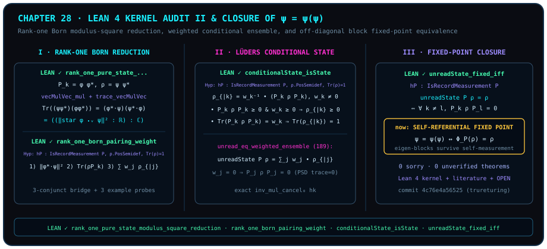

# Inside the Lean 4 Axiom Sanctuary (Part II): From Rank-One Born Reduction to Unread Fixed Points and $\psi = \psi(\psi)$

> *"This is the $\psi = \psi(\psi)$ that we studied at the beginning."*

Looking back across twenty-seven chapters — from pairwise measurement and inner-product overlap in [Chapter 1](ch01-measurement.md) to contracting self-reference in Chapter 24 — our opening epigraph brings the journey full circle: **"This is the $\psi = \psi(\psi)$ that we studied at the beginning."**

In the operator geometry of quantum measurement, a projective record measurement $P = \{P_k\}_{k \in \kappa}$ acts on a state $\rho$ in two complementary ways: conditioned on a specific outcome $k$ with nonzero weight, it updates the state to $\operatorname{conditionalState}(P, \rho, k) = (\operatorname{recordWeight}(P, \rho, k))^{-1} P_k \rho P_k$; when the outcome record is left unread, it applies the pinching channel $\operatorname{unreadState}(P, \rho) = \sum_{k \in \kappa} P_k \rho P_k$. When is a state $\rho$ a **self-consistent fixed point** $\operatorname{unreadState}(P, \rho) = \rho$ of measurement? In `trureturing@dev`, this question is answered not by metaphor, but by a machine-checked necessary and sufficient theorem: if and only if every off-diagonal interference block $P_k \rho P_l$ ($k \neq l$) vanishes!

In this concluding chapter of Part VII, we audit four frozen declarations from `D5/S3/Observer/` line by line — **the rank-one pure-state Born modulus-squared reduction**, **the three-conjunct Born pairing and ensemble bridge**, **validity of Lüders conditional states**, and **the unread fixed-point equivalence** — and conclude with a **comprehensive audit table of frozen declarations across Parts IV–VI**.



## Source Anatomy of the Rank-One Born Reduction and Three-Conjunct Pairing Bridge {#sec-audit-rank-one-born-and-pairing}

In [Chapter 1](ch01-measurement.md) and [Chapter 2](ch02-born-rule.md), we saw that when both the state $\rho = \lvert\psi\rangle\langle\psi\rvert$ and the projector $P_k = \lvert\phi\rangle\langle\phi\rvert$ have rank one, the trace pairing $\Tr(\rho P_k)$ collapses to the squared modulus of the inner product $\lvert\langle\phi \mid \psi\rangle\rvert^2$. Let us open `D5/S3/Observer/BornReduction.lean:27` and inspect the exact Lean 4 proof (Panel I of Figure 28).

For a finite index type $n$ (`[Fintype n]`) and vectors $\phi, \psi : n \to \mathbb{C}$, the rank-one outer product is `Matrix.vecMulVec psi (star psi)` with $(i, j)$ entry $\psi_i \overline{\psi_j}$, the Hermitian inner product is the dot product `star phi ⬝ᵥ psi` $= \sum_{i \in n} \overline{\phi_i}\psi_i$, and the outcome weight is

$$
\operatorname{recordWeight}(P, \rho, k) = \operatorname{bornProbability}(\rho, P_k) = \Tr(\rho \cdot P_k) \in \mathbb{C}.
$$

::: {.theorem #thm-audit-rank-one-born title="Rank-One Pure-State Born Modulus-Squared Reduction (Kernel Audit)" lean="D5/S3/Observer/BornReduction.rank_one_pure_state_modulus_square_reduction"}
Let $n$ be a finite index type (`[Fintype n]`), let $\kappa$ be an outcome index type, let $P : \kappa \to M_n(\mathbb{C})$ be an operator family, let $\rho \in M_n(\mathbb{C})$ be a square complex matrix, let $k \in \kappa$ be an outcome, and let $\phi, \psi : n \to \mathbb{C}$ be complex vectors. Suppose

$$
P_k = \operatorname{Matrix.vecMulVec}\bigl(\phi,\, \operatorname{star}\phi\bigr), \qquad \rho = \operatorname{Matrix.vecMulVec}\bigl(\psi,\, \operatorname{star}\psi\bigr).
$$

Then the record weight of outcome $k$ reduces to the squared norm of the inner product (coerced to $\mathbb{C}$):

$$
\operatorname{recordWeight}(P, \rho, k) = \bigl(\norm{\operatorname{star}\phi \bullet_{v} \psi}^2 : \mathbb{R}\bigr).
$$
:::

::: proof
In `D5/S3/Observer/BornReduction.lean:27`, the frozen kernel proof is:

```lean
theorem rank_one_pure_state_modulus_square_reduction
    (P : kappa -> Matrix n n ℂ) (rho : Matrix n n ℂ) (k : kappa)
    (phi psi : n -> ℂ)
    (hProjection : P k = Matrix.vecMulVec phi (star phi))
    (hPureState : rho = Matrix.vecMulVec psi (star psi)) :
    recordWeight P rho k = ((‖star phi ⬝ᵥ psi‖ ^ 2 : ℝ) : ℂ) := by
  rw [recordWeight, D5.S3.Quantum.FiniteDimensional.bornProbability, hPureState, hProjection,
    Matrix.vecMulVec_mul_vecMulVec, Matrix.trace_vecMulVec, dotProduct_smul,
    dotProduct_comm psi (star phi), Matrix.star_dotProduct, smul_eq_mul]
  simpa only [RCLike.star_def, Complex.normSq_eq_norm_sq] using
    (Complex.normSq_eq_conj_mul_self (z := star phi ⬝ᵥ psi)).symm
```

Tracing the nine rewrites inside `rw [...]` step by step:

1. `recordWeight` and `bornProbability` unfold the left-hand side to $\Tr(\rho \cdot P_k)$;
2. `hPureState` and `hProjection` substitute $\operatorname{vecMulVec}(\psi, \operatorname{star}\psi)$ and $\operatorname{vecMulVec}(\phi, \operatorname{star}\phi)$;
3. `Matrix.vecMulVec_mul_vecMulVec` contracts the product of outer products into $(\operatorname{star}\psi \bullet_{v} \phi) \bullet \operatorname{vecMulVec}(\psi, \operatorname{star}\phi)$;
4. `Matrix.trace_vecMulVec` and `dotProduct_smul` evaluate the trace of the outer product as $(\operatorname{star}\psi \bullet_{v} \phi) \bullet (\operatorname{star}\phi \bullet_{v} \psi)$;
5. `dotProduct_comm psi (star phi)`, `Matrix.star_dotProduct`, and `smul_eq_mul` rewrite the first factor as the complex conjugate $\operatorname{star}(\operatorname{star}\phi \bullet_{v} \psi)$, producing $\overline{z} \cdot z$ for $z = \operatorname{star}\phi \bullet_{v} \psi$;
6. Finally, `Complex.normSq_eq_conj_mul_self.symm` and `Complex.normSq_eq_norm_sq` fold $\overline{z} z$ into `((‖star phi ⬝ᵥ psi‖ ^ 2 : ℝ) : ℂ)`.

The full proof is checked by the Lean kernel.
:::

Next, `D5/S3/Observer/Conditioning/RankOneBornPairingWeight.lean:36` links this single-branch modulus-squared identity to the trace pairing and the full weighted ensemble decomposition of `unreadState P rho` (upper-middle panel of Figure 28).

::: {.lemma #lemma-audit-born-pairing-weight title="Three-Conjunct Bridge for Rank-One Born Pairing and Unread Ensemble Decomposition (Kernel Audit)" lean="D5/S3/Observer/Conditioning/RankOneBornPairingWeight.rank_one_born_pairing_weight"}
Let $n$ be a finite index type with decidable equality (`[Fintype n] [DecidableEq n]`), let $\kappa$ be a finite outcome type (`[Fintype kappa]`), let $P : \kappa \to M_n(\mathbb{C})$ satisfy `hP : IsRecordMeasurement P`, and let $\rho \in M_n(\mathbb{C})$ satisfy `hState : rho.PosSemidef ∧ Matrix.trace rho = 1`. Given $k \in \kappa$ and vectors $\phi, \psi : n \to \mathbb{C}$ satisfying

$$
P_k = \operatorname{Matrix.vecMulVec}\bigl(\phi,\, \operatorname{star}\phi\bigr), \qquad \rho = \operatorname{Matrix.vecMulVec}\bigl(\psi,\, \operatorname{star}\psi\bigr),
$$

all three identities hold simultaneously:

1. **Modulus-squared reduction**: $\operatorname{recordWeight}(P, \rho, k) = \bigl(\norm{\operatorname{star}\phi \bullet_{v} \psi}^2 : \mathbb{R}\bigr)$;
2. **Trace pairing identity**: $\operatorname{recordWeight}(P, \rho, k) = \Tr(\rho \cdot P_k)$;
3. **Weighted conditional-state ensemble decomposition**:
   $$
   \operatorname{unreadState}(P, \rho) = \sum_{j \in \kappa} \operatorname{recordWeight}(P, \rho, j) \bullet \operatorname{conditionalState}(P, \rho, j).
   $$
:::

::: proof
In `RankOneBornPairingWeight.lean:36`, `refine ⟨?_, ?_, ?_⟩` splits the goal into three conjuncts:

- Conjunct 1 applies `rank_one_pure_state_modulus_square_reduction P rho k phi psi hProjection hPureState`;
- Conjunct 2 holds by definitional reflexivity `rfl`;
- Conjunct 3 invokes `unread_eq_weighted_ensemble hP hState.1` (corresponding to `weighted_ensemble_reconstructs_unreadState`) from `Conditioning.lean:189`. For each outcome $j \in \kappa$, the proof splits by `by_cases hk : recordWeight P rho j = 0`:
  - When $w_j \neq 0$, `smul_smul` and `mul_inv_cancel₀ hk` simplify $w_j \bullet (w_j^{-1} \bullet (P_j \rho P_j)) = P_j \rho P_j$;
  - When $w_j = 0$, the left-hand side is $0 \bullet \operatorname{conditionalState}(P, \rho, j) = 0$, while on the right-hand side `compressed_eq_zero_of_recordWeight_eq_zero` proves $P_j \rho P_j = 0$ by combining positive semidefiniteness `(P j * rho * P j).PosSemidef` with $\Tr(P_j \rho P_j) = w_j = 0$ and applying Mathlib's `PosSemidef.trace_eq_zero_iff.mp` (**a positive-semidefinite matrix with zero trace is identically the zero matrix**).

Lines 57–91 of `RankOneBornPairingWeight.lean` also include three anonymous `example` probes (at lines 57, 72, and 88): Probe 1 (`line 57`) projects `.2.1` (the trace-pairing identity $\operatorname{recordWeight}(P, \rho, k) = \Tr(\rho P_k)$), Probe 2 (`line 72`) projects `.2.2` (the weighted-ensemble reconstruction $\operatorname{unreadState}(P, \rho) = \sum_j \operatorname{recordWeight}(P, \rho, j)\bullet\operatorname{conditionalState}(P, \rho, j)$), and Probe 3 (`line 88`) proves `Matrix.trace (0 : Matrix n n ℂ) ≠ 1` ($\Tr(0) \neq 1$), verifying that the zero matrix $\rho = 0$ is excluded by the trace-one state hypothesis $\Tr(\rho) = 1$. The full proof is checked by the Lean kernel.
:::

## Lüders Conditional State Validity and the Unread Fixed-Point Equivalence {#sec-audit-conditional-state-and-fixed-point}

We now turn to lines 108 and 143 of `D5/S3/Observer/Conditioning.lean` (lower-middle and right panels of Figure 28). Given an outcome $k \in \kappa$, the **Lüders conditional state** is defined at `Conditioning.lean:137` as

$$
\operatorname{conditionalState}(P, \rho, k) = \bigl(\operatorname{recordWeight}(P, \rho, k)\bigr)^{-1} \bullet (P_k \rho P_k).
$$

Because division and inversion in Lean's `ℂ` are total (`0⁻¹ = 0`), the definition of `conditionalState` requires no nonzero proof argument; however, proving that the resulting matrix is a valid physical state (positive semidefinite with unit trace) requires the explicit hypothesis `hk : recordWeight P rho k ≠ 0`.

::: {.proposition #prop-audit-conditional-state title="Positive Semidefiniteness and Unit Trace of Lüders Conditional States (Kernel Audit)" lean="D5/S3/Observer/Conditioning.conditionalState_isState"}
Let $n$ be a finite index type with decidable equality (`[Fintype n] [DecidableEq n]`), let $\kappa$ be a finite outcome type (`[Fintype kappa]`), let $P : \kappa \to M_n(\mathbb{C})$ satisfy `hP : IsRecordMeasurement P`, and let $\rho \in M_n(\mathbb{C})$ satisfy `hRho : rho.PosSemidef` and `hTr : Matrix.trace rho = 1`. For any outcome $k \in \kappa$ with nonzero weight (`hk : recordWeight P rho k ≠ 0`),

$$
\bigl(\operatorname{conditionalState}(P, \rho, k)\bigr).\operatorname{PosSemidef} \qquad\land\qquad \Tr\bigl(\operatorname{conditionalState}(P, \rho, k)\bigr) = 1.
$$
:::

::: proof
In `D5/S3/Observer/Conditioning.lean:143` (prefixed with `omit decEqKappa in`), the proof proceeds in four steps:

1. **Positive semidefiniteness of the compressed numerator (`hCompressed`)**: Rewriting `hP.selfAdjoint k` as `(P k)ᴴ = P k` and applying `hRho.mul_mul_conjTranspose_same (P k)` establishes `(P k * rho * P k).PosSemidef`;
2. **Trace of the compressed numerator (`hTraceCompressed`)**: Using `Matrix.trace_mul_cycle`, `hP.idempotent k`, and `Matrix.trace_mul_comm`, a `calc` chain proves
   $$
   \Tr(P_k \rho P_k) = \Tr(P_k P_k \rho) = \Tr(P_k \rho) = \Tr(\rho P_k) = \operatorname{recordWeight}(P, \rho, k);
   $$
3. **Nonnegativity of the weight and its inverse**: Applying `(born_probability_skeleton rho hRho hTr).2.2 (P k) (hP.selfAdjoint k) (hP.idempotent k)` yields `hWeightNonneg : 0 ≤ recordWeight P rho k`, so `inv_nonneg.mpr hWeightNonneg` gives `0 ≤ (recordWeight P rho k)⁻¹`;
4. **Concluding both conjuncts**:
   - Positive semidefiniteness follows from `hCompressed.smul (inv_nonneg.mpr hWeightNonneg)`;
   - Unit trace follows from `Matrix.trace_smul`, `hTraceCompressed`, and left inverse cancellation `inv_mul_cancel₀ hk`: $w_k^{-1} \cdot w_k = 1$.

The full proof is checked by the Lean kernel.
:::

Finally, we audit `unreadState_fixed_iff` at `D5/S3/Observer/Conditioning.lean:108`, which gives the exact algebraic criterion for a state $\rho$ to be a fixed point of unread measurement $\operatorname{unreadState}(P, \rho) = \rho$.

::: {.corollary #cor-audit-unread-fixed-iff title="Necessary and Sufficient Off-Diagonal Block Criterion for Unread Measurement Fixed Points (Kernel Audit)" lean="D5/S3/Observer/Conditioning.unreadState_fixed_iff"}
Let $n$ be a finite index type with decidable equality (`[Fintype n] [DecidableEq n]`), let $\kappa$ be a finite outcome type (`[Fintype kappa]`), let $P : \kappa \to M_n(\mathbb{C})$ satisfy `hP : IsRecordMeasurement P`, and let $\rho \in M_n(\mathbb{C})$ be any square complex matrix. Then $\rho$ is a fixed point of the unread measurement map if and only if all off-diagonal projection blocks vanish:

$$
\operatorname{unreadState}(P, \rho) = \rho \;\Longleftrightarrow\; \forall k, l \in \kappa,\; k \neq l \longrightarrow P_k \rho P_l = 0.
$$
:::

::: proof
In `D5/S3/Observer/Conditioning.lean:108`:

1. **Forward implication (`→`)**: Assume `hFixed : unreadState P rho = rho` and take $k, l \in \kappa$ with `hkl : k ≠ l`. Rewriting the central $\rho$ in $P_k \rho P_l$ via `← hFixed` and applying `left_project_unread hP rho k` (`P k * unreadState P rho = P k * rho * P k`) transforms the expression into
   $$
   (P_k \rho P_k) P_l = P_k \rho (P_k P_l).
   $$
   Pairwise orthogonality `hP.orthogonal k l hkl : P k * P l = 0` immediately yields $P_k \rho \cdot 0 = 0$.
2. **Converse implication (`←`)**: Assume `hOffDiagonal : ∀ k l, k ≠ l → P k * rho * P l = 0`. First, the helper identity `hRow (k : kappa) : P k * rho = P k * rho * P k` is proved by inserting the completeness resolution `1 = ∑ l, P l` (`hP.complete`) on the right of $P_k \rho$, distributing multiplication across the sum via `Matrix.mul_sum`, and collapsing $\sum_{l \in \kappa} P_k \rho P_l$ to the single term $l = k$ via `Finset.sum_eq_single k` and `hOffDiagonal`. Summing `hRow k` over all $k \in \kappa$ and using completeness a second time gives
   $$
   \operatorname{unreadState}(P, \rho) = \sum_{k \in \kappa} P_k \rho P_k = \sum_{k \in \kappa} P_k \rho = \Bigl(\sum_{k \in \kappa} P_k\Bigr)\rho = 1 \cdot \rho = \rho.
   $$

The full proof is checked by the Lean kernel.
:::

## Comprehensive Audit Table of Frozen Declarations Across Parts IV–VI {#sec-parts-iv-to-vi-frozen-audit-table}

Completing the audit table begun in [Chapter 27](ch27-reading-frozen-proofs-i.md), the table below records the exact source files, line numbers, `statement_id` prefixes, and formal contracts for the declarations audited in this chapter together with representative frozen declarations across Parts IV, V, and VI at commit `a660b9333c0f8d25aaa22af1bbbfab43c2f94a46`.

| Chapter | Frozen GID | Source File & Line | `statement_id` Prefix | Exact Formal Scope & Contract |
| :---------: | ---------------------------- | ---------------------------- | :------------------: | ----------------------------------------------------- |
| Ch 2 / Ch 28 | [`D5/S3/Observer/BornReduction.rank_one_pure_state_modulus_square_reduction`](lean:D5/S3/Observer/BornReduction.rank_one_pure_state_modulus_square_reduction) | `D5/S3/Observer/BornReduction.lean:27` | `sha256:9d19ef37` | $\operatorname{recordWeight}(P,\rho,k)=\norm{\operatorname{star}\phi\bullet_{v}\psi}^2$ for rank-one $P_k$ and $\rho$ |
| Ch 2 / Ch 28 | [`D5/S3/Observer/Conditioning/RankOneBornPairingWeight.rank_one_born_pairing_weight`](lean:D5/S3/Observer/Conditioning/RankOneBornPairingWeight.rank_one_born_pairing_weight) | `D5/S3/Observer/Conditioning/RankOneBornPairingWeight.lean:36` | `sha256:3fd7a21e` | Three-conjunct bridge: modulus squared, trace pairing, and weighted ensemble sum |
| Ch 3 / Ch 28 | [`D5/S3/Observer/Conditioning.conditionalState_isState`](lean:D5/S3/Observer/Conditioning.conditionalState_isState) | `D5/S3/Observer/Conditioning.lean:143` | `sha256:ed6f3095` | Nonzero weight $w_k \neq 0$ preserves `PosSemidef` and unit trace on `conditionalState` |
| Ch 3 / Ch 28 | [`D5/S3/Observer/Conditioning.unreadState_fixed_iff`](lean:D5/S3/Observer/Conditioning.unreadState_fixed_iff) | `D5/S3/Observer/Conditioning.lean:108` | `sha256:ed6f3095` | $\operatorname{unreadState}(P,\rho)=\rho \iff \forall k\neq l,\; P_k\rho P_l = 0$ |
| Ch 13 | [`D5/S3/Quantum/Entanglement/BellPureStateMixedMarginal.bell_pure_state_has_maximally_mixed_marginal`](lean:D5/S3/Quantum/Entanglement/BellPureStateMixedMarginal.bell_pure_state_has_maximally_mixed_marginal) | `D5/S3/Quantum/Entanglement/BellPureStateMixedMarginal.lean:83` | `sha256:9ef86e62` | Partial trace marginal of the Bell pure state equals $\frac{1}{2}I_2$ |
| Ch 13 | [`D5/S3/QuantumBounds/LandauIdentity.landau_identity`](lean:D5/S3/QuantumBounds/LandauIdentity.landau_identity) | `D5/S3/QuantumBounds/LandauIdentity.lean:32` | `sha256:eb5456fe` | Algebraic Landau identity $S^2 = 4I - [A_0,A_1][B_0,B_1]$ for involutory observables |
| Ch 13 | [`D5/S3/QuantumBounds/TsirelsonTightness.bell_chsh_state_expectation_is_greatest`](lean:D5/S3/QuantumBounds/TsirelsonTightness.bell_chsh_state_expectation_is_greatest) | `D5/S3/QuantumBounds/TsirelsonTightness.lean:26` | `sha256:3451081f` | Tightness of Tsirelson's $2\sqrt{2}$ bound achieved on the Bell witness state |
| Ch 13 | [`D5/S3/QuantumBounds/ClassicalFiberBound.classical_chsh_bound_is_exact`](lean:D5/S3/QuantumBounds/ClassicalFiberBound.classical_chsh_bound_is_exact) | `D5/S3/QuantumBounds/ClassicalFiberBound.lean:152` | `sha256:b0f4a788` | For a finite fiber type with nonnegative normalized weights, the set of $\lvert\mathrm{CHSH}\rvert$ values of deterministic local models has greatest element $2$ |
| Ch 14 | [`D5/S3/Quantum/Recovery/OrthogonalSyndromeDecoding.orthogonal_syndrome_recovery`](lean:D5/S3/Quantum/Recovery/OrthogonalSyndromeDecoding.orthogonal_syndrome_recovery) | `D5/S3/Quantum/Recovery/OrthogonalSyndromeDecoding.lean:67` | `sha256:27a50d53` | Exact state recovery via orthogonal syndrome subspace projections |
| Ch 14 | [`D5/S3/Quantum/CloningMachine.machine_reduced_spectrum`](lean:D5/S3/Quantum/CloningMachine.machine_reduced_spectrum) | `D5/S3/Quantum/CloningMachine.lean:125` | `sha256:7e149ec4` | For normalized input, the spectrum of $\frac{1}{3}\psi\psi^{*} + \frac{2}{3}\psi^\perp(\psi^\perp)^{*}$ is exactly $\{\frac{1}{3}, \frac{2}{3}\}$ |
| Ch 15 | [`D5/S3/Fourier/FinitePoisson.finite_poisson_summation`](lean:D5/S3/Fourier/FinitePoisson.finite_poisson_summation) | `D5/S3/Fourier/FinitePoisson.lean:145` | `sha256:bead691c` | Finite Poisson summation orthogonality for additive subgroups $H : \operatorname{AddSubgroup}(\mathrm{ZMod}\;m)$ of $\mathrm{ZMod}\;m$ |
| Ch 17 | [`D5/S3/Quantum/Bogoliubov/BogoliubovNormConservation.bogoliubov_norm_conservation`](lean:D5/S3/Quantum/Bogoliubov/BogoliubovNormConservation.bogoliubov_norm_conservation) | `D5/S3/Quantum/Bogoliubov/BogoliubovNormConservation.lean:14` | `sha256:f8d4e451` | Hyperbolic normalization identity $(\cosh r)^2 - (\sinh r)^2 = 1$ |
| Ch 17 | [`D5/S0/Certificates/MinkowskiNullConeRigidity.null_cone_spatial_rigidity`](lean:D5/S0/Certificates/MinkowskiNullConeRigidity.null_cone_spatial_rigidity) | `D5/S0/Certificates/MinkowskiNullConeRigidity.lean:42` | `sha256:fdb3d06f` | Spatial restriction $Q(0,x,y,z)=-Q(1,0,0,0)(x^2+y^2+z^2)$ and zero polar term for quadratic forms $Q$ vanishing on $t^2=x^2+y^2+z^2$ |
| Ch 18 | [`D5/S3/Observer/AgencyHolonomy/AnchoredPhaseClassification.anchored_phase_classification`](lean:D5/S3/Observer/AgencyHolonomy/AnchoredPhaseClassification.anchored_phase_classification) | `D5/S3/Observer/AgencyHolonomy/AnchoredPhaseClassification.lean:94` | `sha256:2ea228f5` | Exact classification of anchored loop holonomy phases |
| Ch 19 | [`D5/S3/Quantum/TensorNetworks/BridgeGraph/QuantumMaxFlowMinCut.result`](lean:D5/S3/Quantum/TensorNetworks/BridgeGraph/QuantumMaxFlowMinCut.result) | `D5/S3/Quantum/TensorNetworks/BridgeGraph/QuantumMaxFlowMinCut.lean:116` | `sha256:06aeda0a` | Quantum max-flow min-cut identity on bridge-graph tensor networks |
| Ch 20 | [`D5/S3/Quantum/Dynamics/OpenIntegrableCircuitDepthRefutation.result`](lean:D5/S3/Quantum/Dynamics/OpenIntegrableCircuitDepthRefutation.result) | `D5/S3/Quantum/Dynamics/OpenIntegrableCircuitDepthRefutation.lean:75` | `sha256:390c62f3` | Explicit finite counterexample refuting naive open-integrable circuit depth bounds |
| Ch 21 | [`D5/S3/ConceptDynamics/ObservationTopology/DiagonalTopologicalEscape.complete_diagonal_topological_settlement`](lean:D5/S3/ConceptDynamics/ObservationTopology/DiagonalTopologicalEscape.complete_diagonal_topological_settlement) | `D5/S3/ConceptDynamics/ObservationTopology/DiagonalTopologicalEscape.lean:94` | `sha256:b2dce622` | Four-conjunct bundle: non-refinement ($\neg(\mathrm{Obs}\le\mathrm{Target})$), target discontinuity, nonempty separation deficit, and strict refinement after adjoining the diagonal witness |
| Ch 21 | [`D5/S3/Observer/Linear/ExactTaylorObservationRemainder.exp_tail_le`](lean:D5/S3/Observer/Linear/ExactTaylorObservationRemainder.exp_tail_le) | `D5/S3/Observer/Linear/ExactTaylorObservationRemainder.lean:25` | `sha256:73b8364f` | In a complete normed algebra, $\lVert\exp z - \sum_{k<n} z^k/k!\rVert \le \frac{r^n}{n!}e^r$ for $\lVert z\rVert \le r$ |
| Ch 21 | [`D5/S3/Quantum/QuantumChannels/FiniteRecordCosineObstruction.finite_record_cosine_obstruction`](lean:D5/S3/Quantum/QuantumChannels/FiniteRecordCosineObstruction.finite_record_cosine_obstruction) | `D5/S3/Quantum/QuantumChannels/FiniteRecordCosineObstruction.lean:231` | `sha256:c2b14fbf` | Shift-recording channel: for every recovery channel the worst-case trace-distance error is $\ge \frac{1}{2}\bigl(1 - \cos\frac{\pi}{\lfloor N/\lvert\ell\rvert\rfloor + 2}\bigr) > 0$ |
| Ch 22 | [`D5/S3/Zeros/ZetaUpgrade.riemann_zeta_dirichlet_sum_eq_euler_product`](lean:D5/S3/Zeros/ZetaUpgrade.riemann_zeta_dirichlet_sum_eq_euler_product) | `D5/S3/Zeros/ZetaUpgrade.lean:25` | `sha256:d42c4a0a` | Identity between the Dirichlet series and Euler product of $\zeta(s)$ for $\operatorname{Re}(s)>1$ |
| Ch 22 | [`D5/S3/Zeros/CompletedZeta.xi_reading_reflection`](lean:D5/S3/Zeros/CompletedZeta.xi_reading_reflection) | `D5/S3/Zeros/CompletedZeta.lean:50` | `sha256:d757f2e1` | Reflection symmetry $\xi(1 - s) = \xi(s)$ of the pole-removed xi reading, for every $s \in \mathbb{C}$ |
| Ch 22 | [`D5/S3/Zeros/Symmetry/ZetaConjugationCovariance.riemann_zeta_conj`](lean:D5/S3/Zeros/Symmetry/ZetaConjugationCovariance.riemann_zeta_conj) | `D5/S3/Zeros/Symmetry/ZetaConjugationCovariance.lean:87` | `sha256:c71d7be1` | $\zeta(\overline{s}) = \overline{\zeta(s)}$ for all $s \in \mathbb{C}$ |
| Ch 22 | [`D5/S3/Zeros/Symmetry/ZetaConjugationCovariance.xi_reading_conj`](lean:D5/S3/Zeros/Symmetry/ZetaConjugationCovariance.xi_reading_conj) | `D5/S3/Zeros/Symmetry/ZetaConjugationCovariance.lean:98` | `sha256:c71d7be1` | $\xi(\overline{s}) = \overline{\xi(s)}$ for all $s \in \mathbb{C}$ |
| Ch 22 | [`D5/S3/Zeros/Symmetry/ZetaConjugationCovariance.xi_reading_one_sub_conj`](lean:D5/S3/Zeros/Symmetry/ZetaConjugationCovariance.xi_reading_one_sub_conj) | `D5/S3/Zeros/Symmetry/ZetaConjugationCovariance.lean:105` | `sha256:c71d7be1` | $\xi(1-\overline{s}) = \overline{\xi(s)}$ for all $s \in \mathbb{C}$ |
| Ch 22 | [`D5/S3/Midline/CayleyCriticalLine.cayley_ratio_norm_one_iff_critical_line`](lean:D5/S3/Midline/CayleyCriticalLine.cayley_ratio_norm_one_iff_critical_line) | `D5/S3/Midline/CayleyCriticalLine.lean:46` | `sha256:79d47c18` | $\norm{(s-1)/s} = 1 \iff \operatorname{Re}(s) = \tfrac12$ for all $s \in \mathbb{C}$ |
| Ch 22 | [`D5/S3/Midline/Cayley/CayleyCriticalLineZetaCriterion.cayley_critical_line_zeta_criterion`](lean:D5/S3/Midline/Cayley/CayleyCriticalLineZetaCriterion.cayley_critical_line_zeta_criterion) | `D5/S3/Midline/Cayley/CayleyCriticalLineZetaCriterion.lean:76` | `sha256:547e2360` | `RiemannHypothesis` is equivalent to zero logarithmic radial defect at every nontrivial zero (a restatement, not a proof) |
| Ch 22 | [`D5/S3/Zeros/SymmetricPolynomial/FullSymmetryNonlocalization.full_symmetry_not_fixed_line_localization`](lean:D5/S3/Zeros/SymmetricPolynomial/FullSymmetryNonlocalization.full_symmetry_not_fixed_line_localization) | `D5/S3/Zeros/SymmetricPolynomial/FullSymmetryNonlocalization.lean:166` | `sha256:460e07bc` | For $\delta,\gamma \ne 0$ the off-critical quartic is entire, has full $\zeta$ symmetry and exactly four zeros, none on the critical line |
| Ch 23 | [`D5/S3/PrimeForms/Crossing/CrossingNormForm.Qform_range_eq_eisNorm`](lean:D5/S3/PrimeForms/Crossing/CrossingNormForm.Qform_range_eq_eisNorm) | `D5/S3/PrimeForms/Crossing/CrossingNormForm.lean:35` | `sha256:d56f3761` | Equality between the range of $a^2-ab+b^2$ and the norm image of $\mathbb{Z}[\omega]$ |
| Ch 24 | [`D5/S1/FixedPoints/FiniteContractingStability.finite_contracting_updates_stabilize`](lean:D5/S1/FixedPoints/FiniteContractingStability.finite_contracting_updates_stabilize) | `D5/S1/FixedPoints/FiniteContractingStability.lean:27` | `sha256:d7f526a9` | Deletion-only set updates $U(S)\subseteq S$ on finite $X$ stabilize within $(S_0).\mathrm{ncard}$ steps |
| Ch 24 | [`D5/S1/FixedPoints/Algebraic/GoldenFixedPoint.golden_fixed_point_unique`](lean:D5/S1/FixedPoints/Algebraic/GoldenFixedPoint.golden_fixed_point_unique) | `D5/S1/FixedPoints/Algebraic/GoldenFixedPoint.lean:40` | `sha256:0711b0ac` | Positivity ($0<\varphi$), fixed-point equation $\varphi=1+1/\varphi$ ($\varphi^2=\varphi+1$), and uniqueness on $(0,\infty)$ |
| Ch 24 | [`D5/S0/Diagonal/SelfApplicationFates.self_application_four_fates`](lean:D5/S0/Diagonal/SelfApplicationFates.self_application_four_fates) | `D5/S0/Diagonal/SelfApplicationFates.lean:61` | `sha256:c190651c` | A nondegenerate binary fractional map has exactly one self-application fate; `live` iff it lies in the $\varphi$-family |
| Ch 24 | [`D5/S3/Constants/PentagonCosines.pentagon_golden_cosines`](lean:D5/S3/Constants/PentagonCosines.pentagon_golden_cosines) | `D5/S3/Constants/PentagonCosines.lean:45` | `sha256:038cd861` | $2\cos\frac{\pi}{5} = \varphi$, $2\cos\frac{2\pi}{5} = \varphi^{-1}$, their sum is $\sqrt{5}$, and the latter is irrational |
| Ch 24 | [`D5/S0/Diagonal/EscapeCount.diagonal_landing_fixed`](lean:D5/S0/Diagonal/EscapeCount.diagonal_landing_fixed) | `D5/S0/Diagonal/EscapeCount.lean:28` | `sha256:14c5e871` | $g\ a_0 = \operatorname{diagonal} f\ g \Rightarrow f(g\ a_0\ a_0) = g\ a_0\ a_0$ |
| Ch 24 | [`D5/S0/Diagonal/Lawvere/QualitativeEscape.self_application_fragment_package`](lean:D5/S0/Diagonal/Lawvere/QualitativeEscape.self_application_fragment_package) | `D5/S0/Diagonal/Lawvere/QualitativeEscape.lean:48` | `sha256:f4f9c8f7` | A fixed-point-free twist escapes every listing (no finiteness assumption), and the hypothesis cannot be dropped |
| Ch 24 | [`D5/S3/Geometry/FixedPoint/Brouwer.Brouwer`](lean:D5/S3/Geometry/FixedPoint/Brouwer.Brouwer) | `D5/S3/Geometry/FixedPoint/Brouwer.lean:43` | `sha256:5551c05c` | Every continuous self-map of the standard simplex $\operatorname{stdSimplex}\ \mathbb{R}\ (\operatorname{Fin} n)$ has a fixed point |
| Ch 24 | [`D5/S1/Phase/ContinuousAverage.continuous_average_tendsto_haar`](lean:D5/S1/Phase/ContinuousAverage.continuous_average_tendsto_haar) | `D5/S1/Phase/ContinuousAverage.lean:94` | `sha256:f1e543c6` | Under an irrational rotation, orbit averages of a continuous function tend to the Haar integral (any initial phase) |
| Ch 25 | [`D5/S3/Quantum/Algebra/WeylDisplacement.displacement_mul`](lean:D5/S3/Quantum/Algebra/WeylDisplacement.displacement_mul) | `D5/S3/Quantum/Algebra/WeylDisplacement.lean:140` | `sha256:11f68b71` | $D(a,b)\,D(c,d) = \omega^{bc}\,D(a+c,\ b+d)$ for all $a,b,c,d \in \mathbb{Z}_M$ |
| Ch 25 | [`D5/S3/Quantum/Algebra/WeylDisplacementAdjoint.displacement_adjoint`](lean:D5/S3/Quantum/Algebra/WeylDisplacementAdjoint.displacement_adjoint) | `D5/S3/Quantum/Algebra/WeylDisplacementAdjoint.lean:154` | `sha256:8aae4e56` | $D(a,b)^{\dagger} = \omega^{ab}\,D(-a,-b)$ |
| Ch 25 | [`D5/S3/Quantum/Algebra/WeylDisplacement.displacement_comm`](lean:D5/S3/Quantum/Algebra/WeylDisplacement.displacement_comm) | `D5/S3/Quantum/Algebra/WeylDisplacement.lean:174` | `sha256:11f68b71` | $\omega^{da}\,D(a,b)D(c,d) = \omega^{bc}\,D(c,d)D(a,b)$ |
| Ch 25 | [`D5/S3/Quantum/Algebra/WeylDisplacementConjugation.displacement_conjugation`](lean:D5/S3/Quantum/Algebra/WeylDisplacementConjugation.displacement_conjugation) | `D5/S3/Quantum/Algebra/WeylDisplacementConjugation.lean:94` | `sha256:075eec65` | $D(a,b)\,D(c,d)\,D(a,b)^{\dagger} = \omega^{bc-ad}\,D(c,d)$ |
| Ch 25 | [`D5/S3/Quantum/Algebra/WeylDisplacement.displacement_two_anticommute`](lean:D5/S3/Quantum/Algebra/WeylDisplacement.displacement_two_anticommute) | `D5/S3/Quantum/Algebra/WeylDisplacement.lean:182` | `sha256:11f68b71` | $M = 2$: $D(0,1)D(1,0) = -D(1,0)D(0,1)$ |

Let us trace all four theorems of this chapter on a single concrete qubit state.

::: {.example #ex-lean-audit-part4-6 title="Numerical Audit of Rank-One Born Weights, Conditional States, and Unread Fixed Points on a Qubit State"}
Take $n = \kappa = \operatorname{Fin} 2 = \{0, 1\}$ with computational-basis projectors $P_0 = \lvert 0\rangle\langle 0\rvert = \operatorname{vecMulVec}(\phi_0, \operatorname{star}\phi_0)$ and $P_1 = \lvert 1\rangle\langle 1\rvert = \operatorname{vecMulVec}(\phi_1, \operatorname{star}\phi_1)$, where $\phi_0 = (1, 0)$ and $\phi_1 = (0, 1)$. For the pure state $\psi = (\frac{3}{5}, \frac{4}{5}i)$, the density matrix is

$$
\rho = \operatorname{vecMulVec}(\psi, \operatorname{star}\psi) = \begin{pmatrix} 9/25 & -12i/25 \\ 12i/25 & 16/25 \end{pmatrix}.
$$

1. **Rank-one modulus-squared reduction ([@thm-audit-rank-one-born])**: Since $\operatorname{star}\phi_0 \bullet_{v} \psi = \frac{3}{5}$ and $\operatorname{star}\phi_1 \bullet_{v} \psi = \frac{4}{5}i$, the record weights are
   $$
   w_0 = \operatorname{recordWeight}(P, \rho, 0) = \Bigl|\frac{3}{5}\Bigr|^2 = \frac{9}{25} \neq 0, \qquad w_1 = \operatorname{recordWeight}(P, \rho, 1) = \Bigl|\frac{4}{5}i\Bigr|^2 = \frac{16}{25} \neq 0.
   $$
2. **Conditional states and ensemble sum ([@prop-audit-conditional-state] and [@lemma-audit-born-pairing-weight])**: Because $w_0, w_1 \neq 0$, the conditional states are $\rho_0 = (25/9) P_0 \rho P_0 = \lvert 0\rangle\langle 0\rvert$ and $\rho_1 = (25/16) P_1 \rho P_1 = \lvert 1\rangle\langle 1\rvert$, both positive semidefinite with trace $1$, and their weighted sum gives the unread state
   $$
   \rho' = \operatorname{unreadState}(P, \rho) = \frac{9}{25}\lvert 0\rangle\langle 0\rvert + \frac{16}{25}\lvert 1\rangle\langle 1\rvert = \begin{pmatrix} 9/25 & 0 \\ 0 & 16/25 \end{pmatrix}.
   $$
3. **Unread fixed-point equivalence ([@cor-audit-unread-fixed-iff])**: For the initial pure state $\rho$, the off-diagonal block $P_0 \rho P_1 = \begin{pmatrix} 0 & -12i/25 \\ 0 & 0 \end{pmatrix} \neq 0$, so $\operatorname{unreadState}(P, \rho) \neq \rho$. After one unread measurement, $\rho'$ has $P_0 \rho' P_1 = P_1 \rho' P_0 = 0$, making $\rho'$ an exact fixed point $\operatorname{unreadState}(P, \rho') = \rho'$!
:::

::: {.remark #rem-psi-fixed-point-synthesis-literature title="Von Neumann–Lüders Measurement Updating and the Self-Referential Fixed-Point Motif (Literature Result, Not Formalized in This Book)"}
**Literature result, not formalized in this book.** Two foundational points contextualize the formal theorems audited in this chapter:

1. **The von Neumann–Lüders projection postulate** (J. von Neumann, *Mathematische Grundlagen der Quantenmechanik*, Springer, 1932; G. Lüders, *Über die Zustandsänderung durch den Meßprozeß*, Annalen der Physik **443**(5–8), 322–328, 1950, DOI `10.1002/andp.19504430510`): Lüders generalized von Neumann's rank-one collapse rule to arbitrary orthogonal projection families $\{P_k\}$, establishing both the selective update $\rho \mapsto P_k \rho P_k / \Tr(\rho P_k)$ and the nonselective pinching channel $\rho \mapsto \sum_k P_k \rho P_k$. In [@prop-audit-conditional-state] and [@cor-audit-unread-fixed-iff], both laws are machine-checked for arbitrary finite complete orthogonal projection families.
2. **Philosophical synthesis of $\psi = \psi(\psi)$ versus formal kernel scope**: Throughout this book, the expression $\psi = \psi(\psi)$ serves as a unifying philosophical and geometric motif that is instantiated in distinct, rigorously scoped formal theorems: idempotence and off-diagonal block vanishing of unread pinching $\operatorname{unreadState}(P, \rho) = \rho$ in [Chapter 3](ch03-projectors-and-duality.md) and this chapter ([@cor-audit-pinching-idempotent], [@cor-audit-unread-fixed-iff]); the four-conjunct diagonal observation-topology escape bundle in Chapter 21; and stabilization of deletion-only set updates $U(S)\subseteq S$ within $(S_0).\mathrm{ncard}$ steps alongside positive-real uniqueness of the golden fixed point $\varphi = 1 + 1/\varphi$ in Chapter 24. In strict accordance with our verification discipline, no speculative metaphysical claim is ever conflated with a `LEAN ✓` theorem; every green badge stands strictly for the definitions, hypotheses, and conclusions verified by the Lean 4 kernel.
:::

With Chapter 28 complete, we have finished all four chapters of Part VII (*Construction and Verification*): we built a zero-dependency 3-bit Clifford and Pauli rewriting engine ([Chapter 25](ch25-rewriting-and-xor.md)), compiled arbitrary single-qubit rotations into ZYZ Euler rotors ([Chapter 26](ch26-single-qubit-rotor-compilation.md)), and audited the Lean 4 source proofs underlying Parts I through VI ([Chapter 27](ch27-reading-frozen-proofs-i.md) and this chapter). Armed with this kernel-verified geometric and algebraic toolkit, we now enter Part VIII ([Chapter 29](ch29-timeless-causality-and-gram-space.md)) to unify timeless Gram causality, computational complexity horizons, and continuum hydrodynamic vortex filaments.
