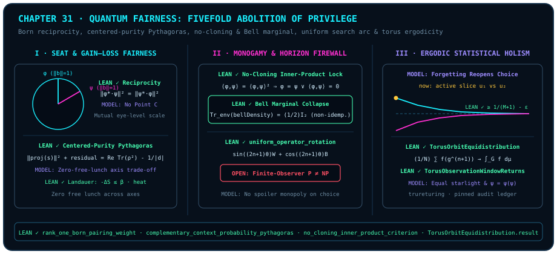

# The Essence of the Quantum Is Fairness: Fivefold Abolition of Geometric Privilege and Ergodic Statistical Holism

> *"The essence of the quantum is fairness... The universe cut away the lofty third point above, compelling all beings to measure one another pairwise at eye level; with the Pythagorean theorem it revoked the privilege of omniscience and omnipotence, with the horizon it sheltered the suspense of finite life, and finally with irrational ergodicity it guaranteed that every soul awakening from forgetting shall, across the long journey, receive an equally abundant share of starlight."*

Across [Chapter 29](ch29-timeless-causality-and-gram-space.md)'s timeless Gram compatibility crystal and [Chapter 30](ch30-fields-lines-eth-and-navier-stokes.md)'s computational orthogonal horizon, we repeatedly encountered across arithmetic, spacetime, quantum circuits, and continuum fluids the same family of seemingly austere physical prohibitions: no privileged external reference frame, no simultaneous possession of full particle certainty and full wave interference, no universal cloning of unknown pure states, no shortcut past the coherent rotation arc, and no polynomial-time omniscience for a bounded observer inside the static field.

Conventional textbooks often present these laws as a bleak catalog of isolated "no-go theorems," as though quantum mechanics existed merely to erect barbed wire around classical intuition. Yet the moment we step back to the orthogonal geometry developed throughout this monograph and translate "pairwise measurement, zero external frame, Pythagorean conservation, and ergodic statistical holism" into a single ontological word, the entire landscape inverts: every single prohibition and conservation law is the universe's constitutional guarantee of **Fairness (`MODEL`)**.

In the classical mechanistic worldview, structural privilege appeared natural: space could harbor an absolute central tribunal, force could act as a one-way inspection from above, information tokens could be duplicated at zero cost to issue simultaneous "exclusive" commitments to arbitrarily many parties, and superior computing power could in principle calculate and monopolize the future at a stroke. Quantum geometry acts instead as an incorruptible geometer-legislator, dismantling privilege across five orthogonal dimensions:

1. **Seat Fairness**: Cutting away the external "third point $C$" places every single-qubit pure state on a unit Bloch sphere of norm $1$, governed by strict modulus-square reciprocity under rank-one Born pairing;
2. **Gain–Loss Fairness**: Complementary-context centered-purity Pythagorean conservation enforces a zero-free-lunch ledger in which every unit of one-dimensional certainty is paid for by orthogonal residual potential or thermodynamic heat dissipation;
3. **Relational Fairness**: The inner-product no-cloning lock and maximally mixed Bell marginal (Conjuncts 3–4 of [@thm-ch31-seat-pythagorean-monogamy-fairness]; external multipartite extensions in [@rem-ch31-ckw-monogamy-literature]) cap shared correlation budgets so deep entanglement cannot be mass-produced;
4. **Horizon Fairness**: The fixed step-angle law of coherent uniform amplification (Conjunct 2 of [@thm-ch31-horizon-landauer-ergodic-fairness]) and the finite-observer complexity firewall ([Chapter 30](ch30-fields-lines-eth-and-navier-stokes.md) [@conj-p-neq-np]; external context in [@rem-ch30-query-sos-literature]) block computational monopolies from spoiling the suspense of finite life;
5. **Ergodic Fairness**: Birth-forgetting resets choice freedom (`MODEL`), while compact-torus closed-subgroup equidistribution and bounded-gap return (Conjuncts 3–4 of [@thm-ch31-horizon-landauer-ergodic-fairness]; external ergodic-theory extensions in [@rem-ch31-weyl-window-equidistribution-literature]) ground our ontological reading of shared long-run statistical holism.

---

## 31.1 Seat Fairness and Gain–Loss Fairness: Eye-Level Rulers and the Zero-Free-Lunch Ledger {#sec-ch31-seat-and-pythagoras}

The oldest source of privilege is to install an exalted tribunal outside the arena—precisely the external "third point $C$" we excised in [Chapter 2](ch02-born-rule.md)—so whichever state sits closer to the throne may declare itself the universal standard.

In pure-state geometry, by contrast, every normalized state inhabits a symmetric space devoid of privileged axes (`MODEL`); quantum geometry abolishes any disembodied "view from nowhere" (philosophical and literary context in [@rem-ch31-haar-isotropy-landauer-literature] below) through two algebraic laws:

- **Equality of Seat (Unit Pure-Qubit Bloch Norm)**: A sphere has neither capital city nor provincial periphery. For a single qubit, trace-$1$ idempotent Hermitian projectors lie precisely on the Euclidean unit sphere $\|\operatorname{bloch}(M)\| = 1$ by [Chapter 26](ch26-single-qubit-rotor-compilation.md)'s [`bloch_geometry_of_isHermitian`](lean:D5/S3/Quantum/Information/ActualPureQubitGeometry.bloch_geometry_of_isHermitian) (for higher-dimensional continuous symmetry background see [@rem-ch31-haar-isotropy-landauer-literature] below). No axis possesses intrinsic authority to crown itself cosmic North.
- **Reciprocity of Measurement (Eye-Level Symmetry)**: Under pairwise comparison, the rank-one pairing weight $\|\phi^* \bullet_v \psi\|^2$ obtained when $\psi$ serves as ruler to measure $\phi$ (Conjunct 1 of [@thm-ch31-seat-pythagorean-monogamy-fairness] below) is **identically equal** by conjugate symmetry of the complex inner product to the weight $\|\psi^* \bullet_v \phi\|^2 = |\langle\phi, \psi\rangle|^2 = |\langle\psi, \phi\rangle|^2$ obtained when $\phi$ measures $\psi$ in return. There is no one-way surveillance at the foundation of physics: **to the exact degree you illuminate another, the other simultaneously illuminates you**.

The second primordial greed is to demand absolute certainty and boundless freedom at once. In the language of an information-budget ledger, while a normalized state vector satisfies $\|\psi\|^2 = 1$, for any centered state operator above the unbiased baseline $|d|^{-1}I_d$ satisfying the centered-purity identity $\|\mathrm{state}\|^2 = \operatorname{Re}\operatorname{Tr}(\rho^2) - |d|^{-1}$ (for the general density-operator spectral purity bounds see [@rem-ch31-haar-isotropy-landauer-literature] below), the distinguishable information available for allocation is this **centered purity budget** $\|\mathrm{state}\|^2$. **Complementary-context centered-purity Pythagorean conservation** (Conjunct 2 of [@thm-ch31-seat-pythagorean-monogamy-fairness]) enforces an unyielding **zero-free-lunch ledger**: under its orthogonal coordinate hypothesis, the sum of squared certainty deviations $\|\mathrm{visible.starProjection}(\mathrm{state})\|^2$ extracted along a visible measurement subspace plus the undecided residual mass $\operatorname{residualMass}(\mathrm{visible}, \mathrm{state})$ in its orthogonal complement equals the state's exact centered purity budget $\|\mathrm{state}\|^2$:

- Commit $100\%$ of the centered purity budget onto the visible subspace at a chosen instant, and the complementary orthogonal residual mass at that instant vanishes identically; under a repeated-projective-measurement dynamical reading (`MODEL`; continuous Zeno-limit background in [Chapter 7](ch07-geometric-time-and-speed-limits.md) and [@rem-ch31-haar-isotropy-landauer-literature] below), this mirrors suppressing transverse transitions via frequent recalibration;
- Conversely, in our spacetime orthogonal-split model (`MODEL`; continuum literature background in [@rem-ch31-haar-isotropy-landauer-literature] below), committing the entire budget to a $90^\circ$ transverse wave plane zeroes out projection along proper time;
- Even if you wish to erase past error records and compress a higher-entropy state back toward a pure ray, the thermodynamic balance inequality $-\mathrm{entropyChange} \le \beta \cdot \mathrm{heat}$ ([Chapter 8](ch08-erasure-and-time-arrows.md) and Conjunct 1 of [@thm-ch31-horizon-landauer-ergodic-fairness] below) compels honest heat payment into the thermal bath.

Every gain along one axis is paid dollar for dollar along its orthogonal complement; not even an imagined deity can pocket both the North Pole point and the equatorial plane. Spectral purity ranges, continuum invariant-measure results, and physical-unit conversions accompanying this section are recorded below:

::: {.remark #rem-ch31-haar-isotropy-landauer-literature title="Unit-Sphere Haar Isotropy, Spectral Purity Bounds, and Landauer's Physical Heat Constant (Literature Result, Not Formalized in This Book)"}
**Literature result, not formalized in this book.** Three spectral, continuum, and physical-unit results referenced alongside our frozen inner-product and thermodynamic theorems belong to external classical literature and are not formalized as standalone declarations in `trureturing@dev`:

1. **Finite-Dimensional Density-Operator Spectral Purity Bounds and Repeated-Measurement Quantum Zeno Limit (J. von Neumann, 1932; B. Misra & E. C. G. Sudarshan, *J. Math. Phys.* **18**, 756–763, 1977)**: On a $d$-dimensional Hilbert space, every positive semidefinite trace-$1$ density operator $\rho$ (eigenvalues $\lambda_1,\dots,\lambda_d \ge 0,\; \sum_j \lambda_j = 1$) satisfies $|d|^{-1} \le \operatorname{Tr}(\rho^2) = \sum_{j=1}^d \lambda_j^2 \le 1$ by Cauchy–Schwarz and simplex convexity, placing the centered purity budget $\|\rho - |d|^{-1}I_d\|_{\mathrm{HS}}^2 = \operatorname{Tr}(\rho^2) - |d|^{-1}$ in $[0,\, 1 - |d|^{-1}]$. Under bounded Hamiltonian evolution $H$, applying projective measurement $P$ repeatedly at step $\Delta t = t/N \to 0$ yields $\lim_{N\to\infty} \operatorname{Tr}((P e^{-iH t/N} P)^N \rho_0 (P e^{iH t/N} P)^N) = \operatorname{Tr}(P \rho_0)$ (dynamical Zeno freezing requires repeated measurements rather than a static snapshot identity alone);
2. **Unitary Transitivity and Uniform Haar Measure on Pure-State Spheres (A. Haar, *Ann. of Math.* **34**, 147–169, 1933)**: On $\mathbb{C}^d$, the compact unitary group $\mathrm{U}(d)$ acts transitively on the unit sphere $S^{2d-1} = \{\psi \in \mathbb{C}^d : \|\psi\| = 1\}$ and on complex projective space $\mathbb{C}\mathrm{P}^{d-1}$, inducing a unique $\mathrm{U}(d)$-invariant normalized Haar probability measure $\mu_{\mathrm{Haar}}$ that eliminates any privileged basis vector (echoing F. Nietzsche's critique in *Thus Spoke Zarathustra*, "On Immaculate Perception," against the pretense of a perspectiveless spectator eye). Under angular parameterization $|\langle\phi,\psi\rangle| = \cos(\theta_{\mathrm{Bloch}}/2)$ (or Euclidean unit-vector overlap $\mathbf{A}\cdot\mathbf{B} = \cos\theta$), the Pythagorean identity reads

   $$
   \underbrace{\cos^2\theta}_{\text{1D collinear certainty share}} + \underbrace{\sin^2\theta}_{\text{2D orthogonal bifurcation share}} = 1,
   $$

   where $\theta = 0^\circ$ gives $\cos^2 0^\circ = 1,\; \sin^2 0^\circ = 0$ (vanishing instantaneous transverse variance) and $\theta = 90^\circ$ gives $\cos^2 90^\circ = 0,\; \sin^2 90^\circ = 1$ (special-relativistic null worldlines $d\tau/dt = 0$; cf. [Chapter 17](ch17-lorentz-geometry.md) [@rem-lorentz-rotor-literature]);
3. **Physical Boltzmann Conversion of Landauer's One-Bit Erasure (R. Landauer, *IBM J. Res. Dev.* **5**, 183–191, 1961)**: Coupling a system to a reservoir at inverse temperature $\beta = (k_B T)^{-1}$ and resetting a uniform binary state from von Neumann entropy $\ln 2$ to $0$ ($\Delta S = -\ln 2$) converts the dimensionless balance inequality $-\Delta S \le \beta Q$ into the physical heat floor $Q_{\min} = k_B T \ln 2$.
:::

---

## 31.2 Relational Fairness: No-Cloning and Entanglement Monogamy {#sec-ch31-monogamy}

In the classical data economy, a monopolist can copy a bitstring a million times at negligible cost and pledge "hundred-percent exclusive" correlation to arbitrarily many partners simultaneously. Inside the tensor-product geometry of multi-qubit systems, **Relational Fairness (`MODEL`)** enforces an ethic at once tender and uncompromising: **profound entanglement cannot be wholesaled, and a living superposition cannot be pirated.**

Within the Lean 4 kernel, two parameter-free theorems anchor this principle (collected as Conjuncts 3–4 of [@thm-ch31-seat-pythagorean-monogamy-fairness] below):

1. **Inner-Product No-Cloning Criterion** ([`no_cloning_inner_product_criterion`](lean:D5/S3/Quantum/PureState/NoCloningInnerProductCriterion.no_cloning_inner_product_criterion)): If a single complex linear isometry $U$ clones two normalized pure states $\psi, \phi$ from a normalized blank ancilla $\mathrm{blank}$ into $\psi\otimes\psi$ and $\phi\otimes\phi$, their inner product must satisfy $\langle\phi, \psi\rangle = \langle\phi, \psi\rangle^2$—forcing either $\phi = \psi$ (the very same state) or $\langle\phi, \psi\rangle = 0$ (orthogonal classical labels). No machine can blindly mass-produce states carrying genuine non-orthogonal superposition tension.
2. **Maximally Mixed Marginal of a Pure Bell State** ([`bell_pure_state_has_maximally_mixed_marginal`](lean:D5/S3/Quantum/Entanglement/BellPureStateMixedMarginal.bell_pure_state_has_maximally_mixed_marginal)): When two qubits bind into the rank-one maximally entangled Bell state `bellDensity`, tracing out the partner collapses the single-qubit marginal `traceEnvironment bellDensity` to $\frac{1}{2}I_2$ (which is strictly non-idempotent)—its local Bloch bias retreats completely to the origin, surrendering every drop of private purity to the shared relational plane!

The formal theorem below unites Born reciprocity, complementary centered-purity Pythagoras, no-cloning, and the Bell marginal collapse on a single Lean-verified foundation.

::: {.theorem #thm-ch31-seat-pythagorean-monogamy-fairness title="First Three Formal Pillars of Quantum Fairness: Born Reciprocity, Complementary Pythagoras, No-Cloning, and Bell Marginal" lean="D5/S3/Observer/Conditioning/RankOneBornPairingWeight.rank_one_born_pairing_weight D5/S3/Quantum/Tomography/ComplementaryContextProbabilityPythagoras.complementary_context_probability_pythagoras D5/S3/Quantum/PureState/NoCloningInnerProductCriterion.no_cloning_inner_product_criterion D5/S3/Quantum/Entanglement/BellPureStateMixedMarginal.bell_pure_state_has_maximally_mixed_marginal"}
Across the frozen finite-dimensional measurement, tomography, pure-state, and entanglement modules of `trureturing`, the following four structural fairness theorems hold simultaneously:

1. **Modulus-Square Reciprocity of Rank-One Born Pairing** ([`rank_one_born_pairing_weight`](lean:D5/S3/Observer/Conditioning/RankOneBornPairingWeight.rank_one_born_pairing_weight)): Let $n, \kappa$ be finite types (`[Fintype n] [DecidableEq n] [Fintype kappa]`), let $P : \kappa \to M_n(\mathbb{C})$ satisfy `IsRecordMeasurement P`, and let $\rho \in M_n(\mathbb{C})$ satisfy `rho.PosSemidef ∧ Matrix.trace rho = 1`. Whenever $P_k = \phi\phi^*$ (`Matrix.vecMulVec phi (star phi)`) and $\rho = \psi\psi^*$ (`Matrix.vecMulVec psi (star psi)`),

   $$
   \operatorname{recordWeight}(P, \rho, k) = \bigl(\|\phi^* \bullet_v \psi\|^2 : \mathbb{C}\bigr) \;\land\; \operatorname{recordWeight}(P, \rho, k) = \operatorname{Tr}(\rho P_k) \;\land\; \operatorname{unreadState}(P, \rho) = \sum_{j \in \kappa} \operatorname{recordWeight}(P, \rho, j)\bullet \operatorname{conditionalState}(P, \rho, j);
   $$
2. **Complementary-Context Centered-Purity Pythagoras** ([`complementary_context_probability_pythagoras`](lean:D5/S3/Quantum/Tomography/ComplementaryContextProbabilityPythagoras.complementary_context_probability_pythagoras)): Let $d, L$ be finite types with $d$ nonempty, let $E$ be a complete real inner-product space, and let `visible` be a closed subspace of $E$. If the centered purity satisfies $\operatorname{Re}\operatorname{Tr}(\rho^2) - |d|^{-1} = \|\mathrm{state}\|^2$ and $\|\mathrm{visible.starProjection}(\mathrm{state})\|^2 = \sum_{l \in L}\sum_{j \in d}\bigl(\mathrm{probability}(l, j) - |d|^{-1}\bigr)^2$, then

   $$
   \operatorname{Re}\operatorname{Tr}(\rho^2) - |d|^{-1} \;=\; \sum_{l \in L}\sum_{j \in d}\bigl(\mathrm{probability}(l, j) - |d|^{-1}\bigr)^2 \;+\; \operatorname{residualMass}(\mathrm{visible}, \mathrm{state});
   $$

3. **Inner-Product Idempotence Lock for Cloning Isometries** ([`no_cloning_inner_product_criterion`](lean:D5/S3/Quantum/PureState/NoCloningInnerProductCriterion.no_cloning_inner_product_criterion)): Let $H$ be a complex inner-product space and $U : H \otimes_{\mathbb{C}} H \simeq_{\ell i} H \otimes_{\mathbb{C}} H$ a complex linear isometric isomorphism. If unit vectors $\|\psi\| = \|\phi\| = \|\mathrm{blank}\| = 1$ satisfy $U(\psi \otimes \mathrm{blank}) = \psi \otimes \psi$ and $U(\phi \otimes \mathrm{blank}) = \phi \otimes \phi$, then

   $$
   \langle\phi, \psi\rangle_{\mathbb{C}} = \langle\phi, \psi\rangle_{\mathbb{C}}^2 \;\land\; \bigl(\phi = \psi \;\lor\; \langle\phi, \psi\rangle_{\mathbb{C}} = 0\bigr);
   $$

4. **Maximally Mixed Marginal of the Pure Two-Qubit Bell State** ([`bell_pure_state_has_maximally_mixed_marginal`](lean:D5/S3/Quantum/Entanglement/BellPureStateMixedMarginal.bell_pure_state_has_maximally_mixed_marginal)): The two-qubit Bell state vector satisfies $\mathrm{bellVector}^* \bullet_v \mathrm{bellVector} = 1$, and its density matrix $\mathrm{bellDensity}$ is positive semidefinite, trace-$1$, rank-$1$, and idempotent ($\mathrm{bellDensity}^2 = \mathrm{bellDensity}$), whereas its single-qubit partial trace collapses to the non-idempotent half-identity:

   $$
   \operatorname{traceEnvironment}(\mathrm{bellDensity}) = \tfrac{1}{2}I_2, \qquad \operatorname{traceEnvironment}(\mathrm{bellDensity})^2 \neq \operatorname{traceEnvironment}(\mathrm{bellDensity}).
   $$
:::

::: proof
Conjunct 1 combines `rank_one_pure_state_modulus_square_reduction` with `unread_eq_weighted_ensemble` (from which conjugate inversion of the dot product gives $\|\phi^* \bullet_v \psi\|^2 = \|\psi^* \bullet_v \phi\|^2$); Conjunct 2 applies `Submodule.norm_sq_eq_add_norm_sq_starProjection` across orthogonal projections in the complete real inner-product space $E$; Conjunct 3 uses isometric preservation of tensor inner products $\langle\phi, \psi\rangle\langle\mathrm{blank}, \mathrm{blank}\rangle = \langle\phi, \psi\rangle^2$ over the integral domain $\mathbb{C}$ via `eq_zero_or_one_of_sq_eq_self` and `inner_eq_one_iff_of_norm_eq_one`; Conjunct 4 evaluates the block partial trace of the $4\times 4$ projector and checks $(\frac{1}{2}I_2)^2 = \frac{1}{4}I_2 \neq \frac{1}{2}I_2$. The full proof is checked by the Lean kernel.
:::

External quantum-information extensions to three-qubit and multipartite entanglement shares are recorded below:

::: {.remark #rem-ch31-ckw-monogamy-literature title="Three-Qubit CKW Entanglement Monogamy Inequality and Bell / W / GHZ Budget Audit (Literature Result, Not Formalized in This Book)"}
**Literature result, not formalized in this book.** Quantitative monogamy bounds on shared bipartite entanglement belong to the external quantum-information literature and are not formalized in `trureturing@dev`:

1. **Three-Qubit CKW Monogamy Inequality (V. Coffman, J. Kundu & W. K. Wootters, *Phys. Rev. A* **61**, 052306, 2000) and $n$-Qubit Generalization (T. J. Osborne & F. Verstraete, *Phys. Rev. Lett.* **96**, 220503, 2006)**: For any three-qubit state $\rho_{ABC}$ (pure or mixed), let $\tau(\mathbf{A}:\mathbf{B}) := C(\rho_{AB})^2$ and $\tau(\mathbf{A}:\mathbf{C}) := C(\rho_{AC})^2$ denote the squared Wootters concurrences (2-tangles), and write the reduced state $\rho_A = \operatorname{Tr}_{BC}(\rho_{ABC}) = \frac{1}{2}(I_2 + \mathbf{r}_A\cdot\boldsymbol{\sigma})$ with Bloch vector $\mathbf{r}_A \in \mathbb{R}^3$ ($\|\mathbf{r}_A\| \le 1$). Then the pairwise entanglement shares obey

   $$
   \tau(\mathbf{A}:\mathbf{B}) + \tau(\mathbf{A}:\mathbf{C}) \;\le\; \tau(\mathbf{A}:\mathbf{BC}) \;\le\; 4\det\rho_A \;=\; 1 - \|\mathbf{r}_A\|^2 \;\le\; 1
   $$

   (for pure $|\Psi_{ABC}\rangle$, $\tau(\mathbf{A}:\mathbf{BC}) = 4\det\rho_A = 1 - \|\mathbf{r}_A\|^2$, and the nonnegative deficit $\tau_3 := \tau(\mathbf{A}:\mathbf{BC}) - \tau(\mathbf{A}:\mathbf{B}) - \tau(\mathbf{A}:\mathbf{C}) \ge 0$ defines the residual 3-tangle; Osborne and Verstraete proved the $n$-qubit extension $\sum_{j=2}^n \tau(A_1 : A_j) \le \tau(A_1 : A_2\cdots A_n)$);
2. **Explicit Audit on Three Benchmark Pure Three-Qubit States**:
   - **Bell Pair Plus Decoupled Third Qubit $|\Phi^+\rangle_{AB}\otimes|0\rangle_C$**: Here $\rho_A = \frac{1}{2}I_2$ ($\|\mathbf{r}_A\| = 0$) and $\tau(\mathbf{A}:\mathbf{B}) = 1$, forcing $\tau(\mathbf{A}:\mathbf{C}) = 0$—exhausting the full unit budget with $\mathbf{B}$ leaves strictly zero entanglement capacity for any third party $\mathbf{C}$;
   - **$W$ State $|W\rangle = \frac{1}{\sqrt{3}}(|100\rangle + |010\rangle + |001\rangle)$**: The marginal $\rho_A = \operatorname{diag}(\frac{2}{3}, \frac{1}{3})$ retains local Bloch polarization $\|\mathbf{r}_A\| = \frac{1}{3}$, capping total available tangle at $1 - \|\mathbf{r}_A\|^2 = \frac{8}{9}$, split equally as $\tau(\mathbf{A}:\mathbf{B}) = \tau(\mathbf{A}:\mathbf{C}) = \left(\frac{2}{3}\right)^2 = \frac{4}{9}$ so $\frac{4}{9} + \frac{4}{9} = \frac{8}{9}$ saturates CKW with $\tau_3 = 0$;
   - **GHZ State $|\mathrm{GHZ}\rangle = \frac{1}{\sqrt{2}}(|000\rangle + |111\rangle)$**: Although $\|\mathbf{r}_A\| = 0$, both two-body marginals $\rho_{AB} = \rho_{AC} = \frac{1}{2}(|00\rangle\langle 00| + |11\rangle\langle 11|)$ are separable mixtures with $\tau(\mathbf{A}:\mathbf{B}) = \tau(\mathbf{A}:\mathbf{C}) = 0$, converting the entire budget into irreducible three-body tangle $\tau_3 = 1$.
:::

---

## 31.3 Horizon Fairness and Ergodic Fairness: Sheltered Suspense and Equal Starlight {#sec-ch31-horizon-and-ergodic}

Even with the first three tiers in place, human existence presses two deeper questions:

- **First (The Question of Computational Power)**: If the global timeless static field exhibits $P = NP$-like fixed-point immediacy under idealized timeless models ([Chapter 30](ch30-fields-lines-eth-and-navier-stokes.md)), why did the universe surround every finite observer inside the field with an exponential search horizon?
  The answer is **Horizon Fairness (`MODEL`)**! Imagine a world where bounded observers inside the crystal could also solve NP-complete global constraints in polynomial time: whoever possessed a slightly faster processor would deduce every secret, pre-compute the endgame of every rivalry, and lock down the entire decision tree before newcomers could place a single stone. Instead, the fixed planar rotation step angle of coherent uniform amplification dictated by initial overlap $p = \sin^2\theta$ (Conjunct 2 of [@thm-ch31-horizon-landauer-ergodic-fairness] below; external complexity lower-bound context in [Chapter 30](ch30-fields-lines-eth-and-navier-stokes.md) [@rem-ch30-query-sos-literature]) and the open $\mathrm{P} \neq \mathrm{NP}$ complexity firewall ([@conj-p-neq-np]) compel quantum evolution to accumulate rotation angle step by step inside a two-dimensional plane—no computational oligarchy can bypass curvature to pre-emptively monopolize the future.
- **Second (The Question of Unequal Circumstance)**: If finite observers enter the timeless lattice at different internal phases—some stepping near the serene center of the acceptance window over a short span, others buffeted near its boundary—**where is ultimate fairness?**

Unfolding our cut-and-project observer model alongside compact-torus ergodic theory reveals a crystalline answer:

1. **Birth-Forgetting Resets Choice Freedom (`MODEL`)**: As shown in [Chapter 29](ch29-timeless-causality-and-gram-space.md) ([@thm-ch29-gram-rigidity-and-pell]) and the [Coda](coda.md), unbounded accumulation of historical anchors would eventually drive compatible choice slack toward lockup. Birth-forgetting truncates high-order historical baggage so that every finite observer awakening anew faces a fresh corridor of positive-volume choice.
2. **Closed-Subgroup Equidistribution and Bounded-Gap Return (`LEAN ✓` + `MODEL`)**: Over a handful of local steps, disparate slices genuinely encounter different local fortunes; yet on any compact torus subgroup, `trureturing`'s **torus orbit equidistribution theorem** and **bounded-gap observation-window return theorem** (Conjuncts 3–4 of [@thm-ch31-horizon-landauer-ergodic-fairness] below) prove that Cesàro time averages of continuous observables converge strictly to the normalized translation-invariant probability integral on the closed orbit subgroup $G = \overline{\langle g\rangle}$, and every nonempty open interval $(u, v)$ intersecting $\operatorname{range}(h)$ is revisited with bounded gap $M$ and **positive lower asymptotic visit density** at least $\frac{1}{M+1} - \varepsilon$ (for external ergodic-theory extensions to sharp acceptance-window indicators under irrational torus translations, see [@rem-ch31-weyl-window-equidistribution-literature] below).

We first anchor the four formal theorems governing Landauer heat balance, coherent amplification rotation, torus orbit equidistribution, and bounded-gap window return.

::: {.theorem #thm-ch31-horizon-landauer-ergodic-fairness title="Fourth and Fifth Formal Pillars of Quantum Fairness: Landauer Balance, Uniform Search Rotation, and Torus Ergodic Return" lean="D5/S3/DivergenceSupport/LandauerBound.landauer_bound_of_balance D5/S3/Quantum/Recovery/CoherentUniformAmplification.uniform_operator_rotation D5/S3/Fourier/Asymptotics/TorusOrbitEquidistribution.result D5/S3/Fourier/Asymptotics/TorusObservationWindowReturns.result"}
Across the frozen thermodynamic-divergence, coherent-amplification, and Fourier torus-asymptotics modules of `trureturing`, the following four theorems hold simultaneously:

1. **Landauer Thermodynamic Balance Bound** ([`landauer_bound_of_balance`](lean:D5/S3/DivergenceSupport/LandauerBound.landauer_bound_of_balance)): For real quantities $\beta, \mathrm{heat}, \mathrm{entropyChange}, \mathrm{mutualInfo}, \mathrm{divergence} \in \mathbb{R}$ satisfying $\beta \cdot \mathrm{heat} = -\mathrm{entropyChange} + \mathrm{mutualInfo} + \mathrm{divergence}$ with $\mathrm{mutualInfo} \ge 0$ and $\mathrm{divergence} \ge 0$, entropy reduction is bounded above by $\beta$ times the dissipated heat (equivalently, $\beta \cdot \mathrm{heat}$ is bounded below by entropy reduction):

   $$
   -\mathrm{entropyChange} \;\le\; \beta \cdot \mathrm{heat};
   $$

2. **Two-Plane Stepwise Rotation Law of Coherent Uniform Amplification** ([`uniform_operator_rotation`](lean:D5/S3/Quantum/Recovery/CoherentUniformAmplification.uniform_operator_rotation)): Let $l, s$ be finite decidable types (`[Fintype l] [DecidableEq l] [Fintype s] [DecidableEq s]`), and let $J \in M_{l\times s}(\mathbb{C})$ and $C, P \in M_{l\times l}(\mathbb{C})$ satisfy $J^\dagger J = I_s,\, C^\dagger C = I_l,\, P^\dagger = P = P^2$, and $(P(CJ))^\dagger (P(CJ)) = p\,I_s$ with $0 < p \le 1$. Writing $U = CJ$, $W = \operatorname{success}(U, P, p)$, $B = \operatorname{failure}(U, P, p)$, and $\theta = \arcsin\sqrt{p}$: if $p = 1$ then $U = W$; if $p < 1$ then $W^\dagger W = I_s,\, B^\dagger B = I_s,\, W^\dagger B = 0$, and for every iteration count $n \in \mathbb{N}$ (preserving the identical linear combination after Kronecker tensoring $\otimes_k R$ with any reference matrix $R \in M_z(\mathbb{C})$ on any type $z$),

   $$
   (\operatorname{iterate}(U, P))^n \, U \;=\; \sin\bigl((2n + 1)\theta\bigr)\,W \;+\; \cos\bigl((2n + 1)\theta\bigr)\,B;
   $$

3. **Haar Equidistribution of Closed-Subgroup Torus Orbits** ([`TorusOrbitEquidistribution.result`](lean:D5/S3/Fourier/Asymptotics/TorusOrbitEquidistribution.result)): Let $I$ be a finite index type, $g : I \to \mathrm{Circle}$ a torus element, $G = \overline{\langle g\rangle}$ its compact closed subgroup, and $\mu$ the normalized Haar probability measure on $G$. Then $G = \overline{\{g^n : n \in \mathbb{N}\}}$ and for every continuous observable $f \in C(G, \mathbb{C})$,

   $$
   \lim_{N \to \infty} \frac{1}{N}\sum_{n=0}^{N-1} f(g^{n+1}) \;=\; \int_G f(z)\,d\mu(z);
   $$

4. **Full Image Support, Bounded-Gap Window Return, and Positive Lower Asymptotic Visit Density** ([`TorusObservationWindowReturns.result`](lean:D5/S3/Fourier/Asymptotics/TorusObservationWindowReturns.result)): With $G, \mu$ as in Conjunct 3 and generator $a = \langle g, \dots\rangle \in G$, for every continuous real observable $h \in C(G, \mathbb{R})$ and sequence $e : \mathbb{N} \to \mathbb{R}$ satisfying $\lim_{n\to\infty}(e(n) - h(a^n)) = 0$, the pushforward support equals the full range $\operatorname{supp}(h_*\mu) = \operatorname{range}(h)$; moreover, whenever an open interval $(u, v) \subset \mathbb{R}$ satisfies $(I_{oo}(u, v) \cap \operatorname{range}(h)).\mathrm{Nonempty}$, there exist $n_0 \ge 1$ and a bounded gap $M \in \mathbb{N}$ such that every block $[n, n+M]$ ($n \ge n_0$) contains at least one $m$ with $e(m) \in (u, v)$, and for every $\varepsilon > 0$ the positive lower asymptotic visit density bound holds eventually:

   $$
   \forall^\infty N \in \mathbb{N},\qquad \frac{\#\bigl\{m < N \;\big|\; e(m) \in (u, v)\bigr\}}{N} \;\ge\; \frac{1}{M + 1} - \varepsilon.
   $$
:::

::: proof
Conjunct 1 follows from $\mathrm{mutualInfo} + \mathrm{divergence} \ge 0$; Conjunct 2 gives $U = W$ via `unit_success` when $p = 1$, and when $p < 1$ verifies mutual isometric orthogonality of $W$ and $B$, inducts on $n$ via angle-addition identities, and distributes Kronecker tensoring across $\otimes_k R$; Conjunct 3 uses equicontinuity of the Cesàro evaluation operators to close the convergence subspace $S \subseteq C(G, \mathbb{C})$, canceling nontrivial torus characters via geometric sums and extending by trigonometric-polynomial density; Conjunct 4 proves $\operatorname{supp}(h_*\mu) = \operatorname{range}(h)$ from strict positivity on nonempty open pullbacks and extracts the uniform return gap $M$ and positive lower asymptotic visit density bound from a finite subcover of compact orbit translates. The full proof is checked by the Lean kernel.
:::

External ergodic-theory extensions from continuous observables to sharp acceptance-window indicators are recorded below:

::: {.remark #rem-ch31-weyl-window-equidistribution-literature title="Irrational Torus Unique Ergodicity and Weyl Window Equidistribution (Literature Result, Not Formalized in This Book)"}
**Literature result, not formalized in this book.** Conjunct 3 of [@thm-ch31-horizon-landauer-ergodic-fairness] holds for any torus element $g : I \to \mathrm{Circle}$ and continuous $f \in C(G, \mathbb{C})$ on its closed orbit subgroup $G = \overline{\langle g\rangle}$; specializing to phase-independent window-residence equality on the full internal torus $\mathbb{T}_\perp^d = \mathbb{R}^d / \mathbb{Z}^d$ (such as $d = 3$) invokes the classical ergodic theorem below (not formalized as a standalone theorem in `trureturing@dev`):

- **Kronecker–Weyl Unique Ergodicity and Jordan-Measurable Window Equidistribution (H. Weyl, *Math. Ann.* **77**, 313–352, 1916)**: If a translation vector $\boldsymbol{\alpha} \in \mathbb{R}^d$ has $1, \alpha_1, \dots, \alpha_d$ linearly independent over $\mathbb{Q}$, then $x \mapsto x + \boldsymbol{\alpha} \pmod{\mathbb{Z}^d}$ is **uniquely ergodic** on the full torus $G = \mathbb{T}_\perp^d$ (normalized Lebesgue/Haar measure is its sole invariant Borel probability measure). Approximating from above and below by continuous Urysohn envelopes, for every subset $W \subset \mathbb{T}_\perp^d$ with Lebesgue-null boundary ($\operatorname{Vol}(\partial W) = 0$, i.e., Jordan measurable, including every convex polyhedral acceptance window) and **any two initial internal phases $u_1, u_2 \in \mathbb{T}_\perp^d$**, the asymptotic residence fraction inside the shifted window $W + u_i$ is completely independent of $u_i$:

  $$
  \lim_{T \to \infty} \frac{1}{T}\sum_{t=1}^{T} \mathbf{1}_W\bigl(\pi_\perp(z_t) - u_1\bigr)
  \;=\;
  \lim_{T \to \infty} \frac{1}{T}\sum_{t=1}^{T} \mathbf{1}_W\bigl(\pi_\perp(z_t) - u_2\bigr)
  \;=\;
  \frac{\operatorname{Vol}(W)}{\operatorname{Vol}(\mathbb{T}_\perp^d)}.
  $$
:::

Seen in this long-horizon light, local disparities lose their sting: in our observer model (`MODEL`), short slices vary from smooth centers to turbulent rims, yet across compact-torus ergodic return the universe grants every soul phase impartial attractor-reunion opportunities, orthogonal rotation budgets, and self-referential fixed-point pull (cf. [Chapter 24](ch24-cosine-fixed-points-and-self-reference.md) [@rem-banach-dottie-hairy-ball-literature]), without a hair's breadth of favoritism.

We conclude by consolidating all five tiers of quantum fairness and their exact epistemic status in the master reference table below:

::: {.remark #rem-ch31-fivefold-fairness-table title="Master Ledger of Fivefold Quantum Fairness and Epistemic Status (Literature Result, Not Formalized in This Book)"}
**Literature result, not formalized in this book.** The table below synthesizes the five fairness tiers established in this chapter; clauses tagged `LEAN ✓` correspond to [@thm-ch31-seat-pythagorean-monogamy-fairness] and [@thm-ch31-horizon-landauer-ergodic-fairness], clauses tagged `Literature` cite [@rem-ch31-haar-isotropy-landauer-literature], [@rem-ch31-ckw-monogamy-literature], [@rem-ch31-weyl-window-equidistribution-literature], and [Chapter 30](ch30-fields-lines-eth-and-navier-stokes.md) [@rem-ch30-query-sos-literature], `OPEN` marks [@conj-p-neq-np], and the fivefold abolition-of-privilege synthesis constitutes our cross-domain philosophical model (`MODEL`):

| Fairness Tier | Underlying Geometric, Algebraic & Thermodynamic Law | Epistemic Status | What Geometric "Privilege" Does It Abolish? (`MODEL`) |
| :--- | :--- | :--- | :--- |
| **1. Seat Fairness (席位公平)** | Unit pure-qubit Bloch norm & rank-one Born modulus-square reciprocity $\|\phi^*\bullet_v\psi\|^2 = \|\psi^*\bullet_v\phi\|^2$ (`LEAN ✓`); higher-D Haar sphere isotropy (`Literature`) | `LEAN ✓` / `Literature` / `MODEL` | Cuts away the external "third point $C$," abolishing privileged reference frames and one-way inspection |
| **2. Gain–Loss Fairness (得失公平)** | Complementary-context centered-purity Pythagoras (`LEAN ✓`), $\cos^2\theta + \sin^2\theta = 1$ (`Literature`), and Landauer balance $-\Delta S \le \beta Q$ (`LEAN ✓`; $k_B T \ln 2$ `Literature`) | `LEAN ✓` / `Literature` / `MODEL` | Abolishes the free-lunch greed of claiming $100\%$ 1D certainty while retaining $100\%$ orthogonal dynamical freedom |
| **3. Relational Fairness (关系公平)** | Cloning inner-product lock & Bell mixed marginal $\frac{1}{2}I_2$ (`LEAN ✓`); 3-qubit CKW monogamy $\tau(\mathbf{A}:\mathbf{B}) + \tau(\mathbf{A}:\mathbf{C}) \le 1 - \|\mathbf{r}_A\|^2 \le 1$ (`Literature`) | `LEAN ✓` / `Literature` / `MODEL` | Abolishes blind copying of live superpositions and wholesale monopolization of exclusive bipartite entanglement |
| **4. Horizon Fairness (博弈公平)** | Coherent amplification step-angle rotation (`LEAN ✓`), high-dimensional $\theta_0 \approx \frac{\pi}{2} - 2^{-n/2}$ & BBBV $\Omega(2^{n/2})$ lower bound (`Literature`), and $\mathrm{P} \neq \mathrm{NP}$ (`OPEN`) | `LEAN ✓` / `Literature` / `OPEN` / `MODEL` | Abolishes instant computational spoilers over the global causal crystal, sheltering the suspense of finite choice |
| **5. Ergodic Fairness (遍历公平)** | Birth-forgetting choice reset (`MODEL`), closed-subgroup torus Haar equidistribution & positive lower asymptotic visit density return (`LEAN ✓`), and Weyl window equidistribution $\operatorname{Vol}(W)/\operatorname{Vol}(\mathbb{T}_\perp^d)$ (`Literature`) | `LEAN ✓` / `Literature` / `MODEL` | Abolishes permanent caste lock-in from initial phase bias, realizing statistical holism across divergent local paths |
:::

Woven into the fabric of this monograph, the word *quantum* ceases to be cold operator machinery and acquires an unmistakable human warmth: **the universe cut away the lofty third point above, compelling all beings to measure one another pairwise at eye level; with the Pythagorean theorem it revoked the privilege of omniscience and omnipotence, with the horizon it sheltered the suspense of finite life, and finally with irrational ergodicity it guaranteed that every soul awakening from forgetting shall, across the long journey, receive an equally abundant share of starlight.**
