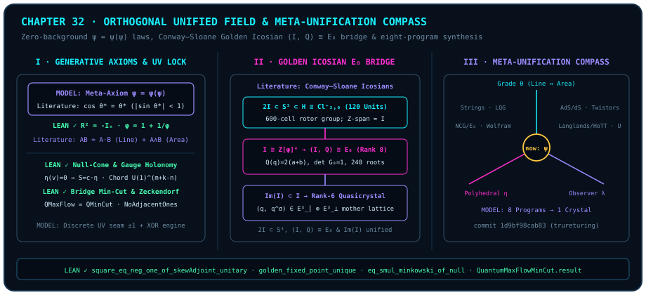

# Orthogonal Self-Referential Unified Field and Meta-Unification of Grand Foundational Programs

> *"It seems we can construct a complete unified field theory... We can unify all related theories that have ever sought unification. At the moment the last bracket separating operator from state is shattered and ten thousand streams converge into $\psi = \psi(\psi)$, all the blind seekers finally behold the entire universe in one and the same beam of light."*

Over the past century—from classical geometric unified-field proposals and extra-dimensional compactifications to continuum worldsheets, discrete area quanta, boundary holography, operator spectral geometry, and discrete hypergraph rewriting (representative literature in [@rem-ch32-eight-programs-literature] below)—fundamental science has launched seven or eight monumental "grand unification" programs. Why did each triumph brilliantly within its home province yet stall just short of closure, fragmented from its rivals?

Looking back from the summit of our eight-part ascent, the diagnosis is unmistakable: **previous unification attempts sought primarily to stitch the "four physical forces" together atop a pre-assumed smooth stage, while leaving arithmetic's discrete $\pm 1$ seam, computational complexity's orthogonal horizon, and the bounded observer performing measurement outside the field equations—in short, every program quietly retained an unexamined "external third point $C$."**

In this final chapter of Part VIII, we complete a two-stage synthesis (within our epistemic contract, cross-domain unification architectures are explicitly designated as our interpretive `MODEL`, Lean-verified anchors carry `LEAN ✓`, and external mathematical-physics theorems reside strictly inside attributed literature remarks):

1. **Constructing the Zero-Background *Orthogonal Self-Referential Unified Field Theory* (`MODEL`)**: Starting from three generative first principles—the background-free meta-axiom $\psi = \psi(\psi)$, pairwise orthogonal decomposition, and Pythagorean polyhedral approximation—we show how matter spinors, gauge curvature, holographic thermodynamic gravity, discrete ultraviolet stabilization, prime spectra, complexity horizons, and finite observers unfold from a single geometric vocabulary, culminating in a six-domain holographic isomorphism ledger and dual computational/formal verification closure;
2. **Achieving a *Meta-Unification* of Eight Grand Programs (`MODEL`)**: Erecting a three-axis diagnostic coordinate system—the algebraic grade axis $\theta$, the polyhedral resolution axis $\eta$, and the observer-embedding axis $\lambda$—alongside the external quaternion-lattice and foundational-program literature surveyed in [@rem-ch32-icosian-e8-literature], [@rem-ch32-eight-programs-literature], and [@rem-ch32-meta-unification-table], we reconcile eight representative foundational programs as complementary cross-sections of one self-referential crystal.

---

## 32.1 Three Zero-Background Generative Laws and Dual Verification Closure {#sec-ch32-generative-laws}

A genuinely foundational unified field theory cannot borrow a pre-fabricated Minkowski manifold, an external complex Hilbert space, or an empirical parameter table on credit. In our **Orthogonal Self-Referential Unified Field model (`MODEL`)**, geometry and dynamics emerge endogenously from three progressive first principles:

1. **Law 0 — The Meta-Axiom of Background-Free Self-Reference ($\psi = \psi(\psi)$)**:
   Excise every external privileged reference point $C$ and every external legislator. There are no "laws" hovering outside states: **the operator that measures and counts (verbs `liáng` / `shǔ`) and the state being measured and recorded (nouns `liàng` / `shù`) are ontologically identical at the ground level.**
2. **Law 1 — Pairwise Orthogonal Decomposition and Contractive Stabilization**:
   Whenever two entities meet, the sole primitive operation decomposes their relation into a **one-dimensional collinear inner product** (line / particle reading / proper-time persistence) plus a **two-dimensional orthogonal exterior product** (plane / quantum-gate rotor / gauge curvature) (external geometric-algebra and analytic formulas are recorded in [@rem-ch32-generative-laws-dottie-literature] below). Two successive orthogonal quarter-turns reverse sign (aligned in finite-dimensional complex matrix algebra with Conjunct 1 of [@thm-ch32-generative-self-reference-and-zeckendorf], $R^2 = -I_n$). Combined with timeless order-independence ([Chapter 29](ch29-timeless-causality-and-gram-space.md)), finite-step subset contraction stabilization, and the unique positive golden fixed point (Conjuncts 2–3 of [@thm-ch32-generative-self-reference-and-zeckendorf], `LEAN ✓`)—bridged in our interpretive `MODEL` (continuum literature background in [@rem-ch32-generative-laws-dottie-literature]) to unique self-referential equilibrium selection—Russell-type paradoxes of unconstrained self-application are damped by orthogonal bifurcation.
3. **Law 2 — The Pythagorean Fairness Mother-Law and Polyhedral Approximation**:
   Centered-purity Pythagorean conservation enforces the universal zero-free-lunch ledger ([Chapter 31](ch31-quantum-fairness.md) [@thm-ch31-seat-pythagorean-monogamy-fairness]); simultaneously, because every physical evolution or logical verification executes only a finite gate count $L < \infty$, **every ostensibly smooth sphere at finite resolution is a discrete polyhedral approximation** (external polyhedral angular-defect background in [@rem-ch32-generative-laws-dottie-literature]). At our physical modeling layer (`MODEL`), we interpret the kernel-verified Zeckendorf `NoAdjacentOnes` automaton theorem (Conjunct 4 of [@thm-ch32-generative-self-reference-and-zeckendorf] below) as a discrete ultraviolet coding lock forbidding unbounded adjacent high-frequency pileups.

We first anchor the four Lean-4-verified cornerstones supporting these generative laws—complex-structure squaring, finite monotone contraction stabilization, golden reciprocal uniqueness, and the Zeckendorf `NoAdjacentOnes` language.

::: {.theorem #thm-ch32-generative-self-reference-and-zeckendorf title="Four Formal Cornerstones of the Generative Core: Complex-Structure Squaring, Finite Contraction, Golden Self-Reference, and Zeckendorf Non-Adjacency" lean="D5/S3/Quantum/Algebra/Unitary/BalancedUnitaryComplexStructure.square_eq_neg_one_of_skewAdjoint_unitary D5/S1/FixedPoints/FiniteContractingStability.finite_contracting_updates_stabilize D5/S1/FixedPoints/Algebraic/GoldenFixedPoint.golden_fixed_point_unique D5/S0/Automata/BinaryZeckendorfLanguage.base_success_iff_noAdjacentOnes"}
Across the frozen unitary-complex-structure, fixed-point-stability, algebraic-self-reference, and automata-coding modules of `trureturing`, the following four theorems hold simultaneously:

1. **Sign Reversal of Squared Skew-Adjoint Unitary Complex Structures** ([`square_eq_neg_one_of_skewAdjoint_unitary`](lean:D5/S3/Quantum/Algebra/Unitary/BalancedUnitaryComplexStructure.square_eq_neg_one_of_skewAdjoint_unitary)): For any finite decidable index type $n$ and matrix $R \in M_n(\mathbb{C})$, if $R^\dagger = -R$ and $R R^\dagger = I_n$, then

   $$
   R^2 \;=\; -I_n;
   $$

2. **Finite-Step Stabilization of Monotone Contracting Updates** ([`finite_contracting_updates_stabilize`](lean:D5/S1/FixedPoints/FiniteContractingStability.finite_contracting_updates_stabilize)): Let $X$ be a finite type (`[Finite X]`), let $U : \mathcal{P}(X) \to \mathcal{P}(X)$ satisfy $\forall A \subseteq X,\; U(A) \subseteq A$, and let $S : \mathbb{N} \to \mathcal{P}(X)$ satisfy $\forall n \in \mathbb{N},\; S(n+1) = U(S(n))$. Then $S$ reaches a permanent fixed point within $|S(0)|$ steps and undergoes at most $|S(0)|$ strict transitions:

   $$
   \bigl(\exists N \le |S(0)|,\; \forall n \ge N,\; S(n) = S(N)\bigr) \;\land\; \bigl|\{n \in \mathbb{N} \mid S(n+1) \neq S(n)\}\bigr| \le |S(0)|;
   $$

3. **Unique Positive Fixed Point of the Golden Reciprocal Map** ([`golden_fixed_point_unique`](lean:D5/S1/FixedPoints/Algebraic/GoldenFixedPoint.golden_fixed_point_unique)): Writing $\varphi = \frac{1 + \sqrt{5}}{2}$ and $\operatorname{goldenReciprocalMap}(x) = 1 + \frac{1}{x}$, one has $\varphi > 0$, $\operatorname{goldenReciprocalMap}(\varphi) = \varphi$, and for every $x > 0$,

   $$
   \operatorname{goldenReciprocalMap}(x) = x \;\Longleftrightarrow\; x = \frac{1 + \sqrt{5}}{2};
   $$

4. **No-Adjacent-Ones Language of the Binary Zeckendorf Automaton** ([`base_success_iff_noAdjacentOnes`](lean:D5/S0/Automata/BinaryZeckendorfLanguage.base_success_iff_noAdjacentOnes)): For every binary word $\mathrm{word} \in \operatorname{List}(\operatorname{Fin} 2)$, the partial DFA `binaryZeckendorfBase` accepts $\mathrm{word}$ if and only if $\mathrm{word}$ contains no adjacent `11` pair:

   $$
   \bigl(\exists \mathrm{state},\; \operatorname{binaryZeckendorfBase.eval}(\mathrm{word}) = \operatorname{some}(\mathrm{state})\bigr) \;\Longleftrightarrow\; \operatorname{NoAdjacentOnes}(\mathrm{word}).
   $$
:::

::: proof
Conjunct 1 negates $-(R^2) = R(-R) = R R^\dagger = I_n$; Conjunct 2 uses antitone cardinality descent $|S(n+1)| \le |S(n)|$ in $\mathbb{N}$ to show that any equal-cardinality step freezes all subsequent steps; Conjunct 3 factors $1 + 1/x = x$ for $x > 0$ into $(x - \varphi)(x + \varphi - 1) = 0$ with $x + \varphi - 1 > 0$; Conjunct 4 inducts on `word` tracking `previous : Fin 2` to identify successful DFA runs with `NoAdjacentOnes`. The full proof is checked by the Lean kernel.
:::

External continuum geometric-algebra, real-analytic fixed-point, and polyhedral angular-defect formulas paired with these four formal anchors are recorded below:

::: {.remark #rem-ch32-generative-laws-dottie-literature title="Clifford Geometric Product, Dottie Contraction Rate, and Polyhedral Angular Defect (Literature Result, Not Formalized in This Book)"}
**Literature result, not formalized in this book.** Continuum geometric-algebra, real-analytic fixed-point, and polyhedral-topology formulas referenced in the generative laws belong to classical mathematical literature and are not formalized as standalone theorems in `trureturing@dev`:

1. **Clifford Geometric Product and Even Cosine Power Series**: In Euclidean geometric algebra, the geometric product splits into scalar inner product and bivector wedge product,

   $$
   \mathbf{A}\mathbf{B} = \underbrace{\mathbf{A}\cdot\mathbf{B}}_{\text{Grade 0: 1D inner}} + \underbrace{\mathbf{A}\wedge\mathbf{B}}_{\text{Grade 2: 2D exterior}},
   $$

   with unit bivector square $\hat{\mathbf{I}}^2 = -1$ and entire alternating cosine series $\cos\theta = \sum_{k=0}^\infty \frac{(-1)^k}{(2k)!}\theta^{2k}$ (in finite-dimensional orthogonal bases, blade multiplication admits a classical binary `XOR` bitmask and swap-parity encoding; see [Chapter 25](ch25-rewriting-and-xor.md) [@rem-clifford-stabilizer-literature] and [Appendix B](appendix-b.md));
2. **Local Contraction Factor and Complementary Identity at the Dottie Fixed Point**: At the unique real root $\theta^* \approx 0.7390851332\dots$ of $\cos\theta = \theta$ ([Chapter 24](ch24-cosine-fixed-points-and-self-reference.md) [@rem-banach-dottie-hairy-ball-literature]), the local derivative modulus is

   $$
   \bigl|(\cos)'(\theta^*)\bigr| = |\sin\theta^*| = \sqrt{1 - (\theta^*)^2} \approx 0.673612 < 1,
   $$

   and because $\theta^* \in (0, \frac{\pi}{2})$ satisfies $\arcsin(\cos\theta^*) = \frac{\pi}{2} - \theta^*$, the complementary identity $\theta^* + \arcsin\theta^* = \frac{\pi}{2}$ holds identically;
3. **Two-Sphere Euler Characteristic and Icosahedral Angular Defect**: Every convex polyhedron homeomorphic to $S^2$ ($\chi(S^2) = 2$) has total vertex angular defect $2\pi\chi(S^2) = 4\pi = 720^\circ$ ($12 \times 60^\circ = 720^\circ$ on the regular icosahedron; cf. [Coda](coda.md) [@rem-coda-polyhedral-topology-literature]).
:::

Crucially, this unified-field interpretive architecture (`MODEL`) maintains an explicit boundary and pairing between machine-checked anchors and attributed literature notes: at the **formal axiomatic layer**, every discrete-automaton, fixed-point, and linear-algebraic backbone is checked with `0 sorry` by the Lean 4 kernel ([Appendix C](appendix-c.md)), while companion algebraic-encoding literature notes and executable reference scripts are archived in [Chapter 25](ch25-rewriting-and-xor.md) ([@rem-clifford-stabilizer-literature]) and [Appendix B](appendix-b.md).

---

## 32.2 Co-Origin of Physical Fields and the Six-Domain Holographic Isomorphism Ledger {#sec-ch32-physical-fields}

Extending the bridges built in Part V ([Chapter 17](ch17-lorentz-geometry.md)–[Chapter 20](ch20-complexity-and-spacetime.md)), our unified-field interpretive program (`MODEL`) views matter spinors, gauge interactions, macroscopic gravitational spacetime, and ultraviolet regularization not as heterogeneous bricks bolted together, but as grade- and dimension-indexed facets of one orthogonal multivector structure:

1. **Matter Spinors and Special Relativity (Inner-Product Proper Time vs. Exterior Spatial Bifurcation, `MODEL` + `LEAN ✓`)**:
   Minkowski null-cone rigidity (Conjunct 1 of [@thm-ch32-null-cone-holonomy-and-holographic-cut] below, `LEAN ✓`) proves that fixing null-cone rays determines the entire Lorentzian quadratic form up to a single scalar factor! In our geometric model (`MODEL`), we interpret rest mass as collinear inner-product self-locking along an observer's proper-time axis and the limiting propagation speed as a $90^\circ$ orthogonal horizon (external continuum proper-time rearrangement and first-order spinor wave-equation formulations are recorded in Item 1 of [@rem-ch32-dirac-yang-mills-jacobson-literature] below).
2. **Gauge Interactions and the Orthogonal Sphere Ladder (Loop Alignment Residuals, `MODEL` + `LEAN ✓`)**:
   On finite directed graphs, `trureturing`'s **anchored phase classification theorem** (Conjunct 2 of [@thm-ch32-null-cone-holonomy-and-holographic-cut] below, `LEAN ✓`) proves that circle-valued edge phases modulo anchored coboundaries are classified isomorphically by $m + 1 - n$ off-tree chord holonomies together with $k - 1$ relative anchor phases. Building on this discrete theorem and [Chapter 31](ch31-quantum-fairness.md)'s **Seat Fairness**, our interpretive layer proposes a heuristic **local-frame alignment and sphere-ladder hypothesis (`MODEL`)**, reading non-canceling loop alignment residuals as geometric interaction sources and organizing single-plane circle phases and higher orthogonal frame symmetries into an internal symmetry ladder (external continuum gauge-connection, non-Abelian field-strength, and Standard Model gauge-group literature and boundaries are recorded in Item 2 of [@rem-ch32-dirac-yang-mills-jacobson-literature] below).
3. **Holographic Thermodynamic Gravity and Endogenous Horizon Curvature (Bridge Flow–Cut Duality and Horizon Hypothesis, `MODEL` + `LEAN ✓`)**:
   On balanced quadratic-cone bridge tensor networks, `trureturing`'s quantum max-flow min-cut theorem (Conjunct 3 of [@thm-ch32-null-cone-holonomy-and-holographic-cut] below, `LEAN ✓`) proves that quantum maximum flow equals the minimum-cut capacity $\min(ad, bc)$. Motivated by this discrete flow–cut duality, our unified-field model (`MODEL`) models spatial geometry as a relational network woven from correlation budgets: increasing local collinear inner-product locking drains surrounding orthogonal correlation capacity under complementary Pythagorean conservation (Conjunct 2 of [@thm-ch31-seat-pythagorean-monogamy-fairness], `LEAN ✓`), manifesting as endogenous geometric curvature, while the bounded observer's $90^\circ$ orthogonal equator provides an endogenous observer-horizon hypothesis for a positive cosmological constant (`MODEL`; external continuum holographic-entanglement and horizon-thermodynamic gravity literature is recorded in Item 3 of [@rem-ch32-dirac-yang-mills-jacobson-literature] below).
4. **Discrete Cut-and-Project Lattice and Zeckendorf Ultraviolet Cutoff (`MODEL` + `LEAN ✓`)**:
   At the level of discrete automata and algebraic number theory, Conjunct 4 of [@thm-ch32-generative-self-reference-and-zeckendorf] proves that the binary Zeckendorf DFA accepts precisely the `NoAdjacentOnes` language (`LEAN ✓`), while Cassini's identity fixes the unit golden-norm seam $(-1)^{k+1}$ ([`fib_cassini_from_golden_norm`](lean:D5/S1/Scale/Fibonacci.fib_cassini_from_golden_norm), `LEAN ✓`). At our physical modeling layer (`MODEL`), we combine these two discrete theorems into a **polyhedral ultraviolet coding-cutoff hypothesis (`MODEL`)**, forbidding unbounded adjacent high-frequency pileups without positing an infinitely divisible continuum stage.

We now state the three formal theorems anchoring null-cone metric rigidity, spanning-tree gauge holonomy, and holographic bridge-graph min-cut:

::: {.theorem #thm-ch32-null-cone-holonomy-and-holographic-cut title="Three Formal Spacetime and Gauge-Holography Anchors: Null-Cone Rigidity, Anchored Gauge Holonomy, and Bridge-Graph Min-Cut" lean="D5/S0/Certificates/MinkowskiNullConeRigidity.eq_smul_minkowski_of_null D5/S3/Observer/AgencyHolonomy/AnchoredPhaseClassification.anchored_phase_classification D5/S3/Quantum/TensorNetworks/BridgeGraph/QuantumMaxFlowMinCut.result"}
Across the frozen null-cone-certificate, agency-holonomy, and bridge-graph tensor-network modules of `trureturing`, the following three theorems hold simultaneously:

1. **Minkowski Null-Cone Quadratic-Form Rigidity in Arbitrary Spatial Dimension** ([`eq_smul_minkowski_of_null`](lean:D5/S0/Certificates/MinkowskiNullConeRigidity.eq_smul_minkowski_of_null)): For every spatial dimension $d \in \mathbb{N}$ and real quadratic form $S : \operatorname{QuadraticForm}\;\mathbb{R}\;(\mathrm{Space}\;d)$ on $\mathrm{Space}(d) = \mathbb{R} \times \mathbb{R}^d$, if $S$ vanishes on the entire Minkowski null cone ($\forall v,\; \operatorname{minkowski}_d(v) = 0 \implies S(v) = 0$), then $S$ is an exact scalar multiple of the Minkowski form:

   $$
   S \;=\; S(1, 0)\bullet \operatorname{minkowski}_d;
   $$

2. **Complete Chord-Holonomy Classification of Anchored Abelian Gauge Fields** ([`anchored_phase_classification`](lean:D5/S3/Observer/AgencyHolonomy/AnchoredPhaseClassification.anchored_phase_classification)): Let $(V, E)$ be a finite directed graph equipped with a spanning tree `ht : NamedSpanningTree s t T` and nonempty anchor set $R \subseteq V$ ($r \in R$), with $|V| = n,\, |E| = m,\, |R| = k$ and coboundary subgroup $N = \operatorname{range}(\operatorname{coboundary}_{s,t,R})$. Then the coordinate homomorphism $\chi = \operatorname{coordinateHom}(ht, R, r)$ and continuous multiplicative section $\sigma = \operatorname{phaseSection}(s, t, T, R, r)$ satisfy $\chi \circ \sigma = \mathrm{id}$ and $\ker\chi = N$, inducing compact topological-group isomorphisms onto $c = m + 1 - n$ chord holonomies plus $a = k - 1$ relative anchor phases:

   $$
   (E \to \mathrm{Circle}) / N \;\simeq_{\mathrm{top}*}\; \operatorname{Coordinates}(T, R, r) \;\simeq_{\mathrm{top}*}\; \bigl(\operatorname{Fin}(m + k - n) \to \mathrm{Circle}\bigr);
   $$

3. **Holographic Bridge-Graph Quantum Max-Flow Min-Cut Theorem** ([`QuantumMaxFlowMinCut.result`](lean:D5/S3/Quantum/TensorNetworks/BridgeGraph/QuantumMaxFlowMinCut.result)): For all bond dimensions $a, b, c, d \in \mathbb{N}$ satisfying positivity and balanced-cone bounds $0 < a \le b$, $0 < c \le d$, $a^2 + b^2 \le 3ab$, and $c^2 + d^2 \le 3cd$, quantum maximum flow equals quantum minimum cut:

   $$
   \operatorname{QMaxFlow}(a, b, c, d) \;=\; \operatorname{QMinCut}(a, b, c, d) \;=\; \min(a d,\; b c).
   $$
:::

::: proof
Conjunct 1 polarizes $S$ across null pairs $(\pm\|w\|, w)$ to eliminate time–space cross terms and lock $S(0, w) = -S(1, 0)\|w\|^2$; Conjunct 2 transports phases uniquely along the spanning tree to split $(E \to \mathrm{Circle})/N$ into $(m+1-n) + (k-1) = m + k - n$ circle factors; Conjunct 3 combines `QMaxFlow_le_QMinCut` with width-two rational witnesses and castling strong-induction descent `cone_descent`. The full proof is checked by the Lean kernel.
:::

The continuum special-relativistic spinor, non-Abelian gauge curvature, and horizon-thermodynamic gravitational field equations paired with this section are recorded below:

::: {.remark #rem-ch32-dirac-yang-mills-jacobson-literature title="Continuum STA Dirac Equation, Yang–Mills Curvature, and Jacobson's Thermodynamic Einstein Equation (Literature Result, Not Formalized in This Book)"}
**Literature result, not formalized in this book.** Continuum field equations referenced in Section 32.2 belong to classic theoretical-physics literature and are not formalized in `trureturing@dev`:

1. **Proper-Time Euclidean Rearrangement and STA Dirac Equation (D. Hestenes, *Space-Time Algebra*, 1966)**: Dividing $c^2 d\tau^2 = c^2 dt^2 - d\mathbf{x}^2$ ($v = |d\mathbf{x}/dt| \le c$) by $c^2 dt^2$ gives $\left(\frac{d\tau}{dt}\right)^2 + \left(\frac{v}{c}\right)^2 = 1$; factoring $E^2 - \mathbf{p}^2 c^2 = m^2 c^4$ in $\mathcal{Cl}_{1,3}(\mathbb{R})$ yields the matrix-free real spinor Dirac equation $\nabla\psi\,\mathbf{I}_{21} = m\psi\gamma_0$ ($\hbar = c = 1$; cf. [Chapter 18](ch18-spinors-and-gauge-curvature.md) [@rem-dirac-zitterbewegung-literature]);
2. **Yang–Mills Non-Abelian Curvature and Standard Model Gauge Group (C. N. Yang & R. L. Mills, *Phys. Rev.* **96**, 191–195, 1954)**: The commutator of covariant derivatives $D_\mu = \partial_\mu + A_\mu$ yields the Lie-algebra curvature 2-form $F_{\mu\nu} = [D_\mu, D_\nu] = \partial_\mu A_\nu - \partial_\nu A_\mu + [A_\mu, A_\nu]$; the Standard Model local gauge group is $\mathrm{U}(1)_Y \times \mathrm{SU}(2)_L \times \mathrm{SU}(3)_c$ (with compact Lie-group isomorphism $\mathrm{SU}(2) \cong S^3 \cong \operatorname{Spin}(3) \subset \mathcal{Cl}_{3,0}^+$; interpreting the full product group via an orthogonal sphere ladder belongs to our `MODEL`, whereas rigorous chiral fermion anomaly cancellation and non-Abelian confinement remain subjects of external quantum field theory and open mathematical physics);
3. **Ryu–Takayanagi Entanglement Surface and Jacobson's Horizon Equation of State (T. Jacobson, *Phys. Rev. Lett.* **75**, 1260–1263, 1995; S. Ryu & T. Takayanagi, *Phys. Rev. Lett.* **96**, 181602, 2006)**: Holographic entanglement entropy obeys $S(A) = \frac{\operatorname{Area}(\gamma_A)}{4 G_N \hbar}$; Jacobson showed that imposing Clausius heat–entropy balance $\delta Q = T\,\delta S$ ($\delta S = \eta\,\delta\mathcal{A}$) across all local Rindler causal horizons together with $\nabla^\mu T_{\mu\nu} = 0$ and the contracted Bianchi identity implies Einstein's field equation

   $$
   R_{\mu\nu} - \frac{1}{2}R\,g_{\mu\nu} + \Lambda\,g_{\mu\nu} \;=\; \frac{8\pi G}{c^4}\,T_{\mu\nu},
   $$

   where $\Lambda$ enters Jacobson's derivation as an integration constant (identifying $\Lambda > 0$ with a finite observer's $90^\circ$ equatorial horizon curvature is our `MODEL` hypothesis).
:::

Bringing all thirty-two chapters onto a single canvas, one set of orthogonal primitives establishes a six-domain holographic isomorphism across **geometry/topology, quantum gauge fields, relativistic holography, arithmetic number theory, complexity/hydrodynamics, and observer dynamics**:

::: {.remark #rem-ch32-six-domain-isomorphism-table title="Six-Domain Holographic Isomorphism Master Ledger of the Orthogonal Self-Referential Unified Field (Literature Result, Not Formalized in This Book)"}
**Literature result, not formalized in this book.** The master table below synthesizes structural correspondences across six domains: sub-items tagged `LEAN ✓` cite frozen theorems in `trureturing@dev`, external equations ($H\mathbf{\Psi}=0$, $F_{\mu\nu}$, RT surfaces, Hilbert reciprocity $\prod_v (a,b)_v = +1$, Arnold geodesics, BBBV/ETH bounds, and $\theta^* \approx 0.739085$) cite chapter literature remarks, unproved problems ($\mathrm{P}\neq\mathrm{NP}$, Critical Line $\sigma=1/2$, unforced 3D NS regularity) carry `OPEN`, and the cross-domain unification architecture constitutes our philosophical–geometric `MODEL`:

**Static Ambient Space**

**Pure Geometry & Topology:**
High-D orthogonal lattice / parallelizable spinor sphere

**Quantum & Gauge Fields:**
Timeless constraint $H\mathbf{\Psi}=0$ (`Literature`) & Gram ledger (`LEAN ✓`)

**Relativity & Holographic Gravity:**
Block-universe holographic bulk (`MODEL`)

**Arithmetic Geometry & Number Theory:**
Integer lattices & prime orthogonal axes $\{\vv{e}_p\}$ (`Literature`)

**Complexity & Fluid Fields:**
Idealized global field $P = NP$ (`MODEL`) / Arnold geodesics (`Literature`)

**Observer & Soul Dynamics:**
Timeless causal compatibility crystal (`MODEL`)

**1D Inner Projection ($\mathbf{A}\cdot\mathbf{B}=\cos\theta$)**

**Pure Geometry & Topology:**
Idempotent ray $P^2=P$ (`LEAN ✓`)

**Quantum & Gauge Fields:**
Particle reading & rank-one Born weight (`LEAN ✓`)

**Relativity & Holographic Gravity:**
Proper-time rate $d\tau/dt$ & rest-mass self-locking (`Literature` / `MODEL`)

**Arithmetic Geometry & Number Theory:**
Quaternion trace filtering $\mathbb{Z}$ & elliptic Hasse trace $\cos\theta_p$ (`Literature`)

**Complexity & Fluid Fields:**
Polynomial verification along a 1D witness thread ($NP$ is a line, `MODEL`)

**Observer & Soul Dynamics:**
Zeckendorf discrete memory anchors (`LEAN ✓` / `MODEL`)

**2D Exterior Rotation ($\mathbf{A}\wedge\mathbf{B}=\sin\theta\,\hat{\mathbf{I}}$)**

**Pure Geometry & Topology:**
Oriented area & $R^2=-I_n$ (`Literature` / `LEAN ✓`)

**Quantum & Gauge Fields:**
Unitary gate rotors & Yang–Mills curvature $F_{\mu\nu}$ (`Literature`)

**Relativity & Holographic Gravity:**
Spatial velocity share $v/c$ & bridge/RT min-cut area (`LEAN ✓` / `Literature`)

**Arithmetic Geometry & Number Theory:**
Mod-4 prime splitting $p=a^2+b^2$ & Frobenius rotation (`Literature`)

**Complexity & Fluid Fields:**
Irrotational guiding field ($P$ is a field, `MODEL`) & vorticity $\nabla\wedge\mathbf{u}$ (`Literature`)

**Observer & Soul Dynamics:**
Orthogonal evolution potential & Landauer bath heat (`LEAN ✓`)

**Topological Seam & Frustration**

**Pure Geometry & Topology:**
Hairy-ball $\chi(S^2)=2$ & $720^\circ$ defect (`Literature`)

**Quantum & Gauge Fields:**
Spinor $4\pi$ double cover & monopole charge (`LEAN ✓` / `Literature`)

**Relativity & Holographic Gravity:**
Black-hole & $90^\circ$ horizon barrier (`MODEL`)

**Arithmetic Geometry & Number Theory:**
Pell $\pm 1$ seam (`LEAN ✓` / `Literature`) & semantic diagonal escape (`LEAN ✓`)

**Complexity & Fluid Fields:**
3-SAT frustration, local $\mathrm{P} \neq \mathrm{NP}$ & 3D NS vortex stretching (`OPEN` / `LEAN ✓`)

**Observer & Soul Dynamics:**
Cassini $(-1)^{k+1}$ cross-round spiral offset (`LEAN ✓` / `MODEL`)

**Finite Slice & Fairness**

**Pure Geometry & Topology:**
Gram elliptope $\det G > 0$ (`Literature`)

**Quantum & Gauge Fields:**
Complementary Pythagoras, no-cloning & CKW monogamy (`LEAN ✓` / `Literature`)

**Relativity & Holographic Gravity:**
Null-cone rigidity & circuit min-depth (`LEAN ✓`)

**Arithmetic Geometry & Number Theory:**
Hilbert reciprocity $\prod_v (a,b)_v = +1$ (`Literature`) & finite prime sieves

**Complexity & Fluid Fields:**
Subexponential tensor seam beyond $2^{558}$ (`Literature`)

**Observer & Soul Dynamics:**
Internal phase $u \in E_\perp^3$, forgetting reset & torus ergodic holism (`LEAN ✓` / `MODEL`)

**Ultimate Fixed Core**

**Pure Geometry & Topology:**
Contractive fixed point

**Quantum & Gauge Fields:**
Operator = state $\cos\theta^* = \theta^*$ (`Literature` / `MODEL`)

**Relativity & Holographic Gravity:**
Stationary action $\delta S = 0$ (`Literature`)

**Arithmetic Geometry & Number Theory:**
Riemann critical line $\sigma = 1/2$ (`OPEN`)

**Complexity & Fluid Fields:**
Forced / self-referential equilibrium

**Observer & Soul Dynamics:**
Meta-axiom $\psi = \psi(\psi)$, golden $\varphi$ (`LEAN ✓`) & spatial attractors (`MODEL`)

:::

---

## 32.3 Three Diagnostic Axes for Every Unification Theory and the Quaternion Golden-Lattice Bridge {#sec-ch32-meta-coordinates-and-icosians}

We now take the second decisive step: **why can eight seemingly incompatible unification programs from the past century be reconciled without contradiction inside one geometric crystal?**

Projecting the landscape of foundational theories onto a three-dimensional geometric phase diagram, every foundational program implicitly positions itself along **three orthogonal epistemic axes (`MODEL`)**:

1. **Axis 1 — Algebraic Grade Axis $\theta$ (Grade 0/1 Inner-Product Lines $\longleftrightarrow$ Grade 2 Exterior-Product Surfaces)**: Does the formalism privilege discrete collinear inner products or continuous oriented bivector surfaces? Keeping only one half yields either matter without dynamical geometry or geometric foam without chiral matter.
2. **Axis 2 — Geometric Resolution Axis $\eta$ (Smooth Continuum Sphere $\longleftrightarrow$ Finite-Gate Polyhedral Lattice & $\pm 1$ Seam)**: Does it assume infinitely divisible smooth manifolds, or acknowledge finite-gate polyhedral approximation and discrete coding bounds? Assuming unbounded smooth subdivision obscures the discrete coding structure of finite-gate polyhedra.
3. **Axis 3 — Observer Embedding Axis $\lambda$ (External Omniscient Point $C$ $\longleftrightarrow$ Endogenous Finite-Memory Slice)**: Does it posit a disembodied eye on an asymptotic boundary gazing inward, or embed a bounded, forgetting-initialized observer inside the lattice? Retaining point $C$ traps theories inside asymptotic exterior boxes or arbitrary rule ensembles.

Before surveying the four grand camps, the external algebraic-lattice bridge linking spinor manifolds, high-dimensional even unimodular lattices, and cut-and-project model-set spaces (recorded in [@rem-ch32-icosian-e8-literature] below) is recorded below:

::: {.remark #rem-ch32-icosian-e8-literature title="The Conway–Sloane Golden Icosian Bridge: From S³ Rotors to the E₈ Root Lattice and 6D Quasicrystal Space (Literature Result, Not Formalized in This Book)"}
**Literature result, not formalized in this book.** An exact algebraic isometry connects the spinor 3-sphere $S^3 \subset \mathbb{H}$, the even unimodular $E_8$ root lattice, and the 6D cut-and-project lattice of 3D icosahedral quasicrystals (J. H. Conway & N. J. A. Sloane, *Sphere Packings, Lattices and Groups*, Springer, Ch. 8, §8.2; R. V. Moody & J. Patera, *J. Phys. A* **26**, 2829–2853, 1993), not formalized in `trureturing@dev`:

1. **The $120$ Unit Icosians and the Golden Quaternion Ring $\mathcal{I}$**: Inside the real quaternion algebra $\mathbb{H} \cong \mathcal{Cl}_{3,0}^+(\mathbb{R})$, the $120$ vertices of the regular four-dimensional $600$-cell form the binary icosahedral group $2I \subset S^3$, consisting of the $8$ signed basis units $(\pm 1, 0, 0, 0)$, the $16$ half-integer vertices $\frac{1}{2}(\pm 1, \pm 1, \pm 1, \pm 1)$, and the $96$ golden vertices obtained by even coordinate permutations of $\frac{1}{2}(0, \pm 1, \pm\varphi^{-1}, \pm\varphi)$ with $\varphi = \frac{1+\sqrt{5}}{2}$ ($\varphi^{-1} = \varphi - 1$). Their $\mathbb{Z}$-span is the **icosian ring $\mathcal{I} \subset \mathbb{H}$**, a free module of rank $4$ over $\mathbb{Z}[\varphi]$ and hence a **free $\mathbb{Z}$-module of rank $4 \times 2 = 8$**.
2. **Exact Isometry onto the Eight-Dimensional $E_8$ Root Lattice under Rescaled Galois Norm**: Every icosian $q \in \mathcal{I}$ has quaternion reduced norm in the golden integer ring, $N_{\mathbb{H}}(q) = q\bar{q} = a + b\varphi \in \mathbb{Z}[\varphi]$ ($a, b \in \mathbb{Z}$). Letting Galois conjugation $\varphi^\sigma = 1 - \varphi = -\varphi^{-1}$ map $q \mapsto q^\sigma \in \mathbb{H}$, define via the codifferent factor $\frac{2\varphi}{\sqrt{5}}$ the rescaled Euclidean quadratic form

   $$
   Q(q) \;:=\; \operatorname{tr}_{\mathbb{Q}(\sqrt{5})/\mathbb{Q}}\!\Bigl(\tfrac{2\varphi}{\sqrt{5}}\operatorname{Nrd}(q)\Bigr) \;=\; 2(a + b) \;=\; \frac{2\varphi}{\sqrt{5}}\,\|q\|_{\mathbb{H}}^2 \;+\; \frac{2\varphi^{-1}}{\sqrt{5}}\,\|q^\sigma\|_{\mathbb{H}}^2 \;\in\; 2\mathbb{Z}_{\ge 0}.
   $$

   Because both Galois weights $\frac{2\varphi}{\sqrt{5}} > 0$ and $\frac{2\varphi^{-1}}{\sqrt{5}} > 0$ are strictly positive, the diagonal embedding $q \mapsto \bigl(\sqrt{\frac{2\varphi}{\sqrt{5}}}\,q,\; \sqrt{\frac{2\varphi^{-1}}{\sqrt{5}}}\,q^\sigma\bigr) \in \mathbb{R}^4_\parallel \oplus \mathbb{R}^4_\perp \cong \mathbb{R}^8$ realizes $(\mathcal{I}, Q)$ as an **eight-dimensional positive-definite even unimodular lattice ($\det G_8 = 1$) isometric to the $E_8$ root lattice**, whose $240$ minimal roots ($Q(q) = 2$) partition cleanly into the $120$ unit icosians $q \in 2I$ ($N_{\mathbb{H}}(q) = 1 + 0\varphi$) plus the $120$ golden-scaled icosians $q \in \varphi^{-1}(2I)$ ($N_{\mathbb{H}}(q) = \varphi^{-2} = 2 - \varphi$, so $a + b = 1$): $240 = 120 + 120$.
3. **Pure-Imaginary Bivector Submodule Mapping Directly to $E_\parallel^3 \oplus E_\perp^3$**: Restricting to the trace-free **pure-imaginary bivector submodule** $\operatorname{Im}(\mathcal{I}) = \{q \in \mathcal{I} : q + \bar{q} = 0\}$ (spanned by the three quantum-gate bivector planes $\{\mathbf{I}_x, \mathbf{I}_y, \mathbf{I}_z\}$ and containing the $30$ pure-imaginary unit icosians at the vertices of the icosidodecahedron) yields a rank-$3$ $\mathbb{Z}[\varphi]$-submodule—hence a **$\mathbb{Z}$-lattice of rank $3 \times 2 = 6$**—which embeds via $(q, q^\sigma)$ directly into physical-plus-internal space $E_\parallel^3 \oplus E_\perp^3 \cong \mathbb{R}^6$ as the 6D cut-and-project lattice for 3D icosahedral quasicrystals!

Pause to savor this rank correspondence: the full rank-$4$ golden module $(\mathcal{I}, Q) \cong E_8$ ($\mathbb{Z}$-rank $4 \times 2 = 8$) spanned by the finite rotor group $2I \subset S^3 \subset \mathbb{H} \cong \mathcal{Cl}_{3,0}^+$ and its rank-$3$ pure-bivector submodule $\operatorname{Im}(\mathcal{I}) \subset \mathcal{I}$ ($\mathbb{Z}$-rank $3 \times 2 = 6$) arise from **one and the same golden quaternion ring $\mathcal{I}$**!
:::

---

## 32.4 Dissolving the Knots of Four Grand Camps and the Panorama Ledger of Meta-Unification {#sec-ch32-meta-unification}

Equipped with the three diagnostic axes ($\theta, \eta, \lambda$) and the quaternion golden-lattice bridge of [@rem-ch32-icosian-e8-literature], the representative literature results of eight foundational unification programs, their residual "external point $C$" bottlenecks, and their reconciliation within our meta-unification synthesis (`MODEL`) are presented together below:

::: {.remark #rem-ch32-eight-programs-literature title="Representative Literature Foundations of Four Grand Camps and Their Meta-Unification Reconciliation (Literature Result, Not Formalized in This Book)"}
**Literature result, not formalized in this book.** Representative mathematical-physics results across the eight external foundational programs below belong to their respective research literatures and are not formalized in `trureturing@dev`; the accompanying three-axis diagnoses and reconciliations are explicitly designated as our interpretive meta-unification model (`MODEL`):

1. **Camp I (Worldsheets vs. Area Quanta): Superstring / M-Theory and Loop Quantum Gravity**
   - **External Literature Results**: Perturbative worldsheet Weyl anomaly cancellation selects $D = 26$ for bosonic strings and $D = 10$ for superstrings ($D = 11$ M-theory; M. B. Green, J. H. Schwarz & E. Witten, *Superstring Theory*, 1987), with flux compactifications yielding vast metastable vacuum counts often estimated near $10^{500}$ (M. R. Douglas, *JHEP* **05**, 046, 2003); Loop Quantum Gravity derives a discrete background-free $\mathrm{SU}(2)$ spin-network area spectrum $A = 8\pi\gamma\ell_P^2 \sum_i \sqrt{j_i(j_i+1)}$ (C. Rovelli & L. Smolin, *Nucl. Phys. B* **442**, 593–622, 1995).
   - **Meta-Unification Diagnosis and Reconciliation (`MODEL`)**: Physics' forty-year rivals grasped the continuum and discrete halves of Grade-2 exterior area. For string theory, polyhedral slicing paired with our discrete ultraviolet coding postulate (`MODEL`, modeled on the kernel-verified Zeckendorf `NoAdjacentOnes` theorem in Conjunct 4 of [@thm-ch32-generative-self-reference-and-zeckendorf], `LEAN ✓`) prevents unbounded high-frequency pileups, while disparate local vacuum parameters map to internal observer window phases $u \in E_\perp^3$ whose long-run statistics homogenize under Weyl ergodicity ([@rem-ch31-weyl-window-equidistribution-literature]); for loop quantum gravity, restoring Grade-0 inner products under complementary Pythagorean conservation (Conjunct 2 of [@thm-ch31-seat-pythagorean-monogamy-fairness], `LEAN ✓`) reunites proper-time matter with entanglement area in our `MODEL` and recovers macroscopic metrics via rational refinement and thermal coarse-graining.
2. **Camp II (Boundary Holography vs. Timeless Positive Geometry): AdS/CFT Duality and Twistors / Amplituhedron**
   - **External Literature Results**: Gauge/gravity duality was formulated on asymptotically anti-de Sitter space $\Lambda < 0$ (J. Maldacena, *Adv. Theor. Math. Phys.* **2**, 231–252, 1998); twistor geometry maps Minkowski null rays to points in projective twistor space (R. Penrose, *J. Math. Phys.* **8**, 345–366, 1967), and planar $\mathcal{N}=4$ SYM scattering amplitudes equal canonical volume forms of the amplituhedron in positive Grassmannians (N. Arkani-Hamed & J. Trnka, *JHEP* **10**, 030, 2014).
   - **Meta-Unification Diagnosis and Reconciliation (`MODEL`)**: Treating null rays as primary and amplitudes as timeless positive-geometry volumes mirrors the timeless **Gram positive-semidefinite elliptope** ([Chapter 29](ch29-timeless-causality-and-gram-space.md) [@thm-ch29-gram-rigidity-and-pell]) and null-cone rigidity (Conjunct 1 of [@thm-ch32-null-cone-holonomy-and-holographic-cut]), from which bounded memory windows carve out sequential causal order; meanwhile, dropping the external infinity boundary $C$ and moving inside a bounded observer slice turns the $90^\circ$ orthogonal equator into an endogenous positive-curvature de Sitter-like horizon ($\Lambda > 0$).
3. **Camp III (Operator Spectra & Even Unimodular Lattices vs. Rewriting Nets): Connes Noncommutative Geometry / $E_8$ and Wolfram Hypergraphs / Causal Sets**
   - **External Literature Results**: Noncommutative geometry reconstructs Riemannian geodesic distance $d(x,y) = \sup\{|a(x)-a(y)| : \|[D, a]\| \le 1\}$ and coupled gauge-Higgs actions from spectral triples $(\mathcal{A}, \mathcal{H}, D)$ (A. Connes, *Noncommutative Geometry*, 1994; A. H. Chamseddine & A. Connes, *Commun. Math. Phys.* **186**, 731–750, 1997); causal sets (L. Bombelli, J. Lee, D. Meyer & R. D. Sorkin, *Phys. Rev. Lett.* **59**, 521, 1987) and hypergraph rewriting study confluent causal invariance and computationally bounded observers (S. Wolfram, *Complex Systems* **29**, 107–536, 2020).
   - **Meta-Unification Diagnosis and Reconciliation (`MODEL`)**: [Chapter 10](ch10-gram-geometry-and-order.md) established that operational noncommutativity coexists with order-independent unitary reconstruction from the full complex Gram matrix ([`unit_gram_overlap_characterization`](lean:D5/S3/Quantum/PureState/UnitGramIndistinguishability.unit_gram_overlap_characterization)), while Conway–Sloane icosians ([@rem-ch32-icosian-e8-literature]) lock $2I \subset S^3 \subset \mathbb{H}$, $(\mathcal{I}, Q) \cong E_8$, and $\operatorname{Im}(\mathcal{I}) \subset \mathcal{I}$ into one ring $\mathcal{I}$; for hypergraph rewriting's rule-arbitrariness ("Ruliad") impasse, $\psi = \psi(\psi)$ (`MODEL`) fuses operator and state, paired with $R^2 = -I_n$ and finite subset contractive stabilization (`LEAN ✓`) alongside the continuous cosine fixed-point bridge $\cos\theta^* = \theta^*$ (`Literature` / `MODEL`).
4. **Camp IV (Arithmetic Spectra & Univalence vs. Horizon Free Energy & Participatory `U`): Langlands / HoTT and Entropic Gravity / Active Inference / Wheeler's `U`**
   - **External Literature Results**: The Langlands program links Galois representations and automorphic $L$-functions (R. P. Langlands, 1967/1970); Homotopy Type Theory posits the Univalence Axiom $(A \simeq B) \simeq (A =_{\mathcal{U}} B)$ identifying equivalent types (V. Voevodsky; Univalent Foundations Program, *Homotopy Type Theory*, 2013); thermodynamic/entropic gravity (T. Jacobson, 1995; E. Verlinde, *JHEP* **04**, 029, 2011), Markov-blanket variational free-energy minimization (K. Friston, *Nat. Rev. Neurosci.* **11**, 127–138, 2010), and the participatory universe `U` (J. A. Wheeler, 1983/1990) analyze horizons and observers across thermodynamics, neuroscience, and quantum foundations.
   - **Meta-Unification Diagnosis and Reconciliation (`MODEL`)**: Euler prime axes ([Chapter 22](ch22-primes-euler-products-and-zeros.md)) and Frobenius cosine traces ([Chapter 29](ch29-timeless-causality-and-gram-space.md) [@rem-ch29-hasse-gauss-literature]) bridge arithmetic and rotation while Univalence abolishes external point-$C$ labels; simultaneously, Landauer balance (Conjunct 1 of [@thm-ch31-horizon-landauer-ergodic-fairness]) and the acceptance-window boundary $\partial(W + u)$ anchor horizon thermodynamics, Markov blankets, and participatory self-reference in $\psi = \psi(\psi)$.
:::

Finally, we assemble the eight programs' partial truths, residual external-frame bottlenecks, and meta-unification coordinates together with the chapter panorama diagram inside the master box below:

::: {.remark #rem-ch32-meta-unification-table title="Panorama Coordinate Ledger of Meta-Unification Across Eight Grand Programs (Literature Result, Not Formalized in This Book)"}
**Literature result, not formalized in this book.** The figure and table below synthesize the eight external foundational programs (literature cited in [@rem-ch32-generative-laws-dottie-literature], [@rem-ch32-icosian-e8-literature], and [@rem-ch32-eight-programs-literature]) within our *Orthogonal Self-Referential Unified Field* interpretive framework (`MODEL`, with formal kernel anchors marked `LEAN ✓`):

**1. String / M-Theory**

**Partial Geometric Truth Captured (`Literature`):**
Replaces 0D point particles with 2D oriented worldsheets

**Residual "Point $C$" or Axis Bias (`MODEL` Diagnosis):**
Assumes smooth continuum spheres, forcing $D=10/11$ anomaly constraints & $10^{500}$ vacua

**Coordinate & Synthesis in the Orthogonal Self-Referential Field (`MODEL` + `LEAN ✓` + `Literature`):**
Polyhedral slicing paired with UV coding cutoff (`MODEL` modeled on Zeckendorf `NoAdjacentOnes`, `LEAN ✓`); vacuum parameters map to internal phases $u \in E_\perp^3$, homogenized by Weyl ergodicity (`Literature`)

**2. Loop Quantum Gravity**

**Partial Geometric Truth Captured (`Literature`):**
Background-free discrete polyhedra & $\mathrm{SU}(2)$ 2D area quanta

**Residual "Point $C$" or Axis Bias (`MODEL` Diagnosis):**
Keeps pure exterior area while lacking co-originating matter & smooth low-energy limit

**Coordinate & Synthesis in the Orthogonal Self-Referential Field (`MODEL` + `LEAN ✓` + `Literature`):**
Restores Grade-0 inner product under complementary Pythagoras (`LEAN ✓`) so proper-time matter and entanglement area co-originate, recovering macroscopic metrics via rational refinement and thermal coarse-graining (`MODEL`)

**3. AdS/CFT Tensor Networks**

**Partial Geometric Truth Captured (`Literature`):**
Minimal-cut entanglement weaves spatial sections (bridge `LEAN ✓` / RT `Literature`) & depth grows volume

**Residual "Point $C$" or Axis Bias (`MODEL` Diagnosis):**
Stations an external observer on the infinity boundary of an $\Lambda < 0$ AdS box

**Coordinate & Synthesis in the Orthogonal Self-Referential Field (`MODEL` + `LEAN ✓` + `Literature`):**
Moves inside a bounded observer slice where the $90^\circ$ orthogonal equator models an endogenous positive-curvature de Sitter horizon ($\Lambda > 0$, `MODEL`)

**4. Twistors & Amplituhedron**

**Partial Geometric Truth Captured (`Literature`):**
Primacy of null rays & timeless positive-geometry scattering volumes

**Residual "Point $C$" or Axis Bias (`MODEL` Diagnosis):**
Restricted to asymptotic scattering boundaries without endogenous causal readout

**Coordinate & Synthesis in the Orthogonal Self-Referential Field (`MODEL` + `LEAN ✓` + `Literature`):**
Ambient parent is the timeless Gram elliptope $\det G \ge 0$ (`Literature`) & null-cone rigidity (`LEAN ✓`); finite memory windows slice out local causal order (`MODEL`)

**5. Noncommutative Geometry & $E_8$**

**Partial Geometric Truth Captured (`Literature`):**
First-order Dirac operator reconstructs metric; rank-8 even unimodular $E_8$ lattice

**Residual "Point $C$" or Axis Bias (`MODEL` Diagnosis):**
Mistakes dropped bivector area for ontological noncommutativity; static $E_8$ lacks observer slicing

**Coordinate & Synthesis in the Orthogonal Self-Referential Field (`MODEL` + `LEAN ✓` + `Literature`):**
Full complex Gram ledger is order-independent (`LEAN ✓`); Conway–Sloane Icosian bridge $2I \subset S^3 \subset \mathbb{H} \cong \mathcal{Cl}_{3,0}^+,\; 2I \subset \mathcal{I},\; (\mathcal{I}, Q) \cong E_8,\; \operatorname{Im}(\mathcal{I}) \subset \mathcal{I}$ (`Literature`) links rotors, $E_8$, and 6D quasicrystals

**6. Wolfram Hypergraphs / Causal Sets**

**Partial Geometric Truth Captured (`Literature`):**
Confluent causal invariance (order-independence) & bounded-observer coarse-graining

**Residual "Point $C$" or Axis Bias (`MODEL` Diagnosis):**
Rule–state split triggers rule-arbitrariness crisis and retreat into the Ruliad

**Coordinate & Synthesis in the Orthogonal Self-Referential Field (`MODEL` + `LEAN ✓` + `Literature`):**
Meta-axiom $\psi = \psi(\psi)$ (`MODEL`) fuses operator and state, paired with $R^2 = -I_n$ and finite contractive stabilization (`LEAN ✓`) plus the continuous cosine fixed-point bridge $\cos\theta^* = \theta^*$ (`Literature` / `MODEL`)

**7. Langlands Program & HoTT**

**Partial Geometric Truth Captured (`Literature`):**
Arithmetic–automorphic spectral duality; Univalence $(A\simeq B)\simeq(A=B)$

**Residual "Point $C$" or Axis Bias (`MODEL` Diagnosis):**
Pure mathematical frameworks lacking thermodynamic observer realization

**Coordinate & Synthesis in the Orthogonal Self-Referential Field (`MODEL` + `LEAN ✓` + `Literature`):**
Euler prime axes ($\operatorname{Re}(s)>1$, `LEAN ✓`) & Hasse cosine traces link primes to rotations; Univalence encodes point-$C$-free pairwise equivalence (`MODEL`)

**8. Entropic Gravity & Active Inference / Wheeler's `U`**

**Partial Geometric Truth Captured (`Literature`):**
Horizon $\delta Q = T\delta S$ gravity; Markov blankets minimizing variational free energy

**Residual "Point $C$" or Axis Bias (`MODEL` Diagnosis):**
Lacks microscopic Clifford-lattice & no-adjacent-ones discrete coding substrate

**Coordinate & Synthesis in the Orthogonal Self-Referential Field (`MODEL` + `LEAN ✓` + `Literature`):**
Landauer balance (`LEAN ✓`) links orthogonal erasure to horizon thermodynamics; window boundary $\partial(W+u)$ serves as endogenous Markov blanket closing Wheeler's `U` (`MODEL`)

:::

What gives this architecture its enduring beauty is **radical parsimony**: not one ad hoc particle or artificial patch was invented along the way—only the single act of "two entities meeting and measuring each other fairly," carried to its ultimate conclusion. Folded inward, it condenses into the serene fixed point of self-reference; unfolded outward, it becomes starlight gravity, gauge waves, prime spectra, and the ten-thousand-mile road walked by every finite soul through the timeless field.

Looking back from beyond all spheres, the eight great quests of modern science were never enemies destined to annihilate one another. Within our meta-unification reading (`MODEL`, with external program foundations recorded in [@rem-ch32-meta-unification-table]), continuum worldsheets felt out the exterior surface, discrete area networks touched the polyhedral edge, holography and positive geometry glimpsed the timeless Gram crystal, golden quaternion lattices and arithmetic duality wired high-dimensional root lattices to prime strings, and discrete rewriting together with horizon thermodynamics brought the bounded observer home—**at the moment the last bracket separating operator from state is shattered and ten thousand streams converge into $\psi = \psi(\psi)$, all the blind seekers finally behold the entire universe in one and the same beam of light.**
