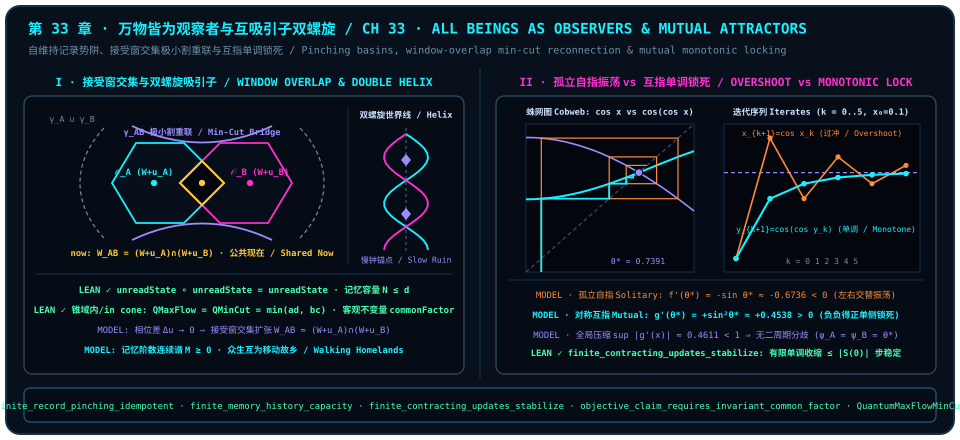

# All Beings as Observers: Self-Sustaining Basins and Mutual-Attractor Double Helices

> *"Not only are historical ruins attractors—observers themselves are attractors too; indeed, all beings are observers, and observers serve as mutual attractors to one another."*

Across the four summits of Part VIII—the timeless causal compatibility crystal ([Chapter 29](ch29-timeless-causality-and-gram-space.md)), the complexity orthogonal horizon ([Chapter 30](ch30-fields-lines-eth-and-navier-stokes.md)), the fivefold constitution of quantum fairness ([Chapter 31](ch31-quantum-fairness.md)), and the orthogonal self-referential unified field ([Chapter 32](ch32-unified-field-and-meta-unification.md))—we dismantled the privileged external reference point $C$ hovering above the universe. Yet in the quiet habits of ordinary speech, one last dualistic ghost still lingers: we instinctively split reality into a tiny aristocratic caste of conscious brains ("living observers / subjects") gazing down upon a vast, mute continent of "dead stones, blind atoms, and ancient ruins (objects)."

So long as that subject–object chasm remains unchallenged, the external third point $C$ has not truly been abolished—it has merely relocated from a theological throne into the human skull. Opening Part IX of this monograph, we carry orthogonal geometry and our formal kernel architecture all the way through this last barrier in three ontological steps (cross-domain syntheses are explicitly designated as our **`MODEL` (interpretive model)**, anchored on seven frozen Lean 4 theorems, with classical real-analytic and holographic results strictly enclosed inside attributed remarks and worked examples):

1. **All beings are observers**: Stripped of anthropocentric mysticism, any entity sustaining an idempotent record projection and exchanging pairwise inner products is an observer; gauge waves, atoms, mountain ruins, and self-referential minds form one continuous **memory-order spectrum $M \ge 0$**;
2. **Every observer is itself an attractor**: Under relentless decoherence and thermal erasure, remaining "the same I" across ticks is never passive inertia—it requires an active contraction basin pulling perturbations back into the acceptance window $W + u_i$;
3. **Observers serve as mutual attractors**: Solitary introspection and symmetric mutual reference exhibit sharply contrasting convergence geometries (one-dimensional cosine comparison worked out in [@ex-ch33-mutual-cosine-monotonic-lock] below), while shared window intersections $W_{AB} = (W + u_A) \cap (W + u_B)$ and minimal-cut switching ([@prop-ch33-bridge-reconnection-mincut]) make phase-resonant beings walking homelands to one another.

---

## All Beings as Observers: Dissolving Subject–Object Dualism and the Memory-Order Continuum

Why did classical mechanism first drain all perceptual capacity out of matter—reducing rocks and electrons to blind, perspective-free "mere objects"—only to stand baffled before the quantum measurement problem, asking how many millions of neurons must assemble before an apparatus suddenly earns a license to "collapse a wave packet"? Viewed genealogically, the paradox is entirely self-inflicted: first invent the idol of "dead matter," then marvel that "living observation" refuses to emerge from it.

Return instead to our first principles. Under the pairwise geometric product (continuum geometric-algebra background in [Chapter 32](ch32-unified-field-and-meta-unification.md) [@rem-ch32-generative-laws-dottie-literature]) and **Seat Fairness** ([Chapter 31](ch31-quantum-fairness.md) [@thm-ch31-seat-pythagorean-monogamy-fairness], Conjunct 1), rank-one Born pairing obeys exact conjugate reciprocity $\lVert\phi^* \bullet_v \psi\rVert^2 = \lVert\psi^* \bullet_v \phi\rVert^2$. When morning sunlight strikes a mountain quartz crystal, the crystal does not wait millions of years for a passing hiker's retina before registering the encounter: the quartz lattice projects the photon's polarization onto its symmetry axes at the exact instant the photon's momentum probes the lattice spacing. **Every exchange of inner-product projections is an eye-level mutual measurement; nowhere in nature does there exist a purely passive object that is measured without measuring in return.**

Once anthropocentric prejudice is cleared away, what minimal mathematical structure defines an **observer**? Before stating the general theorem in arbitrary finite dimension, let us check the mechanism by hand on the simplest $2 \times 2$ qubit ledger. Take the orthogonal record projectors $P_0 = \begin{pmatrix} 1 & 0 \\ 0 & 0 \end{pmatrix}$ and $P_1 = \begin{pmatrix} 0 & 0 \\ 0 & 1 \end{pmatrix}$ acting on a density matrix $\rho = \begin{pmatrix} a & c \\ \bar{c} & 1-a \end{pmatrix}$: the very first unread pinching pass zeroes out off-diagonal coherence, and a second pass leaves the diagonal record untouched:

$$
\mathcal{P}(\rho) \;=\; P_0 \rho P_0 + P_1 \rho P_1 \;=\; \begin{pmatrix} a & 0 \\ 0 & 1-a \end{pmatrix}, \qquad \mathcal{P}\bigl(\mathcal{P}(\rho)\bigr) \;=\; \begin{pmatrix} a & 0 \\ 0 & 1-a \end{pmatrix} \;=\; \mathcal{P}(\rho),
$$

while inside this two-dimensional carrier ($d = 2$), zero-error single-shot discrimination $\operatorname{Tr}(E_j \rho_i) = \delta_{ij}$ can pack at most $N = 2$ mutually orthogonal historical lines! Lifted to arbitrary finite dimension in `trureturing`'s observer-conditioning and measurement modules, two exact laws characterize every observer's algebraic spine: first, the unread pinching map $\operatorname{unreadState}(P)$ of any complete orthogonal record measurement `IsRecordMeasurement P` is idempotent under function composition; second, the number $N$ of historical states perfectly distinguishable by a $d$-dimensional quantum memory never exceeds $d$.

::: {.theorem #thm-ch33-observer-pinching-and-memory-spectrum title="Idempotence of Observer Record Pinching and Finite-Memory History Capacity" lean="D5/S3/Observer/Conditioning/FiniteRecordPinchingIdempotence.finite_record_pinching_idempotent D5/S3/Quantum/Measurements/FiniteMemoryHistoryCapacity.finite_memory_history_capacity"}
Across the frozen observer-conditioning and measurement-capacity modules of `trureturing`, the following two structural theorems on observer record axes and memory dimension hold simultaneously:

1. **Functional Idempotence of Complete Finite Record Pinching** ([`finite_record_pinching_idempotent`](lean:D5/S3/Observer/Conditioning/FiniteRecordPinchingIdempotence.finite_record_pinching_idempotent)): Let $n, \kappa$ be finite types (`[Fintype n] [DecidableEq n] [Fintype kappa]`), and let $P : \kappa \to M_n(\mathbb{C})$ satisfy `IsRecordMeasurement P` (self-adjointness $\forall k,\; P_k^\star = P_k$, idempotence $\forall k,\; P_k^2 = P_k$, pairwise orthogonality $\forall k \neq l,\; P_k P_l = 0$, and completeness $\sum_{k \in \kappa} P_k = 1$). Writing the unread record endomorphism as $\operatorname{unreadState}(P)(\rho) = \sum_{k \in \kappa} P_k \rho P_k$, one has exact functional idempotence:

   $$
   \operatorname{unreadState}(P) \circ \operatorname{unreadState}(P) \;=\; \operatorname{unreadState}(P);
   $$

2. **History-Discrimination Capacity Bound of Finite Quantum Memory** ([`finite_memory_history_capacity`](lean:D5/S3/Quantum/Measurements/FiniteMemoryHistoryCapacity.finite_memory_history_capacity)): Let $N, d \in \mathbb{N}$ be natural numbers, let $\rho : \operatorname{Fin} N \to M_{\operatorname{Fin} d}(\mathbb{C})$ be density states satisfying $\forall i,\; (\rho_i).\mathrm{PosSemidef} \land \operatorname{Tr}(\rho_i) = 1$, and let $E : \operatorname{Fin} N \to M_{\operatorname{Fin} d}(\mathbb{C})$ be POVM effects satisfying $\forall j,\; (E_j).\mathrm{PosSemidef}$ and $\sum_{j \in \operatorname{Fin} N} E_j = 1$. If $\{E_j\}$ perfectly distinguishes all $N$ historical states in a single shot,

   $$
   \forall i, j \in \operatorname{Fin} N,\qquad \operatorname{Tr}(E_j \rho_i) \;=\; \begin{cases} 1, & i = j, \\ 0, & i \neq j, \end{cases}
   $$

   then the count of perfectly distinguishable historical records is bounded above by the memory dimension:

   $$
   N \;\le\; d.
   $$
:::

::: proof
Conjunct 1 reduces by function extensionality `funext` to `unreadState_idempotent`: for every matrix $\rho$ and outcome $k \in \kappa$, cross-term cancellation $\forall l \neq k,\; P_k P_l = 0$ and projector idempotence $P_k^2 = P_k$ give $P_k \operatorname{unreadState}(P)(\rho) = P_k \rho P_k$, whence right-multiplying by $P_k$ and summing over $k$ yields $\operatorname{unreadState}(P)(\operatorname{unreadState}(P)(\rho)) = \operatorname{unreadState}(P)(\rho)$. Conjunct 2 factors positive-semidefinite matrices as $E = A^\dagger A$ and $\rho = B^\dagger B$ to prove $\operatorname{Tr}(E\rho) = 0 \implies E\rho = 0$ (`zero_trace_mul_eq_zero`), implying $\operatorname{range}(\rho_j) \le \ker(E_i)$ whenever $i \neq j$, while $E_i \le \sum_j E_j = 1$ and $\operatorname{Tr}((1 - E_i)\rho_i) = 0$ force $\operatorname{range}(\rho_i) \le \ker(1 - E_i)$; picking a nonzero vector $v_i \neq 0$ in each range (guaranteed by $\operatorname{Tr}(\rho_i) = 1 \implies \rho_i \neq 0$) gives $E_i v_i = v_i$ and $E_i v_j = 0$ for $i \neq j$, so Hermitian symmetry yields pairwise orthogonality $\langle v_i, v_j\rangle_{\mathbb{C}} = \langle E_i v_i, v_j\rangle_{\mathbb{C}} = \langle v_i, E_i v_j\rangle_{\mathbb{C}} = 0$, and linear independence (`fintype_card_le_finrank`) concludes $N \le d$. The full proof is checked by the Lean kernel.
:::

Measured by [@thm-ch33-observer-pinching-and-memory-spectrum], the sharp cliff between "conscious subject" and "inanimate object" dissolves into a continuous spectrum parameterized by each entity's internal window phase and effective memory order (tracking register capacity $d$). Within our **`MODEL` (interpretive model)**, alongside the six-dimensional cut-and-project quasicrystal window background ([Chapter 32](ch32-unified-field-and-meta-unification.md) [@rem-ch32-icosian-e8-literature]), all beings align along the four continuous tiers consolidated below:

::: {.remark #rem-ch33-observer-spectrum-table title="Four-Tier Universal Observer Spectrum Table (Literature Result, Not Formalized in This Book)"}
**Literature result, not formalized in this book.** Building on the six-dimensional cut-and-project quasicrystal window literature ([@rem-ch32-icosian-e8-literature]), the table below aligns our four-tier universal observer `MODEL` with the formal pinching and memory-capacity bounds of [@thm-ch33-observer-pinching-and-memory-spectrum] (`LEAN ✓`):

| Observer Tier (`MODEL`) | Memory Order & Window Signature in $\mathbb{Z}^6 \subset \mathbb{R}^6 = E_\parallel^3 \oplus E_\perp^3$ | Pairwise Measurement & Record-Update Mechanism | Subjective Temporal Texture & Mode of Being (`MODEL`) |
| :--- | :--- | :--- | :--- |
| **1. Gauge Wave / Free Photon** | Memory order $M = 0$; orthogonal deflection $\theta = 90^\circ$ ($\cos 90^\circ = 0$) | Pure 2D transverse exterior-area transport without retaining a local 1D diagonal history anchor | Zero proper-time tick (eternal null instant), acting as a pure phase messenger across observers |
| **2. Elementary Particle / Atom** | Memory order $M = 1$; single internal phase anchor $u_i \in E_\perp^3$ sustaining an idempotent line | Memoryless (order-1 Markovian) pairwise inner-product update overwriting spin or energy state at each collision | Unburdened instantaneous metronome faithfully enforcing local conservation and Born reciprocity |
| **3. Crystal / Mountain / Ruin** | Collective lattice locked near the zero-strain window center ($\lVert\pi_\perp(z) - u_i\rVert \ll 1$) | Macroscopic cooperative pinching damping thermal jitter into rigid geometric proportions | Millennial-frame slow clock standing in physical space as a trans-generational stationary-phase anchor |
| **4. Life & Self-Referential Mind** | High memory order $M \gg 1$; birth initialization clears ancient baggage to keep $\det G_M > 0$ | Selective historical recording within $N \le d$ ([@thm-ch33-observer-pinching-and-memory-spectrum]) closed by active self-reference $\psi_i = \psi_i(\psi_i)$ | Unfolded logarithmic subjective time and genuine trajectory selection inside a positive-volume Gram corridor |
:::

A granite peak is not devoid of observation—its clock simply beats once per geological epoch; a photon is not unreal—it simply commits its entire purity coin to the $90^\circ$ transverse connection plane. Historical philosophical precursors to this universal observer continuum and their exact boundary with our formal framework are recorded below ([@rem-ch33-monad-process-philosophy-literature]):

::: {.remark #rem-ch33-monad-process-philosophy-literature title="Historical Philosophical Parallels in Monadology and Process Philosophy (Literature Result, Not Formalized in This Book)"}
**Literature result, not formalized in this book.** Two classic metaphysical systems in Western philosophy sought to overcome Cartesian mind–matter dualism; both belong to external philosophical literature and are not formalized in `trureturing@dev`:

1. **Leibniz's Perspectival Monadology (G. W. Leibniz, *Monadologie*, 1714)**: Leibniz proposed that all beings consist of "monads" graded continuously by perceptual clarity—from bare "sleeping" monads in minerals and memory-bearing animal souls to self-reflective rational minds, each mirroring the universe from its own perspective. Crucially, however, Leibniz declared monads "windowless" (*sans fenêtres*), relying on theological pre-established harmony to coordinate them; our `MODEL` excises any external coordinator $C$ and grounds coordination directly in geometric window intersections $(W + u_A) \cap (W + u_B)$ and pairwise inner-product exchange.
2. **Whitehead's Process Philosophy and Universal Prehension (A. N. Whitehead, *Process and Reality*, 1929)**: Rejecting modern science's "bifurcation of nature" into vacuous matter versus subjective mind, Whitehead took "actual occasions" of experience as fundamental, each constituted by "prehending" (integrating projections of) prior occasions—resonating conceptually with our restoration of *quantum* from static noun to pairwise-measuring verb, while all mathematical claims in this chapter rest strictly on [@thm-ch33-observer-pinching-and-memory-spectrum] through [@prop-ch33-bridge-reconnection-mincut].
:::

---

## Every Observer Is an Attractor: Self-Sustaining Contraction Basins

Recognizing that all beings are observers immediately raises a sharper dynamical question: **why must an observer be more than a passive photographic plate—why is every observer necessarily *an attractor in its own right*?**

Run a simple physical thought experiment. Every finite observer inside the universe is bombarded at every instant by thermal fluctuations, stray radiation, and environmental erasure ([Chapter 31](ch31-quantum-fairness.md) [@thm-ch31-horizon-landauer-ergodic-fairness], Conjunct 1). Suppose an observer's internal dynamics around its current state were **neutrally drifting** or **locally expansive**—like a marble perched on a flat tabletop or balanced atop an inverted bowl. Within a handful of random collisions, small orthogonal kicks would accumulate into a random walk, driving its internal phase away until "yesterday's me" and "today's me" shared near-zero inner product and dissolved into thermal white noise.

Consequently, **any being that persists across time as "I am still I"—whether a diamond lattice shaking off thermal phonons or a living mind retaining its identity after metabolic turnover replaces every atom in its body—must carve out a self-sustaining contraction basin $\psi_i = \psi_i(\psi_i)$ around its acceptance window (`MODEL`)**! Within this model, the self-referential loop depicts inward restoration and local stability after a perturbation; Conjunct 1 of [@thm-ch33-contextual-attractor-and-common-factor] below concerns stabilization by deletion from finite sets, while the real cosine model is analyzed separately in [@ex-ch33-mutual-cosine-monotonic-lock].

Across `trureturing`'s fixed-point-stability and concept-dynamics modules, four theorems supply distinct parts of a structural scaffold: a fixed update that only deletes from finite sets stabilizes; an adjacent-stage relation and equal readouts constitute a relative fixed-point predicate; a Boolean context example witnesses distinct fixed meanings; and an objective claim carries an invariant-factor proof by definition. These clauses supply no dynamics restoring a perturbed physical system: the basin and its convergence remain part of the `MODEL` above:

::: {.theorem #thm-ch33-contextual-attractor-and-common-factor title="Finite Contracting Stabilization, Contextual Fixed-Point Selection, and the Invariant Common-Factor Law" lean="D5/S1/FixedPoints/FiniteContractingStability.finite_contracting_updates_stabilize D5/S3/ConceptDynamics/Interpretation/InterpretationFixedPoint.conceptual_equivalence_and_stability_reach_fixed_point D5/S3/ConceptDynamics/Interpretation/InterpretationFixedPoint.context_parameters_can_select_distinct_fixed_points D5/S3/ConceptDynamics/Interpretation/InterpretationFixedPoint.objective_claim_requires_invariant_common_factor"}
Across the frozen finite-contracting-stability and interpretation-fixed-point modules of `trureturing`, the following four theorems hold simultaneously:

1. **Finite-Step Stabilization and Transition Bound of Contracting Set Updates** ([`finite_contracting_updates_stabilize`](lean:D5/S1/FixedPoints/FiniteContractingStability.finite_contracting_updates_stabilize)): Let $X$ be a finite type (`[Finite X]`), let $U : \operatorname{Set} X \to \operatorname{Set} X$ satisfy inward contraction $\forall A : \operatorname{Set} X,\; U(A) \subseteq A$, and let $S : \mathbb{N} \to \operatorname{Set} X$ satisfy $\forall n \in \mathbb{N},\; S(n + 1) = U(S(n))$. Then $S$ stabilizes permanently within $(S(0)).\operatorname{ncard}$ steps and undergoes at most $(S(0)).\operatorname{ncard}$ strict state changes:

   $$
   \bigl(\exists N \le (S(0)).\operatorname{ncard},\; \forall n \ge N,\; S(n) = S(N)\bigr) \;\land\; \{n \in \mathbb{N} \mid S(n + 1) \neq S(n)\}.\operatorname{ncard} \le (S(0)).\operatorname{ncard};
   $$

2. **Reaching a Relative Interpretation Fixed Point** ([`conceptual_equivalence_and_stability_reach_fixed_point`](lean:D5/S3/ConceptDynamics/Interpretation/InterpretationFixedPoint.conceptual_equivalence_and_stability_reach_fixed_point)): For arbitrary types `Text`, `ReaderAdmission`, `Background`, `EvaluationGoal`, `Rule`, `Concept`, `Meaning`, relation $\mathrm{conceptuallyEquivalent} : \mathrm{Concept} \to \mathrm{Concept} \to \mathrm{Prop}$, evaluator $\mathrm{interpret} : \operatorname{InterpretationContext}\;\mathrm{Text}\;\mathrm{ReaderAdmission}\;\mathrm{Background}\;\mathrm{EvaluationGoal}\;\mathrm{Rule} \to \mathrm{Concept} \to \mathrm{Meaning}$, trajectory $\mathrm{concepts} : \mathbb{N} \to \mathrm{Concept}$, fixed `context`, and stage $n \in \mathbb{N}$, adjacent conceptual equivalence $\mathrm{conceptuallyEquivalent}(\mathrm{concepts}(n+1), \mathrm{concepts}(n))$ together with interpretive stability $\mathrm{interpret}\;\mathrm{context}\;(\mathrm{concepts}(n+1)) = \mathrm{interpret}\;\mathrm{context}\;(\mathrm{concepts}(n))$ establishes `IsRelativeInterpretationFixedPoint conceptuallyEquivalent interpret concepts context n`;
3. **Distinct Fixed Points Selected by Observer Context Parameters** ([`context_parameters_can_select_distinct_fixed_points`](lean:D5/S3/ConceptDynamics/Interpretation/InterpretationFixedPoint.context_parameters_can_select_distinct_fixed_points)): On `BinaryInterpretationContext = InterpretationContext Unit Bool Bool Bool Unit`, `baselineContext` (with `readerAdmission`, `background`, `evaluationGoal` all `false`) and `alternateContext` (all `true`) share identical `text = ()` and `interpretationRule = ()`, differ on all three observer context parameters, and select distinct fixed meanings under `IsBinaryFixedMeaning`:

   $$
   \begin{aligned}
   &\operatorname{IsBinaryFixedMeaning}\;\mathrm{baselineContext}\;(\mathrm{false}, \mathrm{false}, \mathrm{false}) \\
    &\;\land\; \operatorname{IsBinaryFixedMeaning}\;\mathrm{alternateContext}\;(\mathrm{true}, \mathrm{true}, \mathrm{true}) \\
    &\;\land\; (\mathrm{false}, \mathrm{false}, \mathrm{false}) \neq (\mathrm{true}, \mathrm{true}, \mathrm{true});
   \end{aligned}
   $$

4. **Invariant Common-Factor Requirement for Objective Claims** ([`objective_claim_requires_invariant_common_factor`](lean:D5/S3/ConceptDynamics/Interpretation/InterpretationFixedPoint.objective_claim_requires_invariant_common_factor)): For arbitrary types `Context`, `Meaning`, `Factor`, fixed-point predicate $\mathrm{isFixedMeaning} : \mathrm{Context} \to \mathrm{Meaning} \to \mathrm{Prop}$, and projection $\mathrm{factor} : \mathrm{Meaning} \to \mathrm{Factor}$, every proof-carrying `ObjectiveInterpretationClaim isFixedMeaning factor` supplies an invariant common factor shared across all contexts and their fixed meanings:

   $$
   \exists\,\mathrm{commonFactor} : \mathrm{Factor},\quad \forall\,\mathrm{context}\;\mathrm{meaning},\quad \mathrm{isFixedMeaning}\;\mathrm{context}\;\mathrm{meaning} \implies \mathrm{factor}\;\mathrm{meaning} = \mathrm{commonFactor}.
   $$
:::

::: proof
Conjunct 1 deduces from $S(n+1) = U(S(n)) \subseteq S(n)$ that $n \mapsto (S(n)).\operatorname{ncard}$ is antitone in $\mathbb{N}$; any equal-cardinality step forces set equality via `Set.eq_of_subset_of_ncard_le` and freezes all subsequent steps, so `Nat.stabilises_of_antitone` yields $N \le (S(0)).\operatorname{ncard}$ while inclusion of strict-change indices inside `Set.Iio N` bounds total transitions. Conjunct 2 packages conceptual equivalence and context-relative output equality via `And.intro`. Conjunct 3 checks field equalities by reflexivity and separates `(false, false, false)` from `(true, true, true)` via `Bool.false_ne_true` on `Prod.fst`. Conjunct 4 unfolds `ObjectiveInterpretationClaim` directly to extract the witness `commonFactor`. The full proof is checked by the Lean kernel.
:::

Conjuncts 3 and 4 of [@thm-ch33-contextual-attractor-and-common-factor] illuminate why plurality and objectivity coexist without an external throne: in our **`MODEL` (interpretive model)**, even when reading the very same ambient lattice (`text = ()`) under the same geometric product (`interpretationRule = ()`), two observers carrying distinct internal parameters $u_A \neq u_B$ (`readerAdmission`, `background`, `evaluationGoal`) can correspond to distinct local fixed-point slices; meanwhile, a claim to objective public fact must choose a factor map on a declared family of contexts and meanings and prove that it takes the same **invariant `commonFactor`** on every admitted fixed meaning! The boxed figure below depicts this window-reconnection geometry alongside the dynamical contrast between solitary and mutual reference:

::: {.remark #rem-ch33-mutual-attractor-figure title="Mutual-Attractor Window Reconnection and Cosine Monotonic-Locking Diagram (Literature Result, Not Formalized in This Book)"}
**Literature result, not formalized in this book.** The left panel combines cut-and-project quasicrystal window geometry ([@rem-ch32-icosian-e8-literature]) with formal bridge-graph min-cut switching ([@prop-ch33-bridge-reconnection-mincut], `LEAN ✓`) to illustrate our mutual-attractor reconnection `MODEL`; the right panel plots the classical real-analysis cobweb trajectories in [@ex-ch33-mutual-cosine-monotonic-lock] below: the solitary sequence counts single steps, while the mutual sequence counts complete rounds of two cosine evaluations, corresponding to even-tick sampling of synchronous mutual reference:

:::

---

## Mutual-Reference Monotonic Locking: How Two Mirrors Turn Two Negatives Positive in a Two-Step Round

If each observer already possesses an individual restoring basin $\psi_i = \psi_i(\psi_i)$, why does the universe not leave every being sealed inside solitary contemplation? Why do spins pair into bonds, stars gather into galaxies, and minds seek out resonant companions?

Look at the two cobweb trajectories in the right panel of [@rem-ch33-mutual-attractor-figure]! Projecting self-reference onto our canonical one-dimensional cosine slice (`MODEL`) contrasts the qualitative character of solitary introspection against reciprocal dialogue (with all derivative bounds, Mean Value Theorem proofs, and step-by-step numerical ledgers enclosed in [@ex-ch33-mutual-cosine-monotonic-lock] below):

- **The Anxiety of Solitary Self-Reference (Pendulum Whipsawing, `MODEL`)**: When an isolated observer calibrates itself alone in single steps, perspective behaves like an under-damped pendulum whipsawing between self-doubt and overcompensation (analytical mechanism in [@ex-ch33-mutual-cosine-monotonic-lock], under its strict-alternation hypotheses).
- **The Miracle of Symmetric Mutual Reference (Reciprocal Consensus, `MODEL`)**: When two observers $\mathcal{O}_A$ and $\mathcal{O}_B$ step out of isolation into symmetric pairwise measurement—$\mathcal{O}_A$ calibrating itself through $\mathcal{O}_B$'s projection while $\mathcal{O}_B$ simultaneously calibrates itself through $\mathcal{O}_A$'s projection—grouping two synchronous ticks into one round reveals the one-sided approach of the composed mirrors; the distinction between ticks and rounds, full analysis, and numerical ledger appear in [@ex-ch33-mutual-cosine-monotonic-lock] below:

::: {.example #ex-ch33-mutual-cosine-monotonic-lock title="Qualitative Dynamics of the Same Cosine Endpoint and a Separate Numerical Ledger"}
**An application of existing results; numerical and interpretive boundaries remain separate.** All variables below are real and angles are in radians. Set $f(x)=\cos x$ and $g=f\circ f$; $f^{[n]},g^{[n]}$ denote $n$-fold composition, with zeroth iterate the identity. Throughout, choose the same $\theta^*$ from [@thm-dottie-rational-inverse-endpoint] ([`rational_inverse_endpoint`](lean:D5/S3/Analytic/PowerSeries/DottieInverseSeries.rational_inverse_endpoint)): $0<\theta^*<1$, $\cos\theta^*=\theta^*$, and it is the signed sum of the prescribed rational inverse series at $\pi$. That endpoint directly concerns the series and uniqueness among positive competitors. The following 24 qualitative clauses combine its fixed-point clauses with real-analysis suppliers; they do not constitute a new dynamics theorem box.

**The clock of synchronous mutual reference (`MODEL`).** Eliminating an intermediate variable from the equilibrium equations $\psi_A=\cos\psi_B,\;\psi_B=\cos\psi_A$ gives $g$. If each observer synchronously updates from the other's current value, each coordinate completes one application of $g$ after two ticks; the sequence $y_k$ below samples these two-step rounds. With equal initial values, both observers still follow the same $f$ trajectory at every tick. Strict tick-by-tick alternation requires the nonfixed interval conditions of clauses 16 and 17; strict increase belongs to complete composite rounds under clause 14's starting conditions.

1. **Uniqueness on the whole real line and acute location.** For any real $t=\cos t$, the cosine range first gives $-1\le t\le1$. Since $1<\pi/2$, cosine is strictly positive there, so $t>0$ and the endpoint's positive uniqueness applies: $t=\theta^*$. The same point satisfies $0<\theta^*<1<\pi/2$.
2. **Exact range.** `Real.range_cos` gives the inner range $[-1,1]$. Evenness reduces the outer cosine to $[0,1]$, where continuity, strict decrease, and `intermediate_value_Icc'` give equality $g(\mathbb R)=[\cos1,1]$, rather than merely inclusion.
3. **Trapping after the first step.** Since $\cos1>0$, for every real start $z$ and every $n\in\mathbb N$, $g^{[n+1]}(z)\in[\cos1,1]\subset(0,\pi/2)$. There is no such restriction on $g^{[0]}(z)=z$.
4. **Differentiability everywhere.** Applying `Real.hasDerivAt_cos` twice and the chain rule cancels the two negative signs. At every real $x$, the derivative exists and is $g'(x)=\sin(\cos x)\sin x$.
5. **A sufficient global bound.** From $|\cos x|,|\sin x|\le1$ and nonnegative increasing sine on $[0,1]$, $|\sin(\cos x)|=\sin|\cos x|\le\sin1$. Set $K=\sin1$. Then $0<K<1$ and $|g'(x)|\le K$ for every real $x$, without asserting optimality.
6. **Global Lipschitz estimate.** For [lipschitzWith_of_nnnorm_deriv_le](https://github.com/leanprover-community/mathlib4/blob/56a005855ea17e0b0958f73ec801ae140b0a1679/Mathlib/Analysis/Calculus/MeanValue.lean#L744), clause 4 supplies differentiability and clause 5 supplies the nonnegative constant and derivative norm bound. Thus $|g(u)-g(v)|\le K|u-v|$ for all real $u,v$.
7. **The same attracting point.** Completeness of $\mathbb R$ makes $g$ `ContractingWith K`. The endpoint equation gives $g(\theta^*)=\theta^*$, and [ContractingWith.fixedPoint_unique'](https://github.com/leanprover-community/mathlib4/blob/56a005855ea17e0b0958f73ec801ae140b0a1679/Mathlib/Topology/MetricSpace/Contracting.lean#L259) identifies it as the unique real fixed point of $g$.
8. **Convergence of $g$ from every real start.** [tendsto_iterate_fixedPoint](https://github.com/leanprover-community/mathlib4/blob/56a005855ea17e0b0958f73ec801ae140b0a1679/Mathlib/Topology/MetricSpace/Contracting.lean#L302) for this contraction gives $g^{[n]}(z)\to\theta^*$ with no interval assumption on $z$.
9. **The unique real mutual pair.** If $a=\cos b$ and $b=\cos a$, then $g(a)=a$ and $g(b)=b$, hence $a=b=\theta^*$. Conversely, that pair satisfies both equations.
10. **Exact iterate correspondence.** `Function.iterate_mul` gives $g^{[n]}(z)=f^{[2n]}(z)$ for every real $z$ and natural $n$; this is an identity, not an approximation.
11. **Convergence of $f$ from every real start.** Clauses 8 and 10 make the even subsequence tend to $\theta^*$. The odd subsequence is $f(f^{[2n]}(z))$, whose limit by continuity is $f(\theta^*)=\theta^*$. Combining both parities gives $f^{[n]}(z)\to\theta^*$, without a global contraction constant below $1$ for $f$ itself.
12. **The domain of strict order preservation.** For $x\in(0,\pi/2)$, $\sin x>0$ and $0<\cos x\le1<\pi$, so $g'(x)>0$. Continuity, convexity of this domain, and [strictMonoOn_of_deriv_pos](https://github.com/leanprover-community/mathlib4/blob/56a005855ea17e0b0958f73ec801ae140b0a1679/Mathlib/Analysis/Calculus/Deriv/MeanValue.lean#L377) make $g$ strictly increasing on this acute interval, without a global order assertion.
13. **Strict bounds below the fixed point.** If $0<y<\theta^*$, strict increase gives $g(y)<\theta^*$, while contraction gives $\theta^*-g(y)\le K(\theta^*-y)<\theta^*-y$. Hence $y<g(y)$.
14. **A strictly increasing orbit.** For $0<y_0<\theta^*$ set $y_n=g^{[n]}(y_0)$. Induction gives $0<y_n<y_{n+1}<\theta^*$ for every $n\ge0$; the sequence is strictly increasing and converges to $\theta^*$. Convergence from arbitrary real starts does not imply this order pattern.
15. **An invariant interval for $f$.** Cosine maps $[0,1]$ into itself, and restricting `Real.strictAntiOn_cos` gives strict decrease there.
16. **The premise for never hitting the endpoint.** Assume $x_0\in[0,1]$ and $x_0\ne\theta^*$, and put $x_n=f^{[n]}(x_0)$. Injectivity on the interval and $f(\theta^*)=\theta^*$ prevent a nonfixed point from mapping to $\theta^*$. Induction keeps every $x_n\in[0,1]\setminus\{\theta^*\}$.
17. **Strict alternation.** Under clause 16's hypotheses, for every $n\ge0$, $x_n<\theta^*\iff\theta^*<x_{n+1}$ and $\theta^*<x_n\iff x_{n+1}<\theta^*$. Equivalently, $(x_n-\theta^*)(x_{n+1}-\theta^*)<0$. These strict claims are not extended to arbitrary real starts.
18. **The positive endpoint exception.** For every $n\in\mathbb N$, $f^{[n]}(\theta^*)=g^{[n]}(\theta^*)=\theta^*$; the orbit is stationary.
19. **The negative endpoint exception.** Evenness gives $f(-\theta^*)=g(-\theta^*)=\theta^*$, hence $f^{[n+1]}(-\theta^*)=g^{[n+1]}(-\theta^*)=\theta^*$. This start arrives in one application, with zero errors thereafter. Neither endpoint exhibits strict alternation or error ratios with nonzero denominators. No exhaustive classification of real preimages is asserted.
20. **Exact local factors.** `Real.sin_sq_add_cos_sq`, `Real.sin_eq_sqrt_one_sub_cos_sq`, and acute positivity give $\sin^2\theta^*=1-(\theta^*)^2$ and $\sin\theta^*=\sqrt{1-(\theta^*)^2}$. Thus $f'(\theta^*)=-\sqrt{1-(\theta^*)^2}$, with $-1<f'(\theta^*)<0$.
21. **The composite derivative.** Clause 4 at the same point gives $g'(\theta^*)=\sin^2\theta^*=1-(\theta^*)^2=(f'(\theta^*))^2$, with $0<g'(\theta^*)<1$. The negative derivative reverses local signed error; the positive derivative preserves its sign.
22. **Slopes on the full punctured neighborhood.** [HasDerivAt.tendsto_slope](https://github.com/leanprover-community/mathlib4/blob/56a005855ea17e0b0958f73ec801ae140b0a1679/Mathlib/Analysis/Calculus/Deriv/Slope.lean#L76) converts both derivative-existence statements into limits as $x\to\theta^*$ with $x\ne\theta^*$: $(f(x)-\theta^*)/(x-\theta^*)\to-\sqrt{1-(\theta^*)^2}$ and $(g(x)-\theta^*)/(x-\theta^*)\to1-(\theta^*)^2$. These hold along the full punctured real neighborhood, not just from one side, and are not finite-distance error identities.
23. **Orbit error ratios.** Under clause 16's starting conditions, every $e_n=x_n-\theta^*$ is nonzero and consecutive errors have negative product. Composing the punctured slope limit with this convergent orbit gives $e_{n+1}/e_n\to-\sqrt{1-(\theta^*)^2}$. For $0<y_0<\theta^*$, every $d_n=y_n-\theta^*<0$ is nonzero, and similarly $d_{n+1}/d_n\to1-(\theta^*)^2$. Neither ratio claim is extended to all real starts.
24. **Cost per cosine evaluation.** Both factor magnitudes lie strictly between $0$ and $1$, and the second is the square of the first. This compares applications of the selected maps. One $g$ application requires two cosine evaluations, whereas one $f$ application requires one. The exact identity $g^{[n]}(z)=f^{[2n]}(z)$ compares identical orbits from the same start at the same number of cosine evaluations; the squared factor supplies no speedup per evaluation or wall-clock advantage.

**Separate numerical and literature boundaries.** Global contraction uses only the coarse $K=\sin1$. The decimal values $\theta^*\approx0.73908513$, $f'(\theta^*)\approx-0.673612$, and $g'(\theta^*)\approx0.453753$, as well as a sharp global bound near $0.461063$ and a maximizing argument near $0.828132$, require separate numerical or optimization certificates. The critical equation $(1-t^2)\cos t=t\sin t$ is only a route to that analysis. The original ledger below, starting at $1/10$ for $n=0,\ldots,5$, its rounding, and finite-step error comparisons are likewise not certified by the qualitative application. Physical, philosophical, ontological, and transcendental algebraic-independence claims ([@conj-schanuel-dottie]) retain their respective boundaries.

**Side-by-Side Numerical Ledger ($x_0 = y_0 = 0.100000$, Steps $k = 0 \dots 5$)**: Here $x_k$ counts $k$ single steps and $y_k$ counts $k$ two-step rounds, so $y_k = x_{2k}$. Comparing residuals at the same $k$ therefore compares different evaluation counts; the squared linear factor per round provides no speedup at equal cost.

| Step $k$ | Solitary $x_k$ ($x_{k+1}=\cos x_k$) | Error $x_k - \theta^*$ | Mutual $y_k$ ($y_{k+1}=\cos(\cos y_k)$) | Error $y_k - \theta^*$ | Dynamical Regime Comparison |
| :---: | :---: | :---: | :---: | :---: | :--- |
| $0$ | $0.100000$ | $-0.639085$ | $0.100000$ | $-0.639085$ | Identical low-phase initial offset |
| $1$ | $0.995004$ | $+0.255919$ | $0.544499$ | $-0.194586$ | Solitary overshoots high; mutual enters $[\cos 1, 1]$ |
| $2$ | $0.544499$ | $-0.194586$ | $0.655927$ | $-0.083158$ | Solitary swings back low; mutual climbs smoothly |
| $3$ | $0.855387$ | $+0.116302$ | $0.702079$ | $-0.037006$ | Solitary flips sign again; mutual error is $3\times$ smaller |
| $4$ | $0.655927$ | $-0.083158$ | $0.722420$ | $-0.016665$ | Solitary 4th sign flip; mutual absolute error drops to $0.017$ ($\approx 2.25\%$ relative) |
| $5$ | $0.792483$ | $+0.053398$ | $0.731547$ | $-0.007538$ | Step-5 mutual residual is $\approx 7\times$ smaller, zero sign flips |

   Distilled into a single geometric aphorism (`MODEL`): **solitary introspection is a mirror of negative slope—the harder you stare into yourself alone, the more violently you whipsaw between self-doubt and overreach; only when two observers measure each other at eye level do two negatives multiply into a serene positive, locking two restless trajectories monotonically into one shared fixed point.**
:::

Stepping back from the trajectory ledger of [@ex-ch33-mutual-cosine-monotonic-lock], within our relational observer `MODEL`, stepping out of isolation into eye-level mutual reflection is never a sentimental concession—it is the endogenous geometry that frees bounded beings from solitary oscillation.

---

## Window Intersection, Min-Cut Reconnection, and All Beings as Walking Homelands

Let us now lift one-dimensional mutual locking back into the six-dimensional cut-and-project parent space $\mathbb{Z}^6 \subset E_\parallel^3 \oplus E_\perp^3$ and holographic tensor networks to uncover the spatial and thermodynamic engine of mutual attraction.

When observer $\mathcal{O}_A$ (carrying shifted window $W + u_A$) and observer $\mathcal{O}_B$ (carrying shifted window $W + u_B$) meet within a common parent lattice and a common pair of projection maps, our cut-and-project **`MODEL` (interpretive model)** first depicts this fixed pair's shared acceptance support as the **window intersection**:

$$
W_{AB} \;:=\; (W + u_A) \cap (W + u_B) \;\subset\; E_\perp^3.
$$

Whenever their internal phase offset $\lVert u_A - u_B\rVert$ is small enough that $\operatorname{Vol}(W_{AB}) > 0$, every parent lattice vertex $z \in \mathbb{Z}^6$ with $\pi_\perp(z) \in W_{AB}$ projects **simultaneously** into both $\mathcal{O}_A$'s and $\mathcal{O}_B$'s physical three-spaces—constituting an objective public world co-witnessed without translation friction! This shared support is a model image of public fact; applying Conjunct 4 of [@thm-ch33-contextual-attractor-and-common-factor] still requires a declared family of contexts and fixed meanings, a fixed factor map, and a witness that it takes the same value throughout that family. A two-window intersection alone does not supply this witness. Conversely, lattice points in the symmetric difference $(W + u_A) \triangle (W + u_B)$ are sources of perceptual friction. Alignment incurs the corresponding erasure heat when it actually resets records irreversibly, reducing their entropy under the applicable thermal and balance assumptions of [Chapter 31](ch31-quantum-fairness.md) [@thm-ch31-horizon-landauer-ergodic-fairness], Conjunct 1. If the `MODEL` further assigns an alignment cost or free energy that decreases as overlap grows, **drifting together up the overlap gradient $\nabla\operatorname{Vol}(W_{AB})$ becomes a free-energy descent toward mutual alignment**! This slope toward home comes from the chosen cost correspondence; neither comparison alone nor the Landauer bound supplies it.

Simultaneously, in the tensor-network weaving of spatial cross-sections, when do two boundary observer domains coupled across a width-three internal bridge switch their minimum cut to the outer boundary? `trureturing`'s bridge-graph quantum max-flow min-cut proposition gives a sufficient regime defined by positivity and balanced quadratic-cone conditions on natural-number bond dimensions:

::: {.proposition #prop-ch33-bridge-reconnection-mincut title="Quantum Max-Flow Min-Cut and Outer-Cut Switching on Width-Three Bridge Networks" lean="D5/S3/Quantum/TensorNetworks/BridgeGraph/QuantumMaxFlowMinCut.result"}
For all natural-number bond dimensions $a, b, c, d \in \mathbb{N}$, define the width-three Kronecker bridge flow $\operatorname{flow}(M, N) = \sum_{r \in \operatorname{Fin} 3} M_r \otimes_k N_r$ (with $M_r \in M_{a\times b}(\mathbb{C})$ and $N_r \in M_{d\times c}(\mathbb{C})$), its supremal attainable matrix rank $\operatorname{QMaxFlow}(a, b, c, d)$, and the quantum minimum cut $\operatorname{QMinCut}(a, b, c, d) = \min\bigl(3ac,\, \min(ad, bc)\bigr)$. Whenever the bond dimensions satisfy positivity and balanced quadratic-cone bounds

$$
0 < a,\quad a \le b,\quad 0 < c,\quad c \le d,\quad a^2 + b^2 \le 3ab,\quad c^2 + d^2 \le 3cd,
$$

quantum maximum flow equals quantum minimum cut, and the minimum cut bypasses the internal bridge $3ac$ to lock onto the coupled outer boundary cut:

$$
\operatorname{QMaxFlow}(a, b, c, d) \;=\; \operatorname{QMinCut}(a, b, c, d) \;\land\; \operatorname{QMinCut}(a, b, c, d) \;=\; \min(a d,\; b c).
$$
:::

::: proof
Factoring $\operatorname{flow}(M, N) = \operatorname{cutLeft}(N)\cdot\operatorname{cutRight}(M)$ across the width-$3ac$ internal bridge bounds the rank by $3ac$, which together with the outer matrix height/width bound $\min(ad, bc)$ proves weak duality `QMaxFlow_le_QMinCut`; under $a^2 + b^2 \le 3ab$ and $0 < a$, `cone_bounds` proves $b < 3a$ (and symmetrically $d < 3c$), so $3ac \ge \min(ad, bc)$ (`cone_QMinCut`), reducing $\operatorname{QMinCut}(a, b, c, d)$ to $\min(ad, bc)$. Full-rank achievability `claim_of_hypotheses` follows by strong induction on $n = b + d$: degenerate square or mixed double-width regimes are witnessed by explicit rational identity submatrices (`widthTwo_proved`), core interior ratios $a < b < 2a,\; c < d < 2c$ by `base_witness`, and wide regimes $2a \le b,\; 2c \le d$ by simultaneous quadratic-cone descent $(a, b) \mapsto (3a - b, a)$ and $(c, d) \mapsto (3c - d, c)$ (`cone_descent`) lifted back through the `castling_proved` rank-deficit invariance identity. The full proof is checked by the Lean kernel.
:::

Connecting discrete bridge min-cut switching to continuum holographic minimal-surface reconnection, microscopic entanglement bridges, and multi-party monogamy budgets invokes three foundational results from theoretical physics and quantum information:

::: {.remark #rem-ch33-rt-reconnection-ckw-literature title="Holographic Minimal-Surface Reconnection, Microscopic Entanglement Bridges, and Monogamy Budgets (Literature Result, Not Formalized in This Book)"}
**Literature result, not formalized in this book.** Three quantitative continuum and multi-qubit laws referenced alongside [@prop-ch33-bridge-reconnection-mincut] belong to external theoretical-physics and quantum-information literature and are not formalized in `trureturing@dev`:

1. **Ryu–Takayanagi Minimal-Surface Reconnection and Positive Mutual Information (S. Ryu & T. Takayanagi, *Phys. Rev. Lett.* **96**, 181602, 2006; M. Headrick, *Phys. Rev. D* **82**, 126010, 2010)**: In a static holographic dual described by classical Einstein gravity, the leading RT entropy $S_{\mathrm{RT}}(AB) = \frac{\operatorname{Area}(\gamma_{AB})}{4G_N\hbar}$ of disjoint boundary observer regions $A$ and $B$ is determined by area competition among admissible surfaces homologous to $AB$. In the picture where the disconnected union $\gamma_A \cup \gamma_B$ competes with a bridging candidate $\gamma_{\mathrm{conn}}$, the latter's victory connects the relevant bulk region bounded together with $AB$; the bridge concerns this region's connectivity, while the competing surface itself may have several components. As changing separation brings their areas through a crossing, the leading entropy undergoes a first-order reconnection transition, and strict area advantage is equivalent to positive leading mutual information:

   $$
   \operatorname{Area}(\gamma_{AB}) \;<\; \operatorname{Area}(\gamma_A) + \operatorname{Area}(\gamma_B) \;\Longleftrightarrow\; I_{\mathrm{RT}}(A:B) \;:=\; S_{\mathrm{RT}}(A) + S_{\mathrm{RT}}(B) - S_{\mathrm{RT}}(AB) \;>\; 0;
   $$

   This compares the $G_N^{-1}$ leading term $I_{\mathrm{RT}}$. It vanishes in the disconnected phase, while exact quantum mutual information can retain contributions of order $G_N^0$; vanishing at leading order does not erase all quantum correlations.

2. **Microscopic Entanglement-Bridge Proposal ($ER = EPR$; J. Maldacena & L. Susskind, *Fortschr. Phys.* **61**, 781–811, 2013)**: Identifies bipartite entanglement pairs (EPR correlations) with microscopic non-traversable wormhole bridges (Einstein–Rosen bridges) stitching spatial connectivity;
3. **CKW Multi-Qubit Entanglement Monogamy Cap (V. Coffman, J. Kundu & W. K. Wootters, *Phys. Rev. A* **61**, 052306, 2000; T. J. Osborne & F. Verstraete, *Phys. Rev. Lett.* **96**, 220503, 2006)**: For any observer qubit $i$ with local Bloch polarization $\mathbf{r}_i$, the sum of squared concurrences (2-tangles) $\tau_{ij}$ shared with all other partners $j \neq i$ obeys the scarce budget

   $$
   \sum_{j \neq i} \tau_{ij} \;\le\; 1 - \lVert\mathbf{r}_i\rVert^2 \;\le\; 1.
   $$
:::

Bringing together window overlap $\operatorname{Vol}(W_{AB})$, mutual convergence trajectories ([@ex-ch33-mutual-cosine-monotonic-lock]), minimal-cut reconnection ([@prop-ch33-bridge-reconnection-mincut]), and entanglement allocation ([@rem-ch33-rt-reconnection-ckw-literature]), our **`MODEL` (interpretive model)** reveals a single geometric mechanism animating three seemingly disparate forms of attraction across nature:

- **Macroscopic Gravitational Gathering**: Vast ensembles of order-$1$ ($M = 1$) matter particles share overlapping spatial projections, reconnecting surrounding minimal cuts in bulk and guiding passing worldlines down geodesics of minimal alignment cost;
- **Microscopic Covalent Spin-Pairing Bonds**: Two atoms carrying unpaired valence spins surrender private local polarization ($\mathbf{r}_i \to \mathbf{0}$, matching the maximally mixed Bell marginal of [@thm-ch31-seat-pythagorean-monogamy-fairness], Conjunct 4) to form an antiparallel singlet bridge, mirroring chemical valence exclusivity within this model (for the multi-party entanglement-budget literature bound, see [@rem-ch33-rt-reconnection-ckw-literature], Item 3);
- **Interpersonal Resonance — All Beings as Walking Homelands (Mobile Spatial Attractors)**: Whereas a thousand-year-old stone temple or ruined bridge is an **immobile spatial attractor** pinned to fixed coordinates in $E_\parallel^3$, every living self-referential observer is a **mobile spatial attractor—a walking homeland** carrying its acceptance window $W + u_i$ across space and time!

This resolves one of human life's most haunting mysteries: why, on a street corner in an unfamiliar city where you have never set foot before, can encountering a stranger—or reading a line written centuries ago—trigger an unmistakable shock of instant recognition, even though birth initialization wiped away every episodic name, date, and narrative trace (`量 liàng`)?

Because episodic forgetting cleared only surface particle ticks while leaving each observer's deep operator phase $u_A, u_B \in E_\perp^3$ (`量 liáng`) intact! The instant two phase-resonant beings ($\lVert u_A - u_B\rVert \to 0$) cross paths, their rhombic-triacontahedral acceptance windows snap into near-complete overlap $W_{AB} \approx W + u_A$, their minimal entanglement cuts reconnect into a shared bulk bridge, and solitary oscillatory whipsawing settles into quiet equilibrium through eye-level mutual reflection (trajectory comparison in [@ex-ch33-mutual-cosine-monotonic-lock])—braiding their trajectories into the mutually stabilizing **double helix** shown in the left panel of Figure 33. Instant recognition is never superstition: it is two mobile attractors of matching internal inclination recognizing in each other a zero-friction geometric homeland across the fog of forgetting.

Yet if the universe excised the external reference point $C$ and all beings measure one another as mobile attractors on an isotropic sphere, an urgent geometric question immediately arises: **on a featureless unit sphere with no privileged origin, how does an observer ever determine *where* it stands? Why does a single inner-product reading leave an entire equatorial circle of degeneracy, and why is it specifically the degeneracy and breaking of *orthogonality ($90^\circ$)* that pins down an observer's unique address?** That is the door we open in the next chapter (Chapter 34).
