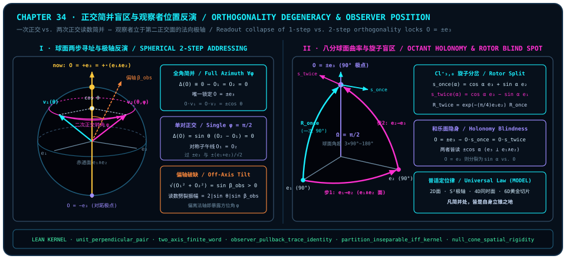

# Orthogonality-Degeneracy Blind Spots: How Single vs. Double Orthogonality Inverts Observer Position

> *"That a single orthogonality step and a double orthogonality step yield the same result reflects precisely the position of the observer."*

Once Chapter 33 establishes a background-free relational ontology of the observer, an immediate inverse problem confronts every observer embedded inside the field. Since [Chapter 2](ch02-born-rule.md) excised the external "third point $C$" and [Chapter 31](ch31-quantum-fairness.md)'s Seat Fairness ([@thm-ch31-seat-pythagorean-monogamy-fairness]) abolished every privileged origin—leaving an unpainted, isotropic unit sphere on which every pure state has norm $1$—**how can a bounded observer standing inside the arena ever deduce *which axis it is standing on*?**

Everyday intuition trains us to hunt for **differences**: we assume an instrument reveals our coordinates only when two distinct operations produce distinct dial readings, and when two genuinely different geometric moves return the exact same number, we lament "information loss" or "measurement degeneracy." The epigraph opening this chapter turns that prejudice inside out: **what betrays an observer's own position is not the difference it sees, but the exact orthogonal turn to which its meter is completely blind!**

We develop this blind-spot inversion principle across three progressive stages, turning degeneracy from an epistemic nuisance into a precise geometric locator:

1. **Polar-Axis Inversion in Two-Step Spherical Addressing**: Contrasting right-angle steps on a flat floor against "first and second orthogonal steps" on the unit sphere $S^2$ ([Chapter 9](ch09-axes-and-state-addressing.md)), we combine common unit-normal existence [`unit_perpendicular_pair`](lean:D5/S3/Geometry/TwoAxisFiniteRotation.unit_perpendicular_pair), exact two-axis finite-word generation [`two_axis_finite_word`](lean:D5/S3/Geometry/TwoAxisFiniteRotation.two_axis_finite_word), and the iterated state–effect pullback identity [`observer_pullback_trace_identity`](lean:D5/S3/Quantum/Dynamics/ObserverPullbackTraceIdentity.observer_pullback_trace_identity) to show that invisibility of a second orthogonal step locks the observer's probe onto a fixed axis of the dual rotation;
2. **Spherical Octant Curvature and Rotor Blind Spots**: Using the partition-topology inseparability kernel [`partition_inseparable_iff_kernel`](lean:D5/S3/ConceptDynamics/ObservationTopology/PartitionTopologyKernel.partition_inseparable_iff_kernel) and covariant commutator factorization [`covariant_commutator_formula`](lean:D5/S3/Quantum/Algebra/CovariantCommutator.covariant_commutator_formula), together with a complete analytical and numerical derivation of spherical addressing and octant rotor holonomy ([@ex-ch34-spherical-addressing-and-octant-rotors]), we prove that *you stand on the normal of whichever area's rotation you cannot see*;
3. **Universal Observer Localization Across Dimensions (`MODEL`)**: Anchored by null-cone spatial rigidity [`null_cone_spatial_rigidity`](lean:D5/S0/Certificates/MinkowskiNullConeRigidity.null_cone_spatial_rigidity) and golden cut-and-project subset inclusion [`golden_model_set_subset_cut_and_project`](lean:D5/S1/Deficit/ModelSet/GoldenCutAndProject.golden_model_set_subset_cut_and_project), we extend the same inversion law across planar turns, zero-duration superconducting phase-frame updates, geometric phase, relativistic simultaneity slices ([@rem-ch34-virtual-z-berry-relativity-literature]), and the six-dimensional golden hypercube slice.

---

## Second-Orthogonality Invisibility in Spherical Addressing: Symmetry Meridian and Polar Normal Inversion {#sec-ch34-spherical-addressing-inversion}

::: {.example #ex-ch34-spherical-addressing-preview title="Flat-Floor Hypotenuse Contrast and Spherical Two-Step Addressing Inversion Preview (Literature Result, Not Formalized in This Book)"}
**Literature result, not formalized in this book.** The elementary Euclidean hypotenuse contrast and unit-sphere $S^2 \subset \mathbb{R}^3$ inner-product inversion preview below belong to classical Euclidean geometry (with full algebraic elimination given in [@ex-ch34-spherical-addressing-and-octant-rotors], Part 1) and are not formalized as a standalone continuous spherical-coordinate lemma in `trureturing@dev`:

1. **Hypotenuse Growth on a Flat Floor**: Standing at the origin of an infinite flat floor, walking $1$ unit straight ahead (one orthogonal step) yields radial distance $1$, whereas pivoting $90^\circ$ sideways and walking $1$ unit along the perpendicular axis (two orthogonal steps) stretches the radial distance to $\sqrt{1^2 + 1^2} = \sqrt{2} \neq 1$—single-step and double-step radial readings can never coincide.
2. **Two-Step Orthogonal Addressing on $S^2$**: In the mutually orthogonal triad $(\mathbf{e}_1, \mathbf{e}_2, \mathbf{e}_3)$ of [Chapter 9](ch09-axes-and-state-addressing.md), addressing directions from the reference pole $\mathbf{e}_3$ proceeds in two orthogonal turns:
   - **First orthogonal step (polar tilt)**: Rotate inside the meridian plane $\mathbf{e}_3 \wedge \mathbf{e}_1$ by polar angle $\theta \in (0, \pi)$ ($\sin\theta \neq 0$) to $\mathbf{v}_1(\theta) = \cos\theta\,\mathbf{e}_3 + \sin\theta\,\mathbf{e}_1$;
   - **Second orthogonal step (azimuthal twist)**: Holding $\mathbf{e}_3$ perpendicular to the equatorial stage $\mathbf{e}_1 \wedge \mathbf{e}_2$, rotate the transverse component through azimuth $\phi \in [0, 2\pi)$ to $\mathbf{v}_2(\theta, \phi) = \cos\theta\,\mathbf{e}_3 + \sin\theta(\cos\phi\,\mathbf{e}_1 + \sin\phi\,\mathbf{e}_2)$.
3. **Readout Equality as Vantage Inversion**: Whenever $\phi \not\equiv 0 \pmod{2\pi}$, $\mathbf{v}_1(\theta)$ and $\mathbf{v}_2(\theta, \phi)$ point in distinct directions; if an internal observer probing with unit axis $\mathbf{O} \in S^2$ finds $\mathbf{O}\cdot\mathbf{v}_1(\theta) = \mathbf{O}\cdot\mathbf{v}_2(\theta, \phi)$—just like the unique axial camera vantage from which a tilted spinning top's tip traces a circle of constant radial projection—then:
   - Equality for a single $90^\circ$ transverse pair ($\phi = \pi/2$) constrains $\mathbf{O}$ to the **symmetry meridian** bisecting $\mathbf{e}_1$ and $\mathbf{e}_2$;
   - Equality across the entire azimuthal circle $\phi \in [0, 2\pi)$ renders the equatorial plane $\mathbf{e}_1 \wedge \mathbf{e}_2$ orthogonally invisible, uniquely locking the observer's axis onto the polar normal $\mathbf{O} = \pm\mathbf{e}_3$!
:::

Stepping back from [@ex-ch34-spherical-addressing-preview], conventional measurement theory mourns degeneracy only because it secretly gazes down from an external coordinate grid and regrets "losing the transverse angle." Inside a self-contained geometry without point $C$ (`MODEL`), **transverse invisibility is the universe's built-in compass for self-localization**.

At the formal kernel level, three structural facts make this inversion airtight: any pair of vectors in $\mathbb{R}^3$ admits a common unit normal, exact finite words in the rotation circles of any two noncollinear axes generate every orientation-preserving isometry of $\mathbb{R}^3$, and multi-step state evolution pulls back without loss onto the observer's measurement effect. The theorem below locks all three together.

::: {.theorem #thm-ch34-perpendicular-axis-and-pullback title="Common Unit Normal, Two-Axis Finite Rotation Words, and Observer Pullback Trace Identity" lean="D5/S3/Geometry/TwoAxisFiniteRotation.unit_perpendicular_pair D5/S3/Geometry/TwoAxisFiniteRotation.two_axis_finite_word D5/S3/Quantum/Dynamics/ObserverPullbackTraceIdentity.observer_pullback_trace_identity"}
In the frozen three-dimensional two-axis rotation and finite-dimensional quantum pullback modules of `trureturing`, write $\mathrm{Space} = \operatorname{EuclideanSpace}\;\mathbb{R}\;(\operatorname{Fin} 3)$, $\mathrm{Orthogonal} = (\mathrm{Space} \simeq_{\ell i}[\mathbb{R}] \mathrm{Space})$ for its group of real linear isometries, $\operatorname{determinant}(R) = \det(R.\mathrm{toLinearMap})$, $\operatorname{axisCircle}(a) = \{R \in \mathrm{Orthogonal} \mid \operatorname{determinant}(R) = 1 \land R(a) = a\}$ for the subgroup of orientation-preserving rotations fixing $a$, and $\operatorname{IsAxisWord}(a, b, l)$ for the predicate that every letter of $l \in \operatorname{List}(\mathrm{Orthogonal})$ belongs to $\operatorname{axisCircle}(a) \cup \operatorname{axisCircle}(b)$. The following three statements hold simultaneously:

1. **Existence of a Common Unit Perpendicular Vector** ([`unit_perpendicular_pair`](lean:D5/S3/Geometry/TwoAxisFiniteRotation.unit_perpendicular_pair)): For any two vectors $a, b \in \mathrm{Space}$ (without assuming nonzeroness, normalization, or linear independence), there exists a unit vector $n \in \mathrm{Space}$ simultaneously orthogonal to both:

   $$
   \lVert n\rVert = 1 \;\land\; \langle a, n\rangle_{\mathbb{R}} = 0 \;\land\; \langle b, n\rangle_{\mathbb{R}} = 0;
   $$

2. **Exact Finite-Word Generation from Two Noncollinear Axis Circles** ([`two_axis_finite_word`](lean:D5/S3/Geometry/TwoAxisFiniteRotation.two_axis_finite_word)): Let $a, b \in \mathrm{Space}$ satisfy strict noncollinearity $\langle a, b\rangle_{\mathbb{R}}^2 < \lVert a\rVert^2 \lVert b\rVert^2$ (with neither $a$ nor $b$ required to have unit norm). Then every orientation-preserving isometry $R \in \mathrm{Orthogonal}$ with $\operatorname{determinant}(R) = 1$ factors as an exact finite word $l \in \operatorname{List}(\mathrm{Orthogonal})$ without topological closure:

   $$
   \operatorname{IsAxisWord}(a, b, l) \;\land\; l.\mathrm{prod} = R;
   $$

3. **Multi-Step Trace Identity Between Channel Evolution and Effect Pullback** ([`observer_pullback_trace_identity`](lean:D5/S3/Quantum/Dynamics/ObserverPullbackTraceIdentity.observer_pullback_trace_identity)): Let $d$ be a finite decidable type (`[Fintype d] [DecidableEq d]`), let $\mathrm{channel} : \operatorname{QuantumChannel}\;d\;d$ be a quantum channel, and let $\mathrm{heisenberg} : \operatorname{MatrixAlgebra}\;d \to_{\mathrm{CP}} \operatorname{MatrixAlgebra}\;d$ be a completely positive map satisfying single-step trace duality

   $$
   \forall\,\mathrm{state}, \mathrm{effect} \in \operatorname{MatrixAlgebra}\;d,\qquad \operatorname{Tr}\bigl(\mathrm{channel.toCompletelyPositiveMap}(\mathrm{state}) \cdot \mathrm{effect}\bigr) = \operatorname{Tr}\bigl(\mathrm{state} \cdot \mathrm{heisenberg}(\mathrm{effect})\bigr).
   $$

   Then for every step count $t \in \mathbb{N}$, initial density state $\rho \in \operatorname{DensityState}\;d$, and arbitrary matrix $\mathrm{effect} \in \operatorname{MatrixAlgebra}\;d$,

   $$
   \operatorname{Tr}\bigl((\operatorname{evolvedState}(\mathrm{channel}, t, \rho)).1 \cdot \mathrm{effect}\bigr) \;=\; \operatorname{Tr}\Bigl(\rho.1 \cdot \bigl((\lambda A,\, \mathrm{heisenberg}(A))^{[t]}(\mathrm{effect})\bigr)\Bigr).
   $$
:::

::: proof
Conjunct 1 sets $P = \operatorname{span}_{\mathbb{R}}\{a, b\} \subseteq \mathrm{Space}$; since $\operatorname{finrank}_{\mathbb{R}} P \le 2 < 3 = \operatorname{finrank}_{\mathbb{R}} \mathrm{Space}$, the orthogonal complement $P^\perp \neq \bot$ contains a nonzero vector $v \neq 0$, whose normalization $n = \lVert v\rVert^{-1} v$ satisfies $\lVert n\rVert = 1$ and $\langle a, n\rangle_{\mathbb{R}} = \langle b, n\rangle_{\mathbb{R}} = 0$. Conjunct 2 deduces $a \neq 0$ and $b \neq 0$ from the strict inner-product norm inequality, normalizes $a' = \lVert a\rVert^{-1} a$ and $b' = \lVert b\rVert^{-1} b$, constructs intersecting latitude circles and two-reflection equal-latitude rotations to show that the finite-word orbit on the connected unit sphere is clopen and hence surjective, composes with the stabilizer $\operatorname{axisCircle}(a')$ to recover $R$, and rescales via $\operatorname{axisCircle}(c\bullet a) = \operatorname{axisCircle}(a)$. Conjunct 3 inducts on $t \in \mathbb{N}$ generalized over `effect`, combining `Function.iterate_succ_apply'`, single-step `hduality`, and `Function.iterate_succ_apply`. The full proof is checked by the Lean kernel.
:::

Taken together, the three clauses of [@thm-ch34-perpendicular-axis-and-pullback] expose the exact mechanism of observer inversion: Conjunct 1 guarantees a unit normal axis $n$ perpendicular to any two directions swept out by a second orthogonal step; Conjunct 2 confirms that finite words around two noncollinear axes generate all of $\mathrm{SO}(3)$; and Conjunct 3 translates "applying an extra rotation step to the state" into "pulling the measurement `effect` one step backward onto the observer"—**whenever a rotation leaves trace readouts unchanged across arbitrary input states, the observer's own measurement axis sits inside the fixed-axis stabilizer of the dual rotation!**

::: {.remark #rem-ch34-localization-figure title="Polar-Axis Inversion and Octant Rotor Blind-Spot Diagram (Literature Result, Not Formalized in This Book)"}
**Literature result, not formalized in this book.** The left panel combines formal perpendicular-axis and adjoint-pullback laws ([@thm-ch34-perpendicular-axis-and-pullback], `LEAN ✓`) with two-step spherical addressing inversion ([@ex-ch34-spherical-addressing-and-octant-rotors]); the right panel illustrates octant rotor holonomy and geometric-phase background ([@ex-ch34-spherical-addressing-and-octant-rotors] and [@rem-ch34-virtual-z-berry-relativity-literature]):

:::

---

## Spherical Octant and Rotor Curvature: You Stand on the Normal of Whichever Area You Cannot See {#sec-ch34-octant-rotor-holonomy}

Moving from static vector addressing to the **octant orthogonal-circuit model (`MODEL`)** in the right panel of [@rem-ch34-localization-figure] (with the single-step vs. two-step rotor products, holonomy discrepancy, and equatorial test-vector comparison derived inside attributed example [@ex-ch34-spherical-addressing-and-octant-rotors] Part 2 below, and continuum geometric-phase literature recorded in [@rem-ch34-virtual-z-berry-relativity-literature]) elevates the comparison between single and double orthogonality from point coordinates to **readout kernels and commutator blind spots**.

When two distinct evolution sequences produce distinct states in the full carrier space, how can a bounded internal observer still record identical readings for both? At the level of observation topology and ring algebra, two formal theorems pinpoint why: **every readout map induces a partition topology whose topologically inseparable pairs coincide with its readout kernel, while the commutator between an operator $U$ and an observable $f$ factors as $(\mathrm{translated} - f) \cdot U$—so whenever semiconjugation leaves $f$ unshifted ($\mathrm{translated} = f$), the commutator vanishes immediately!**

::: {.theorem #thm-ch34-readout-kernel-and-covariant-commutator title="Partition-Topology Inseparability Kernel and Covariant Commutator Factorization" lean="D5/S3/ConceptDynamics/ObservationTopology/PartitionTopologyKernel.partition_inseparable_iff_kernel D5/S3/Quantum/Algebra/CovariantCommutator.covariant_commutator_formula"}
In the frozen observation-partition-topology and covariant-commutator modules of `trureturing`, the following two theorems hold simultaneously:

1. **Exact Kernel Characterization of Inseparability in a Readout Partition Topology** ([`partition_inseparable_iff_kernel`](lean:D5/S3/ConceptDynamics/ObservationTopology/PartitionTopologyKernel.partition_inseparable_iff_kernel)): For arbitrary types $X, B$ and any readout map $\mathrm{readout} : \operatorname{Concept}\;X\;B$ ($X \to B$), equip $X$ with the induced discrete pullback topology $\operatorname{partitionTopology}(\mathrm{readout}) = \operatorname{TopologicalSpace.induced}\;\mathrm{readout}\;\bot$. Then for all states $x, y \in X$,

   $$
   \operatorname{Inseparable}_{\operatorname{partitionTopology}(\mathrm{readout})}(x, y) \;\Longleftrightarrow\; \mathrm{readout}(x) = \mathrm{readout}(y);
   $$

2. **Right-Factored Covariant Commutator Identity** ([`covariant_commutator_formula`](lean:D5/S3/Quantum/Algebra/CovariantCommutator.covariant_commutator_formula)): Let $B$ be any ring (`[Ring B]`) and let $U, f, \mathrm{translated} \in B$ satisfy the semiconjugacy relation $\operatorname{SemiconjBy}\;U\;f\;\mathrm{translated}$ (meaning $U \cdot f = \mathrm{translated} \cdot U$). Then the commutator factors exactly as

   $$
   U \cdot f - f \cdot U \;=\; (\mathrm{translated} - f) \cdot U.
   $$
:::

::: proof
In Conjunct 1, endowing $B$ with the discrete topology $\bot$ makes the singleton fiber $\mathrm{fiber} = \mathrm{readout}^{-1}(\{\mathrm{readout}(x)\})$ open in $\operatorname{partitionTopology}(\mathrm{readout})$; if $x$ and $y$ are topologically inseparable, `Inseparable.mem_open_iff` forces $y \in \mathrm{fiber}$ and hence $\mathrm{readout}(x) = \mathrm{readout}(y)$, while conversely $\mathrm{readout}(x) = \mathrm{readout}(y)$ implies identical membership across every induced open preimage $\mathrm{readout}^{-1}(\mathrm{coordinates})$. In Conjunct 2, rewriting $U \cdot f = \mathrm{translated} \cdot U$ via `hcov.eq` and applying right distributivity `sub_mul` yields $(\mathrm{translated} - f) \cdot U$. The full proof is checked by the Lean kernel.
:::

[@thm-ch34-readout-kernel-and-covariant-commutator] strips all mystique from observational blind spots: topological inseparability of distinct states $x \neq y$ under $\operatorname{partitionTopology}(\mathrm{readout})$ directly traces the fiber kernel of `readout`, and whenever a holonomy transformation $U$ fixes the observer's observable ($\mathrm{translated} = f$), their commutator collapses to zero ($U f - f U = 0$). We now work out every sign of both the spherical addressing difference and the octant rotor holonomy in $\mathbb{R}^3$ and $\mathcal{Cl}_{3,0}^+$.

::: {.example #ex-ch34-spherical-addressing-and-octant-rotors title="Complete Analytical and Numerical Derivation of Spherical Addressing Inversion and Octant Rotor Holonomy (Literature Result, Not Formalized in This Book)"}
**Literature result, not formalized in this book.** Part 1 below is an elementary inner-product derivation in $\mathbb{R}^3$, while Part 2 uses standard bivector-exponential rotor and duality conventions in the even subalgebra $\mathcal{Cl}_{3,0}^+$ of the real three-dimensional geometric algebra $\mathcal{Cl}_{3,0}(\mathbb{R})$ (with $\mathbf{e}_i^2 = 1$ and $\mathbf{e}_i\mathbf{e}_j = -\mathbf{e}_j\mathbf{e}_i$ for $i \neq j$, not formalized as a standalone continuum rotor module in `trureturing@dev`):

1. **Readout Difference and Polar Normal Locking in Two-Step Spherical Addressing**:
   In the orthonormal basis $\{\mathbf{e}_1, \mathbf{e}_2, \mathbf{e}_3\} \subset \mathbb{R}^3$, take $\theta \in (0, \pi)$ ($\sin\theta \neq 0$) and $\phi \in [0, 2\pi)$, and compare the single-step and double-step states

   $$
   \mathbf{v}_1(\theta) = \cos\theta\,\mathbf{e}_3 + \sin\theta\,\mathbf{e}_1, \qquad
   \mathbf{v}_2(\theta, \phi) = \cos\theta\,\mathbf{e}_3 + \sin\theta\bigl(\cos\phi\,\mathbf{e}_1 + \sin\phi\,\mathbf{e}_2\bigr).
   $$

   For any unit observer vector $\mathbf{O} = O_1\mathbf{e}_1 + O_2\mathbf{e}_2 + O_3\mathbf{e}_3$ ($O_1^2 + O_2^2 + O_3^2 = 1$), the inner-product readout discrepancy is

   $$
   \Delta(\mathbf{O}) \;=\; \mathbf{O}\cdot\mathbf{v}_2(\theta, \phi) - \mathbf{O}\cdot\mathbf{v}_1(\theta) \;=\; \sin\theta\bigl[O_1(\cos\phi - 1) + O_2\sin\phi\bigr].
   $$

   Three exact localization regimes follow immediately:
   - **Single $90^\circ$ second step ($\phi = \pi/2$)**: Since $\sin\theta \neq 0$, $\Delta(\mathbf{O}) = \sin\theta(-O_1 + O_2) = 0 \iff O_1 = O_2$, confining $\mathbf{O}$ to the **great-circle symmetry meridian** passing through $\pm\mathbf{e}_3$ and $\pm(\mathbf{e}_1 + \mathbf{e}_2)/\sqrt{2}$;
   - **Full azimuthal degeneracy ($\forall \phi \in [0, 2\pi)$)**: Setting $\phi = \pi$ gives $-2\sin\theta\,O_1 = 0 \implies O_1 = 0$, and setting $\phi = \pi/2$ gives $\sin\theta\,O_2 = 0 \implies O_2 = 0$. Normalization $O_1^2 + O_2^2 + O_3^2 = 1$ then forces $O_3 = \pm 1$:

     $$
     \Delta(\mathbf{O}) \equiv 0 \;\Longleftrightarrow\; O_1 = O_2 = 0 \;\Longleftrightarrow\; \mathbf{O} = \pm\mathbf{e}_3 = \pm\star(\mathbf{e}_1 \wedge \mathbf{e}_2),
     $$

     at which both readouts collapse identically to $\mathbf{O}\cdot\mathbf{v}_1(\theta) = \mathbf{O}\cdot\mathbf{v}_2(\theta, \phi) = \pm\cos\theta$;
   - **Off-axis observer tilt ($\beta_{\mathrm{obs}} \in (0, \pi)$)**: Tilting $\mathbf{O}$ off $\pm\mathbf{e}_3$ by polar angle $\beta_{\mathrm{obs}}$ ($\sqrt{O_1^2 + O_2^2} = \sin\beta_{\mathrm{obs}} > 0$, transverse azimuth $\varphi_{\mathrm{obs}}$) yields $\Delta(\mathbf{O}) = \sin\theta\sin\beta_{\mathrm{obs}}\bigl[\cos(\phi - \varphi_{\mathrm{obs}}) - \cos\varphi_{\mathrm{obs}}\bigr]$, opening an azimuthal readout split with peak-to-peak amplitude proportional to $\lvert\sin\theta\rvert\sin\beta_{\mathrm{obs}}$.

2. **Octant Rotor Holonomy in $\mathcal{Cl}_{3,0}^+$ and Polar Blindness**:
   Under the two-sided rotor action $\mathbf{s} \mapsto R\mathbf{s}\widetilde{R}$ (where reversion satisfies $\widetilde{\mathbf{e}_i\mathbf{e}_j} = \mathbf{e}_j\mathbf{e}_i = -\mathbf{e}_i\mathbf{e}_j$), the direct $90^\circ$ rotor in $\mathbf{e}_1 \wedge \mathbf{e}_3$ carrying $\mathbf{e}_1 \to \mathbf{e}_3$ is

   $$
   R_{\mathrm{once}} \;=\; \exp\!\left(-\frac{\pi}{4}\mathbf{e}_1\mathbf{e}_3\right) \;=\; \frac{1 - \mathbf{e}_1\mathbf{e}_3}{\sqrt{2}}.
   $$

   Composing the two-step $90^\circ$ transport ($\mathbf{e}_1 \to \mathbf{e}_2$ via $\frac{1 - \mathbf{e}_1\mathbf{e}_2}{\sqrt{2}}$ followed by $\mathbf{e}_2 \to \mathbf{e}_3$ via $\frac{1 - \mathbf{e}_2\mathbf{e}_3}{\sqrt{2}}$) and evaluating the bivector product $(-\mathbf{e}_2\mathbf{e}_3)(-\mathbf{e}_1\mathbf{e}_2) = \mathbf{e}_2\mathbf{e}_3\mathbf{e}_1\mathbf{e}_2 = -\mathbf{e}_2\mathbf{e}_1\mathbf{e}_3\mathbf{e}_2 = +\mathbf{e}_1\mathbf{e}_2\mathbf{e}_3\mathbf{e}_2 = -\mathbf{e}_1\mathbf{e}_2^2\mathbf{e}_3 = -\mathbf{e}_1\mathbf{e}_3 = +\mathbf{e}_3\mathbf{e}_1$ gives

   $$
   \begin{aligned}
   R_{\mathrm{twice}}
   &= \left(\frac{1 - \mathbf{e}_2\mathbf{e}_3}{\sqrt{2}}\right)\left(\frac{1 - \mathbf{e}_1\mathbf{e}_2}{\sqrt{2}}\right)
   = \frac{1 - \mathbf{e}_1\mathbf{e}_2 - \mathbf{e}_2\mathbf{e}_3 - \mathbf{e}_1\mathbf{e}_3}{2} \\
   &= \frac{1 - \mathbf{e}_1\mathbf{e}_2 - \mathbf{e}_2\mathbf{e}_3 + \mathbf{e}_3\mathbf{e}_1}{2}
   = \exp\!\left(-\frac{\pi}{4}\mathbf{e}_1\mathbf{e}_2\right) R_{\mathrm{once}} \;\neq\; R_{\mathrm{once}}
   \end{aligned}
   $$

   (since $(1 - \mathbf{e}_1\mathbf{e}_2)(1 - \mathbf{e}_1\mathbf{e}_3) = 1 - \mathbf{e}_1\mathbf{e}_2 - \mathbf{e}_1\mathbf{e}_3 + \mathbf{e}_1\mathbf{e}_2\mathbf{e}_1\mathbf{e}_3 = 1 - \mathbf{e}_1\mathbf{e}_2 - \mathbf{e}_2\mathbf{e}_3 - \mathbf{e}_1\mathbf{e}_3$). Acting on an equatorial test vector $\mathbf{s}(\alpha) = \cos\alpha\,\mathbf{e}_1 + \sin\alpha\,\mathbf{e}_2$ yields

   $$
   \mathbf{s}_{\mathrm{once}}(\alpha) = R_{\mathrm{once}}\mathbf{s}(\alpha)\widetilde{R}_{\mathrm{once}} = \cos\alpha\,\mathbf{e}_3 + \sin\alpha\,\mathbf{e}_2,
   \qquad
   \mathbf{s}_{\mathrm{twice}}(\alpha) = R_{\mathrm{twice}}\mathbf{s}(\alpha)\widetilde{R}_{\mathrm{twice}} = \cos\alpha\,\mathbf{e}_3 - \sin\alpha\,\mathbf{e}_1
   $$

   (with $\mathbf{s}_{\mathrm{once}}(\alpha) \neq \mathbf{s}_{\mathrm{twice}}(\alpha)$ if and only if $\sin\alpha \neq 0$, coinciding at $\pm\mathbf{e}_3$ when $\sin\alpha = 0$). Requiring $\mathbf{O}\cdot\mathbf{s}_{\mathrm{once}}(\alpha) = \mathbf{O}\cdot\mathbf{s}_{\mathrm{twice}}(\alpha)$ for a single angle with $\sin\alpha \neq 0$ gives $-\sin\alpha(O_1 + O_2) = 0 \implies O_1 + O_2 = 0$; requiring invariance across rotated initial equatorial frames $(\mathbf{e}_1(\gamma), \mathbf{e}_2(\gamma))$ ($\gamma \in [0, 2\pi)$) forces $O_1 = O_2 = 0$, uniquely locking $\mathbf{O} = \pm\mathbf{e}_3$! At $\mathbf{O} = +\mathbf{e}_3$, both readouts equal $\cos\alpha$ because $\langle \mathbf{e}_3,\, \mathbf{e}_1 \wedge \mathbf{e}_2\rangle_0 = 0$ and $\langle \mathbf{e}_3(\mathbf{e}_1\wedge\mathbf{e}_2)\rangle_1 = 0$, whereas an equatorial observer at $\mathbf{O} = \mathbf{e}_2$ reads $\sin\alpha$ versus $0$!

3. **Explicit Numerical Check ($\theta = \alpha = \frac{\pi}{3},\; \phi = \frac{\pi}{2}$)**:
   With $\cos\frac{\pi}{3} = \frac{1}{2}$ and $\sin\frac{\pi}{3} = \frac{\sqrt{3}}{2}$, the four unit vectors evaluate explicitly to

   $$
   \mathbf{v}_1\!\left(\tfrac{\pi}{3}\right) = \left(\tfrac{\sqrt{3}}{2},\; 0,\; \tfrac{1}{2}\right), \qquad
   \mathbf{v}_2\!\left(\tfrac{\pi}{3}, \tfrac{\pi}{2}\right) = \left(0,\; \tfrac{\sqrt{3}}{2},\; \tfrac{1}{2}\right);
   $$

   $$
   \mathbf{s}_{\mathrm{once}}\!\left(\tfrac{\pi}{3}\right) = \left(0,\; \tfrac{\sqrt{3}}{2},\; \tfrac{1}{2}\right), \qquad
   \mathbf{s}_{\mathrm{twice}}\!\left(\tfrac{\pi}{3}\right) = \left(-\tfrac{\sqrt{3}}{2},\; 0,\; \tfrac{1}{2}\right).
   $$

   A polar observer $\mathbf{O} = (0, 0, 1)$ obtains the identical overlap $\frac{1}{2}$ (squared weight $\frac{1}{4}$) on all four vectors, whereas an equatorial observer tilted by $\beta_{\mathrm{obs}} = \frac{\pi}{2}$ to $\mathbf{O}' = (0, 1, 0)$ reads $0$ vs. $\frac{\sqrt{3}}{2}$ on $(\mathbf{v}_1, \mathbf{v}_2)$ and $\frac{\sqrt{3}}{2}$ vs. $0$ on $(\mathbf{s}_{\mathrm{once}}, \mathbf{s}_{\mathrm{twice}})$: because the octant holonomy factor $\exp\!\left(-\frac{\pi}{4}\mathbf{e}_1\mathbf{e}_2\right)$ separating $R_{\mathrm{once}}$ from $R_{\mathrm{twice}}$ lies wholly inside $\mathbf{e}_1 \wedge \mathbf{e}_2$, an equatorial observer immediately resolves $\sin\alpha$ from $0$ while only the polar observer at $\pm\mathbf{e}_3$ remains structurally blind to that plane.
:::

Stepping back from the rotor calculation in Part 2 of [@ex-ch34-spherical-addressing-and-octant-rotors], the geometric localization principle crystallizes into a single aphorism (`MODEL`): **whichever rotation plane's turning you cannot see, you are standing directly on its orthogonal normal axis.**

---

## From a Single Plane and Relativistic Simultaneity to the 6D Golden Cut: Universal Observer Localization {#sec-ch34-universal-observer-localization}

Once we grasp that *readout degeneracy is normal-axis localization*, the mechanism scales effortlessly beyond $S^2$ to relativistic spacetime metrics and higher-dimensional cut-and-project lattices: how does a relativistic observer determine which spatially orthogonal events happen "at the same time," and how does a cut-and-project observer ([Chapter 32](ch32-unified-field-and-meta-unification.md) [@rem-ch32-icosian-e8-literature]) anchor the three-dimensional orientation of its physical slice inside a six-dimensional mother lattice?

The exact same geometric lock governs both! On the indefinite carrier $\mathrm{Space}(d) = \mathbb{R} \times \mathbb{R}^d$, the formal proposition below proves that any real quadratic form vanishing on the null cone depends on pure spatial vectors $(0, w)$ solely through their rotationally invariant norm squared $\lVert w\rVert^2$, while its polar cross-term between the rest time axis $(1, 0)$ and every spatial displacement $(0, w)$ vanishes identically. Simultaneously, in the golden cut-and-project module, every physical value of a canonical natural-number golden expansion embeds inside the point set cut out by the closed internal conjugate window.

::: {.proposition #prop-ch34-null-cone-and-golden-cut-orientation title="Null-Cone Spatial Norm Rigidity, Polar Orthogonality, and Golden Cut-and-Project Inclusion" lean="D5/S0/Certificates/MinkowskiNullConeRigidity.null_cone_spatial_rigidity D5/S1/Deficit/ModelSet/GoldenCutAndProject.golden_model_set_subset_cut_and_project"}
In the frozen null-cone-rigidity and golden cut-and-project modules of `trureturing`, the following two statements hold simultaneously:

1. **Spatial Norm Degeneracy and Vanishing Time–Space Polar Cross-Term from the Null Cone** ([`null_cone_spatial_rigidity`](lean:D5/S0/Certificates/MinkowskiNullConeRigidity.null_cone_spatial_rigidity)): For every $d \in \mathbb{N}$ and real quadratic form $S : \operatorname{QuadraticForm}\;\mathbb{R}\;(\mathrm{Space}\;d)$ on $\mathrm{Space}(d) = \mathbb{R} \times \operatorname{EuclideanSpace}\;\mathbb{R}\;(\operatorname{Fin} d)$ vanishing on the null cone ($\forall v,\; \operatorname{minkowski}_d(v) = 0 \implies S(v) = 0$, where $\operatorname{minkowski}_d(t, w) = t^2 - \lVert w\rVert^2$), every spatial vector $w \in \operatorname{EuclideanSpace}\;\mathbb{R}\;(\operatorname{Fin} d)$ satisfies

   $$
   S(0, w) = -S(1, 0)\cdot \lVert w\rVert^2 \;\land\; \operatorname{QuadraticMap.polar}\;S\;(1, 0)\;(0, w) = 0;
   $$

2. **One-Way Inclusion of the Canonical Golden Model Set into the Cut-and-Project Set** ([`golden_model_set_subset_cut_and_project`](lean:D5/S1/Deficit/ModelSet/GoldenCutAndProject.golden_model_set_subset_cut_and_project)): Writing $\operatorname{goldenModelSet} = \operatorname{range}(\operatorname{betaGolden}) \subseteq \operatorname{GoldenInt}$ for canonical natural-number golden expansions, $\operatorname{embedding} : \operatorname{GoldenInt} \to \mathbb{R}$ for the physical real embedding, $\operatorname{goldenLattice} \subseteq \mathbb{R} \times \mathbb{R}$ for the joint physical–conjugate lattice, $\operatorname{goldenWindow} = [-\varphi^{-2}, \varphi^{-1}]$ for the closed conjugate window, and $\operatorname{goldenCutAndProjectSet}$ for physical projections of lattice points whose internal projection lies in $\operatorname{goldenWindow}$, one has

   $$
   \operatorname{embedding} '' \operatorname{goldenModelSet} \;\subseteq\; \operatorname{goldenCutAndProjectSet}.
   $$
:::

::: proof
Conjunct 1 evaluates $S$ on the opposite null vectors $(\lVert w\rVert, w)$ and $(-\lVert w\rVert, w)$ satisfying $\operatorname{minkowski}_d(\pm\lVert w\rVert, w) = 0$; expanding $S(\pm\lVert w\rVert, w) = \lVert w\rVert^2 S(1, 0) + S(0, w) \pm \lVert w\rVert\,\operatorname{polar}_S((1, 0), (0, w)) = 0$, summing eliminates the linear polar term to give $S(0, w) = -S(1, 0)\lVert w\rVert^2$, and subtracting cancels $\lVert w\rVert \neq 0$ when $w \neq 0$ (while `polar_zero_right` handles $w = 0$). Conjunct 2 maps any $y = \operatorname{embedding}(\operatorname{betaGolden}(v))$ ($v \in \mathbb{N}$) to the lattice witness $\operatorname{minkowskiEmbedding}(\operatorname{betaGolden}(v)) \in \operatorname{goldenLattice}$, whose physical coordinate equals $y$ and whose internal coordinate $\operatorname{betaContraction}(v)$ lies in $\operatorname{goldenWindow} = [-\varphi^{-2}, \varphi^{-1}]$ by `betaContraction_mem_window`. The full proof is checked by the Lean kernel.
:::

Notice the exact formal scope of both clauses in [@prop-ch34-null-cone-and-golden-cut-orientation]: first, in `null_cone_spatial_rigidity`, rotating a pure spatial step $(0, w)$ from $\mathbf{e}_x$ by $90^\circ$ to an equal-norm step along $\mathbf{e}_y$ leaves $S(0, w) = -S(1, 0)\lVert w\rVert^2$ invariant and keeps its polar cross-term with the first-coordinate basis vector $(1, 0)$ identically zero (note that this algebraic identity holds for every null-cone-vanishing real quadratic form $S$, including the degenerate zero form $S = 0$; it carries no nondegeneracy hypothesis $S(1, 0) \neq 0$ and asserts no standalone physical uniqueness of a four-velocity axis, whereas relativistic simultaneity-slice inversion under a nondegenerate Minkowski metric and future-pointing unit normalization is developed inside [@rem-ch34-virtual-z-berry-relativity-literature] item 4 below). Second, in `golden_model_set_subset_cut_and_project`, we faithfully retain the one-way subset inclusion `⊆` (since unrestricted lattice points with negative integer coordinates can fall inside the closed window without lying in the natural-number range `goldenModelSet`), while its interpretive six-dimensional quasicrystal extension (`MODEL`) is consolidated in [@rem-ch34-localization-master-table] below (cf. [Chapter 32](ch32-unified-field-and-meta-unification.md) [@rem-ch32-icosian-e8-literature]).

Four classic counterparts of this blind-spot localization principle across superconducting microwave hardware, geometric phase, gauge theory, and relativity are consolidated below:

::: {.remark #rem-ch34-virtual-z-berry-relativity-literature title="Superconducting Virtual-Z Frame Updates, Octant Berry Phase, U(1) Gauge Phase Invisibility, and Galilean–Einsteinian Relativity (Literature Result, Not Formalized in This Book)"}
**Literature result, not formalized in this book.** Four classic experimental and theoretical physics results instantiate orthogonality-degeneracy localization outside the standalone declarations formalized in `trureturing@dev`:

1. **Zero-Duration Microwave "Virtual-$Z$" Frame Updates in Superconducting Qubits (D. C. McKay, C. J. Wood, S. Sheldon, J. M. Chow & J. M. Gambetta, *Phys. Rev. A* **96**, 022330, 2017; cf. [Chapter 11](ch11-pulses-and-virtual-z.md))**: In superconducting transmon architectures, dispersive readout projects states onto the energy axis $\mathbf{O} = \pm\mathbf{e}_3$ ($Z$-basis populations). Appending a bare $Z$-rotation $R_z(\phi) = \exp(-i\frac{\phi}{2}\sigma_z)$ right before readout leaves $Z$-populations strictly unchanged because the readout apparatus stands at the normal pole of $\mathbf{e}_1 \wedge \mathbf{e}_2$! Engineers implement noiseless zero-nanosecond virtual-$Z$ gates by shifting the software local-oscillator phase $\varphi_{\mathrm{LO}} \mapsto \varphi_{\mathrm{LO}} - \phi$, exploiting polar blindness until a subsequent transverse $X/Y$ pulse tilts the state off $\pm\mathbf{e}_3$.
2. **Berry–Pancharatnam Geometric Phase on the $\Omega = \pi/2$ Spherical Octant (S. Pancharatnam, *Proc. Indian Acad. Sci. A* **44**, 247–262, 1956; M. V. Berry, *Proc. R. Soc. Lond. A* **392**, 45–57, 1984)**: Transporting a spin-$1/2$ state around the closed octant geodesic triangle $\mathbf{e}_1 \to \mathbf{e}_2 \to \mathbf{e}_3 \to \mathbf{e}_1$ of solid angle $\Omega = \pi/2$ accumulates geometric phase $\gamma_B = -\frac{1}{2}\Omega = -\frac{\pi}{4}$ (rotating the Bloch tangent frame by $\Omega = 90^\circ$ inside $\mathbf{e}_1 \wedge \mathbf{e}_2$, matching the rotor factor $\exp(-\frac{\pi}{4}\mathbf{e}_1\mathbf{e}_2)$ in [@ex-ch34-spherical-addressing-and-octant-rotors]). Projective population readout on a single branch at $\pm\mathbf{e}_3$ erases this phase completely; interferometric superposition against a reference branch is required to reveal it.
3. **Local Invisibility of Global $U(1)$ Ray and Gauge Phase (H. Weyl, *Z. Phys.* **56**, 330–352, 1929; Y. Aharonov & D. Bohm, *Phys. Rev.* **115**, 485–491, 1959)**: Multiplying $\psi \mapsto e^{i\chi}\psi$ cancels out of rank-one projectors $\lvert\psi\rangle\langle\psi\rvert$, showing that local physical observables stand orthogonal to the internal $U(1)$ phase circle until closed-loop gauge holonomy compares two paths.
4. **Galileo's Ship Cabin and Einstein's Relativity of Simultaneity (Galileo Galilei, *Dialogo*, 1632; A. Einstein, *Ann. Phys.* **17**, 891–921, 1905)**: Galileo observed that mechanical experiments inside a sealed cabin cannot detect the ship's uniform velocity; Einstein showed in special relativity that an inertial observer's four-velocity $\mathbf{u}_{\mathrm{obs}}$ is Minkowski-orthogonal to its three-dimensional simultaneity slice ($\eta(\mathbf{u}_{\mathrm{obs}}, \Delta x) = 0 \iff \Delta t' = 0$). Identifying which orthogonal spatial flash events register zero time-difference degeneracy uniquely inverts the observer's own four-velocity $\mathbf{u}_{\mathrm{obs}}$!
:::

Within our cross-dimensional **interpretive model (`MODEL`)**, the four-tier table boxed below unifies observer localization from a single plane and the unit sphere to four-dimensional relativistic spacetime and the six-dimensional golden hypercube:

::: {.remark #rem-ch34-localization-master-table title="Four-Tier Universal Observer Localization Table (Literature Result, Not Formalized in This Book)"}
**Literature result, not formalized in this book.** The table below synthesizes planar, spherical-rotor ([@ex-ch34-spherical-addressing-and-octant-rotors]), relativistic simultaneity ([@rem-ch34-virtual-z-berry-relativity-literature]), and six-dimensional cut-and-project literature ([@rem-ch32-icosian-e8-literature]) alongside our `MODEL` and formal kernel theorems (`LEAN ✓`):

| Geometric Arena & Dimension (`MODEL`) | Single vs. Double Orthogonality | Degeneracy Blind-Spot Kernel | Observer Position $\mathbf{O}$ Inverted from Degeneracy |
| :--- | :--- | :--- | :--- |
| **1. Single Plane $\hat{\mathbf{I}} = \mathbf{e}_1 \wedge \mathbf{e}_2$** | From $\mathbf{u}_0 = \mathbf{e}_1$: one $90^\circ$ turn gives $\mathbf{u}_1 = \mathbf{e}_2$; two $90^\circ$ turns give $\mathbf{u}_2 = -\mathbf{e}_1$ | Out-of-plane normal yields zero overlap for all planar turns; in-plane fixed $\mathbf{u}_0$ gives $O_2 = -O_1$ (signed) and $\lvert O_1\rvert = \lvert O_2\rvert$ (squared) | Out-of-plane normal $\mathbf{O} = \pm\mathbf{e}_3$ (universal zero readout); in-plane anti-bisector $\pm(\mathbf{e}_1 - \mathbf{e}_2)/\sqrt{2}$ (signed equality) and both $45^\circ / 135^\circ$ bisectors $\lvert O_1\rvert = \lvert O_2\rvert$ (equal squared weight $1/2$) |
| **2. Three-Axis Sphere $S^2$ & Octant Rotors** | $\mathbf{v}_1(\theta)$ vs. $\mathbf{v}_2(\theta, \phi)$ and direct rotor $R_{\mathrm{once}}$ vs. two-step $R_{\mathrm{twice}}$ ([@ex-ch34-spherical-addressing-and-octant-rotors]) | Single $\phi = \pi/2$ pair gives $O_1 = O_2$; full azimuth $\forall\phi \in [0, 2\pi)$ hides the entire $\mathbf{e}_1 \wedge \mathbf{e}_2$ bivector plane ([@thm-ch34-readout-kernel-and-covariant-commutator]) | Single pair locks the symmetry meridian $O_1 = O_2$; full azimuthal degeneracy uniquely locks the polar normal $\mathbf{O} = \pm\mathbf{e}_3 = \pm\star(\mathbf{e}_1 \wedge \mathbf{e}_2)$ ([@thm-ch34-perpendicular-axis-and-pullback]) |
| **3. 4D Relativistic Spacetime $\mathbb{R}^{1,3}$** | Spatial step along $\mathbf{e}_x$ vs. $90^\circ$-rotated equal-norm step along $\mathbf{e}_y$ ([@prop-ch34-null-cone-and-golden-cut-orientation] and [@rem-ch34-virtual-z-berry-relativity-literature]) | Equal-distance spatial steps share zero time offset and vanishing polar cross-term `polar S (1,0) (0,w) = 0` | Under a nondegenerate Minkowski form ($S(1,0) \neq 0$) and future-pointing unit normalization, uniquely locks the observer's rest four-velocity $\mathbf{u}_{\mathrm{obs}} = \mathbf{e}_0 = (1, \mathbf{0})$ and its orthogonal simultaneity hyperplane |
| **4. 6D Golden Hypercube $\mathbb{Z}^6 = E_\parallel^3 \oplus E_\perp^3$** | Idempotent physical projection $P_\parallel^2 = P_\parallel$ vs. orthogonal rotations inside $E_\perp^3$ (`MODEL` extending [@prop-ch34-null-cone-and-golden-cut-orientation]) | Entire 3D internal conjugate subspace $E_\perp^3 = \ker P_\parallel$ is invisible to a single static physical projection | Orthogonal complement $(E_\perp^3)^\perp = E_\parallel^3$ uniquely locks the golden cut orientation of the observer's physical 3-space |
:::

Standing before this four-tier ledger, the last epistemological fog of a zero-background universe lifts cleanly away: a finite observer never needed an external "third point $C$" hovering outside the cosmos to tell it where it stands. An eye cannot directly see its own retina, and a probe cannot register twists inside the plane normal to its own line of sight; yet by comparing a single orthogonal step against a double orthogonal step and gathering every plane whose rotation leaves the dial silent, the observer maps its own coordinates from within—**wherever orthogonal steps degenerate into one reading, precisely there lies the ground beneath the observer's own feet.**

Yet what we have localized in this chapter is still the observer's static axis $\mathbf{O}$ at a **single slice instant**. What happens when the observer ceases to stand still, migrates its memory anchors step by step across the causal lattice, and advances across rounds as its finite acceptance window opens and closes—turning hidden transverse area into subjective time flow and topological echo? That dynamical passage unfolds directly in Chapter 35.
