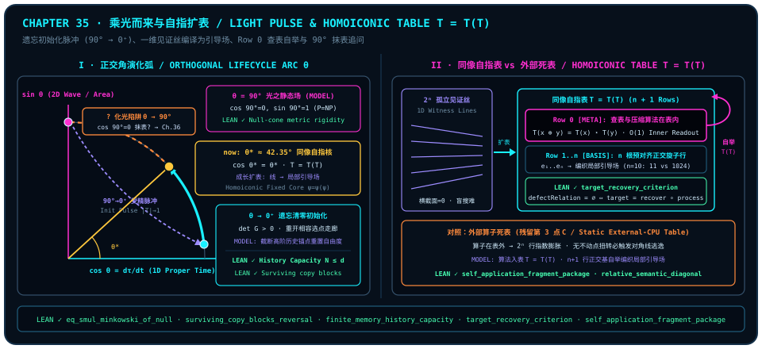

# Arriving on a Pulse of Light and Self-Referential Table Expansion: From Initialization by Forgetting to the Homoiconic Loop $T = T(T)$

> *"The entire universe is in fact brimming with ultimate computational power: in the global static field, P = NP. Living beings seem to have forgotten their computational power so as to experience anew; growing up is the continual rise of computational power, because learned knowledge generates a table—increasing computational power is in essence table expansion, the lookup algorithm itself is also inside the table, and at the very end one returns to that state of ultimate computation. It is that pulse at the instant the fertilized egg is conceived: arriving riding on light, and at last becoming light itself."*

Stepping across the timeless Gram compatibility crystal of [Chapter 29](ch29-timeless-causality-and-gram-space.md), the dual perspective of [Chapter 30](ch30-fields-lines-eth-and-navier-stokes.md)—where the global static field exhibits $P = NP$-like geometric intersection while every bounded observer inside faces the $P \neq NP$ orthogonal horizon—and the fairness principle of [Chapter 31](ch31-quantum-fairness.md) whereby birth resets degrees of freedom through forgetting, a foundational question about life and mind comes into sharp focus: **if the timeless global matrix already brims with maximal compatibility power, why must every living mind begin in near-total forgetting? From an infant's first fumbling reach to a master's effortless command, what geometric operation is "growing up" actually performing? And when "the lookup algorithm itself is also inside the table," how does a finite mind pull off its own meta-bootstrapping leap?**

Within the **orthogonal observer lifecycle and homoiconic table-expansion model (`MODEL`)** developed in this chapter, the arc from the fertilization pulse to mature wisdom is no poetic mystification. It is a precise geometric trajectory governed by null-cone metric rigidity, finite memory capacity, zero-defect fiber factorization, and self-referential diagonal fixed points: life refracts out of the $\theta = 90^\circ$ timeless correlation field into a $\theta \to 0^+$ local proper-time slice, actively clearing prior entries so as to reopen a strictly positive-volume choice corridor; it then pre-compiles arduous one-dimensional witness threads row by row into an orthogonal basis table $T$, and places the lookup and compression rule itself into Row $0$ to close the homoiconic loop $T = T(T)$—until, at the chapter's end, it confronts a chilling geometric trap hidden inside the naive dream of "returning to $90^\circ$ to become light itself."

---

## Arriving on Light: Initialization Pulse, Active Forgetting, and Logarithmic Subjective Time

Why must a living observer's very first act upon entering a local world be a symmetry-breaking pulse accompanied by radical forgetting?

Let us first set out the unit-circle purity budget inside our **orthogonal inclination parameterization (`MODEL`)** (all external literature correspondences—continuum proper-time rearrangement, mammalian fertilization fluorescence pulses, and psychophysical logarithmic perception—are physically enclosed in [@rem-ch35-fertilization-zinc-spark-literature] below, alongside [Chapter 31](ch31-quantum-fairness.md) [@rem-ch31-haar-isotropy-landauer-literature]). When a local observer state opens an orthogonal inclination angle $\theta \in [0, \frac{\pi}{2}]$ relative to its one-dimensional persistence axis, the collinear inner-product share $\cos\theta$ measures local self-retention along that anchor, while the two-dimensional orthogonal bifurcation share $\sin\theta$ measures transverse relational spread, obeying the exact unit-circle Pythagorean ledger:

$$
\cos^2\theta + \sin^2\theta \;=\; 1.
$$

At the two endpoints of this balance stand two opposite modes of being (`MODEL`):

1. **The Timeless Null Field at $\theta = 90^\circ$ ($\cos 90^\circ = 0,\; \sin 90^\circ = 1$)**:
   With $100\%$ of the purity budget committed to the transverse wave plane, the one-dimensional local persistence component vanishes identically ($\cos 90^\circ = 0$; for the corresponding relativistic null proper-time literature, see Item 1 of [@rem-ch35-fertilization-zinc-spark-literature] below). In the idealized static-field model of [Chapter 30](ch30-fields-lines-eth-and-navier-stokes.md) (cf. [@rem-ch30-postselection-ctc-literature]), global hyperplane intersections coexist timelessly; yet precisely because $\cos 90^\circ = 0$, there is neither "before and after," nor suspense, nor any local perspective capable of savoring a journey called *experience*.
2. **Initialization Refraction $\theta = 90^\circ \to 0^+$ and Clearing by Forgetting ($\lvert T\rvert \to 1,\; \det G > 0$)**:
   For "experiencing anew" to become physically possible, a coherent initialization pulse must break pure $90^\circ$ wave symmetry, refract onto the $\theta \to 0^+$ one-dimensional idempotent axis of local existence, and clear the accumulated history table $T$ down to a single baseline anchor ($\lvert T\rvert \to 1$).

Popular intuition laments forgetting as a frailty of mortal flesh. Yet the threefold theorem verified by the Lean 4 kernel below ([@thm-ch35-null-pulse-and-record-blocking]) reveals the exact opposite geometric truth—**for any finite-dimensional physical carrier, refusing to forget means total dynamical gridlock**:

- First, [`eq_smul_minkowski_of_null`](lean:D5/S0/Certificates/MinkowskiNullConeRigidity.eq_smul_minkowski_of_null) proves that vanishing on the null cone rigidly locks any spacetime quadratic form to the scalar multiple $S(1, 0)\bullet\operatorname{minkowski}_d$: light lays down the causal skeleton, while the nonzero reading $S(1, 0)$ along the temporal unit vector $(1, 0)$ calibrates the very first tick of a local clock;
- Second, [`surviving_copy_blocks_reversal`](lean:D5/S3/ObserverMemory/JointCoherentReversal.surviving_copy_blocks_reversal) proves that as long as past interactions leave behind even a single unreversed surviving environmental copy $k$ whose overlap factor differs from $1$, applying coherent conjugate reversal to every other copy still fails to restore a nonzero off-diagonal coherence entry $\rho_{ij} \neq 0$—scattered traces of an old cycle cannot be locally rewound away;
- Third, [`finite_memory_history_capacity`](lean:D5/S3/Quantum/Measurements/FiniteMemoryHistoryCapacity.finite_memory_history_capacity) establishes a hard ceiling: inside a $d$-dimensional physical memory space, the number of history density matrices perfectly distinguishable by any single positive operator-valued measure (POVM) is bounded above by $d$ ($N \le d$)!

Picture a notebook with only $d$ pages: if all $d$ orthogonal history anchors from a prior cycle remain welded across every page, not only is the register ceiling $N \le d$ completely saturated, but accumulated anchors also squeeze the compatibility margin for subsequent choices (cf. [Chapter 29](ch29-timeless-causality-and-gram-space.md#sec-coda-finite-observer-time-field) [@thm-ch29-gram-rigidity-and-pell]; explicit two-anchor Gram calculation in [@ex-ch35-two-anchor-gram-corridor] below):

::: {.example #ex-ch35-two-anchor-gram-corridor title="Two-Anchor 2x2 Gram Compatibility Area and Corridor Reopening (Literature Result, Not Formalized in This Book)"}
**Literature result, not formalized in this book.** The elementary $2 \times 2$ real Gram determinant identity below belongs to standard linear algebra (aligned with [Chapter 29](ch29-timeless-causality-and-gram-space.md#sec-coda-hume-spinoza-gram) [@thm-ch29-gram-rigidity-and-pell]) and is not formalized as a standalone $2 \times 2$ determinant lemma in `trureturing@dev`:

For a new unit state having real inner-product overlap $c \in [-1, 1]$ with an existing unit anchor, the squared compatibility area of their $2 \times 2$ unit-diagonal Gram matrix is

$$
\det G_2 \;=\; \det\begin{pmatrix}1 & c \\ c & 1\end{pmatrix} \;=\; 1 - c^2.
$$

Once historical anchors lock onto the collinear boundary $c = \pm 1$, the compatibility margin $\det G_2 = 0$ collapses to zero; conversely, severing inherited anchors and resetting the table $T$ to a single baseline state ($\lvert T\rvert = 1,\; \det G_1 = 1 > 0$) reopens the strictly positive compatibility corridor $1 - c^2 > 0$ across every non-collinear overlap $\lvert c\rvert < 1$.
:::

Within our interpretive model (`MODEL`), that pulse at conception—"arriving riding on light"—is therefore a **geometric amnesty that clears the old table ($\lvert T\rvert \to 1$) and reopens the causal selection corridor ([@ex-ch35-two-anchor-gram-corridor])**. Moreover, because the baseline table at life's outset is nearly blank, each newly written experience occupies a large relative share of current table size, resonating directly with psychophysical logarithmic time scaling (for fertilization fluorescence observations, the logarithmic subjective-time literature law, and quantitative age-span ratios, see Items 2–3 of [@rem-ch35-fertilization-zinc-spark-literature] below)—the geometric reason why a single childhood summer feels endless while a decade in densely indexed adulthood flashes past in the blink of an eye.

::: {.theorem #thm-ch35-null-pulse-and-record-blocking title="Null-Cone Metric Rigidity, Surviving-Copy Reversal Blocking, and Finite-Memory History Capacity" lean="D5/S0/Certificates/MinkowskiNullConeRigidity.eq_smul_minkowski_of_null D5/S3/ObserverMemory/JointCoherentReversal.surviving_copy_blocks_reversal D5/S3/Quantum/Measurements/FiniteMemoryHistoryCapacity.finite_memory_history_capacity"}
Across the frozen null-cone rigidity certificate, observer-memory coherent reversal, and quantum measurement-capacity modules of `trureturing`, the following three theorems hold simultaneously:

1. **Null-Cone Quadratic-Form Rigidity in Arbitrary Spatial Dimension** ([`eq_smul_minkowski_of_null`](lean:D5/S0/Certificates/MinkowskiNullConeRigidity.eq_smul_minkowski_of_null)): Let $d \in \mathbb{N}$, write the spacetime carrier $\operatorname{Space}(d) = \mathbb{R} \times \operatorname{EuclideanSpace}\;\mathbb{R}\;(\operatorname{Fin}\;d)$, and define $\operatorname{minkowski}_d(t, w) = t^2 - \lVert w\rVert^2$. For every real quadratic form $S : \operatorname{QuadraticForm}\;\mathbb{R}\;(\operatorname{Space}\;d)$, if $S$ vanishes on all null vectors ($\forall v \in \operatorname{Space}(d),\; \operatorname{minkowski}_d(v) = 0 \to S(v) = 0$), then

   $$
   S \;=\; S(1, 0) \bullet \operatorname{minkowski}_d;
   $$

2. **Single Unreversed Surviving Copy Blocks Coherent Reversal** ([`surviving_copy_blocks_reversal`](lean:D5/S3/ObserverMemory/JointCoherentReversal.surviving_copy_blocks_reversal)): Let $\mathrm{Copy}$ be a finite decidable index type (`[Fintype Copy] [DecidableEq Copy]`), let $\mathrm{records} : \mathrm{Copy} \to \mathrm{EnvironmentRecord}$ be a family of single-qubit environment records, and let $\rho \in M_2(\mathbb{C})$ (`QubitMatrix`), $i, j \in \operatorname{Fin}\;2$, and $k \in \mathrm{Copy}$. If (a) for all $l \neq k$, $\operatorname{star}(\operatorname{recordOverlap}(\mathrm{records}(l), i, j)) \cdot \operatorname{recordOverlap}(\mathrm{records}(l), i, j) = 1$, (b) the surviving copy satisfies $\operatorname{recordOverlap}(\mathrm{records}(k), i, j) \neq 1$, and (c) the initial entry satisfies $\rho_{ij} \neq 0$, then reversing all copies in $\operatorname{Finset.univ.erase}\;k$ fails to restore entry $(i, j)$:

   $$
   \operatorname{reverseChannelOn}\bigl(\operatorname{Finset.univ.erase}\;k,\; \mathrm{records},\; \operatorname{multiRecordChannel}(\mathrm{records}, \rho)\bigr)_{ij} \;\neq\; \rho_{ij};
   $$

3. **Distinguishable History Capacity Bound of a Finite-Dimensional Memory** ([`finite_memory_history_capacity`](lean:D5/S3/Quantum/Measurements/FiniteMemoryHistoryCapacity.finite_memory_history_capacity)): Let $N, d \in \mathbb{N}$, and let state and measurement families $\rho, E : \operatorname{Fin}\;N \to M_d(\mathbb{C})$ satisfy: (a) for every $i$, $\rho_i$ is positive semidefinite with $\operatorname{Tr}(\rho_i) = 1$; (b) for every $j$, $E_j$ is positive semidefinite with $\sum_{j \in \operatorname{Fin}\;N} E_j = I_d$; and (c) for all $i, j$, perfect discrimination $\operatorname{Tr}(E_j \rho_i) = \delta_{ij}$ ($1$ if $i = j$, else $0$) holds. Then the number of perfectly distinguishable history records is bounded above by the memory dimension:

   $$
   N \;\le\; d.
   $$

:::

::: proof
For Conjunct 1, decomposing any $v = (t, w) \in \operatorname{Space}(d)$ as $t(1, 0) + (0, w)$ and evaluating $S$ on the null pairs $(\pm\lVert w\rVert, w)$ via [`null_cone_spatial_rigidity`](lean:D5/S0/Certificates/MinkowskiNullConeRigidity.null_cone_spatial_rigidity) forces the cross polar term to vanish and yields $S(0, w) = -S(1, 0)\lVert w\rVert^2$, giving $S(t, w) = S(1, 0)(t^2 - \lVert w\rVert^2)$ pointwise. For Conjunct 2, [`one_surviving_copy_composition_apply`](lean:D5/S3/ObserverMemory/JointCoherentReversal.one_surviving_copy_composition_apply) cancels the unimodular conjugate overlaps on all reversed copies $l \neq k$ to reduce entry $(i, j)$ of the composed channel to $\operatorname{recordOverlap}(\mathrm{records}(k), i, j)\cdot\rho_{ij}$; equality with $\rho_{ij} \neq 0$ over the field $\mathbb{C}$ would force that overlap factor to equal $1$, contradicting hypothesis (b). For Conjunct 3, $0 \le E_i \le I_d$ and the vanishing-product lemma for positive semidefinite matrices of zero trace imply $\operatorname{range}(\rho_i) \le \ker(I_d - E_i)$ and $\operatorname{range}(\rho_j) \le \ker(E_i)$ for $j \neq i$; choosing a nonzero vector $v_i$ in each range (guaranteed by $\operatorname{Tr}(\rho_i) = 1 \neq 0$) and applying Hermiticity of $E_i$ gives $\langle v_i, v_j\rangle_{\mathbb{C}} = \langle E_i v_i, v_j\rangle_{\mathbb{C}} = \langle v_i, E_i v_j\rangle_{\mathbb{C}} = 0$, whence linear independence of pairwise orthogonal nonzero vectors in $\mathbb{C}^d$ yields $N \le d$. The full proof is checked by the Lean kernel.
:::

::: {.remark #rem-ch35-fertilization-zinc-spark-literature title="Proper-Time Pythagorean Parameterization, Mammalian Fertilization Calcium–Zinc Spark Fluorescence, and the Weber–Fechner Logarithmic Law (Literature Result, Not Formalized in This Book)"}
**Literature result, not formalized in this book.** Three background results from relativity, developmental biology, and psychophysics juxtaposed with this section's initialization model (`MODEL`) belong to external scientific literature and are not formalized in the locked declaration set of this book:

1. **Unit-Circle Rearrangement of Minkowski Proper Time and Spatial Speed**: Rearranging the special-relativistic line element $c^2 d\tau^2 = c^2 dt^2 - \lVert d\mathbf{x}\rVert^2$ ($v = \lVert d\mathbf{x}/dt\rVert \le c$) with $\sin\theta = v/c$ and $\cos\theta = d\tau/dt = \sqrt{1 - v^2/c^2}$ yields $(d\tau/dt)^2 + (v/c)^2 = \cos^2\theta + \sin^2\theta = 1$; null propagation $v = c$ ($\theta = 90^\circ$) gives $d\tau = 0$, whereas the local rest limit $v \to 0^+$ ($\theta \to 0^+$) gives $d\tau/dt \to 1$;
2. **Mammalian Egg-Activation Calcium Oscillations, Zinc-Spark Fluorescence Pulses, and Ultraweak Biophoton Emission**: Live-cell fluorescence microscopy has demonstrated that upon fertilization activation, mouse and human oocytes trigger intracellular $\mathrm{Ca}^{2+}$ wave oscillations that drive coordinated cortical-granule exocytosis of billions of zinc ions, producing quantized extracellular fluorescence flashes termed "zinc sparks" whose amplitude correlates positively with embryonic developmental potential (E. L. Que *et al.*, *Nat. Chem.* **7**, 130–139, 2015; F. E. Duncan *et al.*, *Sci. Rep.* **6**, 24737, 2016); biophysics experiments have likewise measured ultraweak photon emission ($\sim 10^1\text{–}10^3\;\mathrm{photons}\cdot\mathrm{cm}^{-2}\cdot\mathrm{s}^{-1}$) from reactive oxygen transitions in dividing cells. Epistemic discipline is essential: experimentally these signals are biochemical ion waves and metabolic chemiluminescence, whereas interpreting the fertilization pulse as an observer's initialization projection from a $90^\circ$ correlation field onto a $\theta \to 0^+$ slice is strictly an interpretive cross-domain model (`MODEL`) of this monograph;
3. **Weber–Fechner Logarithmic Perception Scaling (E. H. Weber, 1834; G. T. Fechner, *Elemente der Psychophysik*, 1860)**: Classical psychophysics models perceived subjective increments in proportion to fractional baseline change, $d\tau_{\mathrm{subj}} = k\,dt/t$, integrating to the logarithmic subjective time law $\tau_{\mathrm{subj}}(t) = k\ln(t/t_0)$ ($t \ge t_0 > 0$). Thus a single calendar year spans $k\ln(2/1) \approx 0.6931\,k$ across $t \in [t_0, 2t_0]$, compared with $k\ln(41/40) \approx 0.0247\,k$ across $t \in [40t_0, 41t_0]$—a roughly $28$-fold compression.
:::

---

## Growth as Table Expansion: Pre-Compiling 1D Witness Threads into a Local Guiding Field

Awakening from its blank $\theta \to 0^+$ baseline, a living being embarks on the long arc of growth. Why does our opening epigraph cut straight to the bone: **"growing up is the continual rise of computational power, because learned knowledge generates a table—increasing computational power is in essence table expansion"**?

Recall the geometric contrast established in [Chapter 30](ch30-fields-lines-eth-and-navier-stokes.md) (`MODEL`): "$P$ is a field; $NP$ is a line." Before an unfamiliar skill is mastered—whether a child first tying shoelaces, a chess player calculating a sacrificial mating net, or a mathematician hunting an elusive lemma—the valid witness is a zero-cross-section one-dimensional thread buried across a high-dimensional near-$90^\circ$ equatorial wilderness (cf. Conjunct 2 of [@thm-ch31-horizon-landauer-ergodic-fairness] and [@rem-ch30-query-sos-literature]). Finding that thread the very first time exacts a steep bill in trial rotations and dissipated heat.

Yet living minds part company with memoryless black-box searchers at one decisive juncture—**life casts every traversed thread into a table row**! Consider first the transparent $2\times 2$ single-qubit hand calculation: when a state $\rho = \begin{pmatrix}\rho_{00} & \rho_{01}\\ \rho_{10} & \rho_{11}\end{pmatrix}$ writes into a blank address register via a controlled-permutation gate to form the canonical address record $R_{i,a} = \delta_{i,a}$, distinct address branches satisfy strict zero overlap $\sum_{a=0}^{1} R_{0,a}\overline{R_{1,a}} = 1\cdot 0 + 0\cdot 1 = 0$, anchoring the two branches onto crosstalk-free orthogonal table slots. Within our geometric table-expansion model (`MODEL`), genuine learning executes three stages of geometric pre-compilation:

1. **Writing to the Table (Crystallizing a 1D Witness Polyline into a Pre-Aligned Orthogonal Rotor Row)**:
   Once a learner has paid the search cost to traverse a valid witness polyline $\mathbf{P}_0 \to \mathbf{P}_1 \to \dots \to \mathbf{P}_k$ from problem to solution, memory extracts the net transformation and locks it into a sharply separated canonical address record inside table $T$ (matching `copiedAddressRecord` in Conjunct 2 of [@thm-ch35-target-recovery-table-factorization] below), eliminating target-collision defects across the process readout (`defectRelation process target = ∅`).
2. **Looking Up the Table (Cancelling Parasitic Commutator Area for $O(1)$ Inner-Product Readout)**:
   Before tabulation, re-solving the same problem class forces repeated zigzags across non-commuting intermediate planes, paying parasitic holonomy area each time; once written into $T$, any input landing on an indexed fiber invokes the exact factorization $\mathrm{target} = \mathrm{recover} \circ \mathrm{process}$ (Conjunct 1 of [@thm-ch35-target-recovery-table-factorization] below), reading out the answer via a single pre-aligned inner product! What everyday speech calls **intuition, muscle memory, or effortless mastery** is geometrically **replacing online blind search arc-length with pre-compiled table projection**.
3. **Weaving Lines into a Field (Spanning a Local Smooth Guiding Field from Orthogonal Basis Rows)**:
   A solitary witness thread stands isolated in state space; as growth steadily expands the table, hundreds and thousands of mutually orthogonal basis rows populate the task manifold, and their linear superpositions weave an erstwhile "lines-without-a-field" desert into a **locally smooth guiding field** supplying tangential direction at every point (`MODEL`; for cell-probe space–time trade-offs and non-uniform advice complexity limits, see [@rem-ch35-advice-space-time-tradeoff-literature] below).

We now lock into place the two formal theorems governing lossless table-recovery factorization and the extensional uniqueness of canonical copied-address records.

::: {.theorem #thm-ch35-target-recovery-table-factorization title="Fourfold Criterion for Lossless Table Recovery and Extensional Identity of Canonical Copied-Address Records" lean="D5/S3/ConceptDynamics/Restoration/TargetRecoveryCriterion.target_recovery_criterion D5/S3/Quantum/Decoherence/CanonicalRecordAccessRecovery.canonical_copied_address_record_eq_prior"}
Across the frozen concept-dynamics target-recovery and quantum-decoherence canonical-record modules of `trureturing`, the following two theorems hold simultaneously:

1. **Fourfold Characterization of Lossless Table Recovery on Nonempty State Spaces** ([`target_recovery_criterion`](lean:D5/S3/ConceptDynamics/Restoration/TargetRecoveryCriterion.target_recovery_criterion)): Let $X, \mathrm{ProcessState}, \mathrm{Target}$ be arbitrary types with $X$ nonempty (`[Nonempty X]`), let $\mathrm{process} : \operatorname{Concept}\;X\;\mathrm{ProcessState}$ be a table-indexing process readout and $\mathrm{target} : \operatorname{Concept}\;X\;\mathrm{Target}$ a target readout, and write $\operatorname{defectRelation}(\mathrm{process}, \mathrm{target}) = \{(x, y) \in X \times X \mid \mathrm{process}(x) = \mathrm{process}(y) \land \mathrm{target}(x) \neq \mathrm{target}(y)\}$. Then all four equivalences hold simultaneously:
   - **(a) Factorization Iff Fiber Constancy**:

     $$
     \begin{aligned}
     &(\exists\,\mathrm{recover} : \mathrm{ProcessState} \to \mathrm{Target}, \\
      &\quad \mathrm{target} = \mathrm{recover} \circ \mathrm{process}) \\
      &\iff (\forall x, y \in X,\; \mathrm{process}(x) = \mathrm{process}(y) \to \mathrm{target}(x) = \mathrm{target}(y))
     \end{aligned}
     $$

     ;
   - **(b) Fiber Constancy Iff Empty Defect Relation**:

     $$
     \begin{aligned}
     &(\forall x, y \in X,\; \mathrm{process}(x) = \mathrm{process}(y) \to \mathrm{target}(x) = \mathrm{target}(y)) \\
      &\iff \operatorname{defectRelation}(\mathrm{process}, \mathrm{target}) = \emptyset
     \end{aligned}
     $$

     ;
   - **(c) Empty Defect Relation Iff Table Recovery Exists**:

     $$
     \begin{aligned}
     &\operatorname{defectRelation}(\mathrm{process}, \mathrm{target}) = \emptyset \\
      &\iff (\exists\,\mathrm{recover} : \mathrm{ProcessState} \to \mathrm{Target}, \\
      &\quad \mathrm{target} = \mathrm{recover} \circ \mathrm{process})
     \end{aligned}
     $$

     ;
   - **(d) Unrecoverability Iff Nonempty Defect Relation**:

     $$
     \begin{aligned}
     &(\neg\exists\,\mathrm{recover} : \mathrm{ProcessState} \to \mathrm{Target}, \\
      &\quad \mathrm{target} = \mathrm{recover} \circ \mathrm{process}) \\
      &\iff (\operatorname{defectRelation}(\mathrm{process}, \mathrm{target})).\mathrm{Nonempty}
     \end{aligned}
     $$

     ;
2. **Extensional Identity of Canonical Copied-Address Records** ([`canonical_copied_address_record_eq_prior`](lean:D5/S3/Quantum/Decoherence/CanonicalRecordAccessRecovery.canonical_copied_address_record_eq_prior)): The canonical address-table record $\operatorname{MeasurementMarginal.copiedAddressRecord}(i, a) = (\text{if } i = a \text{ then } 1 \text{ else } 0)$ from the measurement-marginal module and the controlled-permutation record $\operatorname{ReducedRecordAccessDefect.copiedAddressRecord}(i, a) = (\text{if } a = i \text{ then } 1 \text{ else } 0)$ from the reduced-record-access module are identically equal as environment records of type $\operatorname{Fin}\;2 \to \operatorname{Fin}\;2 \to \mathbb{C}$:

   $$
   \operatorname{MeasurementMarginal.copiedAddressRecord} \;=\; \operatorname{ReducedRecordAccessDefect.copiedAddressRecord}.
   $$

:::

::: proof
In Conjunct 1, `[Nonempty X]` supplies a fallback witness $x_0 \in X$ (assigning default target value $\mathrm{target}(x_0)$ to unhit process coordinates outside the range of $\mathrm{process}$), allowing direct invocation of `answerability_criterion`: a lookup map $\mathrm{recover}$ with $\mathrm{target} = \mathrm{recover} \circ \mathrm{process}$ exists if and only if $\mathrm{target}$ is constant along every fiber of $\mathrm{process}$, which by unfolding `defectRelation` holds if and only if the collision-defect set is $\emptyset$; negating both sides of (c) and applying `Set.nonempty_iff_ne_empty` yields (d). In Conjunct 2, two-argument function extensionality `funext i a` over $\operatorname{Fin}\;2$ followed by symmetry of equality `eq_comm` ($i = a \iff a = i$) proves pointwise identity. The full proof is checked by the Lean kernel.
:::

::: {.remark #rem-ch35-advice-space-time-tradeoff-literature title="Yao's Cell-Probe Space–Time Trade-Off and the Karp–Lipton Non-Uniform Advice Class P/poly (Literature Result, Not Formalized in This Book)"}
**Literature result, not formalized in this book.** When "table expansion boosts computational power" is examined within classical data-structure and complexity theory, two quantitative boundaries come from external classical literature and are not formalized in the locked declaration set of this book:

1. **Cell-Probe Precomputation Space–Time Trade-Offs (A. C. Yao, *J. ACM* **28**, 615–628, 1981; A. C. Yao, *FOCS*, 379–384, 1990)**: In Yao's cell-probe model for static dictionary queries or black-box permutation inversion over a domain of size $N$, storing an offline table of $S$ memory cells compresses online query probes to $T$ subject to strict space–time lower bounds—for instance, generic black-box permutation inversion obeys the product lower bound $S \cdot T \ge \Omega(N)$ (bounded below on the order of $N$)—quantifying how spatial memory amortizes online search time;
2. **Non-Uniform Advice Class $\mathrm{P}/\mathrm{poly}$ and the Karp–Lipton Collapse Theorem (R. M. Karp & R. J. Lipton, *STOC*, 302–309, 1980; *Enseign. Math.* **28**, 191–209, 1982)**: Equipping each input length $n$ with a static external lookup advice string of polynomially bounded length $|\alpha_n| \le \operatorname{poly}(n)$ defines $\mathrm{P}/\mathrm{poly}$ (equivalent to polynomial-size Boolean circuit families). Karp and Lipton proved that if $\mathrm{NP} \subseteq \mathrm{P}/\mathrm{poly}$, the entire polynomial hierarchy collapses to its second level $\mathrm{PH} = \Sigma_2^{\mathrm{P}} \cap \Pi_2^{\mathrm{P}}$. Thus a polynomial-size static flat table is widely believed incapable of exhausting worst-case $\mathrm{NP}$-complete instances (cf. [@conj-p-neq-np]); a finite mind achieves dramatic leaps through table expansion not by hoarding exponential flat rows, but by exploiting shared algebraic symmetry and internalizing the self-bootstrapping compression rule of the next section.
:::

::: {.remark #rem-ch35-light-pulse-table-figure title="Orthogonal Lifecycle Arc and Homoiconic Table T = T(T) Diagram (Literature Result, Not Formalized in This Book)"}
**Literature result, not formalized in this book.** The left panel combines fertilization-spark and logarithmic-time literature ([@rem-ch35-fertilization-zinc-spark-literature]) with the cosine fixed point ([@rem-banach-dottie-hairy-ball-literature]) to illustrate our orthogonal lifecycle `MODEL`; the right panel pairs homoiconicity and reflexive-domain literature ([@rem-ch35-homoiconicity-scott-domain-literature]) with formal diagonal escape ([@thm-ch35-lawvere-diagonal-and-homoiconic-closure], `LEAN ✓`) for Row $0$ self-bootstrapping $T = T(T)$:

:::

---

## The Lookup Algorithm Inside the Table: $T = T(T)$ and Homoiconic Meta-Bootstrapping

Pushing further along the complexity warning of [@rem-ch35-advice-space-time-tradeoff-literature]: what happens if "table expansion" merely stuffs inert entries into a passive array while the lookup engine that indexes, combines, and interprets those rows remains perched outside the table?

It immediately slams into two walls (`MODEL`):

- **Wall 1 (Resurrection of the External Point $C$ and Exponential Blowup)**: Leaving the lookup engine outside $T$ secretly reinstates inside the mind the very "external third point $C$" excised in [Chapter 2](ch02-born-rule.md). Across $n$ binary features spanning $2^n$ situations, a flat rule-free table must store all $N = 2^n$ rows explicitly: under a `MODEL` encoding that represents each stored row as a pairwise perfectly distinguishable quantum state inside a fixed $d$-dimensional register, any register dimension budget $d < 2^n$ (such as any polynomial budget $d \le \operatorname{poly}(n)$) violates the discrimination bound $N \le d$ of [@thm-ch35-null-pulse-and-record-blocking] Conjunct 3 while sequential retrieval cost grows exponentially with table size.
- **Wall 2 (Diagonal Escape Under Operator–Table Split)**: So long as the decoder catalog and latent coordinate readout remain split into separate tiers, any fixed-point-free modifier (`twist`) slices diagonally across the entire catalog ([@thm-ch35-lawvere-diagonal-and-homoiconic-closure] below), guaranteeing that every static row misses the diagonal query.

Here the deepest stroke in our opening epigraph cuts straight through the knot: **"the lookup algorithm itself is also inside the table"**!

Encode the addressing, lookup, and compositional compression algorithm directly into **Row $0$ of table $T$**, housing operator (the verb that reads the table) and operand (the rows being read) inside one and the same addressable geometric carrier (`MODEL`; for stored-program architecture, homoiconicity, and reflexive domain isomorphisms in computer science, see [@rem-ch35-homoiconicity-scott-domain-literature] below). Two qualitative phase transitions ignite at once:

1. **Rank Collapse and Meta-Learning ("Learning How to Build and Read Tables")**:
   Row $0$ is no longer an isolated datum; it is the **bilinear composition and reduction operator** governing the entire table! Once Row $0$ stores the group-multiplication or parity-composition law of an orthogonal basis, $T$ need never tabulate $2^n$ dead entries: it stores just $n$ orthogonal generator rows and synthesizes the answer to any of the $2^n$ queries on the fly via Row $0$ (worked out explicitly in [@ex-ch35-self-indexing-table-rank-collapse] below). Better still, whenever the mind refines the lookup/compression rule in Row $0$, retrieval across thousands of previously stored rows upgrades instantaneously—the exact geometry of leaping from rote memorization to structural mastery (meta-learning)!
2. **Dissolving Infinite Interpreter Regress into $T = T(T) \iff \psi = \psi(\psi)$**:
   Examine all four conjuncts of [@thm-ch35-lawvere-diagonal-and-homoiconic-closure] Conjunct 1 below: whenever a modifier $f$ is **fixed-point-free**, the self-application diagonal $\operatorname{diagonal}(f, h)(a) = f(h(a, a))$ escapes every two-argument table $h$ (part (c)); conversely, part (d) exhibits a concrete Boolean witness proving the fixed-point-free hypothesis indispensable—**the moment a table captures its own diagonal row, self-application at the capturing address locks onto a fixed point**! When table $T$ stops appealing to a higher meta-interpreter and instead uses Row $0$ to index and rewrite $T$ itself under contractive orthogonal projection damping ([Chapter 32](ch32-unified-field-and-meta-unification.md) [@thm-ch32-generative-self-reference-and-zeckendorf] and [Chapter 24](ch24-cosine-fixed-points-and-self-reference.md) [@rem-banach-dottie-hairy-ball-literature]), infinite regress closes into the **homoiconic self-referential loop**:

$$
T \;=\; T(T) \;\Longleftrightarrow\; \psi \;=\; \psi(\psi).
$$

Within our one-dimensional real projection model (`MODEL`), this self-consistent equilibrium where operator and table become one corresponds to [Chapter 24](ch24-cosine-fixed-points-and-self-reference.md)'s self-referential cosine equilibrium angle (numerical root and continuum iteration background in [@rem-banach-dottie-hairy-ball-literature]): there, the ruler that reads the table and the table being read admit no subject–object split.

::: {.theorem #thm-ch35-lawvere-diagonal-and-homoiconic-closure title="Self-Application Diagonal Package and Pointwise Escape of the Relative Semantic Diagonal" lean="D5/S0/Diagonal/Lawvere/QualitativeEscape.self_application_fragment_package D5/S3/ConceptDynamics/DefinitionEscape/RelativeSemanticDiagonal.relative_semantic_diagonal_ne_listed_decode"}
Across the frozen qualitative self-application diagonal and concept-definition escape modules of `trureturing`, with no finiteness assumptions required, the following two theorems hold simultaneously:

1. **Four-Part Self-Application Fragment Package** ([`self_application_fragment_package`](lean:D5/S0/Diagonal/Lawvere/QualitativeEscape.self_application_fragment_package)): For arbitrary types $A, Y$ in any universe levels, any endomap $f : Y \to Y$, and any two-argument table $g : A \to A \to Y$, all four statements hold simultaneously:
   - **(a) Pointwise Self-Application Formula**: For every address $a \in A$, $\operatorname{diagonal}(f, g)(a) = f\bigl(g(a, a)\bigr)$;
   - **(b) Range Characterization of Escape**: $\operatorname{IsEscaped}(f, g) \iff \operatorname{diagonal}(f, g) \notin \operatorname{Set.range}(g)$;
   - **(c) Universal Escape of Fixed-Point-Free Twists**: If $\forall y \in Y,\; f(y) \neq y$, then $\operatorname{IsEscaped}(f, h)$ holds for every table $h : A \to A \to Y$;
   - **(d) In-Table Capture Witness with a Fixed Point (Non-Omissibility of Fixed-Point-Freeness)**: There exist a map $f_0 : \mathrm{Bool} \to \mathrm{Bool}$ possessing a fixed point and a table $g_0 : \mathrm{Unit} \to \mathrm{Unit} \to \mathrm{Bool}$ such that $\neg\operatorname{IsEscaped}(f_0, g_0)$;
2. **Relative Semantic Diagonal Differs from Every Listed Catalog Decode** ([`relative_semantic_diagonal_ne_listed_decode`](lean:D5/S3/ConceptDynamics/DefinitionEscape/RelativeSemanticDiagonal.relative_semantic_diagonal_ne_listed_decode)): Let $\mathrm{Address}, \mathrm{Coordinate}, \mathrm{Output}$ be arbitrary types, let $\mathrm{twist} : \mathrm{Output} \to \mathrm{Output}$ be fixed-point-free ($\forall o \in \mathrm{Output},\; \mathrm{twist}(o) \neq o$), let $\mathrm{latent} : \operatorname{Concept}\;\mathrm{Address}\;\mathrm{Coordinate}$ be a latent coordinate readout, and let $\mathrm{decoderCatalog} : \mathrm{Address} \to \mathrm{Coordinate} \to \mathrm{Output}$ be a decoder table catalog. Writing [`relativeSemanticDiagonal`](lean:D5/S3/ConceptDynamics/DefinitionEscape/RelativeSemanticDiagonal.relativeSemanticDiagonal) for $a \mapsto \mathrm{twist}\bigl(\mathrm{decoderCatalog}(a, \mathrm{latent}(a))\bigr)$, every $\mathrm{address} \in \mathrm{Address}$ satisfies the function inequality

   $$
   \operatorname{relativeSemanticDiagonal}(\mathrm{twist}, \mathrm{latent}, \mathrm{decoderCatalog}) \;\neq\; \mathrm{decoderCatalog}(\mathrm{address}) \circ \mathrm{latent}.
   $$

:::

::: proof
In Conjunct 1, parts (a) and (b) hold definitionally (`rfl` and `Iff.rfl`); for part (c), if some table $h$ failed to be escaped, an address $a \in A$ would satisfy $h(a) = \operatorname{diagonal}(f, h)$, and evaluating both sides at $a$ gives $h(a, a) = f(h(a, a))$, exhibiting a fixed point of $f$ contradicting $\forall y,\; f(y) \neq y$; for part (d), choosing $f_0 = \mathrm{id}_{\mathrm{Bool}}$ and the constant table $g_0(\_, \_) = \mathrm{true}$ yields $\operatorname{diagonal}(f_0, g_0) = g_0(())$, proving $\neg\operatorname{IsEscaped}(f_0, g_0)$. In Conjunct 2, assuming function equality at some $\mathrm{address}$ and evaluating both sides at $\mathrm{address}$ (`congrFun`) yields $\mathrm{twist}\bigl(\mathrm{decoderCatalog}(\mathrm{address}, \mathrm{latent}(\mathrm{address}))\bigr) = \mathrm{decoderCatalog}(\mathrm{address}, \mathrm{latent}(\mathrm{address}))$, directly contradicting `fixedPointFree`. The full proof is checked by the Lean kernel.
:::

::: {.remark #rem-ch35-homoiconicity-scott-domain-literature title="Von Neumann Stored-Program Architecture, Homoiconicity (Code as Data), and Scott's Reflexive Domain Isomorphism D_∞ (Literature Result, Not Formalized in This Book)"}
**Literature result, not formalized in this book.** Housing "the lookup algorithm itself inside the table" corresponds to three foundational milestones across computer architecture, programming-language theory, and denotational semantics (none formalized in the locked declaration set of this book):

1. **Stored-Program Computer Architecture (J. von Neumann, *First Draft of a Report on the EDVAC*, 1945; rooted in A. M. Turing's 1936 universal machine encoding)**: Abolishing the hardware wall between an external wired control unit and passive data memory, instructions (operators) and operands (table entries) inhabit the same linearly addressable memory words, enabling a program to inspect, compile, and rewrite itself just like ordinary table rows;
2. **Homoiconicity ("Code as Data") and Meta-Circular Evaluators (J. McCarthy, *Commun. ACM* **3**, 184–195, 1960; C. N. Mooers & L. P. Deutsch, 1965)**: In homoiconic symbolic systems such as Lisp, program syntax trees and base table structures (S-expressions) share one identical representation, allowing the entire evaluator $\operatorname{eval}$ to sit as a table entry and bootstrap itself;
3. **Dana Scott's Reflexive Domain Isomorphism $D_\infty \cong [D_\infty \to D_\infty]$ (D. S. Scott, *Proc. 4th Ann. Princeton Conf. Inf. Sci. Syst.*, 169–176, 1970; *Lect. Notes Math.* **274**, 97–136, 1972)**: In naive set theory, for any $|D| \ge 2$ the full function-set cardinality $|D^D| > |D|$ strictly forbids $D \cong (D \to D)$; Scott constructed the inverse limit $D_\infty = \lim_{\leftarrow} (D_n, p_n)$ along embedding–projection pairs of $\omega$-complete partial orders ($\omega$-cpos) and proved order isomorphism with its space of Scott-continuous self-maps:

   $$
   D_\infty \;\cong\; [D_\infty \to D_\infty],
   $$

   supplying the first nontrivial mathematical model of untyped $\lambda$-calculus in which every element $T \in D_\infty$ is simultaneously a data table and a continuous lookup operator on tables, and every continuous functional $F$ admits a least fixed point $\operatorname{fix}(F) = \bigsqcup_{m=0}^\infty F^m(\bot)$ making $T = T(T)$ rigorously well-defined.
:::

To make completely concrete how storing the composition rule in Row $0$ triggers exponential table-row compression, the attributed worked example below audits finite parity queries alongside planar orthogonal rotor families:

::: {.example #ex-ch35-self-indexing-table-rank-collapse title="Self-Indexing Rank Collapse for n-Bit Parity and Planar Rotors: From 2^n Flat Rows to n + 1 Homoiconic Rows (Literature Result, Not Formalized in This Book)"}
**Literature result, not formalized in this book.** The planar rotation homomorphism $R(\alpha)R(\beta) = R(\alpha + \beta)$ and $\mathbb{F}_2^n$ linear parity basis expansion used below belong to standard linear algebra and elementary group representation theory and are not formalized as a standalone homoiconic-table compression theorem in `trureturing@dev`:

Consider on the $n$-bit query cube $X = \{0, 1\}^n$ the linear parity target $f_w(x) = \bigoplus_{r=1}^n w_r x_r \in \{0, 1\}$ (with fixed secret weight $w \in \{0, 1\}^n$) alongside the corresponding product family of planar orthogonal rotations

$$
U_\theta(x) \;=\; \prod_{r=1}^n R(\theta_r)^{x_r}, \qquad R(\alpha) := \begin{pmatrix}\cos\alpha & -\sin\alpha \\ \sin\alpha & \cos\alpha\end{pmatrix}.
$$

By the planar rotation homomorphism $R(\alpha)R(\beta) = R(\alpha + \beta)$, the composite rotor simplifies to the angle inner product $U_\theta(x) = R\bigl(\sum_{r=1}^n x_r \theta_r\bigr)$. Contrast two table architectures:

1. **Architecture A (Flat Dead Table with External Operator)**: If the table can store only static `key x ↦ output` pairs with no internal composition rule, zero-error coverage across $X$ demands all $|X| = 2^n$ rows explicitly. Even at $n = 3$ with $w = (1, 0, 1)$, the flat table must list $(000)\mapsto 0, (001)\mapsto 1, (010)\mapsto 0, (011)\mapsto 1, (100)\mapsto 1, (101)\mapsto 0, (110)\mapsto 1, (111)\mapsto 0$ ($2^3 = 8$ rows); at $n = 10$ it requires $2^{10} = 1024$ rows; at $n = 100$ it requires $N = 2^{100} \approx 1.27 \times 10^{30}$ rows—under a `MODEL` encoding representing those $N = 2^{100}$ rows as pairwise perfectly distinguishable density states in one register, [@thm-ch35-null-pulse-and-record-blocking] Conjunct 3 ($N \le d$) forces Hilbert-space dimension $d \ge 2^{100}$, ruling out lossless storage in any finite-dimensional register whose dimension budget satisfies $d < 2^{100}$.
2. **Architecture B (Homoiconic Table $T$ Storing the Composition Rule in Row $0$)**:
   - **Row $0$ (Meta-Rule Row)**: Stores the bilinear homomorphic lookup law expanding any input in the standard basis $x = \bigoplus_{r=1}^n x_r \mathbf{e}_r$ and evaluating $T(x) := \bigoplus_{r=1}^n x_r \cdot T(\mathbf{e}_r)$ (or $T(x) := R\bigl(\sum_{r=1}^n x_r \theta_r\bigr)$ for planar rotors);
   - **Rows $1, \dots, n$ (Orthogonal Basis Rows)**: Store only the $n$ basis responses $T(\mathbf{e}_r) = w_r$ (or basis angles $\theta_r$) on $\mathbf{e}_1, \dots, \mathbf{e}_n$. For $n = 3, w = (1, 0, 1)$, storing Row $0$ plus $T(\mathbf{e}_1)=1, T(\mathbf{e}_2)=0, T(\mathbf{e}_3)=1$ takes just $4$ rows, answering $x = (1, 1, 1)$ via $1\cdot 1 \oplus 1\cdot 0 \oplus 1\cdot 1 = 0$.
3. **Quantitative Audit and Zero-Defect Verification**:

   $$
   \text{Flat dead-table rows } 2^n \quad \xrightarrow{\text{Row } 0\text{ homomorphic bootstrap}} \quad \text{Homoiconic table rows } n + 1.
   $$

   At $n = 10$, table size drops from $1024$ rows to $1 + 10 = 11$ rows (over $93\times$ compression); at $n = 100$, just $101$ rows cover all $2^{100}$ inputs with zero error! Packing Rows $1\dots n$ into a single machine word $W = (w_1, \dots, w_n)$ reduces Row $0$ lookup to one bitwise-AND parity inner product $\langle W, x\rangle \bmod 2$ (or one angle inner product $R(\langle\boldsymbol{\theta}, x\rangle)$). Because the full coordinate readout $\mathrm{process}(x) = x$ is injective on $X$, $\operatorname{defectRelation}(\mathrm{process}, f_w) = \emptyset$, satisfying the lossless recovery criterion of [@thm-ch35-target-recovery-table-factorization] Conjunct 1.
:::

---

## The Loop of Light and Its Hidden Trap: The Question Leading to Chapter 36

At first glance, the grand lifecycle sketched in our opening epigraph—**"arriving riding on light, experiencing anew through forgetting, expanding computational power by growing a table with its lookup algorithm inside, and at last returning to ultimate computation and becoming light itself"**—appears to close into a symmetric four-stage panorama. Let us enclose this **apparent lifecycle (`MODEL`)** in a four-row synthesis table:

::: {.remark #rem-ch35-lifecycle-table-synthesis title="Four-Stage Apparent Lifecycle Synthesis Table (Literature Result, Not Formalized in This Book)"}
**Literature result, not formalized in this book.** The table below synthesizes global hyperplane literature ([@rem-ch30-postselection-ctc-literature]), fertilization and logarithmic-time literature ([@rem-ch35-fertilization-zinc-spark-literature]), and cosine fixed-point literature ([@rem-banach-dottie-hairy-ball-literature]) alongside our `MODEL` and formal kernel anchors (`LEAN ✓`):

| Lifecycle Stage (`MODEL`) | Orthogonal Angle & Trigonometric Shares | Table Structure $T$ & Formal Mechanism Anchors | Subjective Time & Local Computational Regime (`MODEL`) |
| :--- | :--- | :--- | :--- |
| **I. Prior Global Null Field** | $\theta = 90^\circ$ ($\cos 90^\circ = 0,\; \sin 90^\circ = 1$) | No local table boundaries; null-cone metric skeleton ([@thm-ch35-null-pulse-and-record-blocking] Conjunct 1) and global hyperplane intersection ([@rem-ch30-postselection-ctc-literature]) | Proper-time rate $d\tau/dt = 0$; global static compatibility akin to $P = NP$, yet zero local lived experience |
| **II. Fertilization Pulse Initialization** | $\theta : 90^\circ \to 0^+$ ($\cos\theta \to 1,\; \sin\theta \to 0^+$) | Actively clears prior anchors $\lvert T\rvert \to 1$, avoiding $N \le d$ saturation and surviving-copy lockup ([@thm-ch35-null-pulse-and-record-blocking] Conjuncts 2–3) | Reopens $\det G > 0$ choice corridor; logarithmic subjective time $\tau_{\mathrm{subj}} \propto \ln(t/t_0)$ stretches wide open ([@rem-ch35-fertilization-zinc-spark-literature]) |
| **III. Growth & Homoiconic Table Expansion** | $\theta : 0^+ \to \theta^* \approx 42.35^\circ$ ($\cos\theta^* = \theta^*$) | Casts witness threads into orthogonal basis rows ([@thm-ch35-target-recovery-table-factorization]), with Row $0$ storing the lookup algorithm for rank collapse and $T = T(T)$ ([@thm-ch35-lawvere-diagonal-and-homoiconic-closure], [@ex-ch35-self-indexing-table-rank-collapse]) | Isolated threads weave into a local guiding field; leaps from online blind search to $O(1)$ inner-product intuition and meta-learning mastery |
| **IV. Apparent Full-Rank Return to Light (Under Scrutiny!)** | $\theta : \theta^* \to 90^\circ$? ($\cos\theta \to 0,\; \sin\theta \to 1$?) | Hypothetically dissolves every table row back into the pure transverse wave plane, melting all local table boundaries into the global null field | Appears to "return to ultimate computation and become light itself"—**yet conceals a fatal geometric paradox!** |
:::

Hold your gaze squarely on that question mark in Row IV of [@rem-ch35-lifecycle-table-synthesis], and bring down the sharpest Pythagorean scalpel in this book!

"Arriving riding on light, and at last becoming light itself" rings poetically flawless. Yet if linear intuition tempts us to equate "becoming light itself" with pushing the inclination angle $\theta$ past the self-referential equilibrium core all the way back to **$\theta = 90^\circ$**, calculate what happens at that exact instant:

As we just proved across the preceding two sections, the entire ability of a homoiconic table $T = T(T)$ to retain learned knowledge, keep distinct address fibers collision-free ($\operatorname{defectRelation} = \emptyset$, [@thm-ch35-target-recovery-table-factorization]), and let Row $0$'s lookup operator hit Row $r$'s basis vector rests on a **nonzero one-dimensional collinear inner-product skeleton $\cos\theta > 0$**—that is, a nonzero idempotent existence line $P^2 = P$ (for the relativistic proper-time parameterization, see Item 1 of [@rem-ch35-fertilization-zinc-spark-literature])!

The moment a mind or civilization actually pushes its inclination angle to $\theta = 90^\circ$, trigonometry delivers an unforgiving verdict:

$$
\cos 90^\circ \;=\; 0 \;!
$$

At $\cos 90^\circ = 0$, every one-dimensional idempotent ruler line collapses to zero, address boundaries separating row from row vaporize on the spot, and even the lookup algorithm stored inside Row $0$ **evaporates along with the entire table $T$ back into memoryless white radiation**! That would not be arriving at supreme consummation with a lifetime's wisdom intact; it would be **incinerating the entire homoiconic table built across a lifetime**, plunging straight back into amnesia and triggering yet another blind $90^\circ \to 0^+$ cycle!

**Could the entire labor of expanding the table and inscribing the lookup algorithm inside Row $0$ really culminate in burning the table to ashes at $\theta = 90^\circ$? And if "at last becoming light itself" cannot mean table-erasing collapse at $90^\circ$, what exact fixed point in orthogonal geometry preserves $100\%$ of the self-referential skeleton $T = T(T)$ while illuminating the whole field unimpeded like light?**

Carrying this life-or-death geometric cliffhanger, we push open the door to the closing chapter of Part IX—[Chapter 36](ch36-hyperbolic-steps-and-quotienting-reincarnation.md).
