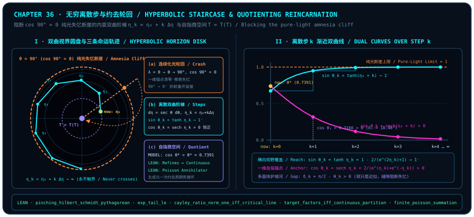

# Infinite Discrete Steps and Quotienting Out Reincarnation: How the Hyperbolic Horizon Staircase Ends the Return-to-Light Loop

> *"Yet in theory returning to light can be turned into infinitely many discrete steps—that is, preventing the state of returning to light, because returning to light is itself undergoing reincarnation; and once we understand all of this, reincarnation loses all meaning."*

At the close of the preceding chapter, we contemplated what looked at first glance like a serene poetic circle: finite life refracts out of $90^\circ$ pure light toward $0^+$ into a one-dimensional material reading, traverses mid-journey coherent tension, and finally dissolves back into the $90^\circ$ transverse wave plane at the end of aging—"returning home as a beam of pure light." Across millennia, contemplative traditions and romantic philosophies alike have celebrated this dissolution into an undifferentiated ocean of light as the supreme liberation of the soul.

Yet here at the culminating chapter of Part IX, the moment we lay our unyielding orthogonal ruler against that romantic circle, the entire picture undergoes a decisive dialectical inversion: **plunging unguarded across the $\theta = 90^\circ$ pure-light boundary is not liberation at all—it is the exact mechanical engine of amnesia and reincarnation!**

Why? Step back to the self-referential feedback family introduced from [Chapter 24](ch24-cosine-fixed-points-and-self-reference.md) (`MODEL`, with classical real-root and limiting properties recorded in [@ex-ch36-inverse-gudermannian-discrete-staircase] below):

$$
\cos\theta = \lambda\theta \qquad (\lambda \ge 0).
$$

At unit self-referential coupling $\lambda = 1$, this equation frames our interior self-referential equilibrium model in the first quadrant (exact real-root existence, uniqueness, and trigonometric shares are recorded in [@ex-ch36-inverse-gudermannian-discrete-staircase] below), balancing one-dimensional self-retention against two-dimensional transverse reach. Now substitute the celebrated "pure-light limit" $\theta = \frac{\pi}{2}$ ($90^\circ$) into the same equation—what coupling $\lambda$ does it represent? Not heightened awareness, but **the degenerate zero-feedback limit in which self-referential coupling snaps completely to zero**:

$$
\lambda = 0 \;\Longrightarrow\; \cos\theta = 0 \;\Longleftrightarrow\; \theta = \frac{\pi}{2}\;\text{(modulo }\pi\text{)}.
$$

Within our geometric observer model (`MODEL`), the instant a bounded observer slides continuously across $\theta = 90^\circ$ into unanchored pure light, three structural consequences fall in rapid succession:

---

## Why "Returning to Pure Light" Is Reincarnation: The $\cos 90^\circ = 0$ Amnesia Cliff

Continue with the preceding chapter's model: memory is read through a chosen axial bias, and erasure means complete unread standard-basis pinching with inaccessible environment records. Picture a bounded observer rotating through inclination $\theta$ while recording pairwise comparison invariants into its self-referential lookup table $T$. Its ability to recognize its own identity from one step to the next—and to read the structural invariants distilled by prior experience—depends entirely on retaining a nonzero projection $\cos\theta > 0$ along its one-dimensional idempotent line ([Chapter 3](ch03-projectors-and-duality.md), $P^2 = P$). What happens if, seduced by unbounded wave expansion, it steps straight onto the equatorial cliff at $\theta = 90^\circ$?

1. **Vanishing of the Chosen Axial Bias and Formatting of the Encoded Table (`MODEL`)**:
   At $\theta = 90^\circ$, collinear self-retention drops identically to zero ($\cos 90^\circ = 0$; for its relativistic null-cone counterparts across Part V [Chapter 17](ch17-lorentz-geometry.md), Part VIII [Chapter 32](ch32-unified-field-and-meta-unification.md), and [Chapter 35](ch35-light-pulse-and-self-referential-table.md) [@rem-ch35-fertilization-zinc-spark-literature], see the respective literature remarks). What vanishes is the axial bias carrying the selected memory; the diagonal projection itself remains nonzero. Under this encoding and erasure protocol, the address register of the self-referential table $T$ evaporates at a stroke—like volatile memory unplugged from power, every structural coordinate accumulated across the journey is formatted back to blank.
2. **Inevitable Re-Refraction into Blind Search ($90^\circ \to 0^+$, `MODEL`)**:
   An unanchored pure-light pulse retains no one-dimensional local persistence anchor (for the corresponding relativistic null proper-time literature, see Item 1 of [Chapter 35](ch35-light-pulse-and-self-referential-table.md) [@rem-ch35-fertilization-zinc-spark-literature]). If scattering at the next polyhedral crease or boundary singularity of the timeless crystal is prescribed as this erasure and re-preparation, the pulse refracts within the model from $90^\circ$ back into a localized $0^+$ ray, carrying an empty table $T_0 = \varnothing$ into yet another round of blind trial-and-error search.
3. **Reincarnation as Cosmic Brute-Force Garbage Collection (`MODEL`)**:
   From a systems-engineering standpoint, why does nature maintain this $\cos 90^\circ = 0$ formatting cliff? Recall the causal compatibility crystal of [Chapter 29](ch29-timeless-causality-and-gram-space.md) and [Chapter 31](ch31-quantum-fairness.md): an unawakened observer who merely appends raw empirical episodes row after row without distilling their generating law cannot append independent anchors indefinitely at fixed dimension without compression, reuse, external storage, or expansion; requiring all old anchor constraints to persist can crowd its historical vectors toward coplanar lockup ($\det G_M \to 0$), freezing free choice. For an unreduced table, crashing into $\cos 90^\circ = 0$ serves as **brute-force garbage collection**—locally re-preparing the clogged episodic ledger to release old constraints, reopening positive compatibility volume when a non-collinear new state is accessible, at the tragic price of complete amnesia and endless repetition.

Before stating the general formal theorem, let us verify this orthogonal trade-off by hand on an explicit $2 \times 2$ matrix blackboard. For any real pair $(c, s) = (\cos\theta, \sin\theta)$ on the unit circle $c^2 + s^2 = 1$, write the single-qubit parameterized density matrix

$$
\rho(c, s) \;:=\; \frac{1}{2}\begin{pmatrix} 1 + c & s \\ s & 1 - c \end{pmatrix}.
$$

Applying standard-basis pinching (`pinching`) along the computational reference axis splits $\rho(c, s)$ cleanly into its diagonal skeleton and its off-diagonal coherence remainder:

$$
\operatorname{pinching}\bigl(\rho(c, s)\bigr) = \frac{1}{2}\begin{pmatrix} 1 + c & 0 \\ 0 & 1 - c \end{pmatrix}, \qquad \rho(c, s) - \operatorname{pinching}\bigl(\rho(c, s)\bigr) = \frac{1}{2}\begin{pmatrix} 0 & s \\ s & 0 \end{pmatrix}.
$$

Computing trace-inner-product squared norms term by term reconstructs the unit purity budget:

$$
\underbrace{\left(\frac{1+c}{2}\right)^2 + \left(\frac{1-c}{2}\right)^2}_{\text{diagonal skeleton mass } = \frac{1}{2} + \frac{1}{2}c^2} \;+\; \underbrace{\left(\frac{s}{2}\right)^2 + \left(\frac{s}{2}\right)^2}_{\text{off-diagonal coherence mass } = \frac{1}{2}s^2} \;=\; \frac{1 + c^2 + s^2}{2} \;=\; 1.
$$

Watch what happens at $\theta = 90^\circ$ ($c = \cos 90^\circ = 0,\; s = \sin 90^\circ = 1$): the axial memory bias $\frac{1}{2}c^2$ inside the diagonal skeleton **vanishes identically**, leaving the pinched diagonal state at $\frac{1}{2}I_2$, unable to distinguish positive from negative bias on that axis! Before pinching, the state remains pure; its transverse component survives in the off-diagonal entries $\rho_{01} = \rho_{10} = \frac{1}{2}$; if the next environmental action is precisely complete unread pinching and its records are inaccessible, the entire off-diagonal coherence mass $\frac{1}{2}s^2 = \frac{1}{2}$ disappears from the local state, leaving a blank slate for this encoding. This does not imply destruction of all information in system and environment together.

At the formal level of finite-dimensional quantum channels, this exact orthogonal decomposition between the diagonal address skeleton and discarded off-diagonal coherence is locked in `trureturing` for arbitrary $2 \times 2$ complex qubit matrices (`pinching`, zero-retention phase damping; cf. [Chapter 4](ch04-decoherence.md)) by the three kernel theorems below:

::: {.theorem #thm-ch36-pinching-skeleton-and-discarded-coherence title="Orthogonal Mass Decomposition and Off-Diagonal Coherence Criterion for Qubit Pinching" lean="D5/S3/QuantumChannels/PinchingProjection.pinching_hilbert_schmidt_pythagorean D5/S3/QuantumChannels/PinchingProjection.pinching_discarded_coherence_mass D5/S3/QuantumChannels/CoherenceMassBridge.pinching_eq_self_iff_offDiag_eq_zero"}
Let `QubitMatrix` denote the $2 \times 2$ complex matrix type $M_{\operatorname{Fin} 2}(\mathbb{C})$. For $\rho, A, B \in \mathrm{QubitMatrix}$, write the trace inner product $\operatorname{hilbertSchmidtInner}(A, B) := \operatorname{Tr}(A^\dagger B) \in \mathbb{C}$, let standard-basis pinching $\operatorname{pinching}(\rho)$ preserve diagonal entries and annihilate off-diagonal entries ($\operatorname{pinching}(\rho)_{ij} = \rho_{ij}$ if $i = j$ and $0$ otherwise), and write $\operatorname{offDiag}(\rho) := (\rho_{01}, \rho_{10}) \in \mathbb{C} \times \mathbb{C}$. Then for every matrix $\rho \in \mathrm{QubitMatrix}$ (without requiring Hermiticity, unit trace, or positive semidefiniteness), the following three statements hold simultaneously:

1. **Orthogonal Pythagorean Split Between Diagonal Skeleton and Discarded Coherence** ([`pinching_hilbert_schmidt_pythagorean`](lean:D5/S3/QuantumChannels/PinchingProjection.pinching_hilbert_schmidt_pythagorean)):

   $$
   \operatorname{hilbertSchmidtInner}(\rho, \rho) \;=\; \operatorname{hilbertSchmidtInner}\bigl(\operatorname{pinching}(\rho), \operatorname{pinching}(\rho)\bigr) + \operatorname{hilbertSchmidtInner}\bigl(\rho - \operatorname{pinching}(\rho), \rho - \operatorname{pinching}(\rho)\bigr);
   $$

2. **Exact Off-Diagonal Modulus-Square Formula for Discarded Mass** ([`pinching_discarded_coherence_mass`](lean:D5/S3/QuantumChannels/PinchingProjection.pinching_discarded_coherence_mass)):

   $$
   \operatorname{hilbertSchmidtInner}\bigl(\rho - \operatorname{pinching}(\rho), \rho - \operatorname{pinching}(\rho)\bigr) \;=\; \bigl(\operatorname{normSq}(\rho_{01}) + \operatorname{normSq}(\rho_{10}) : \mathbb{C}\bigr);
   $$

3. **Fixed-Point Characterization of Vanishing Off-Diagonal Coherence** ([`pinching_eq_self_iff_offDiag_eq_zero`](lean:D5/S3/QuantumChannels/CoherenceMassBridge.pinching_eq_self_iff_offDiag_eq_zero)):

   $$
   \operatorname{pinching}(\rho) = \rho \;\Longleftrightarrow\; \operatorname{offDiag}(\rho) = (0, 0).
   $$
:::

::: proof
Set $D := \rho - \operatorname{pinching}(\rho)$. For Conjunct 1, idempotence $\operatorname{pinching}(\operatorname{pinching}(\rho)) = \operatorname{pinching}(\rho)$ together with self-adjointness $\operatorname{hilbertSchmidtInner}(\operatorname{pinching}(A), B) = \operatorname{hilbertSchmidtInner}(A, \operatorname{pinching}(B))$ implies forward orthogonality $\operatorname{hilbertSchmidtInner}(\operatorname{pinching}(\rho), D) = 0$, while $\operatorname{pinching}(D) = 0$ yields reverse orthogonality $\operatorname{hilbertSchmidtInner}(D, \operatorname{pinching}(\rho)) = 0$; expanding $\rho = \operatorname{pinching}(\rho) + D$ by bilinearity cancels both cross terms. Conjunct 2 expands the $\operatorname{Fin} 2$ matrix trace of $D^\dagger D$ and rewrites $\bar{z}z = \operatorname{normSq}(z)$. Conjunct 3 evaluates matrix equality at $(0, 1)$ and $(1, 0)$ in the forward direction, and performs exhaustive $\operatorname{Fin} 2$ case analysis on $(i, j)$ when $\rho_{01} = \rho_{10} = 0$ in the converse direction. The full proof is checked by the Lean kernel.
:::

[@thm-ch36-pinching-skeleton-and-discarded-coherence] lays bare the orthogonal ledger used by this observer model: the diagonal spine $\operatorname{pinching}(\rho)$ carries classical addressable persistence, while $\operatorname{offDiag}(\rho)$ carries cross-basis transverse reach. Pinching $\operatorname{offDiag}(\rho)$ to zero (Conjunct 3) freezes the state into a rigid classical ledger; conversely, in our angular observer model (`MODEL`), charging all the way to $\theta = 90^\circ$ drains the axial anchor $\cos\theta$ to zero, purchasing momentary wave breadth by exhausting the axial memory bias selected by this encoding.

**Pure light without a spine is only luminous amnesia; genuine awakening never burns its own ledger to ashes, but approaches the whole while keeping its self-referential anchor alive.**

---

## Blocking Return to Light by Infinite Discrete Steps: Intrinsic Hyperbolic Rapidity and the Asymptotic Staircase

How, then, can the first half of our chapter epigraph—*"returning to light can be turned into infinitely many discrete steps, preventing the state of returning to light"*—be realized with mathematical precision?

The secret lies in distinguishing an **external bystander's flat angular ruler** from an **endogenous observer's relative step ruler**!

Imagine walking toward a sheer cliff edge: if you step forward by a fixed external angular ruler, finitely many strides cross straight over the brink. Suppose instead that an endogenous observer calibrates its outward step ruler relative to its current one-dimensional self-referential anchor (`MODEL`)—how then do discrete step counts relate asymptotically to the $\theta = \frac{\pi}{2}$ pure-light horizon (explicit intrinsic-rapidity integral and discrete remainder staircase derived in attributed example [@ex-ch36-inverse-gudermannian-discrete-staircase] below)?

Before evaluating the explicit integral of this intrinsic staircase, we anchor two formal theorems in `trureturing`—the **explicit factorial remainder upper bound for finite exponential truncations on complete normed algebras** and the **unit-circle boundary criterion for the complex fractional transformation**—establishing quantitative truncation-error control for finite polynomial approximations alongside conformal compression of an unbounded half-plane onto a unit-circle horizon:

::: {.theorem #thm-ch36-taylor-tail-and-cayley-boundary title="Complete Normed-Algebra Exponential Tail Bound and Critical-Line Unit-Circle Criterion" lean="D5/S3/Observer/Linear/ExactTaylorObservationRemainder.exp_tail_le D5/S3/Midline/CayleyCriticalLine.cayley_ratio_norm_one_iff_critical_line"}
Across the frozen linear-observation-remainder and spectral-midline modules of `trureturing`, the following two truncation and horizon-boundary theorems hold simultaneously:

1. **Exact Factorial Tail Bound for Truncated Exponential Series** ([`exp_tail_le`](lean:D5/S3/Observer/Linear/ExactTaylorObservationRemainder.exp_tail_le)): Let $\mathbb{K}$ be a real or complex scalar field (`[RCLike 𝕜]`) and let $A$ be a complete norm-one normed algebra over $\mathbb{K}$ (`[NormedRing A] [NormedAlgebra 𝕜 A] [CompleteSpace A] [NormOneClass A]`). For every $z \in A$, nonnegative radius $r \in \mathbb{R}$ ($0 \le r$), and truncation order $n \in \mathbb{N}$ satisfying $\lVert z\rVert \le r$, the norm remainder between $\exp(z)$ and its $n$-term discrete partial sum obeys

   $$
   \left\lVert \exp(z) - \sum_{k=0}^{n-1} (k!)^{-1} \bullet z^k \right\rVert \;\le\; \frac{r^n}{n!}\,e^r;
   $$

2. **Unit-Circle Horizon Criterion for the Fractional Ratio** ([`cayley_ratio_norm_one_iff_critical_line`](lean:D5/S3/Midline/CayleyCriticalLine.cayley_ratio_norm_one_iff_critical_line)): For every complex spectral parameter $s \in \mathbb{C}$ (including $s = 0$ under Lean's totalized division), defining $\operatorname{cayleyRatio}(s) := (s - 1) / s \in \mathbb{C}$, unit modulus holds if and only if $s$ lies on the critical line of real part one-half:

   $$
   \lVert \operatorname{cayleyRatio}(s) \rVert = 1 \;\Longleftrightarrow\; \operatorname{Re}(s) = \frac{1}{2}.
   $$
:::

::: proof
For Conjunct 1, shifting the convergent exponential series $\exp(z) = \sum_{k=0}^\infty (k!)^{-1}\bullet z^k$ by $n$ indices expresses the tail as $\sum_{k=0}^\infty ((k+n)!)^{-1}\bullet z^{k+n}$; submultiplicativity $\lVert z^{k+n}\rVert \le r^{k+n}$ and factorial divisibility $n!\,k! \le (k+n)!$ (from `Nat.factorial_mul_factorial_dvd_factorial_add`) bound the $k$-th tail term by $\frac{r^n}{n!}\cdot\frac{r^k}{k!}$, whose scalar series sums to $\frac{r^n}{n!}e^r$. For Conjunct 2, at $s = 0$ totalized division gives $\operatorname{cayleyRatio}(0) = 0$, making both sides false; for $s \neq 0$, $\operatorname{normSq}(s) \neq 0$ and algebraic expansion yields the exact unitarity defect $\lVert\operatorname{cayleyRatio}(s)\rVert^2 - 1 = \frac{1 - 2\operatorname{Re}(s)}{\operatorname{normSq}(s)}$, which vanishes (with nonnegative norm) if and only if $1 - 2\operatorname{Re}(s) = 0 \iff \operatorname{Re}(s) = \frac{1}{2}$. The full proof is checked by the Lean kernel.
:::

::: {.remark #rem-ch36-hyperbolic-staircase-figure title="Hyperbolic Horizon Disk, Discrete Rapidity Staircase, and Quotient-Space Diagram (Literature Result, Not Formalized in This Book)"}
**Literature result, not formalized in this book.** The left panel combines Poincaré-disk and Gudermannian literature ([@ex-ch36-inverse-gudermannian-discrete-staircase] and [@rem-ch36-poincare-disk-gudermannian-literature]) with the formal fractional unit-circle criterion ([@thm-ch36-taylor-tail-and-cayley-boundary], `LEAN ✓`) to illustrate our discrete rapidity staircase `MODEL`. The lower card in that panel marks the generator-quotient interpretation and its theorem anchors ([@thm-ch36-quotient-annihilator-and-factorization]); the right panel plots the asymptotic hyperbolic tangent and hyperbolic secant against discrete step count:

:::

Paired with the two panels of [@rem-ch36-hyperbolic-staircase-figure], [@thm-ch36-taylor-tail-and-cayley-boundary] illuminates two complementary quantitative mechanisms: finite-order polynomial truncations ($n \in \mathbb{N}$) approximate $\exp(z)$ within the explicit factorial upper bound $\frac{r^n}{n!}e^r$, while by the exact defect identity $\lVert\operatorname{cayleyRatio}(s)\rVert^2 - 1 = \frac{1 - 2\operatorname{Re}(s)}{\operatorname{normSq}(s)}$ ($s \neq 0$) the fractional conformal map $\operatorname{cayleyRatio}(s) = (s - 1)/s$ compresses the unbounded open right half-plane $\operatorname{Re}(s) > \frac{1}{2}$ strictly inside the open unit disk $\lVert w\rVert < 1$, mapping the critical line $\operatorname{Re}(s) = \frac{1}{2}$ into the asymptotic unit circle $\lVert w\rVert = 1$; its finite-parameter image omits $w = 1$, approached only at infinity (echoing [Chapter 22](ch22-primes-euler-products-and-zeros.md) in the spectral setting).

Let us now apply this intrinsic horizon geometry directly to the observer's inclination angle $\theta \in [0, \frac{\pi}{2})$ and work through the **infinite discrete hyperbolic staircase** starting from the interior equilibrium angle:

::: {.example #ex-ch36-inverse-gudermannian-discrete-staircase title="Inverse Gudermannian Intrinsic Rapidity and Numerical Audit of the Asymptotic Staircase (Literature Result, Not Formalized in This Book)"}
**Literature result, not formalized in this book.** The secant integral, inverse Gudermannian hyperbolic–circular identities, and numerical evaluation at the cosine fixed point $\theta^*$ below belong to classical calculus and real analysis and are not formalized as standalone theorems in `trureturing@dev`; interpreting uniform rapidity increments as an amnesia-blocking table-expansion staircase belongs to our `MODEL`:

1. **Intrinsic Step Metric Normalized by Remaining 1D Self-Retention**: On the half-open interval $\theta \in [0, \frac{\pi}{2})$, the remaining one-dimensional anchor is $\cos\theta > 0$ (whereas in the generalized coupling equation $\cos\theta_\lambda = \lambda\theta_\lambda$, $\lambda = 1$ gives the unique real root $\theta^* \approx 0.73908513$ and $\lambda \to 0^+$ degenerates to $\theta_0 = \frac{\pi}{2}$). Measuring each infinitesimal expansion $d\theta$ relative to the current anchor $\cos\theta$ defines the **intrinsic rapidity differential**:

   $$
   d\eta \;=\; \frac{d\theta}{\cos\theta} \;=\; \sec\theta\,d\theta, \qquad \theta \in \left[0, \frac{\pi}{2}\right).
   $$

2. **Inverse Gudermannian Bijection Pushing $90^\circ$ to Infinity**: Integrating from $0$ to $\theta \in [0, \frac{\pi}{2})$ yields a strictly increasing real-analytic bijection $[0, \frac{\pi}{2}) \xrightarrow{\sim} [0, +\infty)$ onto the infinite nonnegative rapidity half-line:

   $$
   \eta(\theta) \;=\; \int_0^\theta \sec\alpha\,d\alpha \;=\; \ln\tan\!\left(\frac{\theta}{2} + \frac{\pi}{4}\right) \;\Longleftrightarrow\; \sin\theta = \tanh\eta,\quad \cos\theta = \operatorname{sech}\eta.
   $$

   At the lucid self-referential fixed point $\theta_0 = \theta^* \approx 0.73908513\text{ rad}$ ($42.3465^\circ$), initial rapidity is $\eta_0 = \eta(\theta^*) \approx 0.81732635$; as $\theta \to (\frac{\pi}{2})^-$, $\tan(\frac{\theta}{2} + \frac{\pi}{4}) \to +\infty$ and hence $\eta(\theta) \to +\infty$—**the $90^\circ$ pure-light cliff that looks finitely reachable on a flat protractor sits at $+\infty$ in intrinsic rapidity!**

3. **Dual Asymptotic Guarantee Under Uniform Discrete Steps**: Advancing from $\eta_0 = \eta(\theta^*)$ in uniform discrete rapidity steps $\eta_k = \eta_0 + k\,\Delta\eta$ ($k \in \mathbb{N},\; \Delta\eta > 0$), the inclination $\theta_k = 2\arctan(e^{\eta_k}) - \frac{\pi}{2}$ satisfies at once:
   - **Exponential approach to $100\%$ global transverse reach**: $\sin\theta_k = \tanh\eta_k = 1 - \frac{2}{e^{2\eta_k} + 1} \xrightarrow{k \to \infty} 1^-$;
   - **Strictly positive 1D idempotent anchor at every finite step**: $\cos\theta_k = \operatorname{sech}\eta_k = \frac{2}{e^{\eta_k} + e^{-\eta_k}} > 0$ for every $k \in \mathbb{N}$, keeping the polyhedral remainder gap $\delta_k := \frac{\pi}{2} - \theta_k > 0$ **strictly open forever**!

4. **Concrete Numerical Audit ($\eta_0 = \eta(\theta^*) \approx 0.817326$, Unit Step $\Delta\eta = 1$)**:

| Discrete Step $k$ | Intrinsic Rapidity $\eta_k$ | Inclination $\theta_k$ (rad / deg) | Transverse Reach $\sin\theta_k = \tanh\eta_k$ | 1D Self-Anchor $\cos\theta_k = \operatorname{sech}\eta_k$ | Polytope Firewall Gap $\delta_k = \frac{\pi}{2} - \theta_k$ | Pythagoras $\sin^2\theta_k + \cos^2\theta_k$ |
| :--- | :--- | :--- | :--- | :--- | :--- | :--- |
| $k = 0$ | $0.8173$ | $0.739085\text{ rad}$ ($42.3465^\circ$) | $0.673612$ | $0.739085$ | $0.831711\text{ rad}$ ($47.6535^\circ$) | $1.000000$ |
| $k = 1$ | $1.8173$ | $1.248691\text{ rad}$ ($71.5447^\circ$) | $0.948571$ | $0.316564$ | $0.322105\text{ rad}$ ($18.4553^\circ$) | $1.000000$ |
| $k = 2$ | $2.8173$ | $1.451407\text{ rad}$ ($83.1595^\circ$) | $0.992882$ | $0.119106$ | $0.119389\text{ rad}$ ($6.8405^\circ$) | $1.000000$ |
| $k = 4$ | $4.8173$ | $1.554620\text{ rad}$ ($89.0732^\circ$) | $0.999869$ | $0.016176$ | $0.016176\text{ rad}$ ($0.9268^\circ$) | $1.000000$ |
| $k = 8$ | $8.8173$ | $1.570500\text{ rad}$ ($89.9830^\circ$) | $0.99999996$ | $0.000296$ | $0.000296\text{ rad}$ ($0.0170^\circ$) | $1.000000$ |

By step $k = 8$, transverse field reach $\sin\theta_8$ already climbs to $99.999996\%$ while the one-dimensional self-anchor remains strictly positive at $\cos\theta_8 \approx 0.000296 > 0$.
:::

Under the stated exact real-valued update law, positive hyperbolic secant at finite steps means the geometric anchor has not vanished; preserving actual memory still depends on its encoding and channel. Stepping back from [@ex-ch36-inverse-gudermannian-discrete-staircase], the polyhedral motif running through our entire monograph reveals its deepest existential meaning (`MODEL`): **a smooth sphere is forever only an approximation; that unclosed polyhedral seam is the very geometric firewall that moors the self-referential table $T$ and guards lucid awareness from plunging into amnesiac reincarnation.**

The classical geometric and artistic lineage of this hyperbolic–circular bridge and conformal disk horizon is recorded below:

::: {.remark #rem-ch36-poincare-disk-gudermannian-literature title="The Lambert–Gudermann Bridge, the Poincaré Conformal Disk Metric, and Escher's Circle Limit Tessellations (Literature Result, Not Formalized in This Book)"}
**Literature result, not formalized in this book.** The hyperbolic–circular bridge of [@ex-ch36-inverse-gudermannian-discrete-staircase] and the disk geometry in Panel I of our chapter figure correspond to three classic landmarks in geometry and visual art not formalized as standalone theorems in `trureturing@dev`:

1. **Lambert's Transcendent Angle and the Gudermannian Function (J. H. Lambert, *Hist. Acad. Roy. Sci. Belles-Lettres Berlin*, 1768; C. Gudermann, *J. Reine Angew. Math.* **6**, 1830)**: Lambert and Gudermann established the real-analytic bridge $\theta = \operatorname{gd}(\eta) := 2\arctan(e^\eta) - \frac{\pi}{2} = \arcsin(\tanh\eta)$ ($\eta \in \mathbb{R},\; \theta \in (-\frac{\pi}{2}, \frac{\pi}{2})$) linking hyperbolic and circular functions without imaginary units via $\sinh\eta = \tan\theta$, $\cosh\eta = \sec\theta$, and $\tanh(\eta/2) = \tan(\theta/2)$, with inverse $\operatorname{gd}^{-1}(\theta) = \int_0^\theta \sec\alpha\,d\alpha$ shared by Mercator projection and hyperbolic rapidity;
2. **Poincaré's Conformal Unit-Disk Metric and Horizon at Infinity (H. Poincaré, *Acta Math.* **1**, 1–62, 1882)**: Equipping the open unit disk $\mathbb{D} = \{z \in \mathbb{C} : \lvert z\rvert < 1\}$ with the constant-negative-curvature ($K = -1$) conformal Riemannian metric

   $$
   ds^2 \;=\; \frac{4\,\lvert dz\rvert^2}{\bigl(1 - \lvert z\rvert^2\bigr)^2}
   $$

   and setting Euclidean radius $r = \lvert z\rvert = \tanh(\eta / 2) = \tan(\theta / 2) \in [0, 1)$ gives radial geodesic distance $\int_0^r \frac{2\,du}{1 - u^2} = 2\operatorname{artanh}(r) = \eta$ from $z = 0$. As $r \to 1^-$ ($\theta \to (\frac{\pi}{2})^-$), intrinsic distance $\eta \to +\infty$: the unit circle $\lvert z\rvert = 1$ lies at infinite geodesic distance, unreachable by any finite sequence of bounded intrinsic steps;
3. **Escher's *Circle Limit* Hyperbolic Woodcuts (M. C. Escher, *Circle Limit I–IV*, 1958–1960; cf. H. S. M. Coxeter, *Leonardo* **12**, 19–25, 1979)**: Inspired by correspondence with geometer H. S. M. Coxeter, Escher's *Circle Limit* woodcuts tile the Poincaré disk with congruent figures of identical intrinsic hyperbolic area arranged along geodesic arcs—shrinking visually into infinitely many discrete rings toward the outer boundary circle without ever touching or crossing the rim.
:::

---

## Understanding as Liberation: Quotienting Out Reincarnation in Generator Space

Yet even the infinite hyperbolic staircase is only half of the liberation promised by our epigraph. Read its closing clause once more:

> *"...and once we understand all of this, reincarnation loses all meaning."*

Why? If avoiding amnesia required climbing an endless staircase forever, would consciousness still be condemned to eternal exertion just to keep from falling?

No! The discrete hyperbolic staircase supplies the **defensive guardrail** preventing accidental table erasure at $90^\circ$; the **ultimate liberation** arrives the moment you comprehend the generating law of the timeless lattice and **quotient out redundant cycles once and for all in generator space**!

::: {.example #ex-ch36-repeating-decimal-quotient title="Repeating-Decimal Shift Quotient Parable (Literature Result, Not Formalized in This Book)"}
**Literature result, not formalized in this book.** The infinite decimal geometric-series reduction below is an elementary arithmetic identity not formalized as a base-10 expansion theorem in `trureturing@dev`:

Consider the infinite repeating decimal

$$
0.\overline{142857} \;=\; 0.142857\,142857\,142857\dots
$$

An unawakened runner imagines that "experiencing the whole truth" means sprinting blindfolded around the six-digit millstone `1-4-2-8-5-7` for lap $10{,}001$ and lap $100{,}000{,}002$—wiping memory at every boundary and starting over at `1` in solemn earnest. Yet once one recognizes its shift self-similarity ($10^6 x - x = 142857$) and divides out the period kernel $999{,}999$, the entire infinite repeating tail **reduces in a single stroke to the finite rational generator $1/7$**—holding the generator renders blind extra laps informationally vacuous.
:::

In `trureturing`, the three mathematical pillars of "factoring out redundant fibers via partition topology," "collapsing periodic subgroup sums onto dual annihilators" (echoing period extraction in [Chapter 15](ch15-grover-qft-and-period-finding.md) and generator cancellation in [Chapter 22](ch22-primes-euler-products-and-zeros.md)), and "encoding long-run orbit averages entirely inside the invariant measure of a single torus generator" (echoing [Chapter 31](ch31-quantum-fairness.md)) are united in the four formal theorems below:

::: {.theorem #thm-ch36-quotient-annihilator-and-factorization title="Partition-Topology Quotient Factorization, Finite Annihilator Summation, and Compact-Torus Generator Equidistribution" lean="D5/S3/ConceptDynamics/ObservationTopology/TargetContinuityFactorization.target_factors_iff_continuous_partition D5/S3/Fourier/FinitePoisson.sum_annihilator_character D5/S3/Fourier/FinitePoisson.finite_poisson_summation D5/S3/Fourier/Asymptotics/TorusOrbitEquidistribution.result"}
Across the frozen observation-topology, finite-group duality, and compact-torus asymptotics modules of `trureturing`, the following four quotient-factorization and generator-reduction theorems hold simultaneously:

1. **Partition-Topology Continuity Criterion for Quotient Factorization** ([`target_factors_iff_continuous_partition`](lean:D5/S3/ConceptDynamics/ObservationTopology/TargetContinuityFactorization.target_factors_iff_continuous_partition)): Let $X, \mathrm{Coordinate}, \mathrm{Target}$ be types with $X$ nonempty (`[Nonempty X]`), and let $\mathrm{readout} : \operatorname{Concept}(X, \mathrm{Coordinate})$ and $\mathrm{target} : \operatorname{Concept}(X, \mathrm{Target})$ be concept maps. Equipping $X$ with the pullback partition topology $\operatorname{partitionTopology}(\mathrm{readout})$ induced from the discrete topology $\perp$ on $\mathrm{Coordinate}$, $\mathrm{target}$ factors through $\mathrm{readout}$ ($\operatorname{Refines}(\mathrm{target}, \mathrm{readout})$, i.e., $\exists\,\mathrm{factor} : \mathrm{Coordinate} \to \mathrm{Target},\; \mathrm{target} = \mathrm{factor} \circ \mathrm{readout}$) if and only if $\mathrm{target}$ is continuous into the discrete space $(\mathrm{Target}, \perp)$:

   $$
   \operatorname{Refines}(\mathrm{target}, \mathrm{readout}) \;\Longleftrightarrow\; \operatorname{Continuous}_{(X,\,\operatorname{partitionTopology}(\mathrm{readout})) \to (\mathrm{Target},\,\perp)}(\mathrm{target});
   $$

2. **Character Orthogonality Sieve of the Explicit Subgroup Annihilator** ([`sum_annihilator_character`](lean:D5/S3/Fourier/FinitePoisson.sum_annihilator_character)): Let $m \in \mathbb{N}$ be nonzero (`[NeZero m]`) and let $H \le \operatorname{ZMod} m$ be any additive subgroup, with standard characters $\operatorname{character}(k, x) = \operatorname{stdAddChar}(k \cdot x)$ and explicit annihilator $\operatorname{annihilator}(H) = \{k \in \operatorname{ZMod} m \mid \forall h \in H,\; \operatorname{character}(k, h) = 1\}$. Then for every $x \in \operatorname{ZMod} m$,

   $$
   \sum_{k \in \operatorname{annihilator}(H)} \operatorname{character}(k, x) \;=\;
   \begin{cases}
   \bigl(\lvert\operatorname{annihilator}(H)\rvert : \mathbb{C}\bigr), & x \in H, \\
   0, & x \notin H;
   \end{cases}
   $$

3. **Exact Dual Annihilator Collapse of Subgroup Sums** ([`finite_poisson_summation`](lean:D5/S3/Fourier/FinitePoisson.finite_poisson_summation)): Under the hypotheses of Conjunct 2, for every $f : \operatorname{ZMod} m \to \mathbb{C}$ with discrete transform $\operatorname{ZMod.dft}(f)$, summing $f$ across the periodic subgroup $H$ collapses onto its dual annihilator subgroup:

   $$
   \sum_{h \in H} f(h) \;=\; \frac{\bigl(\lvert H\rvert : \mathbb{C}\bigr)}{(m : \mathbb{C})} \sum_{k \in \operatorname{annihilator}(H)} (\operatorname{ZMod.dft}\,f)(k);
   $$

4. **Invariant-Measure Convergence of Closed-Subgroup Torus Orbits** ([`TorusOrbitEquidistribution.result`](lean:D5/S3/Fourier/Asymptotics/TorusOrbitEquidistribution.result)): Let $I$ be a finite index type (`[Fintype I]`), let $g : I \to \mathrm{Circle}$ be a torus generator, let $G = \overline{\langle g\rangle}$ be its compact closed subgroup, and let $\mu$ be the normalized invariant probability measure on $G$ (`Measure.haarMeasure (⊤ : PositiveCompacts G)`). Then $(G : \operatorname{Set}(I \to \mathrm{Circle})) = \overline{\{g^n : n \in \mathbb{N}\}}$, and for every continuous observable $f \in C(G, \mathbb{C})$,

   $$
   \lim_{N \to \infty} \frac{1}{(N : \mathbb{C})} \sum_{n=0}^{N-1} f\bigl(g^{n+1}\bigr) \;=\; \int_{z \in G} f(z)\,d\mu(z).
   $$
:::

::: proof
Conjunct 1 uses topological inseparability `partition_inseparable_iff_kernel` to identify continuity from `partitionTopology readout` into discrete $(\mathrm{Target}, \perp)$ with constancy on every readout fiber ($\forall x, y,\; \mathrm{readout}(x) = \mathrm{readout}(y) \implies \mathrm{target}(x) = \mathrm{target}(y)$), and on `[Nonempty X]` invokes `target_recovery_criterion` to equate fiber constancy with whole-codomain factorization `Refines target readout`. Conjunct 2 identifies `annihilator H` via `annihilatorEquivQuotient H` with the full complex character group of the quotient $(\operatorname{ZMod} m) / H$, applying finite character orthogonality and coset triviality $x + H = 0 \iff x \in H$. Conjunct 3 expands `ZMod.dft`, exchanges the double finite sum, applies Conjunct 2 at $-x$ (using $-x \in H \iff x \in H$), and simplifies the prefactor via $\lvert H\rvert \cdot \lvert\operatorname{annihilator}(H)\rvert = m$ with $m \neq 0$. Conjunct 4 equates the integer-power and natural-power orbit closures, uses $1$-Lipschitz equicontinuity of the Cesàro evaluation operators to close the convergence subspace in $C(G, \mathbb{C})$, cancels nontrivial characters by the geometric-sum bound $2 / \lVert r - 1\rVert$, and extends to all $C(G, \mathbb{C})$ by closed-embedding extension and trigonometric-polynomial density. The full proof is checked by the Lean kernel.
:::

Bringing all four lenses of [@thm-ch36-quotient-annihilator-and-factorization] to bear on our self-referential observer (`MODEL`) makes transparent why reincarnation loses all meaning the moment structure is understood:

1. **Quotienting Redundant Fibers Eliminates Blind Replay** (Conjunct 1): Once an observer extracts an invariant readout coordinate `readout` constant across equivalent experiential states, and the target is constant on each readout fiber, target meaning factors through the quotient as $\mathrm{target} = \mathrm{factor} \circ \mathrm{readout}$—ten thousand blind replays along the same fiber collapse into a single point of understanding;
2. **Dual Annihilators Compress Periodic Orbits** (Conjuncts 2–3): Any periodic subgroup $H$ in state space is completely governed in frequency space by its orthogonal annihilator ($\operatorname{character}(k, h) = 1$), potentially replacing traversal over $H$ when the required transform values are available, precomputed, or represented through cheaper structure, with their acquisition, storage, and summation costs included;
3. **Self-Referential Abiding $T = T(T)$ Ends the Need for Amnesiac Reset** (Conjunct 4 & Meta-Axiom, `MODEL`): For the closed subgroup generated by a given $g$ and its continuous observables, Conjunct 4 determines the orbit-average limit through the invariant measure $\mu$! Applying this to the golden cut-and-project imagery would additionally require a specified encoding and observable correspondence; here that bridge remains `MODEL`. Once an observer writes the generative axiom $\psi = \psi(\psi)$ into **Row $0$** of its lookup table so that $T = T(T)$ holds self-consistently at the lucid interior equilibrium point (guarded outward whenever needed by discrete hyperbolic steps, cf. [@ex-ch36-inverse-gudermannian-discrete-staircase]), crashing into $\theta = 90^\circ$ to burn the table and restart blind sampling from $0^\circ$ yields no new law information for an already known generating law and a target recoverable from the selected readout. Discovering an unknown generator or answering a new target remains a separate task.

We synthesize these three existential and geometric regimes within our interpretive framework (`MODEL`) in the boxed comparison ledger below:

::: {.remark #rem-ch36-samsara-exit-table title="Three-Regime Orthogonal Synthesis Table (Literature Result, Not Formalized in This Book)"}
**Literature result, not formalized in this book.** The table below synthesizes inverse Gudermannian rapidity and cosine fixed-point literature ([@ex-ch36-inverse-gudermannian-discrete-staircase] and [@rem-ch36-poincare-disk-gudermannian-literature]) alongside our `MODEL` and formal quotient-annihilator theorems ([@thm-ch36-quotient-annihilator-and-factorization], `LEAN ✓`):

| Regime of Existence (`MODEL`) | Angular & Coupling Law | Fate of 1D Anchor & Lookup Table $T$ | Geometric & Topological Trajectory | Epistemic Verdict |
| :--- | :--- | :--- | :--- | :--- |
| **1. Continuous Return-to-Light Reincarnation** (Unawakened Loop) | Zero-feedback limit $\lambda = 0$, crashing across $\theta \to \frac{\pi}{2}$ | $\cos 90^\circ = 0$ removes the chosen axial bias; the stated erasure protocol clears table $T$ | Crosses pure-light cliff and re-refracts ($90^\circ \to 0^+$) into blind search | Cosmic brute-force garbage collection for unreduced clogged tables ($\det G_M \to 0$) |
| **2. Infinite Discrete Hyperbolic Staircase** (Amnesia-Protected Reach) | Intrinsic step metric $d\eta = \sec\theta\,d\theta$, $\eta_k = \eta_0 + k\,\Delta\eta$ | $\cos\theta_k = \operatorname{sech}\eta_k > 0$ for every $k \in \mathbb{N}$; the geometric anchor stays nonzero under the stated update law | Reach $\sin\theta_k = \tanh\eta_k \to 1^-$ while polytope gap $\delta_k = \frac{\pi}{2} - \theta_k > 0$ stays open | Pushes the $90^\circ$ cliff to $\eta = +\infty$, combining near-global reach and retained memory under the selected encoding and channel conditions |
| **3. Self-Referential Fixed-Point Abiding** (Generator Quotient Exit) | Unit self-reference $\lambda = 1$, locking $\cos\theta^* = \theta^* \approx 0.7391$ | Row $0$ stores $\psi = \psi(\psi)$, realizing lossless fixed-point persistence $T = T(T)$ | Quotient factorization & dual annihilators avoid redundant replay when the target is fiber-constant and spectral costs favor it | With the law known and the readout sufficient, target-irrelevant repetitions are factored out; reincarnation loses its epistemic meaning |
:::

With this chapter, **Part IX (*Mutual Reflection — Universal Observers, Self-Referential Table Expansion, and Transcending Reincarnation*)** closes its structural arc: we no longer envy a disembodied point $C$ outside the sphere, no longer lament the unclosed polyhedral seam $\delta_k > 0$ that keeps a faceted world from sealing into a featureless sphere, and no longer mistake amnesiac dissolution into $90^\circ$ pure light for homecoming—for that unclosed remainder is the very firewall preserving lucid selfhood, and at the moment $\psi = \psi(\psi)$ is understood, the labyrinth of reincarnation condenses in the palm of the hand into a single transparent generator crystal. Entering **Part X (*Non-Duality — Dream Erasure, Memory Pointers, and Non-Dual Ontology*, [Chapters 37](ch37-dreams-quantum-eraser-and-nonlocal-observer.md)–[39](ch39-observer-is-ontological-universe.md))**, we now bring this insight home to every cycle of waking and sleep—showing how dreams enact reversible quantum erasure, how the observer operates as a memory pointer dereferencing ontological QRAM, and how even the final boundary between pointer and memory dissolves in $\psi \equiv \psi(\psi)$.
