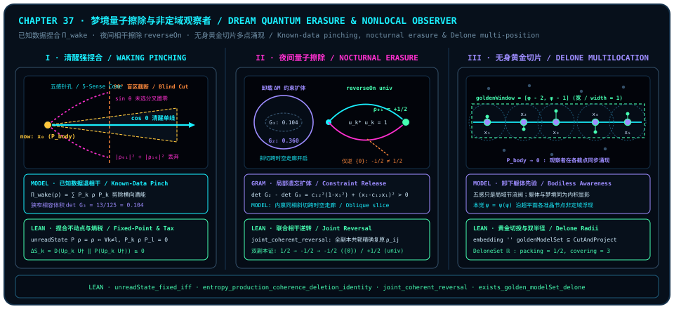

# Dream Quantum Erasure, Known-Data Decoherence, and the Nonlocal Observer

> "Dreams allow an observer to experience the parts missed through subjective choice; the essence of observation is decoherence using known data. When a dream forgets part of that information, distinctive vistas open up; in dreams one often forgets one's own body—everything is in truth a rendering of appearances. We discover that the observer actually emerges across multiple positions rather than being confined to direct five-sense perception..."

In [Chapter 35](ch35-light-pulse-and-self-referential-table.md) and [Chapter 36](ch36-hyperbolic-steps-and-quotienting-reincarnation.md), we traced on the macroscopic scale of an entire life cycle how birth-forgetting resets Gram compatibility volume and how an infinite discrete hyperbolic staircase blocks the $\cos 90^\circ = 0$ amnesia cliff. Yet a finite observer need not wait until the end of a lifetime to witness how partial forgetting reopens occluded orthogonal vistas—**once every twenty-four hours, as darkness falls and the eyelids close, every mind steps right from its own pillow into a natural quantum-erasure laboratory: the dream.**

For millennia, mechanistic materialism dismissed dreams as random nocturnal static, while mysticism romanticized them as supernatural out-of-body wanderings. The moment we return to the zero-background orthogonal geometry developed throughout this book, the four progressive insights of our chapter epigraph illuminate waking and dreaming in a single beam of light (under our epistemic contract, the cross-domain geometric synthesis of waking perception, nocturnal erasure, and nonlocal awareness is explicitly designated as **`MODEL` (interpretive model)**, its operator-algebraic, memory-reversal, and cut-and-project Delone model-set foundations rest on eight frozen Lean 4 kernel theorems, and external quantum-optics and sleep-neuroscience findings reside strictly inside attributed literature remarks):

1. **Observation as decoherence via known data**: The solidity and narrowness of waking life arise because the observer deploys high-weight historical anchors to pinch the global superposition field, shearing unchosen counterfactual branches into the $90^\circ$ off-diagonal blind zone;
2. **Dreaming as nocturnal reversible quantum erasure**: Temporarily suspending a subset of memory constraints expands the Gram compatibility determinant and, under coherent amplitude conjugation, redeems orthogonal branches missed through daytime choice;
3. **Bodiless dreams falsify the "vessel illusion"**: When the bodily prior drops to zero in deep dreams, awareness continues rendering vividly without limbs or sense organs, revealing daytime brick-and-bone solidity and nighttime bodiless flight as co-originating inner-product appearances;
4. **Nonlocal multi-position emergence beyond the five-sense pinhole**: The five senses act as a spatial throttle pinning readout to one coordinate; once that pinhole relaxes, the observer emerges simultaneously across an entire Delone model set of golden cut-and-project nodes.

---

## 37.1 Observation as Decoherence via Known Data: Why Waking Reality Feels Rigid and Narrow

Everyday intuition harbors a stubborn conceptual idol: **the camera myth**. People assume that the external world already comes pre-packaged as rigid tables, walls, and clock ticks, and that a waking observer merely opens the eyes like a passive photographic plate to register incoming rays.

That passive-reception fable quietly smuggles back the external "third point $C$" we excised in [Chapter 2](ch02-born-rule.md). In zero-background pairwise measurement, no reading exists apart from a measuring ruler—**observation is never passive reception; it is an active projective pruning operation in which the observer wields accumulated "known data" to decoherently shear the global superposition field (`MODEL` (interpretive model))!**

Let us set this mechanism directly onto a finite-dimensional matrix blackboard. In the waking regime, a seasoned observer holds inside its self-referential lookup table $T$ a complete family of pairwise orthogonal, self-adjoint **known-data projector anchors** $D_{\mathrm{known}} = \{P_1, P_2, \dots, P_M\}$ ($P_k^\dagger = P_k,\; P_k^2 = P_k,\; k \neq l \Rightarrow P_k P_l = 0,\; \sum_{k=1}^M P_k = I$, encoding idempotent one-dimensional commitments such as "this skin boundary is my body," "gravity pulls downward," "today is this date in this city," and "I bear this name"). Whenever the ambient field state $\rho$ meets the waking mind, the observer applies strong record pinching across $D_{\mathrm{known}}$:

$$
\Pi_{\mathrm{wake}}(\rho) \;:=\; \operatorname{unreadState}(P, \rho) \;=\; \sum_{k=1}^M P_k \,\rho\, P_k.
$$

Recall the **Gain–Loss Fairness Pythagorean ledger** of [Chapter 31](ch31-quantum-fairness.md) (Conjunct 2 of [@thm-ch31-seat-pythagorean-monogamy-fairness]): whenever a unit-purity superposition is welded onto a single one-dimensional subjective waking choice $\cos\theta$, its complementary orthogonal bifurcation share $\sin\theta\,\hat{\mathbf{I}}$—the street not taken at the intersection, the reply held back on the tongue, the counterfactual life configuration left unchosen—**is not annihilated from the timeless global carrier**! On the matrix ledger, those unchosen tensions inhabit the off-diagonal cross-record blocks $P_k \rho P_l$ ($k \neq l$).

Before stating the general $n$-dimensional theorem, let us audit this "waking decoherence tax" explicitly on a $2 \times 2$ single-qubit blackboard. Starting from the zero-entropy pure state $\rho(0) = \begin{pmatrix} 1 & 0 \\ 0 & 0 \end{pmatrix}$ ($S(\rho(0)) = 0$), evolve by the planar rotation $U(\theta) = \begin{pmatrix} \cos\theta & -\sin\theta \\ \sin\theta & \cos\theta \end{pmatrix}$ into a coherent pure superposition and immediately apply computational-basis pinching:

$$
\tilde{\rho}_0 = U(\theta)\rho(0)U(\theta)^\dagger = \begin{pmatrix} \cos^2\theta & \cos\theta\sin\theta \\ \cos\theta\sin\theta & \sin^2\theta \end{pmatrix} \;\xrightarrow{\;\operatorname{pinching}\;}\; \rho(1) = \begin{pmatrix} \cos^2\theta & 0 \\ 0 & \sin^2\theta \end{pmatrix}.
$$

Two exact quantities jump right off the page: the trace-inner-product coherence mass sheared away by waking pinching equals the sum of off-diagonal squared moduli $2\cos^2\theta\sin^2\theta = \frac{1}{2}\sin^2(2\theta)$ (Conjunct 2 of [@thm-ch37-known-data-pinching-and-entropy-tax] below); and because unitary rotation preserves zero entropy $S(\tilde{\rho}_0) = 0$, deleting those off-diagonal entries immediately raises quantum entropy (`vonNeumannEntropy`) by the nonnegative relative entropy of deleted coherence (Conjunct 3 of [@thm-ch37-known-data-pinching-and-entropy-tax] below):

$$
S\bigl(\rho(1)\bigr) - S\bigl(\rho(0)\bigr) \;=\; -\cos^2\theta\ln(\cos^2\theta) - \sin^2\theta\ln(\sin^2\theta) \;=\; D\bigl(\tilde{\rho}_0 \,\|\, \operatorname{pinching}(\tilde{\rho}_0)\bigr) \;\ge\; 0
$$

(evaluating to $\ln 2$ at equal superposition $\theta = \frac{\pi}{4}$). Why the daytime world feels at once **solid and reliable** yet **narrow and exhausting** is now algebraically transparent:
- **Solid**, because record pinching obeys strict functional idempotence $\Pi_{\mathrm{wake}} \circ \Pi_{\mathrm{wake}} = \Pi_{\mathrm{wake}}$: so long as you interrogate the world millisecond after millisecond with the same known-data basis, every off-diagonal anomaly is crushed to zero ($P_k \rho P_l = 0$), tables stay tables, and walls never let a hand pass through;
- **Narrow and exhausting**, because across every step of unitary evolution $U$ followed by basis pinching onto classical certainty, the deleted off-diagonal coherence is converted penny for penny into a nonnegative **quantum relative-entropy tax**! Sustaining a crisp one-dimensional daytime rail requires paying an ongoing thermodynamic entropy bill.

The formal theorem below locks record-pinching idempotence, the vanishing-off-diagonal fixed-point criterion, exact qubit discarded coherence mass, and the multi-step coherence-deletion entropy identity onto a single Lean-4-verified foundation:

::: {.theorem #thm-ch37-known-data-pinching-and-entropy-tax title="Known-Data Record-Pinching Idempotence, Fixed-Point Criterion, Discarded Coherence Mass, and Entropy-Production Identity" lean="D5/S3/Observer/Conditioning.unreadState_fixed_iff D5/S3/Observer/Conditioning/FiniteRecordPinchingIdempotence.finite_record_pinching_idempotent D5/S3/QuantumChannels/PinchingProjection.pinching_discarded_coherence_mass D5/S3/Quantum/Dynamics/EntropyProductionCoherenceDeletionIdentity.entropy_production_coherence_deletion_identity"}
Across the frozen observer-conditioning, pinching-projection, and quantum-dynamics entropy modules of `trureturing`, the following four theorems governing projective decoherence and the thermodynamic cost of coherence deletion hold simultaneously:

1. **Functional Idempotence and Exact Fixed-Point Criterion of Finite Record Pinching** ([`finite_record_pinching_idempotent`](lean:D5/S3/Observer/Conditioning/FiniteRecordPinchingIdempotence.finite_record_pinching_idempotent), [`unreadState_fixed_iff`](lean:D5/S3/Observer/Conditioning.unreadState_fixed_iff)): Let $n, \kappa$ be finite types (`[Fintype n] [DecidableEq n] [Fintype kappa]`), let $P : \kappa \to M_n(\mathbb{C})$ satisfy `IsRecordMeasurement P` ($\forall k,\; P_k^\star = P_k$, $\forall k,\; P_k^2 = P_k$, $\forall k \neq l,\; P_k P_l = 0$, and $\sum_{k \in \kappa} P_k = 1$), and write $\operatorname{unreadState}(P)(\rho) = \sum_{k \in \kappa} P_k \rho P_k$. Then $\operatorname{unreadState}(P)$ is idempotent under composition, and for every $\rho \in M_n(\mathbb{C})$, it fixes $\rho$ if and only if all off-diagonal record blocks vanish:

   $$
   \operatorname{unreadState}(P) \circ \operatorname{unreadState}(P) = \operatorname{unreadState}(P), \qquad \operatorname{unreadState}(P, \rho) = \rho \;\Longleftrightarrow\; \forall k, l \in \kappa,\; k \neq l \to P_k \rho P_l = 0;
   $$

2. **Exact Off-Diagonal Formula for Qubit Discarded Coherence Mass** ([`pinching_discarded_coherence_mass`](lean:D5/S3/QuantumChannels/PinchingProjection.pinching_discarded_coherence_mass)): On $\mathrm{QubitMatrix} = M_{\operatorname{Fin} 2}(\mathbb{C})$, writing $\operatorname{hilbertSchmidtInner}(A, B) = \operatorname{Tr}(A^\dagger B)$ and standard-basis dephasing $\operatorname{pinching}(\rho)$, every matrix $\rho \in \mathrm{QubitMatrix}$ satisfies

   $$
   \operatorname{hilbertSchmidtInner}\bigl(\rho - \operatorname{pinching}(\rho),\; \rho - \operatorname{pinching}(\rho)\bigr) \;=\; \bigl(\operatorname{normSq}(\rho_{01}) + \operatorname{normSq}(\rho_{10}) : \mathbb{C}\bigr);
   $$

3. **Entropy-Production and Coherence-Deletion Identity Under Repeated Unitary–Pinching Steps** ([`entropy_production_coherence_deletion_identity`](lean:D5/S3/Quantum/Dynamics/EntropyProductionCoherenceDeletionIdentity.entropy_production_coherence_deletion_identity)): Let $n$ be a finite decidable type (`[Fintype n] [DecidableEq n]`), let $U \in \operatorname{unitaryGroup}(n, \mathbb{C})$, and let $\rho : \mathbb{N} \to \operatorname{DensityState}(n)$ satisfy $\forall k \in \mathbb{N},\; \rho(k + 1) = \operatorname{basisPinchingState}(\operatorname{unitaryConjugateState}(U, h_U, \rho(k)))$. Writing $\tilde{\rho}_k := \operatorname{unitaryConjugateState}(U, h_U, \rho(k))$, each step's von Neumann entropy increase equals the nonnegative quantum relative entropy of deleted coherence, and the $N$-step cumulative entropy gain equals the exact sum of those step taxes:

   $$
   \begin{aligned}
   &\forall k \in \mathbb{N},\quad S\bigl(\rho(k+1)\bigr) - S\bigl(\rho(k)\bigr) \\
    &\quad = D\bigl(\tilde{\rho}_k \,\big\|\, \operatorname{basisPinchingState}(\tilde{\rho}_k)\bigr) \ge 0, \\
    &\forall N \in \mathbb{N},\quad S\bigl(\rho(N)\bigr) - S\bigl(\rho(0)\bigr) \\
    &\quad = \sum_{k \in \operatorname{Finset.range} N} D\bigl(\tilde{\rho}_k \,\big\|\, \operatorname{basisPinchingState}(\tilde{\rho}_k)\bigr).
   \end{aligned}
   $$
:::

::: proof
In Conjunct 1, left-multiplying $\operatorname{unreadState}(P, \rho)$ by $P_k$ kills $l \neq k$ via orthogonality to give $P_k \operatorname{unreadState}(P, \rho) = P_k \rho P_k$, right-multiplying by $P_k$ and applying $P_k^2 = P_k$ yields pointwise idempotence, and `funext` lifts this to function composition; for `unreadState_fixed_iff`, if $\operatorname{unreadState}(P, \rho) = \rho$ then $P_k \rho P_l = P_k \rho (P_k P_l) = 0$ for $k \neq l$, while conversely completeness gives $P_k \rho = P_k \rho (\sum_l P_l) = P_k \rho P_k$, whose sum over $k$ restores $(\sum_k P_k)\rho = \rho$. Conjunct 2 expands the $\operatorname{Fin} 2$ trace product of $\rho - \operatorname{pinching}(\rho)$ and simplifies $\bar{z}z = \operatorname{normSq}(z)$. Conjunct 3 uses the continuous functional calculus to prove unitary invariance $S(\tilde{\rho}_k) = S(\rho(k))$ and the diagonal log-trace identity $\operatorname{Tr}(\tilde{\rho}_k \log \mathcal{P}(\tilde{\rho}_k)) = \operatorname{Tr}(\mathcal{P}(\tilde{\rho}_k) \log \mathcal{P}(\tilde{\rho}_k))$ to equate single-step entropy gain with $D(\tilde{\rho}_k \,\|\, \mathcal{P}(\tilde{\rho}_k))$; doubly stochastic majorization by squared eigenvector moduli together with convexity of $x \mapsto x\ln x$ establishes nonnegativity, and telescoping over $\operatorname{Finset.range} N$ yields the finite-horizon sum. The full proof is checked by the Lean kernel.
:::

---

## 37.2 Dreams as Nocturnal Quantum Erasure: How Partial Forgetting Redeems Unchosen Orthogonal Branches

Because daytime focus operates as a pinching engine that continually prunes $\sin\theta$ branches while accumulating entropy taxes, a bounded mind that never relaxed its grip on known data would steadily suffocate inside a shrinking compatibility corridor. In [Chapter 36](ch36-hyperbolic-steps-and-quotienting-reincarnation.md) we saw that driving the entire table across $\cos 90^\circ = 0$ is catastrophic macroscopic formatting; by contrast, living observers rely every night on an exquisite **soft-maintenance protocol (`MODEL` (interpretive model))**—**reversible partial forgetting in dreams**.

When the sleeping mind temporarily suspends rigid daytime constraint rows (forgetting for a few hours what year it is, that two cities lie oceans apart, or that an old companion moved away years ago), how do the surviving compatibility geometry and cross-layer addressing corridors reorganize? The attributed worked example below derives the explicit $3 \times 3$ and $2 \times 2$ principal Gram determinants and oblique counterfactual slices:

::: {.example #ex-ch37-gram-constraint-release title="Explicit 3x3 Gram Determinant Expansion and Oblique Counterfactual Corridors Under Partial Constraint Release (Literature Result, Not Formalized in This Book)"}
**Literature result, not formalized in this book.** The $3 \times 3$ and $2 \times 2$ unit-diagonal Gram determinant expansions and principal-minor sum-of-squares gap derived below belong to standard elementary linear algebra (aligned with [Chapter 29](ch29-timeless-causality-and-gram-space.md#sec-coda-hume-spinoza-gram) [@thm-ch29-gram-rigidity-and-pell]) and are not formalized as a standalone $3 \times 3$ principal-minor theorem in `trureturing@dev`:

Consider three unit vectors in a real inner-product space: let $\mathbf{u}_1$ denote a deep emotional/structural phase anchor ($\lVert\mathbf{u}_1\rVert = 1$), let $\mathbf{u}_2$ denote a rigid daytime spatiotemporal continuity anchor ($\lVert\mathbf{u}_2\rVert = 1$) strongly coupled to $\mathbf{u}_1$ in waking habit with overlap $c_{12} = \langle\mathbf{u}_1, \mathbf{u}_2\rangle = \frac{4}{5} = 0.8$, and let $\mathbf{v}$ ($\lVert\mathbf{v}\rVert = 1$) be a candidate experiential state with overlaps $x_1 = \langle\mathbf{u}_1, \mathbf{v}\rangle$ and $x_2 = \langle\mathbf{u}_2, \mathbf{v}\rangle$.

1. **Universal Sum-of-Squares Gap Between $2 \times 2$ and $3 \times 3$ Gram Determinants**: Write the full $3 \times 3$ unit-diagonal Gram matrix $G_3(x_1, x_2)$ alongside the $2 \times 2$ principal submatrix $G_2(x_1)$ obtained when anchor $\mathbf{u}_2$ (row $2$ and column $2$) is suspended in sleep:

   $$
   G_3(x_1, x_2) = \begin{pmatrix} 1 & c_{12} & x_1 \\ c_{12} & 1 & x_2 \\ x_1 & x_2 & 1 \end{pmatrix}, \qquad G_2(x_1) = \begin{pmatrix} 1 & x_1 \\ x_1 & 1 \end{pmatrix}.
   $$

   Expanding the $3 \times 3$ determinant and completing the square in $x_2$ gives

   $$
   \det G_3(x_1, x_2) \;=\; 1 - c_{12}^2 - x_1^2 - x_2^2 + 2c_{12}x_1 x_2 \;=\; (1 - c_{12}^2)(1 - x_1^2) - (x_2 - c_{12}x_1)^2,
   $$

   so subtracting $\det G_3$ from $\det G_2(x_1) = 1 - x_1^2$ yields an exact sum of two nonnegative squares:

   $$
   \det G_2(x_1) - \det G_3(x_1, x_2) \;=\; c_{12}^2(1 - x_1^2) + (x_2 - c_{12}x_1)^2 \;\ge\; 0.
   $$

   Whenever $c_{12} \neq 0$ and $\lvert x_1\rvert < 1$ (or whenever $x_2 \neq c_{12}x_1$), suspending $\mathbf{u}_2$ **strictly enlarges** the squared compatibility volume: $\det G_2(x_1) > \det G_3(x_1, x_2)$!

2. **Numerical Audit Contrasting Waking Lock Against Nocturnal Oblique Slicing**: Fix $c_{12} = \frac{4}{5}$ and internal phase resonance $x_1 = \frac{4}{5}$:
   - **Waking Full-Anchor Lock ($M = 3$)**: Positive semidefiniteness $\det G_3(\frac{4}{5}, x_2) \ge 0$ forces $(x_2 - \frac{16}{25})^2 \le (\frac{9}{25})^2$, trapping $x_2$ inside the narrow corridor $x_2 \in [\frac{7}{25}, 1] = [0.28, 1.00]$; even at the conformist waking point $x_2 = \frac{4}{5}$, the compatibility determinant is squeezed down to $\det G_3(\frac{4}{5}, \frac{4}{5}) = \frac{81 - 16}{625} = \frac{13}{125} = 0.104$. An orthogonal counterfactual scene $x_2 = 0$ (such as conversing in a childhood courtyard with a friend met decades later in another city) yields $\det G_3(\frac{4}{5}, 0) = -\frac{7}{25} = -0.28 < 0$ and is flatly vetoed by waking Gram positivity!
   - **Dream Partial Forgetting ($M - \Delta M = 2$, $\mathbf{u}_2$ Suspended)**: Once sleep temporarily unloads $\mathbf{u}_2$, compatibility reduces to $G_2(\frac{4}{5}) \succeq 0$; the determinant more than triples from $0.104$ to $\det G_2(\frac{4}{5}) = 1 - \frac{16}{25} = \frac{9}{25} = 0.360 > 0$, and the counterfactual branch $x_2 = 0$ immediately becomes a valid geometric slice!
:::

[@ex-ch37-gram-constraint-release] dissolves the apparent absurdity of dream montage: dreams are not broken films, but **oblique phase-addressed cross-sections** that emerge once chronological index $\mathbf{u}_2$ steps aside—allowing a childhood alley, a distant face, and an unwalked $\sin\theta$ fork to meet in one frame because all three share internal phase resonance $x_1$!

External quantum-optics literature concerning record erasure and its relativistic no-signaling boundary is recorded separately in [@rem-ch37-quantum-eraser-literature]:

::: {.remark #rem-ch37-quantum-eraser-literature title="Which-Path Marking and Delayed-Choice Quantum-Eraser Interferometry (Literature Result, Not Formalized in This Book)"}
**Literature result, not formalized in this book.** Experimental realizations linking selective record erasure to interference recovery belong to the external quantum-optics literature on the quantum eraser and are not formalized as standalone optical models in `trureturing@dev`:

1. **Quantum-Eraser Proposal and Optical Interferometric Demonstrations (M. O. Scully & K. Drühl, *Phys. Rev. A* **25**, 2208–2213, 1982; T. J. Herzog, P. G. Kwiat, H. Weinfurter & A. Zeilinger, *Phys. Rev. Lett.* **75**, 3034–3037, 1995)**: Coupling a two-path interferometer to orthogonal ancillary "which-path" states zeroes out off-diagonal coherence in the signal marginal and erases interference fringes; projecting the ancilla onto mutually unbiased symmetric/antisymmetric erasure states deletes path distinguishability and restores complementary interference fringes within the conditioned coincidence sub-ensembles;
2. **Delayed-Choice Quantum Eraser and the No-Signaling Boundary (Y.-H. Kim, R. Yu, S. P. Kulik, Y. H. Shih & M. O. Scully, *Phys. Rev. Lett.* **84**, 1–5, 2000)**: Using entangled photon pairs from spontaneous parametric down-conversion, interference fringes or smooth single-slit envelopes are recovered in joint detection even when the choice to erase or preserve the idler photon's path marker is made after the signal photon has already struck its detector (while the unconditional signal marginal remains strictly unchanged, obeying relativistic no-signaling without retrocausal communication).
:::

Within `trureturing`'s formal observer-memory module, under what exact algebraic condition can off-diagonal coherence $\rho_{ij}$ twisted by multiple record copies be losslessly redeemed, and what happens if only one copy is conjugated while a second copy remains active?

Inspect the explicit two-copy phase ledger first: start from the equal-superposition off-diagonal entry $\rho_{01} = +\frac{1}{2}$, and let each phase record write amplitude $(1, 0)$ for address $0$ and $(i, 0)$ for address $1$, giving unimodular overlap $\gamma = 1 \cdot \overline{i} + 0 = -i$ ($\overline{\gamma}\gamma = (+i)(-i) = 1$). Coupling two forward copies flips the sign of coherence; conjugating only copy $\{0\}$ leaves the surviving copy blocking recovery, whereas conjugating the full family $\{0, 1\}$ restores $+\frac{1}{2}$ without loss:

$$
\frac{1}{2} \;\xrightarrow{\;\text{forward }\times (-i)^2\;}\; -\frac{1}{2} \;\xrightarrow{\;\text{reverse }\{0\}\;\times (+i)\;}\; -\frac{i}{2} \neq \frac{1}{2}, \qquad -\frac{1}{2} \;\xrightarrow{\;\text{reverse }\{0,1\}\;\times (+i)^2\;}\; +\frac{1}{2}.
$$

Two kernel theorems establish both general full-family unimodular reversal and this exact two-copy certificate:

::: {.theorem #thm-ch37-joint-coherent-record-erasure title="Joint Coherent Reversal of Unimodular Record Families and the Two-Copy Partial-vs-Full Erasure Certificate" lean="D5/S3/ObserverMemory/JointCoherentReversal.joint_coherent_reversal D5/S3/ObserverMemory/JointCoherentReversal.two_copy_joint_reversal_certificate"}
Across the frozen joint-coherent-reversal observer-memory module of `trureturing`, write $\mathrm{EnvironmentRecord} = \operatorname{Fin} 2 \to \operatorname{Fin} 2 \to \mathbb{C}$, address Gram overlap $\operatorname{recordOverlap}(r, i, j) = \sum_{a \in \operatorname{Fin} 2} r(i, a)\,\overline{r(j, a)}$, amplitude-conjugated record $\operatorname{reverseRecord}(r)(i, a) = \overline{r(i, a)}$, and `multiRecordChannel` for sequential application scaling entry $(i, j)$ by $\prod_k \operatorname{recordOverlap}(\mathrm{records}(k), i, j)$. The following two statements hold simultaneously:

1. **Exact Coherence Restoration Under Full-Family Unimodular Conjugation** ([`joint_coherent_reversal`](lean:D5/S3/ObserverMemory/JointCoherentReversal.joint_coherent_reversal)): Let $\mathrm{Copy}$ be a finite decidable index type (`[Fintype Copy] [DecidableEq Copy]`), let $\mathrm{records} : \mathrm{Copy} \to \mathrm{EnvironmentRecord}$, let $\rho \in \mathrm{QubitMatrix}$, and let $i, j \in \operatorname{Fin} 2$. If every copy's overlap at $(i, j)$ is unimodular,

   $$
   \forall k \in \mathrm{Copy},\qquad \operatorname{star}\bigl(\operatorname{recordOverlap}(\mathrm{records}(k), i, j)\bigr) \cdot \operatorname{recordOverlap}(\mathrm{records}(k), i, j) \;=\; 1,
   $$

   then applying `multiRecordChannel` with the globally conjugated family $\operatorname{reverseOn}(\operatorname{Finset.univ}, \mathrm{records})$ to $\operatorname{multiRecordChannel}(\mathrm{records}, \rho)$ restores $\rho_{ij}$ identically:

   $$
   \operatorname{multiRecordChannel}\bigl(\operatorname{reverseOn}(\operatorname{Finset.univ}, \mathrm{records}),\; \operatorname{multiRecordChannel}(\mathrm{records}, \rho)\bigr)_{ij} \;=\; \rho_{ij};
   $$

2. **Explicit Two-Copy Certificate Contrasting Partial Obstruction Against Joint Restoration** ([`two_copy_joint_reversal_certificate`](lean:D5/S3/ObserverMemory/JointCoherentReversal.two_copy_joint_reversal_certificate)): Set $\rho = \mathrm{equalSuperpositionDensity} = \begin{pmatrix} 1/2 & 1/2 \\ 1/2 & 1/2 \end{pmatrix}$, define $\mathrm{phaseRecord}(i, a)$ to take $1$ at $(i=0, a=0)$, $i$ (`Complex.I`) at $(i=1, a=0)$, and $0$ at $a=1$, set $\mathrm{records} : \operatorname{Fin} 2 \to \mathrm{EnvironmentRecord}$ to two identical copies of $\mathrm{phaseRecord}$, and write $\mathrm{copyZero} = \{0\} \subseteq \operatorname{Fin} 2$. Evaluating off-diagonal entry $(0, 1)$ under `reverseChannelOn` yields all four exact identities:

   $$
   \begin{aligned}
   &\rho_{01} = \frac{1}{2}, \\
    & \operatorname{multiRecordChannel}(\mathrm{records}, \rho)_{01} = -\frac{1}{2}, \\
    & \operatorname{reverseChannelOn}\bigl(\{0\}, \mathrm{records}, \operatorname{multiRecordChannel}(\mathrm{records}, \rho)\bigr)_{01} = -\frac{i}{2}, \\
    & \operatorname{reverseChannelOn}\bigl(\operatorname{Finset.univ}, \mathrm{records}, \operatorname{multiRecordChannel}(\mathrm{records}, \rho)\bigr)_{01} = \frac{1}{2}.
   \end{aligned}
   $$
:::

::: proof
For Conjunct 1, unfolding `multi_record_channel_apply` twice expresses entry $(i, j)$ as the product of the reversed-family overlap product, the forward overlap product, and $\rho_{ij}$; `reverse_record_overlap` rewrites each reversed copy's overlap as $\operatorname{star}(\operatorname{recordOverlap}(\mathrm{records}(k), i, j))$, and `Finset.prod_mul_distrib` merges the two finite products into $\prod_{k \in \operatorname{Finset.univ}} \operatorname{star}(\operatorname{recordOverlap}(\mathrm{records}(k), i, j)) \cdot \operatorname{recordOverlap}(\mathrm{records}(k), i, j) = \prod_k 1 = 1$ by `hunit k`. For Conjunct 2, direct evaluation gives $\operatorname{recordOverlap}(\mathrm{phaseRecord}, 0, 1) = 1 \cdot \overline{i} + 0 = -i$: forward coupling across both copies multiplies $1/2$ by $(-i)^2 = -1$ to give $-1/2$; reversing `{0}` alone multiplies by a single $+i$ to leave $-i/2 \neq 1/2$; jointly reversing `Finset.univ` (`{0, 1}`) multiplies by $(+i)^2 = -1$ and restores $(-1)(-1/2) = +1/2$. The full proof is checked by the Lean kernel.
:::

Conjunct 2 of [@thm-ch37-joint-coherent-record-erasure] captures the lived difference between shallow half-sleep and deep nocturnal release (`MODEL` (interpretive model)): when two daytime commitments invert an initial $+1/2$ coherence into $-1/2$, loosening only copy `{0}` leaves the unreversed second guard twisting the phase onto $-i/2$; only when both copies are jointly conjugated across `Finset.univ` does the buried $+1/2$ amplitude resurface intact!

---

## 37.3 Unloading the Bodily Prior: Controlled Rendering, Bodiless Awareness, and the Common Origin of Appearances

Descending one rung deeper along nocturnal forgetting brings us face to face with the most quietly revolutionary observation in our epigraph:

> *"In dreams one often forgets one's own body—everything is in truth a rendering of appearances."*

Pause and inspect your own firsthand dream memory: in countless vivid dreams, you gaze across snow-lit mountain ridges, move through vaulted corridors, or recognize a beloved voice—and only after waking do you realize with a start that **throughout fifteen unbroken minutes of crystalline observation, you had no hands, no torso, no eye sockets or eardrums, and zero awareness of possessing a physical body at all!**

Related external literature in computational neuroscience and sleep physiology, together with its formal scope boundary, is recorded separately in [@rem-ch37-predictive-processing-rem-literature]:

::: {.remark #rem-ch37-predictive-processing-rem-literature title="Predictive-Processing Controlled Generation and REM Sensory-Motor Gating Physiology (Literature Result, Not Formalized in This Book)"}
**Literature result, not formalized in this book.** Empirical theories in computational neuroscience and sleep neurobiology concerning waking perception, dream generation, and bodily sensory suspension belong to external scientific literature and are not formalized in `trureturing@dev`:

1. **Predictive Processing, Active Inference, and "Controlled Hallucination" (H. von Helmholtz, *Handbuch der physiologischen Optik*, 1867; K. Friston, *Nat. Rev. Neurosci.* **11**, 127–138, 2010; A. K. Seth, *Being You*, 2021)**: Predictive-coding and free-energy frameworks model cortical perception not as bottom-up camera capture, but as top-down generative model projection continually calibrated by peripheral prediction-error signals; waking perception functions as sensory-clamped "controlled hallucination," whereas dreaming runs the same internal generative engine decoupled from external error clamping;
2. **REM Sleep Thalamic Gating, Prefrontal Down-Weighting, and Spinal Motor Atonia (J. A. Hobson, E. F. Pace-Schott & R. Stickgold, *Behav. Brain Sci.* **23**, 793–842, 2000)**: During rapid-eye-movement (REM) sleep, thalamic gating attenuates external sensory afferents, dorsolateral prefrontal executive monitoring is metabolically down-regulated, and brainstem pontine circuits actively hyperpolarize spinal motor neurons via glycinergic and GABAergic inhibition (REM motor atonia), suspending peripheral motor output and proprioceptive body-loop feedback while vivid visuospatial and affective experience continues unabated.
:::

Stepping back from neurophysiology into our zero-background self-referential geometry (**`MODEL` (interpretive model)**, alongside the empirical context of [@rem-ch37-predictive-processing-rem-literature]), let us ask the decisive genealogical question: why does a single ordinary bodiless dream shatter naive "vessel materialism" at its root?

If awareness were genuinely secreted by sense organs as a fragile byproduct that cannot exist without a corporeal container, then the instant deep sleep drives the **bodily prior projector $\mathbf{P}_{\mathrm{body}}$ in lookup table $T$ toward zero ($\mathbf{P}_{\mathrm{body}} \to 0$)**, observation itself would have to black out alongside its container!

Yet the exact opposite occurs: **the body is forgotten completely, and observation loses not a single lumen of clarity!** Light, perspective, geometry, and affection continue unfolding without eyeballs or limbs. This repeatable nightly experiment exposes two foundational consequences (`MODEL`):

1. **The "body" is not a vessel housing the observer, but a high-weight avatar prior inside table $T$**: During daytime coordination with slow-clock material attractors ([Chapter 33](ch33-all-beings-observers-and-mutual-attractors.md)—ground, air, tools, and fellow beings), lookup table $T$ keeps a high-weight local avatar projector $\mathbf{P}_{\mathrm{body}}$ resident in memory, funneling unbounded pairwise measurement into a meter-scale biological coordinate. At night, when collision-avoidance with tables and staircases is suspended, $\mathbf{P}_{\mathrm{body}}$ unloads—and you discover immediately that the astronaut was never the spacesuit!
2. **Daytime brick and nighttime flight share one rendering engine; only $\psi = \psi(\psi)$ is irreducible**: When our epigraph declares *"everything is in truth a rendering of appearances,"* it preaches not nihilism, but **ontological parity of mechanism**: daytime stone walls are inner-product renderings clamped by $D_{\mathrm{known}} \cup \{\mathbf{P}_{\mathrm{body}}\}$, while nocturnal bodiless vistas are inner-product renderings under relaxed constraints. Every frozen noun-form—including the hands you see when looking down at noon—is a basis-dependent projection; the sole invariant that neither wakes nor sleeps away is the self-referential operator $\psi = \psi(\psi)$ performing the measurement!

---

## 37.4 Beyond the Five-Sense Pinhole: Golden Hyperplane Cuts and Nonlocal Multi-Position Emergence

Once even the physical body is recognized as an unloadable local prior, the last spatial superstition gives way as well: **does the observer truly "live inside a few cubic centimeters behind the brow at a single point $\mathbf{x}_0$"?**

Consider why waking consciousness feels nailed to one coordinate $\mathbf{x}_0$: two retinal pinholes six centimeters apart triangulate a single optical origin, two ears compute microsecond interaural delays around a single head center, and a closed cutaneous sheet draws a sharp inside/outside boundary. In our geometric observer model (`MODEL`), **the five senses do not bestow perception upon the observer; they prune and localize it!** They act like an opaque card pierced by one tiny pinhole $\mathbf{x}_0$ held in front of a luminous screen—the pinhole sharpens one forward ray, while tricking you into believing that you *are* the pinhole.

Remove that five-sense card in bodiless deep dreams or pure geometric contemplation ($\mathbf{P}_{\mathrm{body}} \to 0$), and what spatial profile emerges? Exactly what our epigraph reports: **"We discover that the observer actually emerges across multiple positions rather than being confined to direct five-sense perception..."**—in a dream you simultaneously behold the valley from the ridge and move as the wind among the pines below; you stand inside a childhood window looking out while simultaneously standing beneath the streetlamp across the lane looking back!

Is such simultaneous multi-position emergence mere poetic metaphor? Not in the least! Recall the **cut-and-project model-set observer geometry** of [Chapter 32](ch32-unified-field-and-meta-unification.md) and [Chapter 34](ch34-orthogonality-degeneracy-and-observer-position.md): an observer's internal state is not an isolated point on the physical line $E_\parallel = \mathbb{R}$, but a compact **golden acceptance window `goldenWindow`** in conjugate internal space $E_\perp = \mathbb{R}$! When the higher-dimensional golden lattice $\mathbb{Z}[\varphi] \hookrightarrow \mathbb{R} \times \mathbb{R}$ is sliced by that internal window, every lattice point whose conjugate coordinate falls inside the window lights up on $E_\parallel$ **at once**.

In `trureturing`'s golden model-set and Fourier Delone modules, two kernel theorems prove first that all canonical natural-number Zeckendorf golden expansions embed inside the golden cut-and-project set, and second that the complete bi-infinite golden window carrier forms a certified **Mathlib `DeloneSet ℝ`** with explicit packing radius $1/2$ (minimum node separation $\ge 1$) and explicit covering radius $3$ (every real coordinate $x \in \mathbb{R}$ lies within distance at most $3$ of an active cut-and-project node):

::: {.theorem #thm-ch37-golden-cut-delone-multilocation title="Golden Cut-and-Project Inclusion and Explicit Bi-Infinite Delone Radii Certificate" lean="D5/S1/Deficit/ModelSet/GoldenCutAndProject.golden_model_set_subset_cut_and_project D5/S3/Fourier/GoldenModelSetDelone.exists_golden_modelSet_delone"}
Across the frozen golden cut-and-project and Fourier Delone-certificate modules of `trureturing`, write $\varphi = \mathrm{Real.goldenRatio} = \frac{1+\sqrt{5}}{2}$, let $\mathrm{GoldenInt}$ denote $\mathbb{Z}[\varphi]$ ($a + b\varphi$ with $a, b \in \mathbb{Z}$), let $\operatorname{embedding}(a + b\varphi) = a + b\varphi \in \mathbb{R}$, let $\operatorname{conj}(a + b\varphi) = (a + b) - b\varphi$, let $\operatorname{minkowskiEmbedding}(x) = (\operatorname{embedding}(x), \operatorname{embedding}(\operatorname{conj}(x))) \in \mathbb{R} \times \mathbb{R}$ with additive range `goldenLattice`, and define the compact conjugate acceptance window

$$
\mathrm{goldenWindow} \;:=\; \left[-\frac{1}{\varphi^2},\; \frac{1}{\varphi}\right] \;=\; [\varphi - 2,\; \varphi - 1] \;\subset\; \mathbb{R}.
$$

The following two cut-and-project selection and global Delone uniformity theorems hold simultaneously:

1. **Cut-and-Project Inclusion of Canonical Natural-Number Golden Expansions** ([`golden_model_set_subset_cut_and_project`](lean:D5/S1/Deficit/ModelSet/GoldenCutAndProject.golden_model_set_subset_cut_and_project)): Writing $\mathrm{goldenModelSet} = \operatorname{Set.range}(\mathrm{betaGolden}) \subseteq \mathrm{GoldenInt}$ for all canonical natural-number golden-expansion values and $\mathrm{goldenCutAndProjectSet} = \{y \in \mathbb{R} \mid \exists\,\mathrm{point} \in \mathrm{goldenLattice},\; \mathrm{point}.1 = y \land \mathrm{point}.2 \in \mathrm{goldenWindow}\}$, every embedded value of `goldenModelSet` belongs to `goldenCutAndProjectSet`:

   $$
   \operatorname{embedding} '' \mathrm{goldenModelSet} \;\subseteq\; \mathrm{goldenCutAndProjectSet};
   $$

2. **Certified Delone Packing and Covering Radii of the Complete Golden Model Set** ([`exists_golden_modelSet_delone`](lean:D5/S3/Fourier/GoldenModelSetDelone.exists_golden_modelSet_delone)): Over the bi-infinite cut-and-project carrier $\operatorname{modelSet}(\mathrm{goldenWindow}) = \{y \in \mathbb{R} \mid \exists x \in \mathrm{GoldenInt},\; \operatorname{embedding}(x) = y \land \operatorname{embedding}(\operatorname{conj}(x)) \in \mathrm{goldenWindow}\}$, there exists a verified Mathlib Delone set $D : \operatorname{Delone.DeloneSet}\;\mathbb{R}$ with exact carrier, uniform packing radius $1/2$, and uniform covering radius $3$:

   $$
   \begin{aligned}
   &\exists\, D : \operatorname{Delone.DeloneSet}\;\mathbb{R}, \\
    &D.\mathrm{carrier} = \operatorname{modelSet}(\mathrm{goldenWindow}) \\
    &\;\land\; D.\mathrm{packingRadius} = \bigl(\tfrac{1}{2} : \mathbb{R}_{\ge 0}\bigr) \\
    &\;\land\; D.\mathrm{coveringRadius} = \bigl(3 : \mathbb{R}_{\ge 0}\bigr)
   \end{aligned}
   $$

   (where packing radius $1/2$ encodes uniform node separation $\forall x \neq y \in \operatorname{modelSet}(\mathrm{goldenWindow}),\; \operatorname{dist}(x, y) \ge 1$, and covering radius $3$ encodes uniform relative density $\forall x \in \mathbb{R},\; \exists y \in \operatorname{modelSet}(\mathrm{goldenWindow}),\; \operatorname{dist}(x, y) \le 3$).
:::

::: proof
For Conjunct 1, any $y \in \operatorname{embedding} '' \mathrm{goldenModelSet}$ has a witness $v \in \mathbb{N}$ with $y = \operatorname{embedding}(\operatorname{betaGolden}(v))$; taking $\operatorname{minkowskiEmbedding}(\operatorname{betaGolden}(v)) \in \mathrm{goldenLattice}$ gives physical first coordinate $y$ and internal second coordinate $\operatorname{betaContraction}(v)$, which lies in $[-\varphi^{-2}, \varphi^{-1}]$ by `betaContraction_mem_window` and `Real.inv_goldenRatio`. For Conjunct 2, `goldenWindow_eq` rewrites $[-\varphi^{-2}, \varphi^{-1}] = [\varphi - 2, \varphi - 1]$ (width $1$) via $\varphi^{-1} = \varphi - 1$ and $\varphi^2 = \varphi + 1$; for distinct $u \neq v \in \mathrm{GoldenInt}$, integral norm integrality gives $\lvert\operatorname{norm}(u - v)\rvert = \lvert\operatorname{embedding}(u - v)\rvert \cdot \lvert\operatorname{embedding}(\operatorname{conj}(u - v))\rvert \ge 1$ while window membership bounds the conjugate difference above by $1$, forcing $\operatorname{dist}(x, y) \ge 1$ and certifying packing radius $1/2$; for arbitrary $x \in \mathbb{R}$, setting $q = 2\varphi - 1 > 0$ and choosing explicit floor coordinates $b = \lfloor x / q\rfloor$ and $a = \lfloor \varphi - 1 - b(1 - \varphi)\rfloor$ produces $u = \langle a, b\rangle \in \mathrm{GoldenInt}$ with $\operatorname{embedding}(\operatorname{conj}(u)) \in [\varphi - 2, \varphi - 1]$ and $\lvert x - \operatorname{embedding}(u)\rvert \le 3$ (using $\varphi < 2$), packaged via `goldenModelSetCertificate.toDeloneSet`. The full proof is checked by the Lean kernel.
:::

Contemplate what [@thm-ch37-golden-cut-delone-multilocation] reveals for our observer ontology (`MODEL` (interpretive model)). We can verify right by hand how a single internal window $\mathrm{goldenWindow} = [\varphi - 2, \varphi - 1] \approx [-0.3820, +0.6180]$ activates multiple separated positions along $\mathbb{R}$ simultaneously (for $u = \langle a, b\rangle \in \mathrm{GoldenInt}$, the physical embedding is $a + b\varphi$ and the conjugate coordinate is $a + b(1 - \varphi)$):
- For $u_{-2} = \langle -1, -1\rangle$ and $u_{-1} = \langle 0, -1\rangle$: the conjugate coordinates are $-1 - (1 - \varphi) = \varphi - 2$ (the exact left window endpoint) and $-(1 - \varphi) = \varphi - 1$ (the exact right window endpoint), lighting up negative-axis positions $y_{-2} = -1 - \varphi \approx -2.6180$ and $y_{-1} = -\varphi \approx -1.6180$ and realizing the sharp unit spacing $y_{-1} - y_{-2} = 1 \ge 1$;
- For $u_0 = \langle 0, 0\rangle$: the conjugate coordinate is $0 \in [\varphi - 2, \varphi - 1]$, lighting up physical position $y_0 = 0$ (spacing $y_0 - y_{-1} = \varphi \approx 1.6180 \ge 1$);
- For $u_1 = \langle 1, 1\rangle$ and $u_2 = \langle 1, 2\rangle$: the conjugate coordinates are $2 - \varphi \approx +0.3820 \in [\varphi - 2, \varphi - 1]$ and $3 - 2\varphi \approx -0.2361 \in [\varphi - 2, \varphi - 1]$, lighting up $y_1 = 1 + \varphi = \varphi^2 \approx 2.6180$ and $y_2 = 1 + 2\varphi \approx 4.2361$ (whereas the intermediate candidate $\langle 0, 1\rangle \mapsto \varphi \approx 1.6180$ has conjugate $1 - \varphi \approx -0.6180 < \varphi - 2$ outside the window and is filtered out, leaving adjacent gaps $y_1 - y_0 = \varphi^2 \approx 2.6180 \le 6$ and $y_2 - y_1 = \varphi \approx 1.6180 \ge 1$ strictly within the packing radius $1/2$ and covering radius $3$ bounds).

Thus the physical slice $\operatorname{modelSet}(\mathrm{goldenWindow})$ cut out by a single internal window **is never an isolated point—it is a Delone cut-and-project constellation spanning the entire real line $\mathbb{R}$ with minimum spacing $1$ (packing radius $1/2$) and maximum covering radius $3$!** (For additional external literature context, see [@rem-ch37-dream-eraser-synthesis-table] below.) Daytime five-sense gating restricts readout to the single node nearest $\mathbf{x}_0$; when deep sleep unloads $\mathbf{P}_{\mathrm{body}}$ and local chronological guards, multiple compatible cut-points $\{\mathbf{x}_1, \mathbf{x}_2, \dots, \mathbf{x}_K\}$ across the same internal window illuminate awareness simultaneously.

We consolidate waking five-sense lock, shallow nocturnal erasure, and bodiless deep-dream awareness under our **`MODEL` (interpretive model)** in the boxed three-regime ledger and diagram below:

::: {.remark #rem-ch37-dream-eraser-synthesis-table title="Three-Regime Synthesis Table and Diagram of Waking Lock, Dream Erasure, and Nonlocal Emergence (Literature Result, Not Formalized in This Book)"}
**Literature result, not formalized in this book.** The table and figure below synthesize Gram-elliptope ([Chapter 29](ch29-timeless-causality-and-gram-space.md#sec-coda-finite-observer-time-field) [@thm-ch29-gram-rigidity-and-pell]), cut-and-project quasicrystal aperiodicity (M. Baake & U. Grimm, *Aperiodic Order, Vol. 1*, Cambridge Univ. Press, 2013), quantum-eraser, and predictive-processing literature alongside our `MODEL` and formal decoherence-reversal and golden Delone theorems (`LEAN ✓`):

| Regime of Awareness (`MODEL`) | Known-Data Anchors & Bodily Prior | Gram Volume & Off-Diagonal Coherence Fate | Spatial Addressing & Observer Localization | Phenomenological Vista & Ontological Verdict |
| :--- | :--- | :--- | :--- | :--- |
| **1. Waking Five-Sense State (Strong Decoherence Lock)** | Full known-data family $D_{\mathrm{known}}$ active with high-weight bodily prior $\mathbf{P}_{\mathrm{body}} \approx 1$ | Narrow compatibility volume (e.g., $3\times 3$ example $\det G_3 = 0.104$); off-diagonal $\sin\theta$ branches continually pinched to zero with nonnegative relative-entropy tax | Five-sense pinhole locks readout onto a single local coordinate $\mathbf{x}_0$ | Rigid, continuous, publicly checkable physical rail, while counterfactual branches hide in the $90^\circ$ blind zone |
| **2. Shallow Dream Erasure (Partial Memory Forgetting)** | Suspends $\Delta M$ spatiotemporal and chronological constraints and applies coherent conjugation to local record copies | Compatibility volume jumps strictly ($\det G_{M-\Delta M} > \det G_M$, e.g., to $0.360$); suppressed off-diagonal coherence restores under joint reversal | Oblique cross-layer addressing across eras and places sharing internal phase | Redeems counterfactual branches missed by daytime choice, while any unreversed copy leaves residual phase twist |
| **3. Bodiless Deep Dream & Pure Awareness (Bodily Prior Zeroed)** | Bodily prior zeroed ($\mathbf{P}_{\mathrm{body}} \to 0$) and five-sense local throttle removed, retaining self-referential core $\psi = \psi(\psi)$ | Frees the observer from single-step avatar pinching overhead, aligning the internal acceptance window directly with the global lattice | Nonlocal simultaneous emergence across multiple positions $\{\mathbf{x}_1, \dots, \mathbf{x}_K\}$ along the golden cut-and-project Delone quasicrystal carrier (packing radius $1/2$, covering radius $3$) | Falsifies vessel materialism: waking and dreaming appearances alike are projection-mask inner-product renderings, while self-referential measurement alone shines undiminished |

:::

Stepping across the three panels of [@rem-ch37-dream-eraser-synthesis-table] dissolves the ancient opposition between noon and midnight: waking perception is not the sole reality, only a high-magnification narrow-aperture visor worn to place crisp moves among slow-clock material attractors; dreaming is not neural noise, but a nightly quantum erasure that lifts the visor and unbuckles the bodily armor—letting finite awareness revisit unwalked orthogonal paths and verify firsthand that even without a body, across every Delone cut-and-project node, the seeing, feeling, self-referential observer shines undiminished.

And once we recognize that five-sense waking lock, dream montage, and bodiless multi-location are simply different **address masks** querying one unchanging global lattice, an unmistakable computer-architecture revelation steps into view: **if not a single brick of the timeless carrier needs to be physically hauled around when awareness shifts from $\mathbf{x}_0$ to $\{\mathbf{x}_1, \dots, \mathbf{x}_K\}$, what hardware primitive *is* the observer inside the cosmic quantum computer?** In the next chapter, we unveil that crystalline answer: **an addressing pointer `ptr` scanning a static ontological Quantum Random-Access Memory (QRAM)**.
