---
# 01 Cover
theme: ../../../../theme/slides
title: "Geometric Intuition of Quantum Computing · Overview"
info: "An overview of Geometric Intuition of Quantum Computing: the four blind spots and the dimensional ladder; for each of the eight parts its core picture, main Lean-verified theorems, literature results and open problems; the counts of the three tiers of warrant; and the book's dependency map."
htmlAttrs:
  lang: "en"
deck:
  code: "ORTHO//QUANTUM"
  book: "Geometric Intuition of Quantum Computing"
  title: "Overview"
  version: "0.1.0"
  blurb: "From pairwise measurement to spheres beyond spheres: the core pictures, main theorems and three tiers of warrant of all eight parts and thirty chapters, in thirty-nine slides."
layout: cover
---

Geometric Intuition of Quantum Computing · Overview

<h1 class="display">From pairwise measurement to <em>ψ = ψ(ψ)</em></h1>

Eight parts, thirty chapters, climbing the ladder point → line → plane → sphere → the sphere beyond, rebuild quantum computing as geometry you can work by hand. The book explains why; the Lean kernel guarantees that.

---
# 02 The book in one sentence
section: "In one sentence"
---

  
The book in one sentence

  <h2 class="t">There is no “quantum”, only <em>two things meeting and measuring each other</em></h2>
  

    
“What we take to be a point is in fact a line; what we take to be a line is in fact a plane; what we take to be a plane is in fact a sphere; and when we think we have seen the sphere, we are already enclosed within a larger sphere.”

    
“This is the <Tex t="\psi = \psi(\psi)" /> we investigated from the very beginning.”

  

  
Measure the target state <Tex t="\vec b" /> directly against the known state <Tex t="\vec a" />: the reading is the compatibility <Tex t="\vec a \cdot \vec b = \cos\theta" />, with no external third point <Tex t="C" />. When the ruler <Tex t="\cos" /> and the mark <Tex t="\theta" /> become one, <Tex t="\cos\theta^* = \theta^*" />.

<Source>Prelude: epigraph (Auric's own words) and “Reader's Guide and Formal Verification Contract”</Source>

---
# 03 Four blind spots and the ladder
section: "Four blind spots"
---

  
Four blind spots · one ladder

  <h2 class="t">Point, line, plane, sphere — <em>and a sphere beyond</em></h2>
  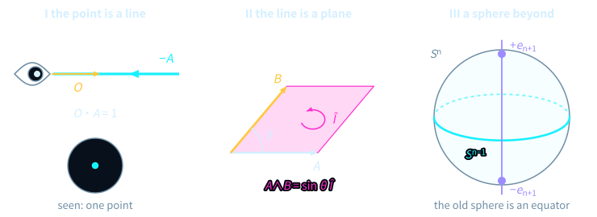
  
Panel I: sight and ray are collinear, leaving one point. Panel II: two arrows open the magenta directed area <Tex t="A \wedge B = \sin\theta\,\hat I" />. Panel III: the old sphere is the cyan equator of the new one, and the violet normal <Tex t="\pm\vec e_{n+1}" /> escapes it.

<Source>Prelude, Figure 0 (prelude-overview)</Source>

---
# 04 The eight parts form a staircase
section: "Reader's guide"
---

  
Eight parts, thirty chapters

  <h2 class="t">Eight parts form a staircase, <em>each one dimension higher</em></h2>
  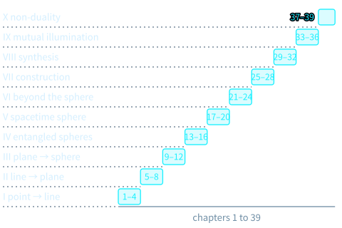
  
Four chapters apiece for the first seven parts, two for the eighth: point → line, line → plane, plane → sphere, entangled spheres, spacetime sphere, beyond the sphere, construction, synthesis.

<Source>Prelude, “Reader's Guide and Formal Verification Contract” (prelude-eight-parts)</Source>

---
# 05 Part I
layout: section
chapter: "01"
section: "Part I"
---

Part I · Chapters 1–4

<h2 class="t">From point to line: <em>pairwise measurement and zero-redundancy projection</em></h2>

Drop the isolated particle and the external third point <Tex t="C" />: take the state itself as the basis and compare by inner product; to exist is to be an idempotent line <Tex t="P^2 = P" />; when the gaze turns away, states on the sphere shrink toward its centre.

  <ul class="plain">
    <li>Ch. 1 Quantum = two things = measuring · Ch. 2 Cutting away the third point C</li>
    <li>Ch. 3 Existence as an idempotent line · Ch. 4 Decoherence and the truncated line</li>
  </ul>

---
# 06 Part I · picture
section: "Part I · picture"
---

  
Chapter 2 · cut the third point

  <h2 class="t">The same pair of arrows: two angles, or <em>just one</em></h2>
  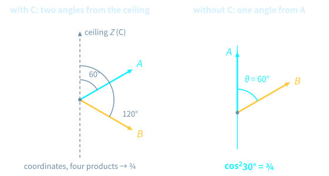
  
Remove the ceiling and let the cyan <Tex t="A" /> be its own axis: the amber <Tex t="B" /> is a single angle <Tex t="\theta = 60^\circ" /> away, and the weight is simply <Tex t="\cos^2 30^\circ = 3/4" />.

<Source>Chapter 2, ch02-cut-c</Source>

---
# 07 Part I · theorems
section: "Part I · theorems"
---

  
Theorem 2.4 · Theorem 3.3

  <h2 class="t">The Born weight is a <em>squared overlap</em>; unread fixed points are <em>block-diagonal</em></h2>
<TheoremCard class="compact mt-s" label="Theorem 2.4" title="Squared-modulus reduction of record weights" gid="D5/S3/Observer/BornReduction.rank_one_pure_state_modulus_square_reduction" cite="thm-born-modulus-square">

Let $\phi, \psi \in \mathbb{C}^n$. If $P_k = \lvert\phi\rangle\langle\phi\rvert$ and $\rho = \lvert\psi\rangle\langle\psi\rvert$, the record weight of that branch is $\operatorname{recordWeight}(P, \rho, k) = \lvert\langle\phi\mid\psi\rangle\rvert^2$.

</TheoremCard>
<TheoremCard class="compact mt-s" label="Theorem 3.3" title="Block-diagonal criterion for fixed points of the unread state" gid="D5/S3/Observer/Conditioning.unreadState_fixed_iff" cite="thm-unread-fixed-iff">

Let $P$ be a record measurement (`IsRecordMeasurement P`). Then $\operatorname{unreadState}(P, \rho) = \rho$ if and only if $P_k \rho P_l = 0$ for all $k \neq l$.

</TheoremCard>

<Source>Chapter 2 (Observer/BornReduction) · Chapter 3 (Observer/Conditioning)</Source>

---
# 08 Part I · literature
section: "Part I · warrant"
---

  
Literature results · not formalized in this book

  <h2 class="t">Finite dimensions are verified; infinite ones stay in the literature</h2>
  

    

      <h4>Literature · Chapter 2</h4>
      <h3>Gleason's theorem and Busch's theorem in infinite dimension</h3>
      
The book proves, in finite dimension, that a probability additive on effects is a trace pairing; Gleason's theorem (dimension at least 3) and the infinite-dimensional case are cited, not formalized here.

    

    

      <h4>Literature · Chapter 4</h4>
      <h3>Stinespring dilation and bath underdetermination</h3>
      
The book verifies the general form <Tex t="\varphi(a) = V^\dagger \pi(a) V" />; the isometric dilation of finite-dimensional channels, and minimal dilations agreeing up to a unitary on the environment — so the microscopic bath is not unique — are literature results.

    

  

  
Part I has no open problems: every formal result in it carries a badge like <LeanBadge gid="D5/S3/Observer/BornReduction.rank_one_pure_state_modulus_square_reduction" />.

<Source>Chapter 2 remark (Gleason) · Chapter 4 remark (Stinespring)</Source>

---
# 09 Part II
layout: section
chapter: "02"
section: "Part II"
---

Part II · Chapters 5–8

<h2 class="t">From line to plane: <em>orthogonal bifurcation, quantum gates and time duality</em></h2>

A complex phase generates a plane rotation; the geometric product <Tex t="AB = A\cdot B + A\wedge B" /> sews inner product to area; lines are classical time, areas quantum time; erasure has a thermodynamic price.

  <ul class="plain">
    <li>Ch. 5 Farewell to the mysterious i · Ch. 6 The geometric product</li>
    <li>Ch. 7 The duality of time · Ch. 8 The cost of erasure</li>
  </ul>

---
# 10 Part II · picture
section: "Part II · picture"
---

  
Chapter 6 · the Gram deficit

  <h2 class="t">The gap in Cauchy–Schwarz <em class="magenta">is exactly an area squared</em></h2>
  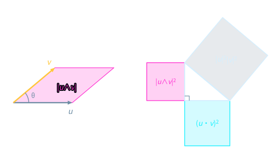
  
On the left, <Tex t="\vec u" /> and <Tex t="\vec v" /> span the magenta parallelogram; on the right, the legs of the right triangle are <Tex t="\lvert\vec u\cdot\vec v\rvert" /> and <Tex t="\lvert\vec u\wedge\vec v\rvert" />.

<Source>Chapter 6, ch06-gram-deficit</Source>

---
# 11 Part II · theorems
section: "Part II · theorems"
---

  
Theorem 5.3 · Theorem 6.1

  <h2 class="t"><em>i</em> is a quarter turn of a plane; inner product and area <em>add up in squares</em></h2>
<TheoremCard class="compact mt-s" label="Theorem 5.3" title="Square identity of the relative complex structure" gid="D5/S3/Quantum/Algebra/Unitary/BalancedUnitaryComplexStructure.relativeComplexStructure_square" cite="thm-relative-complex-structure-square">

Let $A, B \in M_n(\mathbb{C})$ and $J := 2AB^*$. If $AB^* + BA^* = 0$, $AA^* = \tfrac12 I_n$ and $B^*B = \tfrac12 I_n$, then $J^2 = -I_n$.

</TheoremCard>
<TheoremCard class="compact mt-s" label="Theorem 6.1" title="The Lagrange–Gram identity" gid="D5/S3/QuantumBounds/LagrangeGramIdentity.lagrange_gram_identity" cite="thm-lagrange-gram-identity">

For real vectors $u, v$ on a finite index set $s$: $\left(\sum u_i^2\right)\left(\sum v_i^2\right) - \left(\sum u_i v_i\right)^2 = \tfrac12 \sum_{i,j} (u_i v_j - u_j v_i)^2$.

</TheoremCard>

<Source>Chapter 5 (BalancedUnitaryComplexStructure) · Chapter 6 (LagrangeGramIdentity)</Source>

---
# 12 Part II · literature
section: "Part II · warrant"
---

  
Literature results · not formalized in this book

  <h2 class="t">Speed limits and Landauer's principle, cited from the literature</h2>
  

    

      <h4>Literature · Chapter 7</h4>
      <h3>Dynamical speed limits and the Zeno theorem</h3>
      
The Mandelstam–Tamm and Margolus–Levitin limits and the Misra–Sudarshan Zeno theorem: the book proves a Fubini–Study time bound for resolving records; these general forms are cited only.

    

    

      <h4>Literature · Chapter 8</h4>
      <h3>Landauer erasure, reversible computing, finite baths</h3>
      
The book derives Landauer's bound and its equality criterion from bath and unitary balances; the thermodynamic bridge, Bennett's reversible computing and the Reeb–Wolf inequality are literature results.

    

  

<Source>Chapters 7 and 8, literature remarks</Source>

---
# 13 Part III
layout: section
chapter: "03"
section: "Part III"
---

Part III · Chapters 9–12

<h2 class="t">From plane to sphere: <em>orthogonal triads, global compatibility, measurement as computation</em></h2>

One orthogonal step, then a second, reaches the whole sphere; pairwise comparisons always agree, whatever the order; a hardware gate is a pulse area, and the virtual <Tex t="Z" /> gate takes no time; measuring is computing.

  <ul class="plain">
    <li>Ch. 9 Pairwise orthogonal triads · Ch. 10 Pairwise, consistent, order-free</li>
    <li>Ch. 11 Pulse areas and the virtual Z gate · Ch. 12 Attention as computation</li>
  </ul>

---
# 14 Part III · picture
section: "Part III · picture"
---

  
Chapter 9 · the common normal

  <h2 class="t">Any two vectors share <em>a unit normal</em></h2>
  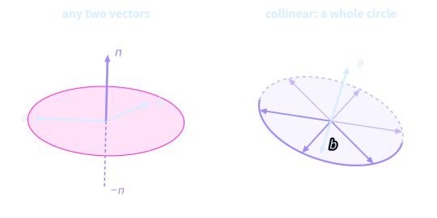
  
Left: <Tex t="a, b" /> are not collinear, and the violet <Tex t="n" /> is perpendicular to the magenta disc they span. Right: <Tex t="a, b" /> are collinear, and the unit vectors perpendicular to them fill a whole violet circle.

<Source>Chapter 9, ch09-common-normal</Source>

---
# 15 Part III · theorems
section: "Part III · theorems"
---

  
Theorem 9.2 · Theorem 10.7

  <h2 class="t">Two axes reach every rotation; the Gram matrix <em>fixes all relative geometry</em></h2>
<TheoremCard class="compact mt-s" label="Theorem 9.2" title="Finite rotation words from two noncollinear axes" gid="D5/S3/Geometry/TwoAxisFiniteRotation.two_axis_finite_word" cite="thm-two-axis-finite-word">

Let $a, b \in \mathbb{R}^3$ satisfy $\langle a, b\rangle^2 < \lVert a\rVert^2 \lVert b\rVert^2$. Then every orthogonal map $R$ of determinant $1$ is the product of a finite word of rotations about the axes $a$ and $b$.

</TheoremCard>
<TheoremCard class="compact mt-s" label="Theorem 10.7" title="Ambient unitary reconstruction from equal complex Gram matrices" gid="D5/S3/Quantum/Algebra/GramUnitaryExtension.exists_unitary_mul_eq_of_conjTranspose_mul_eq" cite="thm-gram-unitary-reconstruction">

For complex matrices $A, B \in M_{m\times n}(\mathbb{C})$, if $B^*B = A^*A$, there is a unitary $U$ with $B = UA$.

</TheoremCard>

<Source>Chapter 9 (TwoAxisFiniteRotation) · Chapter 10 (GramUnitaryExtension)</Source>

---
# 16 Part III · literature
section: "Part III · warrant"
---

  
Literature results · not formalized in this book

  <h2 class="t">Geometric phase and measurement-based computing, cited from the literature</h2>
  

    

      <h4>Literature · Chapter 10</h4>
      <h3>The octant Berry phase and the Bargmann invariant</h3>
      
Around the octant triangle the direction returns to the pole, yet the spinor picks up <Tex t="\gamma_B = -\Omega/2 = -\pi/4" />; the argument of the three-point Bargmann invariant encodes the same phase.

    

    

      <h4>Literature · Chapter 12</h4>
      <h3>One-way computing, parameter shift, barren plateaus</h3>
      
The book proves the commutator derivative of projective-measurement probabilities and the dissipation identity of gradient flow; the universality of MBQC, natural gradients and barren plateaus are literature results.

    

  

<Source>Chapters 10 and 12, literature remarks</Source>

---
# 17 Part IV
layout: section
chapter: "04"
section: "Part IV"
---

Part IV · Chapters 13–16

<h2 class="t">Entangled spheres: <em>entanglement, fault-tolerant codes and unified algorithms</em></h2>

The cosine arc beats the classical polyline at <Tex t="45^\circ" />; fragile lines hide in higher-dimensional planes; Grover is a rotation in the plane of an angle, the QFT a gear on the equator; compiling gates is cancelling factors.

  <ul class="plain">
    <li>Ch. 13 Entanglement and the 45° Bell break · Ch. 14 Codes and anyons</li>
    <li>Ch. 15 Grover, the QFT and Shor · Ch. 16 QSVT, walks and compilation</li>
  </ul>

---
# 18 Part IV · picture
section: "Part IV · picture"
---

  
Chapter 13 · the 45° break

  <h2 class="t">The cosine arc reaches <em>2√2</em> only at <em>45°</em></h2>
  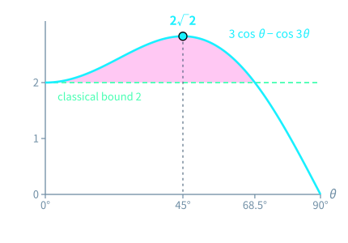
  
The cyan curve is <Tex t="3\cos\theta - \cos 3\theta" /> on the Bell state: it starts at <Tex t="2" /> for <Tex t="\theta = 0^\circ" />, rises to <Tex t="2\sqrt2" /> at <Tex t="45^\circ" />, and falls back to <Tex t="2" /> near <Tex t="68.5^\circ" />.

<Source>Chapter 13, ch13-symmetric</Source>

---
# 19 Part IV · theorems
section: "Part IV · theorems"
---

  
Theorem 13.10 · Corollary 13.8

  <h2 class="t">Classical models cap at <em>2</em>, the CHSH operator at <em>2√2</em></h2>
<TheoremCard class="compact mt-s" label="Theorem 13.10" title="The CHSH bound of finite deterministic fiber models is exactly 2" gid="D5/S3/QuantumBounds/ClassicalFiberBound.classical_chsh_bound_is_exact" cite="thm-classical-chsh-bound-exact">

For a nonnegative normalized weight $\mu$ on a finite fiber, every deterministic fiber model has $\lvert\operatorname{classicalCHSH}(\mu, \mathrm{model})\rvert \le 2$, and $2$ is the greatest of these values.

</TheoremCard>
<TheoremCard class="compact mt-s" label="Corollary 13.8" title="The fixed two-qubit CHSH operator has maximum expectation 2√2" gid="D5/S3/QuantumBounds/TsirelsonTightness.bell_chsh_state_expectation_is_greatest" cite="cor-fixed-chsh-tsirelson">

Over all two-qubit states $\rho$, the values of $\operatorname{Re}\operatorname{Tr}(\rho \cdot \mathrm{chshOperator})$ have greatest element $2\sqrt2$: some state attains it, none exceeds it.

</TheoremCard>

<Source>Chapter 13 (ClassicalFiberBound · TsirelsonTightness)</Source>

---
# 20 Part IV · literature
section: "Part IV · warrant"
---

  
Literature results · not formalized in this book

  <h2 class="t">General Bell theorems and gate compilation, cited from the literature</h2>
  

    

      <h4>Literature · Chapter 13</h4>
      <h3>General local-hidden-variable and Tsirelson bounds</h3>
      
The book verifies finite fiber models and the fixed two-qubit operator; the general bounds over all local hidden-variable theories and all quantum strategies, and no-signaling, are literature results.

    

    

      <h4>Literature · Chapter 16</h4>
      <h3>The Solovay–Kitaev compilation theorem</h3>
      
The book proves exact finite-word generation from two noncollinear axes; approximating any gate from a finite gate set at polylogarithmic length (Solovay–Kitaev) is a literature result.

    

  

<Source>Chapters 13 and 16, literature remarks</Source>

---
# 21 Part V
layout: section
chapter: "05"
section: "Part V"
---

Part V · Chapters 17–20

<h2 class="t">The spacetime sphere: <em>relativistic metrics, gauge fields and holographic gravity</em></h2>

Special relativity is a hyperbolic rotation, and the light cone fixes the metric; force is the curvature of area; entanglement weaves space, and a discrete min-cut can be proved; complexity equals volume remains a conjecture.

  <ul class="plain">
    <li>Ch. 17 Hyperbolic rotations and light cones · Ch. 18 Spinors and gauge fields</li>
    <li>Ch. 19 Tensor networks and min-cuts · Ch. 20 Complexity and spacetime</li>
  </ul>

---
# 22 Part V · picture
section: "Part V · picture"
---

  
Chapter 19 · three candidate cuts

  <h2 class="t">The width-three bridge graph has <em>three candidate cuts</em></h2>
  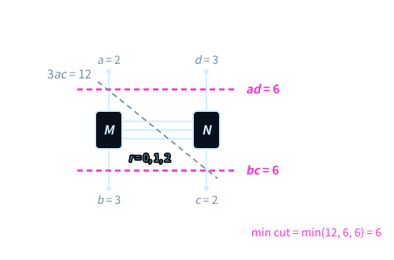
  
Take <Tex t="(a, b, c, d) = (2, 3, 2, 3)" />: cutting legs <Tex t="a, d" /> costs <Tex t="ad = 6" />, cutting legs <Tex t="b, c" /> costs <Tex t="bc = 6" />, the slanted cut costs more; the minimum cut is the smallest of the three.

<Source>Chapter 19, ch19-three-cuts</Source>

---
# 23 Part V · theorems
section: "Part V · theorems"
---

  
Proposition 17.4 · Theorem 19.6

  <h2 class="t">The light cone fixes the metric; on the bridge graph <em>max-flow equals min-cut</em></h2>
<TheoremCard class="compact mt-s" label="Proposition 17.4" title="Null-cone quadratic-form rigidity" gid="D5/S0/Certificates/MinkowskiNullConeRigidity.eq_smul_minkowski_of_null" cite="prop-null-cone-rigidity">

Let $S$ be a real quadratic form on $\operatorname{Space}(d)$. If $\operatorname{minkowski}_d(v) = 0$ always implies $S(v) = 0$, then $S = S(1, 0) \cdot \operatorname{minkowski}_d$.

</TheoremCard>
<TheoremCard class="compact mt-s" label="Theorem 19.6" title="Discrete bridge-graph quantum max-flow min-cut" gid="D5/S3/Quantum/TensorNetworks/BridgeGraph/QuantumMaxFlowMinCut.result" cite="thm-bridge-quantum-maxflow-mincut">

For natural numbers $0 < a \le b$, $0 < c \le d$ with $a^2 + b^2 \le 3ab$ and $c^2 + d^2 \le 3cd$, the width-three bridge graph has $\operatorname{QMaxFlow} = \operatorname{QMinCut} = \min(ad, bc)$.

</TheoremCard>

<Source>Chapter 17 (MinkowskiNullConeRigidity) · Chapter 19 (QuantumMaxFlowMinCut)</Source>

---
# 24 Part V · literature and open problems
section: "Part V · warrant"
---

  
Literature · open conjectures

  <h2 class="t">Continuum holography is literature; <em class="warn">complexity = volume is open</em></h2>
  

    

      <h4>Literature · Chapter 19</h4>
      <h3>The Ryu–Takayanagi formula</h3>
      
The entanglement entropy of a boundary region is the area of a minimal bulk surface over <Tex t="4G_N" />. The book proves only the discrete width-three max-flow min-cut; the continuum formula and its scope are cited.

    

    

      <TheoremCard class="compact" label="Conjecture 20.5" title="Complexity equals volume" status="open" cite="conj-complexity-equals-volume">
        
The circuit complexity of the boundary state at time <Tex t="t" /> is proportional to the renormalized volume of the maximal spacelike slice anchored at that time.

      </TheoremCard>
      
The same chapter states two more open conjectures, ER=EPR and P≠NP, neither with a Lean reference.

    

  

<Source>Chapter 19 literature remark · Chapter 20, three conjectures</Source>

---
# 25 Part VI
layout: section
chapter: "06"
section: "Part VI"
---

Part VI · Chapters 21–24

<h2 class="t">Spheres beyond spheres: <em>Gödelian escape, arithmetic spectra and ψ = ψ(ψ)</em></h2>

The diagonal escapes the old observation topology along a normal; primes are the orthogonal basis of arithmetic; the rationals hide the skeleton of the integers; the cosine fixed point <Tex t="\cos\theta^* = \theta^*" /> makes ruler and mark one.

  <ul class="plain">
    <li>Ch. 21 Diagonals, Gödelian escape, hairy balls · Ch. 22 Euler products and zeta zeros</li>
    <li>Ch. 23 Quaternion norms and Diophantine definability · Ch. 24 Cosine fixed points</li>
  </ul>

---
# 26 Part VI · picture
section: "Part VI · picture"
---

  
Chapter 21 · the Taylor crack

  <h2 class="t">One more term pushes the crack further out, <em class="magenta">but never closes it</em></h2>
  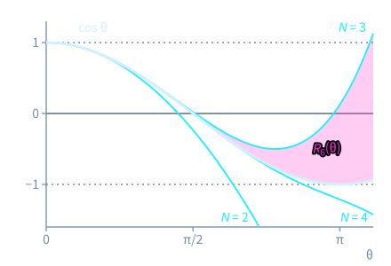
  
The thick ink curve is <Tex t="\cos\theta" />; the cyan curves keep the first <Tex t="N = 2, 3, 4" /> terms; the magenta area is the remainder <Tex t="R_6(\theta)" /> for <Tex t="N = 3" />, widening to the right.

<Source>Chapter 21, ch21-taylor-crack</Source>

---
# 27 Part VI · theorems
section: "Part VI · theorems"
---

  
Theorem 21.3 · Theorem 22.4

  <h2 class="t">A complete diagonal <em>must escape</em>; zeta is <em>a product over primes</em></h2>
<TheoremCard class="compact mt-s" label="Theorem 21.3" title="Discontinuity of the complete-catalog relative semantic diagonal" gid="D5/S3/ConceptDynamics/ObservationTopology/DiagonalTopologicalEscape.complete_diagonal_not_continuous" cite="thm-complete-diagonal-not-continuous">

If the twist $\operatorname{twist}$ has no fixed point and the decoder catalog is surjective, the relative semantic diagonal is not continuous from the latent partition topology to the discrete output topology.

</TheoremCard>
<TheoremCard class="compact mt-s" label="Theorem 22.4" title="Euler product of the Riemann zeta function for Re(s) > 1" gid="D5/S3/Zeros/ZetaIdentities.riemann_zeta_euler_product" cite="thm-riemann-zeta-euler-product">

If $\operatorname{Re}(s) > 1$, then $\prod_{p} \bigl(1 - p^{-s}\bigr)^{-1} = \operatorname{classicalZeta}(s)$, the product running over all primes.

</TheoremCard>

<Source>Chapter 21 (DiagonalTopologicalEscape) · Chapter 22 (ZetaIdentities)</Source>

---
# 28 Part VI · literature and open problems
section: "Part VI · warrant"
---

  
Literature · open conjectures

  <h2 class="t">Gödel is literature; <em class="warn">the Riemann Hypothesis is open</em></h2>
  

    

      <h4>Literature · Chapter 21</h4>
      <h3>Diagonal escape and Gödel–Tarski metamathematics</h3>
      
The book verifies an abstract diagonal escape; the hypotheses of the Cantor, Lawvere, Gödel and Tarski theorems are compared only as literature, not formalized here.

    

    

      <TheoremCard class="compact" label="Conjecture 22.34" title="The Riemann Hypothesis" status="open" cite="conj-riemann-hypothesis">
        
Every zero of the zeta function in the critical strip <Tex t="0 \lt \operatorname{Re}(s) \lt 1" /> lies on the critical line <Tex t="\operatorname{Re}(s) = 1/2" />.

      </TheoremCard>
      
Chapter 24 adds one more: Schanuel's conjecture would make <Tex t="\theta^*" /> and <Tex t="\pi" /> algebraically independent.

    

  

<Source>Chapter 21 literature remark · Chapters 22 and 24, conjectures</Source>

---
# 29 Part VII
layout: section
chapter: "07"
section: "Part VII"
---

Part VII · Chapters 25–28

<h2 class="t">Construction and verification: <em>XOR algebra, rotor compilation and Lean 4</em></h2>

Reduce matrices to XOR bitmasks; compile single-qubit rotations from Bloch geometry; then open the frozen Lean proofs line by line and see exactly what the kernel checks.

  <ul class="plain">
    <li>Ch. 25 Three-bit blades and the XOR–Pauli engine · Ch. 26 ZYZ rotor compilation</li>
    <li>Ch. 27 and 28 Inside the Lean 4 axiom sanctuary (I and II)</li>
  </ul>

---
# 30 Part VII · picture
section: "Part VII · picture"
---

  
Chapter 25 · the mask cube

  <h2 class="t">The eight blades are <em>the eight corners of a cube</em></h2>
  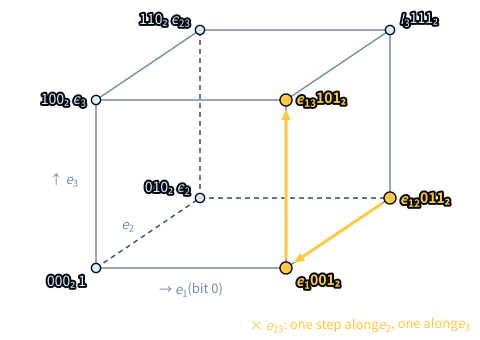
  
Each corner carries a blade and its three-bit mask; multiplying by a blade walks one edge along each direction it lights up, and the masks combine by XOR.

<Source>Chapter 25, ch25-mask-cube</Source>

---
# 31 Part VII · theorems
section: "Part VII · theorems"
---

  
Theorem 25.1 · Proposition 26.3

  <h2 class="t">The Pauli pair anticommutes; a Hermitian 2×2 matrix <em>is a Bloch vector</em></h2>
<TheoremCard class="compact mt-s" label="Theorem 25.1" title="Anticommutation, self-adjointness and unit squares of the qubit Weyl pair" gid="D5/S3/Quantum/FiniteDimensional.qubit_weyl_star" cite="thm-qubit-weyl-star">

In $M_2(\mathbb{C})$: $ZX = -XZ$, $X^* = X$, $Z^* = Z$, $X^2 = 1$, $Z^2 = 1$.

</TheoremCard>
<TheoremCard class="compact mt-s" label="Proposition 26.3" title="Hermitian Bloch reconstruction and the pure-projector unit sphere" gid="D5/S3/Quantum/Information/ActualPureQubitGeometry.bloch_geometry_of_isHermitian" cite="prop-hermitian-bloch-geometry">

Let $M$ be a Hermitian $2\times 2$ complex matrix. Then $M = \operatorname{blochMatrix}(\operatorname{Re}\operatorname{Tr} M, \operatorname{bloch}(M))$; if moreover $\operatorname{Tr} M = 1$ and $M^2 = M$, then $\lVert\operatorname{bloch}(M)\rVert = 1$.

</TheoremCard>

<Source>Chapter 25 (FiniteDimensional) · Chapter 26 (ActualPureQubitGeometry)</Source>

---
# 32 Part VII · literature
section: "Part VII · warrant"
---

  
Literature results · not formalized in this book

  <h2 class="t">The kernel vouches for inference, not for physical modelling</h2>
  

    

      <h4>Literature · Chapter 26</h4>
      <h3>The SU(2) → SO(3) double cover and ZYZ Euler decomposition</h3>
      
The book verifies Bloch reconstruction and the trace identities; the universal theorem that every single-qubit unitary has ZYZ Euler angles is cited from the literature.

    

    

      <h4>Literature · Chapter 27</h4>
      <h3>Dependent type theory and the de Bruijn criterion</h3>
      
A small, auditable kernel checks every inference; whether a Lean definition faithfully captures a physical object is a modelling question, outside what the kernel guarantees.

    

  

<Source>Chapters 26 and 27, literature remarks</Source>

---
# 33 Part VIII
layout: section
chapter: "08"
section: "Part VIII"
---

Part VIII · Chapters 29–30

<h2 class="t">Synthesis: <em>timeless causality, complexity horizons and fluid vortex filaments</em></h2>

The integer grid can only approach <Tex t="\sqrt2" /> step by step, its error flipping sign and shrinking but never vanishing; a finite-resolution observation cannot close exactly under quadratic advection.

  <ul class="plain">
    <li>Ch. 29 Timeless causality and Gram-compatible space</li>
    <li>Ch. 30 Fields (P) and lines (NP): from ETH to Navier–Stokes vortex filaments</li>
  </ul>

---
# 34 Part VIII · picture
section: "Part VIII · picture"
---

  
Chapter 29 · the Pell seam

  <h2 class="t">Each step the error flips sign and shrinks by <em>s</em>, <em>yet never vanishes</em></h2>
  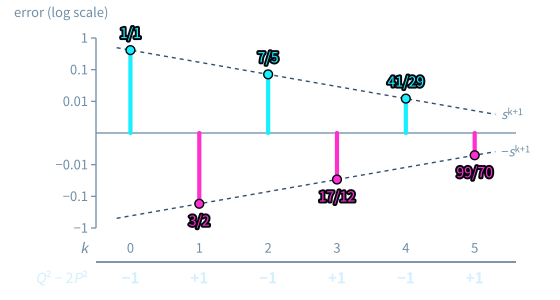
  
The bars are the errors <Tex t="P_{k+1}s - P_k" />, cyan pointing up for positive, magenta down for negative; on the logarithmic axis each step shrinks by <Tex t="s = \sqrt2 - 1 \approx 0.414" />.

<Source>Chapter 29, ch29-pell-seam</Source>

---
# 35 Part VIII · theorems
section: "Part VIII · theorems"
---

  
Theorem 29.4 · Theorem 30.20

  <h2 class="t">The silver slope has a <em>best-approximation bound</em>; finite-mode advection <em>never closes</em></h2>
<TheoremCard class="compact mt-s" label="Theorem 29.4" title="Best-approximation lower bound for the silver slope" gid="D5/S1/Words/Mechanical/SilverSlopeAbelianPellArithmetic.silver_best_approximation" cite="thm-ch29-silver-best-approximation">

Let $s = \sqrt2 - 1$, $P_k$ the Pell numbers and $0 < m < P_{k+2}$. Then $s^{k+1} \le \lvert m s - z\rvert$ for every integer $z$.

</TheoremCard>
<TheoremCard class="compact mt-s" label="Theorem 30.20" title="Projection closure criterion and finite-mode advection non-closure" gid="D5/S3/Observer/Reversal/QuadraticObservationClosure.quadratic_closure_iff" cite="thm-coda-quadratic-advection-no-closure">

For idempotent $P$ and $V(x) = Lx - B(x, x)$, an exact closure $P(V(x)) = f(P(x))$ exists iff three leakage conditions vanish; in five-mode Fourier advection $P\bigl(B(a, b) + B(b, a)\bigr)_{0,0} = i/4 \neq 0$, so no exact closure exists.

</TheoremCard>

<Source>Chapter 29 (SilverSlopeAbelianPellArithmetic) · Chapter 30 (QuadraticObservationClosure)</Source>

---
# 36 Part VIII · literature and open problems
section: "Part VIII · warrant"
---

  
Literature · open conjectures

  <h2 class="t">Continued fractions are literature; <em class="warn">Navier–Stokes regularity is open</em></h2>
  

    

      <h4>Literature · Chapter 29</h4>
      <h3><Tex t="Q_n/P_n" /> and the convergents of <Tex t="\sqrt2" /></h3>
      
The book verifies the Pell remainder and the best-approximation bound; that these are exactly the continued-fraction convergents of <Tex t="\sqrt2" /> is the classical picture, cited from the literature.

    

    

      <TheoremCard class="compact" label="Conjecture 30.19" title="Global regularity of the 3D Navier–Stokes equations" status="open" cite="conj-coda-navier-stokes-regularity">
        
Whether the unforced three-dimensional incompressible Navier–Stokes equations always have a global smooth solution for smooth initial data (Clay Millennium statements A / B).

      </TheoremCard>
      
Finite-mode non-closure is a verified theorem; it does not settle this conjecture.

    

  

<Source>Chapter 29 literature remark · Chapter 30 conjecture</Source>

---
# 37 Three tiers of warrant
section: "Three tiers"
---

  
Three tiers of warrant

  <h2 class="t">Three tiers of warrant, <em>three colours</em>, never mixed</h2>
  

    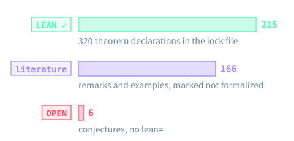
    

      

        <Stat value="180" label="theorems, lemmas, propositions and corollaries with lean=" tone="ok" />
        <Stat value="117" label="remarks and examples marked “literature result, not formalized”" tone="violet" />
        <Stat value="6" label="open conjectures, marked OPEN, with no Lean reference" tone="warn" />
      

      
The lock file trureturing.lock.json pins dev@1d9bf98cab83: 439 declarations, 308 of them Lean theorems.

    

  

<Source>Counted from both editions and trureturing.lock.json · Prelude, prelude-three-tiers · Appendix C</Source>

---
# 38 Dependency map
section: "Dependency map"
---

  
Reading and dependency map

  

    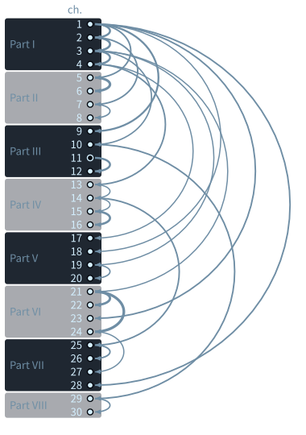
    

      <h2 class="t">Which chapter <em>builds on</em> which</h2>
      
The curved arrow into each chapter comes from the earlier chapter it refers back to most. Chapter 1 sends out six arrows; two thick arrows run from Chapter 21 to Chapters 22 and 24.

      <ul class="plain mt">
        <li><b>Physical intuition:</b> Prelude → Ch. 1–12 → Ch. 17–19</li>
        <li><b>Algorithms and compilation:</b> Ch. 2 → Ch. 13–16 → Ch. 25–27</li>
        <li><b>Logic and number theory:</b> Ch. 10 → Ch. 21–24 → Ch. 29–30</li>
        <li><b>Kernel audit:</b> Prelude → Ch. 25–28 → Appendix C</li>
      </ul>
    

  

<Source>Coda, “Eight-Part, Thirty-Chapter Reading and Dependency Map” (coda-dependency-tree)</Source>

---
# 39 Closing
layout: cover
---

Read · Verify · Watch

<h1 class="display">The book explains, <em>Lean</em> decides</h1>

Read online or as PDF and EPUB; 150 static figures, 36 interactive labs, one film for each of the eight parts; check every theorem at the pinned trureturing commit.

Prelude → Ch. 1 · Appendix C: locked index

