---
# 01 封面
theme: ../../../../theme/slides
title: "量子计算的几何直觉 · 全书概览"
info: "《量子计算的几何直觉》全书概览：四重盲区与升维阶梯，八部各自的核心图景、主要的 Lean 已验证定理、文献结果与开放问题，三层依据的条数，以及全书依赖导图。"
htmlAttrs:
  lang: "zh-CN"
deck:
  code: "ORTHO//QUANTUM"
  book: "量子计算的几何直觉"
  title: "全书概览"
  version: "0.1.0"
  blurb: "从两子丈量到球外之球：八部三十二章的核心图景、主要定理与三层依据，三十九页看完全书。"
layout: cover
---

量子计算的几何直觉 · 全书概览

<h1 class="display">从两子丈量 到 <em>ψ = ψ(ψ)</em></h1>

八部三十二章，沿“点 → 线 → 面 → 球 → 球外之球”的阶梯，把量子计算还原为可以手算的几何。书负责解释为什么如此，Lean 内核负责担保确实如此。

---
# 02 全书一句话
section: "全书一句话"
---

  
The book in one sentence

  <h2 class="t">世上本无“量子”，不过是<em>两子相遇，彼此丈量</em></h2>
  

    
“我们认为是点，其实是线，认为是线，其实是面，认为是面，其实是球，以为看到球了，却被更大的球包裹。”

    
“这就是我们最早研究的 <Tex t="\psi = \psi(\psi)" />。”

  

  
以已知态 <Tex t="\vec a" /> 直接比量目标态 <Tex t="\vec b" />，读数就是相融度 <Tex t="\vec a \cdot \vec b = \cos\theta" />，不需要外部的第 3 点 <Tex t="C" />。当丈量的尺子 <Tex t="\cos" /> 与被丈量的刻度 <Tex t="\theta" /> 合二为一，得到 <Tex t="\cos\theta^* = \theta^*" />。

<Source>序曲 题记（作者 Auric 原话）与“全书导读与形式化验证契约”</Source>

---
# 03 四重盲区与升维阶梯
section: "四重盲区"
---

  
Four blind spots · one ladder

  <h2 class="t">以线为点、以面为线、以球为面，<em>球外还有球</em></h2>
  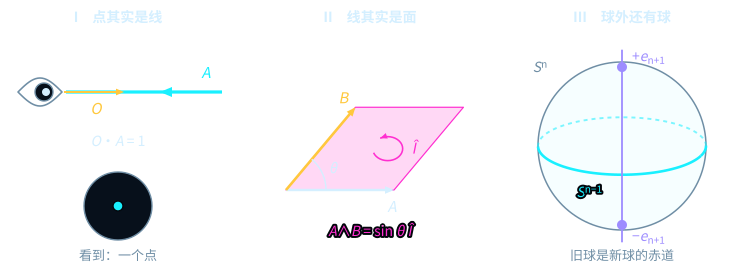
  
第 I 栏：视线与射线共线，只剩一个点；第 II 栏：两根箭头张开品红的有向面积 <Tex t="A \wedge B = \sin\theta\,\hat I" />；第 III 栏：旧球是新球青色的赤道，紫色的法向 <Tex t="\pm\vec e_{n+1}" /> 逃出旧球。

<Source>序曲 图 0（prelude-overview）</Source>

---
# 04 八部是一架阶梯
section: "八部导读"
---

  
Eight parts, thirty-two chapters

  <h2 class="t">八部是一架阶梯，<em>一部比一部高一维</em></h2>
  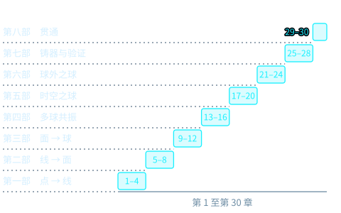
  
八部各四章：点 → 线、线 → 面、面 → 球、多球共振、时空之球、球外之球、铸器与验证、贯通。

<Source>序曲“全书导读与形式化验证契约”（prelude-eight-parts）</Source>

---
# 05 第一部
layout: section
chapter: "01"
section: "第一部"
---

第一部 · 第 1–4 章

<h2 class="t">破妄 · 从点到线：<em>两子丈量与零冗余投影</em></h2>

废除孤立粒子与外部第 3 点 <Tex t="C" />：选自身为基，用内积直接比量；存在即幂等线 <Tex t="P^2 = P" />；视线移开时，球面上的态缩进球心。

  <ul class="plain">
    <li>第 1 章 量子 = 两子 = 量（liáng）子 · 第 2 章 砍掉“第 3 点 C”</li>
    <li>第 3 章 存在即幂等线 · 第 4 章 退相干与截短之线</li>
  </ul>

---
# 06 第一部 · 图景
section: "第一部 · 图景"
---

  
Chapter 2 · cut the third point

  <h2 class="t">同一对箭头：量两个角，还是<em>只量一个角</em></h2>
  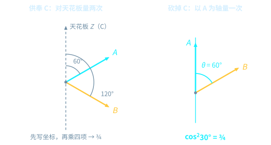
  
去掉天花板，让青色的 <Tex t="A" /> 自己当轴：琥珀色的 <Tex t="B" /> 离它只有一个角 <Tex t="\theta = 60^\circ" />，权重直接是 <Tex t="\cos^2 30^\circ = 3/4" />。

<Source>第二章 ch02-cut-c</Source>

---
# 07 第一部 · 定理
section: "第一部 · 定理"
---

  
Theorem 2.4 · Theorem 3.3

  <h2 class="t">玻恩权重是<em>内积的模方</em>，未读不动点是<em>块对角</em></h2>
<TheoremCard class="compact mt-s" label="定理2.4" title="外积矩阵的记录权重模平方归约" gid="D5/S3/Observer/BornReduction.rank_one_pure_state_modulus_square_reduction" cite="thm-born-modulus-square">

设 $\phi, \psi \in \mathbb{C}^n$。若 $P_k = \lvert\phi\rangle\langle\phi\rvert$，$\rho = \lvert\psi\rangle\langle\psi\rvert$，则该分支的记录权重 $\operatorname{recordWeight}(P, \rho, k) = \lvert\langle\phi\mid\psi\rangle\rvert^2$。

</TheoremCard>
<TheoremCard class="compact mt-s" label="定理3.3" title="未读态不动点的块对角充要判据" gid="D5/S3/Observer/Conditioning.unreadState_fixed_iff" cite="thm-unread-fixed-iff">

设 $P$ 是记录测量（`IsRecordMeasurement P`）。则 $\operatorname{unreadState}(P, \rho) = \rho$，当且仅当对一切 $k \neq l$ 都有 $P_k \rho P_l = 0$。

</TheoremCard>

<Source>第二章 定理（Observer/BornReduction）· 第三章 定理（Observer/Conditioning）</Source>

---
# 08 第一部 · 文献结果
section: "第一部 · 依据"
---

  
Literature results · not formalized in this book

  <h2 class="t">有限维已经验证；无穷维仍是文献</h2>
  

    

      <h4>文献结果 · 第二章</h4>
      <h3>格里森定理与无穷维的布施定理</h3>
      
本书在有限维证明了“效应上可加的概率必是迹配对”；维数不低于 3 的格里森定理与无穷维情形只作文献引用，未在本书形式化。

    

    

      <h4>文献结果 · 第四章</h4>
      <h3>Stinespring 扩张与热浴欠定性</h3>
      
本书验证了扩张的一般形式 <Tex t="\varphi(a) = V^\dagger \pi(a) V" />；有限维信道的等距扩张写法，以及极小扩张只差环境上一个幺正、因而微观热浴不唯一，是文献结果。

    

  

  
第一部没有开放问题：它的每一条形式结论都带 <LeanBadge gid="D5/S3/Observer/BornReduction.rank_one_pure_state_modulus_square_reduction" /> 这样的徽章。

<Source>第二章 注记（格里森定理）· 第四章 注记（Stinespring）</Source>

---
# 09 第二部
layout: section
chapter: "02"
section: "第二部"
---

第二部 · 第 5–8 章

<h2 class="t">展翼 · 从线到面：<em>正交分叉、量子门与时间二象性</em></h2>

复相位就是平面旋转的生成元；几何积 <Tex t="AB = A\cdot B + A\wedge B" /> 把内积与面积缝在一起；线是经典时间，面积是量子时间；擦除要付热力学的面积代价。

  <ul class="plain">
    <li>第 5 章 告别神秘的 i · 第 6 章 几何积</li>
    <li>第 7 章 时间的二象性 · 第 8 章 擦除的代价</li>
  </ul>

---
# 10 第二部 · 图景
section: "第二部 · 图景"
---

  
Chapter 6 · the Gram deficit

  <h2 class="t">柯西—施瓦茨两边差的那一块，<em class="magenta">正是面积的平方</em></h2>
  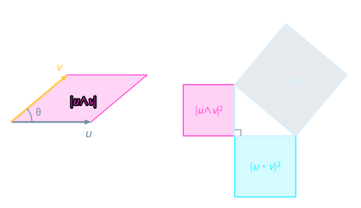
  
左边 <Tex t="\vec u" /> 与 <Tex t="\vec v" /> 张出品红的平行四边形；右边直角三角形的两条直角边是 <Tex t="\lvert\vec u\cdot\vec v\rvert" /> 与 <Tex t="\lvert\vec u\wedge\vec v\rvert" />。

<Source>第六章 ch06-gram-deficit</Source>

---
# 11 第二部 · 定理
section: "第二部 · 定理"
---

  
Theorem 5.3 · Theorem 6.1

  <h2 class="t"><em>i</em> 是平面转了四分之一圈；内积与面积<em>平方守恒</em></h2>
<TheoremCard class="compact mt-s" label="定理5.3" title="平衡正交对生成的相对复结构平方恒等式" gid="D5/S3/Quantum/Algebra/Unitary/BalancedUnitaryComplexStructure.relativeComplexStructure_square" cite="thm-relative-complex-structure-square">

设 $A, B \in M_n(\mathbb{C})$，$J := 2AB^*$。若 $AB^* + BA^* = 0$，$AA^* = \tfrac12 I_n$，$B^*B = \tfrac12 I_n$，则 $J^2 = -I_n$。

</TheoremCard>
<TheoremCard class="compact mt-s" label="定理6.1" title="拉格朗日—格拉姆恒等式" gid="D5/S3/QuantumBounds/LagrangeGramIdentity.lagrange_gram_identity" cite="thm-lagrange-gram-identity">

对有限指标集 $s$ 上的实向量 $u, v$：$\left(\sum u_i^2\right)\left(\sum v_i^2\right) - \left(\sum u_i v_i\right)^2 = \tfrac12 \sum_{i,j} (u_i v_j - u_j v_i)^2$。

</TheoremCard>

<Source>第五章（BalancedUnitaryComplexStructure）· 第六章（LagrangeGramIdentity）</Source>

---
# 12 第二部 · 文献结果
section: "第二部 · 依据"
---

  
Literature results · not formalized in this book

  <h2 class="t">速度极限与兰道尔原理，照文献引用</h2>
  

    

      <h4>文献结果 · 第七章</h4>
      <h3>动力学速度极限与芝诺定理</h3>
      
Mandelstam–Tamm、Margolus–Levitin 速度极限与 Misra–Sudarshan 芝诺定理：本书证明了记录分辨的富比尼—施图迪时间下界，这些一般形式只作文献引用。

    

    

      <h4>文献结果 · 第八章</h4>
      <h3>兰道尔擦除、可逆计算与有限热浴</h3>
      
本书由热浴平衡与幺正平衡推出兰道尔下界及其取等判据；兰道尔原理的热力学桥接、贝内特可逆计算与 Reeb–Wolf 不等式是文献结果。

    

  

<Source>第七章、第八章 文献注记</Source>

---
# 13 第三部
layout: section
chapter: "03"
section: "第三部"
---

第三部 · 第 9–12 章

<h2 class="t">合拢 · 从面到球：<em>三元正交、全局相容与注意力计算</em></h2>

正交一次、正交两次就能走遍全球；两两比较永远一致、与顺序无关；硬件里的门是脉冲面积，虚拟 <Tex t="Z" /> 门零耗时；测量本身就是计算。

  <ul class="plain">
    <li>第 9 章 三元两两正交 · 第 10 章 两两比较，顺序无关</li>
    <li>第 11 章 脉冲面积与虚拟 Z 门 · 第 12 章 注意力即计算</li>
  </ul>

---
# 14 第三部 · 图景
section: "第三部 · 图景"
---

  
Chapter 9 · the common normal

  <h2 class="t">任意两根向量都有<em>公共的单位法线</em></h2>
  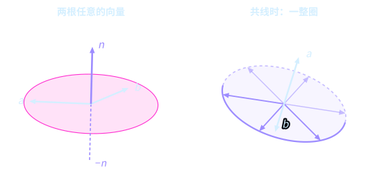
  
左栏 <Tex t="a, b" /> 不共线，紫色的 <Tex t="n" /> 垂直于它们张成的品红圆盘；右栏 <Tex t="a, b" /> 共线，垂直于它们的单位向量铺满一整个紫色的圆。

<Source>第九章 ch09-common-normal</Source>

---
# 15 第三部 · 定理
section: "第三部 · 定理"
---

  
Theorem 9.2 · Theorem 10.7

  <h2 class="t">两根轴走遍所有旋转；格拉姆矩阵<em>决定一切相对几何</em></h2>
<TheoremCard class="compact mt-s" label="定理9.2" title="两不共线轴生成特殊正交群的有限旋转字" gid="D5/S3/Geometry/TwoAxisFiniteRotation.two_axis_finite_word" cite="thm-two-axis-finite-word">

设 $a, b \in \mathbb{R}^3$ 满足 $\langle a, b\rangle^2 < \lVert a\rVert^2 \lVert b\rVert^2$。则每个行列式为 $1$ 的正交变换 $R$ 都是绕 $a$、$b$ 两轴旋转的某个有限字的乘积。

</TheoremCard>
<TheoremCard class="compact mt-s" label="定理10.7" title="复格拉姆矩阵相等下的公共外围幺正重构" gid="D5/S3/Quantum/Algebra/GramUnitaryExtension.exists_unitary_mul_eq_of_conjTranspose_mul_eq" cite="thm-gram-unitary-reconstruction">

对复矩阵 $A, B \in M_{m\times n}(\mathbb{C})$，若 $B^*B = A^*A$，则存在幺正矩阵 $U$ 使 $B = UA$。

</TheoremCard>

<Source>第九章（TwoAxisFiniteRotation）· 第十章（GramUnitaryExtension）</Source>

---
# 16 第三部 · 文献结果
section: "第三部 · 依据"
---

  
Literature results · not formalized in this book

  <h2 class="t">几何相位与测量计算，照文献引用</h2>
  

    

      <h4>文献结果 · 第十章</h4>
      <h3>八分球贝里相位与巴格曼不变量</h3>
      
沿八分球三角形走一圈，方向回到北极，旋量却攒下 <Tex t="\gamma_B = -\Omega/2 = -\pi/4" />；三点循环巴格曼不变量的辐角编码同一个相位。

    

    

      <h4>文献结果 · 第十二章</h4>
      <h3>单向量子计算、参数位移与贫瘠高原</h3>
      
本书证明了投影测量概率的对易子导数与梯度流耗散恒等式；MBQC 的通用性、自然梯度与贫瘠高原是文献结果。

    

  

<Source>第十章、第十二章 文献注记</Source>

---
# 17 第四部
layout: section
chapter: "04"
section: "第四部"
---

第四部 · 第 13–16 章

<h2 class="t">交织 · 多球共振：<em>纠缠、容错编码与算法大一统</em></h2>

余弦圆弧在 <Tex t="45^\circ" /> 击败经典折线；脆弱的线藏进高维的面；Grover 是夹角平面里的旋转，QFT 是赤道上的齿轮；门编译是因式约分。

  <ul class="plain">
    <li>第 13 章 纠缠与贝尔 45° 破缺 · 第 14 章 纠错码与任意子</li>
    <li>第 15 章 Grover、QFT 与 Shor · 第 16 章 QSVT、游走与门编译</li>
  </ul>

---
# 18 第四部 · 图景
section: "第四部 · 图景"
---

  
Chapter 13 · the 45° break

  <h2 class="t">余弦圆弧只在 <em>45°</em> 顶到 <em>2√2</em></h2>
  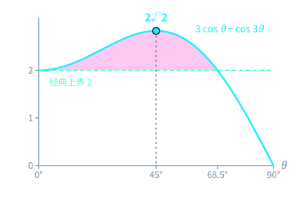
  
青色曲线是贝尔态上的 <Tex t="3\cos\theta - \cos 3\theta" />：从 <Tex t="\theta = 0^\circ" /> 的 <Tex t="2" /> 起步，在 <Tex t="45^\circ" /> 升到 <Tex t="2\sqrt2" />，约在 <Tex t="68.5^\circ" /> 落回 <Tex t="2" />。

<Source>第十三章 ch13-symmetric</Source>

---
# 19 第四部 · 定理
section: "第四部 · 定理"
---

  
Theorem 13.10 · Corollary 13.8

  <h2 class="t">经典折线封顶于 <em>2</em>，固定的 CHSH 算子封顶于 <em>2√2</em></h2>
<TheoremCard class="compact mt-s" label="定理13.10" title="有限确定性局域纤维模型的 CHSH 绝对值上界恰为 2" gid="D5/S3/QuantumBounds/ClassicalFiberBound.classical_chsh_bound_is_exact" cite="thm-classical-chsh-bound-exact">

设 $\mu$ 是有限纤维上的非负归一权重。对每个确定性纤维模型，$\lvert\operatorname{classicalCHSH}(\mu, \mathrm{model})\rvert \le 2$，且 $2$ 是这些绝对值组成的集合的最大元。

</TheoremCard>
<TheoremCard class="compact mt-s" label="推论13.8" title="固定双比特 CHSH 算子的最大期望值为 2√2" gid="D5/S3/QuantumBounds/TsirelsonTightness.bell_chsh_state_expectation_is_greatest" cite="cor-fixed-chsh-tsirelson">

在全体双比特量子态 $\rho$ 上，$\operatorname{Re}\operatorname{Tr}(\rho \cdot \mathrm{chshOperator})$ 的取值集合以 $2\sqrt2$ 为最大元：有态取到 $2\sqrt2$，且对一切态不超过 $2\sqrt2$。

</TheoremCard>

<Source>第十三章（ClassicalFiberBound · TsirelsonTightness）</Source>

---
# 20 第四部 · 文献结果
section: "第四部 · 依据"
---

  
Literature results · not formalized in this book

  <h2 class="t">一般的贝尔定理与门编译，照文献引用</h2>
  

    

      <h4>文献结果 · 第十三章</h4>
      <h3>一般局域隐变量界与一般 Tsirelson 定理</h3>
      
本书验证的是有限纤维模型与固定双比特算子；对一切局域隐变量理论与一切量子策略的一般上界，以及无超光速通信，是文献结果。

    

    

      <h4>文献结果 · 第十六章</h4>
      <h3>Solovay–Kitaev 门编译定理</h3>
      
本书证明了两根不共线轴的有限字精确生成；有限门集以多对数长度逼近任意门的 Solovay–Kitaev 定理是文献结果。

    

  

<Source>第十三章、第十六章 文献注记</Source>

---
# 21 第五部
layout: section
chapter: "05"
section: "第五部"
---

第五部 · 第 17–20 章

<h2 class="t">显影 · 时空之球：<em>相对论度规、规范力场与全息引力</em></h2>

狭义相对论是双曲旋转，光锥决定度规；力是面积的曲率；纠缠编织空间，离散最小割可以证明；复杂度与体积的对应仍是猜想。

  <ul class="plain">
    <li>第 17 章 双曲旋转与光锥 · 第 18 章 旋量与规范场</li>
    <li>第 19 章 张量网络与最小割 · 第 20 章 复杂度与时空</li>
  </ul>

---
# 22 第五部 · 图景
section: "第五部 · 图景"
---

  
Chapter 19 · three candidate cuts

  <h2 class="t">切断宽度三桥图只有<em>三道候选割</em></h2>
  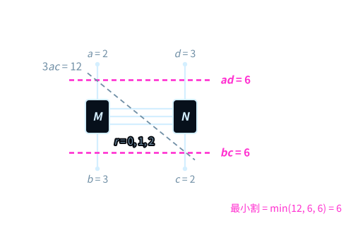
  
取 <Tex t="(a, b, c, d) = (2, 3, 2, 3)" />：横切腿 <Tex t="a, d" /> 容量 <Tex t="ad = 6" />，横切腿 <Tex t="b, c" /> 容量 <Tex t="bc = 6" />，斜切的一道更大；最小割取三者中最小的。

<Source>第十九章 ch19-three-cuts</Source>

---
# 23 第五部 · 定理
section: "第五部 · 定理"
---

  
Proposition 17.4 · Theorem 19.6

  <h2 class="t">光锥决定度规；离散桥图上<em>最大流等于最小割</em></h2>
<TheoremCard class="compact mt-s" label="命题17.4" title="零锥决定二次型" gid="D5/S0/Certificates/MinkowskiNullConeRigidity.eq_smul_minkowski_of_null" cite="prop-null-cone-rigidity">

设 $S$ 是 $\operatorname{Space}(d)$ 上的实二次型。若 $\operatorname{minkowski}_d(v) = 0$ 总推出 $S(v) = 0$，则 $S = S(1, 0) \cdot \operatorname{minkowski}_d$。

</TheoremCard>
<TheoremCard class="compact mt-s" label="定理19.6" title="离散桥图量子最大流最小割" gid="D5/S3/Quantum/TensorNetworks/BridgeGraph/QuantumMaxFlowMinCut.result" cite="thm-bridge-quantum-maxflow-mincut">

对自然数 $0 < a \le b$、$0 < c \le d$，若 $a^2 + b^2 \le 3ab$ 且 $c^2 + d^2 \le 3cd$，则宽度三桥图上 $\operatorname{QMaxFlow} = \operatorname{QMinCut} = \min(ad, bc)$。

</TheoremCard>

<Source>第十七章（MinkowskiNullConeRigidity）· 第十九章（QuantumMaxFlowMinCut）</Source>

---
# 24 第五部 · 文献结果与开放问题
section: "第五部 · 依据"
---

  
Literature · open conjectures

  <h2 class="t">连续统全息是文献，<em class="warn">复杂度等于体积仍然开放</em></h2>
  

    

      <h4>文献结果 · 第十九章</h4>
      <h3>Ryu–Takayanagi 公式</h3>
      
边界区域的纠缠熵等于体时空极小曲面的面积除以 <Tex t="4G_N" />。本书只证明离散宽度三桥图上的最大流最小割，连续统公式与适用边界照文献引用。

    

    

      <TheoremCard class="compact" label="猜想20.5" title="复杂度等于体积" status="open" cite="conj-complexity-equals-volume">
        
边界态在时刻 <Tex t="t" /> 的电路复杂度，与锚定于该时刻的最大体积类空切片的重整化体积成正比。

      </TheoremCard>
      
同章另有两条开放猜想：ER=EPR 与 P≠NP，都不带 Lean 引用。

    

  

<Source>第十九章 文献注记 · 第二十章 三条猜想</Source>

---
# 25 第六部
layout: section
chapter: "06"
section: "第六部"
---

第六部 · 第 21–24 章

<h2 class="t">越界 · 球外之球：<em>哥德尔逃逸、算术频谱与 ψ = ψ(ψ)</em></h2>

对角线沿法向逃出旧的观测拓扑；素数是算术的正交基；有理数里藏着整数的骨架；余弦自指的不动点 <Tex t="\cos\theta^* = \theta^*" /> 让尺子与刻度合一。

  <ul class="plain">
    <li>第 21 章 对角线、哥德尔逃逸与毛球 · 第 22 章 欧拉乘积与黎曼零点</li>
    <li>第 23 章 四元数范数与丢番图可定义性 · 第 24 章 余弦不动点与自指</li>
  </ul>

---
# 26 第六部 · 图景
section: "第六部 · 图景"
---

  
Chapter 21 · the Taylor crack

  <h2 class="t">多一项，裂缝推远一些，<em class="magenta">却不合拢</em></h2>
  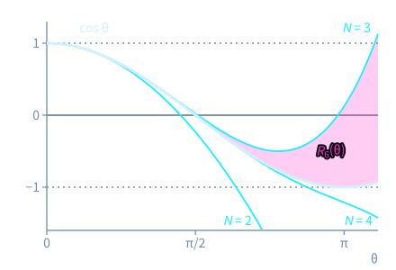
  
墨色的粗曲线是 <Tex t="\cos\theta" />，青色曲线取前 <Tex t="N = 2, 3, 4" /> 项；品红的面积是 <Tex t="N = 3" /> 时的余项 <Tex t="R_6(\theta)" />，往右越来越宽。

<Source>第二十一章 ch21-taylor-crack</Source>

---
# 27 第六部 · 定理
section: "第六部 · 定理"
---

  
Theorem 21.3 · Theorem 22.4

  <h2 class="t">完备的对角线<em>必然逃逸</em>；ζ 是<em>素数的乘积</em></h2>
<TheoremCard class="compact mt-s" label="定理21.3" title="完备解码目录诱导的相对语义对角线必不连续" gid="D5/S3/ConceptDynamics/ObservationTopology/DiagonalTopologicalEscape.complete_diagonal_not_continuous" cite="thm-complete-diagonal-not-continuous">

若扭转 $\operatorname{twist}$ 没有不动点、解码器目录是满射，则相对语义对角线从潜划分拓扑到离散输出拓扑不连续。

</TheoremCard>
<TheoremCard class="compact mt-s" label="定理22.4" title="Re(s) > 1 上黎曼 ζ 函数的欧拉乘积" gid="D5/S3/Zeros/ZetaIdentities.riemann_zeta_euler_product" cite="thm-riemann-zeta-euler-product">

若 $\operatorname{Re}(s) > 1$，则 $\prod_{p} \bigl(1 - p^{-s}\bigr)^{-1} = \operatorname{classicalZeta}(s)$，乘积遍历全体素数。

</TheoremCard>

<Source>第二十一章（DiagonalTopologicalEscape）· 第二十二章（ZetaIdentities）</Source>

---
# 28 第六部 · 文献结果与开放问题
section: "第六部 · 依据"
---

  
Literature · open conjectures

  <h2 class="t">哥德尔是文献，<em class="warn">黎曼猜想仍然开放</em></h2>
  

    

      <h4>文献结果 · 第二十一章</h4>
      <h3>对角线逃逸与哥德尔—塔斯基元数学</h3>
      
本书验证的是抽象的对角线逃逸；康托尔、Lawvere、哥德尔与塔斯基定理各自的前提边界只作文献对照，未在本书形式化。

    

    

      <TheoremCard class="compact" label="猜想22.36" title="黎曼猜想" status="open" cite="conj-riemann-hypothesis">
        
ζ 函数位于临界带 <Tex t="0 \lt \operatorname{Re}(s) \lt 1" /> 内的每个零点都在临界线 <Tex t="\operatorname{Re}(s) = 1/2" /> 上。

      </TheoremCard>
      
第二十四章另有一条：沙努埃尔猜想推出 <Tex t="\theta^*" /> 与 <Tex t="\pi" /> 代数无关。

    

  

<Source>第二十一章 文献注记 · 第二十二章、第二十四章 猜想</Source>

---
# 29 第七部
layout: section
chapter: "07"
section: "第七部"
---

第七部 · 第 25–28 章

<h2 class="t">铸器 · 构造与验证：<em>异或代数、旋子编译与 Lean 4</em></h2>

把矩阵还原为异或位掩码；用布洛赫几何编译单比特旋转；再逐行打开冻结的 Lean 证明，看内核究竟检查了什么。

  <ul class="plain">
    <li>第 25 章 3 比特刀片与 XOR–Pauli 引擎 · 第 26 章 ZYZ 旋转器编译</li>
    <li>第 27、28 章 走进 Lean 4 公理圣殿（上、下）</li>
  </ul>

---
# 30 第七部 · 图景
section: "第七部 · 图景"
---

  
Chapter 25 · the mask cube

  <h2 class="t">八块刀片是<em>立方体的八个角</em></h2>
  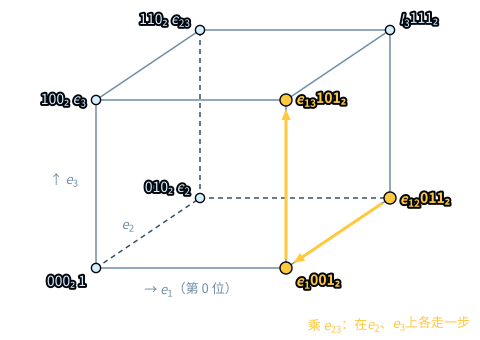
  
每个角标着刀片与它的三位掩码；乘一块刀片，就是沿它亮着的方向各走一条边，掩码按位异或。

<Source>第二十五章 ch25-mask-cube</Source>

---
# 31 第七部 · 定理
section: "第七部 · 定理"
---

  
Theorem 25.1 · Proposition 26.3

  <h2 class="t">泡利对反对易；厄米 2×2 矩阵<em>就是布洛赫向量</em></h2>
<TheoremCard class="compact mt-s" label="定理25.1" title="单比特泡利外尔对的反对易、自伴与对合恒等式" gid="D5/S3/Quantum/FiniteDimensional.qubit_weyl_star" cite="thm-qubit-weyl-star">

在 $M_2(\mathbb{C})$ 中：$ZX = -XZ$，$X^* = X$，$Z^* = Z$，$X^2 = 1$，$Z^2 = 1$。

</TheoremCard>
<TheoremCard class="compact mt-s" label="命题26.3" title="厄米 2×2 矩阵的布洛赫重构与纯态单位球面" gid="D5/S3/Quantum/Information/ActualPureQubitGeometry.bloch_geometry_of_isHermitian" cite="prop-hermitian-bloch-geometry">

设 $M$ 是厄米 $2\times 2$ 复矩阵。则 $M = \operatorname{blochMatrix}(\operatorname{Re}\operatorname{Tr} M, \operatorname{bloch}(M))$；若再有 $\operatorname{Tr} M = 1$ 且 $M^2 = M$，则 $\lVert\operatorname{bloch}(M)\rVert = 1$。

</TheoremCard>

<Source>第二十五章（FiniteDimensional）· 第二十六章（ActualPureQubitGeometry）</Source>

---
# 32 第七部 · 文献结果
section: "第七部 · 依据"
---

  
Literature results · not formalized in this book

  <h2 class="t">内核担保推理，不担保物理建模</h2>
  

    

      <h4>文献结果 · 第二十六章</h4>
      <h3>SU(2) → SO(3) 双覆盖与 ZYZ 欧拉分解</h3>
      
本书验证了布洛赫重构与迹恒等式；任意单比特幺正都能写成 ZYZ 欧拉角的普遍分解定理，照文献引用。

    

    

      <h4>文献结果 · 第二十七章</h4>
      <h3>依值类型论内核与德布鲁因准则</h3>
      
小而可审计的内核检查每一步推理；Lean 定义是否忠实刻画物理对象，是建模问题，不在内核担保之内。

    

  

<Source>第二十六章、第二十七章 文献注记</Source>

---
# 33 第八部
layout: section
chapter: "08"
section: "第八部"
---

第八部 · 第 29–32 章

<h2 class="t">贯通：<em>无时间因果、视界、量子公平与元统一</em></h2>

整数网格逼近 <Tex t="\sqrt2" /> 的误差变号缩小却不归零；二次平流无精确闭合；五重几何对称杜绝特权，并在自指罗盘下收束统一纲领。

  <ul class="plain">
    <li>第 29 章 无时间因果与格拉姆相容空间 · 第 30 章 场（P）与线（NP）</li>
    <li>第 31 章 量子的本质是公平 · 第 32 章 正交自指统一场论与元统一罗盘</li>
  </ul>

---
# 34 第八部 · 图景
section: "第八部 · 图景"
---

  
Chapter 29 · the Pell seam

  <h2 class="t">误差每步变号、缩成 <em>s</em> 倍，<em>却从不归零</em></h2>
  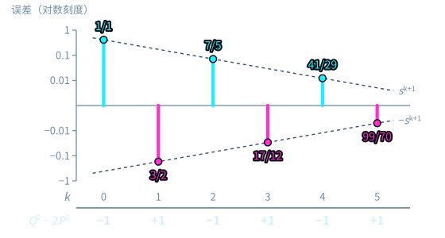
  
竖线是误差 <Tex t="P_{k+1}s - P_k" />，青色朝上为正、品红朝下为负；纵轴取对数刻度，每步缩成 <Tex t="s = \sqrt2 - 1 \approx 0.414" /> 倍。

<Source>第二十九章 ch29-pell-seam</Source>

---
# 35 第八部 · 定理
section: "第八部 · 定理"
---

  
Theorem 29.4 · Theorem 30.20

  <h2 class="t">银斜率有<em>最佳逼近下界</em>；有限模态平流<em>无精确闭合</em></h2>
<TheoremCard class="compact mt-s" label="定理29.4" title="银斜率的最佳逼近下界" gid="D5/S1/Words/Mechanical/SilverSlopeAbelianPellArithmetic.silver_best_approximation" cite="thm-ch29-silver-best-approximation">

设 $s = \sqrt2 - 1$，$P_k$ 为佩尔数，$0 < m < P_{k+2}$。则对每个整数 $z$，$s^{k+1} \le \lvert m s - z\rvert$。

</TheoremCard>
<TheoremCard class="compact mt-s" label="定理30.20" title="二次矢量场投影闭合判据与有限模态平流闭合不可能性" gid="D5/S3/Observer/Reversal/QuadraticObservationClosure.quadratic_closure_iff" cite="thm-coda-quadratic-advection-no-closure">

对幂等投影 $P$ 与 $V(x) = Lx - B(x, x)$，存在精确闭合 $P(V(x)) = f(P(x))$ 当且仅当三项泄漏条件都为零；在五模态傅里叶平流中，跨尺度混合项 $P\bigl(B(a, b) + B(b, a)\bigr)_{0,0} = i/4 \neq 0$，所以没有精确闭合。

</TheoremCard>

<Source>第二十九章（SilverSlopeAbelianPellArithmetic）· 第三十章（QuadraticObservationClosure）</Source>

---
# 36 第八部 · 文献结果与开放问题
section: "第八部 · 依据"
---

  
Literature · open conjectures

  <h2 class="t">连分数是文献，<em class="warn">纳维—斯托克斯光滑性仍然开放</em></h2>
  

    

      <h4>文献结果 · 第二十九章</h4>
      <h3><Tex t="Q_n/P_n" /> 与 <Tex t="\sqrt2" /> 的连分数渐近分数</h3>
      
本书验证了佩尔余项与最佳逼近下界；它们正是 <Tex t="\sqrt2" /> 连分数的渐近分数，这一经典刻画照文献引用。

    

    

      <TheoremCard class="compact" label="猜想30.19" title="三维纳维—斯托克斯方程的全局光滑性" status="open" cite="conj-coda-navier-stokes-regularity">
        
无外力三维不可压缩纳维—斯托克斯方程，对光滑初值是否总有全局光滑解（克雷千禧年陈述 A / B）。

      </TheoremCard>
      
有限模态无精确闭合是已验证的定理；它不回答这条猜想。

    

  

<Source>第二十九章 文献注记 · 第三十章 猜想</Source>

---
# 37 三层依据
section: "三层依据"
---

  
Three tiers of warrant

  <h2 class="t">三层依据，<em>三种颜色</em>，从不越级</h2>
  

    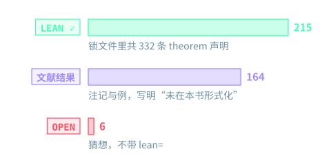
    

      

        <Stat value="186" label="带 lean= 的定理、引理、命题与推论" tone="ok" />
        <Stat value="127" label="写明“文献结果，未在本书形式化”的注记与例" tone="violet" />
        <Stat value="6" label="开放猜想，标为 OPEN，不带 Lean 引用" tone="warn" />
      

      
锁文件 trureturing.lock.json 钉住 <PinnedCommit />，共 441 项声明，其中 310 项是 Lean theorem。

    

  

<Source>按中英两版正文与 trureturing.lock.json 统计 · 序曲 prelude-three-tiers · 附录 C</Source>

---
# 38 依赖导图
section: "依赖导图"
---

  
Reading and dependency map

  

    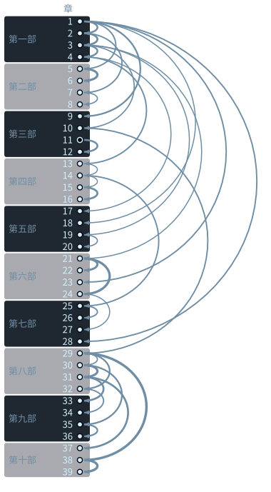
    

      <h2 class="t">哪一章<em>依赖</em>哪一章</h2>
      
指向每一章的弧形箭头，来自它回头引用最多的那一章；引用越多，箭头越粗。

      <ul class="plain mt">
        <li><b>物理直觉：</b>序曲 → 第 1–12 章 → 第 17–19 章</li>
        <li><b>算法编译：</b>第 2 章 → 第 13–16 章 → 第 25–27 章</li>
        <li><b>逻辑与数论：</b>第 10 章 → 第 21–24 章 → 第 29–32 章</li>
        <li><b>内核审计：</b>序曲 → 第 25–28 章 → 附录 C</li>
      </ul>
    

  

<Source>终章“全书八部曲三十二章阅读与依赖导图”（coda-dependency-tree）</Source>

---
# 39 结尾
layout: cover
---

Read · Verify · Watch

<h1 class="display">书负责解释， <em>Lean</em> 负责成立</h1>

在线阅读，下载 PDF 与 EPUB；152 张静态图、36 个交互实验室，八部各一部讲解视频；每一条定理都能在所钉的 trureturing 提交上逐条核对。

序曲 → 第一章 · 附录 C：锁定声明完整索引

