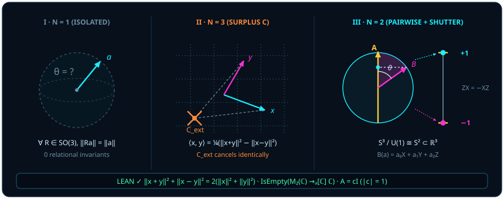

# 第一章 量子 = 两子 = 量（liáng）子：从静态名词到比量动词的还原

> *“量子到底是什么东西呀，量子门，我虽然整天在研究这些，我却不懂。”*
>
> *“我真的不懂，我现在只能理解量子态是一个球上的向量，然后推这些。”*

如果把二十世纪物理学留给后人最大的概念迷雾压缩成一个词，这个词就是被当作静态名词来读的“**量子**（liàng zǐ）”。一听到这个词，人们的脑海里便自动浮现出一颗颗微小的能量弹丸、一袋子预先分装好的离散沙砾——仿佛微观世界是一座由乐高积木拼起来的颗粒仓库，而物理学的任务就是清点每一颗积木头上贴着什么固有标签。

然而在汉语的词源深处，“量”字原本就有两副面孔：读四声（**liàng**）时，它是已经被切分出来的静态名词——份额、刻度、计数；读二声（**liáng**）时，它却是发生在两个对象之间的动态动词——比量、权衡、拿一把尺子去试探另一件东西的深浅。

本章是全书“破妄”的第一步。我们将用严格的几何图像与经 Lean 内核验证的形式化定理证明：**先有“两子”相遇的动态丈量（liáng），后有观测屏上蹦出的离散份额（liàng）。** 一旦把动作生成的结果倒果为因地塞回动作发生之前，把关系性的比量硬化为孤立实体的私有属性，量子力学的全部“反直觉悖论”便应运而生。

## 1.1 一子太少，三子多余 {#sec-ch01-1}

让我们从最朴素的思想实验开始。把整座实验室、地球、恒星乃至你手里的坐标纸统统抹去，只留下一片纯粹均匀、处处各向同性的虚空。现在，往这片虚空里放进**唯一一根**有向箭头 $A$。

请问：$A$ 指向几度？它是“朝上”还是“朝下”？它是处在“确定态”还是“叠加态”？

这个问题在几何上毫无意义。在没有任何参照对象的绝对虚空里，单根箭头既不朝上也不朝右，既不静止也不偏转。“**一子太少**”——孤立的一颗单子根本无法定义方向，更谈不上携带任何可辨识的物理状态。传统形而上学总爱追问“事物本身（Ding an sich）在未被任何他者触碰时是什么模样”，殊不知脱离了比量关系的孤立单子，在几何上连“指向哪里”都无法开口。

那么，怎样才能让方向涌现出来？只需要在这片虚空里再放进**第二根**箭头 $B$。当两子相遇的一刹那，无论外围空间怎样整体翻滚，它们之间张开的相对夹角 $\theta$ 立刻成为确凿无疑、不随视角转移的几何事实！

可叹的是，人类的笛卡尔坐标习惯偏偏在这里犯下了第二个错误：为了描述 $A$ 与 $B$ 这两根箭头的关系，教科书总忍不住从宇宙外面虚构出**第 3 个外部参考点 $C$**——先架起一套绝对原点与外部正交坐标架 $(x, y, z)$，给 $A$ 分配三个坐标 $(a_1, a_2, a_3)$，再给 $B$ 分配三个坐标 $(b_1, b_2, b_3)$，仿佛不先向某个高高在上的“外部公证人 $C$”报备户口，$A$ 与 $B$ 就无法发生物理接触。

“**三子多余**”——这尊被偷偷请进物理学的外部坐标系偶像，正是冗余符号与规范假象的温床。要看清两子之间根本不需要外部第 3 点 $C$，只需考察内积空间最底层的几何骨架：平行四边形范数恒等式。

::: {.theorem #thm-parallelogram-norm-law title="实内积空间的平行四边形范数律" lean="D5/S3/QuantumContext/ParallelogramNormLaw.inner_product_norm_parallelogram_law"}
设 $E$ 为任意实内积空间。对任意向量 $x, y \in E$，恒有

$$
\norm{x + y}^2 + \norm{x - y}^2 = 2\bigl(\norm{x}^2 + \norm{y}^2\bigr).
$$
:::

::: proof
在实内积空间 $E$ 中，范数平方由自内积给出：$\norm{u}^2 = \langle u, u\rangle$。利用实内积的双线性与对称性分别展开两根对角线：

$$
\begin{aligned}
\norm{x + y}^2 &= \norm{x}^2 + 2\langle x, y\rangle + \norm{y}^2, \\
\norm{x - y}^2 &= \norm{x}^2 - 2\langle x, y\rangle + \norm{y}^2.
\end{aligned}
$$

将两式相加，交叉干涉项 $+2\langle x, y\rangle$ 与 $-2\langle x, y\rangle$ 精确抵消，即得 $2(\norm{x}^2 + \norm{y}^2)$。Lean 声明 [`inner_product_norm_parallelogram_law`](lean:D5/S3/QuantumContext/ParallelogramNormLaw.inner_product_norm_parallelogram_law) 直接调用了内积空间的这一普遍性质。完整证明由 Lean 内核检查。
:::

请仔细品味 [@thm-parallelogram-norm-law] 及其证明中那两行展开式的物理含义。在证明里，相加两根对角线消去了交叉项 $\langle x, y\rangle$，守住了总模长预算；反过来，若把证明中的两式**相减**，外部坐标连影子都未曾出现，两子的相融内积便被两根叠加对角线的模长差直接锁定（极化恒等式）：

$$
\langle x, y\rangle = \frac{1}{4}\bigl(\norm{x + y}^2 - \norm{x - y}^2\bigr).
$$

在光学干涉仪或拉姆齐（Ramsey）脉冲实验里，实验家从来不需要一把悬浮在绝对虚空里的“上帝量角器”：只要把两束态同相叠加测一次强度 $\norm{x + y}^2$，反相叠加测一次强度 $\norm{x - y}^2$，两者的明暗反差本身就是内积 $\langle x, y\rangle$，而两者的总和始终严格守恒为 $2(\norm{x}^2 + \norm{y}^2)$。

不妨亲手算一个最直观的数值特例：设两束等强度的单位实向量 $\norm{x} = \norm{y} = 1$ 相遇，实验家根本不知道实验室墙壁朝哪儿，只从两个干涉输出端口读出了明端口强度 $\norm{x + y}^2 = 3$ 与暗端口强度 $\norm{x - y}^2 = 1$。首先核对 [@thm-parallelogram-norm-law]：$3 + 1 = 4 = 2(1^2 + 1^2)$，总能量分毫不差；接着代入极化差公式，当场读出两者的内积相融度：

$$
\langle x, y\rangle = \frac{3 - 1}{4} = \frac{1}{2} = \cos 60^\circ!
$$

你看，连一根外部坐标轴都没画，两束态张开的 $60^\circ$ 倾角就已经从明暗端口的强度差里自己跳了出来。两子相遇，自带尺度；任何游离在 $x, y$ 之外的第 3 个坐标原点，都是多余的脚手架（我们将在[第二章](ch02-born-rule.md)把这副脚手架彻底拆除）。

> 一子孤悬则方向失语，三子并立则坐标生障；唯两子相逢，互为尺规，方成丈量。

## 1.2 从“量（liáng，丈量）”到“量（liàng，份额）” {#sec-ch01-2}

既然宇宙底层的实相是两子之间的连续几何倾角，为什么我们在盖革计数器、光电倍增管和超导量子比特读出腔里听到的，却总是清脆、离散、非此即彼的“咔哒”声（$+1$ 或 $-1$）？

让我们借费曼最偏爱的机械装置打个比方。想象桌面上有一只平滑旋转的连续飞轮，轮缘可以停在 $360^\circ$ 圆周上的任意连续方位角；但你手里用来探测它的仪器，却是一道只开了一条窄缝的**一维双向分拣快门**（就像斯特恩—革拉赫非均匀磁场在竖直轴 $\vv{e}_3$ 上劈开上下两条通道）：凡是通过快门拷问的对象，要么被归入上通道记为 $+1$，要么被归入下通道记为 $-1$。

当你用这道一维快门去“**量**（liáng，丈量）”那只连续旋转的飞轮时，输出端自然只能吐出一份份离散的“**量**（liàng，份额）”。离散性并不意味着飞轮在被快门截断之前就已经碎成了一袋子写好 $+1$ 或 $-1$ 的小钢珠；**离散的“量子（liàng）”，是连续球面几何通过一维幂等判别狭缝时被切出来的投影回响。**

如果我们拒绝承认这一点——偏要像经典实在论者那样固执地假定：在测量发生之前，系统肚子里早就揣着一张“全能属性账本” $\chi$，给每一个可观测量 $A$ 都预先写好了一个确定的复数值 $\chi(A)$，并且这张账本忠实遵守算术加减乘除（即 $\chi(I) = 1$、$\chi(A + B) = \chi(A) + \chi(B)$、$\chi(AB) = \chi(A)\chi(B)$）——会发生什么？

答案不是哲学争辩，而是三行小学生都能算明白、却足以击碎一切朴素隐变量幻梦的矩阵代数。在单量子比特的 $2\times 2$ 复矩阵代数 $M_2(\mathbb{C})$（Lean 中记作 [`QubitMatrix`](lean:D5/S3/Quantum/FiniteDimensional.QubitMatrix)）中，考察最基本的两道正交快门——泡利翻转矩阵 $X$ 与相位判别矩阵 $Z$：

$$
X = \begin{pmatrix} 0 & 1 \\ 1 & 0 \end{pmatrix}, \qquad Z = \begin{pmatrix} 1 & 0 \\ 0 & -1 \end{pmatrix}.
$$

让我们先核实这对 Weyl 生成元自身的五条代数性质。

::: {.lemma #lem-qubit-weyl-star title="单比特泡利 X 与 Z 的反对易、自伴与对合性" lean="D5/S3/Quantum/FiniteDimensional.qubit_weyl_star"}
对 $2\times 2$ 复矩阵 $X = \begin{pmatrix} 0 & 1 \\ 1 & 0 \end{pmatrix}$ 与 $Z = \begin{pmatrix} 1 & 0 \\ 0 & -1 \end{pmatrix}$，记 $A^*$ 为共轭转置、$I$ 为 $2\times 2$ 单位矩阵，则同时成立：

$$
ZX = -XZ, \qquad X^* = X, \qquad Z^* = Z, \qquad X^2 = I, \qquad Z^2 = I.
$$
:::

::: proof
直接做 $2\times 2$ 矩阵乘法：

$$
ZX = \begin{pmatrix} 1 & 0 \\ 0 & -1 \end{pmatrix}\begin{pmatrix} 0 & 1 \\ 1 & 0 \end{pmatrix} = \begin{pmatrix} 0 & 1 \\ -1 & 0 \end{pmatrix}, \qquad
XZ = \begin{pmatrix} 0 & 1 \\ 1 & 0 \end{pmatrix}\begin{pmatrix} 1 & 0 \\ 0 & -1 \end{pmatrix} = \begin{pmatrix} 0 & -1 \\ 1 & 0 \end{pmatrix} = -ZX.
$$

由于 $X$ 与 $Z$ 的矩阵元均为实数且关于主对角线对称，共轭转置保持它们不变（$X^* = X$，$Z^* = Z$）；再次自乘立即给出对角线全为 $1$ 的单位矩阵 $X^2 = Z^2 = I$。Lean 在四个下标对 $(i, j) \in \{0, 1\}^2$ 上逐项归约验证。完整证明由 Lean 内核检查。
:::

注意 $ZX = -XZ$ 这个负号！在几何上，它一点也不神秘：把平面向量先沿水平轴镜像反射、再沿 $45^\circ$ 对角轴镜像反射，合起来是一次逆时针 $90^\circ$ 旋转；把两次反射顺序颠倒过来，合起来就变成了顺时针 $90^\circ$ 旋转，两者相差整整 $180^\circ$（即在自旋半角表示下相差一个负号 $-1$）。然而，一旦你想把这对有方向的几何动作塞进一张顺序无关的经典数值账本 $\chi : M_2(\mathbb{C}) \to \mathbb{C}$，这个负号立刻引发雪崩。

::: {.theorem #thm-qubit-no-character title="单比特矩阵代数不存在代数特征标" lean="D5/S3/Quantum/FiniteDimensional.qubit_matrix_algebra_has_no_character"}
从 $2\times 2$ 复矩阵代数 $M_2(\mathbb{C})$ 到复数域 $\mathbb{C}$ 的保单位元 $\mathbb{C}$-代数同态所构成的类型为空；也就是说，不存在任何满足 $\chi(I) = 1$ 且保持加法、数乘与乘法的映射 $\chi : M_2(\mathbb{C}) \to \mathbb{C}$。
:::

::: proof
假设存在这样的保单位元 $\mathbb{C}$-代数同态 $\chi$。将其作用于 [@lem-qubit-weyl-star] 中的反对易关系 $ZX = -XZ$，并利用目标域 $\mathbb{C}$ 中复数乘法的交换律，得到

$$
\chi(X)\chi(Z) = \chi(Z)\chi(X) = \chi(ZX) = \chi(-XZ) = -\chi(X)\chi(Z).
$$

一个等于自身相反数的复数必为零，故 $\chi(X)\chi(Z) = 0$，从而 $\chi(X) = 0$ 或 $\chi(Z) = 0$。但另一方面，将 $\chi$ 作用于对合关系 $X^2 = I$ 与 $Z^2 = I$，又给出

$$
\chi(X)^2 = \chi(X^2) = \chi(I) = 1, \qquad \chi(Z)^2 = \chi(Z^2) = \chi(I) = 1.
$$

无论 $\chi(X) = 0$ 还是 $\chi(Z) = 0$，代入上式都会导出 $0 = 1$ 的荒谬矛盾。因此这样的特征标 $\chi$ 绝不存在。完整证明由 Lean 内核检查。
:::

[@thm-qubit-no-character] 是非交换几何与量子逻辑最锋利的一块基石（可将其视作高维 Kochen–Specker 上下文性定理在单比特代数层面的最简原型）：**非对易几何动作不可能被压缩成一张预先写死的静态数值表。**

也许有人会退一步问：就算不能给*所有*矩阵同时赋确定值，能不能至少找到一个特殊的量子态向量 $\psi \neq 0$，让它在 $X$ 快门和 $Z$ 快门下同时拥有确定的固有刻度 $x$ 与 $z$？下面的推论把这最后一丝侥幸也彻底封死。

::: {.corollary #cor-pauli-no-common-eigenvector title="泡利 X 与 Z 无非零公共特征向量" lean="D5/S3/Quantum/QubitWitnesses.pauli_observables_have_no_common_eigenvector"}
设 $\psi = (\psi_0, \psi_1) \in \mathbb{C}^2$，$x, z \in \mathbb{C}$。若 $X\psi = x\psi$ 且 $Z\psi = z\psi$，则必有 $\psi = 0$。
:::

::: proof
将 $X\psi = x\psi$ 与 $Z\psi = z\psi$ 按分量写出，得到四条线性方程：

$$
\psi_1 = x\psi_0, \qquad \psi_0 = x\psi_1, \qquad \psi_0 = z\psi_0, \qquad -\psi_1 = z\psi_1.
$$

若 $\psi_0 \neq 0$，则由第二式知 $\psi_1 \neq 0$（否则 $\psi_0 = x \cdot 0 = 0$），并由第三式消去非零因子 $\psi_0$ 得 $z = 1$。将 $z = 1$ 代入第四式得 $-\psi_1 = \psi_1$，即 $\psi_1 = 0$，矛盾！故必有 $\psi_0 = 0$；再代回第一式立得 $\psi_1 = x \cdot 0 = 0$，所以 $\psi = 0$。完整证明由 Lean 内核检查。
:::

在几何上，[@cor-pauli-no-common-eigenvector] 的图像透明得令人微笑：在一颗球面上，$Z$ 快门要求箭头严格指向南北极（$\pm\vv{e}_3$），而 $X$ 快门要求同一根箭头严格指向东西极（$\pm\vv{e}_1$）。唯一能“既纯粹指北又纯粹指东”的向量，只有缩成零、根本没有方向的零向量 $\psi = 0$！之所以每一次测量都只蹦出离散的“量（liàng）”，恰恰是因为你每次只能在球面上选定**一根**主轴执行“量（liáng）”的动作。

## 1.3 告别复数列向量 {#sec-ch01-3}

既然单量子比特的真实舞台是一颗三维空间里的单位球面 $S^2$，为什么几乎所有入门教材在第一页都非要塞给学生一个抽象的二维复数列向量

$$
\lvert\psi\rangle = \begin{pmatrix} \alpha \\ \beta \end{pmatrix} \in \mathbb{C}^2, \qquad \alpha = a + bi,\quad \beta = c + di \quad (a, b, c, d \in \mathbb{R})?
$$

让我们做一笔最诚实的自由度审计。表面上看，$\alpha$ 和 $\beta$ 含有 $4$ 个实参数 $(a, b, c, d) \in \mathbb{R}^4$，比三维空间还多出一维。但在这 $4$ 个实数里，混进了两层纯粹的冗余记账：

1. **总模长归一化削去一维（$\mathbb{R}^4 \to S^3$）**：方向比较只关心箭头指向哪里，不关心把箭头画成一寸长还是一尺长。约束 $|\alpha|^2 + |\beta|^2 = a^2 + b^2 + c^2 + d^2 = 1$ 把四维欧氏空间削成了三维单位球面 $S^3$，剩下 $3$ 个实自由度。
2. **全局相位无关性再削去一维（$S^3 / U(1) \cong S^2$）**：将整个列向量同时乘以一个模长为 $1$ 的复相位因子 $e^{i\gamma}$（$\gamma \in \mathbb{R}$），相当于把 $\alpha$ 与 $\beta$ 在各自的复平面里同步拧转同一个角度 $\gamma$。由于没有任何外部绝对时钟替宇宙保管“零相位起点”，$\lvert\psi\rangle$ 与 $e^{i\gamma}\lvert\psi\rangle$ 在一切物理实验下百分之百不可区分！沿着这根 $U(1)$ 相位纤维做商（著名的霍普夫纤维化 Hopf fibration），$3 - 1 = 2$ 个独立实角度脱颖而出——剩下的正好是一颗干干净净的二维球面 $S^2 \subset \mathbb{R}^3$！

为了把“物理状态是射影射线而非复列向量，且全局相位是唯一不可观测的幺正自由度”这一论断铸成严格的数学定理，我们考察任意有限指标集 $\iota$ 上的复矩阵如何保持“射线（一维复子空间）”不变。

::: {.definition #def-preserves-ray title="保持射线不变" lean="D5/S3/Quantum/Foundation/RayPhaseRigidity.PreservesRay"}
设 $\iota$ 为有限指标类型，$A \in M_\iota(\mathbb{C})$ 为复方阵，$x : \iota \to \mathbb{C}$ 为向量。称 $A$ **保持向量 $x$ 所在的射线**（记作 `PreservesRay A x`），若乘积向量 $Ax$ 落在 $x$ 张成的一维复子空间内：

$$
Ax \in \operatorname{span}_{\mathbb{C}}\{x\},
$$

即存在标量 $d \in \mathbb{C}$ 使得 $Ax = dx$（当 $x = 0$ 时该条件自动成立）。
:::

倘若一个幺正演化 $A$ 只保持某组孤立的标准基射线 $\{e_i\}_{i \in \iota}$ 不变，它仍然可以在不同坐标轴上偷偷乘以各自不同的相位 $e^{i\gamma_i}$（成为对角相位矩阵），从而改变叠加态的方向。但是，只要我们额外再测试一族支撑集交叠连通（[`RaySupportConnected`](lean:D5/S3/Quantum/Foundation/RayPhaseRigidity.RaySupportConnected)，即任意两个坐标下标 $i, j \in \iota$ 都可以通过一串测试向量 $x^{(1)}, \dots, x^{(m)}$ 首尾相连，每一步都有某个测试向量在相邻两个坐标上同时非零）的叠加射线，所有局部相位差便被瞬间锁死为同一个全局相位 $c$！

::: {.theorem #thm-ray-phase-rigidity title="连通射线检验下的幺正全局相位刚性" lean="D5/S3/Quantum/Foundation/RayPhaseRigidity.unitary_phase_of_connected_ray_tests"}
设 $\iota$ 为任意有限可判等指标类型（允许 $\iota$ 为空类型），$A \in U(\iota, \mathbb{C})$ 为幺正矩阵，$T \subseteq (\iota \to \mathbb{C})$ 为一族测试向量。若：

1. 对每个坐标下标 $i \in \iota$，$A$ 保持标准基向量 $e_i$（在 $i$ 处取 $1$、其余处取 $0$）所在的射线；
2. 对每个测试向量 $x \in T$，$A$ 保持 $x$ 所在的射线；
3. 测试族 $T$ 满足支撑连通性（对任意 $i, j \in \iota$，存在由关系“$\exists x \in T,\; x_i \neq 0 \land x_j \neq 0$”生成的自反传递链连接 $i$ 与 $j$）；

则存在复标量 $c \in \mathbb{C}$，使得 $\norm{c} = 1$ 且 $A = cI$。
:::

::: proof
当 $\iota$ 为空类型时，$M_\iota(\mathbb{C})$ 仅含唯一矩阵，取 $c = 1$ 即成立。当 $\iota$ 非空时，先由条件 1：对每个 $j \in \iota$，$Ae_j = d_j e_j$ 意味着 $A$ 的第 $j$ 列在一切非对角位置 $i \neq j$ 处均为 $0$，故 $A$ 是对角矩阵。再任取一步支撑重叠：若存在 $x \in T$ 使 $x_i \neq 0$ 且 $x_j \neq 0$，由条件 2 存在 $d \in \mathbb{C}$ 使 $Ax = dx$；比较第 $i$ 个与第 $j$ 个分量得 $A_{ii} x_i = d x_i$ 与 $A_{jj} x_j = d x_j$，消去非零因子 $x_i, x_j$ 即得 $A_{ii} = d = A_{jj}$。沿条件 3 的有限支撑链归纳传递，全体的对角元必彼此相等：对一切 $i \in \iota$ 均有 $A_{ii} = c$，故 $A = cI$。最后由 $A \in U(\iota, \mathbb{C})$ 知 $A^* A = I$，取任一对角元得 $\bar{c}c = 1$，即 $\norm{c} = 1$。完整证明由 Lean 内核检查。
:::

[@thm-ray-phase-rigidity] 的精妙之处还在于它对实验检验资源的极致节约：定理并不要求测试向量一次性铺满所有坐标（全支撑），甚至不需要检验无穷多条连续射线。哪怕在 $N$ 维多模光学网络里，只要用 $N - 1$ 个最近邻双模叠加态

$$
T = \bigl\{\, e_0 + e_1,\; e_1 + e_2,\; \dots,\; e_{N-2} + e_{N-1} \,\bigr\}
$$

像锁链一样把相邻模式两两扣住（$A_{00} = A_{11} = \cdots = A_{N-1,N-1} = c$），局部相位差就无处藏身；反过来，倘若这张支撑图断成了两个互不连通的孤岛（例如超选定则 superselection sector 禁止两块子空间发生相干叠加），那么两块孤岛各自乘上不同的相位 $c_1 \neq c_2$ 将永远无法被允许的射线检验察觉！这再次印证了第一章的核心格言：**没有两两交叠的比量动作，相对相位本身也失去物理意义。**

同时，[@thm-ray-phase-rigidity] 为我们告别复列向量提供了无懈可击的通行证：既然真正承载物理可区分性的是消去全局相位 $c$（$\norm{c}=1$）之后的一维射线，我们就不必再拎着带有相位尾巴的 $\lvert\psi\rangle = \binom{\alpha}{\beta}$，而可以直接改用外积投影算子 $\rho = \lvert\psi\rangle\langle\psi\rvert$——一旦把 $\lvert\psi\rangle$ 换成 $c\lvert\psi\rangle$，就有 $(c\lvert\psi\rangle)(\bar{c}\langle\psi\rvert) = |c|^2 \lvert\psi\rangle\langle\psi\rvert = \lvert\psi\rangle\langle\psi\rvert$，全局相位自动蒸发！

更妙的是，对于单量子比特，任何一个这样的 $2\times 2$ 厄米无迹方向部分，都与三维实欧氏空间 $\mathbb{R}^3$ 中的一根普通实向量 $\vv{a} = (a_0, a_1, a_2)$ 严丝合缝地一一对应。在 Lean 模块 `QubitBloch` 中，取泡利矩阵三元组

$$
\sigma_X = \begin{pmatrix} 0 & 1 \\ 1 & 0 \end{pmatrix}, \qquad
\sigma_Y = i XZ = \begin{pmatrix} 0 & -i \\ i & 0 \end{pmatrix}, \qquad
\sigma_Z = \begin{pmatrix} 1 & 0 \\ 0 & -1 \end{pmatrix},
$$

定义实三维向量 $\vv{a} = (a_0, a_1, a_2) \in \mathbb{R}^3$ 的布洛赫线性组合 [`B`](lean:D5/S3/Quantum/Measurement/Bloch/QubitBloch.B) 为 $B(\vv{a}) = a_0 \sigma_X + a_1 \sigma_Y + a_2 \sigma_Z$。

::: {.proposition #prop-qubit-bloch-core title="单比特实布洛赫向量的矩阵显式展开" lean="D5/S3/Quantum/Measurement/Bloch/QubitBloch.B_formula_core"}
对任意三维实欧氏向量 $a = (a_0, a_1, a_2) \in \mathbb{R}^3$，其布洛赫矩阵 $B(a) = a_0 \sigma_X + a_1 \sigma_Y + a_2 \sigma_Z$ 的显式 $2\times 2$ 矩阵形式为

$$
B(a) = \begin{pmatrix} a_2 & a_0 - i a_1 \\ a_0 + i a_1 & -a_2 \end{pmatrix}.
$$
:::

::: proof
将 $a_0 \sigma_X = \begin{pmatrix} 0 & a_0 \\ a_0 & 0 \end{pmatrix}$、$a_1 \sigma_Y = \begin{pmatrix} 0 & -i a_1 \\ i a_1 & 0 \end{pmatrix}$ 与 $a_2 \sigma_Z = \begin{pmatrix} a_2 & 0 \\ 0 & -a_2 \end{pmatrix}$ 在四个矩阵元位置 $(0,0), (0,1), (1,0), (1,1)$ 上逐项相加合并即得。完整证明由 Lean 内核检查。
:::

加上标量单位矩阵的一半（对应 Lean 中的辅助构造 [`scalarB`](lean:D5/S3/Quantum/Measurement/Bloch/QubitBloch.scalarB)），单量子比特的任何纯态射线 $\lvert\psi\rangle\langle\psi\rvert$ 就彻底还原成了三维单位球面 $S^2$ 上的一根**实单位向量** $\vv{a} = (a_0, a_1, a_2)$（满足 $a_0^2 + a_1^2 + a_2^2 = 1$）：

$$
\rho_{\vv{a}} = \frac{1}{2}\bigl(I + B(\vv{a})\bigr) = \frac{1}{2}\begin{pmatrix} 1 + a_2 & a_0 - i a_1 \\ a_0 + i a_1 & 1 - a_2 \end{pmatrix}.
$$

你看：主对角线上下两项 $\frac{1 \pm a_2}{2}$ 不过是这根三维实箭头在竖直轴 $\vv{e}_3$ 上的上下高度投影，而副对角线上的复数 $a_0 \mp i a_1$ 不过是同一根实箭头落在水平赤道面 $(\vv{e}_1, \vv{e}_2)$ 上的平面坐标！为了让你彻底摸透这本从“复列向量黑箱”翻译回“三维实球面箭头”的词典，让我们亲手把球面上最常遇到的六个极点一一算出来。

::: {.example #ex-bloch-six-poles title="布洛赫球面六大极点的显式手算与全局相位消去"}
设极角为 $\theta \in [0, \pi]$、方位角为 $\phi \in [0, 2\pi)$，取归一化列向量 $\lvert\psi(\theta, \phi)\rangle = \begin{pmatrix} \cos(\theta/2) \\ e^{i\phi}\sin(\theta/2) \end{pmatrix}$ 乘上任意全局相位 $e^{i\gamma}$（$\gamma \in \mathbb{R}$）。计算外积矩阵时，相位因子 $e^{i\gamma} e^{-i\gamma} = 1$ 当场相消：

$$
\begin{aligned}
\bigl(e^{i\gamma}\lvert\psi\rangle\bigr)\bigl(e^{-i\gamma}\langle\psi\rvert\bigr)
&= \begin{pmatrix} \cos^2(\theta/2) & e^{-i\phi}\cos(\theta/2)\sin(\theta/2) \\ e^{i\phi}\cos(\theta/2)\sin(\theta/2) & \sin^2(\theta/2) \end{pmatrix} \\
&= \frac{1}{2}\begin{pmatrix} 1 + \cos\theta & \sin\theta\cos\phi - i\sin\theta\sin\phi \\ \sin\theta\cos\phi + i\sin\theta\sin\phi & 1 - \cos\theta \end{pmatrix}.
\end{aligned}
$$

与 [@prop-qubit-bloch-core] 给出的 $\frac{1}{2}(I + B(\vv{a}))$ 逐项对照，立刻读出普通三维球面坐标 $\vv{a} = (\sin\theta\cos\phi,\, \sin\theta\sin\phi,\, \cos\theta) \in S^2$！特别地，布洛赫球面上三对对跖正交的六个基准极点对应如下表所示：

| 球面极点方向 $\vv{a} \in S^2$ | 常见量子记号（差任意全局相位 $e^{i\gamma}$） | 投影矩阵 $\rho_{\vv{a}} = \frac{1}{2}(I + B(\vv{a}))$ | 几何方位 |
| :---: | :---: | :---: | :--- |
| $+\vv{e}_3 = (0, 0, 1)$ | $\lvert 0\rangle = \binom{1}{0}$ | $\begin{pmatrix} 1 & 0 \\ 0 & 0 \end{pmatrix}$ | 北极（$+Z$） |
| $-\vv{e}_3 = (0, 0, -1)$ | $\lvert 1\rangle = \binom{0}{1}$ | $\begin{pmatrix} 0 & 0 \\ 0 & 1 \end{pmatrix}$ | 南极（$-Z$） |
| $+\vv{e}_1 = (1, 0, 0)$ | $\lvert +\rangle = \frac{1}{\sqrt{2}}\binom{1}{1}$ | $\frac{1}{2}\begin{pmatrix} 1 & 1 \\ 1 & 1 \end{pmatrix}$ | 正东（$+X$） |
| $-\vv{e}_1 = (-1, 0, 0)$ | $\lvert -\rangle = \frac{1}{\sqrt{2}}\binom{1}{-1}$ | $\frac{1}{2}\begin{pmatrix} 1 & -1 \\ -1 & 1 \end{pmatrix}$ | 正西（$-X$） |
| $+\vv{e}_2 = (0, 1, 0)$ | $\lvert +i\rangle = \frac{1}{\sqrt{2}}\binom{1}{i}$ | $\frac{1}{2}\begin{pmatrix} 1 & -i \\ i & 1 \end{pmatrix}$ | 正北偏内（$+Y$） |
| $-\vv{e}_2 = (0, -1, 0)$ | $\lvert -i\rangle = \frac{1}{\sqrt{2}}\binom{1}{-i}$ | $\frac{1}{2}\begin{pmatrix} 1 & i \\ -i & 1 \end{pmatrix}$ | 正南偏外（$-Y$） |

请留意表中最值得玩味的一个几何细节：在传统记号里正交的 $\lvert 0\rangle$ 与 $\lvert 1\rangle$（内积 $\langle 0\mid 1\rangle = 0$，希尔伯特空间夹角 $90^\circ$），在真实的三维布洛赫球面上并不是互相垂直的东极和北极，而是遥遥相对的**北极 $+\vv{e}_3$ 与南极 $-\vv{e}_3$**（球面夹角 $180^\circ$）！为什么希尔伯特夹角恰好是球面真实夹角的一半（$\theta/2$ 对 $\theta$）？这个著名的“半角之谜”，正是下一章将要揭晓的零冗余内积投影的直接推论。
:::

至此，我们已经完成了第一场大扫除：没有孤立悬浮的“量子颗粒”，只有两根方向线在球面上的比量相遇；没有不可捉摸的四维复列向量幽灵，只有剥去归一化与全局相位冗余后的三维实单位箭头 $\vv{a} \in S^2$。现在，当两根这样的实箭头 $\vv{a}$ 与 $\vv{b}$ 正面相遇时，它们究竟如何不用任何外部坐标架就直接算出彼此的概率？让我们推开[第二章](ch02-born-rule.md)的大门。
