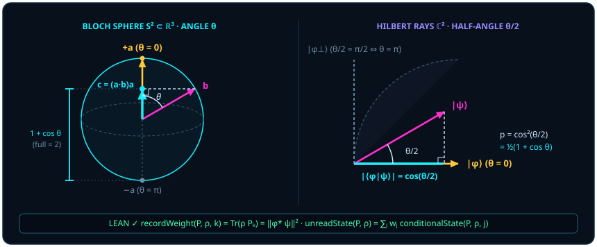

# 第二章 砍掉“第 3 点 C”：选自身为基与相融内积投影

> *“其实点 $C$ 并不是一个已知量，而是一个相融点的投影，因为实际上一条确定的量子态只能确定一条线，一组量子态才能对应一个面积。”*

在[第一章](ch01-measurement.md)末尾，我们把单量子比特从双分量复列向量（四个实坐标）的迷雾中解放出来，还原成了三维单位球面 $S^2$ 上的一根实单位向量 $\vv{a}$。现在，让我们面对量子力学最核心的定量问题：当已知状态 $\vv{a}$ 与探测方向 $\vv{b}$ 相遇时，为什么探测器报出“相符”的概率恰好等于希尔伯特空间夹角余弦的平方 $\cos^2(\theta/2)$，换算到布洛赫球面上又恰好等于 $\frac{1 + \cos\theta}{2}$？

在传统教科书里，“玻恩定则（Born's rule，$p = |\langle\phi\mid\psi\rangle|^2$）”往往被当作一条从天而降的独立公设：狄拉克与冯·诺依曼要求你先接受它，因为“实验测出来就是模平方”。本章将用奥卡姆剃刀砍掉冗余的“第 3 点 $C$”，展示玻恩法则并非外加在几何之上的突兀统计补丁，而是**两子零冗余内积投影与勾股模长守恒所诱导的典范无坐标基迹配对**（其中 [@thm-born-probability-skeleton] 严格确立迹配对满足概率公理的**充分性**，而排除其他非标准赋值所需的跨基/效应可加性**唯一性**条件则在章末 [@rem-gleason-literature] 中精确界定）。

## 2.1 奥卡姆剃刀下的测量基 {#sec-ch02-1}

为什么初学者在算两个任意量子态的跃迁概率时，总觉得步骤繁琐？因为他们不自觉地供奉着那尊“外部第 3 点 $C$”偶像：先选取一套与问题毫无瓜葛的实验室标准基 $C = \{\lvert 0\rangle, \lvert 1\rangle\}$，把初态 $A$ 写成相对于 $C$ 的旋转矩阵 $U_A\lvert 0\rangle$，再把测量轴 $B$ 写成相对于 $C$ 的另一套旋转矩阵 $U_B\lvert 0\rangle$，最后再把两套庞大的坐标矩阵乘回去求 $U_B^* U_A$——就像为了量一量桌面上两支铅笔的夹角，非要先测量第一支铅笔相对于格林尼治天文台的经纬度，再测量第二支铅笔相对于格林尼治天文台的经纬度，最后作球面三角变换一样荒唐！

现在，举起奥卡姆剃刀，**当场砍掉第 3 点 $C$**。

不妨拿一道具体的课堂算例对比这两条路径的天壤之别。假设球面上在同一子午面内有两根状态箭头：初态 $A$ 偏离实验室天花板 $\theta_A = 60^\circ$，探测快门 $B$ 偏离实验室天花板 $\theta_B = 120^\circ$。

- **供奉“第 3 点 $C$”的迂回路线**：你得先把天花板供作外部 $Z$ 轴，写出 $\lvert\psi_A\rangle = \binom{\cos 30^\circ}{\sin 30^\circ} = \binom{\sqrt{3}/2}{1/2}$，再写出 $\lvert\psi_B\rangle = \binom{\cos 60^\circ}{\sin 60^\circ} = \binom{1/2}{\sqrt{3}/2}$，然后展开四个分量的乘积相加求 $\langle\psi_B\mid\psi_A\rangle = \frac{\sqrt{3}}{4} + \frac{\sqrt{3}}{4} = \frac{\sqrt{3}}{2}$，最后平方得到 $\frac{3}{4}$——一旦再加上方位角 $\phi_A, \phi_B$，纸上立刻塞满八项三角函数与复指数！
- **砍掉“第 3 点 $C$”的零冗余路线**：天花板跟这两根箭头有什么相干？宇宙中既然只有已知前提态 $A$ 与待比量目标态 $B$，谁最有资格充当坐标主轴？**当然是已知态 $A$ 自己！** 直接以 $A$ 所在的方向为“零度基准轴”，$B$ 相对于 $A$ 只张开了唯一的真实夹角 $\theta = 120^\circ - 60^\circ = 60^\circ$，半秒钟心算 $\cos^2(60^\circ/2) = \cos^2 30^\circ = \frac{3}{4}$！

在有限维矩阵代数中，哪一种运算天生就砍掉了外部坐标基 $C$ 的一切痕迹？答案是**矩阵的迹**（trace，$\Tr X = \sum_i X_{ii}$）。对任意可逆基变换矩阵 $U$，循环交换律保证 $\Tr(U^{-1} X U) = \Tr(X U U^{-1}) = \Tr(X)$——无论外人怎样旋转坐标架 $C$，两个算子 $\rho$ 与 $P$ 乘积的迹 $\Tr(\rho P)$ 纹丝不动！因此，在零冗余几何里，状态 $\rho$ 与判别投影 $P$ 之间的直接比量，自然采用典范无坐标基迹配对。

::: {.definition #def-born-probability title="有限维玻恩迹配对权重" lean="D5/S3/Quantum/FiniteDimensional.bornProbability"}
设 $n$ 为有限指标类型。对任意复方阵 $\rho, P \in M_n(\mathbb{C})$，定义 $\rho$ 赋予 $P$ 的**玻恩迹配对权重**（Lean 中记作 `bornProbability rho P`）为乘积矩阵的迹：

$$
\operatorname{bornProbability}(\rho, P) = \Tr(\rho P) \in \mathbb{C}.
$$
:::

单看 [@def-born-probability]，$\Tr(\rho P)$ 的落点似乎还是一个一般的复数。为什么当 $\rho$ 是一个合法的物理密度态（半正定且迹为 $1$），而 $P$ 是一把合法的一维或多维判别快门（自伴且幂等）时，这个复数会自动褪去全部虚部，变成一个落在 $[0, 1]$ 区间内、严格遵守可加性与归一化的实概率测度？下面的定理给出了这一概率骨架的完整证明。

::: {.theorem #thm-born-probability-skeleton title="玻恩迹配对的概率测度骨架" lean="D5/S3/Quantum/FiniteDimensional.born_probability_skeleton"}
设 $n$ 为有限可判等指标类型，$\rho \in M_n(\mathbb{C})$ 为半正定矩阵且满足归一化条件 $\Tr(\rho) = 1$。则由 [@def-born-probability] 定义的泛函满足以下三条性质：

1. **全空间归一化**：$\operatorname{bornProbability}(\rho, I) = 1$；
2. **有限可加性**：对任意矩阵 $P, Q \in M_n(\mathbb{C})$，

   $$
   \operatorname{bornProbability}(\rho, P + Q) = \operatorname{bornProbability}(\rho, P) + \operatorname{bornProbability}(\rho, Q);
   $$

3. **投影上的实非负性**：对任意满足自伴性 $P^* = P$ 与幂等性 $P^2 = P$ 的投影矩阵 $P \in M_n(\mathbb{C})$，在复数偏序意义下成立

   $$
   0 \le \operatorname{bornProbability}(\rho, P),
   $$

   即 $\Tr(\rho P)$ 的虚部严格为 $0$ 且实部非负。
:::

::: proof
性质 1 直接由 $\rho I = \rho$ 及前提 $\Tr(\rho) = 1$ 得出。性质 2 直接由矩阵乘法对加法的分配律 $\rho(P + Q) = \rho P + \rho Q$ 与迹的线性性得出。最关键的性质 3 来自幂等性 $P = P^2$ 与迹的循环对称性的精妙配合：因 $P^* = P$ 且 $P^2 = P$，有

$$
\Tr(\rho P) = \Tr(\rho P^2) = \Tr(\rho P P^*) = \Tr(P^* \rho P) = \Tr(P \rho P^*).
$$

既然 $\rho$ 半正定，对任意向量 $v \in \mathbb{C}^n$ 均有 $\langle v, P \rho P^* v\rangle = \langle P^* v, \rho (P^* v)\rangle \ge 0$，故三明治压缩矩阵 $P \rho P^*$ 依然半正定（Lean 中对应 `PosSemidef.mul_mul_conjTranspose_same`）。半正定矩阵的对角元皆为非负实数，其迹必为非负实数。再结合性质 1 与 2，因 $I - P$ 亦满足 $(I - P)^* = I - P$ 与 $(I - P)^2 = I - P$，故 $\Tr(\rho P) = 1 - \Tr(\rho(I - P)) \le 1$。完整证明由 Lean 内核检查。
:::

请看性质 3 的证明里发生了什么：仅仅因为锐利判别快门满足“再看一眼还是它自己”的幂等律 $P = P^2 = P P^*$，原本看似不对称的单侧乘积 $\rho P$，在迹的循环移位下瞬间化作了完全对称的正定压缩 $P \rho P^*$！锐利投影测量之所以永远不会算出负数或虚数，正源于这把提问尺子 $P$ 自伴幂等的三明治正定结构。

不妨亲手试两个反例，看清 [@thm-born-probability-skeleton] 性质 3 为何在锐利投影层面上同时要求 $P^* = P$ 与 $P^2 = P$ 这两条充分条件：

- **撤掉自伴性（$P^* \neq P$）**：取幂等但非正交的斜切矩阵 $Q = \begin{pmatrix} 1 & 1 \\ 0 & 0 \end{pmatrix}$（满足 $Q^2 = Q$，但 $Q^* \neq Q$），用正 $Y$ 纯态 $\rho_{+Y} = \frac{1}{2}\begin{pmatrix} 1 & -i \\ i & 1 \end{pmatrix}$ 去配对，迹当场冒出纯虚数偏离：

  $$
  \Tr(\rho_{+Y} Q) = \frac{1 + i}{2} \notin \mathbb{R}!
  $$

- **撤掉幂等性而越出正定效应界（$P^2 \neq P$）**：取自伴但不幂等的泡利反射算子 $Z = \begin{pmatrix} 1 & 0 \\ 0 & -1 \end{pmatrix}$（满足 $Z^* = Z$，但 $Z^2 = I \neq Z$），用南极纯态 $\rho_1 = \begin{pmatrix} 0 & 0 \\ 0 & 1 \end{pmatrix}$ 去配对，迹立刻跌入负数区间：

  $$
  \Tr(\rho_1 Z) = -1 < 0!
  $$

这里值得精确区分一般广义测量与锐利投影测量的算子边界：对任意算子 $E \in M_n(\mathbb{C})$ 而言，对一切密度态 $\rho$ 恒有 $\Tr(\rho E) \in [0, 1]$ 的充要条件是 $E$ 满足自伴正半定**效应界** $0 \le E \le I$（即广义 POVM 效应元；例如无偏抛币效应 $E = \frac{1}{2}I$ 虽不幂等 $E^2 = \frac{1}{4}I \neq E$，仍恒给出合法概率权重 $\Tr(\rho E) = \frac{1}{2} \in [0, 1]$，详见章末 [@rem-gleason-literature]）。而在凸效应集 $\{E : 0 \le E \le I\}$ 内部，自伴律 $P^* = P$ 加上幂等律 $P^2 = P$（谱值严格落于 $\{0, 1\}$）不仅自动蕴涵 $0 \le P \le I$，更精准刻画了其中无内在模糊度的一类极值边界——**锐利投影效应**。在本书采用的吕德斯（Lüders）测后更新下，若两次测量之间没有额外演化，就能保证立即复核同一结果；效应元只确定结果概率，并不单独确定测后态。

## 2.2 到底什么是“点 C”？ {#sec-ch02-2}

既然外部绝对坐标原点 $C$ 已经被奥卡姆剃刀剃除，一个有趣的问题浮出水面：为什么我们在黑板上画两个单位向量 $\vv{a}$ 与 $\vv{b}$ 的内积图解时，粉笔尖还是会自然而然地标出第三个字母 $C$——也就是从 $\vv{b}$ 的箭头顶端向 $\vv{a}$ 所在直线作垂线时落下的那个**垂足**？

这正是从“外部形而上学”跨入“内生关系几何”的顿悟时刻：**真正的“点 $C$”从来不是站在 $A$ 与 $B$ 之外裁判它们的第三个独立实体，而是 $B$ 投射在 $A$ 身上的内生相融影子！**

把单位向量 $\vv{a}$ 选作基准主轴，目标单位向量 $\vv{b}$ 沿着 $\vv{a}$ 方向切出的正交投影向量正是

$$
\vv{c} = (\vv{a} \cdot \vv{b})\,\vv{a} = (\cos\theta)\,\vv{a}.
$$

你看，$\vv{c}$ 没有一丁点独立于 $\vv{a}$ 和 $\vv{b}$ 的私有信息：它的方向完完全全借自基准态 $\vv{a}$，它的有向长度 $\vv{a} \cdot \vv{b} = \cos\theta$ 完完全全衡量着“$\vv{b}$ 里究竟含有多少与 $\vv{a}$ 同向相融的成分”（在本书受控术语中称为**相融度**）。与此同时，从垂足 $\vv{c}$ 指向 $\vv{b}$ 顶端的那根正交残差向量（垂线段）

$$
\vv{b}_\perp = \vv{b} - \vv{c} = \vv{b} - (\vv{a} \cdot \vv{b})\,\vv{a}
$$

满足 $\vv{a} \cdot \vv{b}_\perp = \vv{a}\cdot\vv{b} - (\vv{a}\cdot\vv{b})(\vv{a}\cdot\vv{a}) = 0$，其长度平方恰为 $\norm{\vv{b}_\perp}^2 = 1 - \cos^2\theta = \sin^2\theta$（在第二部第五章我们将看到，这根长度为 $\sin\theta$ 的正交残差正是撑开双矢量有向面积 $\vv{a} \wedge \vv{b}$ 的另一半翅膀）。所谓“第 3 点 $C$”，不过是两子互量时由内积运算当场孕育出来的**关系之子**；愚蠢的不是画出垂足 $\vv{c}$，而是把垂足反客为主地神化为先于 $A$ 和 $B$ 存在的绝对背景舞台！

这也顺带解开了章首题记里关于“线”与“面积”的维度之惑：单凭一条确定的量子态 $A$，只能在空间里立起一根一维射线 $\vv{a}$；即便把两个不共线的量子态 $A, B$ 放在一起，它们也只在球体内部的大圆截面上撑开一片**平坦的二维夹角扇面**（其有向双矢量面积 $\vv{a}\wedge\vv{b}$ 正是第二部第五章量子门平面旋转的舞台），而在球皮 $S^2$ 上连接 $A, B$ 的大圆劣弧仍只是一条一维曲线，围出的**球面三角形面积恒为零**（立体角 $\Omega = 0$）。唯有再引入一根不共面的第三方向——无论是强行塞进来的外部参考轴 $C$（如实验室北极 $\lvert 0\rangle$），还是真实参与多态比较的第三个量子态——三根不共面射线才会在球皮上真正围出一块非零的**球面面积（立体角 $\Omega$）**（第三部第十章将由格拉姆矩阵严格刻画这一多态球面几何）。正因如此，在纯粹的两子丈量中硬塞进外部基 $\lvert 0\rangle$，才会凭空捏造出本不存在的球面三角相位冗余！

> 世人总想在两物之外寻找第三把公证的尺，却不知当甲以自身去丈量乙时，乙落在甲身上的影子便是那第三点。

现在，让我们把“垂足投影长度的平方”放回任意有限维复希尔伯特空间 $\mathbb{C}^n$ 中核验。当准备态是一个秩一纯态投影 $\rho = \psi\psi^* = \lvert\psi\rangle\langle\psi\rvert$，而探测分支也是一根秩一纯态方向线 $P_k = \phi\phi^* = \lvert\phi\rangle\langle\phi\rvert$（Lean 中用外积 `Matrix.vecMulVec u (star u)` 表示，记记录分支权重 [`recordWeight`](lean:D5/S3/Observer/Conditioning.recordWeight) 为 `recordWeight P rho k := bornProbability rho (P k)`）时，[@def-born-probability] 中抽象的矩阵迹 $\Tr(\rho P_k)$ 会算出什么？

上述物理情形取 $\phi,\psi$ 为单位向量；下面的代数恒等式只需要两条外积等式，也允许未归一化向量和零向量。

::: {.theorem #thm-born-modulus-square title="外积矩阵的记录权重模平方归约" lean="D5/S3/Observer/BornReduction.rank_one_pure_state_modulus_square_reduction"}
设 $n$ 为有限指标类型，$\kappa$ 为结果指标类型，$P : \kappa \to M_n(\mathbb{C})$ 为矩阵族，$\rho \in M_n(\mathbb{C})$，$k \in \kappa$，$\phi, \psi \in \mathbb{C}^n$ 为任意向量。若矩阵 $P_k$ 与 $\rho$ 满足

$$
P_k = \phi\phi^* = \lvert\phi\rangle\langle\phi\rvert, \qquad \rho = \psi\psi^* = \lvert\psi\rangle\langle\psi\rvert,
$$

则该分支的记录权重精确归约为复内积 $\langle\phi\mid\psi\rangle = \phi^* \cdot \psi$ 的模平方（由实数嵌入复数）：

$$
\operatorname{recordWeight}(P, \rho, k) = \norm{\langle\phi\mid\psi\rangle}^2.
$$
:::

::: proof
将 $P_k = \lvert\phi\rangle\langle\phi\rvert$ 与 $\rho = \lvert\psi\rangle\langle\psi\rvert$ 代入 $\operatorname{recordWeight}(P, \rho, k) = \Tr(\rho P_k)$。先算两个秩一外积矩阵的乘积（Lean 中对应 `Matrix.vecMulVec_mul_vecMulVec`）：中间的行向量 $\langle\psi\rvert$ 与列向量 $\lvert\phi\rangle$ 缩并成标量内积 $\langle\psi\mid\phi\rangle$，即

$$
\rho P_k = \bigl(\lvert\psi\rangle\langle\psi\rvert\bigr)\bigl(\lvert\phi\rangle\langle\phi\rvert\bigr) = \langle\psi\mid\phi\rangle\,\lvert\psi\rangle\langle\phi\rvert.
$$

再对外积矩阵 $\lvert\psi\rangle\langle\phi\rvert$ 取迹（`Matrix.trace_vecMulVec`），对角元求和恰好给出反向内积 $\Tr(\lvert\psi\rangle\langle\phi\rvert) = \langle\phi\mid\psi\rangle$。因为 $\langle\psi\mid\phi\rangle = \overline{\langle\phi\mid\psi\rangle}$，两者相乘正是复数共轭自乘：

$$
\Tr(\rho P_k) = \overline{\langle\phi\mid\psi\rangle}\,\langle\phi\mid\psi\rangle = \norm{\langle\phi\mid\psi\rangle}^2.
$$

完整证明由 Lean 内核检查。
:::

请看 [@thm-born-modulus-square] 的证明过程是何等干净利落！为什么教科书里的概率公式 $p = |\langle\phi\mid\psi\rangle|^2$ 非要把复数幅 $\langle\phi\mid\psi\rangle$ 与它的共轭 $\overline{\langle\phi\mid\psi\rangle}$ 成对相乘？在复列向量的片面视角下，这像是一条为了凑出正实数而强行规定的权宜之计；但在零冗余投影算子 $\rho = \lvert\psi\rangle\langle\psi\rvert$ 与 $P_k = \lvert\phi\rangle\langle\phi\rvert$ 的几何视角下，“去程投影 $\langle\phi\mid\psi\rangle$”与“回程投影 $\langle\psi\mid\phi\rangle$”本就是闭环迹配对 $\Tr(\rho P_k)$ 不可分割的左右两半！

更进一步，这也从规范几何上彻底解释了为什么单独一个开环内积 $\langle\phi\mid\psi\rangle$ 不可能是可观测物理量：倘若甲把 $\lvert\psi\rangle$ 的全局标架拨转 $\alpha$ 角（$\lvert\psi'\rangle = e^{i\alpha}\lvert\psi\rangle$），乙把 $\lvert\phi\rangle$ 的全局标架拨转 $\beta$ 角（$\lvert\phi'\rangle = e^{i\beta}\lvert\phi\rangle$），根据[第一章](ch01-measurement.md)的射线冗余性，物理射线分毫未动（$\rho' = \rho$，$P_k' = P_k$），但单向内积却凭空染上了人为相位差 $\langle\phi'\mid\psi'\rangle = e^{i(\alpha - \beta)}\langle\phi\mid\psi\rangle$！唯有沿着 $\lvert\psi\rangle \to \lvert\phi\rangle \to \lvert\psi\rangle$ 走完一整圈往返闭环，去程相位 $e^{+i(\alpha - \beta)}$ 与回程相位 $e^{-i(\alpha - \beta)}$ 才严丝合缝地互逆抵消：

$$
\langle\psi'\mid\phi'\rangle\langle\phi'\mid\psi'\rangle = e^{-i(\alpha-\beta)}e^{+i(\alpha-\beta)}\norm{\langle\phi\mid\psi\rangle}^2 = \Tr(\rho P_k).
$$

（顺便剧透一笔：当往返路径不再是两点折返，而是沿着球面上三点 $\psi \to \phi \to \chi \to \psi$ 围出有向测地三角形，且相邻态的重叠均非零时，在[第三部第十章](ch10-gram-geometry-and-order.md#sec-spherical-order-and-berry)的自旋朝上与路径取向约定下，闭环迹 $\Tr(P_\psi P_\chi P_\phi)$ 的辐角模 $2\pi$ 等于有向立体角的负一半 $-\Omega/2$——这就是**几何贝里相位**！）

## 2.3 玻恩概率法则的纯几何起源 {#sec-ch02-3}

现在，把单根分支投影 $P_k$ 放进一整套正交完备的测量通道 $\{P_j\}_{j \in \kappa}$ 之中。在实验室里，一次完整的记录测量（Lean 中记作谓词 [`IsRecordMeasurement`](lean:D5/S3/Observer/Conditioning.IsRecordMeasurement)，其四条公理将在[第三章](ch03-projectors-and-duality.md)详细展开）把全空间分解成若干两两正交、幂等自伴且总和为单位阵 $I$ 的判别通道 $\sum_{j \in \kappa} P_j = I$。若测量已经发生但观察者尚未读取具体哪一路响了，系统处于各路投影之和 $\operatorname{unreadState}(P, \rho) = \sum_j P_j \rho P_j$（未读态）；一旦读取到第 $j$ 路非零响应，系统在已知该记录的条件下更新为归一化条件态 [`conditionalState`](lean:D5/S3/Observer/Conditioning.conditionalState) $\rho_{|j} = \operatorname{recordWeight}(P, \rho, j)^{-1} P_j \rho P_j$。

下面的核心定理将“模平方跃迁幅”“无基迹配对”与“未读条件系综分解”这三件事严丝合缝地熔铸在同一座桥梁之上。

::: {.theorem #thm-rank-one-born-pairing title="完备记录测量中秩一分支的玻恩配对与条件分解" lean="D5/S3/Observer/Conditioning/RankOneBornPairingWeight.rank_one_born_pairing_weight"}
设 $n$ 与 $\kappa$ 为有限指标类型（其中 $n$ 具可判等性），$P : \kappa \to M_n(\mathbb{C})$ 构成完备正交记录测量（`IsRecordMeasurement P`），$\rho \in M_n(\mathbb{C})$ 为半正定且 $\Tr(\rho) = 1$ 的量子态。对选定分支 $k \in \kappa$ 及向量 $\phi, \psi \in \mathbb{C}^n$，若 $P_k = \lvert\phi\rangle\langle\phi\rvert$ 且 $\rho = \lvert\psi\rangle\langle\psi\rvert$，则同时成立：

1. **模平方归约**：$\operatorname{recordWeight}(P, \rho, k) = \norm{\langle\phi\mid\psi\rangle}^2$；
2. **状态—投影迹配对**：$\operatorname{recordWeight}(P, \rho, k) = \Tr(\rho P_k)$；
3. **未读态的加权条件系综恒等式**：

   $$
   \operatorname{unreadState}(P, \rho) = \sum_{j \in \kappa} \operatorname{recordWeight}(P, \rho, j)\,\operatorname{conditionalState}(P, \rho, j).
   $$

:::

::: proof
结论 1 直接调用 [@thm-born-modulus-square]（`rank_one_pure_state_modulus_square_reduction`）；结论 2 由记录权重与玻恩概率的定义相等直接给出；结论 3 对每个分支 $j \in \kappa$ 分两种情形核验：当权重 $w_j = \operatorname{recordWeight}(P, \rho, j) \neq 0$ 时，$w_j \cdot (w_j^{-1} P_j \rho P_j) = P_j \rho P_j$；当 $w_j = 0$ 时，由半正定压缩矩阵 $P_j \rho P_j$ 的迹 $\Tr(P_j \rho P_j) = \Tr(\rho P_j) = w_j = 0$ 可知矩阵本身必为零矩阵 $P_j \rho P_j = 0$，故 $0 \cdot \operatorname{conditionalState}(P, \rho, j) = 0 = P_j \rho P_j$ 依然逐项成立。对全体 $j \in \kappa$ 求和即得 $\operatorname{unreadState}(P, \rho)$。完整证明由 Lean 内核检查。
:::

为了把 [@thm-rank-one-born-pairing] 的三条结论摸得像掌纹一样清楚，让我们亲手拿一个斜向单比特纯态走一遍完整矩阵验算。取极角 $60^\circ$ 的准备态 $\lvert\psi\rangle = \binom{\sqrt{3}/2}{1/2}$，其外积密度矩阵为

$$
\rho = \lvert\psi\rangle\langle\psi\rvert = \begin{pmatrix} 3/4 & \sqrt{3}/4 \\ \sqrt{3}/4 & 1/4 \end{pmatrix} \qquad \bigl(\Tr\rho = \tfrac{3}{4} + \tfrac{1}{4} = 1\bigr),
$$

并用正东与正西两道完备正交的 $X$ 基快门 $P_+ = \lvert +\rangle\langle +\rvert = \frac{1}{2}\bigl(\begin{smallmatrix} 1 & 1 \\ 1 & 1 \end{smallmatrix}\bigr)$、$P_- = \lvert -\rangle\langle -\rvert = \frac{1}{2}\bigl(\begin{smallmatrix} 1 & -1 \\ -1 & 1 \end{smallmatrix}\bigr)$ 去丈量它：

1. **检验结论 1 与 2（模平方与迹配对完全一致）**：内积 $\langle +\mid\psi\rangle = \frac{\sqrt{3} + 1}{2\sqrt{2}}$，模平方为 $\frac{4 + 2\sqrt{3}}{8} = \frac{2 + \sqrt{3}}{4}$；直接算矩阵乘积迹 $\Tr(\rho P_+) = \frac{1}{2}\bigl(\frac{3}{4} + \frac{\sqrt{3}}{4} + \frac{\sqrt{3}}{4} + \frac{1}{4}\bigr) = \frac{2 + \sqrt{3}}{4}$，分毫不差！同理另一分支权重为 $w_- = \Tr(\rho P_-) = \frac{2 - \sqrt{3}}{4}$，两者之和 $w_+ + w_- = 1$。
2. **检验结论 3（未读态与条件系综的精确重构）**：两路归一化条件更新态恰为 $\rho_{|+} = P_+$ 与 $\rho_{|-} = P_-$。按各自权重加权求和，交叉副对角元恰剩 $\frac{w_+ - w_-}{2} = \frac{\sqrt{3}}{4}$，主对角元拉平为 $\frac{w_+ + w_-}{2} = \frac{1}{2}$：

   $$
   \operatorname{unreadState}(P, \rho) = w_+ P_+ + w_- P_- = \begin{pmatrix} 1/2 & \sqrt{3}/4 \\ \sqrt{3}/4 & 1/2 \end{pmatrix} = P_+ \rho P_+ + P_- \rho P_-!
   $$

让我们进一步追问那个困扰过无数物理学子的终极“为什么”：**在自然界里，为什么概率偏偏等于投影长度的二次方（$L^2$ 范数平方），而不是一次方 $|\cos(\theta/2)|$ 或四次方 $\cos^4(\theta/2)$？**

回看[第一章](ch01-measurement.md)的平行四边形与勾股几何（[@thm-parallelogram-norm-law]），谜底早已写在欧氏空间的直角三角形斜边上！当你用一套正交测量通道把单位状态向量 $\lvert\psi\rangle$（$\norm{\psi} = 1$）分解为沿着通道方向的相融分量 $\cos(\theta/2)$ 与垂直于通道的正交分量 $\sin(\theta/2)$ 时，什么量在任意正交旋转下永远保持总和等于 $1$？

- 一次方之和 $\cos(\theta/2) + \sin(\theta/2)$ 在 $\theta = 90^\circ$ 时等于 $\sqrt{2} \approx 1.414 \neq 1$，概率会凭空暴涨 $41\%$；
- 四次方之和 $\cos^4(\theta/2) + \sin^4(\theta/2)$ 在 $\theta = 90^\circ$ 时等于 $\frac{1}{4} + \frac{1}{4} = \frac{1}{2} \neq 1$，一半的概率凭空人间蒸发；
- **唯独二次方之和** $\cos^2(\theta/2) + \sin^2(\theta/2) \equiv 1$ 对宇宙中一切夹角 $\theta$ 恒等于 $1$！

换句话说，**玻恩概率法则在几何上体现为欧几里得—希尔伯特空间勾股定理与典范无坐标基迹配对的自然结合。** 在重叠模长的幂次候选族 $|\langle\phi\mid\psi\rangle|^p$ 之中，正交完备通道总权重恒为 $1$ 的要求唯一挑出了二次幂 $p = 2$；在一般算子层面上，[@thm-born-probability-skeleton] 严格证明了典范迹配对 $\Tr(\rho P)$ 构成合法概率赋值的**充分性**，而若要在任意一般标架函数或广义测量效应中彻底排除非玻恩赋值以获得严格的**唯一性**，则还需补充跨基正交可加或正效应可加前提（详见下文 [@rem-gleason-literature]）。

现在，让我们用 [@prop-qubit-bloch-core] 与 [@thm-rank-one-born-pairing] 联手，兑现第一章末尾留下的承诺，亲手揭开布洛赫球面夹角 $\theta$ 与希尔伯特空间半角 $\theta/2$ 的换算关系。

::: {.example #ex-bloch-half-angle title="单比特两子丈量的半角公式推导：为何球面反向对应内积正交"}
设单量子比特的已知准备态方向为三维单位实向量 $\vv{a} = (a_0, a_1, a_2) \in S^2$，探测快门选定的主轴方向为另一根三维单位实向量 $\vv{b} = (b_0, b_1, b_2) \in S^2$，两根实箭头在三维空间中的真实夹角为 $\theta \in [0, \pi]$，故欧氏点积为 $\vv{a} \cdot \vv{b} = a_0 b_0 + a_1 b_1 + a_2 b_2 = \cos\theta$。

由 [@prop-qubit-bloch-core]，两者的秩一投影矩阵分别为 $\rho_{\vv{a}} = \frac{1}{2}(I + B(\vv{a}))$ 与 $P_{\vv{b}} = \frac{1}{2}(I + B(\vv{b}))$。完全不借助任何复列向量，直接按 [@thm-rank-one-born-pairing] 计算无坐标迹配对 $\Tr(\rho_{\vv{a}} P_{\vv{b}})$：

$$
\Tr(\rho_{\vv{a}} P_{\vv{b}}) = \frac{1}{4}\Tr\bigl(I + B(\vv{a}) + B(\vv{b}) + B(\vv{a})B(\vv{b})\bigr).
$$

注意 $\Tr(I) = 2$，而由 [@prop-qubit-bloch-core] 的矩阵显式对角元 $a_2$ 与 $-a_2$ 知 $\Tr(B(\vv{a})) = \Tr(B(\vv{b})) = 0$。最后直接算出乘积 $B(\vv{a})B(\vv{b})$ 的两个主对角元：

$$
\begin{aligned}
\bigl(B(\vv{a})B(\vv{b})\bigr)_{00} &= a_2 b_2 + (a_0 - i a_1)(b_0 + i b_1) = (a_0 b_0 + a_1 b_1 + a_2 b_2) + i(a_0 b_1 - a_1 b_0), \\
\bigl(B(\vv{a})B(\vv{b})\bigr)_{11} &= (a_0 + i a_1)(b_0 - i b_1) + (-a_2)(-b_2) = (a_0 b_0 + a_1 b_1 + a_2 b_2) - i(a_0 b_1 - a_1 b_0).
\end{aligned}
$$

看！当把上下两个对角元相加求迹时，带虚数 $i$ 的叉乘旋转项 $\pm i(a_0 b_1 - a_1 b_0)$ 正负相消，留下的干干净净恰好是两倍三维点积 $2(\vv{a} \cdot \vv{b})$！代回迹公式，结合倍角恒等式 $1 + \cos\theta = 2\cos^2(\theta/2)$，一气呵成得到：

$$
\Tr(\rho_{\vv{a}} P_{\vv{b}}) = \frac{1}{4}\bigl(2 + 0 + 0 + 2\,\vv{a}\cdot\vv{b}\bigr) = \frac{1 + \vv{a}\cdot\vv{b}}{2} = \frac{1 + \cos\theta}{2} = \cos^2\Bigl(\frac{\theta}{2}\Bigr).
$$

这行极其优美的等式把一切迷雾一扫而空：

1. **同向共线（$\theta = 0^\circ$）**：$\vv{a} \cdot \vv{b} = +1$，相融概率 $\frac{1 + 1}{2} = 1$（百分之百通过）；
2. **球面正交（$\theta = 90^\circ$，如北极态 $\lvert 0\rangle$ 撞上正东快门 $\lvert +\rangle$）**：$\vv{a} \cdot \vv{b} = 0$，相融度归零，概率恰为不偏不倚的中点 $\frac{1 + 0}{2} = \frac{1}{2}$；
3. **球面反向（$\theta = 180^\circ$，如北极态 $\lvert 0\rangle$ 撞上南极快门 $\lvert 1\rangle$）**：在三维空间中，“完全排斥、互斥对立”的两次结果指向正北与正南（夹角 $180^\circ$，$\cos 180^\circ = -1$）；而在概率与内积语言里，“完全互斥”意味着重叠度必须等于 $0$（夹角 $90^\circ$，$\cos 90^\circ = 0$）。仿射映射 $x \mapsto \frac{1 + x}{2}$ 恰好把球面点积区间 $[-1, +1]$ 线性压缩到概率区间 $[0, 1]$，在三角函数上便自动折半为半角余弦平方 $\cos^2(\theta/2)$！

为了方便后续章节随时查核，我们把典型角度在两套语言间的精确换算汇总如下：

| 布洛赫球面夹角 $\theta$ | 希尔伯特半角 $\theta/2$ | 球面相融度 $\vv{a}\cdot\vv{b} = \cos\theta$ | 玻恩通过权重 $\Tr(\rho_{\vv{a}} P_{\vv{b}}) = \cos^2(\theta/2)$ | 几何与物理判读 |
| :---: | :---: | :---: | :---: | :--- |
| $0^\circ$ | $0^\circ$ | $+1$ | $1$ | 严格同向，确定性通过 |
| $60^\circ$ | $30^\circ$ | $+1/2$ | $3/4$ | 偏同向相融（如三体贝尔不等式常见角） |
| $90^\circ$ | $45^\circ$ | $0$ | $1/2$ | 球面正交赤道盲区，无偏等权分束 |
| $120^\circ$ | $60^\circ$ | $-1/2$ | $1/4$ | 偏反向排斥（对称三态（trine）的夹角） |
| $180^\circ$ | $90^\circ$ | $-1$ | $0$ | 球面对跖反向 $\leftrightarrow$ 希尔伯特正交互斥 |
:::

上面的表是逐个角度算的。换一个问法：如果目标态 $\vv{b}$ 的方向是随机的，在球面上均匀分布，那么相融权重 $p = \cos^2\frac{\theta}{2}$ 会怎样分布？直觉也许会猜它偏向中间，或者偏向两端。都不对。

::: {.example #ex-uniform-born-weight title="随机方向上的玻恩权重是均匀分布的：阿基米德帽盒定理"}
本例是初等计算，未在本书形式化；高维公式是文献结果。

**帽盒定理。** 单位球面上高度落在 $[z,\ z + \mathrm{d}z]$ 的那一圈球带，周长是 $2\pi\sin\theta$，沿经线的宽度是 $\mathrm{d}\theta = \mathrm{d}z / \sin\theta$，面积是 $2\pi\,\mathrm{d}z$：与纬度无关。所以球面上均匀随机的点，高度 $z = \cos\theta$ 在 $[-1, 1]$ 上均匀分布。

**玻恩权重。** 取已知态 $\vv{a}$ 为北极。半角公式给出 $p = \cos^2\frac{\theta}{2} = \frac{1 + \cos\theta}{2} = \frac{1 + z}{2}$，是 $z$ 的仿射函数，于是

$$
p \ \text{在}\ [0, 1]\ \text{上均匀分布}, \qquad \mathbb{E}[p] = \frac{1}{2}, \qquad \operatorname{Var}[p] = \frac{1}{12}, \qquad \Pr[p \ge t] = 1 - t .
$$

| 条件 | 等价的夹角范围 | 概率 |
| :---: | :---: | :---: |
| $p \ge \frac{1}{2}$ | $\theta \le 90^\circ$ | $\frac{1}{2}$ |
| $p \ge \frac{3}{4}$ | $\theta \le 60^\circ$ | $\frac{1}{4}$ |
| $p \ge 0.9$ | $\theta \le 36.87^\circ$ | $0.1$ |
| $p \ge \frac{2 + \sqrt{3}}{4} \approx 0.933$ | $\theta \le 30^\circ$ | $\frac{2 - \sqrt{3}}{4} \approx 0.067$ |

**数值核对。** 取一百万个均匀随机方向：样本均值 $0.5001$，样本方差 $0.08323$（$\frac{1}{12} \approx 0.08333$）；$p$ 落入 $[0, 0.1)$、$[0.25, 0.75)$、$[0.9, 1]$ 的频率为 $0.0996$、$0.5009$、$0.1004$。

**高维对照。** 对 $d$ 维希尔伯特空间里均匀随机的纯态，它与一个固定态的重叠权重满足 $\Pr[p > t] = (1 - t)^{d-1}$，均值为 $\frac{1}{d}$。$d = 2$ 时这正是上面的均匀分布；$d = 4$ 时 $\Pr[p > \frac{1}{2}] = \frac{1}{8}$；$d = 16$ 时 $\Pr[p > \frac{1}{2}] = 2^{-15} \approx 3\times10^{-5}$。四十万样本的模拟给出均值 $0.5000$、$0.2498$、$0.0626$，与 $\frac{1}{d}$ 相符。
:::

单比特是唯一“公平”的情形：随便指一个方向，相融权重取 $0$ 到 $1$ 之间每个值的机会都一样。维数一高，随机指的方向几乎必然与基准态接近正交。[第十二章](ch12-measurement-computation-and-gradients.md)讨论的赤道集中与贫瘠高原，起点就是这件事。

::: {.remark #rem-gleason-literature title="格里森定理与布施定理（文献结果，未在本书形式化）"}
**文献结果，未在本书形式化。** 本章的 [@thm-born-probability-skeleton] 严格证明了“充分性方向”：任何半正定且迹为 $1$ 的密度矩阵 $\rho$，通过典范无坐标基迹配对 $P \mapsto \Tr(\rho P)$ 都会在正交投影算子格上诱导出一个归一化、可加且实非负的概率权重。要反过来确立“唯一性方向”（即任何满足可加性公理的概率赋值必取迹配对形式），则依赖数学物理中的两条经典逆定理及其精确的维数与定义域前提：

- **格里森定理**（A. M. Gleason, *Measures on the closed subspaces of a Hilbert space*, J. Math. Mech. **6**, 885–893, 1957）：要求可分希尔伯特空间维数满足 **$\dim\mathcal{H} \ge 3$**。在此维数前提下，闭子空间（正交投影）格上的任何可数可加概率测度 $\mu$（在有限维 $3 \le \dim\mathcal{H} < \infty$ 下归约为两两正交投影上的有限可加性），必唯一表示为某个半正定迹一算子 $\rho$ 的玻恩迹配对 $\mu(P) = \Tr(\rho P)$。**当 $\dim\mathcal{H} = 2$ 时，格里森定理在纯正交投影格上不成立**：因为二维空间中的每组正交基仅含两个对跖秩一投影 $\{P_{\vv{n}}, P_{-\vv{n}}\}$，不同测量轴之间不存在公共投影元来传递跨基连锁约束，故在 $S^2$ 上可以构造出无穷多满足逐对对跖之和为 $1$ 的非玻恩标架函数（frame functions）。
- **布施定理**（P. Busch, *Quantum states and generalized observables: A simple proof of Gleason's theorem*, Phys. Rev. Lett. **91**, 120403, 2003）：若将可加性定义域从尖锐正交投影扩展到全体正半定广义测量效应（POVM 效应元 $0 \le E_i \le I$，要求每当 $\sum_i E_i \le I$ 时满足可加性 $\mu(\sum_i E_i) = \sum_i \mu(E_i)$），则对**一切维数 $\dim\mathcal{H} \ge 2$**（包含单量子比特 $\dim\mathcal{H} = 2$）唯一性全面恢复：任何广义概率测度必唯一表示为 $E \mapsto \Tr(\rho E)$。

本书所钉仓库聚焦于显式有限维矩阵构造与建设性归约（[@thm-born-probability-skeleton]、[@thm-born-modulus-square] 与 [@thm-rank-one-born-pairing]），上述两条逆向唯一性定理由经典文献给出，不列入本书的 Lean 验证声明账本。
:::

砍掉了冗余的第 3 点 $C$，看清了相融垂足 $\vv{c} = (\vv{a}\cdot\vv{b})\vv{a}$ 与半角余弦平方 $\cos^2(\theta/2)$ 的几何真相之后，我们的目光自然落到了这章所有公式里反复出现的那把标尺本身——满足 $P^2 = P$ 的**幂等投影算子**。为什么“测量一次”和“说出一个概念”乃至“感知到一秒钟的经典时间流逝”，在底层全都是同一个方程 $P^2 = P$？让我们进入[第三章](ch03-projectors-and-duality.md)。
