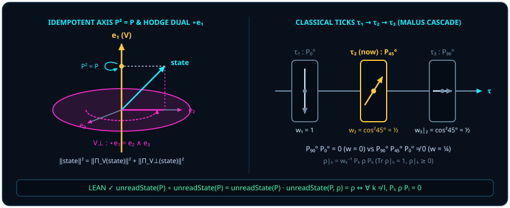

# 第三章 存在即幂等线（$P^2 = P$）：粒子、概念与经典时间轴的诞生

> *“连量子这个概念都是一种粒子，连‘存在’这种概念都是一种粒子。”*

在前两章中，我们看到：单子孤悬无以言说方向，两子相逢无需外部第 3 点 $C$；而在全体满足效应界 $0 \le E \le I$ 的广义是非效应之中，**锐利可重复投影效应** $P$ 不仅足以保证玻恩迹配对 $\Tr(\rho P) \in [0, 1]$ 给出非负实概率（[@thm-born-probability-skeleton]），更凭同一条核心代数律确立了极值无噪、一次定音的可重复判别——**自伴幂等律**：

$$
P^* = P, \qquad P^2 = P.
$$

初学者往往把 $P^2 = P$ 当作线性代数课本角落里一条枯燥的技术定义：“哦，不过是特征值只能取 $0$ 或 $1$ 的投影矩阵罢了。”然而，在本书的谱系学诠释视角下，如果我们剖开人类关于“存在”“实体”“逻辑概念”乃至“经典记录时间序”的认知底座，就会发现一条贯穿始终的代数线索：**这些看似悬殊的古典范畴，在操作结构上都收束于 $P^2 = P$ 这四个字符。**

## 3.1 为什么说“连‘存在’本身都是一颗粒子”？ {#sec-ch03-1}

让我们先问一个看似属于哲学、实则最纯粹的物理操作问题：**究竟什么叫作“某样东西存在”？**

在一片瞬息万变、连续旋转的相位之海里，倘若你指着某处喊了一声“这是一颗电子”或“这是一只白猫”，但下一微秒你紧接着用完全相同的标准再核实一眼，它却变成了完全不相干的别的东西——无法被第二次指认、无法在重复叩问下保持自身同一——那么人类的语言就根本无法为它铸造一个名词，物理学也根本无法把它登记为一颗“粒子”。

两千多年前，亚里士多德把一切理性思维的第一公理写成了**同一律**（$A = A$）；十九世纪中叶，乔治·布尔（George Boole）在创立符号逻辑时，把人类提炼概念的根本代数定律写成了 $x^2 = x$（说一次“所有的猫”与连说两次“所有的猫中所有的猫”，外延丝毫不差）；二十世纪三十年代，冯·诺依曼把量子力学中的物理命题写成了希尔伯特空间上的正交投影算子 $P^2 = P$。

在本书的几何诠释中，这三件事指向**同一种幂等操作结构**！在连续均匀的球面上，本来并没有预先切好的“颗粒”或“概念围栏”。当观察者的测量装置在球面上选定一根一维判别轴线 $P$ 时，凡是第一次穿过这道狭缝被截留下来的分量 $Px$，紧接着再穿过同一道狭缝第二次，必然分毫不差地原样通过——$P(Px) = P^2 x = Px$！在这一诠释视角下，**“粒子”可被理解为连续几何在幂等投影下凝结出的稳定不动点；甚至连“存在（existence，拉丁词源 *ex-sistere*：站出来、凸显出来）”这一操作概念本身，在几何上也对应着满足 $P^2 = P$ 的一维幂等判别线。**

> 给混沌命名，就是往球面上钉入一根 $P^2 = P$ 的木桩；所谓“实体”，不过是经得起同一把尺子连量两次而不走样的影子。

在真实的实验室测量中，我们通常不只钉入单根投影线，而是架设一整组两两互斥、不重不漏的正交读出通道 $\{P_k\}_{k \in \kappa}$（例如斯特恩—革拉赫磁铁的上下双通道，或多端口分光偏振器）。在 Lean 模块 `Observer/Conditioning` 中，这组完备判别尺被精确刻画为**记录测量**。

::: {.definition #def-record-measurement title="有限完备正交记录测量与未读态" lean="D5/S3/Observer/Conditioning.IsRecordMeasurement"}
设 $n$ 与 $\kappa$ 为有限指标类型（其中 $n$ 具可判等性）。称一族复方阵 $P : \kappa \to M_n(\mathbb{C})$ 构成**记录测量**（Lean 中记作 `IsRecordMeasurement P`），若它同时满足以下四条公理：

1. **逐支自伴性**：对任意 $k \in \kappa$，$P_k^* = P_k$；
2. **逐支幂等性**：对任意 $k \in \kappa$，$P_k^2 = P_k$；
3. **跨支两两正交**：对任意 $k, l \in \kappa$，若 $k \neq l$，则 $P_k P_l = 0$；
4. **完备分解**：$\sum_{k \in \kappa} P_k = I$。

对任意矩阵 $\rho \in M_n(\mathbb{C})$，定义该记录测量作用后隐去具体读数的**未读态**（[`unreadState`](lean:D5/S3/Observer/Conditioning.unreadState)，亦称吕德斯捏合映射 Lüders pinching）为

$$
\operatorname{unreadState}(P, \rho) = \sum_{k \in \kappa} P_k \rho P_k.
$$
:::

值得在此停步辨析初学者最容易混淆的一对矩阵方程：**对合律 $M^2 = I$**（如[第一章](ch01-measurement.md) [@lem-qubit-weyl-star] 中的泡利矩阵 $X^2 = I, Z^2 = I$）与**幂等律 $P^2 = P$** 究竟是什么关系？在几何上，满足 $M^* = M$ 且 $M^2 = I$ 的算子是一面**双向无损翻转镜**（特征值为 $+1$ 与 $-1$，可逆幺正门）；而满足 $P^* = P$ 且 $P^2 = P$ 的算子则是**单向截留狭缝**（特征值为 $1$ 与 $0$，不可逆存在线）。两者之间由一对再简单不过的仿射桥精确互译：

$$
P_\pm = \frac{1}{2}(I \pm M) \qquad\Longleftrightarrow\qquad M = P_+ - P_-,\quad I = P_+ + P_-.
$$

你可以当场口算验证：只要 $M^* = M$ 且 $M^2 = I$，就有

$$
P_\pm^2 = \frac{1}{4}(I \pm 2M + M^2) = \frac{1}{4}(2I \pm 2M) = P_\pm, \qquad P_+ P_- = \frac{1}{4}(I - M^2) = 0!
$$

因此，任何一把双向可观测量快门 $M$（如 $X$ 或 $Z$），拆开来看恰恰是一对背靠背构成 `IsRecordMeasurement` 的正交幂等存在线 $\{P_+, P_-\}$！

奇妙的是，一旦单根分支满足 $P_k^2 = P_k$ 且不同分支两两正交（$P_k P_l = 0$），幂等性便会自动从“算子层”跃升到“作用在密度矩阵上的超算子层”：把量子态送进未读测量通道捏合一次，与连续捏合两次、十次、一万次，效果完全相同！

::: {.theorem #thm-pinching-idempotent title="有限记录捏合超算子的函数幂等性" lean="D5/S3/Observer/Conditioning/FiniteRecordPinchingIdempotence.finite_record_pinching_idempotent"}
设 $n$ 与 $\kappa$ 为有限指标类型（其中 $n$ 具可判等性），$P : \kappa \to M_n(\mathbb{C})$ 满足 `IsRecordMeasurement P`。则作为 $M_n(\mathbb{C}) \to M_n(\mathbb{C})$ 上的自映射，未读态算子满足严格的函数复合幂等律：

$$
\operatorname{unreadState}(P) \circ \operatorname{unreadState}(P) = \operatorname{unreadState}(P).
$$
:::

::: proof
任取 $\rho \in M_n(\mathbb{C})$，先计算单侧左乘 $P_k \cdot \operatorname{unreadState}(P, \rho) = \sum_{l \in \kappa} P_k P_l \rho P_l$。由 [@def-record-measurement] 的两两正交性，一切 $l \neq k$ 的交叉项皆满足 $P_k P_l = 0$ 而归零；唯独 $l = k$ 项幸存，并由幂等性 $P_k^2 = P_k$ 化简为 $P_k \rho P_k$。再在右侧乘上 $P_k$ 并再次利用 $P_k^2 = P_k$，得

$$
P_k\,\operatorname{unreadState}(P, \rho)\,P_k = (P_k \rho P_k) P_k = P_k \rho P_k^2 = P_k \rho P_k.
$$

对全体 $k \in \kappa$ 求和，即证对一切 $\rho$ 均有 $\operatorname{unreadState}(P, \operatorname{unreadState}(P, \rho)) = \operatorname{unreadState}(P, \rho)$；由函数外延性即得复合等式。完整证明由 Lean 内核检查。
:::

那么，究竟哪些状态 $\rho$ 能够毫发无损地穿过这道捏合筛网（即满足不动点方程 $\operatorname{unreadState}(P, \rho) = \rho$），成为这套概念框架眼中的“经典客观事实”？下面的充要条件给出了刀锋般精准的判据。

::: {.theorem #thm-unread-fixed-iff title="未读态不动点的块对角充要判据" lean="D5/S3/Observer/Conditioning.unreadState_fixed_iff"}
设 $n$ 与 $\kappa$ 为有限指标类型（其中 $n$ 具可判等性），$P : \kappa \to M_n(\mathbb{C})$ 满足 `IsRecordMeasurement P`，$\rho \in M_n(\mathbb{C})$。则 $\rho$ 是未读映射的不动点，当且仅当 $\rho$ 在任意两个不同记录分支之间的非对角相干块全部归零：

$$
\operatorname{unreadState}(P, \rho) = \rho \quad\Longleftrightarrow\quad \forall k, l \in \kappa,\; k \neq l \implies P_k \rho P_l = 0.
$$
:::

::: proof
**必要性（$\Rightarrow$）**：若 $\rho = \operatorname{unreadState}(P, \rho)$，对任意 $k \neq l$，如 [@thm-pinching-idempotent] 证明所示先左乘 $P_k$ 得 $P_k \rho = P_k \rho P_k$，再右乘 $P_l$ 并用正交性 $P_k P_l = 0$，立即得到 $P_k \rho P_l = P_k \rho (P_k P_l) = 0$。

**充分性（$\Leftarrow$）**：反之，若对一切 $k \neq l$ 均有 $P_k \rho P_l = 0$，利用完备性 $I = \sum_{l \in \kappa} P_l$ 展开 $P_k \rho = P_k \rho I = \sum_{l \in \kappa} P_k \rho P_l$；求和号下所有 $l \neq k$ 项全为 $0$，仅剩 $P_k \rho = P_k \rho P_k$。再对 $k \in \kappa$ 求和并再次使用 $\sum_{k \in \kappa} P_k = I$，得

$$
\operatorname{unreadState}(P, \rho) = \sum_{k \in \kappa} P_k \rho P_k = \sum_{k \in \kappa} P_k \rho = \Bigl(\sum_{k \in \kappa} P_k\Bigr)\rho = \rho.
$$

完整证明由 Lean 内核检查。
:::

[@thm-unread-fixed-iff] 揭示了经典概率论是怎样从量子几何中分娩出来的：一旦选定了一套记录测量 $P$，凡是跨通道相干块 $P_k \rho P_l$（$k \neq l$）为零的矩阵，就退化成了互不干涉的块对角经典账本！经典世界并不是另一个平行宇宙，它就是量子状态空间在某个幂等捏合投影 $\operatorname{unreadState}(P)$ 下的**不动点子空间**。

## 3.2 线与面的伴生宿命（霍奇对偶） {#sec-ch03-2}

但是，往三维球体里钉入一根一维幂等轴线，是要付出几何代价的——更准确地说，它会瞬间唤醒一个与这根轴线如影随形的孪生兄弟。

伸出你的右手，在三维欧氏空间 $\mathbb{R}^3$（带单位体积三矢量 $I_3 = \vv{e}_1 \wedge \vv{e}_2 \wedge \vv{e}_3$）中竖起大拇指代表一维测量主轴 $\vv{e}_3$。就在大拇指竖起的那一刹那，哪怕你一句话也没提水平方向，你的其余四指已经自动围出了一张与 $\vv{e}_3$ 处处正交的**二维赤道平面** $\vv{e}_1 \wedge \vv{e}_2$！

在微分几何与克利福德外代数中，这种在 $d$ 维空间里把 $k$ 维子空间与 $(d - k)$ 维正交补子空间精准配对的运算，称为**霍奇对偶**（Hodge star duality，$\star$）：在三维空间里，一维轴线的霍奇对偶必然是一张二维有向平面，二维有向平面的霍奇对偶必然是一根一维法线：

$$
\star\vv{e}_1 = \vv{e}_2 \wedge \vv{e}_3, \qquad \star\vv{e}_2 = \vv{e}_3 \wedge \vv{e}_1, \qquad \star\vv{e}_3 = \vv{e}_1 \wedge \vv{e}_2.
$$

百年来吵得不可开交的“**波粒二象性**（wave–particle duality）”，扒下神秘主义的外衣后，不过是三维球体上的霍奇对偶：

- 当你的实验装置盯紧一维法线 $\vv{e}_3$ 读取幂等投影刻度时，你看到的是离散、静止、非此即彼的**粒子性**（轴向投影分量 $r_z$）；
- 而被这道一维狭缝挡在视野之外的正交补空间，恰恰是整张二维赤道平面 $\vv{e}_1 \wedge \vv{e}_2 = \star\vv{e}_3$——那里承载着连续旋转的相位角 $\phi$ 与干涉振幅 $r_x^2 + r_y^2$，也就是**波动性**！

你不立起那根一维粒子轴，就没有与之正交的赤道波平面；你立起了那根粒子轴，波平面就自动隐入它的正交盲区 $V^\perp$。更重要的是，在完备内积空间里，“轴线上看得见的粒子偏离量”与“正交平面里看不见的剩余相干质量”满足一分一毫都不差的**勾股守恒定律**！在 Lean 模块 `ComplementaryContextProbabilityPythagoras` 中，对闭子空间 $V \subseteq E$，正交补投影的模平方记作剩余质量 [`residualMass`](lean:D5/S3/Quantum/Tomography/ComplementaryContextProbabilityPythagoras.residualMass)：$\operatorname{residualMass}(V, s) = \norm{P_{V^\perp}(s)}^2$。

::: {.theorem #thm-complementary-pythagoras title="互补测量上下文的概率偏离与正交剩余质量勾股定理" lean="D5/S3/Quantum/Tomography/ComplementaryContextProbabilityPythagoras.complementary_context_probability_pythagoras"}
设 $d$ 为非空有限维度指标类型（记维数为 $|d|$），$L$ 为有限测量上下文指标类型，$E$ 为完备实内积空间，$V \subseteq E$ 为闭线性子空间（记 $P_V$ 与 $P_{V^\perp}$ 分别为到 $V$ 与正交补 $V^\perp$ 上的正交投影）。对矩阵 $\rho \in M_d(\mathbb{C})$、状态表示向量 $s \in E$ 及概率表 $p : L \to d \to \mathbb{R}$，若：

1. **纯度盈余表示**：$\operatorname{Re}\Tr(\rho^2) - |d|^{-1} = \norm{s}^2$；
2. **可见坐标标定**：$\norm{P_V(s)}^2 = \sum_{l \in L} \sum_{j \in d} \bigl(p_{l,j} - |d|^{-1}\bigr)^2$；

则总纯度盈余精确分解为可见上下文的中心化概率平方偏差与正交补空间中的剩余质量之和：

$$
\operatorname{Re}\Tr(\rho^2) - |d|^{-1} = \sum_{l \in L} \sum_{j \in d} \bigl(p_{l,j} - |d|^{-1}\bigr)^2 + \operatorname{residualMass}(V, s).
$$
:::

::: proof
在完备实内积空间 $E$ 中，对闭子空间 $V$ 应用希尔伯特正交投影勾股恒等式（Lean Mathlib 中的 `Submodule.norm_sq_eq_add_norm_sq_starProjection`），向量 $s$ 的范数平方分解为可见投影与正交补投影的范数平方之和：

$$
\norm{s}^2 = \norm{P_V(s)}^2 + \norm{P_{V^\perp}(s)}^2.
$$

将前提 1 代入左端，将前提 2 及定义 $\operatorname{residualMass}(V, s) = \norm{P_{V^\perp}(s)}^2$ 代入右端，等式立得。完整证明由 Lean 内核检查。
:::

让我们立刻把 [@thm-complementary-pythagoras] 放到单量子比特（$|d| = 2$）的布洛赫球上算一算，看看这行定理如何一眼洞穿波粒互补性！

对布洛赫向量为 $\vv{r} = (r_x, r_y, r_z) \in \mathbb{R}^3$ 的单比特态 $\rho_{\vv{r}} = \frac{1}{2}(I + B(\vv{r}))$，由[第二章](ch02-born-rule.md) [@ex-bloch-half-angle] 的迹公式（取 $\vv{a} = \vv{b} = \vv{r}$）立知纯度为 $\Tr(\rho_{\vv{r}}^2) = \frac{1 + \norm{\vv{r}}^2}{2}$，因此左端的**纯度盈余**为

$$
\Tr(\rho_{\vv{r}}^2) - \frac{1}{2} = \frac{1}{2}\norm{\vv{r}}^2 = \frac{1}{2}\bigl(r_x^2 + r_y^2 + r_z^2\bigr),
$$

这对应实内积空间 $E = \mathbb{R}^3$ 中的状态向量 $s = \frac{1}{\sqrt{2}}(r_x, r_y, r_z)$。现在，假设观察者只选定**单一测量上下文** $|L| = 1$——沿着竖直轴 $\vv{e}_3$（可见一维子空间 $V = \operatorname{span}\{\vv{e}_3\}$）做 $Z$ 基测量。上下两个端口的玻恩概率分别为 $p_0 = \frac{1 + r_z}{2}$ 与 $p_1 = \frac{1 - r_z}{2}$，它们偏离均匀随机基线 $\frac{1}{2}$ 的平方和恰好是：

$$
\Bigl(p_0 - \frac{1}{2}\Bigr)^2 + \Bigl(p_1 - \frac{1}{2}\Bigr)^2 = \Bigl(\frac{r_z}{2}\Bigr)^2 + \Bigl(-\frac{r_z}{2}\Bigr)^2 = \frac{1}{2}r_z^2 = \norm{P_V(s)}^2!
$$

那么，[@thm-complementary-pythagoras] 右端剩下的正交剩余质量 $\operatorname{residualMass}(V, s)$ 是多少？分毫不差正是霍奇对偶赤道平面 $V^\perp = \operatorname{span}\{\vv{e}_1, \vv{e}_2\} = \star\vv{e}_3$ 里的相干振幅平方：

$$
\operatorname{residualMass}(V, s) = \frac{1}{2}\bigl(r_x^2 + r_y^2\bigr)!
$$

对纯态（$\norm{\vv{r}}^2 = 1$）而言，$r_z^2 + (r_x^2 + r_y^2) = 1$：你的粒子轴读数越确定（$|r_z| \to 1$），留给赤道干涉平面的剩余质量 $r_x^2 + r_y^2$ 就越趋近于 $0$；反之，当态纯粹躺在赤道平面上高歌猛进地干涉时（$r_x^2 + r_y^2 = 1$），它在竖直粒子轴上的概率偏离 $r_z^2$ 必然归零（$p_0 = p_1 = \frac{1}{2}$）。**波与粒从不打架，它们只是同一根单位斜边在法线 $V$ 与赤道面 $\star V$ 上切出的两条直角边！**

把这行单比特勾股分解写进马赫—曾德尔干涉仪（Mach–Zehnder interferometer）的实验语言里，你当场就推导出量子光学里著名的**路径可预测度—条纹可见度定量互补恒等式**：

- 记两臂粒子路径的先验可预测度（predictability）为 $D_{\mathrm{pred}} = |p_0 - p_1| = |r_z|$；
- 记把两臂重新合束并扫描相对相位 $\varphi \in [0, 2\pi)$（沿赤道方向 $\vv{n}_\varphi = (\cos\varphi, \sin\varphi, 0)$ 探测输出端强度 $I(\varphi) = \frac{1 + r_x\cos\varphi + r_y\sin\varphi}{2}$）时测得的干涉条纹可见度（fringe visibility）为 $V_{\mathrm{vis}} = \frac{I_{\max} - I_{\min}}{I_{\max} + I_{\min}} = \sqrt{r_x^2 + r_y^2}$。

将 [@thm-complementary-pythagoras] 两端同乘 $2$，立刻得到对一切单比特纯态与混合态普遍成立的精确账本：

$$
D_{\mathrm{pred}}^2 + V_{\mathrm{vis}}^2 = r_z^2 + \bigl(r_x^2 + r_y^2\bigr) = \norm{\vv{r}}^2 = 2\Tr(\rho_{\vv{r}}^2) - 1 \le 1!
$$

当且仅当量子比特处于球皮纯态（$\norm{\vv{r}} = 1$）时，等号 $D_{\mathrm{pred}}^2 + V_{\mathrm{vis}}^2 = 1$ 严格成立；哪怕只想知道 $D_{\mathrm{pred}} = 0.8$ 的粒子路径偏向，几何勾股律也最多只允许留出 $V_{\mathrm{vis}} = \sqrt{1 - 0.8^2} = 0.6$ 的干涉条纹对比度！

不仅如此，[@thm-complementary-pythagoras] 里的多上下文指标集 $L$ 还把**量子态层析（quantum state tomography）**的维度阶梯一次性刻画完毕：

| 已测正交泡利上下文集合 $L$ | 可见子空间 $V \subseteq \mathbb{R}^3$ | 可见概率偏离总和 $\norm{P_V(s)}^2$ | 盲区正交补 $V^\perp$ | 不可见剩余质量 $\operatorname{residualMass}(V, s)$ |
| :--- | :---: | :---: | :---: | :---: |
| 单轴测量 $\{Z\}$（$|L|=1$） | 一维轴线 $\operatorname{span}\{\vv{e}_3\}$ | $\frac{1}{2}r_z^2$ | 二维赤道面 $\star\vv{e}_3 = \vv{e}_1 \wedge \vv{e}_2$ | $\frac{1}{2}(r_x^2 + r_y^2)$ |
| 双轴互补测量 $\{Z, X\}$（$|L|=2$） | 二维子午面 $\operatorname{span}\{\vv{e}_3, \vv{e}_1\}$ | $\frac{1}{2}(r_z^2 + r_x^2)$ | 一维法线 $\star(\vv{e}_3 \wedge \vv{e}_1) = \vv{e}_2$ | $\frac{1}{2}r_y^2$ |
| 三元完备层析 $\{X, Y, Z\}$（$|L|=3$） | 整座三维球空间 $\mathbb{R}^3$ | $\frac{1}{2}(r_x^2 + r_y^2 + r_z^2)$ | 零空间 $\{\vv{0}\}$ | $0$（盲区彻底清零） |

你看，为什么单靠两套测量 $\{Z, X\}$ 依然无法唯一确定一颗量子比特的真实状态（$\pm r_y$ 手性正负难辨）？因为二维平面在三维空间里的霍奇对偶 $\star(\vv{e}_3 \wedge \vv{e}_1) = \vv{e}_2$ 还留着最后一根一维法线盲区 $\frac{1}{2}r_y^2$；唯有补齐两两正交的三根上下文轴 $\{X, Y, Z\}$（这正是第三部第九章“三元正交合拢成球”的伏笔），剩余质量才精确归零！

## 3.3 经典线性时间的真面目 {#sec-ch03-3}

既然单次幂等投影 $P^2 = P$ 在操作上给出了“可重复确认的事件”，那么实验室记录本上一格接一格推进的**一维条件记录次序**（$\tau_1 \to \tau_2 \to \tau_3$）又是怎样运作的？

在纯粹孤立的球面内部，幺正演化只是可逆刚体旋转：把球往左转 $30^\circ$ 再往右转 $30^\circ$，一切原样复原，本身并不挑选特殊的离散刻度。离散记录刻度（tick）之所以在操作层面显现，是因为观察者在时刻 $\tau_1$ 施加记录测量 $P^{(1)}$，**按所保留的某个非零结果分支 $k_1$ 进行条件化**，并将归一化后的幸存态作为下一刻 $\tau_2$ 继续测量的前提态！（需要严格区分**操作层面的条件记录次序**与**热力学时间之箭**：本节刻画的是给定保留经典读数后的串行条件态更新次序，而非底层的动力学不可逆性——事实上，下一章将严格证明系统与记录寄存器的联合耦合在全局上完全幺正可逆，而擦除或丢弃环境记录所导致的真正热力学不可逆性与熵增，则须由第二部第八章的兰道尔擦除原理来确立。）

要让这样一串离散历史脚印 $\rho \xrightarrow{k_1} \rho_{|k_1} \xrightarrow{k_2} (\rho_{|k_1})_{|k_2} \to \cdots$ 能够一步接一步合法地走下去，数学上必须担保一件事：只要第 $k$ 个分支发生的概率权重不为零，经吕德斯投影压缩并重新归一化后的条件态 $\operatorname{conditionalState}(P, \rho, k) = \operatorname{recordWeight}(P, \rho, k)^{-1} P_k \rho P_k$，本身必须依然是一个合法的半正定迹一量子态！

::: {.theorem #thm-conditional-state-valid title="非零记录分支条件态的合法性" lean="D5/S3/Observer/Conditioning.conditionalState_isState"}
设 $n$ 与 $\kappa$ 为有限指标类型（其中 $n$ 具可判等性），$P : \kappa \to M_n(\mathbb{C})$ 满足 `IsRecordMeasurement P`，$\rho \in M_n(\mathbb{C})$ 半正定且 $\Tr(\rho) = 1$。若某个结果分支 $k \in \kappa$ 的记录权重满足 $\operatorname{recordWeight}(P, \rho, k) \neq 0$，则条件更新态

$$
\operatorname{conditionalState}(P, \rho, k) = \operatorname{recordWeight}(P, \rho, k)^{-1} P_k \rho P_k
$$

依然是半正定矩阵，且满足 $\Tr\bigl(\operatorname{conditionalState}(P, \rho, k)\bigr) = 1$。
:::

::: proof
记分支权重为 $w_k = \operatorname{recordWeight}(P, \rho, k) = \Tr(\rho P_k)$。由 [@def-record-measurement] 知 $P_k^* = P_k$ 且 $P_k^2 = P_k$，故压缩矩阵 $P_k \rho P_k = P_k \rho P_k^*$ 半正定；同时由迹的循环性与幂等性知 $\Tr(P_k \rho P_k) = \Tr(P_k^2 \rho) = \Tr(\rho P_k) = w_k$。再由[第二章](ch02-born-rule.md)的 [@thm-born-probability-skeleton] 知在复偏序下 $0 \le w_k$（即 $w_k$ 为非负实数）；结合前提 $w_k \neq 0$，其倒数 $w_k^{-1}$ 为严格正实数。正实数倍保持矩阵半正定性，且由迹的线性性得 $\Tr(w_k^{-1} P_k \rho P_k) = w_k^{-1} w_k = 1$。完整证明由 Lean 内核检查。
:::

当观察者沿着一串彼此不共线的测量轴依次执行 [@thm-conditional-state-valid] 的条件更新时，奇迹发生了：原本在球面上被彻底堵死的路径，竟然因为中间多插入了一次“看一眼并立为新起点”的动作而重新贯通！费曼在讲授量子力学时最爱在课堂上掏出三片廉价的太阳镜偏振片，现场演示下面这个令所有人目瞪口呆的桌面实验。

::: {.example #ex-malus-three-polarizers title="费曼的三偏振片级联实验：串行幂等投影如何改写历史"}
取一束沿水平方向线偏振的光子进入实验台（注意光学约定中的一处精妙二倍角：光波电场偏振在物理空间转过夹角 $\alpha$ 时，水平偏振 $\alpha = 0^\circ$ 与竖直偏振 $\alpha = 90^\circ$ 已完全正交互斥，故光学空间角 $\alpha$ 直接对应希尔伯特空间半角 $\theta/2$，而对应的布洛赫球面角为 $\theta = 2\alpha$）。记角度 $\alpha$ 方向的线偏振秩一投影算子为

$$
P(\alpha) = \begin{pmatrix} \cos\alpha \\ \sin\alpha \end{pmatrix}\begin{pmatrix} \cos\alpha & \sin\alpha \end{pmatrix} = \begin{pmatrix} \cos^2\alpha & \cos\alpha\sin\alpha \\ \cos\alpha\sin\alpha & \sin^2\alpha \end{pmatrix},
$$

显然对任意 $\alpha$ 均有 $P(\alpha)^* = P(\alpha)$ 且 $P(\alpha)^2 = P(\alpha)$。

**情形 A（两片正交偏振片，$\tau_1 \to \tau_3$）**：第一片偏振片置于水平 $\alpha_1 = 0^\circ$，制备出初态 $\rho_1 = P(0^\circ) = \begin{pmatrix} 1 & 0 \\ 0 & 0 \end{pmatrix}$（布洛赫北极 $+\vv{e}_3$）。紧接着放上竖直的第二片偏振片 $\alpha_3 = 90^\circ$，即 $P(90^\circ) = \begin{pmatrix} 0 & 0 \\ 0 & 1 \end{pmatrix}$（布洛赫南极 $-\vv{e}_3$，球面夹角 $\theta = 180^\circ$）。由马吕斯定律（即 [@thm-rank-one-born-pairing] 的模平方公式），透射权重为

$$
\Tr\bigl(P(0^\circ) P(90^\circ)\bigr) = \cos^2(90^\circ - 0^\circ) = 0.
$$

视野一片漆黑，没有任何一颗光子能穿过这两片正交栅栏。如果偏振片真的只是经典筛子——仅仅消极地“筛掉身上没贴竖直通行证的光子”——那么在两片已经彻底挡死光路的筛子中间再塞进**第三片**吸光筛子，后面当然只会更黑！

**情形 B（中间插入 $45^\circ$ 偏振片，$\tau_1 \to \tau_2 \to \tau_3$）**：现在，保持首尾两片 $0^\circ$ 与 $90^\circ$ 纹丝不动，往它们正中间轻轻插进一片斜向 $\alpha_2 = 45^\circ$ 的偏振片 $P(45^\circ) = \frac{1}{2}\begin{pmatrix} 1 & 1 \\ 1 & 1 \end{pmatrix}$（布洛赫正东极 $+\vv{e}_1$，球面夹角 $\theta = 90^\circ$）！按 [@thm-conditional-state-valid] 逐步追踪两次串行历史刻度：

1. **第一跳（$\tau_1 \to \tau_2$，$0^\circ \to 45^\circ$）**：光子到达中间片时，通过权重为 $w_2 = \Tr\bigl(P(0^\circ) P(45^\circ)\bigr) = \cos^2 45^\circ = \frac{1}{2}$。凡是通过这一步考核的幸存光子，其状态被幂等更新为新的基准线 $\rho_2 = \operatorname{conditionalState}\bigl(P(45^\circ), \rho_1\bigr) = P(45^\circ)$——它关于“我曾经从 $0^\circ$ 走来”的旧记忆已被彻底抹平，重获了全新的 $45^\circ$ 身份！
2. **第二跳（$\tau_2 \to \tau_3$，$45^\circ \to 90^\circ$）**：这批携带着 $\rho_2 = P(45^\circ)$ 新身份的光子撞上末尾的 $90^\circ$ 竖直片，通过权重再次为 $w_3 = \Tr\bigl(P(45^\circ) P(90^\circ)\bigr) = \cos^2(90^\circ - 45^\circ) = \frac{1}{2}$。

两步串联，原本漆黑一片的末端突然亮起了耀眼的光斑，总透射率高达

$$
w_{\mathrm{total}} = w_2 \cdot w_3 = \frac{1}{2} \times \frac{1}{2} = \frac{1}{4} = 25\%!
$$

（读者甚至可以自己动手算一算：如果在 $0^\circ$ 与 $90^\circ$ 之间均匀插入 $N$ 片偏振片，每步只偏转微小的 $\frac{90^\circ}{N+1}$，总透射率 $\bigl[\cos^2\frac{\pi}{2(N+1)}\bigr]^{N+1}$ 在 $N \to \infty$ 时竟会一路飙升趋近于 $100\%$！这正是我们在第二部第八章将严格证明的**量子芝诺引导效应**。）
:::

[@ex-malus-three-polarizers] 清晰展示了操作层面条件记录序列的几何机制：实验室时间轴上的串行测量记录，并不是一颗颗带着预先固定标签的小球在跑道上被动过关，而是一连串不共线的幂等投影 $P(\tau_1), P(\tau_2), P(\tau_3)$ 依次切出相融分量、并将幸存条件态确立为下一步新基准轴的**串行条件重定基过程**（至于未读取分支的全局去向与擦除记录的热力学代价，则分别留待下一章的幺正记录定理与第八章的兰道尔原理完整解答）。

但这里还藏着第一部最深的一个悬念：在 [@def-record-measurement] 与 [@thm-pinching-idempotent] 中，如果测量或环境耦合**已经发生**，但观察者移开了视线（没有读取记录，或者记录飞散到了无法追踪的外部环境里），状态从球皮上的纯态 $\rho$ 变成了块对角的未读混合态 $\operatorname{unreadState}(P, \rho)$，它在布洛赫球内部的箭头长度变短了（$\norm{\vv{r}} < 1$）。那截“弄丢了的长度”究竟逃到哪儿去了？宇宙真的发生过不可逆的信息毁灭吗？让我们走进第一部的收官之章——[第四章](ch04-decoherence.md)。
