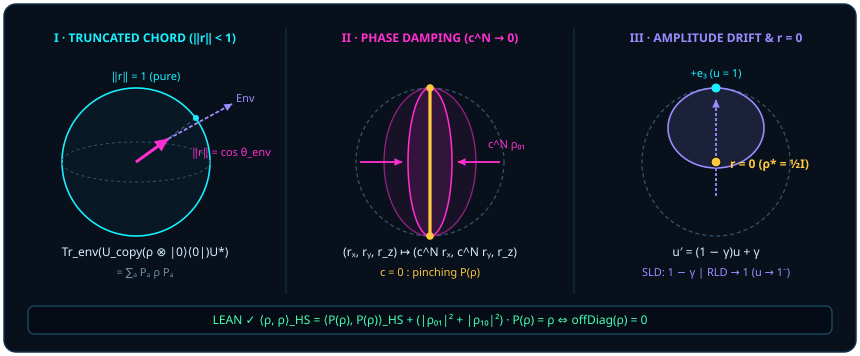

# 第四章 当视线移开或被遮蔽：退相干、混合态与缩进球心的截短之线

> *“所以一切都结束了，没有任何例外，连观察者结构都是这样的。”*

在前三章里，我们的单量子比特箭头 $\vv{a}$ 一直骄傲地站在单位球面 $S^2$ 的**球皮**上（模长 $\norm{\vv{a}} = 1$）：在[第一章](ch01-measurement.md)它是剥去全局相位冗余后的三维实射线，在[第二章](ch02-born-rule.md)它给出零冗余半角投影 $\cos^2(\theta/2)$，在[第三章](ch03-projectors-and-duality.md)它被幂等判别尺 $P^2 = P$ 切成轴向粒子偏离与赤道波动余量。

但在真实的超导芯片、离子阱与室温凝聚态实验室里，实验物理学家最常打交道的却不是球皮上的纯态，而是缩进了球体肚子里的**混合态**（mixed state）：布洛赫向量 $\vv{r}$ 的长度不再等于 $1$，而是变成了一根截短的线段 $\norm{\vv{r}} < 1$，甚至一步步萎缩成球心正中央那个毫无方向可言的死点 $\vv{r} = \vv{0}$。

那截原本好端端的长度 $1 - \norm{\vv{r}}$ 究竟被谁偷走了？“退相干（decoherence）”真的是微观世界在某种神秘摩擦下发生了不可逆的本体毁灭吗？作为第一部“从点到线”的收官之章，我们将揭开混合态的几何机制：**任何局部量子信道与混合态收缩，均可经由等距或幺正扩张（Stinespring 扩张，详见 [@rem-stinespring-literature]）嵌入更高维的系统—环境联合演化之中——球肚子里变短的线段，可精确实现为一根斜刺进环境空间的单位长矛在三维局部子空间里投下的截短余弦影**。

## 4.1 纯态是球皮（$\|\vv{r}\| = 1$），混合态是球肚子里截短的线（$\|\vv{r}\| = \cos\theta_{\mathrm{env}} < 1$） {#sec-ch04-1}

让我们先做一次三行就能算清的费曼式手算实验。假设你的单量子比特原本稳稳指向布洛赫球正东赤道极 $+\vv{e}_1$，即纯叠加态 $\lvert +\rangle = \frac{1}{\sqrt{2}}(\lvert 0\rangle + \lvert 1\rangle)$，此时横向相干长度 $r_x = 1$，箭头顶端紧贴在球皮上。

现在，有一颗路过的环境粒子（比如腔场里的一颗杂散光子，或衬底里的一个双能级缺陷）擦着你的量子比特飞了过去：当你的比特处在 $\lvert 0\rangle$ 时，环境保持初态 $\lvert e_0\rangle$ 不动；当你的比特处在 $\lvert 1\rangle$ 时，环境箭头被轻轻推偏了一个夹角 $\theta_{\mathrm{env}}$，转到了另一个单位态 $\lvert e_1\rangle$（两者的内积重叠度为 $\langle e_0\mid e_1\rangle = \cos\theta_{\mathrm{env}} \in [0, 1]$）。联合系统—环境的整体状态依然是一个百分之百模长为 $1$ 的纯态：

$$
\lvert\Psi_{\mathrm{SE}}\rangle = \frac{1}{\sqrt{2}}\bigl(\lvert 0\rangle \otimes \lvert e_0\rangle + \lvert 1\rangle \otimes \lvert e_1\rangle\bigr).
$$

接下来，那颗环境粒子飞出了你的探测器视野——你的视线只盯着手头的单量子比特，对环境自由度求偏迹（即把环境正交基上的投影无差别加总）。看看你手里的单比特密度矩阵 $\rho_{\mathrm{S}} = \Tr_{\mathrm{E}}(\lvert\Psi_{\mathrm{SE}}\rangle\langle\Psi_{\mathrm{SE}}\rvert)$ 变成了什么模样：

$$
\rho_{\mathrm{S}} = \frac{1}{2}\begin{pmatrix} \langle e_0\mid e_0\rangle & \langle e_1\mid e_0\rangle \\ \langle e_0\mid e_1\rangle & \langle e_1\mid e_1\rangle \end{pmatrix} = \frac{1}{2}\begin{pmatrix} 1 & \cos\theta_{\mathrm{env}} \\ \cos\theta_{\mathrm{env}} & 1 \end{pmatrix}!
$$

对照[第一章](ch01-measurement.md)的 [@prop-qubit-bloch-core]，这正是布洛赫向量 $\vv{r} = (\cos\theta_{\mathrm{env}},\, 0,\, 0)$！看清楚发生什么了吗？没有任何非幺正的神秘妖魔剪断过你的箭头：联合长矛 $\lvert\Psi_{\mathrm{SE}}\rangle$ 在高维空间里依然足斤足两长 $1$ 尺；只因为它往环境维度里斜翘起了 $\theta_{\mathrm{env}}$ 角，当你贴着局部系统这间低维暗室的地板往上看它的影子时，它的可视长度自然按余弦律截短成了 $\|\vv{r}\| = \cos\theta_{\mathrm{env}} < 1$！

特别地，当环境彻底分辨了系统的不同分支（$\theta_{\mathrm{env}} = 90^\circ$，环境记录彼此正交 $\cos 90^\circ = 0$），联合演化就成了一次标准的等距记录耦合，而“移开视线忽略环境”在数学上精确等价于[第三章](ch03-projectors-and-duality.md)定义的吕德斯未读捏合 $\sum_a P_a \rho P_a$。下面的定理在任意有限维系统与任意有限结果寄存器上严格证明了这一核心等价。

::: {.theorem #thm-nonselective-marginal title="等距记录耦合对记录寄存器求偏迹等于非选择性块和" lean="D5/S3/Quantum/Decoherence/NonselectiveMarginalization.nonselective_recording_marginal"}
设 $\mathrm{System}$ 与 $\mathrm{Outcome}$ 为有限可判等类型，$\{P_a\}_{a \in \mathrm{Outcome}}$ 为 $\mathrm{System}$ 上满足自伴性 $P_a^* = P_a$、正交幂等性 $P_a P_b = \delta_{ab} P_a$ 及完备性 $\sum_{a} P_a = I$ 的投影算子族。定义典范记录矩阵 $V \in M_{(\mathrm{System} \times \mathrm{Outcome}) \times \mathrm{System}}(\mathbb{C})$ 及对结果寄存器的偏迹映射 $\Tr_{\mathrm{Outcome}}$ 为

$$
V_{(i, a),\, j} = (P_a)_{i, j}, \qquad \bigl(\Tr_{\mathrm{Outcome}}(J)\bigr)_{i, j} = \sum_{a \in \mathrm{Outcome}} J_{(i, a),\, (j, a)}.
$$

则对任意系统矩阵 $\rho \in M_{\mathrm{System}}(\mathbb{C})$，忽略记录寄存器后的约化边缘态恒等于各投影对角块的非选择性总和：

$$
\Tr_{\mathrm{Outcome}}(V \rho V^*) = \sum_{a \in \mathrm{Outcome}} P_a \rho P_a.
$$
:::

::: proof
先考察联合矩阵 $J = V \rho V^*$ 在结果块对 $(a, b)$ 上的第 $(i, j)$ 个矩阵元：按矩阵乘法与共轭转置定义展开，有

$$
(V \rho V^*)_{(i, a),\, (j, b)} = \sum_{k, l \in \mathrm{System}} V_{(i, a),\, k}\,\rho_{k, l}\,\overline{V_{(j, b),\, l}} = \sum_{k, l \in \mathrm{System}} (P_a)_{i, k}\,\rho_{k, l}\,(P_b^*)_{l, j} = (P_a \rho P_b)_{i, j},
$$

这里用到了自伴性 $P_b^* = P_b$（Lean 中由前置引理 `recording_isometry_and_state_blocks` 给出；顺带一提，$V^* V = \sum_a P_a^* P_a = \sum_a P_a = I$ 正表明 $V$ 是保内积等距嵌入）。现在按偏迹定义令 $b = a$ 并对全体 $a \in \mathrm{Outcome}$ 求和，非对角环境交叉块 $(a \neq b)$ 完全不进入对角迹和，剩下的逐元素恰好是 $\sum_{a} (P_a \rho P_a)_{i, j}$。完整证明由 Lean 内核检查。
:::

[@thm-nonselective-marginal] 把困扰物理学界大半个世纪的“坍缩去相干从何而来”拆解得一清二楚：跨分支干涉项 $P_a \rho P_b$（$a \neq b$）并没有从联合矩阵 $V \rho V^*$ 中消失——它们依然完好无损地躺在环境异号块 $(a, b)$ 里！只是当你执行 $\Tr_{\mathrm{Outcome}}$ 只取环境对角元 $(a, a)$ 时，你的局部账本主动跳过了那些异号块。传统哥本哈根诠释曾在微观系统与宏观仪器之间划下一道神秘的“海森堡切口”，仿佛观察者拥有豁免于量子几何之外的特权；而等距记录定理宣告了这道人为切口的终结——**所以一切都结束了，没有任何例外，连观察者结构都是这样的**：观察者的记忆寄存器与外部环境一样，不过是在更高维联合球面上执行着同一套正交耦合与子空间投影。

[@thm-nonselective-marginal] 是为一族正交投影亲手搭出来的扩张。任何完全正映射都有这样的扩张，这是 Stinespring 定理的内容；它的一般 C\*-代数形式已经冻结在所钉仓库里。这里用的是海森堡图景：映射 $\varphi$ 作用在可观测量上，而不是作用在态上。

::: {.theorem #thm-stinespring-dilation title="Stinespring 扩张定理：完全正映射是某个表示被夹在 V† 与 V 之间" lean="D5/S3/HilbertOperators/Stinespring.stinespring_dilation"}
设 $A$ 为含幺复 C\*-代数，带有与星运算相容的偏序（`[CStarAlgebra A]`、`[PartialOrder A]`、`[StarOrderedRing A]`），$H$ 为复希尔伯特空间（`[NormedAddCommGroup H]`、`[InnerProductSpace ℂ H]`、`[CompleteSpace H]`），$\varphi : A \to B(H)$ 为完全正映射（`φ : A →CP (H →L[ℂ] H)`），其中 $B(H)$ 表示 $H$ 上的有界线性算子。则存在

- 一个复希尔伯特空间 $K$，
- 一个保幺的 \*-代数同态 $\pi : A \to B(K)$（`π : A →⋆ₐ[ℂ] (K →L[ℂ] K)`），
- 一个有界线性算子 $V : H \to K$，

使得对一切 $a \in A$ 与 $x \in H$，

$$
\varphi(a)\,x \;=\; V^{\dagger}\,\pi(a)\,V\,x ,
$$

其中 $V^{\dagger}$ 是 $V$ 的伴随。
:::

::: proof
构造与 GNS 构造同型。在取值于 $H$ 的有限支撑函数空间（即形式和 $\sum_i a_i \otimes x_i$）上定义半双线性型 $\bigl\langle \sum_i a_i \otimes x_i,\ \sum_j b_j \otimes y_j \bigr\rangle = \sum_{i,j} \langle x_i,\ \varphi(a_i^{*} b_j)\,y_j\rangle$。完全正性恰好保证这个型半正定（`cp_gram_sum_nonneg`）。商去零向量并完备化，得到希尔伯特空间 $K$。$A$ 在形式和上的左乘 $a \cdot (b \otimes y) = ab \otimes y$ 关于这个型有界，延拓到 $K$ 上给出 $\pi(a)$；逐条验证它保持加法、数乘、乘法、单位元与星运算，于是 $\pi$ 是 \*-代数同态。算子 $V$ 把 $x$ 送到 $1 \otimes x$ 的等价类，同样有界。最后由内积恒等式 $\langle x,\ V^{\dagger}\pi(a)V y\rangle = \langle 1 \otimes x,\ a \otimes y\rangle = \langle x,\ \varphi(a)\,y\rangle$ 得到结论（`stinespringV_inner_rep`）。完整证明由 Lean 内核检查。
:::

在 [@thm-stinespring-dilation] 中取 $a = 1$，由 $\pi(1) = 1$ 立得 $\varphi(1) = V^{\dagger}V$：$V$ 是等距当且仅当 $\varphi$ 保单位（一行手工推导）。

::: {.example #ex-pinching-stinespring-by-hand title="单比特计算基捏合的 Stinespring 扩张：手算核对"}
取 $A = M_2(\mathbb{C})$，$H = \mathbb{C}^2$，$\varphi$ 为计算基捏合在可观测量上的作用：

$$
\varphi(a) \;=\; P_0\,a\,P_0 + P_1\,a\,P_1 \;=\; \begin{pmatrix} a_{00} & 0 \\ 0 & a_{11} \end{pmatrix}, \qquad P_j = \lvert j\rangle\langle j\rvert .
$$

一组扩张数据是：$K = \mathbb{C}^2 \otimes \mathbb{C}^2$，$\pi(a) = a \otimes I_2$，$V\lvert j\rangle = \lvert j\rangle \otimes \lvert j\rangle$（$j = 0, 1$）。$\pi$ 显然是保幺的 \*-同态。逐个矩阵元核对：

$$
\langle i\rvert\, V^{\dagger}\,(a \otimes I_2)\,V\,\lvert j\rangle \;=\; \bigl(\langle i\rvert \otimes \langle i\rvert\bigr)\,(a \otimes I_2)\,\bigl(\lvert j\rangle \otimes \lvert j\rangle\bigr) \;=\; a_{ij}\,\langle i \mid j\rangle \;=\; a_{ij}\,\delta_{ij},
$$

即 $V^{\dagger}\pi(a)V = \operatorname{diag}(a_{00}, a_{11}) = \varphi(a)$。又 $V^{\dagger}V = I_2$，与 $\varphi(I_2) = I_2$ 相符。这里的 $V$ 正是 [@thm-nonselective-marginal] 中把分支标签抄进记录寄存器的那个等距：第二个因子 $\mathbb{C}^2$ 就是记录。非对角元 $a_{01}$、$a_{10}$ 并没有消失，它们留在 $a \otimes I_2$ 里，只是被 $V$ 夹掉了。
:::

::: {.remark #rem-stinespring-literature title="Stinespring 扩张定理与微观热浴欠定性（文献结果，未在本书形式化）"}
**文献结果，未在本书形式化。** 本章的 [@thm-nonselective-marginal] 针对有限正交投影族 $\{P_a\}$ 给出了显式构造的等距记录扩张，而下文的 [@thm-reduced-access-defect] 则对单比特受控拷贝给出了显式幺正扩张。对于任意完全正且保迹（CPTP）的一般量子信道 $\mathcal{E} : M_d(\mathbb{C}) \to M_{d'}(\mathbb{C})$，其高维保范嵌入由算子代数中的经典 **Stinespring 扩张定理**（W. F. Stinespring, *Positive functions on $C^*$-algebras*, Proc. Amer. Math. Soc. **6**, 211–216, 1955）给出：

1. **等距与幺正扩张的存在性**：必存在有限维辅助环境空间 $\mathcal{H}_{\mathrm{E}}$（维数可取至多 $d d'$，极小扩张维数等于 $\mathcal{E}$ 的 Choi 秩）及保内积等距算子 $V : \mathcal{H}_{\mathrm{S}} \to \mathcal{H}_{\mathrm{S}'} \otimes \mathcal{H}_{\mathrm{E}}$（$V^* V = I_{\mathrm{S}}$），使得对一切 $\rho \in M_d(\mathbb{C})$ 恒有 $\mathcal{E}(\rho) = \Tr_{\mathrm{E}}(V \rho V^*)$；当输入输出同维（$d' = d$）时，固定环境纯初态 $\lvert e_0\rangle \in \mathcal{H}_{\mathrm{E}}$ 并将 $V\lvert\psi\rangle = U(\lvert\psi\rangle \otimes \lvert e_0\rangle)$ 延拓为联合空间上的幺正算子 $U$，即化为联合幺正偏迹形式 $\mathcal{E}(\rho) = \Tr_{\mathrm{E}}\bigl(U(\rho \otimes \lvert e_0\rangle\langle e_0\rvert)U^*\bigr)$。
2. **极小扩张的环境幺正等价唯一性与物理热浴欠定性**：在极小扩张条件下（即 Kraus 算子线性无关、无冗余未耦合环境维数），同一信道 $\mathcal{E}$ 的任意两个极小等距扩张 $(\mathcal{H}_{\mathrm{E}_1}, V_1)$ 与 $(\mathcal{H}_{\mathrm{E}_2}, V_2)$ 之间差且仅差一个作用在辅助环境上的幺正变换 $W : \mathcal{H}_{\mathrm{E}_1} \to \mathcal{H}_{\mathrm{E}_2}$，满足 $(I_{\mathrm{S}'} \otimes W)V_1 = V_2$。然而在物理层面上，仅凭局部约化信道 $\mathcal{E}$ **无法唯一反推真实的微观环境历史**：非极小热浴的冗余自由度、环境空间局部基的幺正旋转 $W$，以及产生该净映射的连续时间系统—热浴哈密顿量 $H_{\mathrm{SE}}(t)$，对于仅握有局部数据的观察者而言均保持欠定。

其中存在性的一般 C\*-代数形式（海森堡图景，$\varphi(a) = V^{\dagger}\pi(a)V$）已由 [@thm-stinespring-dilation] 验证。从它到上面第 1 条的有限维薛定谔图景形式还需要两步：矩阵代数 $M_{d'}(\mathbb{C})$ 的每个表示都酉等价于 $a \mapsto a \otimes I_{\mathrm{E}}$，以及对偶关系 $\Tr(\mathcal{E}(\rho)\,a) = \Tr(\rho\,\varphi(a))$；这两步连同维数界与第 2 条的极小等距唯一性仍由经典文献给出，不列入本书的 Lean 形式化账本。
:::

这立刻引出一个震撼人心的推论：**局部看到的“不可逆退相干”，本质上根本不是动力学不可逆，而是观察者丢掉环境钥匙后的“访问缺陷（access defect）”！**

举个最尖锐的例子：拿正东纯态 $\rho = \lvert +\rangle\langle +\rvert = \frac{1}{2}\bigl(\begin{smallmatrix}1 & 1\\ 1 & 1\end{smallmatrix}\bigr)$ 与正西纯态 $\sigma = \lvert -\rangle\langle -\rvert = \frac{1}{2}\bigl(\begin{smallmatrix}1 & -1\\ -1 & 1\end{smallmatrix}\bigr)$ 分别与空白环境寄存器 $\lvert 0\rangle_{\mathrm{env}}$ 做一次完全可逆的受控地址拷贝幺正门 $U_{\mathrm{copy}}$（即量子计算中最基础的受控非门 CNOT：系统为 $0$ 时环境不动，系统为 $1$ 时翻转环境比特 $a \mapsto 1 - a$）。演化之后：

1. 在局部单比特视野里，$\rho$ 和 $\sigma$ 的约化密度矩阵双双塌缩成了同一个球心死点 $\frac{1}{2}I$——哪怕请来全世界最聪明的解码器，只看这颗单比特也休想分清它刚才到底是东极 $\lvert +\rangle$ 还是西极 $\lvert -\rangle$；
2. 但在包含环境的双比特全局视野里，两个联合状态依然泾渭分明，只要把同一扇受控门倒着推回去（作用 $U_{\mathrm{copy}}^*$），$\rho$ 和 $\sigma$ 连一根毫毛都不少地双双满血复活！

下面的定理将上述六个环环相扣的论断一次性全部形式化。

::: {.theorem #thm-reduced-access-defect title="局部退相干不可逆性的本质是环境记录访问缺陷" lean="D5/S3/Quantum/Decoherence/ReducedRecordAccessDefect.reduced_irreversibility_is_access_defect"}
设 $\rho, \sigma \in M_2(\mathbb{C})$ 为两个单比特矩阵，满足主对角元处处相等（$\forall i,\, \rho_{ii} = \sigma_{ii}$），但至少有一处非对角相干元不同（$\exists i \neq j,\, \rho_{ij} \neq \sigma_{ij}$）。记受控地址拷贝置换矩阵为 $U_{\mathrm{copy}} \in M_{\mathrm{Fin}\,2 \times \mathrm{Fin}\,2}(\mathbb{C})$，空白环境联合嵌入为 $B(\tau) = \tau \otimes \lvert 0\rangle\langle 0\rvert_{\mathrm{env}}$，受控拷贝后的联合记录态为 $R(\tau)$，对环境求偏迹算子为 $\Tr_{\mathrm{env}}$。则以下六条结论同时成立：

1. **全局耦合幺正性**：$U_{\mathrm{copy}} \in U(\mathrm{Fin}\,2 \times \mathrm{Fin}\,2, \mathbb{C})$；
2. **前向幺正写入记录**：$U_{\mathrm{copy}} B(\rho) U_{\mathrm{copy}}^* = R(\rho)$ 且 $U_{\mathrm{copy}} B(\sigma) U_{\mathrm{copy}}^* = R(\sigma)$；
3. **局部边缘态完全重合同化**：$\Tr_{\mathrm{env}}(R(\rho)) = \Tr_{\mathrm{env}}(R(\sigma))$；
4. **全局联合态严格可区分**：$R(\rho) \neq R(\sigma)$；
5. **局部恢复映射的不可能性**：不存在任何仅以单比特约化矩阵为输入的函数 $\mathcal{R} : M_2(\mathbb{C}) \to M_{\mathrm{Fin}\,2 \times \mathrm{Fin}\,2}(\mathbb{C})$ 能同时满足 $\mathcal{R}(\Tr_{\mathrm{env}}(R(\rho))) = R(\rho)$ 与 $\mathcal{R}(\Tr_{\mathrm{env}}(R(\sigma))) = R(\sigma)$；
6. **全局伴随幺正精确可逆恢复**：$U_{\mathrm{copy}}^* R(\rho) U_{\mathrm{copy}} = B(\rho)$ 且 $U_{\mathrm{copy}}^* R(\sigma) U_{\mathrm{copy}} = B(\sigma)$。
:::

::: proof
作为自逆置换 $(i, a) \mapsto (i, a \oplus i)$ 的置换矩阵，$U_{\mathrm{copy}}$ 满足 $U_{\mathrm{copy}}^* U_{\mathrm{copy}} = I$，故属于幺正群（结论 1）。将 $U_{\mathrm{copy}}$ 左右共轭作用于空白环境态 $B(\tau)$，把矩阵下标按置换重排后，系统行号 $i$ 与列号 $j$ 自动拷贝到环境轨道 $(i, i)$ 与 $(j, j)$ 上，得到受控记录态 $R(\tau)$（结论 2）。对环境指标求和取 $\Tr_{\mathrm{env}}(R(\tau))$ 时，当 $i \neq j$ 环境轨道正交失配而归零，仅保留对角元 $\tau_{ii}$；因前提 $\rho_{ii} = \sigma_{ii}$，故 $\Tr_{\mathrm{env}}(R(\rho)) = \Tr_{\mathrm{env}}(R(\sigma))$（结论 3）。另一方面，$R(\tau)$ 在联合对角地址 $((i, i), (j, j))$ 处完整保留了原矩阵元 $\tau_{ij}$；既然存在 $i \neq j$ 使 $\rho_{ij} \neq \sigma_{ij}$，必有 $R(\rho) \neq R(\sigma)$（结论 4）。若存在单值函数 $\mathcal{R}$ 从相等的输入 $\Tr_{\mathrm{env}}(R(\rho)) = \Tr_{\mathrm{env}}(R(\sigma))$ 同时输出不同的 $R(\rho) \neq R(\sigma)$，立即违背函数单值性（结论 5）。最后，在联合空间上作用逆幺正演化 $U_{\mathrm{copy}}^*$，由 $U_{\mathrm{copy}}^* U_{\mathrm{copy}} = I$ 精确还原空白环境初态 $B(\rho)$ 与 $B(\sigma)$（结论 6）。完整证明由 Lean 内核检查。
:::

把 [@thm-reduced-access-defect] 里的 $4\times 4$ 联合矩阵直接摊开在桌面上（按双比特基序 $\{\lvert 00\rangle, \lvert 01\rangle, \lvert 10\rangle, \lvert 11\rangle\}$ 排列），你会看得更加触目惊心。对东极 $\rho = \lvert +\rangle\langle +\rvert$ 与西极 $\sigma = \lvert -\rangle\langle -\rvert$，初始空白环境嵌入 $B(\rho), B(\sigma)$ 与受控拷贝后的联合态 $R(\rho), R(\sigma)$ 分别是：

$$
B\Bigl(\lvert \pm\rangle\langle \pm\rvert\Bigr) = \frac{1}{2}\begin{pmatrix} 1 & 0 & \pm 1 & 0 \\ 0 & 0 & 0 & 0 \\ \pm 1 & 0 & 1 & 0 \\ 0 & 0 & 0 & 0 \end{pmatrix} \;\xrightarrow{\;U_{\mathrm{copy}}\,\cdot\,U_{\mathrm{copy}}^*\;}\; R\Bigl(\lvert \pm\rangle\langle \pm\rvert\Bigr) = \frac{1}{2}\begin{pmatrix} 1 & 0 & 0 & \pm 1 \\ 0 & 0 & 0 & 0 \\ 0 & 0 & 0 & 0 \\ \pm 1 & 0 & 0 & 1 \end{pmatrix}!
$$

请盯住右边那张 $4\times 4$ 矩阵的四个角：区分正号与负号的相干印记 $\pm\frac{1}{2}$ 并没有被抹掉，它们只是从 $(00, 10)$ 搬家到了外侧对角 $(00, 11)$ 与 $(11, 00)$！然而，当你对第二个比特求偏迹 $\Tr_{\mathrm{env}}$ 时，规则要求你把左上 $2\times 2$ 块的迹、右上 $2\times 2$ 块的迹分别加起来：右上 $2\times 2$ 块的主对角元是 $(00, 10)$ 与 $(01, 11)$，那两个位置偏偏都是 $0$，而真正装着 $\pm\frac{1}{2}$ 的右上角 $(00, 11)$ 根本不在环境小块的迹对角线上！于是偏迹交到你手里的只剩一模一样的 $\frac{1}{2}\bigl(\begin{smallmatrix} 1+0 & 0+0 \\ 0+0 & 0+1 \end{smallmatrix}\bigr) = \frac{1}{2}I$。

> 所谓“覆水难收”，只是因为你把目光锁死在了水杯里；对整间屋子而言，每一滴水汽的相位都还写在空气的账本上。

## 4.2 不用背 Kraus 算符看懂三种量子噪声 {#sec-ch04-2}

理解了“退相干就是联合长矛在局部三维球里的投影收缩”之后，传统量子信息教科书里令人生畏的一大串信道 Kraus 算符公式（$\mathcal{E}(\rho) = \sum_k E_k \rho E_k^*$），瞬间退去了神秘面纱。不用死记硬背任何抽象矩阵，每一种常见的单比特量子噪声，在几何上都不过是**把单位布洛赫球皮往不同方向挤压或平移成一颗椭球**！

首先看最纯粹的横向去相干极限——**标准基捏合投影** $\mathcal{P}(\rho)$（Lean 模块 `QuantumChannels/Pinching` 中定义为 [`pinching`](lean:D5/S3/QuantumChannels/Pinching.pinching)，保留对角元 $\rho_{00}, \rho_{11}$、抹零副对角元 $\rho_{01}, \rho_{10}$）。在矩阵希尔伯特—施密特内积（[`hilbertSchmidtInner`](lean:D5/S3/QuantumChannels/Pinching.hilbertSchmidtInner) $\langle A, B\rangle_{\mathrm{HS}} = \Tr(A^* B)$）下，捏合不是粗暴的涂改，而是一次精确的正交勾股投影：整颗布洛赫球被垂直压扁到南北极直径线段 $[-\vv{e}_3, +\vv{e}_3]$ 上，而被压掉的水平赤道质量恰好等于两个副对角相干元的模平方之和！

::: {.theorem #thm-pinching-pythagorean title="单比特捏合投影的希尔伯特—施密特勾股分解与丢弃相干质量" lean="D5/S3/QuantumChannels/PinchingProjection.pinching_hilbert_schmidt_pythagorean D5/S3/QuantumChannels/PinchingProjection.pinching_discarded_coherence_mass"}
设 $\rho \in M_2(\mathbb{C})$ 为任意单比特复矩阵，记标准基捏合算子为 $\mathcal{P}(\rho)_{ij} = \delta_{ij}\rho_{ij}$，希尔伯特—施密特内积为 $\langle A, B\rangle_{\mathrm{HS}} = \Tr(A^* B)$。则同时成立：

1. **正交勾股分解**：

   $$
   \langle \rho, \rho\rangle_{\mathrm{HS}} = \langle \mathcal{P}(\rho), \mathcal{P}(\rho)\rangle_{\mathrm{HS}} + \langle \rho - \mathcal{P}(\rho),\, \rho - \mathcal{P}(\rho)\rangle_{\mathrm{HS}};
   $$

2. **丢弃相干质量显式公式**：

   $$
   \langle \rho - \mathcal{P}(\rho),\, \rho - \mathcal{P}(\rho)\rangle_{\mathrm{HS}} = |\rho_{01}|^2 + |\rho_{10}|^2.
   $$

:::

::: proof
将 $\rho$ 分解为对角部分 $\mathcal{P}(\rho)$ 与纯副对角残差 $D = \rho - \mathcal{P}(\rho)$ 之和。因 $\mathcal{P}$ 对希尔伯特—施密特内积自伴（$\langle \mathcal{P}(A), B\rangle_{\mathrm{HS}} = \langle A, \mathcal{P}(B)\rangle_{\mathrm{HS}}$）且满足 $\mathcal{P}(D) = 0$，交叉内积 $\langle \mathcal{P}(\rho), D\rangle_{\mathrm{HS}} = \langle \rho, \mathcal{P}(D)\rangle_{\mathrm{HS}} = 0$ 与 $\langle D, \mathcal{P}(\rho)\rangle_{\mathrm{HS}} = 0$ 双双归零，双线性展开 $\langle \mathcal{P}(\rho) + D,\, \mathcal{P}(\rho) + D\rangle_{\mathrm{HS}}$ 遂给出正交勾股等式（结论 1）。再将 $D = \bigl(\begin{smallmatrix} 0 & \rho_{01} \\ \rho_{10} & 0 \end{smallmatrix}\bigr)$ 代入 $\Tr(D^* D)$，主对角线两项分别为 $\overline{\rho_{10}}\rho_{10} = |\rho_{10}|^2$ 与 $\overline{\rho_{01}}\rho_{01} = |\rho_{01}|^2$，相加即得 $|\rho_{01}|^2 + |\rho_{10}|^2$（结论 2）。完整证明由 Lean 内核检查。
:::

在实际物理时间里，环境很少一步到位地把球压成一根细棍，而是通过一次次微弱碰撞，在严格含噪区间内每次把赤道半径乘上一个保留系数 $c \in [0, 1)$（$c = 1$ 则对应无噪恒等端点）。这就是超导与核磁共振实验里天天测量的**相位阻尼信道**（phase damping，对应横向弛豫时间 $T_2$）：当 $c \in [0, 1)$ 时，每走一步，布洛赫球的南北高度 $r_z$ 纹丝不动，水平腰围 $(r_x, r_y)$ 则按等比数列 $c^N$ 一圈圈往里严格收腰，从圆球瘦身成橄榄形的雪茄椭球，最终在 $N \to \infty$ 时收敛到南北主轴！

::: {.proposition #prop-phase-damping-decay title="迭代相位阻尼的矩阵元演化与等权叠加态的相干指数衰减" lean="D5/S3/Quantum/QubitWitnesses.phaseDampingIterate_apply D5/S3/Quantum/Decoherence/CoherenceDecay.equal_superposition_coherence_tendsto_zero"}
设相干保留系数 $c \in [0, 1]$，单步实相位阻尼映射保持对角元不变并将副对角元乘以 $c$，记其 $N$ 次迭代为 $\mathcal{D}_c^{(N)}$（$N \in \mathbb{N}$）。则：

1. 对任意单比特矩阵 $\rho \in M_2(\mathbb{C})$ 及下标 $i, j \in \{0, 1\}$，

   $$
   \bigl(\mathcal{D}_c^{(N)}(\rho)\bigr)_{i, j} = \begin{cases} \rho_{i, j}, & i = j, \\ c^N \rho_{i, j}, & i \neq j; \end{cases}
   $$

2. 若严格阻尼条件 $c < 1$ 成立，记赤道等权叠加态密度矩阵为 $\rho_+ = \frac{1}{2}\begin{pmatrix} 1 & 1 \\ 1 & 1 \end{pmatrix}$，则当迭代步数 $N \to \infty$ 时，其副对角相干元收敛于零：

   $$
   \lim_{N \to \infty} \bigl(\mathcal{D}_c^{(N)}(\rho_+)\bigr)_{0, 1} = 0.
   $$

:::

::: proof
结论 1 对自然数 $N$ 归纳：$N = 0$ 时 $c^0 = 1$ 为恒等映射；由 $N$ 到 $N+1$ 时，对角位置 $(i = j)$ 保持不变，副对角位置 $(i \neq j)$ 再乘一次因子 $c$，得到 $c \cdot (c^N \rho_{ij}) = c^{N+1}\rho_{ij}$。结论 2 将 $\rho_+$ 代入结论 1，得第 $(0, 1)$ 元为 $\frac{1}{2}c^N$；因 $0 \le c < 1$，实数（及嵌入复数后）的模长满足 $|c| < 1$，故几何级数项 $c^N \to 0$，乘以常数 $\frac{1}{2}$ 后仍收敛于 $0$。完整证明由 Lean 内核检查。
:::

除了“只收腰、不掉高”的相位阻尼外，实验室里还有另一类截然不同的能量耗散过程——**振幅阻尼信道**（amplitude damping，对应自发辐射能量弛豫时间 $T_1$）：处于激发态（南极 $-1$）的量子比特会向低温环境吐出一颗能量光子而跌回基态（北极 $+1$）。因此，在几何上，整颗布洛赫球不仅在往里收缩，而且球心还在往北极 $u = +1$ 方向**整体上漂**：轴向坐标按仿射律 [`dampedAxis`](lean:D5/S3/QuantumChannels/AmplitudeDampingContraction.dampedAxis) $u \mapsto u' = (1 - \gamma)u + \gamma$（阻尼率 $0 \le \gamma < 1$）向 $+1$ 聚拢！

有趣的是，在量子信息几何（Petz 单调黎曼度规族）中，当我们用对称对数导数度规（SLD，径向权重函数 $\varphi_{\mathrm{SLD}}(u) = 1$）与右对数导数度规（RLD，径向权重函数 $\varphi_{\mathrm{RLD}}(u) = \frac{1}{1 - u^2}$）分别衡量振幅阻尼下的横向相干收缩比 [`coherenceRatio`](lean:D5/S3/QuantumChannels/AmplitudeDampingContraction.coherenceRatio) $\mathcal{R}_\varphi(\gamma, u) = (1 - \gamma)\frac{\varphi(u')}{\varphi(u)}$ 时，两把几何标尺在纯态北极边界 $u \to 1^-$ 处呈现出截然不同的端点极限行为！

::: {.proposition #prop-amplitude-damping-contraction title="振幅阻尼轴向漂移下 SLD 与 RLD 相干收缩比的端点定理" lean="D5/S3/QuantumChannels/AmplitudeDampingContraction.amplitude_damping_sld_rld_endpoints"}
设阻尼参数满足 $0 \le \gamma < 1$，记轴向阻尼映射为 $u'(\gamma, u) = (1 - \gamma)u + \gamma$，对径向轮廓函数 $\varphi : \mathbb{R} \to \mathbb{R}$ 记相干收缩比为 $\mathcal{R}_\varphi(\gamma, u) = (1 - \gamma)\varphi(u'(\gamma, u)) / \varphi(u)$。取 $\varphi_{\mathrm{SLD}}(u) = 1$ 与 $\varphi_{\mathrm{RLD}}(u) = \frac{1}{1 - u^2}$，则同时成立：

1. **SLD 常值均匀收缩**：对一切 $u \in \mathbb{R}$，$\mathcal{R}_{\varphi_{\mathrm{SLD}}}(\gamma, u) = 1 - \gamma$；
2. **RLD 单调上界与纯态边界极限**：对一切混合态内部坐标 $u \in (-1, 1)$ 均有 $\mathcal{R}_{\varphi_{\mathrm{RLD}}}(\gamma, u) \le 1$，且当 $u$ 从球体内部趋近于纯态极点边界 $1^-$ 时，

   $$
   \lim_{u \to 1^-} \mathcal{R}_{\varphi_{\mathrm{RLD}}}(\gamma, u) = 1.
   $$

:::

::: proof
对结论 1，因 $\varphi_{\mathrm{SLD}}$ 恒为 $1$，直接约分即得 $\mathcal{R}_{\varphi_{\mathrm{SLD}}}(\gamma, u) = 1 - \gamma$。对结论 2（Lean 中封装为纯态边界端点谓词 [`HasPureBoundaryEndpoint`](lean:D5/S3/QuantumChannels/AmplitudeDampingContraction.HasPureBoundaryEndpoint)，即同时满足开区间 $u \in (-1, 1)$ 上的逐点上界 $\le 1$ 与左邻域滤子极限 $u \to 1^-$ 收敛于 $1$），当 $u \in (-1, 1)$ 且 $0 \le \gamma < 1$ 时，计算 $1 - u' = 1 - ((1 - \gamma)u + \gamma) = (1 - \gamma)(1 - u)$；代入 $\varphi_{\mathrm{RLD}}(v) = \frac{1}{(1 - v)(1 + v)}$，因子 $(1 - \gamma)$ 与 $(1 - u)$ 上下精确约消，将收缩比化简为极其透明的分式：

$$
\mathcal{R}_{\varphi_{\mathrm{RLD}}}(\gamma, u) = (1 - \gamma)\cdot\frac{1 - u^2}{1 - u'^2} = (1 - \gamma)\cdot\frac{(1 - u)(1 + u)}{(1 - \gamma)(1 - u)(1 + u')} = \frac{1 + u}{1 + (1 - \gamma)u + \gamma}.
$$

因 $u < 1$ 且 $\gamma \ge 0$，分母减去分子等于 $\gamma(1 - u) \ge 0$，且分子分母皆正，故对一切 $u \in (-1, 1)$ 恒有 $\mathcal{R}_{\varphi_{\mathrm{RLD}}}(\gamma, u) \le 1$；再令 $u \to 1^-$，分子与分母连续趋于同一正数 $2$，故左极限精确等于 $\frac{2}{2} = 1$。完整证明由 Lean 内核检查。
:::

现在，我们可以把量子计算工程里最核心的四种噪声信道排成一张一目了然的**布洛赫球几何形变速查表**——从此看到任何噪声信道，脑海里浮现的不再是一堆枯燥的 $E_k$ 符号，而是直观的三维橡皮球挤压动画：

| 量子噪声信道（严格收缩参数域） | 布洛赫向量仿射变换 $\vv{r} = (r_x, r_y, r_z) \mapsto \vv{r}'$ | 三维球体几何形变图像 | 严格收缩域下的不动点集 |
| :--- | :---: | :--- | :--- |
| **相位阻尼 / 去相干**（$0 \le c < 1$） | $(c\,r_x,\; c\,r_y,\; r_z)$ | 绕竖直 $Z$ 轴向内水平收腰（压成竖直橄榄球） | 竖直 $Z$ 轴线段 $(0, 0, r_z)$ |
| **比特翻转噪声**（$0 < p < 1$） | $\bigl(r_x,\; (1-2p)r_y,\; (1-2p)r_z\bigr)$ | 绕水平 $X$ 轴向内径向收腰（$p > \frac{1}{2}$ 时伴随横向反号翻转） | 水平 $X$ 轴线段 $(r_x, 0, 0)$ |
| **退极化噪声**（$0 < \lambda \le 1$） | $\bigl((1-\lambda)r_x,\; (1-\lambda)r_y,\; (1-\lambda)r_z\bigr)$ | 各向同性均匀向球心同心缩小 | 仅球心唯一死点 $\vv{r} = \vv{0}$ |
| **振幅阻尼 / 能量弛豫**（$0 < \gamma < 1$） | $\bigl(\sqrt{1-\gamma}\,r_x,\; \sqrt{1-\gamma}\,r_y,\; (1-\gamma)r_z + \gamma\bigr)$ | 椭球收缩的同时，整体向北极基态 $+\vv{e}_3$ 上漂 | 仅北极基态单点 $+\vv{e}_3 = (0, 0, 1)$ |

（注：在**零噪声恒等端点** $c = 1$、$p = 0$、$\lambda = 0$ 或 $\gamma = 0$ 处，上述信道均退化为恒等映射 $\vv{r}' = \vv{r}$，不动点集扩展为**整颗布洛赫球**；而在非收缩的**确定性边界端点**处，$p = 1$ 的比特翻转映射给出绕 $X$ 轴保模长的幺正 $\pi$ 旋转 $\rho \mapsto X\rho X$、$\vv{r}' = (r_x, -r_y, -r_z)$，并非径向压缩，$\gamma = 1$ 的振幅阻尼则一步将整颗布洛赫球重置到纯态北极 $+\vv{e}_3 = (0, 0, 1)$。）

顺着最后一行追问：固定朝向基态北极的轴向漂移之后，**横向最多能保留多少长度，椭球才不会刺穿球皮？** 下文以 $\lambda$ 表示两个横向坐标共有的实数保留因子，考察

$$
F_{a,\lambda}(x,y,z) = (\lambda x,\,\lambda y,\,az+1-a), \qquad 0 \le a \le 1.
$$

北极 $(0,0,1)$ 始终不动。与前文的参数对应是 $a=1-\gamma$：展开已有的轴向坐标，恰有 $\operatorname{dampedAxis}(1-a,z)=az+1-a$。把它解释为弛豫时，我们限定在**零温、朝固定北极的仿射轴向漂移与各向同性横向因子**这一模型内。

::: {.theorem #thm-north-pole-ball-criterion title="固定北极的仿射映射保持整个闭单位球的充要条件" lean="D5/S3/QuantumChannels/ContractionGeometry/NorthPoleBallCriterion.north_pole_ball_preserving_iff"}
设 $a,\lambda \in \mathbb{R}$ 且 $0 \le a \le 1$，$\lambda$ 可取任意符号。以下两条等价：

1. 对任意实数 $x,y,z$，只要 $x^2+y^2+z^2 \le 1$，就有

   $$
   (\lambda x)^2+(\lambda y)^2+(az+1-a)^2 \le 1.
   $$

2. $\lambda^2 \le a$。
:::

::: proof
充分性先把横向平方半径压到轴向因子之下：由 $\lambda^2 \le a$ 及输入点在球内，

$$
\begin{aligned}
&\lambda^2(x^2+y^2)+(az+1-a)^2 \\
&\quad\le a(1-z^2)+(az+1-a)^2 \\
&\quad=1-a(1-a)(1-z)^2 \le 1.
\end{aligned}
$$

必要性给出一个具体的逃逸点。若 $\lambda^2>a$，取

$$
\begin{gathered}
\delta=\frac{\lambda^2-a}{\lambda^2+1}, \\
(x,y,z)=\bigl(\sqrt{\delta(2-\delta)},\,0,\,1-\delta\bigr).
\end{gathered}
$$

因 $0\le a$，有 $0<\delta\le1$，故该点为实数点且 $x^2+y^2+z^2=1$。利用 $\delta(\lambda^2+1)=\lambda^2-a$ 及 $\delta(\lambda^2-a^2)\le\delta(\lambda^2+1)$，其像超出球皮的平方半径为

$$
\begin{aligned}
&\norm{F_{a,\lambda}(x,0,z)}^2-1 \\
&\quad=\delta\bigl[2(\lambda^2-a)-\delta(\lambda^2-a^2)\bigr] \\
&\quad\ge\delta(\lambda^2-a)>0.
\end{aligned}
$$

因此，北极球冠的直觉对应着整个闭球上的精确判据，端点 $a=0$ 与 $a=1$ 也包含在内。完整证明由 Lean 内核检查。
:::

[@thm-north-pole-ball-criterion] 给出的是横向上界 $|\lambda|\le\sqrt a$。表中的纯振幅阻尼取 $\lambda=\sqrt a$，即 $\lambda^2=a$，恰好饱和；额外横向衰减则可以使不等式严格成立。特别地，$a=0$ 时必须 $\lambda=0$，$a=1$ 时则允许且只允许 $|\lambda|\le1$。这里判定的是球的保持性；完全正性还涉及扩展系统上的条件，不能只凭这个实坐标判据认定。

现在把**同一个映射**中的两个因子取为指数包络。对任意正实数 $T_1,T_2,t$，令

$$
a=e^{-t/T_1}, \qquad \lambda=e^{-t/T_2}.
$$

此时 $0<a<1$。由上述定理，$F_{a,\lambda}$ 将整个闭单位球映入自身，当且仅当

$$
\begin{aligned}
&e^{-2t/T_2}\le e^{-t/T_1} \\
&\quad\Longleftrightarrow -\frac{2t}{T_2}\le-\frac{t}{T_1} \\
&\quad\Longleftrightarrow T_2\le2T_1.
\end{aligned}
$$

第一步用实指数函数的严格单调性，第二步约去正时间并乘以正的时间常数。这是定理在给定指数包络下的直接特例解释。$t=0$ 时，无论正的 $T_1,T_2$ 取何值，两个因子都等于 $1$，映射都是恒等映射；单靠零时刻不约束任何速率。

::: {.remark #rem-relaxation-envelope-literature title="指数包络与速率相加的物理条件（文献结果，未在本书形式化）"}
**文献结果，未在本书形式化。** Krantz 等的 *A quantum engineer's guide to superconducting qubits*（[arXiv:1904.06560v3](https://arxiv.org/abs/1904.06560v3)，式 40–43）在 Bloch–Redfield 描述中引入纵向与横向弛豫速率，并在式 41 相邻文字中明确指出：把横向速率写成各速率之和，预设各个衰减函数为指数型。这为这里的弛豫模型提供物理背景。

若在纯振幅阻尼之外，再**额外假设包络相乘**，并给定非负的纯退相干速率 $k\ge0$，即

$$
e^{-t/T_2}=e^{-t/(2T_1)}e^{-kt},
$$

则在 $T_1,T_2,t>0$ 时取对数并约去 $t$，得到

$$
\frac{1}{T_2}=\frac{1}{2T_1}+k\ge\frac{1}{2T_1}.
$$

当 $k>0$ 时可记 $k=1/T_\varphi$；$k=0$ 对应纯振幅阻尼的饱和情形。包络乘积律是额外的物理假设，几何保持性本身不推出它。这里的 $T_2\le2T_1$ 对应固定北极、零温仿射漂移、各向同性横向收缩及指数包络的上述范围，不外推为任意环境或任意非指数衰减的定律。
:::

三种噪声的形变各不相同，却有一个共同点：它们都不会把球里的两个点拉得更远。这句话有精确的形式。两态之间的**迹距离**是 $T(\rho, \sigma) = \frac{1}{2}\lVert\rho - \sigma\rVert_1$；对单比特，$\rho - \sigma = \frac{1}{2}(\vv{r} - \vv{s})\cdot\vv{\sigma}$ 的两个本征值是 $\pm\frac{1}{2}\lVert\vv{r} - \vv{s}\rVert$，所以

$$
T(\rho, \sigma) \;=\; \frac{1}{2}\,\lVert\vv{r} - \vv{s}\rVert ,
$$

即两根布洛赫矢量之间欧氏距离的一半（这一步是手工计算）。

::: {.definition #def-trace-distance title="有限维密度态之间的迹距离" lean="D5/S3/Quantum/Foundation/FiniteTraceDistance.traceDistance"}
设 $\iota$ 为有限类型（`[Fintype ι]`、`[DecidableEq ι]`）。对两个密度态 $\rho, \sigma$（`DensityState ι`：半正定且迹为 $1$ 的 $\iota \times \iota$ 复矩阵），定义

$$
\operatorname{traceDistance}(\rho, \sigma) \;=\; \frac{1}{2}\,\operatorname{traceNorm}(\rho - \sigma),
$$

其中 `traceNorm` $M$ 是 $\sqrt{M^{\dagger}M}$ 的迹的实部。
:::

::: {.proposition #prop-trace-distance-metric-contraction title="迹距离是不超过 1 的距离，并且在任意量子信道下不增" lean="D5/S3/Quantum/Foundation/FiniteTraceDistance.traceDistance_nonneg D5/S3/Quantum/Foundation/FiniteTraceDistance.traceDistance_symm D5/S3/Quantum/Foundation/FiniteTraceDistance.traceDistance_triangle D5/S3/Quantum/Foundation/FiniteTraceDistance.traceDistance_le_one D5/S3/Quantum/Foundation/FiniteTraceDistance.traceDistance_contract"}
设 $\iota$ 为有限类型，$\rho, \sigma, \tau$ 为 $\iota$ 上的密度态，沿用 [@def-trace-distance] 的记号并简记 $T = \operatorname{traceDistance}$。则：

1. **非负**：$0 \le T(\rho, \sigma)$；
2. **对称**：$T(\rho, \sigma) = T(\sigma, \rho)$；
3. **三角不等式**：$T(\rho, \tau) \le T(\rho, \sigma) + T(\sigma, \tau)$；
4. **有界**：$T(\rho, \sigma) \le 1$；
5. **信道收缩**：对任意量子信道 $\Phi$（`QuantumChannel ι ι`，即迹保持的完全正映射），

   $$
   T\bigl(\Phi(\rho),\ \Phi(\sigma)\bigr) \;\le\; T(\rho, \sigma).
   $$
:::

::: proof
前四条来自迹范数的非负性、$\operatorname{traceNorm}(-M) = \operatorname{traceNorm}(M)$、迹范数的三角不等式（`traceNorm_add_le`），以及半正定矩阵的迹范数等于它的迹。第 5 条：把厄米矩阵 $\rho - \sigma$ 作若尔当分解 $\rho - \sigma = P - M$，其中 $P, M$ 分别是它的正部与负部，均半正定，且迹范数等于 $\operatorname{Tr} P + \operatorname{Tr} M$（`trace_norm_jordan_mass`）。信道把半正定矩阵送到半正定矩阵并保持迹，故 $\operatorname{traceNorm}\bigl(\Phi(P) - \Phi(M)\bigr) \le \operatorname{Tr}\Phi(P) + \operatorname{Tr}\Phi(M) = \operatorname{Tr} P + \operatorname{Tr} M$。两端除以 $2$ 即得结论。完整证明由 Lean 内核检查。
:::

::: {.example #ex-bloch-distance-contraction title="三种单比特噪声下的距离收缩：数值核对"}
取三种信道的布洛赫形式，参数都取 $\frac{1}{2}$：退相位 $(x, y, z) \mapsto \bigl(\frac{x}{2}, \frac{y}{2}, z\bigr)$；振幅阻尼 $(x, y, z) \mapsto \bigl(\frac{x}{\sqrt{2}}, \frac{y}{\sqrt{2}}, \frac{1 + z}{2}\bigr)$；去极化 $\vv{r} \mapsto \frac{1}{2}\vv{r}$。考察两对态：北极与 $+x$（$\vv{r} = (0, 0, 1)$，$\vv{s} = (1, 0, 0)$），以及 $+x$ 与 $-x$。迹距离按 $T = \frac{1}{2}\lVert\vv{r} - \vv{s}\rVert$ 计算：

| 信道 | 北极与 $+x$ | $+x$ 与 $-x$ |
| :---: | :---: | :---: |
| 作用之前 | $0.7071$ | $1.0000$ |
| 退相位 | $0.5590$ | $0.5000$ |
| 振幅阻尼 | $0.4330$ | $0.7071$ |
| 去极化 | $0.3536$ | $0.5000$ |

每一格都不超过第一行，与 [@prop-trace-distance-metric-contraction] 的结论 5 一致。振幅阻尼一行的第一个数另用 Kraus 算子直接作用于密度矩阵再求迹范数复算，同为 $0.4330$。注意振幅阻尼把整个球推向北极，球心并不固定，但任意两点之间的距离照样不增。
:::

所以“混合态是球肚子里截短的线”可以说成一条不依赖具体噪声模型的定理：信道可以平移、压扁、旋转这只球，唯独不能把其中任何两点拉开。可分辨性只会丢，不会凭空长出来。

## 4.3 最大混合死点（$\vv{r} = \vv{0}$） {#sec-ch04-3}

顺着这张几何形变表往下看：先用标准基捏合彻底抹掉赤道相干元（把球压到竖直主轴上），再连竖直主轴上的粒子偏置 $r_z$ 也一并消磨殆尽，整根布洛赫向量就会彻底缩进球的几何中心——**最大混合死点** $\vv{r} = \vv{0}$。

让我们先用一条紧接 [@thm-pinching-pythagorean] 的推论，把“赤道相干彻底清零”的代数判据钉死。

::: {.corollary #cor-pinching-zero-offdiag title="单比特零丢弃相干质量与捏合不动点的副对角归零判据" lean="D5/S3/QuantumChannels/CoherenceMassBridge.pinching_eq_self_iff_offDiag_eq_zero D5/S3/QuantumChannels/CoherenceMassBridge.pinching_discarded_mass_eq_zero_iff"}
对任意单比特矩阵 $\rho \in M_2(\mathbb{C})$，记其副对角元有序对为 $\operatorname{offDiag}(\rho) = (\rho_{01}, \rho_{10}) \in \mathbb{C} \times \mathbb{C}$。则以下三条陈述两两等价：

1. $\rho$ 是标准基捏合映射的不动点：$\mathcal{P}(\rho) = \rho$；
2. 捏合丢弃的希尔伯特—施密特相干质量为零：$\langle \rho - \mathcal{P}(\rho),\, \rho - \mathcal{P}(\rho)\rangle_{\mathrm{HS}} = 0$；
3. $\rho$ 的两个副对角元同时为零：$\operatorname{offDiag}(\rho) = (0, 0)$。
:::

::: proof
（$1 \Leftrightarrow 3$）：$\mathcal{P}(\rho)$ 与 $\rho$ 在对角位置 $(0, 0), (1, 1)$ 恒相等，而在副对角位置 $(0, 1), (1, 0)$ 处 $\mathcal{P}(\rho)$ 取 $0$，故矩阵相等 $\mathcal{P}(\rho) = \rho$ 当且仅当 $\rho_{01} = 0$ 且 $\rho_{10} = 0$。（$2 \Leftrightarrow 3$）：由 [@thm-pinching-pythagorean] 的结论 2，丢弃相干质量等于两个非负实数之和 $|\rho_{01}|^2 + |\rho_{10}|^2$；两个非负实数之和为 $0$ 当且仅当每一项各自为 $0$，这又当且仅当 $\rho_{01} = \rho_{10} = 0$。完整证明由 Lean 内核检查。
:::

现在，在副对角元归零（$r_x = r_y = 0$）的基础上再令对角粒子偏置归零（$\rho_{00} = \rho_{11} = \frac{1}{2}$，即 $r_z = 0$），我们便抵达了单量子比特世界最对称、也最沉寂的奇点：$\rho_* = \frac{1}{2}I$。让我们在下面的综合剖析中仔细端详这颗球心死点——它既是第一部“从点到线”的终点，也是通往后续双矢量面积与多体纠缠的秘密虫洞！

::: {.example #ex-maximally-mixed-center title="球心最大混合态的全方位几何诊断与多球纠缠伏笔"}
取布洛赫球心向量 $\vv{r} = (0, 0, 0)$，由[第一章](ch01-measurement.md) [@prop-qubit-bloch-core] 知 $B(\vv{0}) = 0$，对应的单比特密度矩阵为单位矩阵的一半：

$$
\rho_* = \frac{1}{2}\bigl(I + B(\vv{0})\bigr) = \frac{1}{2}\begin{pmatrix} 1 & 0 \\ 0 & 1 \end{pmatrix}.
$$

这颗球心死点集齐了四重意味深长的几何特征：

1. **全向各向同性失明**：任取球面上**任何一根**单位探测方向 $\vv{n} \in S^2$（对应投影尺 $P_{\vv{n}} = \frac{1}{2}(I + B(\vv{n}))$），按[第二章](ch02-born-rule.md) [@ex-bloch-half-angle] 计算玻恩通过率：

   $$
   \Tr(\rho_* P_{\vv{n}}) = \frac{1 + \vv{0}\cdot\vv{n}}{2} = \frac{1}{2}.
   $$

   无论你把偏振片或斯特恩—革拉赫磁铁转到东南西北哪个角度，探测器永远只吐出毫无倾向的 $50\% : 50\%$ 白噪声！正如[序曲](README.md)第四重盲区所言，当你放弃一切特定方向、把整颗球面不偏不倚地平均揉成一团（$\frac{1}{4\pi}\int_{S^2} \vv{a}\,d\Omega = \vv{0}$）时，“全知”瞬间坍缩成了“全盲”。
2. **零纯度盈余**：计算 $\rho_*^2 = \frac{1}{4}I$，纯度跌至二维空间的绝对下限 $\Tr(\rho_*^2) = \frac{1}{2}$。代入[第三章](ch03-projectors-and-duality.md)的互补勾股定理 [@thm-complementary-pythagoras]（$|d| = 2$），左端纯度盈余 $\Tr(\rho_*^2) - \frac{1}{2} = 0$，意味着无论可见粒子偏离还是正交波动余量都一滴不剩。
3. **经典系综拆解的无穷歧义**：把五成北极与五成南极混在一起，$\frac{1}{2}\rho_{+\vv{e}_3} + \frac{1}{2}\rho_{-\vv{e}_3} = \frac{1}{2}I$；把五成东极与五成西极混在一起，$\frac{1}{2}\rho_{+\vv{e}_1} + \frac{1}{2}\rho_{-\vv{e}_1} = \frac{1}{2}I$！一旦缩成球心一点，任何实验都无法倒推它当初是由南北对冲还是东西对冲混合而成的——因为密度矩阵只记录合成后的净几何重心 $\vv{r}$，从不替历史保存混配配方。
4. **通往第四部“多球纠缠”的惊天伏笔**：最奇妙的一幕还在后头！回到本章 4.1 节开头的双比特联合纯态，令 $\theta_{\mathrm{env}} = 90^\circ$，即著名的**最大纠缠贝尔态（Bell state）** $\lvert\Phi^+\rangle = \frac{1}{\sqrt{2}}(\lvert 00\rangle + \lvert 11\rangle)$，其密度矩阵展开为 $\rho_{AB} = \frac{1}{4}(I \otimes I + \sigma_x \otimes \sigma_x - \sigma_y \otimes \sigma_y + \sigma_z \otimes \sigma_z)$。整个双比特系统明明处在最纯粹、零熵、模长为 $1$ 的全局纯态（$\Tr(\rho_{AB}^2) = 1$），可是当你单独去量第一颗比特 $A$ 时，$\rho_A = \frac{1}{2}I$（$\vv{r}_A = \vv{0}$）；单独去量第二颗比特 $B$ 时，$\rho_B = \frac{1}{2}I$（$\vv{r}_B = \vv{0}$）！两颗局部球心里空空如也，单比特局域泡利分量 $\sigma_i \otimes I$ 与 $I \otimes \sigma_j$ 全部为零——那么那整整 $100\%$ 的非平凡纯度藏到哪儿去了？答案一清二楚：**它百分之百储存在联合双比特泡利关联扇区 $\sigma_i \otimes \sigma_j$ 之中（第四部第十三章将在几何上把这组跨球张量关联阐释为横跨两颗球的共享关联平面）！**
:::

---

### 第一部小结：从“点”站成“线”，下一步向“面”展翼

回望第一部走过的四章征程，我们用经 Lean 4 内核逐条核验的定理级结论及其锁定的形式化声明，完成了量子几何地基的第一轮重塑；各条对应关系列在本书的形式化验证账本中：

- **第一章**拆穿了孤立单子与外部第 3 点 $C$ 的双重幻觉，证明单比特矩阵代数无特征标（[@thm-qubit-no-character]），并用幺正射线刚性（[@thm-ray-phase-rigidity]）与布洛赫展开（[@prop-qubit-bloch-core]）把四维复列向量还原为球面上的三维实单位线 $\vv{a} \in S^2$；
- **第二章**以已知态自身为基，把“点 $C$”还原为内生相融影子 $\vv{c} = (\vv{a}\cdot\vv{b})\vv{a}$，从迹配对与勾股模长守恒严格导出玻恩模平方定则（[@thm-born-modulus-square]、[@thm-rank-one-born-pairing]）及半角换算 $\cos^2(\theta/2) = \frac{1 + \cos\theta}{2}$；
- **第三章**指出粒子、概念与经典时间刻度全都是幂等投影线 $P^2 = P$ 的不动点（[@thm-pinching-idempotent]、[@thm-unread-fixed-iff]、[@thm-conditional-state-valid]），并用互补勾股定理（[@thm-complementary-pythagoras]）揭示了粒子轴与霍奇对偶波平面的伴生宿命；
- **第四章**追踪了视线移开后的偏迹边缘化（[@thm-nonselective-marginal]），证明局部不可逆只是环境访问缺陷（[@thm-reduced-access-defect]），并给出了相位阻尼、振幅阻尼与捏合投影的完整几何收缩图像（[@thm-pinching-pythagorean]、[@prop-phase-damping-decay]、[@prop-amplitude-damping-contraction]、[@cor-pinching-zero-offdiag]）。

至此，第一重帷幕“从点到线”已彻底落下。在接下来的**第二部《展翼·从线到面》**中，我们将把目光从静态的一维投影线 $\vv{a} \cdot \vv{b} = \cos\theta$ 抬高三寸，正面迎向那片在第一部里已经频频显露锋芒的**二维有向面积** $\vv{a} \wedge \vv{b} = \sin\theta\,\hat{I}$——看清虚数单位 $i$ 为什么其实就是平面 $90^\circ$ 正交转向算子，并用一行克利福德几何积恒等式 $AB = A\cdot B + A\wedge B$ 将全部单比特量子门与量子力学五大公理一举合拢！
