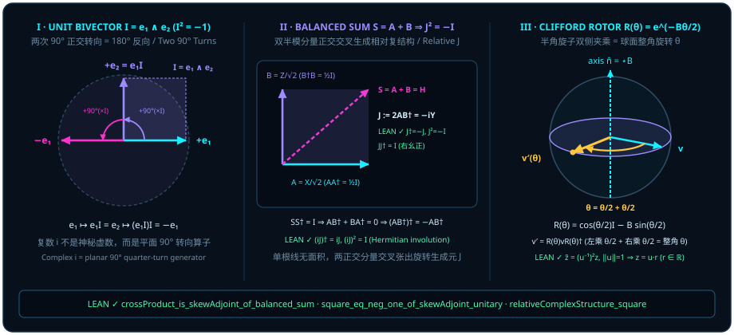

# 第五章 告别神秘的 $i$：复相位就是平面旋转生成元 {#ch05-complex-phase-and-rotors}

正如本书作者所言：

> *“量子态是方向,量子门是让量子态转向的,那么可以理解为一种有面积的几何结构”*
>
> *“其实点 C并不是一个已知量,而是一个相融点的投影,因为实际上一条确定的量子态只能确定一条线,一组量子态才能对应一个面积.”*

在第一部（[第一章](ch01-measurement.md)至[第四章](ch04-decoherence.md)）中，我们完成了量子几何的第一次破妄：砍掉孤立单子与外部第 3 点 $C$ 的脚手架，把单量子比特还原为三维单位球面 $S^2$ 上的一根实方向线 $\vv{a}$，并用两子内积投影 $\vv{a} \cdot \vv{b} = \cos\theta$ 解释了玻恩定则、幂等存在线 $P^2 = P$ 与退相干截短弦。

然而，只要我们的目光还停留在静态的一维线段上，量子力学里最令初学者困惑的第二座大山就依然横亘在眼前：**既然一切测量结果和概率都是实实在在的实数，为什么量子力学的状态演化与量子门非得引进虚数单位 $i = \sqrt{-1}$ 不可？** 在传统教科书里，$i$ 往往被渲染成某种不可捉摸的“纯复代数幽灵”，仿佛微观粒子天生生活在一座人类视觉无法企及的“虚数空间”里。

进入第二部《展翼·从线到面》，本章将彻底撕下虚数单位 $i$ 的神秘面纱。我们将证明：**单根量子态只能确定一条一维方向线；而量子门之所以能让量子态转向，是因为一对不共线的量子态（或一对平衡正交算子分量）张出了一块二维有向面积（二向量 bivector）！** 所谓的虚数单位 $i$，根本不是什么“虚幻的数字”，而是二维平面内**正交 $90^\circ$ 旋转生成元**的代数记号——因为在同一张平面上连续执行两次 $90^\circ$ 正交转向（$90^\circ + 90^\circ = 180^\circ$），任何向量都会严丝合缝地指向自己的反方向！

## 5.1 为什么 $i^2 = -1$？单位二向量 $I = \vv{e}_1 \wedge \vv{e}_2$ 连转两次 $90^\circ$ 的几何必然 {#sec-unit-bivector-square}

让我们从作者最初面对球面与量子门时提出的那个直击要害的追问开始：

> *“为什么是球面上的面积?而不是夹角面积?两个量子态之间只能用线连接吧在球的表面积 A B”*

这个追问一下子戳破了长达百年的教学盲区。当球面上只有孤零零的一条已知量子态 $\vv{a}$ 时，它只能确定一根一维射线，既没有左也没有右，更谈不上“往哪个平面转”。只有当**第二条**不共线的方向 $\vv{b}$ 登场——即有了一组（至少两条）量子态 $\vv{a}$ 与 $\vv{b}$ 时——这两根从球心出发的半径矢量才会在三维空间里撑开一张唯一的**二维大圆切平面**，并在平面内围出一块有向平行四边形夹角面积：

$$
\vv{a} \wedge \vv{b} = \sin\theta\,\vv{I}, \qquad \vv{I} := \vv{e}_1 \wedge \vv{e}_2.
$$

这里，$\{\vv{e}_1, \vv{e}_2\}$ 是该旋转平面内的一对标准正交基（$\vv{e}_1 \cdot \vv{e}_1 = \vv{e}_2 \cdot \vv{e}_2 = 1$，$\vv{e}_1 \cdot \vv{e}_2 = 0$），而外积 $\vv{I} = \vv{e}_1 \wedge \vv{e}_2 = -\vv{e}_2 \wedge \vv{e}_1$ 则是代表这片单位有向面积的**单位二向量（unit bivector）**。

现在，看看这块单位有向面积 $\vv{I}$ 是如何像齿轮一样带动平面内的向量旋转的。在克利福德几何代数（将在[第六章](ch06-geometric-product.md)系统展开）中，正交基向量的几何积反对称（$\vv{e}_1 \vv{e}_2 = \vv{e}_1 \wedge \vv{e}_2 = -\vv{e}_2 \vv{e}_1$）且自身平方为 $1$（$\vv{e}_1^2 = \vv{e}_2^2 = 1$）。拿平面内的基准线 $\vv{e}_1$ 右乘一次单位二向量 $\vv{I}$：

$$
\vv{e}_1 \vv{I} = \vv{e}_1 (\vv{e}_1 \vv{e}_2) = (\vv{e}_1^2)\vv{e}_2 = \vv{e}_2.
$$

看！右乘一次 $\vv{I}$，刚好把水平轴 $\vv{e}_1$ 逆时针旋转了 $90^\circ$，变成了竖直轴 $\vv{e}_2$！那么，如果紧接着**再右乘一次** $\vv{I}$——也就是在同一个平面里再逆时针转第二个 $90^\circ$——会发生什么？

$$
(\vv{e}_1 \vv{I})\vv{I} = \vv{e}_2 (\vv{e}_1 \vv{e}_2) = -\vv{e}_2 (\vv{e}_2 \vv{e}_1) = -(\vv{e}_2^2)\vv{e}_1 = -\vv{e}_1!
$$

无论你选平面内的哪一根向量 $\vv{v} = x\vv{e}_1 + y\vv{e}_2$，连续作用两次 $\vv{I}$ 都会把它转过 $90^\circ + 90^\circ = 180^\circ$，变成反向的 $-\vv{v}$。抽去被作用的向量本身，算子自身的平方满足：

$$
\vv{I}^2 = (\vv{e}_1 \vv{e}_2)(\vv{e}_1 \vv{e}_2) = -\vv{e}_1 \vv{e}_1 \vv{e}_2 \vv{e}_2 = -1!
$$

真相大白！几个世纪以来被称为“虚数（imaginary number）”的 $i$，在几何上一点也不“虚”：**只要一个算子代表平面内保模长的 $90^\circ$ 正交转向（在矩阵代数中表现为反自伴性 $R^* = -R$ 与右幺正性 $R R^* = I$ 的结合），它连续作用两次就必然等于反向算子 $-I$**。

<figure data-tbook-film="001-qubit-bloch-rotor"></figure>

在 Lean 4 形式化库 `Quantum/Algebra/Unitary` 中，我们无需预先假定任何外加的复几何公设，而是直接从最基本的**平衡幺正分解** $S = A + B$ 出发，严格证明了这一正交转向生成元的诞生机制：当你把一个右幺正门 $S$（满足 $S S^* = I$）拆成两个各占一半模长的平衡分量 $A$ 与 $B$（即 $A A^* = \frac{1}{2}I$ 且 $B B^* = \frac{1}{2}I$，在 Lean 中记作 [`halfIdentity`](lean:D5/S3/Quantum/Algebra/Unitary/BalancedUnitarySum.halfIdentity)）时，幺正保模长条件会强行迫使两分量的对称交叉项归零（$A B^* + B A^* = 0$），从而使它们的交叉乘积 $A B^*$ 自动成为一个反自伴的旋转生成元！

::: {.theorem #thm-balanced-sum-skew-adjoint title="平衡幺正和的正交交叉抵消与交叉积反自伴定理" lean="D5/S3/Quantum/Algebra/Unitary/BalancedUnitarySum.crossProduct_is_skewAdjoint_of_balanced_sum"}
设 $n$ 为有限可判等指标类型，$S, A, B \in M_n(\mathbb{C})$ 为 $n \times n$ 复矩阵。记半恒等矩阵为 $H_{1/2} := \frac{1}{2}I_n$（[`halfIdentity`](lean:D5/S3/Quantum/Algebra/Unitary/BalancedUnitarySum.halfIdentity)）。若 $S, A, B$ 满足：

1. **平衡和分解**：$S = A + B$；
2. **合成右幺正性**：$S S^* = I_n$；
3. **双分量半模长平衡**：$A A^* = \frac{1}{2}I_n$ 且 $B B^* = \frac{1}{2}I_n$；

则对称交叉项恒等于零（$A B^* + B A^* = 0$，[`crossTerms_eq_zero`](lean:D5/S3/Quantum/Algebra/Unitary/BalancedUnitarySum.crossTerms_eq_zero)，等价地 $B A^* = -A B^*$，[`secondCross_eq_neg_first`](lean:D5/S3/Quantum/Algebra/Unitary/BalancedUnitarySum.secondCross_eq_neg_first)），且交叉乘积 $A B^*$ 必为反自伴矩阵（[`crossProduct_is_skewAdjoint`](lean:D5/S3/Quantum/Algebra/Unitary/BalancedUnitarySum.crossProduct_is_skewAdjoint)）：

$$
(A B^*)^* = -A B^*.
$$
:::

::: proof
将平衡和 $S = A + B$ 代入右幺正条件 $S S^* = I_n$，按矩阵乘法与共轭转置的分配律展开：

$$
I_n = (A + B)(A^* + B^*) = A A^* + A B^* + B A^* + B B^*.
$$

代入双分量半模长条件 $A A^* = \frac{1}{2}I_n$ 与 $B B^* = \frac{1}{2}I_n$，主对角模长项相加恰为 $\frac{1}{2}I_n + \frac{1}{2}I_n = I_n$；两边消去 $I_n$ 即得交叉项归零恒等式 $A B^* + B A^* = 0$（[`crossTerms_eq_zero`](lean:D5/S3/Quantum/Algebra/Unitary/BalancedUnitarySum.crossTerms_eq_zero)），移项遂有 $B A^* = -A B^*$（[`secondCross_eq_neg_first`](lean:D5/S3/Quantum/Algebra/Unitary/BalancedUnitarySum.secondCross_eq_neg_first)）。再对交叉乘积 $A B^*$ 取共轭转置，利用 $(A B^*)^* = (B^*)^* A^* = B A^*$，立即化为 $(A B^*)^* = -A B^*$。完整证明由 Lean 内核检查。
:::

紧接着，一旦某个算子 $R$ 同时具备反自伴性（$R^* = -R$，代表 $90^\circ$ 无伸缩正交转向）与右幺正性（$R R^* = I_n$，代表单位面积模长），代数上甚至不需要出现半个虚数符号，它自己的平方就铁定等于 $-I_n$！

::: {.lemma #lemma-skew-adjoint-unitary-square title="反自伴右幺正矩阵的平方必为负恒等阵" lean="D5/S3/Quantum/Algebra/Unitary/BalancedUnitaryComplexStructure.square_eq_neg_one_of_skewAdjoint_unitary"}
设 $n$ 为有限可判等指标类型。若复矩阵 $R \in M_n(\mathbb{C})$ 同时满足反自伴性 $R^* = -R$ 与右幺正性 $R R^* = I_n$，则其平方恒等于负单位矩阵：

$$
R^2 = -I_n.
$$
:::

::: proof
在右幺正等式 $R R^* = I_n$ 中直接将反自伴条件 $R^* = -R$ 代入，得 $R(-R) = -R^2 = I_n$；两边同取负号即得 $R^2 = -I_n$。完整证明由 Lean 内核检查。
:::

把 [@thm-balanced-sum-skew-adjoint] 与 [@lemma-skew-adjoint-unitary-square] 合在一起，我们便在矩阵代数内部内生构造出了由两个平衡正交分量 $A, B$ 共同张成的**相对复结构算子** $J := 2 A B^*$（Lean 中定义为 [`relativeComplexStructure`](lean:D5/S3/Quantum/Algebra/Unitary/BalancedUnitaryComplexStructure.relativeComplexStructure)）。为什么前面要乘一个系数 $2$？因为当 $A$ 满足右半模长归一 $A A^* = \frac{1}{2}I_n$ 且 $B$ 满足左半模长归一 $B^* B = \frac{1}{2}I_n$ 时，乘积 $A B^*$ 的右模长平方是 $\frac{1}{2} \times \frac{1}{2} = \frac{1}{4}I_n$；乘上归一化因子 $2$ 之后，$J = 2 A B^*$ 恰好恢复为单位二向量右幺正性 $J J^* = 4 \cdot \frac{1}{4}I_n = I_n$（[`relativeComplexStructure_mul_conjTranspose`](lean:D5/S3/Quantum/Algebra/Unitary/BalancedUnitaryComplexStructure.relativeComplexStructure_mul_conjTranspose)），从而严格满足 $J^2 = -I_n$（若同时具备对偶半模长条件 $A^* A = \frac{1}{2}I_n$ 与 $B B^* = \frac{1}{2}I_n$，则还成立左幺正性 $J^* J = I_n$，[`relativeComplexStructure_conjTranspose_mul`](lean:D5/S3/Quantum/Algebra/Unitary/BalancedUnitaryComplexStructure.relativeComplexStructure_conjTranspose_mul)）！

::: {.theorem #thm-relative-complex-structure-square title="平衡正交对生成的相对复结构平方恒等式 $J^2 = -I$" lean="D5/S3/Quantum/Algebra/Unitary/BalancedUnitaryComplexStructure.relativeComplexStructure_square"}
设 $n$ 为有限可判等指标类型，$A, B \in M_n(\mathbb{C})$。定义相对复结构矩阵为

$$
J := 2 A B^*.
$$

若 $A, B$ 满足正交交叉条件 $A B^* + B A^* = 0$ 以及半模长条件 $A A^* = \frac{1}{2}I_n$ 与 $B^* B = \frac{1}{2}I_n$，则 $J$ 满足反自伴性 $J^* = -J$（仅需 $A B^* + B A^* = 0$，[`relativeComplexStructure_is_skewAdjoint`](lean:D5/S3/Quantum/Algebra/Unitary/BalancedUnitaryComplexStructure.relativeComplexStructure_is_skewAdjoint)）、右幺正性 $J J^* = I_n$（仅需 $A A^* = \frac{1}{2}I_n$ 与 $B^* B = \frac{1}{2}I_n$，[`relativeComplexStructure_mul_conjTranspose`](lean:D5/S3/Quantum/Algebra/Unitary/BalancedUnitaryComplexStructure.relativeComplexStructure_mul_conjTranspose)），且其平方恒等于负恒等矩阵：

$$
J^2 = -I_n.
$$
:::

::: proof
首先由 $A B^* + B A^* = 0$ 知 $(A B^*)^* = -A B^*$，数乘实标量 $2$ 后仍有 $J^* = (2 A B^*)^* = -2 A B^* = -J$（[`relativeComplexStructure_is_skewAdjoint`](lean:D5/S3/Quantum/Algebra/Unitary/BalancedUnitaryComplexStructure.relativeComplexStructure_is_skewAdjoint)）。其次计算右乘积 $J J^*$：利用矩阵乘法结合律与 $B^* B = \frac{1}{2}I_n$、$A A^* = \frac{1}{2}I_n$，有

$$
J J^* = (2 A B^*)(2 B A^*) = 4 A (B^* B) A^* = 4 A \Bigl(\frac{1}{2}I_n\Bigr) A^* = 2 A A^* = 2\Bigl(\frac{1}{2}I_n\Bigr) = I_n
$$

（[`relativeComplexStructure_mul_conjTranspose`](lean:D5/S3/Quantum/Algebra/Unitary/BalancedUnitaryComplexStructure.relativeComplexStructure_mul_conjTranspose)；对偶地，若 $A^* A = \frac{1}{2}I_n$ 且 $B B^* = \frac{1}{2}I_n$，则 $J^* J = 4 B(A^* A)B^* = 2 B B^* = I_n$，[`relativeComplexStructure_conjTranspose_mul`](lean:D5/S3/Quantum/Algebra/Unitary/BalancedUnitaryComplexStructure.relativeComplexStructure_conjTranspose_mul)）。于是 $J$ 同时满足反自伴性 $J^* = -J$ 与右幺正性 $J J^* = I_n$，直接调用 [@lemma-skew-adjoint-unitary-square] 即得 $J^2 = -I_n$。完整证明由 Lean 内核检查。
:::

不仅如此，在同一模块中，若把这枚代表单位旋转平面的反自伴复结构 $J$ 乘上标量 $i$，就得到与之配对的**相对对合算子** $K := iJ$（[`relativeInvolution`](lean:D5/S3/Quantum/Algebra/Unitary/BalancedUnitaryComplexStructure.relativeInvolution)）：由于 $i$ 与 $J$ 在取伴随时双双变号（$(-i)(-J) = iJ$）且在平方时负负得正（$i^2 J^2 = (-1)(-I_n) = I_n$），$K = iJ$ 自动成为一个满足 $K^* = K$（[`relativeInvolution_isHermitian`](lean:D5/S3/Quantum/Algebra/Unitary/BalancedUnitaryComplexStructure.relativeInvolution_isHermitian)）且 $K^2 = I_n$（[`relativeInvolution_square`](lean:D5/S3/Quantum/Algebra/Unitary/BalancedUnitaryComplexStructure.relativeInvolution_square)）的厄米对合反射轴！这再次印证了[第三章](ch03-projectors-and-duality.md)揭示的霍奇对偶图景：每一张平方为 $-I$ 的旋转面积 $J$，都与一根平方为 $+I$ 的厄米可观测轴 $iJ$ 形影不离。

## 5.2 从欧拉公式 $e^{i\theta}$ 到克利福德旋转器 $R(\theta) = \cos(\theta/2) - \vv{B}\sin(\theta/2)$ {#sec-euler-to-rotor}

既然单位二向量 $\vv{B}$（或矩阵层面的相对复结构 $J$）满足与虚数单位完全同构的平方律 $\vv{B}^2 = -1$，那么把复分析里大名鼎鼎的欧拉公式 $e^{i\alpha} = \cos\alpha + i\sin\alpha$ 中的虚数 $i$ 替换为具体的几何旋转平面 $-\vv{B}$，就立刻得到了无需绑定任何特定坐标基的**克利福德旋转器（Clifford rotor）**：

$$
R(\theta) := \exp\Bigl(-\vv{B}\,\frac{\theta}{2}\Bigr) = \sum_{k=0}^\infty \frac{(-\vv{B}\,\theta/2)^k}{k!} = \cos\frac{\theta}{2} - \vv{B}\sin\frac{\theta}{2}.
$$

初学者第一次看到这行旋转器公式时，几乎都会问同一个问题：**为什么旋转角度是半角 $\theta/2$，而不是整角 $\theta$？而且为什么旋转器作用在三维布洛赫向量 $\vv{v}$ 上时，要写成左右两边夹乘的“三明治积（sandwich product）” $\vv{v}' = R(\theta)\,\vv{v}\,R(\theta)^\dagger$，而不是像平面复数那样只乘一边？**

用二向量几何来回答，只需两句话就能让人恍然大悟：

1. **为什么单边相乘在三维空间里不够用？** 当你站在二维平面 $\vv{B} = \vv{e}_1 \wedge \vv{e}_2$ 内部时，所有向量都躺在平面内，因此它们与二向量 $\vv{B}$ 满足**反对易**关系：$\vv{v}_\parallel \vv{B} = -\vv{B} \vv{v}_\parallel$。但在三维布洛赫空间 $\mathbb{R}^3$ 中，除了躺在旋转平面内的平行分量 $\vv{v}_\parallel$ 外，还有垂直于旋转平面的法向旋转轴分量 $\vv{v}_\perp$（例如沿着 $\vv{e}_3$ 的分量）！由于 $\vv{e}_3$ 与 $\vv{e}_1, \vv{e}_2$ 都正交，越过两个正交基向量会连变两次符号（$(-1)^2 = +1$），因此法向向量与旋转平面 $\vv{B}$ **可交换（对易）**：$\vv{v}_\perp \vv{B} = +\vv{B}\vv{v}_\perp$。如果你只从左边单侧乘上 $e^{-\vv{B}\theta}$，平行分量固然在平面内旋转了，但法向轴 $\vv{v}_\perp$ 却会被乘出一个脱离原三维向量空间的三向量（伪标量）项 $\vv{v}_\perp \vv{B}$！
2. **为什么双侧三明治夹乘刚好凑出整角 $\theta$ 并保护旋转轴不动？** 现在改用半角旋转器 $R(\theta) = e^{-\vv{B}\theta/2}$ 与其逆（共轭反转 $R(\theta)^\dagger = e^{+\vv{B}\theta/2}$）从左右两侧同时夹住 $\vv{v} = \vv{v}_\parallel + \vv{v}_\perp$：
   - 对于**垂直于平面**的旋转轴分量 $\vv{v}_\perp$：因为它与 $\vv{B}$ 对易，右边的 $R(\theta)^\dagger$ 可以直接穿过 $\vv{v}_\perp$ 与左边的 $R(\theta)$ 相遇抵消：
     $$
     R(\theta)\,\vv{v}_\perp\,R(\theta)^\dagger = R(\theta)R(\theta)^\dagger\,\vv{v}_\perp = e^{-\vv{B}\theta/2}e^{+\vv{B}\theta/2}\vv{v}_\perp = \vv{v}_\perp!
     $$
     旋转轴纹丝不动！
   - 对于**躺在旋转平面内**的分量 $\vv{v}_\parallel$：因为它与 $\vv{B}$ 反对易（$\vv{v}_\parallel \vv{B} = -\vv{B}\vv{v}_\parallel$），当右边的 $R(\theta)^\dagger = \cos(\theta/2) + \vv{B}\sin(\theta/2)$ 穿过 $\vv{v}_\parallel$ 走到左边时，其中的 $\vv{B}$ 变号为 $-\vv{B}$，使 $R(\theta)^\dagger$ 摇身一变成了第二个同向旋转的 $R(\theta)$：
     $$
     R(\theta)\,\vv{v}_\parallel\,R(\theta)^\dagger = R(\theta)R(\theta)\,\vv{v}_\parallel = e^{-\vv{B}\theta/2}e^{-\vv{B}\theta/2}\vv{v}_\parallel = e^{-\vv{B}\theta}\vv{v}_\parallel = \bigl(\cos\theta - \vv{B}\sin\theta\bigr)\vv{v}_\parallel!
     $$
     左边半个角 $\theta/2$ 加上右边穿过来同向叠加的半个角 $\theta/2$，严丝合缝地合拢为平面内的整角旋转 $\theta$！

这里需要严守概念与形式化边界：本书的 [@lemma-skew-adjoint-unitary-square] 与 [@thm-relative-complex-structure-square] 在 Lean 内核中严格证明的是 $n \times n$ 复矩阵层面的核心代数恒等式 $R^2 = -I_n$ 与 $J^2 = -I_n$；而将三维欧氏空间的完整克利福德代数识别为泡利复矩阵代数 $\mathrm{Cl}_{3,0}(\mathbb{R}) \cong M_2(\mathbb{C})$（实维数 $8$）、将其**偶次子代数**识别为四元数代数 $\mathrm{Cl}^+_{3,0}(\mathbb{R}) \cong \mathbb{H}$（实维数 $4$，其单位球面 $S^3 \cong \mathrm{SU}(2)$ 由旋转器构成）并用三明治积 $\vv{v}' = R(\theta)\vv{v}R(\theta)^\dagger$ 导出三维罗德里格斯旋转公式的历史与经典定理，则在章末的文献注记 [@rem-clifford-rotor-literature] 中专门界定。

## 5.3 全局相位与相对相位：为什么单根线的自转不可见，唯有一组线的夹角才张出面积？ {#sec-global-vs-relative-phase}

在彻底搞懂了“复相位就是二向量平面内的旋转角”之后，困扰无数学生的一道经典难题——**为什么全局相位 $e^{i\alpha}\lvert\psi\rangle$ 在物理上完全不可观测，而叠加态里的相对相位 $\lvert 0\rangle + e^{i\phi}\lvert 1\rangle$ 却能决定干涉条纹的生死？**——便迎刃而解了。

请再读一遍本章开篇引用的作者原话：*“因为实际上一条确定的量子态只能确定一条线,一组量子态才能对应一个面积.”*

- 当你手里只有**单一一条**量子态 $\lvert\psi\rangle$ 时，它在球面上只是一根孤立的一维方向线。给整条状态乘上一个全局相位因子 $\lvert\psi\rangle \mapsto u\lvert\psi\rangle$（其中 $|u| = 1$），相当于企图让一根没有厚度的几何直线绕着它自己的轴心原地自转——在[第一章](ch01-measurement.md)的射线相位刚性定理（[@thm-ray-phase-rigidity]）和[第二章](ch02-born-rule.md)的玻恩秩一投影 $\lvert\psi\rangle\langle\psi\rvert$ 中，$u\overline{u} = |u|^2 = 1$ 当场抵消，整根方向线在球面上的指向分毫不差；
- 相反，当你面对**一组（至少两条）**量子态——例如由两个正交分支合成的叠加态，或者两个不同状态之间的内积重叠幅 $z = \langle\phi\mid\psi\rangle \in \mathbb{C}$ 时，这两条线之间张开了一片实实在在的二维夹角平面，相对相位正是这片面积在平面内的取向角！

更进一步，在干涉实验或相位锁定（phase-locked）测量中，如果我们用一枚单位相位因子 $u \in \mathbb{C}$（$\|u\| = 1$，例如双臂干涉仪的中心基准相位 $u = e^{i\phi/2}$）去校准两态之间的复内积重叠幅 $z \in \mathbb{C}$，什么时候这个看似复杂的复数重叠幅 $z$ 实际上只是一个沿着基准方向 $u$ 伸缩的**纯实数振幅** $r \in \mathbb{R}$？

在 Lean 模块 `QuantumStates/PhaseLockedOverlap` 中，下面这条命题给出了充要的相位锁定判据：只要复重叠幅 $z$ 的共轭满足相位反射对称性 $\overline{z} = (u^{-1})^2 z$，复平面上的横向虚部就会精确归零，使 $z$ 退化为单位相位方向 $u$ 与实数投影 $r = \operatorname{Re}(u^{-1}z) \in \mathbb{R}$ 的简单乘积！

::: {.proposition #prop-phase-locked-overlap title="相位锁定复重叠幅的实振幅分解定理" lean="D5/S3/QuantumStates/PhaseLockedOverlap.phase_locked_overlap_is_rotated_real"}
设单位相位因子 $u \in \mathbb{C}$ 与复重叠幅 $z \in \mathbb{C}$ 满足模长归一条件 $\|u\| = 1$ 及相位锁定共轭条件

$$
\overline{z} = (u^{-1})^2 z.
$$

则必存在实数振幅 $r \in \mathbb{R}$（显式取作 $r = \operatorname{Re}(u^{-1} z)$），使得

$$
z = u \cdot r.
$$
:::

::: proof
记去相位后的复数为 $w := u^{-1} z \in \mathbb{C}$，并取其实部 $r := \operatorname{Re}(w) \in \mathbb{R}$。因 $\|u\| = 1$，复数的模方满足 $\overline{u} u = \|u\|^2 = 1$，从而逆元恰等于共轭：$u^{-1} = \overline{u}$ 且 $\overline{u^{-1}} = u$。现计算 $w$ 的复共轭 $\overline{w}$：由共轭的乘法性质及题设相位锁定条件 $\overline{z} = (u^{-1})^2 z$，有

$$
\overline{w} = \overline{u^{-1} z} = \overline{u^{-1}}\,\overline{z} = u \cdot (u^{-1})^2 z = (u u^{-1}) u^{-1} z = u^{-1} z = w.
$$

一个复数等于其自身的复共轭（$\overline{w} = w$），意味着其虚部为零，故 $w$ 必等于其实部：$u^{-1} z = w = \operatorname{Re}(w) = r$。在等式 $u^{-1} z = r$ 两端左乘 $u$，由 $u u^{-1} = 1$（因 $\|u\| = 1 \implies u \neq 0$）立即得到 $z = u \cdot r$。完整证明由 Lean 内核检查。
:::

[@prop-phase-locked-overlap] 在几何上极其直观：在复平面上，乘以 $u^{-1}$ 相当于把坐标轴顺时针旋转到与单位向量 $u$ 对齐；条件 $\overline{z} = (u^{-1})^2 z$ 等价于 $\overline{u^{-1}z} = u^{-1}z$，说明矢量 $z$ 恰好躺成与基准射线 $u$ 共线的一维线段（外积有向面积 $u \wedge z = 0$），因此剥去方向因子 $u$ 后剩下的纯长度 $r = \operatorname{Re}(u^{-1}z)$ 自然是一个一维实数！

## 5.4 单比特常见量子门（$X, Y, Z, H, S, T$）的纯几何旋转器图鉴 {#sec-single-qubit-gates-as-rotors}

现在，我们可以把量子计算教科书里最常用的六扇单比特基础量子门——泡利三门 $X, Y, Z$、阿达马门（Hadamard gate）$H$、相位门 $S$ 与 $\pi/8$ 门 $T$——统统请下“复矩阵神坛”，还原为三维布洛赫球面上的**刚体旋转器图鉴**。

在阅读任何一张量子电路图时，只要记住一条黄金换算律：若二能级幺正矩阵写成标准 $\mathrm{SU}(2)$ 旋转器形式（相差一个物理上不可观测的全局相位 $e^{i\alpha}$）

$$
U = e^{i\alpha} R_{\hat{\vv{n}}}(\theta) = e^{i\alpha}\left(\cos\frac{\theta}{2}\,I_2 - i\sin\frac{\theta}{2}\,(\hat{\vv{n}}\cdot\vv{\sigma})\right),
$$

那么这扇量子门在三维空间里做的唯一一件事，就是**抓起整颗布洛赫球，绕着单位轴 $\hat{\vv{n}} \in S^2$（即霍奇对偶旋转平面 $\vv{B} = \star\hat{\vv{n}}$）右手刚体旋转整角 $\theta$**！

::: {.example #ex-single-qubit-gate-atlas title="单比特六大基础量子门的旋转器分解与阿达马门平衡复结构验算"}
我们将单比特标准门集 $\{X, Y, Z, H, S, T\}$ 的旋转器参数、旋转平面二向量、球面转轴与转角汇总如下表，并对最核心的阿达马门 $H$ 做一次逐项对照 [@thm-balanced-sum-skew-adjoint] 与 [@thm-relative-complex-structure-square] 的显式验算：

| 量子门 | 标准矩阵表示 | $\mathrm{SU}(2)$ 旋转器形式 $e^{i\alpha}R_{\hat{\vv{n}}}(\theta)$ | 旋转平面二向量 $\vv{B}$ | 布洛赫球转轴 $\hat{\vv{n}}$ | 球面转角 $\theta$（旋转器半角 $\theta/2$） |
| :---: | :---: | :---: | :---: | :---: | :---: |
| **$X$** | $\begin{pmatrix} 0 & 1 \\ 1 & 0 \end{pmatrix}$ | $i\bigl(\cos\frac{\pi}{2}I - i\sin\frac{\pi}{2}\sigma_x\bigr)$ | $\vv{e}_2 \wedge \vv{e}_3$（$YZ$ 平面） | $+\vv{e}_1 = (1, 0, 0)$ | $\pi = 180^\circ$（$\frac{\pi}{2} = 90^\circ$） |
| **$Y$** | $\begin{pmatrix} 0 & -i \\ i & 0 \end{pmatrix}$ | $i\bigl(\cos\frac{\pi}{2}I - i\sin\frac{\pi}{2}\sigma_y\bigr)$ | $\vv{e}_3 \wedge \vv{e}_1$（$ZX$ 平面） | $+\vv{e}_2 = (0, 1, 0)$ | $\pi = 180^\circ$（$\frac{\pi}{2} = 90^\circ$） |
| **$Z$** | $\begin{pmatrix} 1 & 0 \\ 0 & -1 \end{pmatrix}$ | $i\bigl(\cos\frac{\pi}{2}I - i\sin\frac{\pi}{2}\sigma_z\bigr)$ | $\vv{e}_1 \wedge \vv{e}_2$（$XY$ 赤道面） | $+\vv{e}_3 = (0, 0, 1)$ | $\pi = 180^\circ$（$\frac{\pi}{2} = 90^\circ$） |
| **$H$** | $\frac{1}{\sqrt{2}}\begin{pmatrix} 1 & 1 \\ 1 & -1 \end{pmatrix}$ | $i\left(\cos\frac{\pi}{2}I - i\sin\frac{\pi}{2}\frac{\sigma_x + \sigma_z}{\sqrt{2}}\right)$ | $\frac{\vv{e}_2 \wedge \vv{e}_3 + \vv{e}_1 \wedge \vv{e}_2}{\sqrt{2}}$ | $\frac{\vv{e}_1 + \vv{e}_3}{\sqrt{2}}$（$45^\circ$ 斜轴） | $\pi = 180^\circ$（$\frac{\pi}{2} = 90^\circ$） |
| **$S$** | $\begin{pmatrix} 1 & 0 \\ 0 & i \end{pmatrix}$ | $e^{i\pi/4}\bigl(\cos\frac{\pi}{4}I - i\sin\frac{\pi}{4}\sigma_z\bigr)$ | $\vv{e}_1 \wedge \vv{e}_2$（$XY$ 赤道面） | $+\vv{e}_3 = (0, 0, 1)$ | $\frac{\pi}{2} = 90^\circ$（$\frac{\pi}{4} = 45^\circ$） |
| **$T$** | $\begin{pmatrix} 1 & 0 \\ 0 & e^{i\pi/4} \end{pmatrix}$ | $e^{i\pi/8}\bigl(\cos\frac{\pi}{8}I - i\sin\frac{\pi}{8}\sigma_z\bigr)$ | $\vv{e}_1 \wedge \vv{e}_2$（$XY$ 赤道面） | $+\vv{e}_3 = (0, 0, 1)$ | $\frac{\pi}{4} = 45^\circ$（$\frac{\pi}{8} = 22.5^\circ$） |

现在，让我们把目光聚焦在量子算法中最常用到的造波神器——**阿达马门** $H = \frac{1}{\sqrt{2}}(X + Z)$ 上，看看它是如何完美演绎 [@thm-balanced-sum-skew-adjoint] 与 [@thm-relative-complex-structure-square] 的：

1. **平衡幺正和分解**：取 $A := \frac{1}{\sqrt{2}}X$ 与 $B := \frac{1}{\sqrt{2}}Z$，则 $H = A + B$。因 $X^* = X, Z^* = Z$ 且 $X^2 = Z^2 = I_2$，两分量各自满足半模长平衡条件：
   $$
   A A^* = \frac{1}{2}X^2 = \frac{1}{2}I_2, \qquad B B^* = B^* B = \frac{1}{2}Z^2 = \frac{1}{2}I_2.
   $$
2. **正交反对易消去交叉项**：由于 $H H^* = \frac{1}{2}(X+Z)^2 = I_2$，由 [@thm-balanced-sum-skew-adjoint] 知交叉项必归零：
   $$
   A B^* + B A^* = \frac{1}{2}(XZ + ZX) = 0,
   $$
   这正是水平轴 $X$ 与竖直轴 $Z$ 在几何上正交（反对易 $XZ = -ZX$）的直接体现！
3. **相对复结构生成第三轴旋转平面 $-iY$**：按 [@thm-relative-complex-structure-square] 构造相对复结构算子 $J := 2 A B^*$：
   $$
   J = 2\Bigl(\frac{1}{\sqrt{2}}X\Bigr)\Bigl(\frac{1}{\sqrt{2}}Z\Bigr) = XZ = \begin{pmatrix} 0 & 1 \\ 1 & 0 \end{pmatrix}\begin{pmatrix} 1 & 0 \\ 0 & -1 \end{pmatrix} = \begin{pmatrix} 0 & -1 \\ 1 & 0 \end{pmatrix} = -iY!
   $$
   验算可知 $J^* = (-iY)^* = +iY = -J$（反自伴），且 $J^2 = (-iY)^2 = -Y^2 = -I_2$！更美妙的是，与之伴生的厄米对合算子 $K = iJ = i(-iY) = +Y$ 恰好就是垂直于 $XZ$ 平面的**第三根正交泡利轴 $Y$**（满足 $Y^* = Y$ 且 $Y^2 = I_2$）！请注意这里的旋量半角与布洛赫球整角的精确对应：两条正交分量 $X$ 与 $Z$ 一旦平衡相加，它们张出的有向面积 $J = XZ = -iY = \bigl(\begin{smallmatrix} 0 & -1 \\ 1 & 0 \end{smallmatrix}\bigr)$ 在**实二维状态振幅平面** $(\psi_0, \psi_1)^{\mathsf{T}}$ 上是旋转**半角 $\frac{\pi}{2} = 90^\circ$** 的正交四分之一转矩阵，恰等于旋量旋转器 $R_y(\pi) = \exp(-i\frac{\pi}{2}Y)$；而当它通过双侧三明治积 $J\,\vv{v}\,J^\dagger$ 作用在**三维布洛赫球面 $S^2$** 上时，两个半角叠加为绕 $Y$ 轴旋转**整角 $\pi = 180^\circ$** 的半周翻转（将北极 $\lvert 0\rangle$ 翻转到南极 $\lvert 1\rangle$）！
:::

::: {.remark #rem-clifford-rotor-literature title="四元数、罗德里格斯半角公式与克利福德旋转器双覆盖史话（文献结果，未在本书形式化）"}
**文献结果，未在本书形式化。** 本章的 [@thm-balanced-sum-skew-adjoint]、[@lemma-skew-adjoint-unitary-square] 与 [@thm-relative-complex-structure-square] 在 Lean 4 中形式化了一般 $n \times n$ 复矩阵上平衡幺正和生成反自伴相对复结构 $J^2 = -I_n$ 的代数定理，[@prop-phase-locked-overlap] 形式化了相位锁定复重叠幅的实数分解。关于三维旋转半角公式与克利福德几何代数的历史源流及完整三维旋转器定理，来自以下经典数学物理文献：

1. **罗德里格斯半角合成公式（O. Rodrigues, 1840）与哈密顿四元数（W. R. Hamilton, 1843）**：Olinde Rodrigues 在 1840 年（*Des lois géométriques qui régissent les déplacements d'un système solide dans l'espace*, J. Math. Pures Appl. **5**, 380–440）首次发现了三维空间两次镜面反射合成一次双倍角旋转的半角切线公式；三年后，William Rowan Hamilton 在都柏林布鲁姆桥（Brougham Bridge）上刻下四元数基本关系 $\mathbf{i}^2 = \mathbf{j}^2 = \mathbf{k}^2 = \mathbf{i}\mathbf{j}\mathbf{k} = -1$。用现代外代数眼光复盘，哈密顿的 $\mathbf{i}, \mathbf{j}, \mathbf{k}$ 实际上并不是三维向量，而是三维空间中的三个正交单位**二向量（旋转平面）**：$\mathbf{i} = -\vv{e}_2 \wedge \vv{e}_3 = -i\sigma_x$，$\mathbf{j} = -\vv{e}_3 \wedge \vv{e}_1 = -i\sigma_y$，$\mathbf{k} = -\vv{e}_1 \wedge \vv{e}_2 = -i\sigma_z$！
2. **克利福德几何代数与泡利代数同构（W. K. Clifford, 1878）**：William Kingdon Clifford（*Applications of Grassmann's extensive algebra*, Amer. J. Math. **1**, 350–358, 1878）将格拉斯曼（H. Grassmann, 1844）的外积 $\vv{a}\wedge\vv{b}$ 与内积 $\vv{a}\cdot\vv{b}$ 统一为几何积 $\vv{a}\vv{b} = \vv{a}\cdot\vv{b} + \vv{a}\wedge\vv{b}$。在三维欧氏空间 $\mathbb{R}^3$ 的完整克利福德代数 $\mathrm{Cl}_{3,0}(\mathbb{R}) \cong M_2(\mathbb{C})$（实维数 $8$）中，偶次子代数 $\mathrm{Cl}^+_{3,0}(\mathbb{R}) = \mathbb{R} \oplus \Lambda^2(\mathbb{R}^3) \cong \mathbb{H}$（实维数 $4$）由标量与二向量张成，单位二向量 $\vv{B}$ 满足 $\vv{B}^2 = -1$。
3. **旋量双覆盖 $\mathrm{Spin}(3) \cong \mathrm{SU}(2) \xrightarrow{2:1} \mathrm{SO}(3)$ 与罗德里格斯展开**：对任意单位二向量 $\vv{B} = \star\hat{\vv{n}}$ 及角度 $\theta \in \mathbb{R}$，旋转器 $R(\theta) = \cos(\theta/2) - \vv{B}\sin(\theta/2) \in \mathrm{Spin}(3)$ 通过双侧三明治作用 $\vv{v} \mapsto R(\theta)\vv{v}R(\theta)^\dagger$ 导出标准三维罗德里格斯旋转公式：
   $$
   \vv{v}' = R(\theta)\vv{v}R(\theta)^\dagger = \vv{v}\cos\theta + (\hat{\vv{n}}\times\vv{v})\sin\theta + \hat{\vv{n}}(\hat{\vv{n}}\cdot\vv{v})(1 - \cos\theta).
   $$
   由于 $\theta \mapsto \theta + 2\pi$ 使半角旋转器变号 $R(\theta + 2\pi) = -R(\theta)$，而双侧夹乘中 $(-R)\vv{v}(-R)^\dagger = R\vv{v}R^\dagger$ 负负得正，旋转器群 $\mathrm{Spin}(3) \cong \mathrm{SU}(2) \cong S^3$ 对三维正交旋转群 $\mathrm{SO}(3) \cong \mathbb{RP}^3$ 构成拓扑非平凡的 $2:1$ 泛覆盖（旋量转过 $360^\circ$ 变负号，转满 $720^\circ$ 方才回到自身）。

上述历史脉络与三维克利福德三明治展开作为几何背景列出，不计入本书的 Lean 形式化验证账本。
:::

告别了神秘的虚数 $i$，看清了二向量有向面积 $\vv{A} \wedge \vv{B}$ 如何驱动量子门转向之后，一个更加宏大的统一图景已经呼之欲出：既然第一部的“内积 $\vv{A}\cdot\vv{B}$”掌管着粒子的投影定音，而本章的“外积 $\vv{A}\wedge\vv{B}$”掌管着波的干涉与转向，那么把这两半拼回同一个几何积 $\vv{A}\vv{B} = \vv{A}\cdot\vv{B} + \vv{A}\wedge\vv{B}$ 里，会发生什么？让我们翻开[第六章](ch06-geometric-product.md)。
