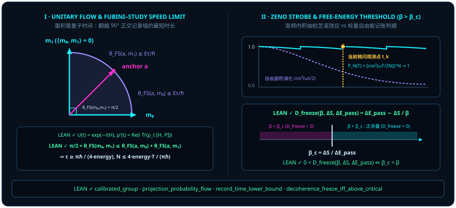

# 第七章 时间的二象性：为什么线是经典时间，面积是量子时间？ {#ch07-geometric-time-and-speed-limits}

正如本书作者所言：

> *“我的直觉是,线是经典时间,面积是量子时间”*
>
> *“把观察者内生放进来思考,何时粒子、何时波,似乎是观察者的注意力问题”*

在[第六章](ch06-geometric-product.md)中，我们用一条克利福德几何积恒等式 $\vv{A}\vv{B} = \vv{A}\cdot\vv{B} + \vv{A}\wedge\vv{B}$ 完成了空间层面的波粒缝合：**粒子是共线的内积投影线（$\cos\theta$），波是正交的外积楔积面（$\sin\theta\,\vv{I}$）**。现在，只要顺着这条正交线索往前多走半步，物理学中最深邃的那个谜团——**时间究竟是什么？**——便当场露出了它的双面几何真容！

在牛顿与日常经验的世界里，时间被想象成一条均匀流淌的一维标量直线 $t \in \mathbb{R}$：钟摆“滴答、滴答”地敲击出一串排成一列的历史刻度，就像纸带上被打孔机打出的一排离散圆孔。然而，在薛定谔方程 $i\hbar\frac{d}{dt}\lvert\psi(t)\rangle = H\lvert\psi(t)\rangle$ 主宰的微观世界里，只要你不去打孔测量，状态矢量却在复希尔伯特空间里沿着二维相位平面连续旋转，甚至同时横跨多条历史路径发生相干叠加！

为什么同一个宇宙里会有两副截然不同的“时间面孔”？本章将严格证明作者的那句直觉洞见——**“线是经典时间，面积是量子时间”**：

1. **量子时间是二向量有向面积**：连续幺正演化 $U(t) = \exp\bigl((-it/\hbar)H_{\mathrm{op}}\bigr)$ 的无穷小生成元 $G = -(i/\hbar)H_{\mathrm{op}}$ 必为**反自伴算子**（$G^* = -G$），哈密顿量 $H_{\mathrm{op}} = i\hbar G$ 所度量的，恰恰是量子态在单位时间内扫过的**二向量旋转面积率**；
2. **经典时间是一维幂等投影线**：只有当观察者用幂等投影尺 $P^2 = P$ 去拦截这片旋转面积、每一次翻越 $90^\circ$ 正交墙（$\langle m_0, m_1\rangle = 0$）落下一枚不可混淆的离散记录时，连续扫掠的二维量子面积才被切分成了“滴答、滴答”的一维经典时间刻度！

## 7.1 薛定谔方程的几何翻译：哈密顿量 $H$ 就是单位时间扫过的二向量面积率 {#sec-schrodinger-bivector-rate}

翻开任何一本大学量子力学课本，薛定谔方程 $i\hbar\partial_t\psi = H\psi$ 总是带着两个令人生疑的特征登场：第一，方程左边为什么要凭空塞进一个虚数单位 $i$？第二，为什么能量算符（哈密顿量 $H$）偏偏要是一个自伴（厄米）算符 $H^* = H$？

让我们用[第五章](ch05-complex-phase-and-rotors.md)建立的“二向量旋转生成元”视角，把薛定谔方程从头到尾翻译成大白话。

假设一个量子系统随实参数 $t \in \mathbb{R}$ 作连续保内积演化，即由一族单参数算子群 $U(t)$ 描述：初刻恒等 $U(0) = I$，时间可加 $U(s + t) = U(s)U(t)$，且处处保持模长与内积不变 $U(t)^* U(t) = I$。考察 $t = 0$ 处的瞬时变化率（导数生成元）$G := U'(0)$。对保模长恒等式 $U(t)^* U(t) = I$ 在 $t = 0$ 处求导，由乘积求导法则立即得到：

$$
\left.\frac{d}{dt}\bigl(U(t)^* U(t)\bigr)\right|_{t=0} = G^* U(0) + U(0)^* G = G^* + G = 0 \quad\Longrightarrow\quad G^* = -G!
$$

看清楚了吗？**任何保模长连续演化的真实几何生成元 $G$，天生必然是一个反自伴算子（$G^* = -G$）——也就是第五章证明的二维有向面积旋转生成元（bivector generator）！**

物理学家之所以在薛定谔方程里写出自伴的哈密顿量 $H_{\mathrm{op}}$（满足 $H_{\mathrm{op}}^* = H_{\mathrm{op}}$），仅仅是因为人类习惯用实数能量刻度来给仪表盘标定读数：人为地给反自伴的几何旋转生成元 $G$ 乘上一个旋转 $90^\circ$ 的因子 $i\hbar$（其中 $\hbar \neq 0$ 是把几何弧度换算为物理作用量焦耳·秒的校准常数），定义

$$
H_{\mathrm{op}} := (i\hbar) G \quad\Longleftrightarrow\quad G = -\frac{i}{\hbar} H_{\mathrm{op}}!
$$

因为 $i$ 和 $G$ 在取共轭伴随时双双变号（$(-i)(-G) = +iG$），两个负号相乘抵消，这才把反自伴的**二向量面积旋转率 $G$** 包装成了自伴的**厄米哈密顿量 $H_{\mathrm{op}}$**！薛定谔方程根本不是一条需要死记硬背的神秘波动方程，它不过是再朴素不过的刚体角速度公式“**瞬时转向率 $=$ 单位时间扫过的二向量面积 $G$**”。

在 Lean 4 形式化模块 `Quantum/Dynamics/CalibratedUnitaryGroup` 中，下面这条定理在完备复内积空间（希尔伯特空间）$H$ 上一次性严格证明了：从单参数保模长群出发，校准后的哈密顿量 $H_{\mathrm{op}} = (i\hbar)G$ 必自伴、有限时间演化必为指数旋子 $U(t) = \exp((-it/\hbar)H_{\mathrm{op}})$，且处处满足算子薛定谔微分方程！

::: {.theorem #thm-calibrated-unitary-group title="单参数幺正演化群的校准自伴哈密顿量与指数薛定谔方程定理" lean="D5/S3/Quantum/Dynamics/CalibratedUnitaryGroup.calibrated_group"}
设 $H$ 为完备复内积空间，$U : \mathbb{R} \to (H \to_L[\mathbb{C}] H)$ 为连续线性算子构成的单参数族，$G : H \to_L[\mathbb{C}] H$ 为 $U$ 在 $t = 0$ 处的导数（`HasDerivAt U G 0`）。若 $U$ 满足单参数幺正群条件：

1. **初刻恒等**：$U(0) = 1$；
2. **单参数群加法律**：$\forall s, t \in \mathbb{R},\, U(s + t) = U(s)U(t)$；
3. **处处左幺正保范**：$\forall t \in \mathbb{R},\, U(t)^* U(t) = 1$；

则对任意非零实校准常数 $\hbar \in \mathbb{R}$（$\hbar \neq 0$），定义校准哈密顿算子 $H_{\mathrm{op}} := (i\hbar)\cdot G$，以下三条结论同时成立：

1. **校准哈密顿量的自伴性**：$H_{\mathrm{op}}$ 为自伴算子（`IsSelfAdjoint H_op`，即 $H_{\mathrm{op}}^* = H_{\mathrm{op}}$）；
2. **有限时间指数旋子表示**：对一切 $t \in \mathbb{R}$，
   $$
   U(t) = \exp\Bigl(\bigl(-\frac{it}{\hbar}\bigr) H_{\mathrm{op}}\Bigr);
   $$
3. **全局薛定谔微分定律**：对一切 $t \in \mathbb{R}$，$U$ 在时刻 $t$ 具有导数 $-\frac{i}{\hbar} H_{\mathrm{op}} U(t)$（`HasDerivAt U ((-Complex.I / ↑ℏ) • (H_op * U t)) t`）。
:::

::: proof
首先在证明内部导出生成元 $G$ 的反自伴性：对双线性复合映射 $t \mapsto U(t)^* U(t)$ 在 $t = 0$ 处求导，由 $U(0) = 1$ 及乘积导数法则，其导数为 $G^* \cdot 1 + 1^* \cdot G = G^* + G$；另一方面因 $U(t)^* U(t) = 1$ 为常值映射，其在 $t = 0$ 处导数为 $0$，由导数唯一性得 $G^* + G = 0$，即 $G^* = -G$。由此计算校准哈密顿量 $H_{\mathrm{op}} = (i\hbar)G$ 的伴随：因 $\hbar \in \mathbb{R}$，有 $H_{\mathrm{op}}^* = \overline{i\hbar}\,G^* = (-i\hbar)(-G) = (i\hbar)G = H_{\mathrm{op}}$，证得结论 1。接着由单参数群性质 $U(t + s) = U(t)U(s)$ 将 $s = 0$ 处的导数 $G$ 平移至任意时刻 $t$，结合巴拿赫代数上常微分方程初值问题 $f'(t) = G f(t),\, f(0) = 1$ 解的唯一性，得 $U(t) = \exp(t G)$。注意到 $\hbar \neq 0$ 时 $\bigl(-\frac{it}{\hbar}\bigr)(i\hbar) = -i^2 t = t$，故 $\bigl(-\frac{it}{\hbar}\bigr)H_{\mathrm{op}} = t G$，代入即得结论 2 与结论 3。完整证明由 Lean 内核检查。
:::

接下来，如果我们在二维量子面积 $U(t) = e^{-itH}$（取自然单位 $\hbar = 1$，Lean 中定义为 [`hamiltonianPropagator`](lean:D5/S3/Quantum/Dynamics/ProjectionProbabilityFlow.hamiltonianPropagator)）连续旋转的过程中，架起一把固定的一维幂等投影尺 $P$（满足 $P^2 = P = P^*$），那么演化密度矩阵 $\rho_t := e^{-itH}\rho e^{itH}$（[`evolvedDensity`](lean:D5/S3/Quantum/Dynamics/ProjectionProbabilityFlow.evolvedDensity)）在这把尺子上的**粒子通过概率** $p(t) := \operatorname{Re}\Tr(\rho_t P)$（[`projectionProbability`](lean:D5/S3/Quantum/Dynamics/ProjectionProbabilityFlow.projectionProbability)）是如何随时间流动的？

下面的命题证明了一个极其优美的几何结论：**一维投影线上粒子概率的变化率 $p'(t)$，一分不差地由哈密顿量 $H$ 与投影尺 $P$ 的对易子二向量面积 $[H, P] = HP - PH$ 所驱动！**

::: {.proposition #prop-projection-probability-flow title="投影概率流的对易子流公式与对易守恒律" lean="D5/S3/Quantum/Dynamics/ProjectionProbabilityFlow.projection_probability_flow"}
设 $n$ 为有限可判等指标类型，$H, P \in M_n(\mathbb{C})$ 分别满足厄米性 $H^* = H$ 与星投影条件 $P^2 = P = P^*$，$\rho : \mathrm{DensityState}\,n$ 为密度态。记演化密度矩阵为 $\rho_t := e^{-itH}\rho e^{itH}$（[`evolvedDensity`](lean:D5/S3/Quantum/Dynamics/ProjectionProbabilityFlow.evolvedDensity)），实投影概率为 $p(t) := \operatorname{Re}\operatorname{bornProbability}(\rho_t, P)$（[`projectionProbability`](lean:D5/S3/Quantum/Dynamics/ProjectionProbabilityFlow.projectionProbability)）。则同时成立：

1. **实值玻恩迹对偶**：对一切 $t \in \mathbb{R}$，$(p(t) : \mathbb{C}) = \operatorname{bornProbability}(\rho_t, P) = \Tr(\rho_t P)$；
2. **对易子概率流微分公式**：对一切 $t \in \mathbb{R}$，$p(t)$ 在时刻 $t$ 的导数为
   $$
   p'(t) = \operatorname{Re}\Bigl(i\Tr\bigl(\rho_t (H P - P H)\bigr)\Bigr),
   $$
   且复数 $i\Tr\bigl(\rho_t(H P - P H)\bigr)$ 本身已为纯实数：$\bigl(\operatorname{Re}(i\Tr(\rho_t(HP - PH))) : \mathbb{C}\bigr) = i\Tr\bigl(\rho_t(HP - PH)\bigr)$；
3. **对易投影定常守恒律**：若 $H$ 与 $P$ 对易（$H P - P H = 0$），则对一切 $t \in \mathbb{R}$ 恒有 $p(t) = p(0)$。
:::

::: proof
对结论 1，因 $\rho$ 为密度态且 $e^{-itH}$ 幺正，$\rho_t$ 仍为合法密度态，结合星投影条件 $P^2 = P = P^*$ 及[第二章](ch02-born-rule.md)玻恩概率实值定理，知 $\Tr(\rho_t P)$ 恒为实数。对结论 2，由生成元 [`hamiltonianGenerator`](lean:D5/S3/Quantum/Dynamics/ProjectionProbabilityFlow.hamiltonianGenerator) $-iH$ 对 $\rho_t = e^{-itH}\rho e^{itH}$ 求导，得冯·诺依曼方程 $\frac{d}{dt}\rho_t = -i(H\rho_t - \rho_t H)$；乘以常矩阵 $P$ 后取迹，利用迹的线性性与循环交换律 $\Tr(H\rho_t P) = \Tr(\rho_t P H)$，化简得

$$
\frac{d}{dt}\Tr(\rho_t P) = -i\Tr\bigl((H\rho_t - \rho_t H)P\bigr) = i\Tr\bigl(\rho_t(HP - PH)\bigr).
$$

又因 $\rho_t^* = \rho_t, H^* = H, P^* = P$，取复共轭验证知 $i\Tr(\rho_t(HP - PH))$ 等于其自身共轭，故为纯实数，实部算子 $\operatorname{Re}$ 保持其值不变。最后，若 $HP - PH = 0$，则导数 $p'(t)$ 在 $\mathbb{R}$ 上恒等于 $0$，故 $p(t) = p(0)$ 处处守恒（结论 3）。完整证明由 Lean 内核检查。
:::

特别地，如果初态 $\psi$ 本身就是哈密顿量 $H$ 的能量本征态（$H\psi = E\psi$），那么在 Lean 模块 `Quantum/Dynamics/EnergyEigenstateStationarity` 中，定理 [`energy_eigenstate_stationary`](lean:D5/S3/Quantum/Dynamics/EnergyEigenstateStationarity.energy_eigenstate_stationary) 与 [`energy_eigenstate_variance_zero`](lean:D5/S3/Quantum/Dynamics/EnergyEigenstateStationarity.energy_eigenstate_variance_zero) 严格证明了：它的能量涨落方差恒为零，演化态 $\psi(t) = e^{-itE/\hbar}\psi$ 仅仅在原方向线上乘了一个不可见的全局相位，其秩一密度矩阵与一切可观测量的期望值在所有时刻 $t$ 纹丝不动！**没有非零的对易子外积面积 $[H, P] \neq 0$，就没有一维投影线上可见的经典时间流逝！**

## 7.2 量子速度极限（Mandelstam–Tamm 与 Margolus–Levitin）：翻越 $90^\circ$ 正交墙的最短时间 {#sec-quantum-speed-limit}

既然“线是经典时间，面积是量子时间”，那么**把一团连续旋转的二维量子面积，切分成两声毫不含糊、彼此绝不串扰的经典时钟“滴答”声，最短需要多少时间？**

让我们从纯几何的角度思考这个问题。在量子世界里，什么样的两个状态 $m_0$ 与 $m_1$ 才算得上“真正可区分的两个不同时刻刻度”？如果 $\langle m_0, m_1\rangle_{\mathbb{C}} \neq 0$，它们在投影时就会发生重叠混淆；只有当两个目标记录态**严格正交**（$\langle m_0, m_1\rangle_{\mathbb{C}} = 0$）时，它们的富比尼—施图迪（Fubini–Study）测地线夹角（Lean 中定义为 [`fsAngle`](lean:D5/S3/QuantumBounds/FubiniStudyRecordTime.fsAngle) $\theta_{\mathrm{FS}}(x, y) := \arccos\|\langle x, y\rangle_{\mathbb{C}}\|$）才恰好等于直角：

$$
\theta_{\mathrm{FS}}(m_0, m_1) = \arccos\|0\| = \frac{\pi}{2} = 90^\circ!
$$

换句话说：**在经典时间轴上每往前迈出一步真正可区分的“滴答”，量子态在射影球面上就必须实打实地翻越一堵 $90^\circ$（$\pi/2$ 弧度）的正交墙！**

在 Lean 模块 `QuantumBounds/FubiniStudyRecordTime` 中，我们先证明了任意三根单位态向量 $a, b, c$ 之间的富比尼—施图迪球面三角不等式 $\theta_{\mathrm{FS}}(a, c) \le \theta_{\mathrm{FS}}(a, b) + \theta_{\mathrm{FS}}(b, c)$（[`fs_angle_triangle`](lean:D5/S3/QuantumBounds/FubiniStudyRecordTime.fs_angle_triangle)）。由此出发，如果从一个锚定中间态 $a$ 到两个正交目标记录态 $m_0, m_1$（$\langle m_0, m_1\rangle_{\mathbb{C}} = 0$）的角位移分别受限于速度上界 $\theta_{\mathrm{FS}}(a, m_k) \le \mathrm{energy}\cdot\tau / \hbar$（$k = 0, 1$），那么两段路程加起来至少要跨过 $\theta_{\mathrm{FS}}(m_0, m_1) = \pi/2$ 的正交鸿沟，从而直接锁死了单步记录时间 $\tau$ 的绝对下界与有限时长 $T$ 内的最大经典记录步数 $N$！

::: {.theorem #thm-fubini-study-record-time title="正交记录分辨的富比尼—施图迪时间下界与记录计数上界定理" lean="D5/S3/QuantumBounds/FubiniStudyRecordTime.record_time_lower_bound"}
设 $E$ 为复内积空间，$a, m_0, m_1 \in E$ 为单位向量（$\|a\| = \|m_0\| = \|m_1\| = 1$），其中两个目标记录态正交：$\langle m_0, m_1\rangle_{\mathbb{C}} = 0$。记富比尼—施图迪夹角为 $\theta_{\mathrm{FS}}(x, y) := \arccos\|\langle x, y\rangle_{\mathbb{C}}\|$（[`fsAngle`](lean:D5/S3/QuantumBounds/FubiniStudyRecordTime.fsAngle)）。设能量尺度参数 $\mathrm{energy} > 0$，普朗克常数 $\hbar > 0$，时间步长 $\tau \in \mathbb{R}$。若从锚定态 $a$ 到 $m_0, m_1$ 的角位移满足单步速度界

$$
\theta_{\mathrm{FS}}(a, m_0) \le \frac{\mathrm{energy}\cdot\tau}{\hbar}, \qquad \theta_{\mathrm{FS}}(a, m_1) \le \frac{\mathrm{energy}\cdot\tau}{\hbar},
$$

则单步记录时长 $\tau$ 必满足下界：

$$
\tau \ge \frac{\pi \hbar}{4 \cdot \mathrm{energy}}.
$$

进一步，对任意步数 $N \in \mathbb{N}$ 及指标族 $a, m_0, m_1 : \mathrm{Fin}\,N \to E$、步长族 $\tau : \mathrm{Fin}\,N \to \mathbb{R}$ 与总时长 $T \in \mathbb{R}$，若对每一步 $i \in \mathrm{Fin}\,N$ 均满足单位范数条件 $\|a(i)\| = \|m_0(i)\| = \|m_1(i)\| = 1$、正交条件 $\langle m_0(i), m_1(i)\rangle_{\mathbb{C}} = 0$、双侧角位移界 $\theta_{\mathrm{FS}}(a(i), m_0(i)) \le \frac{\mathrm{energy}\cdot\tau(i)}{\hbar}$ 与 $\theta_{\mathrm{FS}}(a(i), m_1(i)) \le \frac{\mathrm{energy}\cdot\tau(i)}{\hbar}$，且总时长预算满足 $\sum_{i \in \mathrm{Fin}\,N} \tau(i) \le T$（其中 $\mathrm{energy} > 0, \hbar > 0$），则总记录步数 $N$ 满足上界（[`record_count_upper_bound`](lean:D5/S3/QuantumBounds/FubiniStudyRecordTime.record_count_upper_bound)）：

$$
N \le \frac{4 \cdot \mathrm{energy} \cdot T}{\pi \hbar}.
$$
:::

::: proof
因 $\langle m_0, m_1\rangle_{\mathbb{C}} = 0$，有 $\theta_{\mathrm{FS}}(m_0, m_1) = \arccos 0 = \frac{\pi}{2}$。对单位向量三元组 $(m_0, a, m_1)$ 调用富比尼—施图迪球面三角不等式 [`fs_angle_triangle`](lean:D5/S3/QuantumBounds/FubiniStudyRecordTime.fs_angle_triangle)，并利用内积模长的对称性 $\theta_{\mathrm{FS}}(m_0, a) = \theta_{\mathrm{FS}}(a, m_0)$，得

$$
\frac{\pi}{2} = \theta_{\mathrm{FS}}(m_0, m_1) \le \theta_{\mathrm{FS}}(a, m_0) + \theta_{\mathrm{FS}}(a, m_1) \le \frac{\mathrm{energy}\cdot\tau}{\hbar} + \frac{\mathrm{energy}\cdot\tau}{\hbar} = \frac{2\cdot\mathrm{energy}\cdot\tau}{\hbar}.
$$

因 $\mathrm{energy} > 0$ 且 $\hbar > 0$，两边同乘 $\frac{\hbar}{2\cdot\mathrm{energy}} > 0$ 即得 $\tau \ge \frac{\pi\hbar}{4\cdot\mathrm{energy}}$。对指标族情形，每一步 $i \in \mathrm{Fin}\,N$ 均由单步定理给出 $\tau(i) \ge \frac{\pi\hbar}{4\cdot\mathrm{energy}}$；对 $N$ 步求和得 $N \cdot \frac{\pi\hbar}{4\cdot\mathrm{energy}} \le \sum_{i \in \mathrm{Fin}\,N} \tau(i) \le T$，两边同乘 $\frac{4\cdot\mathrm{energy}}{\pi\hbar} > 0$ 遂得 [`record_count_upper_bound`](lean:D5/S3/QuantumBounds/FubiniStudyRecordTime.record_count_upper_bound)：$N \le \frac{4\cdot\mathrm{energy}\cdot T}{\pi\hbar}$。完整证明由 Lean 内核检查。
:::

[@thm-fubini-study-record-time] 把“经典时间”与“量子时间”的转换关系刻画得力透纸背：二维量子面积以 $\mathrm{energy}/\hbar$ 的角速度在球面上旋转，而一维经典时间刻度 $N$ 不过是这片总扫掠角面积按每 $\frac{\pi}{4}$（或单向直达 $\frac{\pi}{2}$）切下的一枚枚正交筹码！如果系统没有能量（$\mathrm{energy} \to 0$），扫过正交墙所需的时间 $\tau \to \infty$，经典时钟就会彻底停摆。

定理里的 $\mathrm{energy}$ 是一个抽象的速度参数。把它换成具体哈密顿量的能量涨落，就可以看到这条界什么时候取等、什么时候不取等，以及一个真实的量子比特翻一次墙要多久。

::: {.example #ex-orthogonalization-times title="把速度极限算到底：二能级取等，三能级不取等，不等权叠加永远到不了墙"}
本例对具体哈密顿量直接计算。用到的两条一般界——Mandelstam–Tamm 界 $\tau_\perp \ge \frac{\pi\hbar}{2\,\Delta H}$ 与 Margolus–Levitin 界 $\tau_\perp \ge \frac{\pi\hbar}{2\langle H\rangle}$——是文献结果，未在本书形式化（见 [@rem-qsl-zeno-literature]）；其中 $\Delta H$ 是能量标准差，$\langle H\rangle$ 是从基态能量算起的平均能量。

**一、二能级等权叠加：取等。** 取能级 $0$ 与 $E$，初态 $\psi(0) = \frac{1}{\sqrt{2}}\bigl(\lvert 0\rangle + \lvert 1\rangle\bigr)$，则 $\psi(t) = \frac{1}{\sqrt{2}}\bigl(\lvert 0\rangle + e^{-iEt/\hbar}\lvert 1\rangle\bigr)$，

$$
\begin{aligned}
\bigl\lvert\langle\psi(0), \psi(t)\rangle\bigr\rvert &= \Bigl\lvert\frac{1 + e^{-iEt/\hbar}}{2}\Bigr\rvert = \Bigl\lvert\cos\frac{Et}{2\hbar}\Bigr\rvert, \\
\theta_{\mathrm{FS}}\bigl(\psi(0), \psi(t)\bigr) &= \frac{Et}{2\hbar} \qquad \Bigl(0 \le t \le \frac{\pi\hbar}{E}\Bigr).
\end{aligned}
$$

首次正交发生在 $\tau_\perp = \frac{\pi\hbar}{E}$。这个态的 $\langle H\rangle = \frac{E}{2}$、$\Delta H = \frac{E}{2}$，所以夹角恰好以速度 $\Delta H/\hbar$ 匀速增长，两条界都等于 $\frac{\pi\hbar}{E}$，同时取等。对照 [@thm-fubini-study-record-time]：取 $m_0 = \psi(0)$、$m_1 = \psi(\tau_\perp)$，锚点 $a = \psi(\tau_\perp/2)$，$\mathrm{energy} = \Delta H = \frac{E}{2}$，$\tau = \frac{\tau_\perp}{2}$。两段夹角都是 $\frac{\pi}{4} = \frac{\mathrm{energy}\cdot\tau}{\hbar}$，前提以等号成立，结论 $\tau \ge \frac{\pi\hbar}{4\cdot\mathrm{energy}} = \frac{\pi\hbar}{2E}$ 也以等号成立。

**二、三能级等权叠加：不取等。** 取能级 $0, E, 2E$，初态 $\psi(0) = \frac{1}{\sqrt{3}}\bigl(\lvert 0\rangle + \lvert 1\rangle + \lvert 2\rangle\bigr)$。记 $z = e^{-iEt/\hbar}$，重叠为 $\frac{1}{3}(1 + z + z^2)$，它首次为零是在 $z$ 成为三次本原单位根时：

$$
\tau_\perp = \frac{2\pi\hbar}{3E} \approx 2.0944\,\frac{\hbar}{E} .
$$

能量统计为 $\langle H\rangle = E$、$\langle H^2\rangle = \frac{5}{3}E^2$、$\Delta H = \sqrt{\tfrac{2}{3}}\,E \approx 0.8165\,E$。

| 量 | 数值（单位 $\hbar/E$） |
| :--- | :---: |
| 实际正交时间 $\tau_\perp$ | $2.0944$ |
| Mandelstam–Tamm 界 $\frac{\pi\hbar}{2\,\Delta H}$ | $1.9238$ |
| Margolus–Levitin 界 $\frac{\pi\hbar}{2\langle H\rangle}$ | $1.5708$ |

两条界都成立，都不取等。原因可以算出来：态在射影空间里仍以速度 $\Delta H/\hbar$ 运动，到 $\tau_\perp$ 时走过的弧长是 $\Delta H\,\tau_\perp/\hbar \approx 1.7101$ 弧度，而起点与终点之间的测地线只有 $\frac{\pi}{2} \approx 1.5708$ 弧度。轨道是弯的，多走了约 $8.9\%$。沿途的夹角与弧长（$t$ 以 $\hbar/E$ 为单位，四舍五入到所示位数）：

| $t$ | 重叠 $\lvert\langle\psi(0), \psi(t)\rangle\rvert$ | 夹角 $\theta_{\mathrm{FS}}$（弧度） | 弧长 $\Delta H\,t/\hbar$（弧度） |
| :---: | :---: | :---: | :---: |
| $0.5$ | $0.9184$ | $0.4068$ | $0.4082$ |
| $1.0$ | $0.6935$ | $0.8044$ | $0.8165$ |
| $1.5$ | $0.3805$ | $1.1805$ | $1.2247$ |
| $2.0944$ | $0$ | $1.5708$ | $1.7101$ |

**三、不等权叠加：到不了墙。** 取 $\psi(0) = \cos\alpha\,\lvert 0\rangle + \sin\alpha\,\lvert 1\rangle$（能级仍为 $0, E$，$0 < \alpha \le 45^\circ$）。则

$$
\bigl\lvert\langle\psi(0), \psi(t)\rangle\bigr\rvert^2 = \cos^4\alpha + \sin^4\alpha + 2\cos^2\alpha\,\sin^2\alpha\,\cos\frac{Et}{\hbar} \;\ge\; \cos^2 2\alpha ,
$$

最小重叠是 $\lvert\cos 2\alpha\rvert$，最大夹角是 $2\alpha$。$\alpha = 30^\circ$ 时最多转到 $60^\circ$，$\alpha = 40^\circ$ 时最多转到 $80^\circ$；只有 $\alpha = 45^\circ$ 的等权叠加恰好够到 $90^\circ$。不是每个态都能敲出一声“滴答”：初态在两个能级上的权重不相等，它就永远与自己的过去保留着一份重叠。

**四、为什么只有二能级等权叠加取等。** Margolus–Levitin 界的证明用到不等式 $\cos x \ge 1 - \frac{2}{\pi}(x + \sin x)$（$x \ge 0$）：

| $x$ | $0$ | $\frac{\pi}{2}$ | $\pi$ | $\frac{3\pi}{2}$ | $2\pi$ |
| :---: | :---: | :---: | :---: | :---: | :---: |
| $\cos x$ | $1$ | $0$ | $-1$ | $0$ | $1$ |
| $1 - \frac{2}{\pi}(x + \sin x)$ | $1$ | $-0.6366$ | $-1$ | $-1.3634$ | $-3$ |

等号只在 $x = 0$ 与 $x = \pi$ 处出现。取等要求每个能量分量在 $\tau_\perp$ 时刻的相位 $E_n\tau_\perp/\hbar$ 都落在这两点上，这正是第一种情形（相位 $0$ 与 $\pi$）；第二种情形的三个相位是 $0, \frac{2\pi}{3}, \frac{4\pi}{3}$，所以严格不取等。

**五、数量级。** 能级差 $E = hf$、$f = 5\,\mathrm{GHz}$ 的量子比特（$E \approx 20.7\,\mu\mathrm{eV}$）自由进动时，等权叠加态的正交时间是

$$
\tau_\perp = \frac{\pi\hbar}{E} = \frac{1}{2f} = 100\,\mathrm{ps} .
$$

按 [@thm-fubini-study-record-time] 的计数上界，取 $\mathrm{energy} = \Delta H = \frac{hf}{2}$，在 $T = 25\,\mathrm{ns}$ 内 $N \le \frac{4\cdot\mathrm{energy}\cdot T}{\pi\hbar} = 4fT = 500$。受驱时情形不同：[第十一章](ch11-pulses-and-virtual-z.md) [@ex-five-ghz-pi-over-two] 在旋转参考系里消去了载频，有效哈密顿量的能量尺度是拉比频率 $\Omega = 2\pi \times 10\,\mathrm{MHz}$，对初态 $\lvert 0\rangle$ 有 $\Delta H = \frac{\hbar\Omega}{2}$，正交时间 $\tau_\perp = \frac{\pi}{\Omega} = 50\,\mathrm{ns}$，正好是那里 $25\,\mathrm{ns}$ 四分之一转的两倍。同一个量子比特，换一个参考系，时钟的快慢差了五百倍：决定“滴答”间隔的是所选参考系里的能量涨落，而不是能级差本身。
:::

## 7.3 量子芝诺效应：被高频“内积丈量”强行冻结的“外积面积演化” {#sec-quantum-zeno-effect}

反过来问：如果量子态正准备沿着二维平面扫出外积面积 $\vv{A}\wedge\vv{B} = \sin(\omega t/2)\,\vv{I}$，但观察者却像一个焦躁不安的监工，还没等它转满 $90^\circ$ 正交角，就每隔极短的时间 $\delta t = T / N$ 频频掏出初始基准轴 $\vv{A}$ 的幂等投影尺 $P_{\vv{A}}^2 = P_{\vv{A}}$ 对它做一次“内积丈量”，会发生什么？

答案就是量子力学中大名鼎鼎的**量子芝诺效应（Quantum Zeno Effect）**——俗称“被盯着的开水永远烧不开”！

用我们的线面几何来看，芝诺效应的机制连半点玄机都没有：**因为在极短时间 $\delta t = T/N \ll 1$ 内，刚体旋转扫过的外积面积高度是弧长的一阶小量 $\sin(\omega\delta t/2) \approx \frac{\omega T}{2N}$，而投影回初始基准线 $\vv{A}$ 时损失的余弦长度却是二阶小量 $1 - \cos^2(\omega\delta t/2) = \sin^2(\omega\delta t/2) \approx \frac{\omega^2 T^2}{4N^2}$！** 当你用高频内积投影一次次把那丁点刚冒头的一阶外积面积强行拍扁回一维基准线上时，$N$ 次二阶小量加起来只有 $N \times O(N^{-2}) = O(N^{-1}) \to 0$，整个量子演化就被你密不透风的视线硬生生钉死在了原地！

::: {.example #ex-zeno-strobe-freezing title="量子芝诺频闪观测的解析公式与四档频闪（N = 1, 4, 16, 64）数值验算"}
设单量子比特从北极初态 $\lvert 0\rangle$ 出发，在哈密顿量 $H = \frac{\hbar\omega}{2}\sigma_x$ 驱动下绕 $X$ 轴以角速度 $\omega$ 匀速旋转。若在总时长 $T = \pi / \omega$（本应恰好翻转 $180^\circ$ 抵达正交南极态 $\lvert 1\rangle$）内，观察者等间隔地插入 $N$ 次沿初始基 $\lvert 0\rangle\langle 0\rvert$ 的投影测量（步长 $\delta t = \frac{T}{N} = \frac{\pi}{\omega N}$）：

1. **单步留存概率**：经过短短一步 $\delta t$，布洛赫角仅转过 $\delta\theta = \omega\delta t = \frac{\pi}{N}$，按[第二章](ch02-born-rule.md)玻恩半角公式，系统留在初态 $\lvert 0\rangle$ 的概率为
   $$
   p_1 = \cos^2\Bigl(\frac{\omega T}{2N}\Bigr) = \cos^2\Bigl(\frac{\pi}{2N}\Bigr) = 1 - \frac{\pi^2}{4N^2} + O(N^{-4}).
   $$
2. **$N$ 步频闪总留存概率**：连续 $N$ 次投影检测均留在初态 $\lvert 0\rangle$ 的累积概率为
   $$
   P_N(T) = \left[\cos^2\Bigl(\frac{\pi}{2N}\Bigr)\right]^N = \left(1 - \frac{\pi^2}{4N^2} + O(N^{-4})\right)^N = 1 - \frac{\pi^2}{4N} + O(N^{-2}) \;\xrightarrow{\;N \to \infty\;}\; 1!
   $$

下表列出了在 $\omega T = \pi$（不测量时 $100\%$ 翻到 $\lvert 1\rangle$，留存率 $0\%$）下，随着观察者频闪抽检次数 $N$ 倍增，系统被冻结在初态 $\lvert 0\rangle$ 的真实留存率：

| 频闪测量次数 $N$ | 单步旋转角 $\delta\theta = \frac{180^\circ}{N}$ | 单步留存概率 $\cos^2(\frac{\pi}{2N})$ | 全程留存概率 $P_N = [\cos^2(\frac{\pi}{2N})]^N$ | 渐近近似 $1 - \frac{\pi^2}{4N}$ | 几何状态诊断 |
| :---: | :---: | :---: | :---: | :---: | :--- |
| **$N = 1$**（仅终点测） | $180^\circ$ | $0.0000$ | **$0.0000$（$0.0\%$）** | — | 面积完整展开，成功翻越正交墙抵达 $\lvert 1\rangle$ |
| **$N = 4$** | $45^\circ$ | $0.8536$ | **$0.5308$（$53.1\%$）** | $0.3831$ | 过半概率被半途拉回北极 $\lvert 0\rangle$ |
| **$N = 16$** | $11.25^\circ$ | $0.9904$ | **$0.8569$（$85.7\%$）** | $0.8458$ | 外积面积刚露头即被削平，八成以上被冻结 |
| **$N = 64$** | $2.8125^\circ$ | $0.9994$ | **$0.9622$（$96.2\%$）** | $0.9614$ | 高频内积投影将量子旋转强行锁死在北极线 |
:::

[@ex-zeno-strobe-freezing] 只追踪了一条分支：每次探测都回答“还在 $\lvert 0\rangle$”的那一条。同一台频闪探测器还可以记另一本账。从初态 $v$ 出发，每做一步幺正演化 $U$ 就问一次“回到 $v$ 了吗”：回答“是”就停表；回答“否”，状态被投到 $v$ 的正交补上，继续下一步。于是有两列数：恰在第 $n$ 步首次返回的概率，和前 $n$ 步都没有返回的概率。这本账有一条冻结的 Lean 定理，对任意幺正演化都成立。

::: {.definition #def-monitored-return title="受监测的单步演化、返回振幅、返回概率与留存概率" lean="D5/S3/QuantumChannels/ProjectionDiagnostics/MonitoredReturnConservation.monitoredStep D5/S3/QuantumChannels/ProjectionDiagnostics/MonitoredReturnConservation.monitoredHistory D5/S3/QuantumChannels/ProjectionDiagnostics/MonitoredReturnConservation.returnAmplitude D5/S3/QuantumChannels/ProjectionDiagnostics/MonitoredReturnConservation.returnProbability D5/S3/QuantumChannels/ProjectionDiagnostics/MonitoredReturnConservation.survivalProbability"}
设 $E$ 为完备的复内积空间（`[NormedAddCommGroup E]`、`[InnerProductSpace ℂ E]`、`[CompleteSpace E]`），$U : E \simeq_{\mathrm{li}}[\mathbb{C}] E$ 为线性等距同构，$v \in E$。记 $P_v$ 为到子空间 $\mathbb{C} v$（$v \neq 0$ 时为一维）的正交投影。在模块 `MonitoredReturnConservation` 中：

1. **受监测的单步** [`monitoredStep`](lean:D5/S3/QuantumChannels/ProjectionDiagnostics/MonitoredReturnConservation.monitoredStep) $U\ v = (\mathrm{id} - P_v) \circ U$：先演化一步，再投到“没有返回”的子空间上；
2. **监测历史** [`monitoredHistory`](lean:D5/S3/QuantumChannels/ProjectionDiagnostics/MonitoredReturnConservation.monitoredHistory) $U\ v\ n = (\operatorname{monitoredStep}\ U\ v)^n\, v$：连续 $n$ 次都回答“否”之后的未归一化状态；
3. **返回振幅** [`returnAmplitude`](lean:D5/S3/QuantumChannels/ProjectionDiagnostics/MonitoredReturnConservation.returnAmplitude) $U\ v\ n = \bigl\langle v,\ U\bigl(\operatorname{monitoredHistory}\ U\ v\ (n - 1)\bigr)\bigr\rangle$，其中 $n - 1$ 是自然数减法；
4. **返回概率** [`returnProbability`](lean:D5/S3/QuantumChannels/ProjectionDiagnostics/MonitoredReturnConservation.returnProbability) $U\ v\ n = \lVert\operatorname{returnAmplitude}\ U\ v\ n\rVert^2$；
5. **留存概率** [`survivalProbability`](lean:D5/S3/QuantumChannels/ProjectionDiagnostics/MonitoredReturnConservation.survivalProbability) $U\ v\ n = \lVert\operatorname{monitoredHistory}\ U\ v\ n\rVert^2$。
:::

下面把 $\operatorname{returnProbability}\ U\ v\ n$ 简记为 $p_n$，把 $\operatorname{survivalProbability}\ U\ v\ n$ 简记为 $s_n$。

::: {.proposition #prop-monitored-return-conservation title="受监测返回协议的逐步与有限守恒律" lean="D5/S3/QuantumChannels/ProjectionDiagnostics/MonitoredReturnConservation.monitored_return_conservation"}
沿用 [@def-monitored-return] 的记号，设 $\lVert v\rVert = 1$（`hv`）。则以下三项同时成立：

1. $s_0 = 1$；
2. 对一切 $n \in \mathbb{N}$：$p_{n+1} = s_n - s_{n+1}$；
3. 对一切 $N \in \mathbb{N}$：

   $$
   \sum_{n=0}^{N-1} p_{n+1} \;+\; s_N \;=\; 1 .
   $$
:::

::: proof
结论 1：零次监测的历史就是 $v$ 本身，范数平方为 $1$。结论 2：把向量 $U\bigl(\operatorname{monitoredHistory}\ U\ v\ n\bigr)$ 沿 $\mathbb{C}v$ 及其正交补作勾股分解（`Submodule.norm_sq_eq_add_norm_sq_starProjection`）。$U$ 是等距，左端的范数平方等于 $s_n$；沿 $\mathbb{C}v$ 的分量由一维投影公式（`Submodule.starProjection_singleton`）与 $\lVert v\rVert = 1$ 认出是返回振幅，范数平方为 $p_{n+1}$；正交补上的分量正是下一步的监测历史，范数平方为 $s_{n+1}$。结论 3 把结论 2 对 $n = 0, \dots, N - 1$ 求和，右端逐项相消（`Finset.sum_range_sub'`），再代入 $s_0 = 1$。完整证明由 Lean 内核检查。
:::

[@prop-monitored-return-conservation] 说的是概率一分不少：前 $N$ 步里首次返回的概率，加上至今没有返回的概率，恰好是 $1$。它不依赖 $U$ 是什么，也不依赖空间的维数。把它用到 [@ex-zeno-strobe-freezing] 的那只旋转比特上，会得到一个与芝诺冻结正好相对的结论。

::: {.example #ex-first-return-qubit title="旋转比特的首次返回统计：平均返回时间恒为 2，与步长无关"}
设单比特每一步绕 $X$ 轴转过布洛赫角 $\delta$，即 $U = \cos\frac{\delta}{2}\,I - i\sin\frac{\delta}{2}\,X$，初态 $v = \lvert 0\rangle$。记 $c = \cos\frac{\delta}{2}$，$s = \sin\frac{\delta}{2}$，并设 $s \neq 0$。

**逐步手算。** 第一步：$U\lvert 0\rangle = c\,\lvert 0\rangle - i s\,\lvert 1\rangle$，所以 $p_1 = c^2$，没有返回的分量是 $-is\,\lvert 1\rangle$，$s_1 = s^2$。此后状态在 $\lvert 1\rangle$ 上：$U\lvert 1\rangle = c\,\lvert 1\rangle - is\,\lvert 0\rangle$，每一步以条件概率 $s^2$ 返回，以条件概率 $c^2$ 继续留在 $\lvert 1\rangle$。于是对 $n \ge 1$：

$$
\begin{aligned}
p_1 &= c^2, \\
p_{n+1} &= s^4\,c^{2(n-1)}, \\
s_n &= s^2\,c^{2(n-1)} .
\end{aligned}
$$

逐项核对 [@prop-monitored-return-conservation] 的结论 2：$s_n - s_{n+1} = s^2 c^{2(n-1)}(1 - c^2) = s^4 c^{2(n-1)} = p_{n+1}$。

**总返回概率与平均返回时间。** 用几何级数求和：

$$
\begin{aligned}
\sum_{n \ge 1} p_n &= c^2 + \frac{s^4}{1 - c^2} = c^2 + s^2 = 1, \\
\sum_{n \ge 1} n\,p_n &= c^2 + s^4\cdot\frac{2 - c^2}{(1 - c^2)^2} = c^2 + (2 - c^2) = 2 .
\end{aligned}
$$

平均首次返回时间恰为 $2$ 步，与 $\delta$ 无关。

**数值。**

| 步长 $\delta$ | $p_1$ | $p_2$ | $p_3$ | $s_3$ | $p_1 + p_2 + p_3 + s_3$ | 第一步未返回的概率 $s^2$ | 第一步未返回条件下的平均返回时间 $1 + \frac{1}{s^2}$ | 平均返回时间 |
| :---: | :---: | :---: | :---: | :---: | :---: | :---: | :---: | :---: |
| $\frac{\pi}{16}$ | $0.990393$ | $9.23\times10^{-5}$ | $9.14\times10^{-5}$ | $0.009424$ | $1.000000$ | $0.009607$ | $105.09$ | $2.000000$ |
| $\frac{\pi}{4}$ | $0.853553$ | $0.021447$ | $0.018306$ | $0.106694$ | $1.000000$ | $0.146447$ | $7.83$ | $2.000000$ |
| $\frac{\pi}{2}$ | $0.500000$ | $0.250000$ | $0.125000$ | $0.125000$ | $1.000000$ | $0.500000$ | $3.00$ | $2.000000$ |
| $2$ | $0.291927$ | $0.501368$ | $0.146363$ | $0.060343$ | $1.000000$ | $0.708073$ | $2.41$ | $2.000000$ |

$\delta = \frac{\pi}{4}$ 一行的 $p_1 = 0.853553$ 就是 [@ex-zeno-strobe-freezing] 中 $N = 4$ 的单步留存概率。各行的守恒和与均值已用数值模拟核对（迭代 $4000$ 步）。

**读法。** 步长越小，第一步就返回的概率越接近 $1$，这是芝诺冻结；可是万一第一步没有返回（概率 $s^2$），回来平均要再等 $\frac{1}{s^2}$ 步。两者相乘恰好补回 $1$ 步：$c^2\cdot 1 + s^2\cdot\bigl(1 + \frac{1}{s^2}\bigr) = 2$。探测得再勤，改变的只是分布的形状，改变不了均值。

**一般情形（文献结果，未在本书形式化）。** Grünbaum、Velázquez、Werner 与 Werner（Commun. Math. Phys. **320**, 543, 2013）证明：对有限维情形，只要返回是必然的，平均首次探测返回时间就取整数值，等于初态在 $U$ 的本征子空间上有非零分量的不同本征值的个数。本例中这个数是 $2$。对 $3$ 维与 $4$ 维的随机幺正所作的数值模拟给出均值 $3.000000$ 与 $4.000000$。
:::

芝诺效应说，看得够勤，状态就走不掉。首次返回的账目补上了另一半：看得再勤，平均两步回来一次这件事也不会变，因为它数的不是时间，而是这只比特一共有几个方向可去。

## 7.4 观察者注意力与标量自由能记账判据：何时读出粒子节拍，何时计入热力学代价？ {#sec-observer-attention-freeze}

请把 7.2 节的“量子速度极限”与 7.3 节的“量子芝诺效应”放在一起对比，再读一遍本章开篇的第二句原话：

> *“把观察者内生放进来思考,何时粒子、何时波,似乎是观察者的注意力问题”*

这句话是对投影测量节奏的直观概括：

- 如果观察者**放慢采样频率**（或者把注意力从路径记录上移开，让 $\tau \ge \frac{\pi\hbar}{4\cdot\mathrm{energy}}$），量子态就有充裕的时间在二维平面里舒展它的**外积波动面积** $\vv{A}\wedge\vv{B}$，展现出完整的波干涉与幺正旋转；
- 如果观察者**拉高采样频率**（把注意力死死盯在固定基轴上，以 $\delta t \ll \frac{\hbar}{\mathrm{energy}}$ 的高频不断索取非此即彼的粒子读数），二维外积面积就会被一次次强行捏合成一维**内积粒子线**，系统便表现为一颗被钉在初始基方向上的“粒子”。

需要严格区分的是：7.3 节的投影芝诺效应是高频投影测量造成的动力学留存机制；而在热力学账本层面，我们还常常关心另一件独立的事——当一个候选过程需要付出被动能量代价（passive energy shift）$\Delta E_{\mathrm{pass}} > 0$ 并伴随熵税（entropy tax）$\Delta S \in \mathbb{R}$ 时，在环境逆温度 $\beta = 1/(k_B T) > 0$ 下，它的**标量自由能记账净余量（scalar free-energy / freeze deposit）**何时为正？在 Lean 模块 `QuantumChannels/DecoherenceFreeze` 中，我们定义了这枚标量自由能记账量 [`freezeDeposit`](lean:D5/S3/QuantumChannels/DecoherenceFreeze.freezeDeposit)：

$$
D_{\mathrm{freeze}}(\beta, \Delta S, \Delta E_{\mathrm{pass}}) := \Delta E_{\mathrm{pass}} - \frac{\Delta S}{\beta},
$$

以及**临界逆温度（critical inverse temperature）** [`criticalInverseTemperature`](lean:D5/S3/QuantumChannels/DecoherenceFreeze.criticalInverseTemperature)：

$$
\beta_c(\Delta S, \Delta E_{\mathrm{pass}}) := \frac{\Delta S}{\Delta E_{\mathrm{pass}}}.
$$

下面的定理给出了一个**标量自由能记账阈值判据**：对正标量 $\beta > 0$ 与 $\Delta E_{\mathrm{pass}} > 0$，净自由能余量 $D_{\mathrm{freeze}} = \Delta E_{\mathrm{pass}} - \Delta S/\beta$ 严格为正，当且仅当逆温度 $\beta$ 严格高于临界比值 $\beta_c = \Delta S/\Delta E_{\mathrm{pass}}$。（注：该定理在 Lean 中仅证明这一标量代数等价关系本身；在未额外引入具体热浴动力学或势垒演化模型前，不应单凭该标量不等式宣称系统动力学演化被自动锁死或退相干被动力学抑制。）

::: {.theorem #thm-decoherence-freeze-critical title="标量自由能记账余量为正的临界逆温度充要判据" lean="D5/S3/QuantumChannels/DecoherenceFreeze.decoherence_freeze_iff_above_critical"}
设逆温度参数 $\beta \in \mathbb{R}$ 满足 $\beta > 0$，被动能量差 $\Delta E_{\mathrm{pass}} \in \mathbb{R}$ 满足 $\Delta E_{\mathrm{pass}} > 0$，熵税参数为 $\Delta S \in \mathbb{R}$。定义标量记账余量与临界逆温度分别为（[`freezeDeposit`](lean:D5/S3/QuantumChannels/DecoherenceFreeze.freezeDeposit)、[`criticalInverseTemperature`](lean:D5/S3/QuantumChannels/DecoherenceFreeze.criticalInverseTemperature)）

$$
D_{\mathrm{freeze}}(\beta, \Delta S, \Delta E_{\mathrm{pass}}) := \Delta E_{\mathrm{pass}} - \frac{\Delta S}{\beta}, \qquad \beta_c(\Delta S, \Delta E_{\mathrm{pass}}) := \frac{\Delta S}{\Delta E_{\mathrm{pass}}}.
$$

则标量记账余量严格为正，当且仅当逆温度 $\beta$ 严格高于临界逆温度 $\beta_c$：

$$
0 < D_{\mathrm{freeze}}(\beta, \Delta S, \Delta E_{\mathrm{pass}}) \;\Longleftrightarrow\; \beta_c(\Delta S, \Delta E_{\mathrm{pass}}) < \beta.
$$
:::

::: proof
按定义展开左端不等式：$0 < \Delta E_{\mathrm{pass}} - \frac{\Delta S}{\beta}$ 等价于 $\frac{\Delta S}{\beta} < \Delta E_{\mathrm{pass}}$。因题设 $\beta > 0$ 且 $\Delta E_{\mathrm{pass}} > 0$，在不等式 $\frac{\Delta S}{\beta} < \Delta E_{\mathrm{pass}}$ 两端同乘正数 $\frac{\beta}{\Delta E_{\mathrm{pass}}} > 0$ 不改变不等号方向，这当且仅当 $\frac{\Delta S}{\Delta E_{\mathrm{pass}}} < \beta$，即 $\beta_c(\Delta S, \Delta E_{\mathrm{pass}}) < \beta$。同理，由同一线性重排可知在临界点处 $D_{\mathrm{freeze}} = 0 \iff \beta = \beta_c$，在高温区 $D_{\mathrm{freeze}} < 0 \iff \beta < \beta_c$。完整证明由 Lean 内核检查。
:::

::: {.remark #rem-qsl-zeno-literature title="Mandelstam–Tamm、Margolus–Levitin 动力学速度极限与 Misra–Sudarshan 芝诺定理（文献结果，未在本书形式化）"}
**文献结果，未在本书形式化。** 本章的 [@thm-fubini-study-record-time] 在 Lean 4 中从富比尼—施图迪球面三角不等式 [`fs_angle_triangle`](lean:D5/S3/QuantumBounds/FubiniStudyRecordTime.fs_angle_triangle) 出发，将单步角位移上界 $\theta_{\mathrm{FS}}(a, m_k) \le \mathrm{energy}\cdot\tau/\hbar$ 作为显式输入条件，严格导出了正交记录分辨时间下界 $\tau \ge \frac{\pi\hbar}{4\cdot\mathrm{energy}}$ 与记录步数上界 $N \le \frac{4\cdot\mathrm{energy}\cdot T}{\pi\hbar}$。在量子动力学文献中，从薛定谔方程直接导出角速度上界及连续芝诺极限的经典定理包括：

1. **Mandelstam–Tamm 能量方差速度极限（L. Mandelstam & I. Tamm, 1945）**：在 *The uncertainty relation between energy and time in non-relativistic quantum mechanics*（J. Phys. USSR **9**, 249–254, 1945）及 Anandan–Aharonov（Phys. Rev. Lett. **65**, 1697, 1990）的射影几何表述中，沿薛定谔演化轨迹的富比尼—施图迪瞬时测地线速度恒等于能量标准差 $\frac{ds_{\mathrm{FS}}}{dt} = \frac{\Delta H}{\hbar}$（其中 $\Delta H = \sqrt{\langle H^2\rangle - \langle H\rangle^2}$）。沿连接初态到正交末态（$\theta_{\mathrm{FS}} = \frac{\pi}{2}$）的测地线积分，即得正交翻转最短时间
   $$
   \tau_\perp \ge \frac{\pi\hbar}{2\,\Delta H}.
   $$
   若在 [@thm-fubini-study-record-time] 中取 $a$ 为初末态测地线中点（每半段角位移为 $\frac{\pi}{4}$）并以 $\mathrm{energy} = \Delta H$ 代入，两段半程合成恰好还原这一经典常数因子！
2. **Margolus–Levitin 平均能量速度极限（N. Margolus & L. B. Levitin, 1998）**：在 *The maximum speed of dynamical evolution*（Physica D **120**, 188–195, 1998）中，利用三角不等式 $\cos x \ge 1 - \frac{2}{\pi}(x + \sin x)$ 对谱展开求界，证明了相对于基态零点能 $E_0 = 0$ 的平均能量 $\langle H\rangle$ 同样限制正交演化时间：
   $$
   \tau_\perp \ge \frac{\pi\hbar}{2\,\langle H\rangle}.
   $$
3. **Misra–Sudarshan 量子芝诺定理（B. Misra & E. C. G. Sudarshan, 1977）**：在 *The Zeno's paradox in quantum theory*（J. Math. Phys. **18**, 756–763, 1977）中，严格证明了对于定义域稠密且能量期望有限的自伴哈密顿算子 $H$ 与投影算子 $P$，当等间隔投影测量次数 $N \to \infty$ 时，有效演化算子强收敛于投影子空间内的幺正群：$\lim_{N\to\infty} (P e^{-iHT/\hbar N} P)^N = P e^{-i(PHP)T/\hbar} P$，从而彻底阻断向正交补空间 $I - P$ 的跃迁。

上述连续时间积分界与强算子拓扑极限作为物理文献背景列出，不计入本书的 Lean 形式化验证账本。
:::

现在，我们已经看清了时间二象性的前半章：只要外积面积 $\vv{A}\wedge\vv{B}$ 还在幺正旋转，量子时间就是双向可逆的；一旦观察者用内积投影尺 $P$ 去切下离散的经典时间刻度，外积相干面积就被压扁成了对角粒子线。

但请紧接着问最后一个、也是最致命的问题：**被压扁的那块二维相干面积，真的能白白消失吗？为什么一旦写下了经典时间刻度，时间就突然长出了一支只能向前、不能倒流的“热力学单向箭头”？** 让我们翻开第二部的收官之章——[第八章](ch08-erasure-and-time-arrows.md)。
