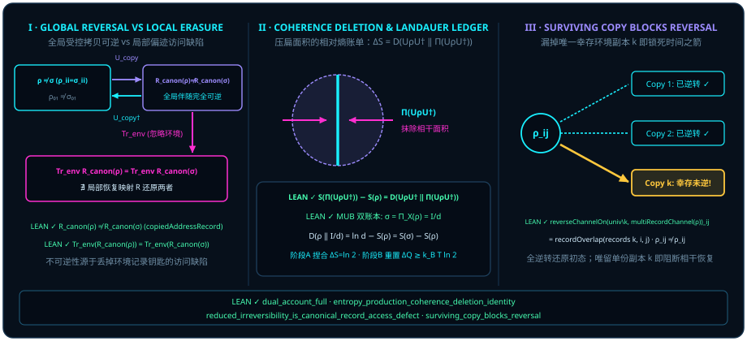

# 第八章 擦除的代价：兰道尔原理与热力学时间箭头 {#ch08-erasure-and-time-arrows}

正如本书作者所言：

> *“那本质上场就是时间,或者说线性时间只是场的粒子,而时间波则对应面积,整体上是一个场,一切都是时间场”*
>
> *“所以一切都结束了,没有任何例外,连观察者结构都是这样的”*

在[第七章](ch07-geometric-time-and-speed-limits.md)中，我们揭开了时间的二象性：连续扫掠的二维二向量有向面积 $\vv{A}\wedge\vv{B}$ 是**量子时间（时间波）**，而被幂等投影尺 $P^2 = P$ 切下的一串正交刻度则是**经典时间（线性时间粒子）**。正如作者在上面第一句引文中所作的终极概括——*“那本质上场就是时间,或者说线性时间只是场的粒子,而时间波则对应面积,整体上是一个场,一切都是时间场”*。

然而，只要把这两种时间放到一起，物理学里著名的“洛施密特时间反演佯谬（Loschmidt paradox）”便迎面扑来：**既然底层的幺正旋转 $U(t) = \exp((-it/\hbar)H_{\mathrm{op}})$ 是百分之百双向可逆的——把旋子倒转一个负角 $R(-\theta) = R(\theta)^\dagger$ 就能原路退回——为什么宏观世界与观察者的记忆却拥有一支铁板钉钉、有去无回的“热力学时间箭头”？为什么我们能记住昨天、却记不住明天？**

作为第二部《展翼·从线到面》的收官之章，本章将用四条经 Lean 4 内核验证的形式化定理，彻底算清这笔“从二维面积压扁成一维线”的信息与热力学总账：

1. **幺正旋转不产熵，唯有基捏合抹除面积才产熵**：每一步“幺正旋转 $U$ $+$ 计算基对角捏合 $\Pi$”所产生的系统冯·诺依曼熵增 $\Delta S_{\mathrm{pinch}} = S(\Pi(U\rho U^*)) - S(\rho)$，一分不差地等于被抹除的横向相干面积的量子相对熵 $D(U\rho U^* \,\|\, \Pi(U\rho U^*)) \ge 0$；
2. **抹平 $1$ 比特正交面积产生 $\ln 2$ 奈特系统熵增，并与非保单位兰道尔热浴重置严格区分**：在相互无偏基（MUB）下将 $d$ 维记录态保单位捏合抹平到最大混合态 $I_d/d$，系统的相对熵代价与冯·诺依曼熵增恒为 $\ln d - S(\rho)$（对单比特纯态恰为 $\ln 2 \approx 0.6931\text{ nats} = 1\text{ bit}$）；至于随后的非保单位逻辑重置如何将系统混合熵排入外部热浴，则见热力学文献注记 [@rem-landauer-stage-b-statement-literature] 与 [@rem-landauer-thermodynamic-bridge-literature]；
3. **连观察者结构都没有任何例外**：哪怕观察者拥有通天神通，把环境中绝大多数纠缠副本都做了相干逆转，只要茫茫宇宙里还漏掉**唯一一份**未逆转的幸存环境副本 $k$（其记录重叠度 $\neq 1$，且其余已逆转副本具幺模重叠度），初始非零相干面积就绝不可能复原！

## 8.1 幺正旋转的可逆性 vs. 信息擦除的不可逆性 {#sec-unitary-reversibility-vs-erasure}

为什么单纯的量子门旋转永远不会制造时间箭头？因为幺正演化 $\rho \mapsto U\rho U^*$ 只是抓起布洛赫球做刚体旋转：球皮上的纯态依然在球皮上，球肚子里的椭球依然保持原本的三个半轴长度，密度矩阵的本征值谱纹丝不动，冯·诺依曼熵 $S(U\rho U^*) = -\Tr(U\rho U^* \ln(U\rho U^*)) = S(\rho)$ 恒等守恒！

那么，不可逆的熵增究竟是在哪一瞬间诞生的？是在你为了在经典时间轴上写下一枚确定的粒子记录，执行**对角捏合投影** $\Pi_P(\sigma) = \sum_k P_k \sigma P_k$，强行把二维外积相干面积（副对角块 $P_j \sigma P_k,\, j \neq k$）从局部账本上抹除的那一瞬间！

让我们先算最彻底的一次正交擦除账本。假设系统原本沿着第一套标准正交记录基 $Z$（比如南北极计算基 $\{\lvert 0\rangle, \lvert 1\rangle\}$）写好了一份对角记录态 $\rho$（满足 $\Pi_Z(\rho) = \rho$）。现在，观察者转过 $90^\circ$，改用一套与 $Z$ **相互无偏（mutually unbiased bases, MUB）**的第二套正交记录基 $X$（比如东西赤道基 $\{\lvert +\rangle, \lvert -\rangle\}$，满足任意两基元重叠度 $|\langle z_j, x_k\rangle|^2 = \frac{1}{d}$）去重新捏合测量它，得到新状态 $\sigma = \Pi_X(\rho)$。

在 Lean 模块 `Quantum/Divergence/DualAccountFull` 中，下面这条“双账本全定理”证明了：正交无偏基 $X$ 的捏合会彻底抹平 $Z$ 基下的全部历史偏置，把状态一步推到熵最大的球心均匀态 $\omega = I_d / d$；而在这一过程中损失的相对于 $\sigma$ 的量子相对熵（Umegaki relative entropy）$D(\rho \,\|\, \sigma) := \Tr(\rho(\ln\rho - \ln\sigma))$，一分不差地等于冯·诺依曼熵的增量 $S(\sigma) - S(\rho) = \ln d - S(\rho)$！

::: {.theorem #thm-dual-account-full title="相互无偏记录基下的双账本相对熵与最大熵增全定理" lean="D5/S3/Quantum/Divergence/DualAccountFull.dual_account_full"}
设维数 $d \in \mathbb{N}$ 满足 $d \ge 1$（`[NeZero d]`），$Z, X : \mathrm{RankOneContext}\,d$ 为两组秩一测量上下文，其投影族均构成完备正交记录测量（`IsRecordMeasurement Z.projector`、`IsRecordMeasurement X.projector`），且满足相互无偏条件：

$$
\forall j, k \in \mathrm{Fin}\,d, \qquad \operatorname{overlap}(Z, X, j, k) = \frac{1}{d}.
$$

设密度态 $\rho, \sigma : \mathrm{DensityState}\,(\mathrm{Fin}\,d)$ 满足 $\rho$ 在 $Z$ 基下已对角化（$\operatorname{unreadState}(Z.\mathrm{projector}, \rho) = \rho$），且 $\sigma$ 为 $\rho$ 在 $X$ 基下的未读捏合态（$\operatorname{unreadState}(X.\mathrm{projector}, \rho) = \sigma$）。记零能谱吉布斯均匀混合态为 $\omega := \operatorname{gibbsState}(0) = \frac{1}{d}I_d$。则以下五条结论同时成立：

1. **正交无偏捏合直达均匀球心**：$\sigma = \omega$；
2. **相对熵参考态等价**：$D(\rho \,\|\, \sigma) = D(\rho \,\|\, \omega)$；
3. **自由度余量公式**：$D(\rho \,\|\, \sigma) = \ln d - S(\rho)$（伴随 [`entropy_freedom_segment`](lean:D5/S3/Quantum/Divergence/DualAccountFull.entropy_freedom_segment) 给出的紧区间界 $0 \le S(\rho) \le \ln d$ 及 $D(\rho \,\|\, \sigma) \ge 0$）；
4. **相对熵与冯·诺依曼熵增精确相等**：
   $$
   S(\sigma) - S(\rho) = D(\rho \,\|\, \sigma);
   $$
5. **跨基不动点唯一性**：$\operatorname{unreadState}(X.\mathrm{projector}, \rho) = \rho \iff \rho = \omega$。
:::

::: proof
因 $\rho$ 在秩一基 $Z$ 下对角化，可展开为 $\rho = \sum_j p_j Z_j$（其中 $\sum_j p_j = 1$）。对其作用 $X$ 基未读捏合算子，第 $k$ 个通道的权重为 $\sum_j p_j \operatorname{overlap}(Z, X, j, k) = \sum_j p_j \frac{1}{d} = \frac{1}{d}$；因 $\sum_k X_k = I_d$，求和即得 $\sigma = \frac{1}{d}I_d = \omega$（结论 1），代入相对熵第二变元立得 $D(\rho \,\|\, \sigma) = D(\rho \,\|\, \omega)$（结论 2）。再计算对均匀态 $\omega = \frac{1}{d}I_d$ 的相对熵：因 $-\Tr(\rho\ln\omega) = \ln d \cdot \Tr(\rho) = \ln d$ 且 $S(\omega) = \ln d$，有 $D(\rho \,\|\, \omega) = \ln d - S(\rho) = S(\omega) - S(\rho) = S(\sigma) - S(\rho)$（结论 3 与结论 4）。最后，若 $\rho$ 同时为 $X$ 基捏合的不动点，则 $\rho = \sigma = \omega$；反之 $\omega = \frac{1}{d}I_d$ 在任何完备正交投影族下显然保持不变（结论 5）。完整证明由 Lean 内核检查。
:::

请特别注意 [@thm-dual-account-full] 在单量子比特（$d = 2$）且初态 $\rho$ 为纯态（例如 $\rho = \lvert 0\rangle\langle 0\rvert$，$S(\rho) = 0$）时的特例：当你用赤道 $X$ 基去捏合北极纯态（或者先把 $\lvert 0\rangle$ 用阿达马门旋转到赤道 $\lvert +\rangle$，再用计算基 $Z$ 去捏合它）时，系统的冯·诺依曼熵从 $S(\rho) = 0$ 跃升至 $S(\omega) = \ln 2$，被抹除的相干面积恰好转化为系统内部的混合熵增

$$
\Delta S_{\mathrm{pinch}} = S(\sigma) - S(\rho) = D(\rho \,\|\, \omega) = \ln 2 \text{ nats} \;\;(\text{即整整 } 1\text{ bit})!
$$

::: {.viz src="erasure-ledger" preset="pinch" height="500"}
**先转，再捏合：熵多出 ln 2。** 转 90° 时，琥珀色的箭头从 |0⟩ 转到横躺，右边“系统的熵”一栏纹丝不动；捏合时，品红的横着的一份被抹掉，箭头缩成圆心，熵那一栏升到 ln 2 的虚线，“付给环境的热”仍是 0（[@thm-dual-account-full]）。
:::

## 8.2 相干擦除产熵与兰道尔原理的两阶段几何图景 {#sec-landauer-principle-geometry}

从纯量子叠加态出发完成一次完整的“未读测量 $+$ 寄存器重置”包含两个截然不同但首尾相接的阶段，必须将本书形式化的**阶段 A（保单位基捏合 / 相干面积抹除）**与外部物理文献中的**阶段 B（非保单位逻辑重置 / 热浴排热）**严格区分：

- **阶段 A（保单位基捏合 / 相干面积抹除，在本书 Lean 模块中严格形式化）**：可逆的幺正门 $U$ 先把状态旋转为 $\rho_U := U\rho U^*$（[`unitaryConjugateState`](lean:D5/S3/Quantum/Dynamics/EntropyProductionCoherenceDeletionIdentity.unitaryConjugateState)），此时本征值谱不变、冯·诺依曼熵一丝未增（$S(\rho_U) = S(\rho)$）；紧接着执行计算基对角捏合 $\Pi(\rho_U) := \operatorname{basisPinchingState}(\rho_U)$（[`basisPinchingState`](lean:D5/S3/Quantum/Dynamics/EntropyProductionCoherenceDeletionIdentity.basisPinchingState)，其对角香农熵公式见 [`von_neumann_entropy_basisPinchingState`](lean:D5/S3/Quantum/Dynamics/EntropyProductionCoherenceDeletionIdentity.von_neumann_entropy_basisPinchingState)），把横向副对角相干面积拍扁到对角线上。阶段 A（[@thm-entropy-production-coherence-deletion]，[`entropy_production_coherence_deletion_identity`](lean:D5/S3/Quantum/Dynamics/EntropyProductionCoherenceDeletionIdentity.entropy_production_coherence_deletion_identity)）严格证明的是计算基保单位捏合（$\Pi(I_n) = I_n$）下的**无量纲系统冯·诺依曼熵增** $\Delta S_{\mathrm{pinch}} = S(\Pi(\rho_U)) - S(\rho) = D(\rho_U \,\|\, \Pi(\rho_U)) \ge 0$（对单比特 $\lvert +\rangle\langle +\rvert \mapsto \frac{1}{2}I_2$ 恰为 $+\ln 2$ 奈特），该形式化定理本身不指定系统哈密顿量、外部热浴或兰道尔重置热耗（见 [@rem-landauer-thermodynamic-bridge-literature]）。

::: {.remark #rem-landauer-stage-b-statement-literature title="阶段 B：兰道尔原理与有限热浴重置排热（文献结果，未在本书形式化）"}
**文献结果，未在本书形式化。** 1961 年，IBM 物理学家罗尔夫·兰道尔（Rolf Landauer）提出计算热力学的基本原理——**兰道尔原理（Landauer's principle）**：“信息是物理的（Information is physical）”，在温度为 $T$ 的环境中每不可逆地擦除 $1$ 比特信息，至少必须向环境排放 $\Delta Q \ge k_B T \ln 2$ 的热量。在**阶段 B（非保单位逻辑重置 / 兰道尔热浴排热，详注见 [@rem-landauer-thermodynamic-bridge-literature]）**中，要想把已被阶段 A 捏合混化的寄存器状态（如 $\frac{1}{2}I_2$，$S = \ln 2$）重新清洗回纯参考态 $\lvert 0\rangle\langle 0\rvert$（$S = 0$）以便下一轮计算复用，必须把阶段 A 累积在系统内部的混合熵压缩掉（$\Delta S_S := S(\rho_{\mathrm{init}}) - S(\rho_{\mathrm{final}}) = +\ln 2$）。根据兰道尔原理与 Reeb–Wolf 有限热浴恒等式 $\beta\Delta Q_{\mathrm{bath}} = \Delta S_S + I(S':E') + D(\rho_E'\,\|\,\rho_E) \ge \Delta S_S$，这笔在阶段 A 中由相干面积转化而来的 $\ln 2$ 奈特熵增，最终在阶段 B 的重置过程中必须化作至少 $\Delta Q_{\min} = k_B T \ln 2$ 的焦耳热量排入温度为 $T$ 的环境热浴。
:::

在 Lean 模块 `Quantum/Dynamics/EntropyProductionCoherenceDeletionIdentity` 中，由对角函数演算定理 [`cfc_diagonal`](lean:D5/S3/Quantum/Dynamics/EntropyProductionCoherenceDeletionIdentity.cfc_diagonal)、[`cfc_log_diagonal`](lean:D5/S3/Quantum/Dynamics/EntropyProductionCoherenceDeletionIdentity.cfc_log_diagonal) 与捏合态熵展开 [`von_neumann_entropy_basisPinchingState`](lean:D5/S3/Quantum/Dynamics/EntropyProductionCoherenceDeletionIdentity.von_neumann_entropy_basisPinchingState) 汇成了下面这条主定理：**沿着任意由“幺正旋转 $U$ $+$ 计算基对角捏合 $\Pi$”迭代生成的离散演化序列 $\rho(k+1) = \Pi(U\rho(k)U^*)$，每一步的系统冯·诺依曼熵增都精确等于该步被抹除的横向相干面积相对熵 $D\bigl(\rho_U(k) \,\big\|\, \Pi(\rho_U(k))\bigr) \ge 0$，且前 $N$ 步的累积总熵增精确等于各步相干擦除相对熵之和！**

::: {.theorem #thm-entropy-production-coherence-deletion title="幺正演化后计算基捏合的单步与累积熵产生等于相干擦除相对熵恒等式" lean="D5/S3/Quantum/Dynamics/EntropyProductionCoherenceDeletionIdentity.entropy_production_coherence_deletion_identity"}
设 $n$ 为有限且具可判等性的指标类型（`[Fintype n] [DecidableEq n]`），$U \in U(n, \mathbb{C})$ 为幺正矩阵（`hU : U ∈ Matrix.unitaryGroup n ℂ`），$\rho : \mathbb{N} \to \mathrm{DensityState}\,n$ 为离散时间密度态序列。记第 $k$ 步经 $U$ 幺正共轭后的状态为 $\rho_U(k) := \operatorname{unitaryConjugateState}(U, h_U, \rho(k))$（[`unitaryConjugateState`](lean:D5/S3/Quantum/Dynamics/EntropyProductionCoherenceDeletionIdentity.unitaryConjugateState)），计算基对角捏合算子为 $\Pi := \operatorname{basisPinchingState}$（[`basisPinchingState`](lean:D5/S3/Quantum/Dynamics/EntropyProductionCoherenceDeletionIdentity.basisPinchingState)）。若演化序列满足单步迭代律

$$
\forall k \in \mathbb{N}, \qquad \rho(k + 1) = \Pi\bigl(\rho_U(k)\bigr),
$$

则以下单步与多步累积熵产生恒等式同时成立：

1. **单步熵产生等于相干擦除相对熵及非负性**：对任意步数 $k \in \mathbb{N}$，
   $$
   S\bigl(\rho(k + 1)\bigr) - S\bigl(\rho(k)\bigr) = D\Bigl(\rho_U(k) \,\Big\|\, \Pi\bigl(\rho_U(k)\bigr)\Bigr) \qquad\text{且}\qquad 0 \le D\Bigl(\rho_U(k) \,\Big\|\, \Pi\bigl(\rho_U(k)\bigr)\Bigr);
   $$
2. **前 $N$ 步累积熵产生等于各步相干擦除相对熵之和**：对任意总步数 $N \in \mathbb{N}$，
   $$
   S\bigl(\rho(N)\bigr) - S\bigl(\rho(0)\bigr) = \sum_{k \in \mathrm{Finset.range}\,N} D\Bigl(\rho_U(k) \,\Big\|\, \Pi\bigl(\rho_U(k)\bigr)\Bigr).
   $$
:::

::: proof
对任意单步状态 $\sigma = \rho(k)$，首先幺正共轭保持密度矩阵本征值不变，故冯·诺依曼熵守恒 $S(\rho_U(k)) = S(\rho(k))$。其次，由对角对数函数演算 [`cfc_log_diagonal`](lean:D5/S3/Quantum/Dynamics/EntropyProductionCoherenceDeletionIdentity.cfc_log_diagonal) 与捏合态冯·诺依曼熵公式 [`von_neumann_entropy_basisPinchingState`](lean:D5/S3/Quantum/Dynamics/EntropyProductionCoherenceDeletionIdentity.von_neumann_entropy_basisPinchingState)，计算基对角捏合 $\Pi = \operatorname{basisPinchingState}$ 满足对角投影迹恒等式 $\Tr\bigl(\rho_U(k)\ln\Pi(\rho_U(k))\bigr) = \Tr\bigl(\Pi(\rho_U(k))\ln\Pi(\rho_U(k))\bigr) = -S\bigl(\Pi(\rho_U(k))\bigr)$；代入量子相对熵定义即得 $D\bigl(\rho_U(k) \,\big\|\, \Pi(\rho_U(k))\bigr) = S\bigl(\Pi(\rho_U(k))\bigr) - S(\rho_U(k))$。结合 $S(\rho_U(k)) = S(\rho(k))$ 与迭代律 $\rho(k+1) = \Pi(\rho_U(k))$，立得单步恒等式 $S(\rho(k+1)) - S(\rho(k)) = D\bigl(\rho_U(k) \,\big\|\, \Pi(\rho_U(k))\bigr)$，且由对角对数凹性（克莱因不等式）保证 $0 \le D\bigl(\rho_U(k) \,\big\|\, \Pi(\rho_U(k))\bigr)$（结论 1）。最后，对 $N \in \mathbb{N}$ 施以数学归纳与裂项求和，左端 $\sum_{k=0}^{N-1} \bigl(S(\rho(k+1)) - S(\rho(k))\bigr)$ 首尾相消为 $S(\rho(N)) - S(\rho(0))$，右端逐项累加即得结论 2。完整证明由 Lean 内核检查。
:::

这就是热力学第二定律在量子几何层面的来龙去脉：**每一次不可逆的捏合熵增，都是把一块二维有向面积 $\vv{A}\wedge\vv{B}$ 强行压扁成一维对角粒子线时切下来的几何余项 $D\bigl(\rho_U(k) \,\big\|\, \Pi(\rho_U(k))\bigr) \ge 0$！**

::: {.viz src="erasure-ledger" preset="steps" height="500"}
**一步一步捏：每一块熵等于这一步的 D。** 每步转 50° 再捏合，连做三步：琥珀色的箭头一级一级落到青色的记录线上、越来越短；熵那一栏一块一块叠起来，每块标着这一步的 D₁、D₂、D₃，叠起来就是总熵增（[@thm-entropy-production-coherence-deletion]）。
:::

::: {.example #ex-landauer-one-bit-ledger title="单比特阿达马造波、计算基保单位捏合与非保单位兰道尔重置的两阶段 1 比特（ln 2）详单"}
让我们把单量子比特从纯态 $\rho_0 = \lvert 0\rangle\langle 0\rvert$ 出发、经阿达马门 $H = \frac{1}{\sqrt{2}}(X + Z)$ 旋转到赤道叠加态 $\rho_H = H\rho_0 H^* = \lvert +\rangle\langle +\rvert$、经计算基保单位捏合变为 $\Pi(\rho_H) = \frac{1}{2}I_2$，最后在室温热浴中非保单位重置回 $\lvert 0\rangle\langle 0\rvert$ 的完整循环列成一张两阶段对账单：

1. **前置幺正旋转（阿达马门展翼 $\rho_0 \mapsto \rho_H$）**：
   $$
   \rho_0 = \begin{pmatrix} 1 & 0 \\ 0 & 0 \end{pmatrix} \;\xrightarrow{\;H\,\cdot\,H^*\;}\; \rho_H = \frac{1}{2}\begin{pmatrix} 1 & 1 \\ 1 & 1 \end{pmatrix}.
   $$
   纯幺正旋转保持本征谱不变而等熵：$S(\rho_H) = S(\rho_0) = 0$，纯度保持 $\Tr(\rho_H^2) = 1$，撑开横向副对角相干元 $\rho_{01} = \rho_{10} = \frac{1}{2}$。
2. **阶段 A（保单位计算基捏合抹除相干面积 $\rho_H \mapsto \Pi(\rho_H) = \frac{1}{2}I_2$，已由 Lean 形式化）**：
   - **希尔伯特—施密特相干质量账单（[@cor-pinching-pythagorean]）**：总范数平方 $\langle\rho_H, \rho_H\rangle_{\mathrm{HS}} = 1$ 被正交拆分为对角粒子部分 $\langle\Pi(\rho_H), \Pi(\rho_H)\rangle_{\mathrm{HS}} = (\frac{1}{2})^2 + (\frac{1}{2})^2 = \frac{1}{2}$ 与被抹除的副对角波动相干质量 $|\rho_{01}|^2 + |\rho_{10}|^2 = (\frac{1}{2})^2 + (\frac{1}{2})^2 = \frac{1}{2}$；
   - **系统冯·诺依曼相对熵增账单（[@thm-dual-account-full] 与 [@thm-entropy-production-coherence-deletion]）**：保单位捏合删去相干面积，使**系统自身**的无量纲冯·诺依曼熵增加
     $$
     \Delta S_{\mathrm{pinch}} = S\bigl(\Pi(\rho_H)\bigr) - S(\rho_0) = D\Bigl(\lvert +\rangle\langle +\rvert \,\Big\|\, \frac{1}{2}I_2\Bigr) = \ln 2 \approx 0.693147\text{ nats} = 1\text{ bit}.
     $$
3. **阶段 B（非保单位逻辑重置 $\frac{1}{2}I_2 \mapsto \lvert 0\rangle\langle 0\rvert$ 与室温热浴排热 $T = 300\text{ K}$；文献结果，未在本书形式化，参见 [@rem-landauer-thermodynamic-bridge-literature]）**：
   要将阶段 A 产生的最大混合态 $\frac{1}{2}I_2$（$S = \ln 2$）重新擦除重置回纯态 $\lvert 0\rangle\langle 0\rvert$（$S = 0$），必须把系统的熵压缩掉 $\Delta S_S = S(\frac{1}{2}I_2) - S(\lvert 0\rangle\langle 0\rvert) = +\ln 2$。按兰道尔原理与 Reeb–Wolf 有限热浴不等式 $\beta\Delta Q_{\mathrm{bath}} \ge \Delta S_S = \ln 2$，乘以玻尔兹曼常数 $k_B \approx 1.380649 \times 10^{-23}\text{ J/K}$ 与室温 $T = 300\text{ K}$，向环境热浴排出的最小物理热量为
   $$
   \Delta Q_{\min} = k_B T \ln 2 \approx (1.380649 \times 10^{-23}\text{ J/K}) \times (300\text{ K}) \times 0.693147 \approx 2.87 \times 10^{-21}\text{ J}\;(\approx 17.9\text{ meV}).
   $$
:::

::: {.viz src="erasure-ledger" preset="cycle" height="500"}
**两阶段：熵先记进系统，再付成热。** 阶段 A（转 90° 再捏合）里，熵那一栏升到 ln 2，热为 0；阶段 B 的理想复位把箭头拉回 |0⟩，熵那一栏回到 0，“付给环境的热”升到 ln 2，正好碰到“下界”那条横线。阶段 B 的热量是文献结果，“理想复位”是取等的理想极限，见 [@rem-landauer-thermodynamic-bridge-literature]。
:::

::: {.remark #rem-density-matrix-balance-inputs-literature title="密度矩阵层面的热浴平衡与幺正平衡（文献结果，未在本书形式化）"}
**文献结果，未在本书形式化。** [@ex-landauer-one-bit-ledger] 的阶段 B 引用了不等式 $\beta\Delta Q_{\mathrm{bath}} \ge \Delta S_S$，其背后是一张三行的账单（密度矩阵层面的物理背景详见 [@rem-landauer-thermodynamic-bridge-literature]）：

- **热浴平衡（文献输入）**：热浴吸收的热量（乘以逆温度）等于热浴的熵变加上热浴被推离平衡的相对熵，$\beta Q = \Delta S_{\mathrm{res}} + D$；
- **幺正平衡（文献输入）**：系统与热浴初始无关联、联合演化是幺正的，所以末态互信息等于两边熵变之和，$I = \Delta S_{\mathrm{sys}} + \Delta S_{\mathrm{res}}$；
- **代数推论**：消去 $\Delta S_{\mathrm{res}}$，得 $\beta Q = -\Delta S_{\mathrm{sys}} + I + D$（其中 $\Delta S_{\mathrm{sys}}$ 为末减初的系统熵变化量，故 $-\Delta S_{\mathrm{sys}}$ 即 [@ex-landauer-one-bit-ledger] 中的系统熵减 $\Delta S_S$）。
:::

将 [@rem-density-matrix-balance-inputs-literature] 中的前两条平衡式作为实数公理假设，从前两行到第三行、再到下界与取等条件的纯实数推理已冻结在 Lean 里。

::: {.proposition #prop-landauer-identity-from-balances title="由热浴平衡与幺正平衡推出热量—熵—信息恒等式" lean="D5/S3/DivergenceSupport/LandauerIdentity.landauer_identity_from_balances"}
设 $\beta$、$Q$、$\Delta S_{\mathrm{sys}}$、$\Delta S_{\mathrm{res}}$、$I$、$D$ 为实数（Lean 中依次为 `beta`、`heat`、`systemEntropyChange`、`reservoirEntropyChange`、`mutualInformation`、`reservoirDivergence`）。若

1. **热浴平衡（`hReservoir`）**：$\beta\,Q = \Delta S_{\mathrm{res}} + D$；
2. **幺正平衡（`hUnitary`）**：$I = \Delta S_{\mathrm{sys}} + \Delta S_{\mathrm{res}}$；

则

$$
\beta\,Q \;=\; -\Delta S_{\mathrm{sys}} + I + D .
$$
:::

::: proof
由 `hUnitary` 解出 $\Delta S_{\mathrm{res}} = I - \Delta S_{\mathrm{sys}}$，代入 `hReservoir` 即得；Lean 中由线性算术 `linarith` 完成。源文件还附有两条反例，说明去掉任何一条前提结论都可以不成立。完整证明由 Lean 内核检查。
:::

::: {.corollary #cor-landauer-bound-saturation title="兰道尔下界及其取等与严格的判据" lean="D5/S3/DivergenceSupport/LandauerBound.landauer_bound_of_balance D5/S3/DivergenceSupport/LandauerSaturation.landauer_saturation_iff D5/S3/DivergenceSupport/LandauerSaturation.landauer_strict_iff"}
设 $\beta$、$Q$、$\Delta S$、$I$、$D$ 为实数（Lean 中依次为 `beta`、`heat`、`entropyChange`、`mutualInfo`、`divergence`），满足

- **平衡式（`hbalance`）**：$\beta\,Q = -\Delta S + I + D$；
- **非负性（`hmutualInfo`、`hdivergence`）**：$0 \le I$ 且 $0 \le D$。

则以下三项同时成立：

1. **下界**：$-\Delta S \le \beta\,Q$；
2. **取等判据**：$-\Delta S = \beta\,Q$ 当且仅当 $I = 0$ 且 $D = 0$；
3. **严格判据**：$-\Delta S < \beta\,Q$ 当且仅当 $0 < I + D$。
:::

::: proof
平衡式说明差额 $\beta Q - (-\Delta S)$ 恰好等于 $I + D$（`landauer_slack_of_balance`）。两项非负，故差额非负，这是结论 1（`landauer_bound_of_balance`）。差额为零当且仅当 $I + D = 0$；在两项都非负时这等价于 $I = 0$ 且 $D = 0$（`add_eq_zero_iff_of_nonneg`），这是结论 2（`landauer_saturation_iff`）。结论 3 把结论 1 与“差额不为零”合起来（`landauer_strict_iff`）。完整证明由 Lean 内核检查。
:::

[@prop-landauer-identity-from-balances] 与 [@cor-landauer-bound-saturation] 是纯实数层面的陈述：它们不知道 $Q$ 是热量、$I$ 是互信息。它们保证的是账目本身不会出错——只要两条平衡式成立、两项余量非负，下界与取等条件就跟着成立。把字母换成物理量的那一步，仍由文献承担。

兰道尔界什么时候取不到等号？[@cor-landauer-bound-saturation] 的结论 2 给了判据：要么系统与热浴之间留下了关联（$I > 0$），要么热浴被推离了平衡（$D > 0$）。下面用能想到的最小热浴把这笔账算一遍。

::: {.example #ex-one-qubit-reservoir-swap-erasure title="用一个热浴量子比特擦除：有限热浴的超额热量"}
本例中的两条密度矩阵平衡式属于**文献结果，未在本书形式化**；各项数值由定义直接计算，并用 [@prop-landauer-identity-from-balances] 的恒等式交叉核对。熵以奈特为单位。

**模型。** 系统是最大混合的单比特 $\rho_S = \frac12 I_2$。热浴也是一个量子比特，处于吉布斯态 $\rho_E = \operatorname{diag}(p,\, 1 - p)$，其中 $p > \frac12$ 是基态布居数，能级间隔 $E$ 满足 $\beta E = \ln\frac{p}{1-p}$。联合幺正取交换门 SWAP：演化之后系统拿到 $\operatorname{diag}(p, 1-p)$，热浴拿到 $\frac12 I_2$，两者仍是直积态。

**逐项计算。** 记二元熵 $h(p) = -p\ln p - (1-p)\ln(1-p)$。

- 系统熵变：$\Delta S_{\mathrm{sys}} = h(p) - \ln 2 < 0$，系统熵减为 $\ln 2 - h(p)$；
- 热浴熵变：$\Delta S_{\mathrm{res}} = \ln 2 - h(p)$；
- 末态互信息：$I = 0$（末态是直积态），与幺正平衡 $I = \Delta S_{\mathrm{sys}} + \Delta S_{\mathrm{res}}$ 相符；
- 热浴相对熵：$D = D\bigl(\tfrac12 I_2 \,\big\|\, \rho_E\bigr) = -\ln 2 - \tfrac12\ln\bigl(p(1-p)\bigr)$；
- 热量：热浴激发态布居数从 $1 - p$ 升到 $\frac12$，所以 $\beta Q = \beta E\,\bigl(\tfrac12 - (1 - p)\bigr) = \bigl(p - \tfrac12\bigr)\ln\frac{p}{1-p}$，展开后等于 $-h(p) - \tfrac12\ln\bigl(p(1-p)\bigr)$，与热浴平衡 $\beta Q = \Delta S_{\mathrm{res}} + D$ 相符。

**数值。**

| 基态布居数 $p$ | 系统熵减 $-\Delta S_{\mathrm{sys}}$ | 互信息 $I$ | 相对熵 $D$ | 热量 $\beta Q$ | $\beta Q / (-\Delta S_{\mathrm{sys}})$ |
| :---: | :---: | :---: | :---: | :---: | :---: |
| $0.6$ | $0.0201$ | $0$ | $0.0204$ | $0.0405$ | $2.01$ |
| $0.75$ | $0.1308$ | $0$ | $0.1438$ | $0.2747$ | $2.10$ |
| $0.9$ | $0.3681$ | $0$ | $0.5108$ | $0.8789$ | $2.39$ |
| $0.99$ | $0.6371$ | $0$ | $1.6145$ | $2.2516$ | $3.53$ |
| $0.999$ | $0.6852$ | $0$ | $2.7612$ | $3.4465$ | $5.03$ |

每一行都满足 $\beta Q = -\Delta S_{\mathrm{sys}} + I + D$，也都满足兰道尔下界，而且都是严格不等：因为 $D > 0$，按 [@cor-landauer-bound-saturation] 的结论 3，等号取不到。

**读法。** 想擦得越干净（$p \to 1$，系统末态越接近纯态 $\lvert 0\rangle\langle 0\rvert$），系统熵减趋于上限 $\ln 2 \approx 0.6931$，而超额项 $D$ 无界增长。只用一个热浴量子比特、一次交换，是做不到以 $k_B T\ln 2$ 的代价擦除一比特的；多付的热量恰好等于热浴被推离平衡的相对熵。要逼近兰道尔界，就得让 $D$ 与 $I$ 都趋于零，这需要更大的热浴和更缓慢的过程。
:::

::: {.viz src="erasure-ledger" preset="bath" height="500"}
**一个热浴比特：多付的就是 D。** 先把箭头捏成圆心，再与 p = 0.9 的热浴比特交换：箭头只回到 0.8 高，熵减 0.368；“付给环境的热”是 0.879，比“下界”横线高出斜线的一截 0.511，那是小圆里的热浴比特从平衡位置（空心圈）被推到圆心的 D。拖动布居数 p，可以逐行重现上表（[@cor-landauer-bound-saturation]）。
:::

## 8.3 观察者记忆与时间之箭：为什么“记住过去”必须消耗自由能？ {#sec-observer-memory-time-arrow}

现在，让我们把手术刀对准站在实验台前的**观察者自己**，印证本章开篇的第二句名言：*“所以一切都结束了,没有任何例外,连观察者结构都是这样的”*。

当观察者（或环境）通过受控拷贝门 $U_{\mathrm{copy}}$ 读取并记住系统的状态时，[第四章](ch04-decoherence.md)的 [@thm-reduced-access-defect] 已经给出了初步诊断。在本章对应的 Lean 模块 `Quantum/Decoherence/CanonicalRecordAccessRecovery` 中，定理 [`canonical_copied_address_record_eq_prior`](lean:D5/S3/Quantum/Decoherence/CanonicalRecordAccessRecovery.canonical_copied_address_record_eq_prior) 与 [`reduced_irreversibility_is_canonical_record_access_defect`](lean:D5/S3/Quantum/Decoherence/CanonicalRecordAccessRecovery.reduced_irreversibility_is_canonical_record_access_defect) 进一步针对典范拷贝地址记录 `copiedAddressRecord` 生成的联合记录态 $R_{\mathrm{canon}}(\tau) := \operatorname{controlledRecordJointState}(\mathrm{copiedAddressRecord}, \tau)$，严格锁定了全局可逆性与局部偏迹不可恢复性：

::: {.theorem #thm-reduced-irreversibility-access-defect title="典范受控地址记录的局部边缘重合与局部恢复不可能性定理" lean="D5/S3/Quantum/Decoherence/CanonicalRecordAccessRecovery.reduced_irreversibility_is_canonical_record_access_defect"}
设 $\rho, \sigma \in M_2(\mathbb{C})$（`QubitMatrix`）为两个对角元处处相等（$\forall i \in \mathrm{Fin}\,2,\, \rho_{ii} = \sigma_{ii}$）但副对角相干元不同（$\exists i, j \in \mathrm{Fin}\,2,\, i \neq j \land \rho_{ij} \neq \sigma_{ij}$）的单比特矩阵。记受控地址拷贝幺正算子为 $U_{\mathrm{copy}} := \mathrm{copyUnitary}$，空白环境嵌入为 $B(\tau) := \operatorname{blankEnvironmentJointState}(\tau)$，典范受控地址联合记录态为 $R_{\mathrm{canon}}(\tau) := \operatorname{controlledRecordJointState}(\mathrm{copiedAddressRecord}, \tau)$（[`canonical_copied_address_record_eq_prior`](lean:D5/S3/Quantum/Decoherence/CanonicalRecordAccessRecovery.canonical_copied_address_record_eq_prior)），对环境求偏迹为 $\Tr_{\mathrm{env}} := \mathrm{traceEnvironment}$。则以下六组（共八个合取项）结论同时成立：

1. **全局拷贝算子幺正性**：$U_{\mathrm{copy}} \in U(\mathrm{Fin}\,2 \times \mathrm{Fin}\,2, \mathbb{C})$；
2. **前向幺正演化生成典范记录态**：$\operatorname{unitaryEvolution}(U_{\mathrm{copy}}, B(\rho)) = R_{\mathrm{canon}}(\rho)$ 且 $\operatorname{unitaryEvolution}(U_{\mathrm{copy}}, B(\sigma)) = R_{\mathrm{canon}}(\sigma)$；
3. **局部环境偏迹完全重合**：
   $$
   \Tr_{\mathrm{env}}\bigl(R_{\mathrm{canon}}(\rho)\bigr) = \Tr_{\mathrm{env}}\bigl(R_{\mathrm{canon}}(\sigma)\bigr);
   $$
4. **全局联合记录严格可区分**：$R_{\mathrm{canon}}(\rho) \neq R_{\mathrm{canon}}(\sigma)$；
5. **局部恢复映射的不可能性**：不存在任何仅以单比特约化态为输入的恢复映射 $\mathcal{R} : M_2(\mathbb{C}) \to M_{\mathrm{Fin}\,2 \times \mathrm{Fin}\,2}(\mathbb{C})$ 能同时满足 $\mathcal{R}\bigl(\Tr_{\mathrm{env}}(R_{\mathrm{canon}}(\rho))\bigr) = R_{\mathrm{canon}}(\rho)$ 与 $\mathcal{R}\bigl(\Tr_{\mathrm{env}}(R_{\mathrm{canon}}(\sigma))\bigr) = R_{\mathrm{canon}}(\sigma)$；
6. **全局伴随幺正精确可逆还原**：$\operatorname{unitaryEvolution}(U_{\mathrm{copy}}^*, R_{\mathrm{canon}}(\rho)) = B(\rho)$ 且 $\operatorname{unitaryEvolution}(U_{\mathrm{copy}}^*, R_{\mathrm{canon}}(\sigma)) = B(\sigma)$。
:::

::: proof
由 [`canonical_copied_address_record_eq_prior`](lean:D5/S3/Quantum/Decoherence/CanonicalRecordAccessRecovery.canonical_copied_address_record_eq_prior)，典范拷贝地址记录 `copiedAddressRecord` 与受控置换拷贝记录 `priorCopiedRecord` 完全相等，故可直接重写并调用 [@thm-reduced-access-defect]（`reduced_state_irreversibility_is_record_access_defect`）得出全部八个合取结论。特别地，对结论 3，因为 `copiedAddressRecord` 的两个分支地址正交（克罗内克 $\delta_{ij}$ 重叠），求偏迹 $\Tr_{\mathrm{env}}(R_{\mathrm{canon}}(\tau))$ 恰好抹去副对角相干元而保留对角元 $\tau_{ii}$（即等于标准基对角捏合 $\Pi(\tau)$），再由题设对角元相等 $\rho_{ii} = \sigma_{ii}$ 立得 $\Tr_{\mathrm{env}}(R_{\mathrm{canon}}(\rho)) = \Tr_{\mathrm{env}}(R_{\mathrm{canon}}(\sigma))$；而因全局状态 $R_{\mathrm{canon}}(\rho) \neq R_{\mathrm{canon}}(\sigma)$，任何单值函数 $\mathcal{R}$ 都不可能把同一个约化输入映成两个不同的全局输出（结论 4 与结论 5）。完整证明由 Lean 内核检查。
:::

::: {.viz src="erasure-ledger" preset="copy" height="500"}
**拷贝：局部的熵涨了，热一分没付，还能撤回。** 转 90° 后拷贝进记录比特 E：系统这一侧的琥珀色箭头缩成圆心，熵那一栏升到 ln 2（斜线表示这只是局部的熵），“付给环境的热”是 0；下一步撤回拷贝，箭头回到横躺，熵回到 0（[@thm-reduced-irreversibility-access-defect]）。
:::

有人可能会问：“既然全局受控拷贝 $U_{\mathrm{copy}}$ 是可逆的（结论 6），那我们在宏观实验室里为什么不能像电影倒放一样，随手把已经发生的退相干倒转回来？”

因为在一个真实的宏观世界里，系统并不是只和**一份**孤立环境记录打交道，而是像石头砸进池塘一样，瞬间把单比特分支记录扩散拷贝到了由成千上万个环境自由度（光子、声子、空气分子、仪器指针乃至观察者神经元）组成的有限副本集合 $\mathrm{Copy}$ 上！

在 Lean 模块 `ObserverMemory/JointCoherentReversal` 中，我们对这幅多副本环境记忆与相干时间反演图景做了严格的形式化证明。设 $\mathrm{Copy}$ 为有限且具可判等性的副本指标类型（`[Fintype Copy] [DecidableEq Copy]`），每个环境记录副本属于单比特双分支记录类型 $\mathrm{EnvironmentRecord} := \mathrm{Fin}\,2 \to \mathrm{Fin}\,2 \to \mathbb{C}$，$\mathrm{records} : \mathrm{Copy} \to \mathrm{EnvironmentRecord}$ 为记录副本族，$\rho \in M_2(\mathbb{C})$（`QubitMatrix`）为单比特矩阵。前向多副本信道 $\operatorname{multiRecordChannel}(\mathrm{records}, \rho)$ 将第 $(i, j)$ 元乘以全部副本的记录重叠因子之积 $\prod_{l \in \mathrm{Copy}} \operatorname{recordOverlap}(\mathrm{records}(l), i, j)$；而对子集 $S \subseteq \mathrm{Copy}$ 内的副本实施时间反演记录（[`reverseRecord`](lean:D5/S3/ObserverMemory/JointCoherentReversal.reverseRecord)、[`reverseOn`](lean:D5/S3/ObserverMemory/JointCoherentReversal.reverseOn)）后再作用的信道记为 $\operatorname{reverseChannelOn}(S, \mathrm{records}, \cdot)$（[`reverseChannelOn`](lean:D5/S3/ObserverMemory/JointCoherentReversal.reverseChannelOn)）：

- 引理 [`reverse_record_overlap`](lean:D5/S3/ObserverMemory/JointCoherentReversal.reverse_record_overlap) 证明：对单个副本执行时间反演 `reverseRecord` 会将其分支重叠因子**取复共轭**：
  $$
  \operatorname{recordOverlap}\bigl(\operatorname{reverseRecord}(r), i, j\bigr) = \overline{\operatorname{recordOverlap}(r, i, j)};
  $$
  因此，当每个已逆转副本 $l$ 在分支 $(i, j)$ 处具有**幺模重叠因子**（$\overline{\operatorname{recordOverlap}(\mathrm{records}(l), i, j)} \cdot \operatorname{recordOverlap}(\mathrm{records}(l), i, j) = 1$）时，前向因子与反演共轭因子相乘恰好抵消为 $1$！若观察者能把宇宙中**全部**副本（$S = \mathrm{Finset.univ}$）悉数逆转，联合相干逆转定理 [`joint_coherent_reversal`](lean:D5/S3/ObserverMemory/JointCoherentReversal.joint_coherent_reversal) 保证初态矩阵元 $\rho_{ij}$ 精确复原；
- 但哪怕观察者逆转了除 $k$ 以外的**所有其他副本**（即对 $S = \mathrm{Finset.univ.erase}\,k$ 实施相干逆转，且所有 $l \neq k$ 均满足幺模抵消条件 $\overline{c_l} c_l = 1$），只要宇宙角落里还漏掉**唯一一份**未逆转的幸存副本 $k \in \mathrm{Copy}$，且该副本在 $(i, j)$ 处的重叠因子不为 $1$（$\operatorname{recordOverlap}(\mathrm{records}(k), i, j) \neq 1$），那么单幸存副本合成定理 [`one_surviving_copy_composition_apply`](lean:D5/S3/ObserverMemory/JointCoherentReversal.one_surviving_copy_composition_apply) 与下面的命题就铁面无私地宣告：**任何非零相干元 $\rho_{ij} \neq 0$ 都绝不可能复原！（双副本显式充要判据亦见 [`two_copy_joint_reversal_certificate`](lean:D5/S3/ObserverMemory/JointCoherentReversal.two_copy_joint_reversal_certificate)。）**

::: {.proposition #prop-surviving-copy-blocks-reversal title="唯一未逆转幸存环境副本阻断相干时间反演定理" lean="D5/S3/ObserverMemory/JointCoherentReversal.surviving_copy_blocks_reversal"}
设 $\mathrm{Copy}$ 为有限且具可判等性的副本指标类型（`[Fintype Copy] [DecidableEq Copy]`），$\mathrm{records} : \mathrm{Copy} \to \mathrm{EnvironmentRecord}$ 为单比特环境记录副本族，$\rho \in M_2(\mathbb{C})$（`QubitMatrix`）为单比特矩阵，$i, j \in \mathrm{Fin}\,2$ 为矩阵指标，$k \in \mathrm{Copy}$ 为某一特定环境副本。假设满足以下三条条件：

1. **其余副本的重叠因子均为幺模（可逆相位）**：
   $$
   \forall l \in \mathrm{Copy},\quad l \neq k \implies \overline{\operatorname{recordOverlap}\bigl(\mathrm{records}(l), i, j\bigr)} \cdot \operatorname{recordOverlap}\bigl(\mathrm{records}(l), i, j\bigr) = 1;
   $$
2. **幸存副本 $k$ 留有非平凡记录痕迹**：$\operatorname{recordOverlap}\bigl(\mathrm{records}(k), i, j\bigr) \neq 1$；
3. **初始矩阵元非零**：$\rho_{ij} \neq 0$。

则即便对其余全部副本 $\mathrm{Finset.univ.erase}\,k$ 实施相干逆转信道 [`reverseChannelOn`](lean:D5/S3/ObserverMemory/JointCoherentReversal.reverseChannelOn)，作用在前向多副本演化态 $\operatorname{multiRecordChannel}(\mathrm{records}, \rho)$ 上的第 $(i, j)$ 元仍严格不等于初值：

$$
\operatorname{reverseChannelOn}\Bigl(\mathrm{Finset.univ.erase}\,k,\, \mathrm{records},\, \operatorname{multiRecordChannel}(\mathrm{records}, \rho)\Bigr)_{ij} \neq \rho_{ij}.
$$
:::

::: proof
首先由 [`one_surviving_copy_composition_apply`](lean:D5/S3/ObserverMemory/JointCoherentReversal.one_surviving_copy_composition_apply)（其内部利用 [`reverse_record_overlap`](lean:D5/S3/ObserverMemory/JointCoherentReversal.reverse_record_overlap) 将 $\mathrm{Finset.univ.erase}\,k$ 中每个副本 $l \neq k$ 的逆转重叠因子化为复共轭 $\overline{\operatorname{recordOverlap}(\mathrm{records}(l), i, j)}$，再由条件 1 的幺模假设 $\overline{c_l} c_l = 1$ 逐项抵消为 $1$），连乘积中唯一剩下的因子正是未逆转幸存副本 $k$ 的前向重叠因子：

$$
\begin{aligned}
&\operatorname{reverseChannelOn}\Bigl(\mathrm{Finset.univ.erase}\,k,\, \mathrm{records},\, \operatorname{multiRecordChannel}(\mathrm{records}, \rho)\Bigr)_{ij} \\
&= \operatorname{recordOverlap}\bigl(\mathrm{records}(k), i, j\bigr) \cdot \rho_{ij}.
\end{aligned}
$$

假若上式左端等于 $\rho_{ij}$，则有 $\operatorname{recordOverlap}(\mathrm{records}(k), i, j) \cdot \rho_{ij} = 1 \cdot \rho_{ij}$。因复数域 $\mathbb{C}$ 无零因子且条件 3 给出 $\rho_{ij} \neq 0$，由右消去律立得 $\operatorname{recordOverlap}(\mathrm{records}(k), i, j) = 1$，与条件 2 的 $\operatorname{recordOverlap}(\mathrm{records}(k), i, j) \neq 1$ 直接矛盾！故相干元严格无法复原。完整证明由 Lean 内核检查。
:::

[@prop-surviving-copy-blocks-reversal] 道尽了宏观热力学时间箭头的全部秘密：一颗光子飞向夜空深处，就足以充当那枚无人能够追回的幸存证人副本 $k$，把刚才发生过的测量永远锁死在“过去”！而观察者自己的有限记忆寄存器要想在下一刻继续记录新的历史刻度，就必须先经历阶段 A 的保单位捏合（根据 [@thm-entropy-production-coherence-deletion] 产生系统熵增 $\Delta S_{\mathrm{pinch}} = D(\rho_U \,\|\, \Pi(\rho_U)) \ge 0$），再经历阶段 B 的非保单位擦除重置（按 [@rem-landauer-thermodynamic-bridge-literature] 将这笔熵压缩排入热浴并耗散至少 $k_B T \Delta S_S$ 的热量）——这就是为什么任何生命体与计算机“记住过去、迈向未来”都必须源源不断地消耗自由能、向环境排放热量！

::: {.remark #rem-landauer-thermodynamic-bridge-literature title="兰道尔擦除原理、贝内特可逆计算与 Reeb–Wolf 有限热浴不等式（文献结果，未在本书形式化）"}
**文献结果，未在本书形式化。** 本章的 [@thm-dual-account-full] 与 [@thm-entropy-production-coherence-deletion] 在 Lean 4 中严格证明了**阶段 A（保单位基捏合抹除相干面积）**在无量纲信息论层面的精确恒等式 $S(\Pi(U\rho U^*)) - S(\rho) = D(U\rho U^* \,\|\, \Pi(U\rho U^*)) \ge 0$ 及相互无偏捏合熵增 $\ln d - S(\rho)$（对单比特纯态为 $\ln 2$ 奈特的系统熵增）。而在**阶段 B（非保单位逻辑重置，如将混合态 $\frac{1}{2}I_2$ 压缩回纯参考态 $\lvert 0\rangle\langle 0\rvert$）**中，将系统熵减 $\Delta S_S := S(\rho_S) - S(\rho_S')$ 乘以物理温度 $k_B T$ 换算为热浴焦耳热量 $\Delta Q$ 的热力学桥梁，来自以下经典物理文献：

1. **兰道尔擦除原理（R. Landauer, 1961）与贝内特逻辑可逆计算（C. H. Bennett, 1973, 1982）**：Rolf Landauer 在 *Irreversibility and heat generation in the computing process*（IBM J. Res. Dev. **5**, 183–191, 1961）中指出，逻辑不可逆的“多对一”非保单位重置操作（如 $\frac{1}{2}I_2 \mapsto \lvert 0\rangle\langle 0\rvert$）必须压缩计算寄存器的信息熵，按热力学第二定律向温度为 $T$ 的环境排放至少 $\Delta Q \ge k_B T \ln 2$ 的热量；Charles H. Bennett（IBM J. Res. Dev. **17**, 525–532, 1973；Int. J. Theor. Phys. **21**, 905–940, 1982）进而证明，任何计算本身都可以通过幺正/双射门可逆地完成（对应 [`unitaryConjugateState`](lean:D5/S3/Quantum/Dynamics/EntropyProductionCoherenceDeletionIdentity.unitaryConjugateState) 的等熵性质 $S(U\rho U^*) = S(\rho)$），唯有在擦除重置辅助寄存器（ancilla resetting）时才必须支付兰道尔热代价，从而彻底消解了麦克斯韦妖（Maxwell's demon）悖论。
2. **Reeb–Wolf 有限量子热浴精确兰道尔恒等式与不等式（D. Reeb & M. M. Wolf, 2014）**：在 *An improved Landauer principle with finite-size corrections*（New J. Phys. **16**, 103011, 2014）中，对于初始互不关联的系统 $\rho_S$ 与处于逆温度 $\beta = 1/(k_B T)$ 吉布斯热平衡态 $\rho_E = e^{-\beta H_E}/Z_E$ 的有限维量子热浴，在任意联合幺正演化 $\rho_{SE}' = U(\rho_S \otimes \rho_E)U^*$ 下，热浴吸收的热量 $\beta\Delta Q_{\mathrm{bath}} := \beta\Tr\bigl(H_E(\rho_E' - \rho_E)\bigr)$ 与系统熵减 $\Delta S_S := S(\rho_S) - S(\rho_S')$ 满足精确恒等式
   $$
   \beta\Delta Q_{\mathrm{bath}} = \Delta S_S + I(S' : E') + D(\rho_E' \,\|\, \rho_E) \ge \Delta S_S,
   $$
   其中联合互信息 $I(S' : E') \ge 0$ 与热浴相对熵 $D(\rho_E' \,\|\, \rho_E) \ge 0$ 均非负，从而在微观量子力学框架下无需热力学极限假设即严格导出 $\Delta Q_{\mathrm{bath}} \ge k_B T \Delta S_S$。

上述涉及物理玻尔兹曼常数 $k_B$、热浴哈密顿量 $H_E$ 与焦耳热量 $\Delta Q_{\mathrm{bath}}$ 的阶段 B 热力学重置换算作为物理背景引述。其中有一层已由 Lean 验证：只要承认热浴平衡 $\beta Q = \Delta S_{\mathrm{res}} + D$ 与幺正平衡 $I = \Delta S_{\mathrm{sys}} + \Delta S_{\mathrm{res}}$ 这两条实数等式，第 2 条中的恒等式、下界及其取等条件就由 [@prop-landauer-identity-from-balances] 与 [@cor-landauer-bound-saturation] 给出。这两条平衡式本身（它们是关于吉布斯态、联合幺正演化与冯·诺依曼熵的命题）以及 $I \ge 0$、$D \ge 0$ 的非负性，仍属文献结果，不计入本书的 Lean 形式化验证账本。
:::

::: {.viz src="erasure-ledger" height="560"}
**擦除账本 · 完整实验室。** 按“操作”给一个比特记账：转动、捏合、理想复位、热浴比特复位、拷贝与撤回；左边的圆盘画态，右边两栏记系统的熵与付给环境的热。绿色框只给本章引用的冻结定理，阶段 B 的热量换算标为文献结果。
:::

## 8.4 第二部总结与过渡：当一个平面装不下三次正交分叉，向三维球面跃迁 {#sec-part2-summary-bridge}

至此，第二部《展翼·从线到面》的四章画卷已经全部展开。通过二十一条经 Lean 4 内核逐一验证的形式化定理、引理、命题与推论（第五、六、七章各五条，第八章六条），我们彻底打通了二维有向面积的几何脉络：

- **第五章**拆穿了虚数单位 $i$ 的神秘伪装，从平衡幺正和 $S = A + B$ 出发严格导出反自伴相对复结构 $J := 2AB^*$ 的平方律 $J^2 = -I$（[@thm-balanced-sum-skew-adjoint]、[@lemma-skew-adjoint-unitary-square]、[@thm-relative-complex-structure-square]）与相位锁定实分解（[@prop-phase-locked-overlap]），并以圆的二重覆盖定理（[@thm-circle-double-cover-history-lift]）说明“转一整圈旋子变号”是拓扑事实，将全部单比特量子门还原为三维布洛赫球上的克利福德旋子 $R(\theta) = \cos(\theta/2) - \vv{B}\sin(\theta/2)$；
- **第六章**用几何积 $\vv{A}\vv{B} = \vv{A}\cdot\vv{B} + \vv{A}\wedge\vv{B}$ 终结了波粒二象性的百年割裂，以拉格朗日—格拉姆恒等式（[@thm-lagrange-gram-identity]）、罗伯逊—薛定谔四项守恒律（[@thm-robertson-schrodinger]）及其混合态不等式（[@thm-mixed-state-robertson]）、纯态记录互补圆 $D^2 + V^2 = 1$（[@thm-record-coherence-complementarity]）与捏合勾股分解（[@cor-pinching-pythagorean]）将教科书五大公设熔铸为一炉，并配以实时交互实验室 `ORTHO//QUBIT`；
- **第七章**揭示了“线是经典时间，面积是量子时间”的时间二象性，证明单参数幺正群满足哈密顿量自伴性、指数生成律与无穷小导数方程（[@thm-calibrated-unitary-group]），投影概率流由对易子面积驱动（[@prop-projection-probability-flow]），翻越 $90^\circ$ 正交墙受富比尼—施图迪速度极限约束（[@thm-fubini-study-record-time]），频闪监测下首次返回概率与留存概率逐步守恒（[@prop-monitored-return-conservation]），并给出高频投影抽检的芝诺效应以及作为标量自由能记账判据的临界逆温阈值（[@thm-decoherence-freeze-critical]）；
- **第八章**算清了将二维面积压扁成一维线的信息与热力学账单，证明相互无偏捏合的相对熵与熵增恒为 $\ln d - S(\rho)$（[@thm-dual-account-full]），计算基捏合的单步与累积熵产生恒等于相干擦除相对熵（[@thm-entropy-production-coherence-deletion]），由热浴平衡与幺正平衡推出热量—熵—信息恒等式及兰道尔下界的取等判据（[@prop-landauer-identity-from-balances]、[@cor-landauer-bound-saturation]），局部不可逆源于环境记录访问缺陷（[@thm-reduced-irreversibility-access-defect]），且哪怕漏掉唯一一份未逆转的环境副本也会阻断相干时间反演（[@prop-surviving-copy-blocks-reversal]）。

现在，站在第二部与第三部的交界处，请思考下一个必将到来的维度跃迁：**如果宇宙里真的只有一张二维平面 $\operatorname{span}\{\vv{e}_1, \vv{e}_2\}$，那么从基准轴 $\vv{e}_1$ 出发转过一次 $90^\circ$ 到达正交轴 $\vv{e}_2$ 之后，你还能找到同时与 $\vv{e}_1$ 和 $\vv{e}_2$ 都成 $90^\circ$ 正交的第三根方向吗？**

装不下了！在一张二维平面里，正交一次就已经把维度用光了；要想“正交两次”，实现作者所说的：

> *“这核心是各向同性如何从正交关系到达另外一个点,一个是正交一次,一个是正交两次,因为三元两两正交”*

我们就必须跳出单一平面，让三张两两垂直咬合的二向量平面合拢成一颗完整的**三维单位球面 $S^2$**！在接下来的**第三部《合拢·从面到球》**中，我们将看到三元正交（$X, Y, Z$）如何仅凭“正交一次、正交两次”两步寻址踏遍整颗球面，贝里几何相位如何丈量球面立体角曲率，以及高维球面的赤道测度集中如何决定变分量子算法的命运！
