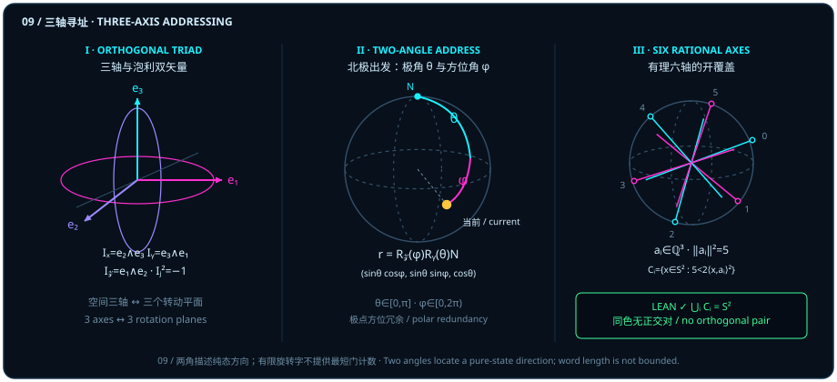

# 三元两两正交：为什么只要“正交一次、正交两次”就能走遍全球？

> *“这核心是各向同性如何从正交关系到达另外一个点,一个是正交一次,一个是正交两次,因为三元两两正交”*

在第一部（[第一章](ch01-measurement.md)至[第四章](ch04-decoherence.md)）与第二部中，我们沿着“点 $\to$ 线 $\to$ 面”的阶梯一路攀登：先将孤立的“量子”还原为两根方向线在球面上的内积投影 $\vv{a}\cdot\vv{b} = \cos\theta$，再将复相位与单轴量子门还原为二维平面内的有向面积旋转 $\vv{a}\wedge\vv{b} = \sin\theta\,\hat{I}$。现在，第三部要迈出合拢三维空间的关键一步——**从单张旋转平面合拢为一整颗球面 $S^2$**。

请先问一个最朴素的几何问题：如果观察者手头只有一张平坦的二维转盘（比如固定绕单根轴旋转的相位门），他能抵达三维世界里的每一个方向吗？不能！单张平面只能画出一个一维圆周。要想跳出原有的圆环、走遍三维单位球面 $S^2 \subset \mathbb{R}^3$ 上的每一寸土地，空间至少需要提供几根两两正交的主轴？从北极基准态出发，又为什么恰好只需要**“正交一次、正交两次”**两步转向，就能为整颗球面上的任意纯态方向精准寻址？

::: {.viz src="two-angle-addressing" preset="tilt" height="500"}
**只转一次，只画得出一个圆。** 只绕 $\vv{e}_2$ 转：琥珀色的点沿紫色虚线的子午圆走一整圈，又回到北极 $N$；白色的线是它走过的路，离不开这一个圆。
:::

本章将把这句看似直觉的口诀拆解为四层严密的几何与拓扑结构：从三维欧氏空间中任意两向量的公共单位法线存在性出发，经由北极两角球面寻址与双轴连续旋转群的有限字生成定理，最终抵达球面无正交对开覆盖的“有理六轴构造”（其中每个条件 $2\langle x, a_i\rangle_{\mathbb{R}}^2 > 5\norm{x}^2$ 在 $S^2$ 上界定围绕 $\pm a_i/\norm{a_i}$ 的一对对跖开球冠，6 对共 12 个开球冠）与拓扑六色下界。

## 三轴与三块正交面 {#sec-three-axis-pauli-bivectors}

为什么单量子比特的布洛赫球面偏偏住在**三维**实欧氏空间 $\mathbb{R}^3$ 里，而它的泡利算符又偏偏是 $\sigma_x, \sigma_y, \sigma_z$ **三个**？

让我们在三维实欧氏空间 $\mathrm{Space} = \mathbb{R}^3$（在 Lean 中记作 `EuclideanSpace ℝ (Fin 3)`）里做一次最基础的几何清点。只要你在空间里随便指定两根向量 $a, b \in \mathbb{R}^3$——哪怕它们既没有归一化、彼此也不正交，甚至其中一根退化为零向量或两根向量完全共线——三维空间总能腾出至少第三个正交维度，为你立起一根同时垂直于 $a$ 与 $b$ 的**单位法向量** $n$。

::: {.lemma #lemma-three-axis-normal title="三维空间中任意两向量的公共单位法向量存在性" lean="D5/S3/Geometry/TwoAxisFiniteRotation.unit_perpendicular_pair"}
设 $\mathrm{Space} = \mathbb{R}^3$ 为三维实欧氏内积空间。对任意两根向量 $a, b \in \mathrm{Space}$，恒存在向量 $n \in \mathrm{Space}$，使得

$$
\norm{n} = 1, \qquad \langle a, n\rangle_{\mathbb{R}} = 0, \qquad \langle b, n\rangle_{\mathbb{R}} = 0.
$$
:::

::: proof
记 $W = \operatorname{span}_{\mathbb{R}}\{a, b\} \subseteq \mathbb{R}^3$ 为由 $a$ 与 $b$ 张成的实线性子空间。由于生成元仅有 $2$ 个，子空间维数满足 $\dim_{\mathbb{R}} W \le 2 < 3 = \dim_{\mathbb{R}} \mathbb{R}^3$（当 $a, b$ 线性无关时 $\dim_{\mathbb{R}} W = 2$，共线或含零向量时 $\dim_{\mathbb{R}} W \le 1$）。因此其正交补子空间 $W^\perp = \{v \in \mathbb{R}^3 \mid \forall w \in W,\; \langle w, v\rangle_{\mathbb{R}} = 0\}$ 的维数至少为 $3 - 2 = 1$，必含某个非零向量 $v \neq 0$。取单位化向量 $n = \norm{v}^{-1} v$，即得 $\norm{n} = 1$，且由 $a, b \in W$ 直接推出 $\langle a, n\rangle_{\mathbb{R}} = 0$ 与 $\langle b, n\rangle_{\mathbb{R}} = 0$。完整证明由 Lean 内核检查。
:::

请注意 [@lemma-three-axis-normal] 的边界纪律：定理对输入向量 $a, b \in \mathbb{R}^3$ **不施加任何非零、归一化或线性无关前提**；当 $a, b$ 共线且不全为零（$\dim_{\mathbb{R}}\operatorname{span}\{a, b\} = 1$）时，垂直于它们的单位法向量在正交平面内构成一整圈单位圆 $S^1$，而当 $a = b = 0$ 时，正交约束退化为空条件，公共单位法向量集合就是整颗单位球面 $S^2$。定理只断言存在至少一根这样的单位法向量 $n$，而不依赖右手叉积去挑选特定定向。

一旦固定标准正交基 $\vv{e}_1 = (1, 0, 0)$、$\vv{e}_2 = (0, 1, 0)$、$\vv{e}_3 = (0, 0, 1)$，[@lemma-three-axis-normal] 揭示的“两轴立一面、一面配一法线”结构就展现出完美的对偶咬合：

1. **三根一维正交轴**：$\vv{e}_1, \vv{e}_2, \vv{e}_3$ 两两满足 $\langle \vv{e}_i, \vv{e}_j\rangle_{\mathbb{R}} = \delta_{ij}$，每根轴都在球面上锚定一对对跖极点（$\pm\vv{e}_1, \pm\vv{e}_2, \pm\vv{e}_3$，参见[第一章](ch01-measurement.md) [@ex-bloch-six-poles]）；
2. **三块二维正交双矢量平面**：在欧氏克利福德代数 $\mathrm{Cl}_{3,0}$ 中，每两根正交基轴的外积（几何积）张成一块单位有向旋转面：

   $$
   I_x = \vv{e}_2 \vv{e}_3 = \vv{e}_2 \wedge \vv{e}_3, \qquad
   I_y = \vv{e}_3 \vv{e}_1 = \vv{e}_3 \wedge \vv{e}_1, \qquad
   I_z = \vv{e}_1 \vv{e}_2 = \vv{e}_1 \wedge \vv{e}_2.
   $$

   由于 $\vv{e}_j^2 = +1$ 且异轴反对易 $\vv{e}_j \vv{e}_k = -\vv{e}_k \vv{e}_j$（$j \neq k$），每块单位双矢量的平方都精确等于 $-1$：

   $$
   I_x^2 = I_y^2 = I_z^2 = -1, \qquad I_x I_y = -I_y I_x = -I_z.
   $$

   用单比特泡利矩阵 $\sigma_x, \sigma_y, \sigma_z$ 对照，固定三维体积定向后，这三块单位双矢量恰好对应 $I_j \leftrightarrow i\sigma_j$（$j \in \{x, y, z\}$）。

这就是图 09 左栏所画的几何真相：**绕 $\vv{e}_3$ 轴的旋转，本质上是在水平赤道平面 $I_z = \vv{e}_1 \wedge \vv{e}_2$ 内转动；绕 $\vv{e}_2$ 轴的旋转，本质上是在子午平面 $I_y = \vv{e}_3 \wedge \vv{e}_1$ 内转动。** 三根两两正交的轴，与三块两两垂直咬合的旋转面互为霍奇对偶。

> 单面成圆，三面成球；所谓三维各向同性，不过是三块正交平面首尾相扣的陀螺支架。

## 从北极出发的两角寻址 {#sec-two-angle-state-address}

有了三根两两正交的主轴 $(\vv{e}_1, \vv{e}_2, \vv{e}_3)$，现在让我们站在北极基准态 $N = \vv{e}_3 = (0, 0, 1)$（对应单比特计算基态 $\lvert 0\rangle\langle 0\rvert$），看看如何用最少的正交步骤走遍整颗单位球面 $S^2$（图 09 中栏）：

- **第一步（正交一次：在 $\vv{e}_3 \wedge \vv{e}_1$ 子午面内倾转极角 $\theta$）**：先绕与初态 $\vv{e}_3$ 正交的水平轴 $\vv{e}_2$ 旋转极角 $\theta \in [0, \pi]$。这一步把北极点 $N = (0, 0, 1)$ 沿着本初子午线拉到了高度为 $\cos\theta$、水平探出量为 $\sin\theta$ 的点：

  $$
  R_y(\theta) N = (\sin\theta,\; 0,\; \cos\theta).
  $$

- **第二步（正交两次：在 $\vv{e}_1 \wedge \vv{e}_2$ 赤道面内旋拧方位角 $\varphi$）**：接着绕同时垂直于 $\vv{e}_1, \vv{e}_2$ 的竖直轴 $\vv{e}_3$（其旋转平面与第一步的子午面成 $90^\circ$ 正交二面角）旋转方位角 $\varphi \in [0, 2\pi)$。这一步保持竖直高度 $\cos\theta$ 不变，将水平分量 $\sin\theta$ 扫向赤道面内的任意方位，抵达球面目标点：

  $$
  \vv{r}(\theta, \varphi) = R_z(\varphi) R_y(\theta) N = (\sin\theta\cos\varphi,\; \sin\theta\sin\varphi,\; \cos\theta) \in S^2.
  $$

::: {.viz src="two-angle-addressing" preset="address" height="500"}
**倾一次、拧一次，到达任一点。** 先绕 $\vv{e}_2$ 倾转 $\theta = 60^\circ$，再绕竖轴 $\vv{e}_3$ 拧转 $\varphi = 45^\circ$：第二步沿紫色虚线的纬度圈走，高度 $\cos\theta = \frac{1}{2}$ 不变，琥珀色的点停在白色的目标圈上，$x = \bigl(\frac{\sqrt{6}}{4}, \frac{\sqrt{6}}{4}, \frac{1}{2}\bigr)$（即 [@ex-two-angle-six-axis] 中的点）。
:::

为什么不需要“正交三次”来定位球面上的一个点？因为单位球面 $S^2 \subset \mathbb{R}^3$ 是二维流形：第一步极角 $\theta \in [0, \pi]$ 选定纬度圈，第二步方位角 $\varphi \in [0, 2\pi)$ 选定经度线，两步正交合起来已经覆盖了 $S^2$ 上的每一个方向！（至于在 $\mathrm{SO}(3)$ 或 $\mathrm{SU}(2)$ 中合成**任意单比特量子门**而非仅仅寻址单个球面态方向，详见章末 [@rem-axes-literature] 以及[第二十六章](ch26-single-qubit-rotor-compilation.md)经内核验证的 ZYZ 旋转器编译。）

同时，在阅读这组球面两角公式时，有两处极易混淆的几何细节必须当场辨明：

1. **布洛赫球面角 $\theta$ 与旋量半角 $\theta/2$ 的区分**：在三维实球面 $S^2$ 上，$R_y(\theta)N$ 实实在在转过了角度 $\theta$；而在二维复旋量空间 $\mathbb{C}^2$ 中，由[第二章](ch02-born-rule.md)的玻恩半角定律，对应的纯态列向量（差全局相位）写作

   $$
   \lvert\psi(\theta, \varphi)\rangle = \cos\frac{\theta}{2}\lvert 0\rangle + e^{i\varphi}\sin\frac{\theta}{2}\lvert 1\rangle = \begin{pmatrix} \cos(\theta/2) \\ e^{i\varphi}\sin(\theta/2) \end{pmatrix}.
   $$

   旋量里的 $\theta/2$ 是二对一双覆盖 $\mathrm{SU}(2) \to \mathrm{SO}(3)$ 的半角投影，切勿与球面向量夹角 $\theta$ 混为一谈。
2. **南北两极的方位角冗余**：当 $\theta = 0$（北极 $N$）或 $\theta = \pi$（南极 $-N$）时，$\sin\theta = 0$，此时无论 $\varphi \in [0, 2\pi)$ 取何值，$\vv{r}(0, \varphi) = (0, 0, 1)$ 与 $\vv{r}(\pi, \varphi) = (0, 0, -1)$ 都纹丝不动。这说明 $(\theta, \varphi)$ 虽然给出了整颗 $S^2$ 的满射参数化，但在南北两极处发生了坐标退化，**并不是整颗球面上的全局非奇异微分坐标卡**。

::: {.viz src="two-angle-addressing" preset="pole" height="500"}
**在南极，第二步白拧。** 先倾转 $\theta = 180^\circ$ 到南极，再绕竖轴拧一整圈：琥珀色的点一动不动，只有白色的小旗沿虚线转过一圈。在两极，$\varphi$ 取什么都是同一点。
:::

## 初始结构与有限旋转字 {#sec-finite-axis-words}

在上面的两角寻址中，我们选用了严格正交的两根坐标轴 $\vv{e}_2$ 与 $\vv{e}_3$。如果实验条件不允许我们把两根控制轴校准到严格 $90^\circ$ 正交——比方说，超导芯片或磁共振腔里的两根驱动场方向 $a, b \in \mathbb{R}^3$ 只满足“不共线”（夹角既非 $0^\circ$ 也非 $180^\circ$）——我们还能不能仅靠绕 $a$ 轴的连续旋转与绕 $b$ 轴的连续旋转，拼出三维空间中的**任意**刚体旋转 $R \in \mathrm{SO}(3)$？

在 Lean 模块 `TwoAxisFiniteRotation` 中，设 $\mathrm{Orthogonal} = (\mathrm{Space} \simeq_{\ell i}[\mathbb{R}] \mathrm{Space})$ 为 $\mathbb{R}^3$ 上的实线性等距同构群，记 $\operatorname{determinant}(R) = \det(R)$。对任意向量 $a \in \mathrm{Space}$，绕 $a$ 轴的保定向连续旋转子群定义为

$$
\operatorname{axisCircle}(a) = \bigl\{\, R \in \mathrm{Orthogonal} \;\big|\; \operatorname{determinant}(R) = 1 \;\land\; R(a) = a \,\bigr\},
$$

而由 $a, b$ 两轴旋转拼成的有限字谓词定义为

$$
\operatorname{IsAxisWord}(a, b, l) \;\Longleftrightarrow\; \forall Q \in l,\quad Q \in \operatorname{axisCircle}(a) \;\lor\; Q \in \operatorname{axisCircle}(b).
$$

下面的定理严格证明：只要初始架构提供的两根轴 $a, b$ 满足正格拉姆行列式条件 $\langle a, b\rangle_{\mathbb{R}}^2 < \norm{a}^2 \norm{b}^2$（即柯西—施瓦茨不等式严格成立，$a$ 与 $b$ 非零且不共线），它们生成的有限旋转字就能精确走遍整个特殊正交群 $\mathrm{SO}(3)$！

::: {.theorem #thm-two-axis-finite-word title="任意两不共线轴生成特殊正交群的有限旋转字定理" lean="D5/S3/Geometry/TwoAxisFiniteRotation.two_axis_finite_word"}
设 $a, b \in \mathrm{Space} = \mathbb{R}^3$ 满足严格柯西—施瓦茨不等式

$$
\langle a, b\rangle_{\mathbb{R}}^2 < \norm{a}^2 \cdot \norm{b}^2.
$$

则对任意实线性等距同构 $R \in \mathrm{Orthogonal}$，若 $\operatorname{determinant}(R) = 1$，必存在有限列表 $l : \operatorname{List}\,\mathrm{Orthogonal}$，使得

$$
\operatorname{IsAxisWord}(a, b, l) \qquad\text{且}\qquad l.\mathrm{prod} = R.
$$
:::

::: proof
条件 $\langle a, b\rangle_{\mathbb{R}}^2 < \norm{a}^2 \norm{b}^2$ 保证 $a \neq 0$、$b \neq 0$ 且单位化方向 $\hat{a} = \norm{a}^{-1}a$ 与 $\hat{b} = \norm{b}^{-1}b$ 满足 $|\langle \hat{a}, \hat{b}\rangle_{\mathbb{R}}| < 1$。在单轴旋转子群 $\operatorname{axisCircle}(a)$ 与 $\operatorname{axisCircle}(b)$ 的交替作用下，$\hat{a}$ 的轨道在球面 $S^2$ 上每次可扩展覆盖半径受 $|\hat{a}\times\hat{b}| = \sqrt{1 - \langle\hat{a},\hat{b}\rangle_{\mathbb{R}}^2} > 0$ 下界控制的球面带，经有限次交替共轭即可将任意单位向量旋转至 $\hat{a}$（并把绕任意第三轴的旋转共轭归约为绕 $a$ 轴的旋转）。由于保定向正交变换 $R$ 由其在标准正交基上的作用唯一确定，将稳定化步与轴上旋转步拼接为有限列表 $l$，即满足列表元素均属于 $\operatorname{axisCircle}(a) \cup \operatorname{axisCircle}(b)$ 且列表乘积 $l.\mathrm{prod} = R$。完整证明由 Lean 内核检查。
:::

::: {.viz src="two-angle-addressing" preset="skew" height="500"}
**斜轴也能到，只是多转几次。** 两根紫色转轴只差 $30^\circ$：每次绕 $b$ 最多把点推远 $60^\circ$，青色虚线是到这一步为止能到的最远处。绕 $b$、绕 $a$ 交替转四次，琥珀色的点停在离 $N$ 为 $110^\circ$ 的白色目标圈上。字是页面按一条贪心规则当场构造的；[@thm-two-axis-finite-word] 只保证这样的有限字存在。
:::

请务必把 [@thm-two-axis-finite-word] 的数学契约读准：

1. **初始结构的门槛与零向量退化分支**：定理只要求严格不等式 $\langle a, b\rangle_{\mathbb{R}}^2 < \norm{a}^2 \norm{b}^2$，输入轴 $a, b$ 既不必是单位向量，也不必互相正交。当柯西—施瓦茨不等式取等号（$\langle a, b\rangle_{\mathbb{R}}^2 = \norm{a}^2 \norm{b}^2$）时，须严格区分两种退化情形：若**两根非零轴共线**（$a \neq 0, b \neq 0$ 且 $a \parallel b$），则两个轴圆坍缩为同一个平面阿贝尔旋转子群 $\operatorname{axisCircle}(a) = \operatorname{axisCircle}(b) \cong \mathrm{SO}(2)$，再长的有限字也永远困在单张平面里而无法生成 $\mathrm{SO}(3)$；反之，若 $a = 0$ 或 $b = 0$，由于源码全定义 $\operatorname{axisCircle}(0) = \{R \in \mathrm{Orthogonal} \mid \operatorname{determinant}(R) = 1 \land R(0) = 0\} = \mathrm{SO}(3)$（任意线性映射均保持零向量不动），零向量的稳定子群直接退化为整个 $\mathrm{SO}(3)$，此时任意 $R \in \mathrm{SO}(3)$ 虽可写成字长为 $1$ 的平凡字，但零向量本身并不给出任何几何旋转轴。

::: {.viz src="two-angle-addressing" preset="collinear" height="500"}
**两轴共线，困在原地。** $\alpha = 0$ 时紫色的 $a$ 与 $b$ 重合：绕 $a$ 转和绕 $b$ 转是同一种转动，都固定 $N$。琥珀色的点不动，白色的小旗只在水平面里转。
:::

2. **存在性不等于通用两步或固定门长算法**：[@thm-two-axis-finite-word] 允许从整条连续圆周子群 $\operatorname{axisCircle}(a)$ 与 $\operatorname{axisCircle}(b)$ 中选取任意连续角度的旋转，并断言存在某个有限列表 $l$ 使 $l.\mathrm{prod} = R$。它**并不断言**任意斜交双轴都能像正交欧拉轴那样仅用固定字长 $2$ 或 $3$ 完成分解（当两轴夹角很小时，所需交替步数会随夹角缩小而增长），**也不断言**随意挑两个固定角度的离散门就能遍历球面，更**不提供**求取最短字长或多项式时间门合成的构造性算法。

::: {.viz src="two-angle-addressing" preset="narrow" height="500"}
**夹角越小，转得越多。** 两根紫色转轴只差 $10^\circ$：每次绕 $b$ 只能把点推远至多 $20^\circ$，青色虚线一格一格往外挪；同一个离 $N$ 为 $110^\circ$ 的目标要十二个转动才到。这是页面的构造，不是最短字。
:::

## 有理六轴覆盖与六色下界 {#sec-rational-six-axis-atlas}

既然在南北极处球面两角坐标 $(\theta, \varphi)$ 会发生方位角退化，而在单根观察轴 $\vv{a}$ 下与它成 $90^\circ$ 的赤道大圆 $\{x \in S^2 \mid \langle x, \vv{a}\rangle_{\mathbb{R}} = 0\}$ 又总是落入正交盲区（[第一章](ch01-measurement.md)与[第二章](ch02-born-rule.md)），我们自然要问一个拓扑学问题：

**最少需要多少块相对开集 $U_0, \dots, U_{k-1} \subseteq S^2$ 才能把整颗单位球面 $S^2$ 完全盖住，同时保证每一块开集 $U_i$ 内部都彻底不含正交向量对（即对任意 $x, y \in U_i$ 均有 $\langle x, y\rangle_{\mathbb{R}} \neq 0$）？**

这里必须先破除一个常见的几何误区：“无正交对开集”只要求集合相对开且内部不含夹角恰好为 $90^\circ$ 的点对（$\langle x, y\rangle_{\mathbb{R}} \neq 0$），**并不要求开集本身连通，也不要求其全局角直径小于 $90^\circ$**。事实上，只要围绕某根基准轴 $a_i$ 同时取正负两极的对跖开球冠 $\{x \in S^2 \mid |\langle x, \hat{a}_i\rangle_{\mathbb{R}}| > 1/\sqrt{2}\}$（使落入其中的每个点与 $+\hat{a}_i$ 或 $-\hat{a}_i$ 的夹角严格小于 $45^\circ$），同一球冠内的两点夹角必严格小于 $90^\circ$，而分处南北两个对跖球冠的两点夹角必严格大于 $90^\circ$（甚至包含夹角为 $180^\circ$ 的对跖点对 $\pm\hat{a}_i$），从而整块不连通的双极冠开集内部永远不会出现 $90^\circ$ 正交对！那么，能不能只靠纯有理整数坐标的基准轴，显式造出这样一套覆盖整颗 $S^2$ 的“无正交盲区开图册”？

答案是肯定的，而且恰好只需要 **6 根有理轴**（图 09 右栏）！在 Lean 模块 `RationalSixAxisCover` 中，定义 $\mathrm{UnitSphere} = \{x \in \mathbb{R}^3 \mid \norm{x} = 1\}$，并按固定下标顺序 $i \in \{0, 1, 2, 3, 4, 5\}$ 给出六根整数坐标向量 `axis`：

$$
\begin{aligned}
a_0 &= (1, 2, 0), &\quad a_1 &= (1, -2, 0), &\quad a_2 &= (0, 1, 2), \\
a_3 &= (0, 1, -2), &\quad a_4 &= (2, 0, 1), &\quad a_5 &= (-2, 0, 1).
\end{aligned}
$$

注意这六根有理轴并不是标准坐标轴 $\pm\vv{e}_j$，且均未归一化：每根轴的欧氏范数平方均为 $\norm{a_i}^2 = 1^2 + 2^2 + 0^2 = 5$。（如果只取三根标准坐标轴 $\vv{e}_1, \vv{e}_2, \vv{e}_3$，它们给出的三对 $45^\circ$ 开球冠会在八个卦限对角线方向 $(\pm 1, \pm 1, \pm 1)/\sqrt{3}$ 处漏出缝隙，因为那里 $\langle x, \vv{e}_j\rangle_{\mathbb{R}}^2 = 1/3 < 1/2$；而在每张坐标平面内按 $1:2$ 整数斜率成对倾斜出上述 6 根有理轴后，6 对对跖开球冠——即 $S^2$ 上的 12 个 $45^\circ$ 开球冠——就能把所有对角线缝隙彻底封死。）对每个下标 $i \in \operatorname{Fin} 6$，定义球面上的第 $i$ 号“颜色”集合（严格超水平集）为

$$
\operatorname{color}(i) = \bigl\{\, x \in \mathrm{UnitSphere} \;\big|\; 5 < 2\,\langle x, a_i\rangle_{\mathbb{R}}^2 \,\bigr\}.
$$

由于 $\norm{a_i}^2 = 5$ 且球面上 $\norm{x}^2 = 1$，齐次形式 $2\langle x, a_i\rangle_{\mathbb{R}}^2 > 5\norm{x}^2$（即 $5 < 2\langle x, a_i\rangle_{\mathbb{R}}^2$）恰等价于对单位化轴 $\hat{a}_i = a_i / \norm{a_i} = a_i / \sqrt{5}$ 要求 $\langle x, \hat{a}_i\rangle_{\mathbb{R}}^2 > \frac{1}{2}$。在几何上，每个 $\operatorname{color}(i)$ 都是围绕对跖方向 $\pm\hat{a}_i$ 的**一对对跖开球冠**（6 个颜色对应 6 对对跖球冠，共 12 个半顶角为 $45^\circ$ 的开球冠）：它包含对跖钝角对，本身不连通，但同色任意两点的内积必非零。

::: {.viz src="two-angle-addressing" preset="three" height="500"}
**三根坐标轴的球冠在对角线漏缝。** 只用 $\pm\vv{e}_1, \pm\vv{e}_2, \pm\vv{e}_3$ 的 $45^\circ$ 球冠：琥珀色的点走到卦限对角线 $(1, 1, 1)/\sqrt{3}$ 时，三对灰色的圆都不含它，它落在品红的缝里，那里 $\langle x, \vv{e}_j\rangle_{\mathbb{R}}^2 = 1/3 < 1/2$。品红的点是页面在球面网格上取样找到的缝。
:::

::: {.proposition #prop-rational-six-axis-cover title="有理六轴无正交对开覆盖定理" lean="D5/S3/Geometry/Orthogonality/RationalSixAxisCover.rational_six_axis_open_cover"}
对上述有理六轴定义的六个球面子集 $\operatorname{color} : \operatorname{Fin} 6 \to \mathcal{P}(\mathrm{UnitSphere})$，同时成立以下三条性质：

1. **相对开性**：对每个 $i \in \operatorname{Fin} 6$，$\operatorname{color}(i)$ 是单位球面 $\mathrm{UnitSphere}$ 上的开集；
2. **同色无正交对**：对每个 $i \in \operatorname{Fin} 6$ 及任意 $x, y \in \operatorname{color}(i)$，恒有 $\langle x, y\rangle_{\mathbb{R}} \neq 0$；
3. **全局覆盖**：六个颜色集合的并集覆盖整颗单位球面，即 $\bigcup_{i \in \operatorname{Fin} 6} \operatorname{color}(i) = \mathrm{UnitSphere}$。
:::

::: proof
1. 对每个 $i \in \operatorname{Fin} 6$，函数 $x \mapsto 2\langle x, a_i\rangle_{\mathbb{R}}^2$ 是 $\mathrm{UnitSphere}$ 上的连续实函数，故严格超水平集 $\{x \mid 5 < 2\langle x, a_i\rangle_{\mathbb{R}}^2\}$ 为开集。
2. 设 $x, y \in \operatorname{color}(i)$，则 $2\langle x, a_i\rangle_{\mathbb{R}}^2 > 5$ 且 $2\langle y, a_i\rangle_{\mathbb{R}}^2 > 5$。若 $\langle x, y\rangle_{\mathbb{R}} = 0$，则单位向量对 $(x, y)$ 构成 $\mathbb{R}^3$ 中的标准正交族，由贝塞尔不等式（`Orthonormal.sum_inner_products_le`）有
   $$
   \langle x, a_i\rangle_{\mathbb{R}}^2 + \langle y, a_i\rangle_{\mathbb{R}}^2 \le \norm{a_i}^2 = 5,
   $$
   但将两式 $2\langle x, a_i\rangle_{\mathbb{R}}^2 > 5$ 与 $2\langle y, a_i\rangle_{\mathbb{R}}^2 > 5$ 相加却得 $2\bigl(\langle x, a_i\rangle_{\mathbb{R}}^2 + \langle y, a_i\rangle_{\mathbb{R}}^2\bigr) > 10$，矛盾（等价地，沿单位轴 $u = a_i/\sqrt{5}$ 正交分解亦直接给出 $|\langle x_\perp, y_\perp\rangle_{\mathbb{R}}| < \frac{1}{2} < |\langle x, u\rangle_{\mathbb{R}}\langle y, u\rangle_{\mathbb{R}}|$）。故必有 $\langle x, y\rangle_{\mathbb{R}} \neq 0$。
3. 对任意向量 $x = (x_0, x_1, x_2) \in \mathbb{R}^3$，注意若直接对六根轴求和，因 $\sum_{i=0}^5 a_i a_i^{\mathsf{T}} = 10 I_3$，恒有 $\sum_{i=0}^5 2\langle x, a_i\rangle_{\mathbb{R}}^2 = 20\norm{x}^2 \le 30\norm{x}^2$，单纯把六个上界相加并不会产生矛盾；源码证明（`signed_square`、`cyclic_max_square` 与 `large_projection`）转而构造**最大投影的多项式非负证书**。记非负实数 $a = |x_0|, b = |x_1|, c = |x_2|$（满足 $a^2 + b^2 + c^2 = \norm{x}^2$），并定义三元循环绝对值线性组合的最大值
   $$
   M = \max\bigl(a + 2b,\; b + 2c,\; c + 2a\bigr) = \max\bigl(|x_0| + 2|x_1|,\; |x_1| + 2|x_2|,\; |x_2| + 2|x_0|\bigr).
   $$
   令差量 $u = M - a - 2b \ge 0$、$v = M - b - 2c \ge 0$、$w = M - c - 2a \ge 0$，直接展开可验证恒等式（`cyclic_max_square`）：
   $$
   3M^2 - 9(a^2 + b^2 + c^2) = uv + vw + wu + 6(aw + bu + cv) + \frac{(a - b)^2 + (b - c)^2 + (c - a)^2}{2} \ge 0,
   $$
   从而 $M^2 \ge 3(a^2 + b^2 + c^2) = 3\norm{x}^2$。又由 `signed_square`，对任意实数 $s, t \in \mathbb{R}$，根据 $s, t$ 同号或异号必有 $(|s| + 2|t|)^2 = (s + 2t)^2$ 或 $(|s| + 2|t|)^2 = (s - 2t)^2$。因此，在三对符号共轭轴 $(a_0, a_1), (a_2, a_3), (a_4, a_5)$ 中，取达到最大值 $M$ 的那一组循环坐标并匹配相应符号的轴 $a_i$，即得（`large_projection`）
   $$
   \langle x, a_i\rangle_{\mathbb{R}}^2 = M^2 \ge 3\norm{x}^2.
   $$
   当 $x \in \mathrm{UnitSphere}$（$\norm{x} = 1$）时，这给出 $2\langle x, a_i\rangle_{\mathbb{R}}^2 \ge 2M^2 \ge 6\norm{x}^2 = 6 > 5$，故 $x \in \operatorname{color}(i)$。完整证明由 Lean 内核检查。
:::

既然 6 块无正交对的开集已经够用，能不能再省一点，只用 5 块甚至 4 块开集就把球面盖住？下面的推论借助博苏克—乌拉姆（Borsuk–Ulam）型球面拓扑阻碍，给出了斩钉截铁的否定回答：**6 是绝对不可逾越的拓扑下界**。

在 Lean 模块 `SphereOrthogonalityCover` 中，对单位球面子集 $U \subseteq S^2$，谓词 `OrthogonalityFree U` 定义为

$$
\operatorname{OrthogonalityFree}(U) \;\Longleftrightarrow\; \forall x \in U,\; \forall y \in U,\quad \langle x, y\rangle_{\mathbb{R}} \neq 0.
$$

::: {.corollary #cor-six-colors-necessary title="二维单位球面无正交对开覆盖的六色下界" lean="D5/S3/Topology/SphereOrthogonalityCover.sphere_two_open_orthogonality_free_cover_lower_six"}
设 $k \in \mathbb{N}$，$U : \operatorname{Fin} k \to \mathcal{P}(S^2)$ 为三维实欧氏空间 $\mathbb{R}^3$ 中单位球面 $S^2$ 的一族子集。若：

1. 对每个 $i \in \operatorname{Fin} k$，$U_i$ 在 $S^2$ 的诱导拓扑下为开集；
2. 对任意点 $x \in S^2$，存在 $i \in \operatorname{Fin} k$ 使得 $x \in U_i$；
3. 对每个 $i \in \operatorname{Fin} k$，$U_i$ 满足无正交对条件 $\operatorname{OrthogonalityFree}(U_i)$；

则必有

$$
6 \le k.
$$
:::

::: proof
证明分为两步（对应源码中的 `sphere_three_absent_colors` 与 `open_cover_contractible_of_multiplicity_lt`）：

1. **正交大圆限制迫使每点至少缺席 $3$ 种颜色**：对任意点 $x \in S^2$，其正交补空间 $x^\perp \subset \mathbb{R}^3$ 中的单位圆周 $S^1_x = \{y \in S^2 \mid \langle x, y\rangle_{\mathbb{R}} = 0\}$ 与 $x$ 处处正交。由无正交对条件 $\operatorname{OrthogonalityFree}(U_i)$，任何包含 $x$ 的颜色集合 $U_i$ 都不能与赤道圆 $S^1_x$ 相交；因此，$S^1_x$ 只能被那些**不包含 $x$** 的颜色子集拉回覆盖。将一般维数下界定理 `sphere_open_orthogonality_free_cover_lower_bound`（在环境维数 $n \ge 2$ 时下界为 $2n - 1$）应用于二维平面 $\mathbb{R}^2$ 中的单位圆 $S^1$（$n = 2$），覆盖 $S^1_x$ 至少需要 $2 \times 2 - 1 = 3$ 个无正交对开集，故对每个 $x \in S^2$，至少有 $3$ 个下标 $i \in \operatorname{Fin} k$ 满足 $x \notin U_i$。
2. **点重数上界与球面不可缩阻碍**：假设 $k < 6$（即 $k \le 5$）。由于每点 $x \in S^2$ 至少缺席 $3$ 种颜色，每个点 $x$ 至多属于 $k - 3 \le 2 < 3 = \dim_{\mathbb{R}}\mathbb{R}^3$ 个颜色集合 $U_i$（点重数严格小于外围空间维数 $3$）。将每个开集 $U_i$ 拆分为其连通分支（在每个连通分支上内积恒正，即全为锐角对，`exists_finite_acute_refinement`），并利用从属单位分解将各分支代表元线性组合再球面归一化（`acute_cover_normalized_map`），可构造出与恒等映射 $\mathrm{id}_{S^2}$ 同伦的连续映射 $g : S^2 \to S^2$，使得每个 $g(x)$ 都落在至多 $2$ 个代表元张成的真线性子空间中。因有限个二维真子空间的并集无法覆盖 $\mathbb{R}^3$，$g$ 必漏掉 $S^2$ 上的某一点 $p$（`map_omits_point_of_small_spans`），经球极投影将导致 $S^2$ 可缩（`ContractibleSpace`），这与二维单位球面不可缩定理（`SphereBrouwerObstruction.not_contractible_unit_sphere`）矛盾！因此必有 $6 \le k$。完整证明由 Lean 内核检查。
:::

把 [@prop-rational-six-axis-cover] 与 [@cor-six-colors-necessary] 合在一起，我们得到了一个极其漂亮的精确极值结论：**三维空间单位球面 $S^2$ 的无正交对开覆盖最小块数恰好等于 $6$**（上界由显式有理六轴构造实现，下界由拓扑阻碍封死）。现在，让我们在同一个具体球面状态点上，把本章的两角寻址、旋量半角向量与有理六轴染色一口气亲手算通。

::: {.example #ex-two-angle-six-axis title="两角寻址与有理六轴的同一点核对"}
在三维实欧氏空间 $\mathbb{R}^3$ 中固定标准正交基 $\vv{e}_1 = (1, 0, 0)$、$\vv{e}_2 = (0, 1, 0)$、$\vv{e}_3 = (0, 0, 1)$ 及北极点 $N = \vv{e}_3$，欧氏克利福德双矢量为 $I_x = \vv{e}_2\vv{e}_3$、$I_y = \vv{e}_3\vv{e}_1$、$I_z = \vv{e}_1\vv{e}_2$（满足 $I_j^2 = -1$，对应单比特泡利约定 $I_j = i\sigma_j$）。

1. **两角球面寻址手算**：取极角 $\theta = \frac{\pi}{3}$（$60^\circ$）、方位角 $\varphi = \frac{\pi}{4}$（$45^\circ$）。因 $\sin\frac{\pi}{3} = \frac{\sqrt{3}}{2}$、$\cos\frac{\pi}{3} = \frac{1}{2}$、$\cos\frac{\pi}{4} = \sin\frac{\pi}{4} = \frac{\sqrt{2}}{2}$，两步正交旋转给出的球面点为

   $$
   x = R_z\Bigl(\frac{\pi}{4}\Bigr) R_y\Bigl(\frac{\pi}{3}\Bigr) N
   = \bigl(\sin\theta\cos\varphi,\; \sin\theta\sin\varphi,\; \cos\theta\bigr)
   = \Bigl(\frac{\sqrt{6}}{4},\; \frac{\sqrt{6}}{4},\; \frac{1}{2}\Bigr).
   $$

   直接核对模长平方：$\norm{x}^2 = \frac{6}{16} + \frac{6}{16} + \frac{1}{4} = \frac{3}{8} + \frac{3}{8} + \frac{1}{4} = 1$，确属单位球面 $S^2$。（顺带注意：若退回极点 $\theta = 0$ 或 $\theta = \pi$，方位角 $\varphi$ 将变为冗余参数，故 $(\theta, \varphi)$ 不是 $S^2$ 上的全局非奇异坐标卡。）
2. **单比特旋量半角对照**：与球面方向 $x$ 对应的单量子比特纯态列向量（取标准全局相位代表元）使用半角 $\theta/2 = \frac{\pi}{6}$（$30^\circ$）：

   $$
   \lvert\psi\rangle = \cos\frac{\pi}{6}\lvert 0\rangle + e^{i\pi/4}\sin\frac{\pi}{6}\lvert 1\rangle = \Bigl(\frac{\sqrt{3}}{2},\; \frac{1}{2}e^{i\pi/4}\Bigr).
   $$

   切记旋量中的半角 $\frac{\pi}{6}$ 与布洛赫球面极角 $\frac{\pi}{3}$ 相差二倍。
3. **有理六轴内积与严格开覆盖判别**：将同一点 $x = \bigl(\frac{\sqrt{6}}{4}, \frac{\sqrt{6}}{4}, \frac{1}{2}\bigr)$ 依次与 [@prop-rational-six-axis-cover] 中按冻结顺序排列的六根未归一化有理轴 $a_0, \dots, a_5$（每根满足 $\norm{a_i}^2 = 5$，绝非标准坐标轴 $\pm\vv{e}_j$）作内积并平方：

   $$
   \begin{aligned}
   (x \cdot a_0)^2 &= \Bigl(\frac{3\sqrt{6}}{4}\Bigr)^2 = \frac{27}{8} = 3.375, &\quad
   2(x \cdot a_0)^2 &= \frac{27}{4} = 6.75 > 5, \\
   (x \cdot a_1)^2 &= \Bigl(-\frac{\sqrt{6}}{4}\Bigr)^2 = \frac{3}{8} = 0.375, &\quad
   2(x \cdot a_1)^2 &= \frac{3}{4} = 0.75 < 5, \\
   (x \cdot a_2)^2 &= \Bigl(\frac{\sqrt{6}}{4} + 1\Bigr)^2 = \frac{11}{8} + \frac{\sqrt{6}}{2}, &\quad
   2(x \cdot a_2)^2 &= \frac{11}{4} + \sqrt{6} \approx 5.199 > 5, \\
   (x \cdot a_3)^2 &= \Bigl(\frac{\sqrt{6}}{4} - 1\Bigr)^2 = \frac{11}{8} - \frac{\sqrt{6}}{2}, &\quad
   2(x \cdot a_3)^2 &= \frac{11}{4} - \sqrt{6} \approx 0.301 < 5, \\
   (x \cdot a_4)^2 &= \Bigl(\frac{\sqrt{6}}{2} + \frac{1}{2}\Bigr)^2 = \frac{7}{4} + \frac{\sqrt{6}}{2}, &\quad
   2(x \cdot a_4)^2 &= \frac{7}{2} + \sqrt{6} \approx 5.949 > 5, \\
   (x \cdot a_5)^2 &= \Bigl(-\frac{\sqrt{6}}{2} + \frac{1}{2}\Bigr)^2 = \frac{7}{4} - \frac{\sqrt{6}}{2}, &\quad
   2(x \cdot a_5)^2 &= \frac{7}{2} - \sqrt{6} \approx 1.051 < 5.
   \end{aligned}
   $$

   按严格不等式判据 $5 < 2(x \cdot a_i)^2$，点 $x$ **恰好同时落入第 $0, 2, 4$ 号三个颜色开集**（$x \in \operatorname{color}(0) \cap \operatorname{color}(2) \cap \operatorname{color}(4)$），而不属于第 $1, 3, 5$ 号颜色。
:::

::: {.viz src="two-angle-addressing" preset="six" height="500"}
**六根有理轴处处盖住。** 琥珀色的点按两角寻址停在 $x = \bigl(\frac{\sqrt{6}}{4}, \frac{\sqrt{6}}{4}, \frac{1}{2}\bigr)$，被颜色 $0, 2, 4$ 的青色球冠盖住，与上面的手算一致；白色虚线是与 $x$ 正交的大圆，它不进入这三种颜色的任何一个球冠（[@prop-rational-six-axis-cover]）。
:::

::: {.remark #rem-axes-literature title="双角参数化、单比特欧拉分解与六轴开覆盖（文献结果，未在本书形式化）"}
**文献结果，未在本书形式化。** 关于本章涉及的经典量子计算参数化与球面正交覆盖背景，须明确区分以下边界：

1. **纯态两角参数化与单比特门三参数欧拉分解**（参见 M. A. Nielsen & I. L. Chuang, *Quantum Computation and Quantum Information*, 10th Anniversary Ed., Cambridge University Press, 2010, §1.2 与 §4.2）：两角公式 $\vv{r}(\theta, \varphi) = (\sin\theta\cos\varphi, \sin\theta\sin\varphi, \cos\theta)$ 与 $\lvert\psi\rangle = \cos(\theta/2)\lvert 0\rangle + e^{i\varphi}\sin(\theta/2)\lvert 1\rangle$ 仅参数化**单比特纯态射线**（从固定北极出发的轨道点）。若要分解任意单比特幺正门 $U \in U(2)$，除将北极送往目标轴的两个角度外，还必须包含绕轴自转的第三个欧拉角以及可能的全局相位因子 $e^{i\alpha}$（即 $U = e^{i\alpha} R_z(\beta) R_y(\gamma) R_z(\delta)$）。
2. **有限旋转字存在性与门计数复杂度的严格区分**：[@thm-two-axis-finite-word] 仅证明在允许连续轴圆 $\operatorname{axisCircle}(a), \operatorname{axisCircle}(b)$ 的前提下存在某个有限乘积列表表示目标旋转 $R \in \mathrm{SO}(3)$。这一纯存在性定理不给出最短字长上界，不涉及有限离散门集编译（如 Solovay–Kitaev 定理），更不能等同于对计算复杂性问题 $\mathrm{P}$ 与 $\mathrm{NP}$ 的判定。
3. **有理六轴覆盖的文献来源与几何范畴**：[@prop-rational-six-axis-cover] 中的显式有理六轴构造源自对 D. Feldman & A. Wilce（arXiv:2608.13320v1, Question 3）相关问题的形式化解答，正如源码模块所载，本书不主张该六轴构造的原始发现权。同时，[@prop-rational-six-axis-cover] 与 [@cor-six-colors-necessary] 讨论的是**不含正交向量对的球面开子集覆盖**（$\operatorname{OrthogonalityFree}$），而非微分拓扑中球面切丛的全局光滑标架问题——后者属于下一章将专门剖析的毛球定理与霍普纤维丛范畴。
:::

::: {.viz src="two-angle-addressing" height="560"}
**两角寻址与旋转字的完整实验室。** 拖动白色的目标圈、改两根紫色转轴的夹角 $\alpha$，看琥珀色的点按怎样的旋转字走过去，青色虚线圈如何限制它每一步能离开北极多远；换到“覆盖”场景，在同一颗球上比较六根有理轴与三根坐标轴的 $45^\circ$ 球冠。绿色框只给 [@thm-two-axis-finite-word]、[@prop-rational-six-axis-cover] 与 [@cor-six-colors-necessary]；旋转字的构造与球面取样是页面的数值演示。
:::

现在，我们已经能够用三元正交轴定位球面上的任意方向，并用六块无正交盲区的有理开集覆盖整颗 $S^2$。然而，一旦我们在球面上真正连续走动起来，一个困扰了物理学界整整一百年的幽灵立刻迎面扑来：**既然在球面上“先绕 $X$ 转、再绕 $Y$ 转”和“先绕 $Y$ 转、再绕 $X$ 转”会停在完全不同的终点（$R_x R_y \neq R_y R_x$），为什么作者却说“量子的本质是两两比较，永远一致，顺序无关”？** 让我们翻开[下一章](ch10-gram-geometry-and-order.md)，揭开格拉姆矩阵与贝里相位的几何谜底。
