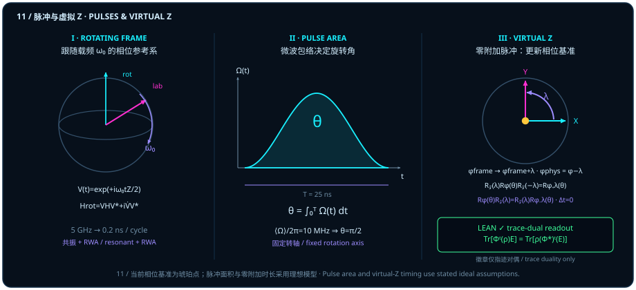

# 硬件里的量子门：微波脉冲面积与零耗时的“虚拟 Z 门”

> *“量子态是方向,量子门是让量子态转向的,那么可以理解为一种有面积的几何结构”*

在前十章里，我们把量子门还原成了三维单位球面 $S^2$ 上的刚体旋转——或者更准确地说，还原成了克利福德偶子代数 $\mathrm{Cl}^+_{3,0}$ 中由有向双矢量面积驱动的旋转器 $U(\theta) = \cos(\theta/2) - \hat{I}\sin(\theta/2)$。然而，当一位习惯了纸面符号的理论家第一次走进超导量子计算（transmon）或核磁共振实验室时，他往低温稀释制冷机和室温控制机柜里看去，却找不到任何一块写着“矩阵乘法器”的芯片：机柜里只有一台台任意波形发生器（AWG）、本地振荡器（LO）与正交混频器（IQ mixer），正源源不断地向谐振腔发射持续几十纳秒的微波电压包络 $\Omega(t)\cos(\omega_d t + \varphi)$。

**一句纸面上的“量子门是让量子态转向的有面积几何结构”，到了真实的物理硬件里，竟然变成了一语双关的工程现实：**

1. 要让量子态绕水平赤道轴（$X$ 轴或 $Y$ 轴）转过角度 $\theta$，工程师必须向芯片注入一束与量子比特能级共振的微波脉冲；在跟随便频旋转的参考系与旋波近似（RWA）下，球面转角 $\theta$ 恰恰等于**微波包络曲线下方的积分面积** $\theta = \int_0^T \Omega(t)\,dt$！
2. 反过来，如果要让量子态绕竖直能量主轴（$Z$ 轴）转过角度 $\lambda$，工程师需要发射多长时间的微波脉冲？答案令人拍案叫绝：**零纳秒！** 因为能量本征轴自身就是旋转参考系的相位基准，绕 $Z$ 轴旋转根本不需要给量子比特施加额外的物理微波脉冲，只需在经典控制软件里把被动参考系相位寄存器更新一个偏移量 $\phi_{\mathrm{frame}} \mapsto \phi_{\mathrm{frame}} + \lambda$（从而在把前置 $R_z(\lambda)$ 推向终端 $Z$ 基读出时，将后续赤道脉冲的物理驱动相位替换为 $\varphi_{\mathrm{phys}} = \varphi - \phi_{\mathrm{frame}}$，单步即 $\varphi \mapsto \varphi - \lambda$）——这就是现代超导量子处理器中大名鼎鼎的**零附加模拟时长“虚拟 $Z$ 门”（Virtual $Z$ gate）**！

本章将从矩阵指数在本征线上的精确相位演化与能量本征态定态不变性出发，逐步推演旋转参考系消去载频、共振脉冲面积积分、有序三脉冲核的迹误差界，以及薛定谔状态演化与海森堡效应拉回之间的迹对偶恒等式。

## 旋转坐标系与载频约分 {#sec-rotating-frame-calibration}

在超导量子芯片中，一颗单量子比特首先拥有由约瑟夫森结电感与电容决定的固有能级劈裂哈密顿量（取自然单位制 $\hbar = 1$）：

$$
H_0 = \frac{1}{2}\omega_0 Z = \frac{1}{2}\omega_0 \begin{pmatrix} 1 & 0 \\ 0 & -1 \end{pmatrix},
$$

其中典型跃迁频率为 $\omega_0 / (2\pi) \approx 5\,\mathrm{GHz}$。在没有外加微波驱动的静置状态下，这颗量子比特在干什么？在实验室坐标系（lab frame）里，它的布洛赫向量正绕着竖直 $Z$ 轴以每秒五十亿圈（周期仅 $T_0 = 0.2\,\mathrm{ns}$）的惊人速度飞旋！

要想在如此高速旋转的靶子上精准雕刻量子门，第一步就是弄清楚算符矩阵指数 $\exp(A)$ 作用在特征向量 $v$（满足 $Av = \mu v$）上时究竟会发生什么。在 Lean 模块 `EnergyEigenstateStationarity` 中，下面的引理在不附加任何厄米性或归一化前提的普遍条件下，直接给出矩阵指数在本征方向上的精确标量指数化。

::: {.lemma #lemma-exponential-on-eigenline title="矩阵指数在特征向量方向上的标量指数化" lean="D5/S3/Quantum/Dynamics/EnergyEigenstateStationarity.exp_mulVec_of_eigenvector"}
设 $n$ 为具有可判等性的有限指标类型（`Fintype n`、`DecidableEq n`），$A \in M_n(\mathbb{C})$ 为任意复方阵，$v : n \to \mathbb{C}$ 为向量，$\mu \in \mathbb{C}$ 为复标量。若 $A v = \mu v$，则

$$
\exp(A)\,v = e^\mu v.
$$
:::

::: proof
在有限维赋范空间上，矩阵指数由幂级数 $\exp(A) = \sum_{k=0}^\infty \frac{1}{k!} A^k$ 定义。由 $Av = \mu v$ 对 $k \in \mathbb{N}$ 归纳可得 $A^k v = \mu^k v$。由于矩阵—向量乘法关于第一个自变量连续线性，可逐项穿过无穷级数求和：

$$
\exp(A)\,v = \sum_{k=0}^\infty \frac{1}{k!} A^k v = \Bigl(\sum_{k=0}^\infty \frac{\mu^k}{k!}\Bigr) v = e^\mu v.
$$

完整证明由 Lean 内核检查。
:::

请注意 [@lemma-exponential-on-eigenline] 的普遍性：它允许 $v = 0$，也不要求 $A$ 厄米或幺正。现在，将它应用到量子动力学演化算符 $U(t) = \exp(-itH)$（取 $A = -itH$）与厄米哈密顿量 $H = H^*$ 的单位特征向量 $v$（满足 $v^* v = 1$ 且 $Hv = Ev$，$E, t \in \mathbb{R}$）上。此时本征方向只获得纯相位因子 $e^{-itE}$，而在消去全局相位的密度矩阵 $\rho = v v^*$（在 Lean 中通过 [`pureDensityState`](lean:D5/S3/Quantum/Dynamics/EnergyEigenstateStationarity.pureDensityState) 编码）层面，相位因子 $e^{-itE} e^{+itE} = 1$ 当场约掉，能量本征态在球面上纹丝不动！

::: {.theorem #thm-hermitian-eigenstate-stationary title="厄米哈密顿量下能量本征纯态的幺正演化与定态不变性" lean="D5/S3/Quantum/Dynamics/EnergyEigenstateStationarity.energy_eigenstate_stationary"}
设 $n$ 为具有可判等性的有限指标类型，$H \in M_n(\mathbb{C})$ 为厄米矩阵（`H.IsHermitian`），$v : n \to \mathbb{C}$ 为满足 $v^* \cdot_v v = 1$ 的单位向量，$E, t \in \mathbb{R}$ 为实数，且满足本征方程 $H v = E v$。记

$$
U = \exp\bigl((-i t) H\bigr), \qquad \rho = v v^* \quad (\text{由 }\operatorname{pureDensityState}(v, hv)\text{ 给出}),
$$

则同时成立：

$$
U \in \operatorname{unitary}\bigl(M_n(\mathbb{C})\bigr) \qquad\text{且}\qquad U \rho U^* = \rho.
$$
:::

::: proof
因 $H$ 厄米（$H^* = H$）且 $t \in \mathbb{R}$，生成元 $(-it)H$ 为斜厄米矩阵，故其矩阵指数 $U = \exp((-it)H)$ 属于幺正群 $\operatorname{unitary}(M_n(\mathbb{C}))$，且 $U^* = \exp((+it)H)$。由 [@lemma-exponential-on-eigenline]（取 $\mu = -itE$），有 $Uv = e^{-itE}v$。对秩一投影矩阵 $\rho = v v^*$ 计算共轭作用：

$$
U \rho U^* = (Uv)(Uv)^* = \bigl(e^{-itE} v\bigr)\bigl(e^{+itE} v^*\bigr) = |e^{-itE}|^2\, v v^* = \rho.
$$

完整证明由 Lean 内核检查。
:::

[@thm-hermitian-eigenstate-stationary] 为我们搭建**旋转坐标系（rotating frame）**提供了最坚实的支点（图 11 左栏）。既然北极 $\lvert 0\rangle$ 与南极 $\lvert 1\rangle$ 是 $H_0 = \frac{1}{2}\omega_0 Z$ 的本征态（本征值分别为 $\pm\omega_0/2$），它们在 $H_0$ 下的演化不过是以角速度 $\omega_0$ 累积相对相位。于是，只要观察者自己也跳上那只以角速度 $\omega_0$ 绕 $Z$ 轴同步旋转的转盘——定义旋转参考系变换算符

$$
V(t) = e^{+i\omega_0 t Z / 2}, \qquad \lvert\psi_{\mathrm{rot}}(t)\rangle = V(t)\lvert\psi_{\mathrm{lab}}(t)\rangle,
$$

将薛定谔方程 $i\partial_t \lvert\psi_{\mathrm{lab}}\rangle = H_{\mathrm{lab}}(t)\lvert\psi_{\mathrm{lab}}\rangle$ 代入，立即得到旋转坐标系下的有效哈密顿量：

$$
H_{\mathrm{rot}}(t) = V(t) H_{\mathrm{lab}}(t) V(t)^* + i\dot{V}(t) V(t)^* = V(t) H_{\mathrm{lab}}(t) V(t)^* - \frac{1}{2}\omega_0 Z.
$$

看！最后那项牵连惯性项 $-\frac{1}{2}\omega_0 Z = -H_0$，把每秒五十亿次的背景载频振荡 $H_0$ **百分之百精确抵消**了！这就像在无穷乘积里把公因子先约掉一样：在旋转参考系里，没有驱动时的布洛赫球瞬间安静下来，静止不动地等待着我们的控制脉冲。

## 共振微波与脉冲面积 {#sec-resonant-pulse-area}

把背景载频 $H_0$ 约掉之后，现在打入一束频率与比特跃迁频率共振（$\omega_d = \omega_0$）、初相位为 $\varphi$、实包络幅度为 $\Omega(t)$ 的横向微波驱动场：

$$
H_{\mathrm{drive}}^{\mathrm{lab}}(t) = \Omega(t)\cos(\omega_0 t + \varphi)\,X.
$$

将它变到旋转参考系 $V(t) X V(t)^* = \cos(\omega_0 t) X - \sin(\omega_0 t) Y$ 下，并利用三角积化和差公式，驱动项分裂为两部分：一部分是以二倍频 $2\omega_0 / (2\pi) \approx 10\,\mathrm{GHz}$ 极速打转、在几十纳秒脉冲窗口内平均为零的反向旋转项；另一部分则是与旋转参考系同速同行、稳稳停在赤道平面固定方位角 $\varphi$ 上的共振项。在理想二能级隔离与**旋波近似（rotating-wave approximation, RWA）**下，略去二倍频快变项，旋转系中的有效哈密顿量简化为极其清爽的形式（图 11 中栏）：

$$
H_{\mathrm{rot}}(t) = \frac{1}{2}\Omega(t)\bigl(\cos\varphi\, X + \sin\varphi\, Y\bigr).
$$

（若把同相与正交包络分量记作 $I(t) = \Omega(t)\cos\varphi$、$Q(t) = \Omega(t)\sin\varphi$，并允许一般的残余失谐项 $\Delta(t) = \omega_0 - \omega_d$，则生成元 $\frac{1}{2}\bigl(I\sigma_x + Q\sigma_y + \Delta\sigma_z\bigr)$ 在 $2\times 2$ 复矩阵环中按行列指标逐项展开（`ext i j; fin_cases i <;> fin_cases j`）即为 $\frac{1}{2}\begin{pmatrix} \Delta & I - iQ \\ I + iQ & -\Delta \end{pmatrix}$；在严格共振 $\Delta = 0$ 时对角元归零，恰好落在赤道平面内。）

请仔细端详这行式子！只要在整段脉冲持续时间 $t \in [0, T]$ 内**保持微波相位 $\varphi$ 恒定不变**，那么无论包络曲线 $\Omega(t)$ 是方波、高斯波还是升余弦波，不同时刻的哈密顿量都指向赤道面内的**同一根固定旋转轴** $\vv{n}_\varphi = (\cos\varphi, \sin\varphi, 0)$，从而在任意两个时刻 $t_1, t_2$ 之间严格对易（$[H_{\mathrm{rot}}(t_1), H_{\mathrm{rot}}(t_2)] = 0$）！

一旦不同时刻的生成元彼此对易，时间演化算符就不需要复杂的戴森（Dyson）时间排序级数，而直接化为普通定积分的矩阵指数：

$$
U_{\mathrm{rot}}(T) = \exp\!\Bigl(-i\int_0^T H_{\mathrm{rot}}(t)\,dt\Bigr) = \exp\!\Bigl(-\frac{i}{2}\theta\bigl(\cos\varphi\, X + \sin\varphi\, Y\bigr)\Bigr) = R_\varphi(\theta),
$$

其中决定布洛赫球面真实转角 $\theta$ 的唯一几何量，正是**拉比包络曲线下方的脉冲面积（pulse area）**：

$$
\theta = \int_0^T \Omega(t)\,dt!
$$

这就是章首题记在硬件物理中的直接回响：**量子态是球面上的方向，而驱动量子态转向的物理量子门，在时域信号上真真切切就是一块有面积的几何包络！** 面积等于 $\pi/2$ 就是四分之一转（如将北极 $\lvert 0\rangle$ 打到赤道叠加态），面积等于 $\pi$ 就是半圈翻转（如 $\lvert 0\rangle \to \lvert 1\rangle$）。

## 有序脉冲与误差界 {#sec-ordered-pulse-control}

在上一节的共振脉冲面积公式里，我们享受了一项至关重要的便利：单段脉冲内部相位 $\varphi$ 固定，生成元在时间上处处对易。然而，一旦我们在电路里**依次串接三个不同方向的脉冲生成元** $A, B, C$（比如为了合成多轴旋转或探测三阶非对易几何响应），指数生成元在有限步长 $t > 0$ 下的高阶非对易展开项就会浮现出来。

为了在严格的数学分析层面刻画三段有序脉冲积分核与理想三矩阵乘积迹 $\Tr(ABC)$ 之间的定量偏差，Lean 模块 `OrderedThreePulseTrace` 针对有限指标集 $I$ 上的任意复方阵 $X \in M_I(\mathbb{C})$ 与实步长参数 $s \in \mathbb{R}$，定义了积分脉冲核 `pulse0`：

$$
\operatorname{pulse0}(X, s) = \int_0^1 \exp\bigl(s r i X\bigr)\,X\,dr.
$$

当 $s = 0$ 时，被积函数恒为 $X$，故 $\operatorname{pulse0}(X, 0) = X$；当 $s \neq 0$ 时，沿区间 $[0, 1]$ 对指数函数积分，恰好给出差商核 $(si)^{-1}(\exp(siX) - I)$。下面的冻结命题证明：对任意三个实对称方阵 $A, B, C \in M_I(\mathbb{R})$，只要它们的**弗罗贝尼乌斯范数（Frobenius norm）**受同一个非负实数 $L \ge 0$ 控制（$\norm{A}_F, \norm{B}_F, \norm{C}_F \le L$），那么在任意正步长 $t > 0$ 下，三段复化脉冲核有序乘积的迹实部与理想乘积迹 $\Tr(ABC)$ 之间的绝对偏差，都受到显式二次界 $\frac{5}{4} L^5 t^2$ 的严格约束！

::: {.proposition #prop-ordered-pulse-error title="有序三脉冲积分核的闭式表达与五次范数二次迹误差界" lean="D5/S3/Quantum/Dynamics/OrderedThreePulseTrace.ordered_three_pulse_real_trace_bound"}
设 $I$ 为具有可判等性的有限指标类型（`Fintype I`、`DecidableEq I`），$A, B, C \in M_I(\mathbb{R})$ 为三个实对称方阵（`A.IsSymm`、`B.IsSymm`、`C.IsSymm`），$L \in \mathbb{R}$ 满足 $0 \le L$，且三矩阵的弗罗贝尼乌斯范数均满足

$$
\norm{A}_F \le L, \qquad \norm{B}_F \le L, \qquad \norm{C}_F \le L.
$$

记 $A_{\mathbb{C}}, B_{\mathbb{C}}, C_{\mathbb{C}} \in M_I(\mathbb{C})$ 为其复化矩阵。则对任意正实数 $t > 0$，同时成立以下三条结论：

1. **零步长极限**：对任意 $X \in M_I(\mathbb{C})$，$\operatorname{pulse0}(X, 0) = X$；
2. **非零步长闭式公式**：对任意 $X \in M_I(\mathbb{C})$ 及任意 $s \in \mathbb{R}$，若 $s \neq 0$，则

   $$
   \operatorname{pulse0}(X, s) = (s i)^{-1}\bigl(\exp(s i X) - I\bigr);
   $$

3. **三脉冲迹实部误差界**：

   $$
   \Bigl|\operatorname{Re}\Tr\bigl(\operatorname{pulse0}(A_{\mathbb{C}}, t)\,\operatorname{pulse0}(B_{\mathbb{C}}, t)\,\operatorname{pulse0}(C_{\mathbb{C}}, t)\bigr) - \Tr(A B C)\Bigr|
   \le \frac{5}{4}\,L^5\,t^2.
   $$
:::

::: proof
在 `[0, 1]` 上对常数矩阵 $X$ 积分即得 $\operatorname{pulse0}(X, 0) = X$；当 $s \neq 0$ 时，利用微积分基本定理对导数 $\frac{d}{dr}\bigl((si)^{-1}\exp(sriX)\bigr) = \exp(sriX)X$ 在 $[0, 1]$ 上积分即得结论 2。对于结论 3，将每个 $\operatorname{pulse0}(X_{\mathbb{C}}, t)$ 展开为 $X_{\mathbb{C}} + \frac{it}{2}X_{\mathbb{C}}^2 + R_2(X_{\mathbb{C}}, t)$。由于 $A, B, C$ 为实对称矩阵，一阶虚部项 $i\frac{t}{2}\bigl(\Tr(A^2BC) + \Tr(AB^2C) + \Tr(ABC^2)\bigr)$ 的迹为纯虚数，在取实部 $\operatorname{Re}\Tr(\cdots)$ 时自动归零！剩余各项均为 $t^2$ 阶及以上，利用算子范数被弗罗贝尼乌斯范数控制（$\norm{X}_{\mathrm{op}} \le \norm{X}_F \le L$）及积分泰勒余项估计，各项系数累加严格受 $\frac{5}{4}L^5 t^2$ 控制。完整证明由 Lean 内核检查。
:::

请留意 [@prop-ordered-pulse-error] 证明中那个极其精妙的几何机制：**为什么误差不是一阶的 $O(t)$，而是直接跳到了二阶的 $O(t^2)$？** 因为实对称矩阵 $A, B, C$ 的一阶修正项带有纯虚因子 $i t / 2$，而对称矩阵乘积的迹为实数，所以在取迹的实部 $\operatorname{Re}\Tr(\cdots)$ 时，一阶漂移被正交虚轴自动滤除！（同时遵守诚实契约：`pulse0` 是积分指数乘矩阵核而非幺正演化算符或硬件门保真度，其中 `NormedSpace.exp` 采用局部 $L^2$ 算子范数拓扑，而前提界 $L$ 显式施加在弗罗贝尼乌斯范数上。）

## 虚拟 Z 与相位参考更新 {#sec-virtual-z-phase-reference}

现在，让我们揭晓本章最令人兴奋的硬件魔术：**零耗时的“虚拟 $Z$ 门”（Virtual $Z$ gate）**（图 11 右栏）。

既然横向旋转门 $R_\varphi(\theta) = \exp\bigl[-\frac{i}{2}\theta(\cos\varphi\, X + \sin\varphi\, Y)\bigr]$ 需要实打实地发射几百个载频周期的微波脉冲去积累面积 $\theta = \int_0^T \Omega(t)\,dt$，那么当算法需要执行一次绕竖直能量轴的旋转

$$
R_z(\lambda) = \exp\Bigl(-\frac{i}{2}\lambda Z\Bigr) = \begin{pmatrix} e^{-i\lambda/2} & 0 \\ 0 & e^{+i\lambda/2} \end{pmatrix}
$$

时，我们是不是也得去改变约瑟夫森结的磁通偏置、或者再发一串耗时的失谐脉冲？

完全不必！请算一算把任意赤道驱动门 $R_\varphi(\theta)$ 夹在两个相反的 $Z$ 旋转之间会发生什么：由于 $R_z(\lambda) X R_z(-\lambda) = \cos\lambda\, X + \sin\lambda\, Y$ 且 $R_z(\lambda) Y R_z(-\lambda) = -\sin\lambda\, X + \cos\lambda\, Y$，由三角和角公式立得共轭恒等式与右移交换恒等式：

$$
R_z(\lambda)\,R_\varphi(\theta)\,R_z(-\lambda) = R_{\varphi + \lambda}(\theta) \quad\Longleftrightarrow\quad R_\varphi(\theta)\,R_z(\lambda) = R_z(\lambda)\,R_{\varphi - \lambda}(\theta)!
$$

为了在硬件实现中万无一失地使用这组恒等式，必须把**被动参考系相位偏移**与**物理驱动脉冲相位替换**的符号关系严格区分清楚：

1. **共轭恒等式与被动参考系寄存器 $\phi_{\mathrm{frame}}$**：左边的共轭式 $R_z(\lambda) R_\varphi(\theta) R_z(-\lambda) = R_{\varphi + \lambda}(\theta)$ 表明，若把新参考系的水平基准轴相对原参考系主动旋转 $+\lambda$，则新参考系中方位角为 $\varphi$ 的旋转轴对应原参考系中的方位角 $\varphi + \lambda$（例如 $\lambda = \frac{\pi}{2}, \varphi = 0$ 时，共轭把 $X$ 轴映为 $+Y$ 轴）。在软件栈中，编译器维护一个**被动参考系相位寄存器** $\phi_{\mathrm{frame}}$，每遇到一扇虚拟门 $R_z(\lambda)$ 就将其更新为
   $$
   \phi_{\mathrm{frame}} \longmapsto \phi_{\mathrm{frame}} + \lambda.
   $$
2. **向前推进 $R_z(\lambda)$ 时的物理驱动相位 $\varphi_{\mathrm{phys}} = \varphi - \phi_{\mathrm{frame}}$**：在实际电路执行中，算符从右向左依次作用于初态。当一扇先作用的 $R_z(\lambda)$ 被省去物理脉冲、向右（朝左端最终 $Z$ 基读出侧）穿过后续赤道门 $R_\varphi(\theta)$ 时，依据的正是右边的交换式
   $$
   R_\varphi(\theta)\,R_z(\lambda) = R_z(\lambda)\,R_{\varphi - \lambda}(\theta).
   $$
   因此，在保持前文物理驱动约定 $R_\varphi(\theta) = \exp\bigl[-\frac{i}{2}\theta(\cos\varphi\,X + \sin\varphi\,Y)\bigr]$ 不变的前提下，软件寄存器累加 $\phi_{\mathrm{frame}} \mapsto \phi_{\mathrm{frame}} + \lambda$ 后，实际下发给 AWG / IQ 混频器的**物理驱动脉冲相位角必须取反方向偏移**：
   $$
   \varphi_{\mathrm{phys}} = \varphi - \phi_{\mathrm{frame}} \qquad (\text{单步即 }\varphi \longmapsto \varphi - \lambda),
   $$
   同时若后续做赤道面投影读出，读出轴也按同一相对关系同步旋转；而一路穿过所有横向门推到电路最左端（最终时刻）的残余算符 $R_z(\phi_{\mathrm{frame}})$，在最终的 $Z$ 基投影测量 $\lvert 0\rangle\langle 0\rvert, \lvert 1\rangle\langle 1\rvert$ 上由 [@thm-hermitian-eigenstate-stationary] 的对偶相消性质满足 $R_z(-\phi_{\mathrm{frame}})\lvert b\rangle\langle b\rvert R_z(\phi_{\mathrm{frame}}) = \lvert b\rangle\langle b\rvert$（$b \in \{0, 1\}$），对 $Z$ 基测量概率毫无影响，当场免费蒸发（附加模拟脉冲时长 $\Delta t_{\mathrm{analog}} = 0$）！
3. **可观测测量概率的直接核对**：取初态 $\lvert +\rangle = \frac{1}{\sqrt{2}}(\lvert 0\rangle + \lvert 1\rangle)$，设目标电路先作用 $R_z(\pi/2)$（将布洛赫向量从 $+x$ 旋至 $+y$），再作用 $R_x(\pi/2) = R_0(\pi/2)$（绕 $+x$ 轴将 $+y$ 旋至北极 $+z = \lvert 0\rangle$），最后做 $Z$ 基读出。此时精确演化满足
   $$
   R_x(\pi/2)\,R_z(\pi/2)\lvert +\rangle = R_z(\pi/2)\,R_{-\pi/2}(\pi/2)\lvert +\rangle = e^{-i\pi/4}\lvert 0\rangle,
   $$
   测得 $\lvert 0\rangle$ 的玻恩概率为 $P(0) = 1$：省去前置 $R_z(\pi/2)$ 后，将后续脉冲的物理驱动角从 $\varphi = 0$ 替换为 $\varphi_{\mathrm{phys}} = 0 - \frac{\pi}{2} = -\frac{\pi}{2}$（即绕 $-Y$ 轴转 $\frac{\pi}{2}$），直接将 $\lvert +\rangle$ 送达北极 $\lvert 0\rangle$，给出完全一致的 $P(0) = 1$！（反之，若误将物理驱动角替换为 $+\frac{\pi}{2}$ 即 $+Y$ 脉冲，则会把 $\lvert +\rangle$ 推到南极 $\lvert 1\rangle$，得出 $P(0) = 0$ 的相反结果。）

从更一般的算子代数视角看，“推动量子态向前演化（薛定谔图像）”与“保持量子态不动、把测量效应算符向后拉回更新（海森堡参考系更新图像）”之所以给出完全相同的实验读数，源于迹配对的步进拉回恒等式。在 Lean 模块 `ObserverPullbackTraceIdentity` 中，设 $d$ 为有限可判等指标类型，$\mathrm{MatrixAlgebra}\,d$ 为 $d\times d$ 复 $C^*$-矩阵代数，$\mathrm{DensityState}\,d$ 为其正半定迹一状态子类型，$\mathrm{QuantumChannel}\,d\,d$ 为完全正保迹（CPTP）量子信道，而 $\operatorname{evolvedState}(\mathrm{channel}, t, \rho)$ 表示状态映射 $\operatorname{mapState}(\mathrm{channel})$ 在离散步数 $t \in \mathbb{N}$ 下的迭代。

::: {.corollary #cor-frame-pullback-readout title="量子信道离散演化与海森堡拉回迭代的迹对偶恒等式" lean="D5/S3/Quantum/Dynamics/ObserverPullbackTraceIdentity.observer_pullback_trace_identity"}
设 $d$ 为具有可判等性的有限指标类型，$\mathrm{channel} : \mathrm{QuantumChannel}\,d\,d$ 为量子信道，$\mathrm{heisenberg} : \mathrm{MatrixAlgebra}\,d \to_{\mathrm{CP}} \mathrm{MatrixAlgebra}\,d$ 为完全正线性映射。若它们对一切矩阵状态 $\mathrm{state}$ 与矩阵效应 $\mathrm{effect}$ 满足迹对偶前提（`hduality`）：

$$
\forall\,\mathrm{state},\, \mathrm{effect} \in \mathrm{MatrixAlgebra}\,d,\qquad
\Tr\bigl(\mathrm{channel}(\mathrm{state}) \cdot \mathrm{effect}\bigr) = \Tr\bigl(\mathrm{state} \cdot \mathrm{heisenberg}(\mathrm{effect})\bigr),
$$

则对任意离散步数 $t \in \mathbb{N}$、任意密度状态 $\rho \in \mathrm{DensityState}\,d$ 与任意效应算符 $\mathrm{effect} \in \mathrm{MatrixAlgebra}\,d$，恒有

$$
\Tr\bigl(\operatorname{evolvedState}(\mathrm{channel}, t, \rho).1 \cdot \mathrm{effect}\bigr)
= \Tr\bigl(\rho.1 \cdot \mathrm{heisenberg}^{[t]}(\mathrm{effect})\bigr).
$$
:::

::: proof
对离散步数 $t \in \mathbb{N}$ 施行数学归纳。当 $t = 0$ 时，两端均为 $\Tr(\rho.1 \cdot \mathrm{effect})$。设结论对 $t$ 成立；在 $t + 1$ 步时，展开薛定谔迭代并先应用一步 `hduality` 将外层信道从状态侧拉回到效应侧，再应用归纳假设（或将 $\mathrm{heisenberg}(\mathrm{effect})$ 作为新效应代入 $t$ 步等式）并整理函数迭代复合 $\mathrm{heisenberg}^{[t+1]}(\mathrm{effect})$，两端迹严格相等。完整证明由 Lean 内核检查。
:::

请准确把握 [@cor-frame-pullback-readout] 的形式化边界：这里的 $t \in \mathbb{N}$ 计数的是**信道的离散迭代步数**而非连续物理秒数，且定理以显式迹对偶假设 `hduality` 为前提（幺正参考系共轭 $\rho \mapsto U\rho U^*, E \mapsto U^* E U$ 是满足该前提的特例）。定理本身严格担保状态前推与效应拉回的迹读出等价，而不直接对硬件模拟脉冲时长、相位校准延迟或门错误率作形式化断言。

为了把超导硬件中三种核心单比特旋转操作做一张清晰的工程对照表，我们可以从物理机制、关键控制参数与模拟脉冲耗时三个维度加以总结：

1. **绕 $X$ 轴旋转 $R_x(\theta)$**：对应固定相位 $\varphi = 0$（同相通道 $I$）的共振微波脉冲，转角由包络积分面积 $\theta = \int_0^T \Omega(t)\,dt$ 决定，典型模拟脉冲时长 $T \approx 10\text{–}40\,\mathrm{ns}$；
2. **绕 $Y$ 轴旋转 $R_y(\theta)$**：对应固定相位 $\varphi = \pi/2$（正交通道 $Q$，即相对 $I$ 通道延时四分之一个载频周期）的共振微波脉冲，转角同样由包络面积 $\theta = \int_0^T \Omega(t)\,dt$ 决定，典型模拟脉冲时长 $T \approx 10\text{–}40\,\mathrm{ns}$；
3. **绕 $Z$ 轴旋转 $R_z(\lambda)$（虚拟 $Z$ 门）**：对应在经典控制软件中将参考系相位寄存器更新为 $\phi_{\mathrm{frame}} \mapsto \phi_{\mathrm{frame}} + \lambda$（当把前置 $R_z(\lambda)$ 交换至终端 $Z$ 基读出时，后续赤道脉冲的物理驱动相位按 $R_\varphi(\theta) R_z(\lambda) = R_z(\lambda) R_{\varphi - \lambda}(\theta)$ 替换为 $\varphi_{\mathrm{phys}} = \varphi - \phi_{\mathrm{frame}}$，单步即 $\varphi \mapsto \varphi - \lambda$），在理想脉冲调度下**附加模拟脉冲时长为 $0\,\mathrm{ns}$**！

让我们通过下面的完整数值算例，把 $5\,\mathrm{GHz}$ 超导比特上的 $25\,\mathrm{ns}$ 四分之一转脉冲、虚拟 $Z$ 相位更新与三脉冲迹误差界逐一算清。

::: {.example #ex-five-ghz-pi-over-two title="5 GHz 载频上的 25 ns 四分之一转与虚拟 Z"}
1. **旋转参考系消去 $5\,\mathrm{GHz}$ 载频**：取 $\hbar = 1$，固有哈密顿量 $H_0 = \frac{1}{2}\omega_0 Z$，其中 $\omega_0 = 2\pi \times (5 \times 10^9)\,\mathrm{rad\,s}^{-1}$（载频周期 $T_0 = \frac{1}{5\,\mathrm{GHz}} = 0.2\,\mathrm{ns}$）。定义 $\lvert\psi_{\mathrm{rot}}\rangle = V\lvert\psi_{\mathrm{lab}}\rangle$，$V(t) = e^{+i\omega_0 t Z/2}$，则 $H_{\mathrm{rot}} = V H_{\mathrm{lab}} V^* + i\dot{V}V^*$ 使背景项 $H_0$ 精确相消。
2. **$25\,\mathrm{ns}$ 共振脉冲面积与四分之一转**：在共振与旋波近似（RWA）下，固定相位 $\varphi$ 的理想有效哈密顿量为 $H_{\mathrm{rot}}(t) = \frac{1}{2}\Omega(t)(\cos\varphi\, X + \sin\varphi\, Y)$。因转轴固定，不同时刻哈密顿量彼此对易，给出 $U = \exp\bigl[-i\frac{\theta}{2}(\cos\varphi\, X + \sin\varphi\, Y)\bigr]$，其中脉冲面积为 $\theta = \int_0^T \Omega(t)\,dt$。取矩形包络 $\Omega = 2\pi \times (10 \times 10^6)\,\mathrm{rad\,s}^{-1}$（拉比频率 $10\,\mathrm{MHz}$）、脉冲时长 $T = 25\,\mathrm{ns}$：包络内共包含 $25 / 0.2 = 125$ 个载频周期，积分面积恰好为

   $$
   \theta = \Omega T = 2\pi \times 10^7 \times 25 \times 10^{-9} = \frac{\pi}{2}.
   $$

   从初态 $\lvert 0\rangle$ 出发，跃迁到 $\lvert 1\rangle$ 的玻恩概率为 $P(1 \mid 0) = \sin^2(\theta/2) = \sin^2(\pi/4) = \frac{1}{2}$。任何在相同有效近似下具有相同积分面积 $\int_0^T \Omega(t)\,dt = \frac{\pi}{2}$ 的平滑包络（如高斯脉冲），都实现同一个固定轴四分之一转。
3. **虚拟 $Z$ 相位参考更新与物理驱动角符号**：记 $R_z(\lambda) = e^{-i\lambda Z/2}$ 与 $R_\varphi(\theta) = e^{-i\theta(\cos\varphi\, X + \sin\varphi\, Y)/2}$，直接验证共轭恒等式
   $$
   R_z(\lambda)\,R_\varphi(\theta)\,R_z(-\lambda) = R_{\varphi + \lambda}(\theta)
   $$
   以及等价的右移交换式 $R_\varphi(\theta)\,R_z(\lambda) = R_z(\lambda)\,R_{\varphi - \lambda}(\theta)$。在主动共轭式 $R_z(\lambda) R_\varphi(\theta) R_z(-\lambda) = R_{\varphi + \lambda}(\theta)$ 中取 $\lambda = \frac{\pi}{2}$、$\varphi = 0$，基准驱动轴从 $X$（$\varphi = 0$）映为 $+Y$（$\varphi + \lambda = \frac{\pi}{2}$）；而在电路编译中，软件用被动参考系寄存器记录 $\phi_{\mathrm{frame}} \mapsto \phi_{\mathrm{frame}} + \lambda$（理想调度下无需施加额外模拟微波脉冲，$\Delta t_{\mathrm{analog}} = 0$），将前置 $R_z(\lambda)$ 向终端 $Z$ 基读出侧交换穿过 $R_\varphi(\theta)$ 时，实际发射脉冲的物理驱动角须按 $R_\varphi(\theta) R_z(\lambda) = R_z(\lambda) R_{\varphi - \lambda}(\theta)$ 设为 $\varphi_{\mathrm{phys}} = \varphi - \phi_{\mathrm{frame}} = \varphi - \lambda$。例如对初态 $\lvert +\rangle$，一次主动物理旋转 $R_z(\pi/2)$ 将布洛赫方向变为 $+y$；若后续紧接 $R_x(\pi/2)$ 与最终 $Z$ 基测量，则 $R_x(\pi/2) R_z(\pi/2)\lvert +\rangle = R_z(\pi/2) R_{-\pi/2}(\pi/2)\lvert +\rangle$ 给出 $P(0) = 1$，证明被动虚拟 $Z$ 更新必须把后续物理控制脉冲（以 $\varphi_{\mathrm{phys}} = -\pi/2$ 替换 $\varphi = 0$）与读出算符按逆向关系一致变换（[@cor-frame-pullback-readout]）。
4. **无量纲 `pulse0` 三脉冲迹误差数值核对**：在 [@prop-ordered-pulse-error] 的独立无量纲模型中，取弗罗贝尼乌斯范数上界 $L = 1$、步长参数 $t = 0.1$，则三段积分核乘积的迹实部与 $\Tr(ABC)$ 的偏差上界为

   $$
   \frac{5}{4} L^5 t^2 = 1.25 \times 1^5 \times (0.1)^2 = 0.0125.
   $$

   再次强调：该数值是三个积分核 `pulse0` 的实部迹偏差上界，既不是硬件量子门的不保真度，也不是上面的微波脉冲面积公式本身。
:::

::: {.remark #rem-pulses-literature title="拉比脉冲面积与虚拟 Z 门（文献结果，未在本书形式化）"}
**文献结果，未在本书形式化。** 关于超导与自旋量子硬件中的微波脉冲控制及虚拟 $Z$ 门实现，其物理建模假设与文献出处如下：

1. **虚拟 $Z$ 门与零附加模拟脉冲时长**（D. C. McKay, C. J. Wood, S. Sheldon, J. M. Chow, & J. M. Gambetta, *Efficient Z gates for quantum processors*, Phys. Rev. A **96**, 022330, 2017, DOI `10.1103/PhysRevA.96.022330`；单比特旋转约定参见 M. A. Nielsen & I. L. Chuang, *Quantum Computation and Quantum Information*, 2010, §4.2）：通过更新参考系相位寄存器 $\phi_{\mathrm{frame}} \mapsto \phi_{\mathrm{frame}} + \lambda$（并在把前置 $R_z(\lambda)$ 推向最终 $Z$ 读出时将后续赤道脉冲的物理驱动相位设为 $\varphi_{\mathrm{phys}} = \varphi - \phi_{\mathrm{frame}}$）实现 $Z$ 轴旋转，在理想脉冲调度下具有零附加模拟脉冲时长（$\Delta t_{\mathrm{analog}} = 0$）。这是一项工程调度约定，不等于零经典数字延迟，也不意味着实际硬件中的总物理错误率为绝对的 $0\%$（实际系统仍受相位寄存器有限位数、混频器偏置与背景退相干限制）。
2. **共振脉冲面积公式的前提条件**：公式 $\theta = \int_0^T \Omega(t)\,dt$ 成立需要同时满足载频共振（$\omega_d = \omega_0$）、单脉冲内驱动相位/转轴固定、理想孤立二能级模型（忽略向高能级 $\lvert 2\rangle$ 的泄漏及 DRAG 修正）以及旋波近似（RWA，$\Omega \ll \omega_0$）。若脉冲相位 $\varphi(t)$ 随时间变化或存在失谐 $\Delta(t) \neq 0$，生成元在不同时刻不再对易，一般须保留时间排序算符 $\mathcal{T}\exp\bigl(-i\int_0^T H_{\mathrm{rot}}(t)\,dt\bigr)$。
3. **冻结定理的精确职责边界**：本章的 [@cor-frame-pullback-readout] 仅在显式迹对偶假设 `hduality` 下证明离散步数 $t \in \mathbb{N}$ 的薛定谔—海森堡迹读出恒等式，并不对模拟脉冲时长、驱动校准、环境退相干、能级泄漏或门错误率作出形式化证明。
:::

到这里，我们已经看到了一个意味深长的趋势：原本以为必须靠物理外力去硬推量子态的 $Z$ 门，其实只需要**移动观察者自己的参考系注意力（相位基准）**就能零耗时完成。如果沿着这个方向再往前推到极致——**我们能不能干脆连所有的单比特门和多比特门都不再去“硬推”量子态，而是先铺好一张静止的纠缠网络，仅仅靠观察者一步步移动测量视线（注意力方向），就把整场通用量子计算全部算完？** 让我们推开第三部收官之章——[第十二章](ch12-measurement-computation-and-gradients.md)的大门。
