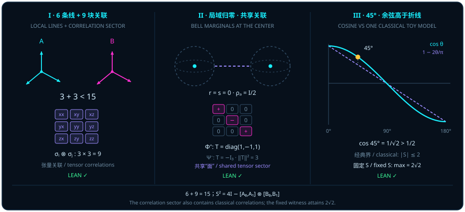

# 量子纠缠与贝尔 45° 破缺：余弦圆弧如何击败经典折线？

> *“其实点 C并不是一个已知量,而是一个相融点的投影,因为实际上一条确定的量子态只能确定一条线,一组量子态才能对应一个面积.”*

在第一部（[第一章](ch01-measurement.md)至[第四章](ch04-decoherence.md)）中，我们看清了单颗量子比特的几何全貌：剥去模长归一化与全局相位冗余后，任何单比特纯态都是三维实欧氏空间 $\mathbb{R}^3$ 中单位球面 $S^2$ 上的一根有向箭头 $\vv{r}$；而在[第四章](ch04-decoherence.md)具体的赤道初态与对称受控门/贝尔记录环境耦合模型（或双随机各向同性退极化噪声）中，当局部观察者对环境求偏迹时，这根横向箭头便按环境重叠余弦因子向球心收缩，并在环境记录完全正交时抵达球心最大混合点 $\vv{r} = \vv{0}$（即 $\frac{1}{2}I_2$；注意一般开放系统信道并不总是径向收缩到球心，例如纯退相干仅将 $(r_x, r_y, r_z)$ 压缩为 $(\eta r_x, \eta r_y, r_z)$ 而保留纵向分量，振幅阻尼则将布洛赫球向纯态北极 $\lvert 0\rangle$ 吸引）。

现在，假设那颗与系统耦合的第二颗量子比特并不是飞散在热浴里的未知杂散粒子，而是被另一位实验家妥善保管在远方实验室里的伙伴量子比特。当两位实验家（通常称作 Alice 与 Bob）各自只盯着自己手里的单颗球看时，他们看到的局部布洛赫箭头可能双双缩在球心死点 $\vv{r} = \vv{s} = \vv{0}$；然而一旦他们把各自的测量记录拿到一起做双体比对，除全局单位阵基线贡献的 $\frac{1}{4}$ 之外，原本在两颗局部三维球面上彻底隐形的全部**非单位阵纯度盈余** $\Tr(\rho^2) - \frac{1}{4} = \frac{3}{4}$（即 $\frac{1}{4}\norm{T}_{\mathrm{F}}^2 = \frac{3}{4}$），竟分毫无损地盛放在一片横跨两子的高维**关联张量扇区**之中！

本章开启第四部“高维球体——纠缠、拓扑与量子算法”。我们将从两体厄米算子空间的正交扇区分解出发，穿过贝尔态的球心边缘盲区与 CHSH 算子平方的换位子面积恒等式，最终抵达 $45^\circ$（$\pi/4$）对称四分角下的 $2\sqrt{2}$ 极值定理。

## 局域线与关联面：6 + 9 = 15 {#sec-pauli-local-correlation}

为什么仅靠“Alice 球面上的箭头 $\vv{r} \in \mathbb{R}^3$”加上“Bob 球面上的箭头 $\vv{s} \in \mathbb{R}^3$”，永远拼不出两体量子态的真实版图？让我们先做一笔严格的实维数与正交子空间审计。

对任意自然数维数 $d \in \mathbb{N}$，全体 $d \times d$ 复厄米矩阵在实数域 $\mathbb{R}$ 上构成一个 $d^2$ 维实向量空间，记作 `HermitianSpace d`。赋予它典范的实希尔伯特—施密特（Hilbert–Schmidt）内积

$$
\langle A, B\rangle_{\mathrm{HS}} = \operatorname{Re}\Tr(A^* B) = \operatorname{Re}\Tr(AB),
$$

则 `HermitianSpace d` 成为一个实内积空间。在其中，实标量倍单位矩阵张成 $1$ 维标量子空间 $\mathrm{scalarHermitian}\,d = \mathbb{R}\cdot I_d$，而全体迹为零的 $d\times d$ 厄米矩阵构成其 $(d^2 - 1)$ 维正交补空间 $\mathrm{traceZeroHermitian}\,d = \{A \in \mathrm{HermitianSpace}\,d \mid \Tr A = 0\}$（因为 $\langle A, I_d\rangle_{\mathrm{HS}} = \operatorname{Re}\Tr(A) = 0$）。

现在考察由 $m$ 维子系统 $A$ 与 $n$ 维子系统 $B$（$m, n \in \mathbb{N}$，$1 \le m$，$1 \le n$，$1 < mn$）复合而成的实张量积空间

$$
\mathcal{H}_{m,n}^{\mathrm{Herm}} = \mathrm{HermitianSpace}\,m \otimes_{\mathbb{R}} \mathrm{HermitianSpace}\,n,
$$

其上带有由两因子希尔伯特—施密特内积诱导的实张量内积。对因子空间中的任意实子空间 $P \le \mathrm{HermitianSpace}\,m$ 与 $Q \le \mathrm{HermitianSpace}\,n$，源码通过典范线性嵌入 `TensorProduct.mapIncl P Q` 的值域定义嵌入扇区 $\mathrm{tensorSector}(P, Q) = \operatorname{range}(\mathrm{TensorProduct.mapIncl}\,P\,Q) \le \mathcal{H}_{m,n}^{\mathrm{Herm}}$（注意这里的载体是嵌入到总张量空间 $\mathcal{H}_{m,n}^{\mathrm{Herm}}$ 后的实子空间，而非脱离母空间的外部抽象直积）。由此，两体无迹厄米空间 $\mathrm{bipartiteTraceZero}\,m\,n = (\mathrm{scalarSector}\,m\,n)^\perp$（即总恒等线 $\mathrm{scalarSector}\,m\,n = \mathrm{tensorSector}(\mathrm{scalarHermitian}\,m, \mathrm{scalarHermitian}\,n)$ 的正交补，实维数为 $m^2 n^2 - 1$）自然分解为三个具有清晰物理操作意义的扇区：

1. **局域 $A$ 扇区** $\mathrm{localASector}\,m\,n = \mathrm{tensorSector}(\mathrm{traceZeroHermitian}\,m,\, \mathrm{scalarHermitian}\,n)$：形如 $A_0 \otimes I_n$（$\Tr A_0 = 0$）的算子，仅对第 1 个子系统提问而对第 2 个子系统完全盲视，实维数为 $m^2 - 1$；
2. **局域 $B$ 扇区** $\mathrm{localBSector}\,m\,n = \mathrm{tensorSector}(\mathrm{scalarHermitian}\,m,\, \mathrm{traceZeroHermitian}\,n)$：形如 $I_m \otimes B_0$（$\Tr B_0 = 0$）的算子，仅对第 2 个子系统提问，实维数为 $n^2 - 1$；
3. **双体关联扇区** $\mathrm{correlationSector}\,m\,n = \mathrm{tensorSector}(\mathrm{traceZeroHermitian}\,m,\, \mathrm{traceZeroHermitian}\,n)$：由双边无迹算子张量 $A_0 \otimes B_0$（$\Tr A_0 = \Tr B_0 = 0$）张成的纯关联子空间，实维数为 $(m^2 - 1)(n^2 - 1)$。

与此同时，在双量子比特（$m = n = 2$，矩阵类型记作 $\mathrm{TwoQubitMatrix} = M_{\mathrm{Fin}\,2 \times \mathrm{Fin}\,2}(\mathbb{C})$）的具体矩阵层面上，定义最大纠缠贝尔态向量 $\mathrm{bellVector} = \lvert\Phi^+\rangle = \frac{1}{\sqrt{2}}(\lvert 00\rangle + \lvert 11\rangle)$（按指标对 $(i, j) \in \mathrm{Fin}\,2 \times \mathrm{Fin}\,2$ 给出的分量为 $\delta_{ij}/\sqrt{2}$），其秩一外积密度矩阵为

$$
\mathrm{bellDensity} = \lvert\Phi^+\rangle\langle\Phi^+\rvert = \frac{1}{2}\begin{pmatrix} 1 & 0 & 0 & 1 \\ 0 & 0 & 0 & 0 \\ 0 & 0 & 0 & 0 \\ 1 & 0 & 0 & 1 \end{pmatrix},
$$

并定义退去相干项的经典对角关联混合态

$$
\mathrm{classicalCorrelatedDensity} = \frac{1}{2}\bigl(\lvert 00\rangle\langle 00\rvert + \lvert 11\rangle\langle 11\rvert\bigr) = \operatorname{diag}\Bigl(\frac{1}{2},\, 0,\, 0,\, \frac{1}{2}\Bigr).
$$

记消去第 2 个因子的偏迹为 $\mathrm{traceEnvironment}(\rho)_{i,j} = \sum_a \rho_{(i,a),(j,a)}$，消去第 1 个因子的偏迹为 $\mathrm{traceFirstFactor}(\rho)_{i,j} = \sum_a \rho_{(a,i),(a,j)}$。下面的定理将一般 $(m, n)$ 维数的正交扇区分解与双比特边缘盲区见证完整地合取在同一个形式化声明中。

::: {.theorem #thm-local-correlation-sectors title="局域边缘扇区与关联扇区的正交分解及边缘盲区定理" lean="D5/S3/Quantum/Entanglement/LocalMarginalCorrelationBlindSpot.local_marginal_correlation_blind_spot"}
设 $m, n \in \mathbb{N}$ 满足 $1 \le m$、$1 \le n$ 且 $1 < mn$。在赋予实希尔伯特—施密特内积的实张量积空间 $\mathrm{HermitianSpace}\,m \otimes_{\mathbb{R}} \mathrm{HermitianSpace}\,n$ 及双比特密度矩阵见证上，以下结论同时成立：

1. **无迹空间的三扇区完备生成**：

   $$
   \mathrm{localASector}\,m\,n \sqcup \mathrm{localBSector}\,m\,n \sqcup \mathrm{correlationSector}\,m\,n = \mathrm{bipartiteTraceZero}\,m\,n;
   $$

2. **局域合成扇区的实维数**：

   $$
   \operatorname{finrank}_{\mathbb{R}}\bigl(\mathrm{localASector}\,m\,n \sqcup \mathrm{localBSector}\,m\,n\bigr) = (m^2 - 1) + (n^2 - 1);
   $$

3. **关联扇区的实维数**：

   $$
   \operatorname{finrank}_{\mathbb{R}}\bigl(\mathrm{correlationSector}\,m\,n\bigr) = (m^2 - 1)(n^2 - 1);
   $$

4. **关联扇区占总无迹空间的维数比**：在由自然数嵌入实数 $\mathbb{R}$ 后，

   $$
   \frac{\operatorname{finrank}_{\mathbb{R}}(\mathrm{correlationSector}\,m\,n)}{\operatorname{finrank}_{\mathbb{R}}(\mathrm{bipartiteTraceZero}\,m\,n)} = \frac{((m^2 - 1)(n^2 - 1) : \mathbb{N})}{((m^2 n^2 - 1) : \mathbb{N})};
   $$

5. **局域扇区与关联扇区严格正交**：在实内积意义下，

   $$
   \operatorname{IsOrtho}_{\mathbb{R}}\bigl(\mathrm{localASector}\,m\,n \sqcup \mathrm{localBSector}\,m\,n,\; \mathrm{correlationSector}\,m\,n\bigr);
   $$

6. **贝尔密度矩阵的纯态性质**：$\mathrm{bellDensity}$ 半正定、$\Tr(\mathrm{bellDensity}) = 1$ 且 $\operatorname{rank}(\mathrm{bellDensity}) = 1$；
7. **经典关联密度矩阵的混合态性质**：$\mathrm{classicalCorrelatedDensity}$ 半正定、$\Tr(\mathrm{classicalCorrelatedDensity}) = 1$，且非幂等

   $$
   \mathrm{classicalCorrelatedDensity} \cdot \mathrm{classicalCorrelatedDensity} \neq \mathrm{classicalCorrelatedDensity};
   $$

8. **双侧局部边缘态完全重合而全局态不同**：

   $$
   \begin{aligned}
   \mathrm{traceEnvironment}(\mathrm{bellDensity}) &= \mathrm{traceEnvironment}(\mathrm{classicalCorrelatedDensity}), \\
   \mathrm{traceFirstFactor}(\mathrm{bellDensity}) &= \mathrm{traceFirstFactor}(\mathrm{classicalCorrelatedDensity}), \\
   \mathrm{bellDensity} &\neq \mathrm{classicalCorrelatedDensity}.
   \end{aligned}
   $$
:::

::: proof
在两因子空间 $\mathrm{HermitianSpace}\,m$ 与 $\mathrm{HermitianSpace}\,n$ 中，标量子空间 $\mathbb{R}\cdot I$ 与无迹子空间 $\mathrm{traceZeroHermitian}$ 构成正交直和，故总张量空间分解为四个两两正交的嵌入张量扇区：标量扇区、局域 $A$ 扇区、局域 $B$ 扇区与关联扇区。去掉一维标量扇区后，其余三个两两正交扇区的上确界恰好等于正交补 $\mathrm{bipartiteTraceZero}\,m\,n$，且局域合成扇区 $\mathrm{localASector} \sqcup \mathrm{localBSector}$ 与 $\mathrm{correlationSector}$ 保持正交（结论 1 与 5）。由正交直和与张量积的实维数公式，$\operatorname{finrank}_{\mathbb{R}}(\mathrm{traceZeroHermitian}\,d) = d^2 - 1$，从而局域两扇区直和维数为 $(m^2 - 1) + (n^2 - 1)$，关联扇区维数为 $(m^2 - 1)(n^2 - 1)$，总无迹空间维数为 $m^2 n^2 - 1$，相除即得维数比公式（结论 2、3、4）。对于双比特具体矩阵，$\mathrm{bellDensity} = \lvert\Phi^+\rangle\langle\Phi^+\rvert$ 作为单位向量的秩一自伴外积自然满足半正定、迹一与秩一（结论 6）；对角矩阵 $\mathrm{classicalCorrelatedDensity} = \operatorname{diag}(1/2, 0, 0, 1/2)$ 对角元非负且和为 $1$，但其平方 $\operatorname{diag}(1/4, 0, 0, 1/4) \neq \mathrm{classicalCorrelatedDensity}$（结论 7）。最后直接按偏迹定义对第二个或第一个指标求和，两者的两个约化边缘态均等于 $\frac{1}{2}I_2$，而在右上角元素 $((0,0),(1,1))$ 处 $\mathrm{bellDensity}$ 取 $1/2$、$\mathrm{classicalCorrelatedDensity}$ 取 $0$，故两全局矩阵不等（结论 8）。完整证明由 Lean 内核检查。
:::

把 [@thm-local-correlation-sectors] 代入最基础的双量子比特情形 $m = n = 2$，一幅令人豁然开朗的几何账本立刻呈现在眼前（见图 13 面板 I）：

- Alice 的单比特无迹方向（$\sigma_X \otimes I_2,\, \sigma_Y \otimes I_2,\, \sigma_Z \otimes I_2$）只有 $2^2 - 1 = 3$ 维；
- Bob 的单比特无迹方向（$I_2 \otimes \sigma_X,\, I_2 \otimes \sigma_Y,\, I_2 \otimes \sigma_Z$）也只有 $2^2 - 1 = 3$ 维；
- 两人各自能独立看到的**局域线总维数**不过是 $3 + 3 = 6$ 维；
- 然而整个双比特无迹厄米空间共有 $4^2 - 1 = 15$ 维！剩下的 $(2^2 - 1)(2^2 - 1) = 3 \times 3 = 9$ 个正交维度（占比 $\frac{9}{15} = 60\%$），全部落在由九个双体泡利乘积 $\{\sigma_i \otimes \sigma_j\}_{i,j \in \{X,Y,Z\}}$ 张成的**关联扇区** $\mathrm{correlationSector}\,2\,2$ 之中！

这就是为什么题记中说“一条确定的量子态只能确定一条线，一组量子态才能对应一个面积”。在单颗球上，你只能看到局域方向线 $\vv{r}$ 与 $\vv{s}$（合共 $6$ 个实参数）；而在两颗球之间，还横亘着一张 $3 \times 3 = 9$ 格的关联张量棋盘 $T_{ij} = \Tr\bigl(\rho(\sigma_i \otimes \sigma_j)\bigr)$。

在解读 [@thm-local-correlation-sectors] 时，必须严格守住两条数学边界：

1. **关联扇区包含经典关联，绝不能笼统改称“纠缠子空间”**：算子扇区 $\mathrm{correlationSector}\,m\,n$ 是测量算子空间的正交直和分量，而不是纯纠缠态的集合。事实上，定理结论 7 与 8 中的经典关联混合态 $\mathrm{classicalCorrelatedDensity} = \frac{1}{2}(\lvert 00\rangle\langle 00\rvert + \lvert 11\rangle\langle 11\rvert) = \frac{1}{4}(I_4 + \sigma_Z \otimes \sigma_Z)$ 没有任何量子纠缠，但它的非平凡无迹部分 $\frac{1}{4}\sigma_Z \otimes \sigma_Z$ 同样百分之百落在 $\mathrm{correlationSector}\,2\,2$ 的 $(Z, Z)$ 格子里！
2. **算子张量扇区不是两个局部布洛赫向量的普通外积**：如果两颗比特处于无关联乘积态 $\rho_A \otimes \rho_B$，其关联矩阵退化为秩至多为 $1$ 的普通实向量外积 $T_{ij} = r_i s_j$（完全受限于 $6$ 个局域参数）；唯有一般的双体态才能在 $\mathrm{correlationSector}\,2\,2$ 中独立激发秩大于 $1$ 的多维对角元（如 $\lvert\Phi^+\rangle$ 同时激发 $\sigma_X \otimes \sigma_X$、$-\sigma_Y \otimes \sigma_Y$ 与 $\sigma_Z \otimes \sigma_Z$ 三格）。

## 贝尔态：球心边缘态与共享关联 {#sec-bell-local-zero}

现在，让我们把放大镜对准 [@thm-local-correlation-sectors] 中登场的贝尔纯态 $\mathrm{bellVector} = \lvert\Phi^+\rangle = \frac{1}{\sqrt{2}}(\lvert 00\rangle + \lvert 11\rangle)$ 及其密度矩阵 $\mathrm{bellDensity} = \lvert\Phi^+\rangle\langle\Phi^+\rvert$。

如果一个经典的观察者坚信“整体不过是局部零件的简单拼装”，那么当他听说双比特系统处于一个百分之百确定、秩为 $1$、满足幂等律 $\rho^2 = \rho$ 的纯态时，他一定会断定：Alice 手里的单比特与 Bob 手里的单比特也必定各自指向某个确定的纯态方向。然而，下面的引理用七条严丝合缝的矩阵合取证明了恰恰相反的事实：整体越是纯粹地交织在一起，局部看到的箭头就越是彻底缩进球心！

::: {.lemma #lemma-bell-mixed-marginal title="贝尔纯态具有最大混合局部边缘态" lean="D5/S3/Quantum/Entanglement/BellPureStateMixedMarginal.bell_pure_state_has_maximally_mixed_marginal"}
对固定双比特贝尔态向量 $\mathrm{bellVector} = \frac{1}{\sqrt{2}}(\lvert 00\rangle + \lvert 11\rangle)$ 与固定 $4\times 4$ 复密度矩阵 $\mathrm{bellDensity} = \mathrm{vecMulVec}\,\mathrm{bellVector}\,(\mathrm{star}\,\mathrm{bellVector})$，以下七条性质同时成立：

1. **态向量单位归一化**：$\mathrm{star}\,\mathrm{bellVector} \mathbin{\cdot_{\mathrm{v}}} \mathrm{bellVector} = 1$；
2. **全局半正定性**：$\mathrm{bellDensity}.\mathrm{PosSemidef}$；
3. **全局迹一归一化**：$\Tr(\mathrm{bellDensity}) = 1$；
4. **全局秩一纯度**：$\operatorname{rank}(\mathrm{bellDensity}) = 1$；
5. **全局投影幂等性**：$\mathrm{bellDensity} \cdot \mathrm{bellDensity} = \mathrm{bellDensity}$；
6. **对第二因子求偏迹得最大混合态**：

   $$
   \mathrm{traceEnvironment}(\mathrm{bellDensity}) = \Bigl(\frac{1}{2} : \mathbb{C}\Bigr) \cdot (1 : \mathrm{QubitMatrix}) = \frac{1}{2}I_2;
   $$

7. **局部边缘态严格非幂等（失去纯态幂等性）**：

   $$
   \mathrm{traceEnvironment}(\mathrm{bellDensity}) \cdot \mathrm{traceEnvironment}(\mathrm{bellDensity}) \neq \mathrm{traceEnvironment}(\mathrm{bellDensity}).
   $$
:::

::: proof
在四个双比特基指标 $(0,0), (0,1), (1,0), (1,1)$ 上直接展开，$\mathrm{bellVector}$ 在 $(0,0)$ 与 $(1,1)$ 处各取 $1/\sqrt{2}$，其余两处取 $0$，故自内积为 $(1/\sqrt{2})^2 + (1/\sqrt{2})^2 = 1$（性质 1）。由此生成的秩一外积矩阵 $\mathrm{bellDensity}$ 自然半正定、迹等于内积 $1$、秩为 $1$，且满足 $(\lvert\Phi^+\rangle\langle\Phi^+\rvert)^2 = \langle\Phi^+\mid\Phi^+\rangle\lvert\Phi^+\rangle\langle\Phi^+\rvert = \mathrm{bellDensity}$（性质 2 至 5）。对第二个比特指标 $a \in \mathrm{Fin}\,2$ 求和计算偏迹 $\mathrm{traceEnvironment}(\mathrm{bellDensity})_{i,j} = \sum_{a \in \{0,1\}} (\mathrm{bellDensity})_{(i,a),(j,a)}$：当 $i = j = 0$ 时得 $(0,0)$ 对角元 $1/2 + 0 = 1/2$；当 $i = j = 1$ 时得 $(1,1)$ 对角元 $0 + 1/2 = 1/2$；当 $i \neq j$ 时，因 $\mathrm{bellVector}$ 仅在对角对 $(0,0)$ 与 $(1,1)$ 非零，故不存在同一个 $a$ 使 $(i,a)$ 与 $(j,a)$ 同时非零，非对角元恒为 $0$。因此 $\mathrm{traceEnvironment}(\mathrm{bellDensity}) = \frac{1}{2}I_2$（性质 6）。最后计算其平方：$(\frac{1}{2}I_2)(\frac{1}{2}I_2) = \frac{1}{4}I_2 \neq \frac{1}{2}I_2$，证得局部边缘态非幂等（性质 7）。完整证明由 Lean 内核检查。
:::

对照[第三章](ch03-projectors-and-duality.md)“存在即幂等线（$P^2 = P$）”的几何准则，[@lemma-bell-mixed-marginal] 的第 5 条与第 7 条形成了一组极具冲击力的对比（见图 13 面板 II）：

- 在 $4\times 4$ 全局空间里，$\mathrm{bellDensity}^2 = \mathrm{bellDensity}$ 严格成立——双体系统是一根毫不含糊的全局幂等纯态；
- 但在 $2\times 2$ 局部空间里，$(\frac{1}{2}I_2)^2 = \frac{1}{4}I_2 \neq \frac{1}{2}I_2$——Alice 的局部布洛赫向量 $\vv{r} = \vv{0}$ 与 Bob 的局部布洛赫向量 $\vv{s} = \vv{0}$ 双双缩成了长度为零的球心原点！

那份全局纯度究竟藏到了哪里？用泡利基将 $\rho_{\Phi^+} = \mathrm{bellDensity}$ 按四个扇区展开，一切水落石出：

$$
\rho_{\Phi^+} = \frac{1}{4}\bigl(I_2 \otimes I_2 + \sigma_X \otimes \sigma_X - \sigma_Y \otimes \sigma_Y + \sigma_Z \otimes \sigma_Z\bigr).
$$

在局域扇区 $\sigma_i \otimes I_2$ 与 $I_2 \otimes \sigma_j$ 上，系数全都是 $0$（所以偏迹只剩标量项 $\frac{1}{2}I_2$）；而在 $9$ 维关联扇区 $\sigma_i \otimes \sigma_j$ 上，对角线上三格 $(X,X)$、$(Y,Y)$、$(Z,Z)$ 的关联系数分别达到了极值 $+1$、$-1$、$+1$，构成关联张量矩阵 $T_{\Phi^+} = \operatorname{diag}(+1, -1, +1)$！

在运用 [@lemma-bell-mixed-marginal] 时，请务必留意两处精确的符号与逻辑边界：

1. **区分冻结声明中的三重态 $\lvert\Phi^+\rangle$ 与教科书常画的自旋单态 $\lvert\Psi^-\rangle$**：[@lemma-bell-mixed-marginal] 形式化的 `bellVector` 是对称贝尔态 $\lvert\Phi^+\rangle = \frac{1}{\sqrt{2}}(\lvert 00\rangle + \lvert 11\rangle)$，其关联矩阵为 $T_{\Phi^+} = \operatorname{diag}(+1, -1, +1)$（因为 $\sigma_Y \otimes \sigma_Y$ 含有两个虚数单位 $(-i)(-i) = -1$，在 $\lvert 00\rangle \leftrightarrow \lvert 11\rangle$ 翻转下给出负号）；而反对称自旋单态（singlet）由于 $i\sigma_Y\lvert 0\rangle = -\lvert 1\rangle$ 且 $i\sigma_Y\lvert 1\rangle = \lvert 0\rangle$，满足精确态向量恒等式 $\lvert\Psi^-\rangle = \frac{1}{\sqrt{2}}(\lvert 01\rangle - \lvert 10\rangle) = \bigl(I_2 \otimes (-i\sigma_Y)\bigr)\lvert\Phi^+\rangle = (i\sigma_Y \otimes I_2)\lvert\Phi^+\rangle$（若作用 $(I_2 \otimes i\sigma_Y)\lvert\Phi^+\rangle = -\lvert\Psi^-\rangle$ 则相差一个全局相位 $-1$，但对应同一个密度矩阵 $\rho_{\Psi^-}$），其泡利展开式为

   $$
   \rho_{\Psi^-} = \frac{1}{4}\bigl(I_2 \otimes I_2 - \sigma_X \otimes \sigma_X - \sigma_Y \otimes \sigma_Y - \sigma_Z \otimes \sigma_Z\bigr), \qquad T_{\Psi^-} = -I_3 = \operatorname{diag}(-1, -1, -1).
   $$

   单态 $\lvert\Psi^-\rangle$ 在任意相同测量轴 $\vv{n}$ 下呈现全向反相关 $\langle(\vv{n}\cdot\vv{\sigma})\otimes(\vv{n}\cdot\vv{\sigma})\rangle_{\Psi^-} = -1$；而 $\lvert\Phi^+\rangle$ 在 $(Z, X)$ 实平面（$n_y = 0$）内任意相同方向 $\vv{n} = (\sin\alpha, 0, \cos\alpha)$ 下呈现正相关 $\langle(\vv{n}\cdot\vv{\sigma})\otimes(\vv{n}\cdot\vv{\sigma})\rangle_{\Phi^+} = \sin^2\alpha + \cos^2\alpha = +1$，唯独在 $Y$ 轴上反号为 $-1$。两者之间通过 Bob 端的局域泡利变换 $-i\sigma_Y = \sigma_X \sigma_Z$（或 Alice 端的 $i\sigma_Y = \sigma_Z \sigma_X$）精确互译，绝不能把 $\lvert\Phi^+\rangle$ 与 $\lvert\Psi^-\rangle$ 的 $\sigma_Y \otimes \sigma_Y$ 符号混为一谈。
2. **仅凭“局域边缘态为 $\frac{1}{2}I_2$（局域零向量）”不能反推任意双体态最大纠缠**：唯有在已知**全局态是纯态**（$\operatorname{rank}\rho = 1$，$\Tr(\rho^2) = 1$）的前提下，局部边缘态等于 $\frac{1}{2}I_2$ 才充要地标志着双比特最大纠缠。对于一般混合态，如 [@thm-local-correlation-sectors] 中的经典关联态 $\mathrm{classicalCorrelatedDensity} = \frac{1}{4}(I_4 + \sigma_Z \otimes \sigma_Z)$（$T = \operatorname{diag}(0, 0, 1)$）乃至完全无关联的最大混合态 $\frac{1}{4}I_4$（$T = 0$），它们的局部边缘态同样等于 $\frac{1}{2}I_2$，却丝毫不具量子纠缠。

## CHSH 平方：正交面积的换位子项 {#sec-chsh-commutator-area}

既然经典对角混合态 $\mathrm{classicalCorrelatedDensity}$ 也能把局部边缘态缩成 $\frac{1}{2}I_2$ 并在关联扇区里占有一格 $\sigma_Z \otimes \sigma_Z$，我们究竟怎样用实验直接拷问出“纯粹的一维经典相关线”与“高维相干关联面”之间的本质分野？

1969 年，Clauser、Horne、Shimony 与 Holt（CHSH）提出了一把极其精巧的四向组合标尺：让 Alice 准备两把二值可观测量快门 $A_0, A_1$（满足自伴性且平方为单位阵 $A_0^2 = A_1^2 = I$），让 Bob 也准备两把二值可观测量快门 $B_0, B_1$（$B_0^2 = B_1^2 = I$），构造 CHSH 算子

$$
S = A_0 \otimes_{\mathrm{K}} B_0 + A_0 \otimes_{\mathrm{K}} B_1 + A_1 \otimes_{\mathrm{K}} B_0 - A_1 \otimes_{\mathrm{K}} B_1,
$$

其中 $\otimes_{\mathrm{K}}$ 表示矩阵的克罗内克积（Kronecker product）。

如果 $A_0, A_1$ 和 $B_0, B_1$ 只是普通的可交换数字 $\pm 1$，因式分解 $S = A_0(B_0 + B_1) + A_1(B_0 - B_1)$ 立刻逼出 $S^2 = 4$（因为 $B_0 = \pm B_1$ 必使其一为 $\pm 2$、另一为 $0$）。那么在非对易的矩阵世界里，把算子 $S$ 直接平方，多出来的到底是什么？1987 年 Landau 指出的算子平方恒等式给出了最透彻的几何答案：多出来的恰恰是 Alice 两把尺子的**换位子** $[A_0, A_1] = A_0 A_1 - A_1 A_0$ 与 Bob 两把尺子的**换位子** $[B_0, B_1] = B_0 B_1 - B_1 B_0$ 的负克罗内克积！

::: {.proposition #prop-landau-area-square title="CHSH 算子平方的 Landau 换位子恒等式" lean="D5/S3/QuantumBounds/LandauIdentity.landau_identity"}
设 $m, n$ 为任意有限可判等指标类型（`[Fintype m] [DecidableEq m] [Fintype n] [DecidableEq n]`），$A_0, A_1 \in M_m(\mathbb{C})$ 与 $B_0, B_1 \in M_n(\mathbb{C})$ 为复方阵，且四个矩阵均满足厄米性与对合性：

$$
\begin{aligned}
A_0.\mathrm{IsHermitian} \land A_0^2 = 1, &\qquad A_1.\mathrm{IsHermitian} \land A_1^2 = 1, \\
B_0.\mathrm{IsHermitian} \land B_0^2 = 1, &\qquad B_1.\mathrm{IsHermitian} \land B_1^2 = 1.
\end{aligned}
$$

定义克罗内克积组合算子 $S, C \in M_{m \times n}(\mathbb{C})$ 为

$$
\begin{aligned}
S &:= A_0 \otimes_{\mathrm{K}} B_0 + A_0 \otimes_{\mathrm{K}} B_1 + A_1 \otimes_{\mathrm{K}} B_0 - A_1 \otimes_{\mathrm{K}} B_1, \\
C &:= -\bigl((A_0 A_1 - A_1 A_0) \otimes_{\mathrm{K}} (B_0 B_1 - B_1 B_0)\bigr),
\end{aligned}
$$

则恒有

$$
S^2 = 4 \cdot (1 : M_{m \times n}(\mathbb{C})) + C.
$$
:::

::: proof
利用克罗内克积的乘法法则 $(X \otimes_{\mathrm{K}} Y)(X' \otimes_{\mathrm{K}} Y') = (XX') \otimes_{\mathrm{K}} (YY')$ 与双线性分配律，将 $S = A_0 \otimes_{\mathrm{K}} (B_0 + B_1) + A_1 \otimes_{\mathrm{K}} (B_0 - B_1)$ 展开平方，共得四组块项：

1. **第 1 组（$A_0^2$ 项）**：$(A_0^2) \otimes_{\mathrm{K}} (B_0 + B_1)^2 = I_m \otimes_{\mathrm{K}} (B_0^2 + B_1^2 + B_0 B_1 + B_1 B_0) = 2 I_{m\times n} + I_m \otimes_{\mathrm{K}} (B_0 B_1 + B_1 B_0)$；
2. **第 2 组（$A_1^2$ 项）**：$(A_1^2) \otimes_{\mathrm{K}} (B_0 - B_1)^2 = I_m \otimes_{\mathrm{K}} (B_0^2 + B_1^2 - B_0 B_1 - B_1 B_0) = 2 I_{m\times n} - I_m \otimes_{\mathrm{K}} (B_0 B_1 + B_1 B_0)$；
   将前两组相加，含反换位子 $\{B_0, B_1\} = B_0 B_1 + B_1 B_0$ 的项正负抵消，精准给出标量主项 $4 I_{m\times n}$。
3. **第 3 与第 4 组（$A_0 A_1$ 与 $A_1 A_0$ 交叉项）**：计算 $(B_0 + B_1)(B_0 - B_1) = B_0^2 - B_1^2 - B_0 B_1 + B_1 B_0 = -(B_0 B_1 - B_1 B_0)$，以及 $(B_0 - B_1)(B_0 + B_1) = B_0^2 - B_1^2 + B_0 B_1 - B_1 B_0 = +(B_0 B_1 - B_1 B_0)$。因此交叉项之和化为

   $$
   A_0 A_1 \otimes_{\mathrm{K}} \bigl(-(B_0 B_1 - B_1 B_0)\bigr) + A_1 A_0 \otimes_{\mathrm{K}} (B_0 B_1 - B_1 B_0) = -\bigl((A_0 A_1 - A_1 A_0) \otimes_{\mathrm{K}} (B_0 B_1 - B_1 B_0)\bigr) = C.
   $$

合并标量主项与交叉项即得 $S^2 = 4 I_{m\times n} + C$。完整证明由 Lean 内核检查。
:::

请细细品味 [@prop-landau-area-square] 的普适性与几何深度：

首先，定理对指标类型 $m, n$ **完全没有作等于 $2$ 的限制**——无论 Alice 和 Bob 手里拿的是单量子比特（$2\times 2$）、双量子比特寄存器还是任意高维有限量子系统，只要四把测量尺是平方为 $1$ 的厄米对合算子，且两侧算子通过克罗内克提升在不同因子上天然对易（$(A_i \otimes_{\mathrm{K}} I_n)(I_m \otimes_{\mathrm{K}} B_j) = A_i \otimes_{\mathrm{K}} B_j = (I_m \otimes_{\mathrm{K}} B_j)(A_i \otimes_{\mathrm{K}} I_n)$），$S^2 = 4I - [A_0, A_1] \otimes_{\mathrm{K}} [B_0, B_1]$ 就恒等成立！

其次，当我们把目光放回单量子比特泡利方向 $A_0 = \vv{a}_0\cdot\vv{\sigma}$、$A_1 = \vv{a}_1\cdot\vv{\sigma}$ 与 $B_0 = \vv{b}_0\cdot\vv{\sigma}$、$B_1 = \vv{b}_1\cdot\vv{\sigma}$（其中 $\vv{a}_i, \vv{b}_j \in S^2$ 为三维单位实向量）时，我们可以亲手算出一座连接矩阵换位子与三维叉积面积的桥梁：利用泡利矩阵乘法 $(\vv{u}\cdot\vv{\sigma})(\vv{v}\cdot\vv{\sigma}) = (\vv{u}\cdot\vv{v})I_2 + i(\vv{u}\times\vv{v})\cdot\vv{\sigma}$，对称点积项在相减时消去，换位子恰好化为两向量所张平行四边形有向面积（叉积 $\vv{u}\times\vv{v}$）的两倍虚部：

$$
[A_0, A_1] = 2i(\vv{a}_0 \times \vv{a}_1)\cdot\vv{\sigma}, \qquad [B_0, B_1] = 2i(\vv{b}_0 \times \vv{b}_1)\cdot\vv{\sigma}.
$$

将这两个手算公式代入 $C = -[A_0, A_1] \otimes_{\mathrm{K}} [B_0, B_1]$，两个虚数因子 $-(2i)(2i) = +4$ 正好把负号翻正：

$$
S^2 = 4 I_4 + 4\bigl((\vv{a}_0 \times \vv{a}_1)\cdot\vv{\sigma}\bigr) \otimes_{\mathrm{K}} \bigl((\vv{b}_0 \times \vv{b}_1)\cdot\vv{\sigma}\bigr)!
$$

看！这句话把量子破缺的几何机制交代得一清二楚（注意：此泡利叉积展开是针对单比特泡利方向的手算几何解释，并不改写 [@prop-landau-area-square] 对任意有限维厄米对合矩阵的一般假设；同时 [@prop-landau-area-square] 本身是算子代数恒等式，而非经典局域隐变量概率上界的证明）：$S^2$ 超出 $4$ 的那一部分，是 Alice 的有向面积乘以 Bob 的有向面积。于是立刻冒出三个问题：一侧面积为零时，$S^2$ 是什么？两侧面积都只张开一部分时，$S$ 的特征值落在哪里？面积张满时，有没有天花板？下面三条冻结定理在任意有限维上回答这三个问题，用不着泡利矩阵。

**一侧面积为零。** 在单比特图像里，Alice 的两次提问共线（$\vv{a}_0 \parallel \vv{a}_1$）意味着 $A_1 = \pm A_0$，两把尺子可交换，换位子当场归零。一般维数下，“共线”换成“可交换”，结论照样成立。

::: {.corollary #cor-chsh-local-commuting-collapse title="一侧局域观测量可交换时 CHSH 算子的平方为 4I" lean="D5/S3/QuantumBounds/LandauCommutingCollapse.chsh_square_eq_four_of_local_pair_commutes"}
设 $m, n$ 为有限可判等指标类型，$A_0, A_1 \in M_m(\mathbb{C})$ 与 $B_0, B_1 \in M_n(\mathbb{C})$ 均为厄米矩阵且平方为单位阵（即 [@prop-landau-area-square] 的四条假设），$S = A_0 \otimes_{\mathrm{K}} B_0 + A_0 \otimes_{\mathrm{K}} B_1 + A_1 \otimes_{\mathrm{K}} B_0 - A_1 \otimes_{\mathrm{K}} B_1$。若

$$
A_0 A_1 = A_1 A_0 \qquad \text{或} \qquad B_0 B_1 = B_1 B_0,
$$

则

$$
S^2 = 4 \cdot (1 : M_{m \times n}(\mathbb{C})).
$$
:::

::: proof
源码先用 [@prop-landau-area-square] 把 $S^2$ 改写为 $4 \cdot 1 + C$，再分两种情形：若 $A_0 A_1 = A_1 A_0$，Alice 的换位子 $A_0 A_1 - A_1 A_0$ 化为 $A_1 A_0 - A_1 A_0 = 0$；若 $B_0 B_1 = B_1 B_0$，Bob 的换位子同样为零。零矩阵与任何矩阵的克罗内克积为零，取负仍为零，于是 $C = 0$，只剩 $S^2 = 4 \cdot 1$。完整证明由 Lean 内核检查。
:::

这条推论是算子恒等式；Lean 文件的说明明确写着，它不陈述任何期望值上界。要由它走到“经典门槛”，还需一段手工推导：$S$ 是厄米矩阵的克罗内克积之和与差，本身厄米；$S^2 = 4I$ 迫使每个特征值 $\lambda$ 满足 $\lambda^2 = 4$，即 $\lambda = \pm 2$；于是 $2I - S$ 与 $2I + S$ 都半正定，对任意密度矩阵 $\rho$ 有 $-2 \le \operatorname{Re}\Tr(\rho S) \le 2$。**只要有一方的两次提问不分先后，量子关联就跨不过经典门槛。**

::: {.viz src="chsh-dial" preset="collinear" height="500"}
**一侧的两次提问重合，S 就越不过 2。** Alice 的两支实线箭头重合在 $Z$ 上，她那块品红面积缩成一条线，量尺上品红的刻度落到 $2$，与经典上界的虚线重合；时间轴转动 Bob 的一对虚线箭头，琥珀色的横线按 $2\cos\varphi$ 起落，最高只碰到 $2$（[@cor-chsh-local-commuting-collapse]）。
:::

**两侧面积都只张开一部分。** 回到单比特：设 Alice 两轴的夹角为 $\alpha$、Bob 两轴的夹角为 $\beta$，则 $\norm{\vv{a}_0 \times \vv{a}_1} = \sin\alpha$，$\norm{\vv{b}_0 \times \vv{b}_1} = \sin\beta$。泡利方向算子 $\vv{u}\cdot\vv{\sigma}$ 的特征值是 $\pm\norm{\vv{u}}$，所以由上面的手算公式，$C$ 只有两个特征值 $\pm 4\sin\alpha\sin\beta$（手工推导）。换位子项只取一对相反的值，这正是下面这条命题的前提。

::: {.proposition #prop-chsh-four-point-spectrum title="换位子项的谱落在 ±N 上时 CHSH 算子的实谱落在四个平方根上" lean="D5/S3/QuantumBounds/CHSHSpectrum.chsh_spectrum"}
设 $N \in \mathbb{R}$ 满足 $0 < N < 4$；$m, n$ 为有限可判等指标类型，$A_0, A_1 \in M_m(\mathbb{C})$ 与 $B_0, B_1 \in M_n(\mathbb{C})$ 均为厄米矩阵且平方为单位阵；$S$ 与 $C$ 同 [@prop-landau-area-square]：

$$
\begin{aligned}
S &= A_0 \otimes_{\mathrm{K}} B_0 + A_0 \otimes_{\mathrm{K}} B_1 + A_1 \otimes_{\mathrm{K}} B_0 - A_1 \otimes_{\mathrm{K}} B_1, \\
C &= -\bigl((A_0 A_1 - A_1 A_0) \otimes_{\mathrm{K}} (B_0 B_1 - B_1 B_0)\bigr).
\end{aligned}
$$

对复方阵 $M$，记 $\operatorname{spectrum}_{\mathbb{R}} M$ 为使 $r \cdot 1 - M$ 不可逆的全体实数 $r$。若 $\operatorname{spectrum}_{\mathbb{R}} C \subseteq \{N, -N\}$，则

$$
\operatorname{spectrum}_{\mathbb{R}} S \subseteq \bigl\{\sqrt{4 + N},\; -\sqrt{4 + N},\; \sqrt{4 - N},\; -\sqrt{4 - N}\bigr\}.
$$
:::

::: proof
源码先证 $S$ 是厄米矩阵：厄米矩阵的克罗内克积仍是厄米的（私有引理 `hermitian_kronecker`），厄米矩阵的和与差也是。于是 $S$ 的实谱恰好是它的特征值集合。任取特征值 $x$：由谱的幂映射（Mathlib 的 `spectrum.pow_mem_pow`），$x^2$ 属于 $S^2$ 的谱；由 [@prop-landau-area-square]，$S^2 = 4 \cdot 1 + C$，标量平移把谱整体平移（`spectrum.add_mem_add_iff`），故 $x^2 - 4$ 属于 $C$ 的谱。按假设 $x^2 - 4 = N$ 或 $x^2 - 4 = -N$，即 $x^2 = 4 + N$ 或 $x^2 = 4 - N$；两数都为正，所以 $x$ 是对应平方根的正值或负值。完整证明由 Lean 内核检查。
:::

这条命题有两处要读准。其一，它只给包含关系：$S$ 的特征值逃不出这四个点，但它没有说四个点都会出现。其二，前提是严格的 $0 < N < 4$。单比特情形 $N = 4\sin\alpha\sin\beta$，前提等于说两侧都不共线、且两侧不同时正交；两侧都正交时 $N = 4$，落在命题之外。那时手算得 $S^2$ 的特征值为 $8, 8, 0, 0$（下一节 [@cor-fixed-chsh-tsirelson] 的证明对固定算子算出的也是这组值），$S$ 的谱为 $\{2\sqrt{2}, -2\sqrt{2}, 0\}$。

::: {.example #ex-chsh-spectrum-angle-table title="五组夹角下的面积参数 N、CHSH 谱与贝尔态上的期望值"}
四根轴都放在 $(Z, X)$ 平面内，角度从 $Z$ 轴量起。Alice 取 $A_0 = Z$、$A_1 = \cos\alpha\,Z + \sin\alpha\,X$；Bob 取 $B_0 = Z$、$B_1 = \cos\beta\,Z - \sin\beta\,X$（向另一侧转）。手工推导：由 $[Z, X] = 2iY$ 得 $[A_0, A_1] = 2i\sin\alpha\,Y$、$[B_0, B_1] = -2i\sin\beta\,Y$，故

$$
C = -(2i\sin\alpha)(-2i\sin\beta)\,Y \otimes_{\mathrm{K}} Y = -4\sin\alpha\sin\beta\;Y \otimes_{\mathrm{K}} Y.
$$

$Y \otimes_{\mathrm{K}} Y$ 在 $\lvert\Phi^+\rangle, \lvert\Psi^-\rangle$ 上取 $-1$，在 $\lvert\Phi^-\rangle, \lvert\Psi^+\rangle$ 上取 $+1$，所以 $C$ 的谱是 $\{N, -N\}$，其中 $N = 4\sin\alpha\sin\beta$。

以 $\alpha = \beta = 60^\circ$ 为例：$A_1 = \frac{1}{2}Z + \frac{\sqrt{3}}{2}X$，$B_1 = \frac{1}{2}Z - \frac{\sqrt{3}}{2}X$，$[A_0, A_1] = i\sqrt{3}\,Y$，$[B_0, B_1] = -i\sqrt{3}\,Y$，$C = -3\,Y \otimes_{\mathrm{K}} Y$，$N = 3$。[@prop-chsh-four-point-spectrum] 把 $S$ 的谱关进 $\{\pm\sqrt{7}, \pm 1\}$；直接展开 $4\times 4$ 矩阵 $S$ 的特征多项式得 $(\lambda - 1)(\lambda + 1)(\lambda^2 - 7)$，四个点各出现一次。贝尔态 $\lvert\Phi^+\rangle$ 上，两根同平面轴的关联就是夹角余弦：$E_{00} = 1$，$E_{01} = \cos 60^\circ = \frac{1}{2}$，$E_{10} = \frac{1}{2}$，$E_{11} = \cos 120^\circ = -\frac{1}{2}$，于是 $\langle S\rangle_{\Phi^+} = 1 + \frac{1}{2} + \frac{1}{2} + \frac{1}{2} = \frac{5}{2}$：已越过 $2$，但没到 $\sqrt{7} \approx 2.6458$。最大值藏在 $\operatorname{span}\{\lvert\Phi^+\rangle, \lvert\Psi^-\rangle\}$ 里，$S$ 在这个平面上的矩阵是

$$
\begin{pmatrix} 5/2 & -\sqrt{3}/2 \\ -\sqrt{3}/2 & -5/2 \end{pmatrix},
$$

特征值为 $\pm\sqrt{25/4 + 3/4} = \pm\sqrt{7}$。

五组夹角汇总如下。末列按 $\langle S\rangle_{\Phi^+} = 1 + \cos\beta + \cos\alpha - \cos(\alpha + \beta)$ 计算，数值四舍五入到四位小数：

| $\alpha$ | $\beta$ | $N = 4\sin\alpha\sin\beta$ | $S$ 的谱 | 冻结依据 | $\langle S\rangle_{\Phi^+}$ |
| :---: | :---: | :---: | :--- | :--- | :---: |
| $0^\circ$ | $60^\circ$ | $0$ | $\pm 2$（各两重） | [@cor-chsh-local-commuting-collapse] | $2$ |
| $30^\circ$ | $30^\circ$ | $1$ | $\pm\sqrt{5} \approx \pm 2.2361$，$\pm\sqrt{3} \approx \pm 1.7321$ | [@prop-chsh-four-point-spectrum] | $\frac{1}{2} + \sqrt{3} \approx 2.2321$ |
| $60^\circ$ | $60^\circ$ | $3$ | $\pm\sqrt{7} \approx \pm 2.6458$，$\pm 1$ | [@prop-chsh-four-point-spectrum] | $\frac{5}{2} = 2.5$ |
| $90^\circ$ | $30^\circ$ | $2$ | $\pm\sqrt{6} \approx \pm 2.4495$，$\pm\sqrt{2} \approx \pm 1.4142$ | [@prop-chsh-four-point-spectrum] | $\frac{3}{2} + \frac{\sqrt{3}}{2} \approx 2.3660$ |
| $90^\circ$ | $90^\circ$ | $4$ | $\pm 2\sqrt{2} \approx \pm 2.8284$，$0$（两重） | 无（$N = 4$ 超出命题前提；由 [@prop-landau-area-square] 手算） | $2$ |

“冻结依据”一栏只说明哪条冻结结论把谱限制在所列的点上（第一行还要接上前面 $\lambda^2 = 4$ 那段手工推导）；所列的点是否都出现、出现几重，以及末列，都是手工推导，并经数值核对。谱只通过 $N$ 依赖两个夹角；只要两侧面积都不为零，最大特征值 $\sqrt{4 + N}$ 就超过 $2$。末行的谱已经顶到 $2\sqrt{2}$，贝尔态上的期望值却只有 $2$：Bob 的十字架摆错了位置。怎么摆，是下一节 $45^\circ$ 的问题。
:::

::: {.viz src="chsh-dial" preset="sixty" height="500"}
**两侧各张 60°：越过 2，停在 √7 之下。** 青色的四段 $1 + \frac{1}{2} + \frac{1}{2} + \frac{1}{2}$ 在贝尔态上叠到 $\frac{5}{2}$，越过了虚线 $2$；外侧品红的刻度在 $\pm\sqrt{7}$，内侧的品红点线在 $\pm 1$，正是 [@prop-chsh-four-point-spectrum] 给出的四个点。把 Bob 的一对方向转到约 $19.1^\circ$，琥珀色的横线正好碰到 $\sqrt{7}$。
:::

::: {.viz src="chsh-dial" preset="cross" height="500"}
**天花板到了顶，CHSH 值还在 2。** 两侧都张成直角，两块品红面积都是整个正方形，品红的刻度升到 $2\sqrt{2}$；可 Bob 的十字架与 Alice 的对齐（$B_0$ 在 $A_0$ 上，$B_1$ 与 $A_1$ 相反），青色的四段只是 $1 + 0 + 0 + 1 = 2$。
:::

**面积张满时的天花板。** 上表中最大的数是 $2\sqrt{2}$。换别的维数、别的观测量，能不能更大？模块 `PeritoTsirelson` 证明了一条更一般的上界：Alice 两个设置、Bob $d$ 个设置，观测量只要求是幺正矩阵；$d = 2$ 时正是 CHSH。

::: {.theorem #thm-unitary-bell-bound title="有限维幺正策略的贝尔值上界 $2/\sin(\pi/(2d))$" lean="D5/S3/QuantumBounds/PeritoTsirelson.bell_value_le"}
设 $d, n, m \in \mathbb{N}$，$d \ge 2$。设 $A_0, A_1$ 为 $n \times n$ 复幺正矩阵，$B_0, \dots, B_{d-1}$ 为 $m \times m$ 复幺正矩阵（行列指标分别为 $\mathrm{Fin}\,n$ 与 $\mathrm{Fin}\,m$），$\rho$ 为 $\mathrm{Fin}\,n \times \mathrm{Fin}\,m$ 上的密度态 `DensityState`（半正定且 $\Tr\rho = 1$）。记 $\omega_d = \exp(2\pi i/d)$（源码中的 $\mathrm{windowRoot}\,d$），定义

$$
\begin{aligned}
\mathrm{bellOperator}_d(A, B) &= \sum_{x = 0}^{1}\sum_{y = 0}^{d - 1} \omega_d^{\,xy}\, A_x \otimes_{\mathrm{K}} B_y, \\
\mathrm{bellValue}_d(A, B, \rho) &= \operatorname{Re}\Tr\bigl(\rho \cdot \mathrm{bellOperator}_d(A, B)\bigr).
\end{aligned}
$$

则

$$
\mathrm{bellValue}_d(A, B, \rho) \le \frac{2}{\sin\bigl(\pi/(2d)\bigr)}.
$$
:::

::: proof
源码分四步。第一步（私有引理 `density_trace_re_le_norm`）：对密度态 $\rho$ 与任意矩阵 $M$，$\operatorname{Re}\Tr(\rho M) \le \norm{M}$（算子范数）。做法是把 $M$ 换成厄米部分 $H = \frac{1}{2}(M + M^*)$，实部迹不变、范数不增；$\norm{H} \cdot 1 - H$ 半正定，与 $\rho$ 配对的迹非负，再用 $\Tr\rho = 1$。第二步（私有引理 `bell_operator_factor`）：从左边提出 $A_0 \otimes_{\mathrm{K}} 1$，

$$
\mathrm{bellOperator}_d(A, B) = (A_0 \otimes_{\mathrm{K}} 1) \sum_{y = 0}^{d - 1} \bigl(1 + \omega_d^{\,y}\, U\bigr) \otimes_{\mathrm{K}} B_y, \qquad U = A_0^* A_1,
$$

左乘幺正矩阵不改变算子范数。第三步（`PeritoTensorBlockBound.tensor_block_bound`）：把幺正矩阵 $U$ 酉对角化为 $\operatorname{diag}(z_1, \dots, z_n)$，$\lvert z_i\rvert = 1$；用 $P \otimes_{\mathrm{K}} 1$ 共轭后，算子拆成 $n$ 个互相正交的 Bob 块 $\sum_y (1 + \omega_d^{\,y} z_i) B_y$，由三角不等式与 $B_y$ 的幺正性，每块的范数不超过 $\sum_y \lvert 1 + \omega_d^{\,y} z_i\rvert$，整个算子的范数也就不超过这些块界的公共上界。第四步（`PeritoUnitCircleSum.unit_circle_sum_le`）：写 $z = e^{2is}$，则 $\lvert 1 + \omega_d^{\,y} z\rvert = 2\lvert\cos(s + \pi y/d)\rvert$，而 $d$ 个等距余弦的绝对值之和不超过 $1/\sin(\pi/(2d))$。完整证明由 Lean 内核检查。
:::

取 $d = 2$ 是一段手工推导：$\omega_2 = e^{i\pi} = -1$，四个系数依次为 $1, 1, 1, -1$，$\mathrm{bellOperator}_2$ 正是 CHSH 算子 $S$，上界为 $2/\sin(\pi/4) = 2\sqrt{2}$。厄米对合矩阵是幺正的（$A^* A = A^2 = 1$）；把 $A_0, A_1$ 同时取负，它们仍是幺正的，而 $S$ 变号。所以对任意有限维、任意四个厄米对合观测量与任意密度态，都有 $\lvert\operatorname{Re}\Tr(\rho S)\rvert \le 2\sqrt{2}$：这就是有限维张量积情形的 Tsirelson 界；无穷维与只要求对易的一般形式仍见章末 [@rem-bell-chsh-literature]。证明第四步在 $d = 2$ 时是 $\lvert 1 + z\rvert + \lvert 1 - z\rvert \le 2\sqrt{2}$，等号只在 $z = \pm i$ 时成立。对单比特泡利方向，$U = A_0^* A_1 = A_0 A_1 = \cos\alpha\, I + i(\vv{a}_0 \times \vv{a}_1)\cdot\vv{\sigma}$ 的特征值是 $e^{\pm i\alpha}$，块界成为 $2\lvert\cos(\alpha/2)\rvert + 2\lvert\sin(\alpha/2)\rvert = 2\sqrt{1 + \sin\alpha}$（$0^\circ \le \alpha \le 180^\circ$）；与 [@prop-chsh-four-point-spectrum] 允许的最大特征值 $\sqrt{4 + N} = 2\sqrt{1 + \sin\alpha\sin\beta}$ 相比，只是把 Bob 的 $\sin\beta$ 放大成了 $1$。它在 $\alpha = 90^\circ$ 时达到 $2\sqrt{2}$：天花板，就钉在 Alice 张满一个正交十字架的地方。

## 45° 余弦与固定 CHSH 极值 {#sec-bell-45-tsirelson}

为了在双量子比特上真正触及 $\sqrt{8} = 2\sqrt{2}$ 这座山峰，Alice 与 Bob 的两套正交十字架应该以什么相对夹角摆放？

::: {.viz src="chsh-dial" preset="sweep" height="500"}
**转动 Bob 的十字架，只在 45° 碰到顶。** 两侧都是直角，时间轴把 Bob 的十字架从 $0^\circ$ 转到 $90^\circ$，琥珀色的横线按 $2\sqrt{2}\cos(\varphi - 45^\circ)$ 起落：两端是 $2$，只在 $45^\circ$ 碰到品红的刻度 $2\sqrt{2}$。图停在 $20^\circ$，读数 $2.563$。
:::

答案是 **$45^\circ$（$\pi/4$）**——正交十字架之间的对称四分角！在源码模块 `CHSHWitness` 中，Alice 将两把快门定在正交的 $Z$ 轴与 $X$ 轴上，而 Bob 将自己的正交十字架在 $(Z, X)$ 平面内旋转 $45^\circ$，定在两条对角角平分线上：

$$
B_0 = \mathrm{bobObservable0} = \frac{Z + X}{\sqrt{2}}, \qquad B_1 = \mathrm{bobObservable1} = \frac{Z - X}{\sqrt{2}},
$$

由此固定双比特 CHSH 见证算子

$$
\mathrm{CHSHWitness.chshOperator} = Z \otimes_{\mathrm{K}} B_0 + Z \otimes_{\mathrm{K}} B_1 + X \otimes_{\mathrm{K}} B_0 - X \otimes_{\mathrm{K}} B_1.
$$

下面的推论在全体 $4\times 4$ 合法双比特密度矩阵（半正定且迹为 $1$ 的子类型）上，严格确立了该固定 CHSH 算子期望值集合具有最大元 $2\sqrt{2}$。

::: {.corollary #cor-fixed-chsh-tsirelson title="固定双比特 CHSH 算子在全体量子态上的最大期望值为 2√2" lean="D5/S3/QuantumBounds/TsirelsonTightness.bell_chsh_state_expectation_is_greatest"}
记双比特量子态子类型为 $\mathcal{S}_2 = \{\rho : \mathrm{CHSHWitness.TwoQubitMatrix} \mid \rho.\mathrm{PosSemidef} \land \Tr(\rho) = 1\}$。则实期望值映射

$$
\rho \longmapsto \operatorname{Re}\Tr\bigl(\rho \cdot \mathrm{CHSHWitness.chshOperator}\bigr)
$$

在 $\mathcal{S}_2$ 上的值域集合以 $2\sqrt{2}$ 为最大元（`IsGreatest`）：即一方面存在合法量子态 $\rho \in \mathcal{S}_2$ 使 $\operatorname{Re}\Tr(\rho \cdot \mathrm{CHSHWitness.chshOperator}) = 2\sqrt{2}$，另一方面对一切 $\rho \in \mathcal{S}_2$ 恒有

$$
\operatorname{Re}\Tr\bigl(\rho \cdot \mathrm{CHSHWitness.chshOperator}\bigr) \le 2\sqrt{2}.
$$
:::

::: proof
在 Mathlib 中，`IsGreatest s a` 定义为 $a \in s \land \forall x \in s,\, x \le a$。源码分两步完成验证：

1. **可达到性（$2\sqrt{2} \in \operatorname{range}$）**：取 [@thm-local-correlation-sectors] 与 [@lemma-bell-mixed-marginal] 中的合法双比特密度态 $\rho = \mathrm{bellDensity} = \lvert\Phi^+\rangle\langle\Phi^+\rvert \in \mathcal{S}_2$。将 $\mathrm{chshOperator}$ 合并同类项化简为 $\sqrt{2}(Z \otimes_{\mathrm{K}} Z + X \otimes_{\mathrm{K}} X)$，因 $\lvert\Phi^+\rangle$ 同时满足 $(Z \otimes_{\mathrm{K}} Z)\lvert\Phi^+\rangle = \lvert\Phi^+\rangle$ 与 $(X \otimes_{\mathrm{K}} X)\lvert\Phi^+\rangle = \lvert\Phi^+\rangle$，直接计算矩阵迹即得 $\operatorname{Re}\Tr(\mathrm{bellDensity} \cdot \mathrm{chshOperator}) = \sqrt{2}(1 + 1) = 2\sqrt{2}$。
2. **全体量子态上的上界（$\le 2\sqrt{2}$）**：对任意 $\rho \in \mathcal{S}_2$，源码直接利用半正定上界差矩阵分解 $2\sqrt{2}I_4 - \mathrm{chshOperator} = \sqrt{2}(I_4 - Z\otimes_{\mathrm{K}} Z) + \sqrt{2}(I_4 - X\otimes_{\mathrm{K}} X) \ge 0$（因为 $Z \otimes_{\mathrm{K}} Z$ 与 $X \otimes_{\mathrm{K}} X$ 均为厄米对合矩阵，故 $I_4 - Z\otimes_{\mathrm{K}} Z \ge 0$ 且 $I_4 - X\otimes_{\mathrm{K}} X \ge 0$；与此同时，由 [@prop-landau-area-square] 的 Landau 平方公式，由于 $[Z, X] = 2iY$ 且 $[B_0, B_1] = -2iY$，该算子的平方精确等于 $(\mathrm{chshOperator})^2 = 4(I_4 - Y \otimes_{\mathrm{K}} Y) \le 8 I_4$，本征谱为 $\{8, 8, 0, 0\}$——在 $\operatorname{span}\{\lvert\Phi^+\rangle, \lvert\Psi^-\rangle\}$ 上取本征值 $8$，而在 $\operatorname{span}\{\lvert\Phi^-\rangle, \lvert\Psi^+\rangle\}$ 上取本征值 $0$）。半正定态 $\rho$ 与半正定差算子乘积的实迹非负，故 $\operatorname{Re}\Tr(\rho \cdot \mathrm{chshOperator}) \le 2\sqrt{2}\operatorname{Re}\Tr(\rho) = 2\sqrt{2}$。完整证明由 Lean 内核检查。
:::

::: {.viz src="chsh-dial" preset="tsirelson" height="500"}
**Bob 转过 45°，四个余弦叠到 2√2。** $B_0$ 在 $A_0$ 与 $A_1$ 正中，$B_1$ 在 $-45^\circ$；三对方向夹 $45^\circ$，第四对 $A_1$、$B_1$ 夹 $135^\circ$。青色的四段各长 $0.707$，最后一段的余弦为负、前面又是减号，也往上叠，合计 $2\sqrt{2} \approx 2.828$，顶到品红的刻度与量尺顶上的线（[@cor-fixed-chsh-tsirelson]；任意有限维的上界见 [@thm-unitary-bell-bound]）。
:::

请注意 [@cor-fixed-chsh-tsirelson] 的精确量词边界：该冻结声明固定了具体的双比特算子 `CHSHWitness.chshOperator`（即固定 Alice 为 $Z, X$、Bob 为 $(Z\pm X)/\sqrt{2}$），并在全体 $4\times 4$ 半正定迹一密度矩阵 $\rho$ 上求极值，**并未包含对任意可变测量方向的量词，也未在任意维希尔伯特空间上作全称量化**（可变观测量、任意有限维下的上界见 [@thm-unitary-bell-bound] 取 $d = 2$；无穷维与对易算子框架下的一般 Tsirelson 定理归入章末 [@rem-bell-chsh-literature]）。

[@cor-fixed-chsh-tsirelson] 把量子一侧的山顶钉在了 $2\sqrt{2}$。要说这是“击败”，还得把经典一侧的天花板同样钉死。经典对手的规则是：Alice 与 Bob 事先共享一个隐变量 $\lambda$（Lean 中称为纤维地址 `Fiber`），此后各自只看自己的测量设置与 $\lambda$，给出答案 $\pm 1$；谁也看不到对方选了哪个设置。

::: {.definition #def-deterministic-fiber-model title="确定性局域纤维模型与经典 CHSH 值" lean="D5/S3/QuantumBounds/ClassicalFiberBound.boolValue D5/S3/QuantumBounds/ClassicalFiberBound.DeterministicFiberModel D5/S3/QuantumBounds/ClassicalFiberBound.observable D5/S3/QuantumBounds/ClassicalFiberBound.chshAt D5/S3/QuantumBounds/ClassicalFiberBound.classicalCHSH"}
在模块 `ClassicalFiberBound` 中：

1. [`boolValue`](lean:D5/S3/QuantumBounds/ClassicalFiberBound.boolValue) $: \mathrm{Bool} \to \mathbb{R}$ 把 `false` 读作 $-1$，把 `true` 读作 $+1$；
2. **确定性纤维模型** [`DeterministicFiberModel`](lean:D5/S3/QuantumBounds/ClassicalFiberBound.DeterministicFiberModel) $\mathrm{Fiber}$ 是由两张应答表 $\mathrm{alice},\ \mathrm{bob} : \operatorname{Fin} 2 \to \mathrm{Fiber} \to \mathrm{Bool}$ 构成的结构体：对两个测量设置中的每一个、对每个纤维地址，各给出一个布尔答案；
3. [`observable`](lean:D5/S3/QuantumBounds/ClassicalFiberBound.observable) 把一张答案表 $\mathrm{answer} : \mathrm{Fiber} \to \mathrm{Bool}$ 变成实值函数 $\lambda \mapsto \operatorname{boolValue}(\mathrm{answer}(\lambda))$；
4. 单个纤维地址上的 CHSH 值 [`chshAt`](lean:D5/S3/QuantumBounds/ClassicalFiberBound.chshAt) 定义为

   $$
   \operatorname{chshAt}(\mathrm{model}, \lambda) \;=\; A_0 B_0 + A_0 B_1 + A_1 B_0 - A_1 B_1,
   $$

   其中 $A_x = \operatorname{observable}(\mathrm{model.alice}\ x)(\lambda)$，$B_y = \operatorname{observable}(\mathrm{model.bob}\ y)(\lambda)$；
5. 对有限类型 $\mathrm{Fiber}$ 与权重 $\mu : \mathrm{Fiber} \to \mathbb{R}$，**经典 CHSH 值** [`classicalCHSH`](lean:D5/S3/QuantumBounds/ClassicalFiberBound.classicalCHSH) 定义为

   $$
   \operatorname{classicalCHSH}(\mu, \mathrm{model}) \;=\; \sum_{\lambda \in \mathrm{Fiber}} \mu(\lambda)\,\operatorname{chshAt}(\mathrm{model}, \lambda).
   $$
:::

::: {.theorem #thm-classical-chsh-bound-exact title="有限确定性局域纤维模型的 CHSH 绝对值上界恰为 2" lean="D5/S3/QuantumBounds/ClassicalFiberBound.classical_chsh_bound_is_exact D5/S3/QuantumBounds/ClassicalFiberBound.classical_chsh_abs_le_two"}
设 $\mathrm{Fiber}$ 为有限类型（`[Fintype Fiber]`），权重 $\mu : \mathrm{Fiber} \to \mathbb{R}$ 满足非负性（`hmu_nonneg`：对一切 $\lambda$ 有 $0 \le \mu(\lambda)$）与归一性（`hmu_sum`：$\sum_\lambda \mu(\lambda) = 1$）。则：

1. 对每个确定性纤维模型 $\mathrm{model}$（[@def-deterministic-fiber-model]），

   $$
   \bigl\lvert \operatorname{classicalCHSH}(\mu, \mathrm{model}) \bigr\rvert \;\le\; 2 ;
   $$

2. 集合 $\bigl\{\, \lvert\operatorname{classicalCHSH}(\mu, \mathrm{model})\rvert \;\big|\; \mathrm{model} : \operatorname{DeterministicFiberModel}\ \mathrm{Fiber} \,\bigr\}$ 以 $2$ 为最大元（`IsGreatest`）：$2$ 属于这个集合，并且集合中的每个元素都不超过 $2$。
:::

::: proof
先看单个纤维地址。四个取值 $\pm 1$ 的实数两两可交换且平方为 $1$，满足 Mathlib 的交换 CHSH 不等式 `CHSH_inequality_of_comm`，于是 $\operatorname{chshAt} \le 2$。把 Alice 的两个答案同时取反会使 $\operatorname{chshAt}$ 变号，对取反后的模型再用一次同一不等式，得 $-2 \le \operatorname{chshAt}$。然后用非负权重 $\mu(\lambda)$ 逐项相乘并求和，代入 $\sum_\lambda \mu(\lambda) = 1$，得 $-2 \le \operatorname{classicalCHSH} \le 2$，这是结论 1（`classical_chsh_abs_le_two`）。可达性取 Alice 与 Bob 在一切设置、一切纤维地址上都回答 `true` 的常值模型：每个地址上 $\operatorname{chshAt} = 1 + 1 + 1 - 1 = 2$，加权和等于 $2$（`classical_chsh_eq_two_exists`）。两者合起来即结论 2。完整证明由 Lean 内核检查。
:::

单个地址上的那一步可以直接用手数完。

::: {.example #ex-sixteen-deterministic-chsh-tables title="十六张确定性应答表的 CHSH 值：八张取 +2，八张取 −2"}
在一个固定的纤维地址上，Alice 的两个答案 $a_0, a_1$ 与 Bob 的两个答案 $b_0, b_1$ 各取 $\pm 1$，共 $2^4 = 16$ 种组合。把 CHSH 值改写为

$$
a_0 b_0 + a_0 b_1 + a_1 b_0 - a_1 b_1 \;=\; a_0\,(b_0 + b_1) + a_1\,(b_0 - b_1).
$$

Bob 的两个答案只有两种关系：

| Bob 的答案 | $b_0 + b_1$ | $b_0 - b_1$ | CHSH 值 | 组合数 |
| :---: | :---: | :---: | :---: | :---: |
| $b_0 = b_1$ | $\pm 2$ | $0$ | $2\,a_0 b_0 = \pm 2$ | $8$ |
| $b_0 = -b_1$ | $0$ | $\pm 2$ | $2\,a_1 b_0 = \pm 2$ | $8$ |

每一行里，决定符号的那个乘积取 $+1$ 与 $-1$ 的组合各占一半，所以十六种组合中恰有八种取 $+2$、八种取 $-2$，没有任何一种落在闭区间 $[-2, 2]$ 之外，也没有任何一种落在它的内部。任何概率混合都只是在 $-2$ 与 $+2$ 之间取加权平均，于是 $\lvert S\rvert \le 2$，与 [@thm-classical-chsh-bound-exact] 一致。
:::

::: {.viz src="chsh-dial" preset="hidden" height="500"}
**每个隐方向只给 ±2，平均出不了 2。** 同样两个十字架，对手换成 360 个等距隐方向、权重各 $1/360$ 的经典模型（[@ex-bell-chsh-45deg] 第三步的均匀隐方向玩具模型，取有限个方向），它是一个有限确定性纤维模型。环上每个刻度是一个隐方向：青色给 $+2$，品红给 $-2$。Bob 的十字架从 $0^\circ$ 转到 $90^\circ$，360 个刻度全是青色，琥珀色的横线钉在 $2$（[@thm-classical-chsh-bound-exact]）；点线是贝尔态上的 $\langle S\rangle$，在 $45^\circ$ 升到 $2.828$。
:::

现在两端都钉住了：有限确定性局域模型的 CHSH 值出不了线段 $[-2, 2]$（[@thm-classical-chsh-bound-exact]），而固定 CHSH 算子在量子态上的期望值可以到达 $2\sqrt{2}$（[@cor-fixed-chsh-tsirelson]）。两者之比为 $\sqrt{2}$，这就是 $45^\circ$ 圆弧超出折线的倍数。需要留意各条定理的量词范围：经典一侧针对的是有限纤维集合上的确定性 $\pm 1$ 应答表；量子一侧的可达性针对的是一个固定的双比特算子，上界 $2\sqrt{2}$ 则对一切有限维幺正策略成立（[@thm-unitary-bell-bound] 取 $d = 2$）；一般形式见章末 [@rem-bell-chsh-literature]。

为什么 CHSH 实验偏偏选定 $\theta = 45^\circ$ 作为对称工作角？在对称四方向设置（三段相邻夹角为 $\theta$、第四段跨越角为 $3\theta$）下，四项余弦组合为 $3\cos\theta - \cos(3\theta)$，其一阶导数 $-3\sin\theta + 3\sin(3\theta) = 0$ 恰在 $\theta = 45^\circ$（$\pi/4$）处取得全局最大值 $2\sqrt{2}$！（注意区分两个不同的优化问题：$\theta = 45^\circ$ 最大化的是四项对称 CHSH 组合 $3\cos\theta - \cos(3\theta)$；若单独考察单根弦上的差函数 $g(\theta) = \cos\theta - (1 - 2\theta/\pi)$，其逐点导数 $-\sin\theta + 2/\pi = 0$ 的极大值点在 $\theta = \arcsin(2/\pi) \approx 39.5402^\circ$ 处，单弦差约为 $0.2105$，而在对称 CHSH 工作角 $\theta = 45^\circ$ 处单弦差为 $\frac{\sqrt{2}-1}{2} \approx 0.2071$，四段累加得 $2\sqrt{2} - 2 \approx 0.8284$。）让我们通过下面的综合算例，把 $\rho_{\Phi^+}$ 与 $\rho_{\Psi^-}$ 的关联张量、四项 CHSH 期望值以及 $45^\circ$ 余弦与特定玩具模型的几何对比逐一算清。

::: {.example #ex-bell-chsh-45deg title="贝尔态关联张量、CHSH 45° 极值 2√2 与余弦圆弧手算全表"}
本例分三步给出双比特贝尔态与 $45^\circ$ CHSH 检验的完整手算核对表：

**第一步：$\rho_{\Phi^+}$ 与 $\rho_{\Psi^-}$ 的偏迹、关联矩阵 $T$ 及纯度验算。**
在标准基 $\{\lvert 00\rangle, \lvert 01\rangle, \lvert 10\rangle, \lvert 11\rangle\}$ 下，固定贝尔态 $\rho_{\Phi^+} = \mathrm{bellDensity}$ 的显式 $4\times 4$ 矩阵为

$$
\rho_{\Phi^+} = \frac{1}{2}\begin{pmatrix} 1 & 0 & 0 & 1 \\ 0 & 0 & 0 & 0 \\ 0 & 0 & 0 & 0 \\ 1 & 0 & 0 & 1 \end{pmatrix}.
$$

对其求两侧偏迹，均得球心最大混合态 $\Tr_B(\rho_{\Phi^+}) = \Tr_A(\rho_{\Phi^+}) = \frac{1}{2}I_2$，故局部布洛赫向量为 $\vv{r} = \vv{s} = (0, 0, 0)$。计算 $3\times 3$ 关联张量 $T_{ij} = \Tr\bigl(\rho(\sigma_i \otimes \sigma_j)\bigr)$（$i, j \in \{X, Y, Z\}$）：

- 对 $\rho_{\Phi^+}$：$T_{\Phi^+} = \operatorname{diag}(+1, -1, +1)$，平方和为 $\norm{T_{\Phi^+}}_{\mathrm{F}}^2 = \sum_{i,j} T_{ij}^2 = 1^2 + (-1)^2 + 1^2 = 3$；
- 对自旋单态 $\rho_{\Psi^-} = \lvert\Psi^-\rangle\langle\Psi^-\rvert$：由于 $\lvert\Psi^-\rangle = \frac{1}{\sqrt{2}}(\lvert 01\rangle - \lvert 10\rangle)$，三个对角关联全部为负，$T_{\Psi^-} = -I_3 = \operatorname{diag}(-1, -1, -1)$，平方和同样为 $\norm{T_{\Psi^-}}_{\mathrm{F}}^2 = (-1)^2 + (-1)^2 + (-1)^2 = 3$（切勿将 $\Phi^+$ 的 $+X, -Y, +Z$ 符号照搬到 $\Psi^-$ 上！）。

将两者代入任意双比特态 $\rho = \frac{1}{4}\bigl(I_4 + \sum_i r_i \sigma_i \otimes I_2 + \sum_j s_j I_2 \otimes \sigma_j + \sum_{i,j} T_{ij}\sigma_i \otimes \sigma_j\bigr)$ 的希尔伯特—施密特纯度公式（因 $16$ 个泡利张量基满足 $\Tr((P_\alpha)(P_\beta)) = 4\delta_{\alpha\beta}$）：

$$
\Tr(\rho^2) = \frac{1}{4}\bigl(1 + \norm{\vv{r}}^2 + \norm{\vv{s}}^2 + \norm{T}_{\mathrm{F}}^2\bigr) = \frac{1 + 0 + 0 + 3}{4} = 1,
$$

验证了在最大混合基线 $\frac{1}{4}I_4$ 贡献的 $\frac{1}{4}$ 之上，局部布洛赫项贡献为 $\frac{1}{4}(\norm{\vv{r}}^2 + \norm{\vv{s}}^2) = 0$，而整整 $100\%$ 的**非单位阵纯度盈余** $\Tr(\rho^2) - \frac{1}{4} = \frac{3}{4}$ 悉数由关联矩阵项 $\frac{1}{4}\norm{T}_{\mathrm{F}}^2 = \frac{3}{4}$（$\norm{T}_{\mathrm{F}}^2 = 3$）承载。（注：图中用“共享关联面”直观展示 $T_{ij}$ 的 $3\times 3$ 关联系数分布，这是一种几何可视化手段，而非一般混合态上的单调纠缠度量。）

**第二步：$45^\circ$ 测量配置下的四项关联与 $2\sqrt{2}$ 极值。**
在 $\rho_{\Phi^+}$ 上，Alice 取 $A_0 = Z$、$A_1 = X$，Bob 取 $B_0 = \frac{Z + X}{\sqrt{2}}$、$B_1 = \frac{Z - X}{\sqrt{2}}$。利用 $\langle Z \otimes Z\rangle_{\Phi^+} = +1$、$\langle X \otimes X\rangle_{\Phi^+} = +1$ 与交叉项 $\langle Z \otimes X\rangle_{\Phi^+} = \langle X \otimes Z\rangle_{\Phi^+} = 0$，逐项算出四个双体期望值 $E_{ij} = \Tr\bigl(\rho_{\Phi^+}(A_i \otimes B_j)\bigr)$：

$$
\begin{aligned}
E_{00} &= \frac{1}{\sqrt{2}}\bigl(\langle Z\otimes Z\rangle + \langle Z\otimes X\rangle\bigr) = +\frac{1}{\sqrt{2}}, &\qquad
E_{01} &= \frac{1}{\sqrt{2}}\bigl(\langle Z\otimes Z\rangle - \langle Z\otimes X\rangle\bigr) = +\frac{1}{\sqrt{2}}, \\
E_{10} &= \frac{1}{\sqrt{2}}\bigl(\langle X\otimes Z\rangle + \langle X\otimes X\rangle\bigr) = +\frac{1}{\sqrt{2}}, &\qquad
E_{11} &= \frac{1}{\sqrt{2}}\bigl(\langle X\otimes Z\rangle - \langle X\otimes X\rangle\bigr) = -\frac{1}{\sqrt{2}}.
\end{aligned}
$$

注意 $A_1 = X$ 与 $B_1 = \frac{Z - X}{\sqrt{2}}$ 之间在 $(Z, X)$ 平面上张开 $135^\circ$ 钝角（$\cos 135^\circ = -1/\sqrt{2}$），恰好配合 CHSH 公式第 4 项前面的负号实现负负得正：

$$
\langle S\rangle_{\Phi^+} = E_{00} + E_{01} + E_{10} - E_{11} = \frac{1}{\sqrt{2}} + \frac{1}{\sqrt{2}} + \frac{1}{\sqrt{2}} - \Bigl(-\frac{1}{\sqrt{2}}\Bigr) = \frac{4}{\sqrt{2}} = 2\sqrt{2} \approx 2.8284271247461903.
$$

与经典局域隐变量上界 $|S_{\mathrm{cl}}| \le 2$ 相比，量子几何在 $45^\circ$ 处净胜出 $2\sqrt{2} - 2 \approx 0.8284271247461903$。

**第三步：余弦圆弧 $C_{\mathrm{q}}(\theta) = \cos\theta$ 与均匀方向玩具折线 $C_{\mathrm{cl}}(\theta) = 1 - \frac{2\theta}{\pi}$ 的数值对比。**
在图 13 面板 III 中，我们采用同向正相关绘图规范 $C_{\mathrm{q}}(\theta) = \cos\theta$（$\theta \in [0, \pi]$）：对于 $\rho_{\Phi^+}$，当 Alice 与 Bob 的测量方向 $\vv{a}, \vv{b}$ 均取在 $(Z, X)$ 实平面内且夹角为 $\theta$ 时，双体关联直接等于 $\langle(\vv{a}\cdot\vv{\sigma})\otimes(\vv{b}\cdot\vv{\sigma})\rangle_{\Phi^+} = \cos\theta$；若改用自旋单态 $\rho_{\Psi^-}$，其原始关联为 $E_{\Psi^-}(\theta) = -\cos\theta$，需先将 Bob 的读出标签整体翻号（$b \mapsto -b$）后，方才化为同一条正余弦曲线 $C_{\mathrm{q}}(\theta) = \cos\theta$。

作为直观对照，考察一个特定的经典均匀隐方向玩具模型：每对粒子出发时携带均匀分布在单位圆（或球面）上的隐向量 $\vv{\lambda}$，Alice 按符号函数输出 $\operatorname{sgn}(\vv{a}\cdot\vv{\lambda}) \in \{\pm 1\}$，Bob 按相同规则输出 $\operatorname{sgn}(\vv{b}\cdot\vv{\lambda}) \in \{\pm 1\}$。当 $\vv{a}$ 与 $\vv{b}$ 夹角为 $\theta \in [0, \pi]$ 时，两个半圆判别区不重合的两块楔形角之和为 $2\theta$（占半周长 $\pi$ 的比例为 $\frac{\theta}{\pi}$），故该特定玩具模型给出分段线性折线

$$
C_{\mathrm{cl}}(\theta) = \Bigl(1 - \frac{\theta}{\pi}\Bigr)(+1) + \Bigl(\frac{\theta}{\pi}\Bigr)(-1) = 1 - \frac{2\theta}{\pi} \qquad (0 \le \theta \le \pi).
$$

（注意：这只是某一特定各向同性玩具模型的关联函数，绝非声称所有经典局域模型都只能给出这条折线！）将两者在四个标志角度下逐点对比：

| 测量夹角 $\theta$ | 量子余弦关联 $C_{\mathrm{q}}(\theta) = \cos\theta$ | 均匀隐方向玩具模型 $C_{\mathrm{cl}}(\theta) = 1 - 2\theta/\pi$ | 差值 $C_{\mathrm{q}}(\theta) - C_{\mathrm{cl}}(\theta)$ | 几何表现 |
| :---: | :---: | :---: | :---: | :--- |
| $0^\circ$ ($0$) | $+1$ | $+1$ | $0$ | 共线同轴，完全正相关重合 |
| $45^\circ$ ($\pi/4$) | $\frac{\sqrt{2}}{2} \approx 0.7071067811865476$ | $0.5$ | $+0.2071067811865476$ | **圆弧高高拱起于弦线之上（CHSH 工作点）** |
| $90^\circ$ ($\pi/2$) | $0$ | $0$ | $0$ | 正交赤道盲区，无相关重合 |
| $135^\circ$ ($3\pi/4$) | $-\frac{\sqrt{2}}{2} \approx -0.7071067811865476$ | $-0.5$ | $-0.2071067811865476$ | 圆弧向负向深拱（对应 $E_{11}$ 项） |
| $180^\circ$ ($\pi$) | $-1$ | $-1$ | $0$ | 反向对跖，完全反相关重合 |

在 $0^\circ, 90^\circ, 180^\circ$ 三个正交主轴节点上，量子余弦与经典折线严丝合缝地钉死在同一点 $(+1, 0, -1)$；唯有走到半途的 $45^\circ$ 与 $135^\circ$，勾股二次范数支撑起的圆弧 $\cos 45^\circ \approx 0.7071$ 越过了平直切割的线性折线 $0.5$，四处鼓包累加起来，正好把 $4 \times 0.5 = 2$ 顶上了 $4 \times 0.70710678\dots = 2\sqrt{2}$！
:::

::: {.viz src="chsh-dial" preset="arc" height="500"}
**四段鼓包累加成 2√2 − 2。** 横轴是两方向的夹角。三对方向落在 $45^\circ$，青色的余弦弧比暗色的折线高 $0.207$；第四对落在 $135^\circ$，弧比折线低 $0.207$，这一项带着减号，也算 $+0.207$。四段品红合计 $2\sqrt{2} - 2 \approx 0.828$：弧上的四个点叠成 $2.828$，折线上的叠成 $2$。在 $0^\circ$、$90^\circ$、$180^\circ$ 弧与折线重合；这条折线只属于这个玩具模型。
:::

::: {.remark #rem-bell-chsh-literature title="一般经典局域隐变量上界、一般 Tsirelson 定理与无超光速通信边界（文献结果，未在本书形式化）"}
**文献结果，未在本书形式化。** 在将本章的形式化定理与量子基础物理文献对照时，应当严格区分以下三个层面的经典与量子结论：

1. **一般经典局域隐变量模型的 $|S_{\mathrm{LHV}}| \le 2$ 凸包定理**（J. F. Clauser, M. A. Horne, A. Shimony, and R. A. Holt, *Proposed experiment to test local hidden-variable theories*, Phys. Rev. Lett. **23**, 880–884, 1969, doi:10.1103/PhysRevLett.23.880）：[@ex-bell-chsh-45deg] 第三步中的折线 $C_{\mathrm{cl}}(\theta) = 1 - 2\theta/\pi$ 仅是一个特定的均匀隐方向玩具模型，其本身并不等同于贝尔定理。真正的贝尔—CHSH 定理对**任意**局域随机隐变量分布 $p(\lambda)$ 及任意局域响应函数 $\bar{A}_i(\lambda), \bar{B}_j(\lambda) \in [-1, 1]$ 成立：因为区间 $[-1, 1]^4$ 上的双线性泛函在极点 $a_0, a_1, b_0, b_1 \in \{\pm 1\}$ 处达到极值，而对任意 $\pm 1$ 赋值，$b_0 + b_1$ 与 $b_0 - b_1$ 中必有一项为 $0$、另一项为 $\pm 2$，故确定性组合 $a_0(b_0 + b_1) + a_1(b_0 - b_1) \in \{-2, +2\}$；对任意隐变量概率测度求凸平均后，必然服从 $|S_{\mathrm{LHV}}| \le 2$。其中有限隐变量集合、确定性 $\pm 1$ 应答的情形已由 [@thm-classical-chsh-bound-exact] 验证；任意概率测度 $p(\lambda)$ 与取值于 $[-1, 1]$ 的随机应答函数的一般形式仍属文献结果：从前者到后者需要把随机应答写成确定性应答的凸组合，并把有限和换成积分，这两步未在本书形式化。
2. **任意希尔伯特空间与对易观测量框架下的一般 Tsirelson 界**（B. S. Cirel'son, *Quantum generalizations of Bell's inequality*, Lett. Math. Phys. **4**, 93–100, 1980, doi:10.1007/BF00417500）：有限维张量积情形已经形式化。[@thm-unitary-bell-bound] 对任意有限维 $n, m$、任意幺正观测量（厄米对合矩阵是其特例）与任意密度态给出贝尔值上界；取 $d = 2$ 并对 $A_0, A_1$ 同时取负，得 $\lvert\operatorname{Re}\Tr(\rho S)\rvert \le 2\sqrt{2}$（这两步是手工推导）；[@cor-fixed-chsh-tsirelson] 说明固定双比特算子 `CHSHWitness.chshOperator` 在贝尔态上达到 $2\sqrt{2}$。仍属文献结果的是 Cirel'son (1980) 定理的一般形式：希尔伯特空间 $\mathcal{H}$ 可以是无穷维的，Alice 与 Bob 的观测量作用在同一个 $\mathcal{H}$ 上，只要求 $A_i^* = A_i$、$B_j^* = B_j$、$A_i^2 = I$、$B_j^2 = I$ 与 $[A_i, B_j] = 0$，不要求张量积结构。一条简短的论证是：把算子范数估计 $\norm{[A_0, A_1]}_{\mathrm{op}} \le 2\norm{A_0}\norm{A_1} = 2$ 与 $\norm{[B_0, B_1]}_{\mathrm{op}} \le 2$ 代入 Landau 恒等式 $S^2 = 4I - [A_0, A_1][B_0, B_1]$，得 $\norm{S^2}_{\mathrm{op}} \le 8$，从而 $|\langle S\rangle| \le 2\sqrt{2}$。这一一般形式与这条论证都未在本书形式化（[@prop-landau-area-square] 只对有限维克罗内克积成立）。
3. **非定域关联绝不蕴涵可控超光速通信（无信令原则）**：贝尔不等式的违背以及实验上的无漏洞贝尔检验，揭示的是联合测量结果在事后放到一起比对时呈现的非经典关联面积；正如 [@thm-local-correlation-sectors] 与 [@lemma-bell-mixed-marginal] 所示，无论 Alice 选择哪一个测量基（甚至无论她是否执行测量），只要她不通过经典信道把测量结果告诉 Bob，Bob 局部的约化密度矩阵始终纹丝不动地停留在球心 $\mathrm{traceFirstFactor}(\mathrm{bellDensity}) = \frac{1}{2}I_2$，因此量子纠缠绝不能用于传递可控超光速信号。
:::

::: {.viz src="chsh-dial" height="560"}
完整实验室：拖动角度盘上的四支箭头，改两侧的张角，用时间轴转动 Bob 的一对方向；三个场景是角度盘、隐方向、弧与折线。量尺上的虚线 $\pm 2$ 与顶上的 $\pm 2\sqrt{2}$ 分别由 [@thm-classical-chsh-bound-exact] 与 [@thm-unitary-bell-bound]（取 $d = 2$ 为手工推导）担保；页面上的其余数字是数值演示。
:::

至此，我们看清了纠缠的第一重几何面貌：单比特的局部信息可以被完全掏空（$\vv{r} = \vv{s} = \vv{0}$），而把整整 $100\%$ 的非单位阵纯度盈余（$\Tr(\rho^2) - \frac{1}{4} = \frac{1}{4}\norm{T}_{\mathrm{F}}^2 = \frac{3}{4}$，连同单位阵基线的 $\frac{1}{4}$ 共计纯度 $1$）藏进高维关联扇区 $T_{ij}$ 的“球外之球”里。这立刻启发了一个关乎所有量子计算机生死存亡的工程点子：**既然环境噪声总是像小偷一样挨个袭击局部的“线”（单比特泡利错误），我们能不能故意把宝贵的逻辑量子态从脆弱的局部线上撤下来，藏进多比特纠缠织就的高维关联“面”与拓扑编织死结里？** 让我们进入[第十四章](ch14-cloning-codes-and-braids.md)。
