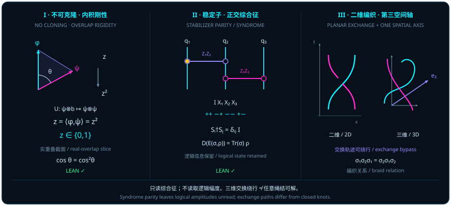

# 把脆弱的线藏进高维的面：量子纠错码与任意子拓扑死结

> *“面积是波,粒子是线,如果线与面积都是一种状态的投影,那看起来似乎是很好的波粒二象性的解释”*

在[第十三章](ch13-entanglement-and-chsh.md)中，我们看到双比特贝尔态把单颗球上的局部方向线缩成了零（$\vv{r} = \vv{s} = \vv{0}$），而在最大混合基线 $\frac{1}{4}I_4$ 之上，把全部非单位纯度盈余 $\Tr(\rho^2) - \frac{1}{4} = \frac{3}{4}$（即 $\frac{1}{4}\norm{T}_{\mathrm{F}}^2 = \frac{3}{4}$）悉数储存在 $9$ 维关联张量扇区 $\mathcal{W}_{\mathrm{corr}}$ 之中。现在，让我们把这一几何洞见转化为量子信息工程中最核心的防御战略：**容错量子纠错与拓扑保护**。

在经典数字电路里，对抗噪声的办法简单粗暴——**备份（克隆）**。怕一根电线上的电压被热涨落掀翻，就把比特 $0$ 复制成三份 $000$，把比特 $1$ 复制成三份 $111$，少数服从多数。然而，在踏入量子纠错的大门之前，一条铁面无私的内积几何定律当头拦住了所有照搬经典备份思路的去路：**未知量子叠加态不可克隆**。既然不能把一根脆弱的局部方向线简单复印成两根独立的局部线，我们唯一的选择就是反其道而行之——不再执着于局部的“线”，而是利用多体泡利稳定子或二维时空中的编织轨迹，把逻辑信息编码进局部噪声无法单独窥探的高维“面”与代数死结之中。

## 不可克隆：保内积与平方内积 {#sec-no-cloning-overlap}

为什么经典世界可以随手复印一页纸上的文字，而量子世界却绝不允许一台通用机器把任意未知纯态 $\psi$ 精确复制成两份 $\psi \otimes \psi$？

传统的科普解释常常诉诸“测量会破坏量子态”，但这并没有触及幺正演化本身最底层的几何症结。真正的理由连测量都不需要提，它直接写在希尔伯特空间内积的两条基本性质里：

1. **线性等距演化必须保内积不变**：如果复制过程由联合空间 $H \otimes_{\mathbb{C}} H$ 上的一个复线性等距变换 $U$ 实现，那么在 $U$ 作用前后，任意两个输入态之间的内积重叠度 $z = \langle\phi, \psi\rangle_{\mathbb{C}}$ 必须分毫不差地保持原值 $z$；
2. **张量积克隆会把内积自动平方**：一旦状态 $\psi$ 与 $\phi$ 被各自复制成双份张量积 $\psi \otimes \psi$ 与 $\phi \otimes \phi$，根据张量积空间的内积乘法律，两份输出之间的内积立刻变成两个因子内积的乘积 $\langle\phi, \psi\rangle_{\mathbb{C}} \cdot \langle\phi, \psi\rangle_{\mathbb{C}} = z^2$！

一面要求“保内积 $z$”，一面又要求“变成平方 $z^2$”，两相碰撞，立刻逼出代数方程 $z = z^2$。在整个复平面 $\mathbb{C}$ 上，满足等于自身平方的数只有两个：**$z = 1$（两向量完全相同）或 $z = 0$（两向量严格正交）**！

下面的定理在无需假定空间完备或有限维的一般复内积空间 $H$ 上，完整形式化了这一不可克隆内积判据（其中 Mathlib 的复内积 `inner Complex` 在第一槽共轭线性、第二槽线性，且 $U$ 为内积张量积 $H \otimes_{\mathbb{C}} H$ 上的复线性等距等价 `LinearIsometryEquiv`）。

::: {.theorem #thm-no-cloning-overlap title="量子不可克隆定理的内积判据" lean="D5/S3/Quantum/PureState/NoCloningInnerProductCriterion.no_cloning_inner_product_criterion"}
设 $H$ 为任意复内积空间（`[NormedAddCommGroup H] [InnerProductSpace Complex H]`），$U : (H \otimes_{\mathbb{C}} H) \simeq_{\mathrm{li}}[\mathbb{C}] (H \otimes_{\mathbb{C}} H)$ 为 $H \otimes_{\mathbb{C}} H$ 上的复线性等距等价。设 $\psi, \phi, \mathrm{blank} \in H$ 为满足单位范数条件

$$
\norm{\psi} = 1, \qquad \norm{\phi} = 1, \qquad \norm{\mathrm{blank}} = 1
$$

的三个向量。若同一个算子 $U$ 在同一个空白初态 $\mathrm{blank}$ 上同时实现精确向量克隆

$$
U\bigl(\psi \otimes_{\mathbb{C}} \mathrm{blank}\bigr) = \psi \otimes_{\mathbb{C}} \psi, \qquad
U\bigl(\phi \otimes_{\mathbb{C}} \mathrm{blank}\bigr) = \phi \otimes_{\mathbb{C}} \phi,
$$

则 $\phi$ 与 $\psi$ 的复内积必满足自平方方程，且两向量要么完全相等、要么严格正交：

$$
\langle\phi, \psi\rangle_{\mathbb{C}} = \langle\phi, \psi\rangle_{\mathbb{C}}^2 \;\land\; \bigl(\phi = \psi \lor \langle\phi, \psi\rangle_{\mathbb{C}} = 0\bigr).
$$
:::

::: proof
记 $z = \langle\phi, \psi\rangle_{\mathbb{C}}$。因 $U$ 为复线性等距映射，它保持张量积空间 $H \otimes_{\mathbb{C}} H$ 上的内积：

$$
\bigl\langle \phi \otimes_{\mathbb{C}} \mathrm{blank},\; \psi \otimes_{\mathbb{C}} \mathrm{blank}\bigr\rangle_{\mathbb{C}}
= \bigl\langle U(\phi \otimes_{\mathbb{C}} \mathrm{blank}),\; U(\psi \otimes_{\mathbb{C}} \mathrm{blank})\bigr\rangle_{\mathbb{C}}.
$$

按纯张量的内积公式 $\langle x_1 \otimes y_1, x_2 \otimes y_2\rangle_{\mathbb{C}} = \langle x_1, x_2\rangle_{\mathbb{C}}\langle y_1, y_2\rangle_{\mathbb{C}}$ 分别计算上式两端：左端等于 $\langle\phi, \psi\rangle_{\mathbb{C}}\langle\mathrm{blank}, \mathrm{blank}\rangle_{\mathbb{C}} = z \cdot \norm{\mathrm{blank}}^2 = z \cdot 1 = z$；右端代入两条克隆假设后等于 $\langle\phi \otimes_{\mathbb{C}} \phi,\; \psi \otimes_{\mathbb{C}} \psi\rangle_{\mathbb{C}} = \langle\phi, \psi\rangle_{\mathbb{C}}\langle\phi, \psi\rangle_{\mathbb{C}} = z^2$。故 $z = z^2$，证明了合取式的第一部分。

再由复数域整环性质，$z(z - 1) = 0$ 蕴涵 $z = 1$ 或 $z = 0$。当 $z = 0$ 时直接落入右析取支 $\langle\phi, \psi\rangle_{\mathbb{C}} = 0$；当 $z = \langle\phi, \psi\rangle_{\mathbb{C}} = 1$ 时，计算差向量的范数平方：

$$
\norm{\phi - \psi}^2 = \norm{\phi}^2 - 2\operatorname{Re}\langle\phi, \psi\rangle_{\mathbb{C}} + \norm{\psi}^2 = 1 - 2(1) + 1 = 0,
$$

故 $\phi - \psi = 0$，即 $\phi = \psi$，落入左析取支。完整证明由 Lean 内核检查。
:::

观察图 14 面板 I：在实非负重叠截面 $z = \cos\vartheta \in [0, 1]$ 上，保内积要求输出停在对角直线 $y = z$ 上，而双份张量积却把输出拽到了抛物线 $y = z^2$ 上。整条抛物线与对角线只交于两个端点 $(0, 0)$ 与 $(1, 1)$，在中间一切倾斜叠加方向 $0 < z < 1$（例如 $\vartheta = 45^\circ$ 时 $z = \frac{1}{\sqrt{2}} \approx 0.7071$，而 $z^2 = 0.5$）上，两曲线之间都裂开了一道不可弥合的几何鸿沟 $z - z^2 > 0$！

在引用 [@thm-no-cloning-overlap] 时，必须严格把握以下四条数学边界：

1. **复内积 $z \in \mathbb{C}$ 与实重叠截面 $\cos\vartheta$ 的区分**：定理中的 $z = \langle\phi, \psi\rangle_{\mathbb{C}}$ 一般是复数；仅当我们在取定实正交相位规范使 $z = \cos\vartheta \in [0, 1]$ 的截面上讨论时，方程 $z = z^2$ 才写为 $\cos\vartheta = \cos^2\vartheta$。同时切勿将希尔伯特空间重叠角 $\vartheta$ 与单比特布洛赫球面夹角 $\theta_{\mathrm{Bloch}}$ 混为一谈：由[第二章](ch02-born-rule.md)半角公式 $|\langle\phi, \psi\rangle|^2 = \cos^2(\theta_{\mathrm{Bloch}}/2)$，纯比特的布洛赫球面夹角是希尔伯特射线角的两倍（$\theta_{\mathrm{Bloch}} = 2\vartheta$）。
2. **精确向量相等与射影射线版本的区别**：[@thm-no-cloning-overlap] 的克隆前提要求严格的**向量等式** $U(\psi \otimes \mathrm{blank}) = \psi \otimes \psi$ 与 $U(\phi \otimes \mathrm{blank}) = \phi \otimes \phi$（使用同一个 $U$ 与同一个 $\mathrm{blank}$），因此当 $z = 1$ 时推出的是严格的向量同一 $\phi = \psi$，而非相差任意相位 $e^{i\alpha}$ 的“共线”。若讨论允许克隆输出带状态相关全局相位 $e^{i\alpha(\psi)}\psi \otimes \psi$ 的射影射线版本，则需对内积取模 $|\langle\phi, \psi\rangle| = |\langle\phi, \psi\rangle|^2$ 并另行固定相位规范。
3. **空间一般性**：定理对任意带 `NormedAddCommGroup` 与 `InnerProductSpace Complex` 的空间 $H$ 成立，无需假定 $H$ 为有限维或完备希尔伯特空间。
4. **必要条件不等于通用克隆器构造**：$z \in \{0, 1\}$ 是存在满足两条克隆等式的线性等距算子 $U$ 的**必要条件**，不能反过来把该判据曲解为已构造出某种通用克隆装置。

第 4 条边界说，[@thm-no-cloning-overlap] 只是必要条件。那么反过来问：既然精确克隆做不到，近似克隆在文献中如何构造，代价又落在哪里（[@rem-buzek-hillery-isometry-literature]）？

::: {.remark #rem-buzek-hillery-isometry-literature title="Bužek–Hillery 通用 1→2 克隆等距（文献结果，未在本书形式化）"}
**文献结果，未在本书形式化。** Bužek 与 Hillery（1996）构造了一台对一切输入一视同仁的 $1 \to 2$ 克隆机（其单拷贝最优保真度由 Gisin 与 Massar 于 1997 年证明；出处见 [@ex-buzek-hillery-three-marginals]）。它用三个量子比特：输入、空白副本，以及一个辅助的“机器”比特 $M$。对单位向量 $\psi$，记 $\psi^\perp$ 为与它正交的单位向量；克隆等距把输入送到

$$
\lvert\psi\rangle \;\longmapsto\; \sqrt{\tfrac{2}{3}}\;\lvert\psi\rangle\lvert\psi\rangle\lvert\psi^\perp\rangle_M \;-\; \sqrt{\tfrac{1}{3}}\;\frac{\lvert\psi\rangle\lvert\psi^\perp\rangle + \lvert\psi^\perp\rangle\lvert\psi\rangle}{\sqrt{2}}\;\lvert\psi\rangle_M ,
$$

三个因子依次是克隆体一、克隆体二与机器比特。对两个克隆体求偏迹，机器比特落在约化态 $\frac{1}{3}\lvert\psi\rangle\langle\psi\rvert + \frac{2}{3}\lvert\psi^\perp\rangle\langle\psi^\perp\rvert$ 上。
:::

Lean 模块 `D5/S3/Quantum/CloningMachine` 直接把这一候选机器约化态矩阵定义出来，并证明它的谱与输入无关。

::: {.definition #def-cloning-machine-reduced-state title="正交补比特、克隆机的机器约化态与机器熵" lean="D5/S3/Quantum/CloningMachine.orthogonalQubit D5/S3/Quantum/CloningMachine.machineReducedState D5/S3/Quantum/CloningMachine.binaryEntropyBits D5/S3/Quantum/CloningMachine.machineEntropy"}
在模块 `CloningMachine` 中（`QubitState` 为 $\operatorname{Fin} 2 \to \mathbb{C}$，`QubitMatrix` 为 $2 \times 2$ 复矩阵）：

1. **正交补比特** [`orthogonalQubit`](lean:D5/S3/Quantum/CloningMachine.orthogonalQubit) $\psi = \bigl(-\overline{\psi_1},\ \overline{\psi_0}\bigr)$；
2. **机器约化态** [`machineReducedState`](lean:D5/S3/Quantum/CloningMachine.machineReducedState) 定义为

   $$
   \operatorname{machineReducedState}\ \psi \;=\; \frac{1}{3}\,\psi\,\psi^{*} \;+\; \frac{2}{3}\,\psi^\perp\,(\psi^\perp)^{*}, \qquad \psi^\perp = \operatorname{orthogonalQubit}\ \psi,
   $$

   其中 $v\,v^{*}$ 表示外积矩阵 `Matrix.vecMulVec v (star v)`；
3. 以比特为单位的二元熵 [`binaryEntropyBits`](lean:D5/S3/Quantum/CloningMachine.binaryEntropyBits) $p = -p\log_2 p - (1 - p)\log_2(1 - p)$，**机器熵** [`machineEntropy`](lean:D5/S3/Quantum/CloningMachine.machineEntropy) $= \operatorname{binaryEntropyBits}\ \frac{1}{3}$。
:::

::: {.theorem #thm-cloning-machine-spectrum title="克隆机机器约化态的输入无关谱与机器熵的闭式" lean="D5/S3/Quantum/CloningMachine.orthogonal_qubit_inner D5/S3/Quantum/CloningMachine.machine_reduced_is_density D5/S3/Quantum/CloningMachine.machine_reduced_det D5/S3/Quantum/CloningMachine.machine_reduced_spectrum D5/S3/Quantum/CloningMachine.machine_entropy_closed_form"}
设 $\psi$ 为 `QubitState`，沿用 [@def-cloning-machine-reduced-state] 的记号。

1. **正交性**（无需归一化）：$\psi^{*} \cdot \operatorname{orthogonalQubit}\ \psi = 0$，即 `star ψ ⬝ᵥ orthogonalQubit ψ = 0`。

若再设 $\psi$ 归一化（`hUnit : star ψ ⬝ᵥ ψ = 1`），则：

2. **是密度矩阵**：$\operatorname{machineReducedState}\ \psi$ 半正定，且迹等于 $1$；
3. **行列式**：$\det\bigl(\operatorname{machineReducedState}\ \psi\bigr) = \frac{2}{9}$；
4. **谱**：$\operatorname{machineReducedState}\ \psi$ 在 $\mathbb{C}$ 上的谱恰为 $\bigl\{\frac{1}{3},\ \frac{2}{3}\bigr\}$。

此外，不涉及 $\psi$：

5. **机器熵的闭式**：$\operatorname{machineEntropy} = \log_2 3 - \frac{2}{3}$。
:::

::: proof
结论 1 展开点积后由环运算化简。结论 2：两个外积 $\psi\psi^{*}$ 与 $\psi^\perp(\psi^\perp)^{*}$ 各自半正定，非负系数的线性组合仍半正定；取正交补保持范数平方，所以迹等于 $\frac{1}{3} + \frac{2}{3} = 1$。结论 3：把 $\psi^\perp(\psi^\perp)^{*}$ 写成显式的 $2 \times 2$ 矩阵，展开行列式，再用归一化条件化简得 $\frac{2}{9}$。结论 4：$2 \times 2$ 矩阵的特征多项式由迹与行列式决定，这里是 $X^2 - X + \frac{2}{9} = \bigl(X - \frac{1}{3}\bigr)\bigl(X - \frac{2}{3}\bigr)$（`machine_reduced_charpoly`），谱就是它的根集。结论 5：把 $\log_2\frac{1}{3} = -\log_2 3$ 与 $\log_2\frac{2}{3} = 1 - \log_2 3$ 代入 $\operatorname{binaryEntropyBits}\ \frac{1}{3}$ 并化简。完整证明由 Lean 内核检查。
:::

[@thm-cloning-machine-spectrum] 严格证明的是 [@def-cloning-machine-reduced-state] 中给定 $2\times 2$ 矩阵的密度态性质、行列式、输入无关谱与机器熵闭式；它与三比特克隆等距偏迹之间的对应见下例（[@ex-buzek-hillery-three-marginals]）。

::: {.example #ex-buzek-hillery-three-marginals title="Bužek–Hillery 克隆机的三个边缘态：克隆体保真度 5/6，机器比特反向收缩到 1/3"}
**文献结果，未在本书形式化**（V. Bužek 与 M. Hillery，Phys. Rev. A **54**, 1844, 1996；最优性见 N. Gisin 与 M. Massar，Phys. Rev. Lett. **79**, 2153, 1997；亦见 [@rem-buzek-hillery-isometry-literature]）。下面的三个边缘态由该克隆等距直接求偏迹得到，并已对随机输入态作数值核对。

记输出态为 $\lvert\Omega\rangle = \sqrt{\frac{2}{3}}\,\lvert\psi\psi\rangle\lvert\psi^\perp\rangle_M - \sqrt{\frac{1}{3}}\,\lvert S\rangle\lvert\psi\rangle_M$，其中 $\lvert S\rangle = \frac{1}{\sqrt{2}}\bigl(\lvert\psi\psi^\perp\rangle + \lvert\psi^\perp\psi\rangle\bigr)$。

- **机器比特。** $\lvert\psi\psi\rangle$ 与 $\lvert S\rangle$ 正交，对两个克隆体求偏迹时交叉项消失，剩下 $\rho_M = \frac{2}{3}\lvert\psi^\perp\rangle\langle\psi^\perp\rvert + \frac{1}{3}\lvert\psi\rangle\langle\psi\rvert$，正是 [@def-cloning-machine-reduced-state] 中的 $\operatorname{machineReducedState}\ \psi$。
- **单个克隆体。** 两项的机器因子 $\lvert\psi^\perp\rangle$ 与 $\lvert\psi\rangle$ 正交，对机器求偏迹后克隆对处于混合态 $\frac{2}{3}\lvert\psi\psi\rangle\langle\psi\psi\rvert + \frac{1}{3}\lvert S\rangle\langle S\rvert$。再对另一个克隆体求偏迹：$\lvert\psi\psi\rangle$ 贡献 $\lvert\psi\rangle\langle\psi\rvert$，$\lvert S\rangle$ 贡献 $\frac{1}{2}\bigl(\lvert\psi\rangle\langle\psi\rvert + \lvert\psi^\perp\rangle\langle\psi^\perp\rvert\bigr)$，合计

  $$
  \rho_{\mathrm{clone}} \;=\; \Bigl(\frac{2}{3} + \frac{1}{6}\Bigr)\lvert\psi\rangle\langle\psi\rvert + \frac{1}{6}\,\lvert\psi^\perp\rangle\langle\psi^\perp\rvert \;=\; \frac{5}{6}\,\lvert\psi\rangle\langle\psi\rvert + \frac{1}{6}\,\lvert\psi^\perp\rangle\langle\psi^\perp\rvert .
  $$

设输入的布洛赫矢量为单位向量 $\vv{r}$（于是 $\lvert\psi^\perp\rangle$ 对应 $-\vv{r}$）：

| 子系统 | 约化态的本征值 | 布洛赫矢量 | 与输入的保真度 $\langle\psi\rvert\rho\lvert\psi\rangle$ | 熵（比特） |
| :---: | :---: | :---: | :---: | :---: |
| 输入 | $1,\ 0$ | $\vv{r}$ | $1$ | $0$ |
| 克隆体一、克隆体二 | $\frac{5}{6},\ \frac{1}{6}$ | $\frac{2}{3}\,\vv{r}$ | $\frac{5}{6} \approx 0.8333$ | $0.6500$ |
| 机器比特 | $\frac{2}{3},\ \frac{1}{3}$ | $-\frac{1}{3}\,\vv{r}$ | $\frac{1}{3}$ | $\log_2 3 - \frac{2}{3} \approx 0.9183$ |

机器一行的本征值与熵即 [@thm-cloning-machine-spectrum] 的结论 4 与 5。数值核对（三个随机输入态）：克隆体保真度 $0.833333$，克隆体与机器的布洛赫收缩因子 $0.666667$ 与 $-0.333333$，机器谱 $\{0.333333,\ 0.666667\}$，行列式 $0.222222$；上式在计算基上的线性延拓与对一般 $\psi$ 的表达式只差整体相位，并保持内积。

由此可见，精确克隆受 [@thm-no-cloning-overlap] 的 $z = z^2$ 判据阻断；而在上述近似克隆方案中，每个克隆体的布洛赫矢量均匀收缩到 $\frac{2}{3}$，机器比特则携带着长度为 $\frac{1}{3}$ 的反向布洛赫矢量与输入方向无关的熵 $\log_2 3 - \frac{2}{3} \approx 0.918$ 比特，三个边缘态的混合度均源于三体纯态纠缠。
:::

## Pauli 字与稳定子综合征 {#sec-pauli-syndrome-parity}

既然 [@thm-no-cloning-overlap] 禁止我们把任意未知叠加态 $\alpha\lvert 0\rangle + \beta\lvert 1\rangle$ 复制成 $(\alpha\lvert 0\rangle + \beta\lvert 1\rangle)^{\otimes 3}$，量子纠错码究竟靠什么施展魔法？

诀窍在于：**不复制整个叠加态，而是只把正交基嵌入多体纠缠空间**（例如将 $\lvert 0\rangle \mapsto \lvert 000\rangle$、$\lvert 1\rangle \mapsto \lvert 111\rangle$ 线性延拓为 $\alpha\lvert 0\rangle + \beta\lvert 1\rangle \mapsto \alpha\lvert 000\rangle + \beta\lvert 111\rangle$），然后不再测量任何会暴露 $\alpha, \beta$ 的局部单比特方向线，而是专门测量多体**泡利字（Pauli words）**的联合奇偶校验面！

为了在任意有限模式数 $N \in \mathbb{N}$ 与任意局部能级数 $p \in \mathbb{N}$（满足非零条件 `[NeZero p]`；注意此处 **$p$ 未要求是素数，且 $N$ 允许为 $0$**）的一般框架下刻画这套代数，源码模块 `StabilizerGenuineEntanglementCommutationRank` 定义了 $N$ 模式模 $p$ 泡利字结构 `PauliWord N p`，包含三个字段：

- 离散相位指标 $\mathrm{phase} : \mathrm{ZMod}\,p$；
- 位移（翻转）指数向量 $x : \mathrm{Fin}\,N \to \mathrm{ZMod}\,p$；
- 时钟（相位）指数向量 $z : \mathrm{Fin}\,N \to \mathrm{ZMod}\,p$。

记 $p$ 次本原单位根为 $\omega_p = \mathrm{windowRoot}\,p = \exp(2\pi i / p)$。在单个 $p$ 能级模式（$M_{\mathrm{Fin}\,p}(\mathbb{C})$）上，循环移位矩阵 $X$ 与对角时钟矩阵 $Z = \operatorname{diag}(\omega_p^{j.\mathrm{val}})$ 组成单模 Weyl 位移算子 $D(e, f) = X^{e.\mathrm{val}} Z^{f.\mathrm{val}}$（注意算子固定次序为先作用 $Z$、后作用 $X$）。由此，泡利字 $w \in \mathrm{PauliWord}\,N\,p$ 在 $N$ 模式联合空间 $(\mathrm{Fin}\,N \to \mathrm{Fin}\,p)$ 上对应的矩阵算子定义为

$$
\bigl(\mathrm{pauliWordOperator}(w)\bigr)_{u, v} = \omega_p^{w.\mathrm{phase}.\mathrm{val}} \prod_{n \in \mathrm{Fin}\,N} D(w.x_n, w.z_n)_{u_n, v_n},
$$

而两个泡利字 $a, b$ 的形式字乘积定义为各字段在 $\mathrm{ZMod}\,p$ 中的逐分量加法：

$$
\mathrm{wordMul}(a, b) = \bigl(a.\mathrm{phase} + b.\mathrm{phase},\; a.x + b.x,\; a.z + b.z\bigr).
$$

当两个泡利字算子相乘时，由于每个格点 $n$ 上左侧的 $Z^{a.z_n}$ 必须跨过右侧的 $X^{b.x_n}$ 才能归并成标准次序 $X^{a.x_n + b.x_n} Z^{a.z_n + b.z_n}$，每一次跨越都会因为非对易关系 $Z^{a.z_n} X^{b.x_n} = \omega_p^{(a.z_n b.x_n).\mathrm{val}} X^{b.x_n} Z^{a.z_n}$ 吐出一枚交叉相位！下面的引理精确锁定了这一核心乘法法则。

::: {.lemma #lemma-pauli-word-phase title="多模广义泡利字算子的乘法与交叉相位引理" lean="D5/S3/Quantum/Codes/StabilizerGenuineEntanglementCommutationRank.pauli_word_mul"}
设 $N, p \in \mathbb{N}$ 且满足 `[NeZero p]`。对任意两个泡利字 $a, b : \mathrm{PauliWord}\,N\,p$，其对应矩阵算子的乘积恒等于

$$
\begin{aligned}
&\mathrm{pauliWordOperator}(a) \cdot \mathrm{pauliWordOperator}(b) \\
&= \mathrm{windowRoot}(p)^{\bigl(\sum_{n \in \mathrm{Fin}\,N} a.z_n \cdot b.x_n\bigr).\mathrm{val}} \bullet \mathrm{pauliWordOperator}\bigl(\mathrm{wordMul}(a, b)\bigr).
\end{aligned}
$$
:::

::: proof
在每个模式 $n \in \mathrm{Fin}\,N$ 上，单模 Weyl 算子的乘积为 $D(a.x_n, a.z_n) D(b.x_n, b.z_n) = X^{a.x_n.\mathrm{val}} Z^{a.z_n.\mathrm{val}} X^{b.x_n.\mathrm{val}} Z^{b.z_n.\mathrm{val}}$。利用时钟矩阵与循环移位矩阵的交换关系 $Z^{a.z_n.\mathrm{val}} X^{b.x_n.\mathrm{val}} = \omega_p^{(a.z_n \cdot b.x_n).\mathrm{val}} X^{b.x_n.\mathrm{val}} Z^{a.z_n.\mathrm{val}}$，以及循环群与对角相位在模 $p$ 加法下的周期性 $X^{(a.x_n + b.x_n).\mathrm{val}}$、$Z^{(a.z_n + b.z_n).\mathrm{val}}$，单模乘积化为 $\omega_p^{(a.z_n \cdot b.x_n).\mathrm{val}} D(a.x_n + b.x_n, a.z_n + b.z_n)$。对全体 $n \in \mathrm{Fin}\,N$ 求乘积，将各模式的交叉相位指数在 $\mathrm{ZMod}\,p$ 中相加为 $\sum_{n} a.z_n \cdot b.x_n$，同时外部固有相位 $\omega_p^{a.\mathrm{phase}.\mathrm{val}} \omega_p^{b.\mathrm{phase}.\mathrm{val}} = \omega_p^{(a.\mathrm{phase} + b.\mathrm{phase}).\mathrm{val}}$ 归入 $\mathrm{wordMul}(a, b)$ 的相位字段，即得结论。完整证明由 Lean 内核检查。
:::

请仔细留意 [@lemma-pauli-word-phase] 中的精妙分工：

1. **绝不能漏掉外部交叉相位标量**：在源码定义中，形式加法 $\mathrm{wordMul}(a, b)$ 的 `phase` 字段只负责把两人原有的相位 $a.\mathrm{phase} + b.\mathrm{phase}$ 相加；所有因非对易跨越产生的交叉相位 $\omega_p^{(\sum_n a.z_n b.x_n).\mathrm{val}}$ **全部以标量数乘 $\bullet$ 的形式立在 $\mathrm{pauliWordOperator}(\mathrm{wordMul}(a,b))$ 外部**。哪怕在最熟悉的多量子比特情形 $p = 2$（$\omega_2 = -1$）下，单模算子依然严格按 $X^{x_n} Z^{z_n}$ 排列，每一次 $Z X = -X Z$ 都会通过指数 $(a.z_n \cdot b.x_n).\mathrm{val}$ 贡献一个负号 $(-1)$，绝不能在计算中忽略。
2. **从双向交叉相位差导出辛内积与稳定子综合征**：由于 $\mathrm{wordMul}(a, b) = \mathrm{wordMul}(b, a)$，若我们将 [@lemma-pauli-word-phase] 正向乘一次 $(a \cdot b)$、反向乘一次 $(b \cdot a)$，两者的唯一差别就在于外部指数从 $\sum_n a.z_n b.x_n$ 变成了 $\sum_n b.z_n a.x_n$！特别地，当 $p = 2$ 时，稳定子校验算子 $a$ 与错误算子 $b$ 是对易（特征值 $+1$，无警报）还是反对易（特征值 $-1$，拉响警报），完全由模 $2$ 二元辛奇偶校验和

   $$
   \langle a, b\rangle_{\mathrm{symp}} = \sum_{n \in \mathrm{Fin}\,N} \bigl(a.z_n b.x_n + a.x_n b.z_n\bigr) \pmod 2
   $$

   决定！需要强调的是，[@lemma-pauli-word-phase] 本身是泡利字算子的精确代数乘法引理；至于如何利用这套综合征在不破坏逻辑态的前提下完整恢复受损信息，还需要引入码空间与正交综合征投影的恢复架构——这正是下一节的主题。

::: {.viz src="syndrome-decoding" preset="single" height="500"}
**一盏灯指出翻了哪一个比特。** 三比特重复码的两道校验 $g_1 = Z_1Z_2$、$g_2 = Z_2Z_3$ 跨在相邻两个比特之上。第一个比特翻了（品红的 X），只有跨在它上面的 $g_1$ 亮起（品红），$g_2$ 不亮：$X_1$ 与 $g_1$ 反对易、与 $g_2$ 对易，正是上式的模 $2$ 奇偶，交叉相位来自 [@lemma-pauli-word-phase]。解码器照灯翻回第一个比特（琥珀色），青色的柱子回到码空间，落在虚线上。
:::

## 正交综合征中的逻辑恢复 {#sec-orthogonal-syndrome-recovery}

当环境噪声把原本安居在基准码空间里的逻辑态 $\rho \in M_d(\mathbb{C})$ 踢进了不同的错误通道时，为什么我们能够像外科手术一样把错误剥离、让 $\rho$ 原封不动地复原？

从几何上看，秘密全在于**正交分室（orthogonal syndrome subspaces）**（见图 14 面板 II）。设想物理空间 $\mathbb{C}^n$ 中有 $|s|$ 间两两正交、每间都是 $d$ 维的房间，由一族等距嵌入矩阵 $S : s \to M_{n \times d}(\mathbb{C})$ 刻画（此处 $s, n, d$ 为有限指标类型，带 `[DecidableEq s]` 与 `[DecidableEq d]`，$n$ 无需显式可判等假设）。源码模块 `OrthogonalSyndromeDecoding` 定义谓词 `OrthogonalSyndromes S` 为：

$$
\forall i, j : s,\qquad S_i^* S_j = \begin{cases} I_d & \text{若 } i = j, \\ 0 & \text{若 } i \neq j. \end{cases}
$$

这意味着：对每一个综合征编号 $i \in s$，$S_i^* S_i = I_d$ 保证 $S_i$ 把 $d$ 维逻辑球体无畸变地等距放进第 $i$ 间综合征子空间；而当 $i \neq j$ 时，$S_i^* S_j = 0$ 保证不同综合征房间之间严格垂直、绝不串门！

::: {.viz src="syndrome-decoding" preset="rooms" height="500"}
**错误把态整个搬进另一间房。** 下面的八个基态按两道校验的读数分成四间房 $S_j = E_jV$（$E \in \{I, X_1, X_2, X_3\}$）。中间的比特翻了，两盏灯都亮；$\alpha\lvert 000\rangle + \beta\lvert 111\rangle$ 的两根青色柱子原样搬进 $(-1,-1)$ 那间房，落在 $\lvert 010\rangle$、$\lvert 101\rangle$ 上，另外三间房空着。
:::

在此几何舞台上，任意携带综合征系数矩阵 $\sigma \in M_s(\mathbb{C})$（允许包含不同错误分支之间的非对角相干项 $\sigma_{jk}$）的受损物理态由**综合征编码映射**给出：

$$
\mathrm{syndromeEncoding}(S, \sigma, \rho) = \sum_{j \in s} \sum_{k \in s} \sigma_{jk}\, S_j \rho S_k^* \in M_n(\mathbb{C}),
$$

而将各综合征房间里的状态重新拉回逻辑空间叠加的**综合征解码映射**定义为：

$$
\mathrm{syndromeDecoding}(S, \mathrm{state}) = \sum_{i \in s} S_i^* \,\mathrm{state}\, S_i \in M_d(\mathbb{C}).
$$

下面的命题证明：无论噪声矩阵 $\sigma$ 与逻辑矩阵 $\rho$ 长什么模样，只要房间之间两两正交，解码映射就能一举抹平全部跨房间的非对角干扰，把输出精确归约为 $\Tr(\sigma) \cdot \rho$！

::: {.proposition #prop-orthogonal-syndrome-recovery title="正交综合征子空间上的精确逻辑恢复恒等式" lean="D5/S3/Quantum/Recovery/OrthogonalSyndromeDecoding.orthogonal_syndrome_recovery"}
设 $s, n, d$ 为有限指标类型（带 `[DecidableEq s]` 与 `[DecidableEq d]`），$S : s \to M_{n \times d}(\mathbb{C})$ 满足正交综合征条件 `OrthogonalSyndromes S`。则对任意复矩阵 $\sigma \in M_s(\mathbb{C})$ 与任意复矩阵 $\rho \in M_d(\mathbb{C})$，恒有

$$
\mathrm{syndromeDecoding}\bigl(S,\, \mathrm{syndromeEncoding}(S, \sigma, \rho)\bigr) = \Tr(\sigma) \bullet \rho.
$$
:::

::: proof
将 $\mathrm{syndromeEncoding}(S, \sigma, \rho)$ 的双重求和代入 $\mathrm{syndromeDecoding}$ 的定义，利用矩阵乘法对加法的分配律与标量提出律，得

$$
\mathrm{syndromeDecoding}\bigl(S,\, \mathrm{syndromeEncoding}(S, \sigma, \rho)\bigr)
= \sum_{i \in s} \sum_{j \in s} \sum_{k \in s} \sigma_{jk}\, (S_i^* S_j)\, \rho\, (S_k^* S_i).
$$

由前提 `OrthogonalSyndromes S`，左侧内积满足 $S_i^* S_j = \delta_{ij} I_d$，右侧内积满足 $S_k^* S_i = (S_i^* S_k)^* = \delta_{ik} I_d$。因此在固定 $i \in s$ 时，所有 $j \neq i$ 或 $k \neq i$ 的项全部乘以零矩阵而消失，唯独 $j = i$ 且 $k = i$ 的对角项幸存为 $\sigma_{ii} (I_d \rho I_d) = \sigma_{ii} \rho$。对全体 $i \in s$ 求和，即得 $\bigl(\sum_{i \in s} \sigma_{ii}\bigr)\rho = \Tr(\sigma) \bullet \rho$。完整证明由 Lean 内核检查。
:::

[@prop-orthogonal-syndrome-recovery] 的代数结构干净得令人赞叹，在应用时需把握两条精确边界：

1. **无需假设 $\sigma$ 对角、半正定或迹一**：定理对**任意**复矩阵 $\sigma \in M_s(\mathbb{C})$ 和 $\rho \in M_d(\mathbb{C})$ 均成立。哪怕物理噪声是多个错误算子的相干叠加（使得 $\sigma$ 具有非零的非对角元 $\sigma_{jk}$，$j \neq k$），正交投影夹逼 $S_i^* S_j \rho S_k^* S_i$ 也会自动切掉所有 $j \neq k$ 的跨综合征相干项，只留下对角迹和 $\sum_i \sigma_{ii} = \Tr(\sigma)$；特别地，当噪声权重归一化满足 $\Tr(\sigma) = 1$ 时，立刻作为特例给出无缩放的精确恢复 $\mathrm{syndromeDecoding}(S, \mathrm{syndromeEncoding}(S, \sigma, \rho)) = \rho$。

::: {.viz src="syndrome-decoding" preset="mix" height="500"}
**四个分支各回各的，拼回原态。** 取 $\sigma = \operatorname{diag}\bigl(\frac{1}{2}, \frac{1}{4}, \frac{1}{8}, \frac{1}{8}\bigr)$（例 [@ex-repetition-code-syndrome] 第四步）与 $\rho = \lvert +\rangle\langle +\rvert$：不出错、翻第一个、翻第二个、翻第三个四个分支，青色柱子的宽窄就是权重，各进各的房。解码时各自拉回码空间，并排拼成一整根，正好填满虚线：$\Tr(\sigma)\,\rho = \rho$，即 [@prop-orthogonal-syndrome-recovery]。
:::

2. **支持子空间上的代数解码与全空间迹保持信道的区分**：$\mathrm{syndromeDecoding}(S, \cdot) = \sum_{i \in s} S_i^* (\cdot) S_i$ 是在可纠综合征支持集 $\mathcal{W} = \bigoplus_{i \in s} \operatorname{range}(S_i)$ 上定义的解码代数式。由于 $s$ 个 $d$ 维正交房间占用的总维数为 $|s|d \le n$，当 $|s|d < n$（即 $\sum_{i \in s} S_i S_i^* \neq I_n$）时，不能无条件声称仅由 $\{S_i^*\}_{i \in s}$ 构成的映射已在整个 $n$ 维物理空间 $M_n(\mathbb{C})$ 上定义了一个迹保持（CPTP）量子信道；若要延拓为全空间上的迹保持信道，还必须把支持子空间正交补 $I_n - \sum_{i \in s} S_i S_i^*$ 上的附加 Kraus 算子补齐。

## 二维编织与第三正交方向 {#sec-braids-and-third-axis}

除了用泡利稳定子校验面主动侦测并纠正错误之外，大自然还提供了一种更加匪夷所思的被动防御机制：**用二维平面粒子的世界线编织（braiding）打结**。

在低维拓扑与任意子物理的直观图景（详见下文 [@rem-error-correction-anyons-literature]）中，人们常追问：为什么把粒子世界线限制在二维平面 $(e_1, e_2)$ 时，$(2+1)$ 维时空中的交换编织会呈现出与三维空间截然不同的结构？

从几何图解（如图 14 面板 III）上看，线索指向**第三根正交空间方向**！当不可互穿的绳股排成一列时，第 1 股绳子跨过第 2 股绳子（正向交叉 $\mathrm{crossing}$）与从底下钻过去（反向交叉 $\mathrm{crossingInv}$）给出互逆的基本交叉步。而在三股绳子 $(x, (y, z))$ 的编织中，先交换前两股、再交换后两股、再交换前两股（$\sigma_1 \sigma_2 \sigma_1$），与先交换后两股、再交换前两股、再交换后两股（$\sigma_2 \sigma_1 \sigma_2$），在图解上恰好对应把中间那根绳子滑过另外两根绳子的交点——著名的**三股编织恒等式（Yang–Baxter 方程）**。

在源码模块 `D5/S0/Certificates/Quandles/BraidColoringTransport.lean` 中，这一编织不变量通过架（`Rack Q`）的代数着色传输得到了纯组合形式化。设类型 $Q$ 带有 `Rack Q` 实例，其上配备二元运算 $\star : Q \to Q \to Q$（源码记作 `act`）及逆运算 $\star^{-1} : Q \to Q \to Q$（源码记作 `invAct`），使得对每个固定的第一宗量 $x \in Q$，左平移作用映射 $L_x : y \mapsto x \star y$ 是双射（其逆映射为 $L_x^{-1} : y \mapsto x \star^{-1} y$，满足 `Function.LeftInverse (invAct x) (act x)` 与 `Function.RightInverse (invAct x) (act x)`，即 $x \star^{-1} (x \star y) = y$ 且 $x \star (x \star^{-1} y) = y$），并满足左自分配公理（left self-distributivity）：

$$
(x \star y) \star (x \star z) = x \star (y \star z) \qquad (\forall x, y, z \in Q).
$$

定义双股正向交叉与反向交叉映射为

$$
\mathrm{crossing}(x, y) = (x \star y,\, x), \qquad \mathrm{crossingInv}(u, v) = (v,\, v \star^{-1} u),
$$

易见 $\mathrm{crossingInv}\bigl(\mathrm{crossing}(x, y)\bigr) = \mathrm{crossingInv}(x \star y, x) = \bigl(x,\, x \star^{-1}(x \star y)\bigr) = (x, y)$。将它们提升到三股状态空间 $Q \times (Q \times Q)$ 上的两个相邻生成元：

$$
\mathrm{crossing}_1\bigl(x, (y, z)\bigr) = \bigl(x \star y,\, (x, z)\bigr), \qquad
\mathrm{crossing}_2\bigl(x, (y, z)\bigr) = \bigl(x,\, (y \star z,\, y)\bigr).
$$

下面的推论证明，这两个相邻交叉算子在任意架 $Q$ 上严格满足三股 Yang–Baxter 编织恒等式。

::: {.corollary #cor-braid-yang-baxter title="架着色传输下的三股编织 Yang–Baxter 恒等式" lean="D5/S0/Certificates/Quandles/BraidColoringTransport.crossing_yang_baxter"}
设 $Q$ 为带有 `[Rack Q]` 实例的任意类型。对任意三个元素 $x, y, z \in Q$，三股编织的两个相邻交叉映射满足

$$
\mathrm{crossing}_1\bigl(\mathrm{crossing}_2\bigl(\mathrm{crossing}_1(x, (y, z))\bigr)\bigr) = \mathrm{crossing}_2\bigl(\mathrm{crossing}_1\bigl(\mathrm{crossing}_2(x, (y, z))\bigr)\bigr).
$$
:::

::: proof
按 $\mathrm{crossing}_1$ 与 $\mathrm{crossing}_2$ 的定义，逐步展开等式左端的三次交叉作用：

$$
\begin{aligned}
(x, (y, z))
&\xrightarrow{\;\mathrm{crossing}_1\;} \bigl(x \star y,\, (x, z)\bigr) \\
&\xrightarrow{\;\mathrm{crossing}_2\;} \bigl(x \star y,\, (x \star z,\, x)\bigr) \\
&\xrightarrow{\;\mathrm{crossing}_1\;} \Bigl((x \star y) \star (x \star z),\; (x \star y,\, x)\Bigr).
\end{aligned}
$$

再逐步展开等式右端的三次交叉作用：

$$
\begin{aligned}
(x, (y, z))
&\xrightarrow{\;\mathrm{crossing}_2\;} \bigl(x,\, (y \star z,\, y)\bigr) \\
&\xrightarrow{\;\mathrm{crossing}_1\;} \bigl(x \star (y \star z),\, (x, y)\bigr) \\
&\xrightarrow{\;\mathrm{crossing}_2\;} \Bigl(x \star (y \star z),\; (x \star y,\, x)\Bigr).
\end{aligned}
$$

比较左端与右端的最终三元组：后两个分量均为 $(x \star y, x)$，完全一致；第一个分量由 `Rack Q` 的自分配律 $(x \star y) \star (x \star z) = x \star (y \star z)$ 严格相等。完整证明由 Lean 内核检查。
:::

::: {.remark #rem-braid-knot-topology-literature title="架着色实现与配置空间辫群、三维绳结拓扑的边界（文献结果，未在本书形式化）"}
**文献结果，未在本书形式化。** 在将 [@cor-braid-yang-baxter] 与物理及低维拓扑文献（另参下文 [@rem-error-correction-anyons-literature]）对接时，必须严格守住三条理论边界（其中配置空间基本群 $B_n$ 与 $S_n$ 的维数二分及三维三叶结的非平凡结拓扑均属外部文献结论，未在本书形式化）：

1. **代数着色实现 vs 完整拓扑基本群分类**：[@cor-braid-yang-baxter] 是在抽象代数结构 `Rack Q` 上对三股编织关系 $\sigma_1 \sigma_2 \sigma_1 = \sigma_2 \sigma_1 \sigma_2$ 的代数着色实现（源码完全不包含拓扑流形、时空维数或量子统计的假设）。它证明了架着色在三股 Reidemeister III / Yang–Baxter 移动下的传输不变性，但并不证明二维平面上一切编织皆非平凡，也不等同于配置空间完整基本群的分类定理。
2. **严格区分“点粒子的交换轨迹（exchange paths）”与“三维空间中的闭合绳结（knots）”**：如图 14 面板 III 所示，当点粒子拥有第三个空间正交方向 $e_3$ 时，原本在二维平面内绕着另一颗粒子转一圈的双交换轨迹（回路）可以沿着第三空间维 $e_3$ 向上抬起并越过被绕粒子，从而使点粒子交换群从无穷阶辫群 $B_n$ 退化为有限对称群 $S_n$（$\sigma_i^2 = 1$）。**但这绝不意味着三维空间里的闭合一维绳结（如三叶结 trefoil knot）也能自动解开！** 闭合绳结在 $\mathbb{R}^3$ 中禁止自身穿越，依然具有非平凡的结拓扑（事实上，架与幂等架（quandle）着色正是区分三维非平凡绳结的经典代数工具，见下文 [@thm-quandle-coloring-markov-invariant] 与 [@ex-fox-three-colorings-markov]）。
3. **任意子统计与物理容错边界归入文献**：非阿贝尔任意子的物理实现、配置空间同伦群以及有限温度下的拓扑纠错界限属于凝聚态与量子信息文献结果，详见下文 [@rem-error-correction-anyons-literature]。
:::

## 把编织首尾相接：Markov 稳定化与着色计数 {#sec-markov-stabilization-coloring-count}

[@rem-braid-knot-topology-literature] 的第 2 条说，三维空间里的三叶结解不开，而着色正是分辨它的经典工具。这件工具怎么用？[@cor-braid-yang-baxter] 管的是一段编织：上面一排线头，下面一排线头，颜色从一排传到另一排。可是结没有线头。把编织弯过来，让第 $k$ 个下端接回第 $k$ 个上端，绳子才成了闭合的圈，这叫编织的**闭合**。接上之后，“上端的颜色”与“下端的颜色”是同一段绳子的颜色，于是闭合编织的着色只剩一个条件：颜色沿编织传一遍，必须原样回来。**闭合编织的着色，就是着色传输的不动点。**

模块 `D5/S3/Topology/QuandleMarkovColoring` 把这句话写成了定义。它不谈画在纸上的绳子：编织是由生成元与关系给出的群里的元素，着色传输是这个群在颜色序列上的作用。

::: {.definition #def-closed-braid-colorings title="按生成元与关系定义的 Artin 辫群、架着色作用、闭合着色与着色计数" lean="D5/S3/Quantum/Algebra/Knot/WeightedPathArtinRepresentation.artinRelators D5/S3/Quantum/Algebra/Knot/WeightedPathArtinRepresentation.Artin D5/S3/Quantum/Algebra/Knot/WeightedPathArtinRepresentation.PositiveBraid D5/S3/Topology/QuandleMarkovColoring.Colors D5/S3/Topology/QuandleMarkovColoring.braidAction D5/S3/Topology/QuandleMarkovColoring.ClosedColorings D5/S3/Topology/QuandleMarkovColoring.coloringCount"}
设 $n \in \mathbb{N}$，$Q$ 为带 `[Rack Q]` 的类型，$\star$ 为它的架运算。

1. **Artin 辫群** [`Artin`](lean:D5/S3/Quantum/Algebra/Knot/WeightedPathArtinRepresentation.Artin) $n$：由生成元 $\sigma_1, \dots, \sigma_{n-1}$ 与关系元集合 [`artinRelators`](lean:D5/S3/Quantum/Algebra/Knot/WeightedPathArtinRepresentation.artinRelators) $n$ 给出的群（`PresentedGroup`，即自由群对关系元生成的正规子群的商），关系为

   $$
   \sigma_j\sigma_k = \sigma_k\sigma_j \quad (j + 1 < k \ \text{或}\ k + 1 < j), \qquad
   \sigma_k\sigma_{k+1}\sigma_k = \sigma_{k+1}\sigma_k\sigma_{k+1}.
   $$

   Lean 中生成元以 $i : \mathrm{Fin}\,(n - 1)$ 编号（$i = 0, \dots, n - 2$），本书记作 $\sigma_{i+1}$；自然数减法截断，所以 $n \le 1$ 时没有生成元，群是平凡群。
2. **着色** [`Colors`](lean:D5/S3/Topology/QuandleMarkovColoring.Colors) $Q\ n = (\mathrm{Fin}\,n \to Q)$，写作 $c = (c_1, \dots, c_n)$（$c_k$ 是 Lean 中下标为 $k - 1$ 的分量）。
3. **着色作用** [`braidAction`](lean:D5/S3/Topology/QuandleMarkovColoring.braidAction) $Q\ n$ 是从 $\mathrm{Artin}\,n$ 到 $\mathrm{Colors}\ Q\ n$ 的置换群（`Equiv.Perm`）的群同态，由生成元上的取值确定：$\sigma_k$ 把 $c$ 的第 $k$、$k+1$ 两个分量 $(c_k,\ c_{k+1})$ 换成 $(c_k \star c_{k+1},\ c_k)$，其余分量不动。记 $b \cdot c = \operatorname{braidAction}\ Q\ n\ b\ c$；置换群的乘法是复合，$(b\,b') \cdot c = b \cdot (b' \cdot c)$。
4. **闭合着色** [`ClosedColorings`](lean:D5/S3/Topology/QuandleMarkovColoring.ClosedColorings) $Q\ b = \{\,c : \mathrm{Colors}\ Q\ n \mid b \cdot c = c\,\}$，其中 $b \in \mathrm{Artin}\,n$。
5. **正股数编织** [`PositiveBraid`](lean:D5/S3/Quantum/Algebra/Knot/WeightedPathArtinRepresentation.PositiveBraid) 是二元组 $(n, b)$，其中 $n > 0$，$b \in \mathrm{Artin}\,n$（名称说的是股数为正，与交叉的正负无关）。若再设 `[Finite Q]`，**着色计数** [`coloringCount`](lean:D5/S3/Topology/QuandleMarkovColoring.coloringCount) 定义为 $\operatorname{coloringCount}\ Q\ (n, b) = \operatorname{Nat.card}\bigl(\mathrm{ClosedColorings}\ Q\ b\bigr)$。
:::

第 3 条里“由生成元上的取值确定”并非白给：生成元的像必须满足 Artin 关系，作用才能从自由群落到商群上。相邻关系 $\sigma_k\sigma_{k+1}\sigma_k = \sigma_{k+1}\sigma_k\sigma_{k+1}$ 的验证用的正是 [@cor-braid-yang-baxter]（在 Lean 中，这一步是私有引理 `generator_adjacent`）；不相邻的两个交叉改动的是不同的分量，自然可交换（`generator_distant`）。

数一数不动点，看起来是在数绳圈本身的某种性质。但编织带着绳圈并不需要的多余信息：从哪里剪开，用了几股。这种多余恰好由三种改写步骤穷尽：这是 Markov 定理，属文献结果，见 [@rem-alexander-markov-literature]。Lean 文件把这三步定义成编织之间的一个纯代数关系。

::: {.definition #def-algebraic-markov-moves title="添股同态、末位生成元与代数 Markov 等价" lean="D5/S3/Quantum/Algebra/Knot/WeightedPathArtinRepresentation.strandInclusion D5/S3/Quantum/Algebra/Knot/WeightedPathArtinRepresentation.lastGenerator D5/S3/Quantum/Algebra/Knot/WeightedPathArtinRepresentation.MarkovStep D5/S3/Quantum/Algebra/Knot/WeightedPathArtinRepresentation.MarkovEquivalent"}
沿用 [@def-closed-braid-colorings] 的记号。

1. **添股同态** [`strandInclusion`](lean:D5/S3/Quantum/Algebra/Knot/WeightedPathArtinRepresentation.strandInclusion) $n$，记作 $\iota_n : \mathrm{Artin}\,n \to \mathrm{Artin}\,(n + 1)$：把每个生成元 $\sigma_k$ 送到同名生成元 $\sigma_k$ 的群同态（Lean 没有断言它是单射）。
2. **末位生成元** [`lastGenerator`](lean:D5/S3/Quantum/Algebra/Knot/WeightedPathArtinRepresentation.lastGenerator) $n\ hn$（$hn : 0 < n$）是 $\mathrm{Artin}\,(n + 1)$ 中的 $\sigma_n$，即第 $n$ 股与新添的第 $n + 1$ 股之间的交叉。
3. **Markov 步** [`MarkovStep`](lean:D5/S3/Quantum/Algebra/Knot/WeightedPathArtinRepresentation.MarkovStep) 是正股数编织之间的归纳关系，恰有三条构造规则：对 $n > 0$ 与 $b, g \in \mathrm{Artin}\,n$，

   $$
   \begin{aligned}
   \text{共轭：}\quad & (n,\ b) \longrightarrow (n,\ g\,b\,g^{-1}), \\
   \text{正稳定化：}\quad & (n,\ b) \longrightarrow \bigl(n + 1,\ \iota_n(b)\,\sigma_n\bigr), \\
   \text{负稳定化：}\quad & (n,\ b) \longrightarrow \bigl(n + 1,\ \iota_n(b)\,\sigma_n^{-1}\bigr).
   \end{aligned}
   $$

4. **Markov 等价** [`MarkovEquivalent`](lean:D5/S3/Quantum/Algebra/Knot/WeightedPathArtinRepresentation.MarkovEquivalent) 是 `Relation.EqvGen MarkovStep`：包含 Markov 步的最小等价关系。
:::

画出来：共轭是把闭合的绳圈换一处剪开；稳定化是在最右边添一股新绳，让它与原来的最后一股只交叉一次，闭合后多出的是一个拧一下就消失的小圈（这两句是几何图像，严格陈述属于 [@rem-alexander-markov-literature] 中的 Markov 定理）。代数问题是：不动点的个数经得起这三步吗？

共轭不难，把颜色整体搬运一下即可。难的是稳定化，它连股数都改了。设新股的颜色是 $z$。按 [@def-closed-braid-colorings] 的乘法约定，$\iota_n(b)\,\sigma_n$ 先让 $\sigma_n$ 作用，把最后两股的 $(c_n,\ z)$ 变成 $(c_n \star z,\ c_n)$；随后 $\iota_n(b)$ 只动前 $n$ 股。新股不再碰到任何交叉，要原样回来就必须 $z = c_n$。于是第 $n$ 股拿到的是 $c_n \star c_n$。它等于 $c_n$ 吗？架的公理里没有这一条。多带公理 $x \star x = x$ 的架叫 quandle（Mathlib 的 `Quandle Q`，下文称**幂等架**）。有了这一条，那个小圈对颜色毫无影响：新股只是把 $c_n$ 抄了一遍，前 $n$ 股的条件原封不动。这段手算正是 Lean 证明的核心一步，模块把它做成了显式的一一对应。

::: {.definition #def-markov-coloring-equivs title="稳定化与共轭下闭合着色空间的三个等价" lean="D5/S3/Topology/QuandleMarkovColoring.positiveStabilizationEquiv D5/S3/Topology/QuandleMarkovColoring.negativeStabilizationEquiv D5/S3/Topology/QuandleMarkovColoring.conjugationEquiv"}
设 $Q$ 为带 `[Quandle Q]` 的类型（不要求有限），$n \in \mathbb{N}$，$b \in \mathrm{Artin}\,n$。模块定义了三个等价（Lean 的 `Equiv`：一对映射，连同它们互逆的证明）：

1. [`positiveStabilizationEquiv`](lean:D5/S3/Topology/QuandleMarkovColoring.positiveStabilizationEquiv) $n\ hn\ b$（$hn : 0 < n$）：$\mathrm{ClosedColorings}\ Q\ b \simeq \mathrm{ClosedColorings}\ Q\ \bigl(\iota_n(b)\,\sigma_n\bigr)$。正向映射把末位颜色再抄一遍，$(c_1, \dots, c_n) \mapsto (c_1, \dots, c_n, c_n)$；反向映射删去最后一个分量。
2. [`negativeStabilizationEquiv`](lean:D5/S3/Topology/QuandleMarkovColoring.negativeStabilizationEquiv) $n\ hn\ b$（$hn : 0 < n$）：$\mathrm{ClosedColorings}\ Q\ b \simeq \mathrm{ClosedColorings}\ Q\ \bigl(\iota_n(b)\,\sigma_n^{-1}\bigr)$，正向与反向映射同第 1 条。
3. [`conjugationEquiv`](lean:D5/S3/Topology/QuandleMarkovColoring.conjugationEquiv) $n\ b\ g$（$g \in \mathrm{Artin}\,n$）：$\mathrm{ClosedColorings}\ Q\ b \simeq \mathrm{ClosedColorings}\ Q\ \bigl(g\,b\,g^{-1}\bigr)$。正向映射为 $d \mapsto g \cdot d$，反向映射为 $d \mapsto g^{-1} \cdot d$。
:::

::: {.theorem #thm-quandle-coloring-markov-invariant title="有限幂等架的闭合着色数在代数 Markov 等价下不变" lean="D5/S3/Topology/QuandleMarkovColoring.quandle_coloring_markov_invariant"}
设 $Q$ 为带 `[Quandle Q]` 与 `[Finite Q]` 的类型，$\beta, \beta'$ 为两个正股数编织（`PositiveBraid`）。若 $\beta$ 与 $\beta'$ Markov 等价（`MarkovEquivalent β β'`），则

$$
\operatorname{coloringCount}\ Q\ \beta = \operatorname{coloringCount}\ Q\ \beta'.
$$
:::

::: proof
`MarkovEquivalent` 是 `Relation.EqvGen`，证明对它的生成方式归纳。自反、对称、传递三种情形分别由等式的自反、对称、传递给出。剩下单独一步 `MarkovStep`，按三条构造规则分情形，每一种都是把 `Nat.card_congr` 用在 [@def-markov-coloring-equivs] 中对应的等价上。

两个稳定化等价的核心是两条私有引理（`positive_fixed_iff` 与 `negative_fixed_iff`）：对 $c = (c_1, \dots, c_n)$ 与 $z \in Q$，

$$
\bigl(\iota_n(b)\,\sigma_n^{\pm 1}\bigr) \cdot (c_1, \dots, c_n, z) = (c_1, \dots, c_n, z)
\iff
b \cdot c = c \ \land\ z = c_n.
$$

正号情形：$\sigma_n$ 把 $(c_1, \dots, c_n, z)$ 送到 $(c_1, \dots, c_{n-1},\ c_n \star z,\ c_n)$；$\iota_n(b)$ 按 $b$ 作用在前 $n$ 个分量上而不动最后一个（在生成元上验证，再由 `PresentedGroup.ext` 推到整个群）。比较最后一个分量得 $z = c_n$；代回去，$c_n \star c_n = c_n$（`Quandle.fix`）把前 $n$ 个分量的条件化为 $b \cdot c = c$。负号情形：$\sigma_n^{-1}$ 把它送到 $(c_1, \dots, c_{n-1},\ z,\ z \star^{-1} c_n)$；最后一个分量给出 $z \star^{-1} c_n = z = z \star^{-1} z$（`Quandle.fix_inv`），消去 $z \star^{-1}$（`Rack.left_cancel_inv`）得 $c_n = z$，其余相同。于是“抄写末位”与“删去末位”互逆。共轭情形只用到着色作用是群同态：若 $b \cdot d = d$，则 $(g\,b\,g^{-1}) \cdot (g \cdot d) = g \cdot (b \cdot d) = g \cdot d$。完整证明由 Lean 内核检查。
:::

引用 [@thm-quandle-coloring-markov-invariant] 时守住三条边界：

1. **它是代数定理，不是几何定理。** 陈述里只有按生成元与关系定义的群 $\mathrm{Artin}\,n$ 与归纳关系 `MarkovStep`；“两个编织闭合成同一个链环”这句几何的话没有出现在 Lean 中。把计数读成结与链环的不变量，要借助 [@rem-alexander-markov-literature] 中的三条文献定理。
2. **不变量只会说“不同”。** 计数不同，两个编织一定不是 Markov 等价的；计数相同，什么也推不出。
3. **幂等公理省不得。** `coloringCount` 对任意有限的架都有定义，定理却要求 `[Quandle Q]`。[@ex-fox-three-colorings-markov] 的最后一步给出一个三元素的架，它的计数在一次稳定化下从 $3$ 变成 $0$。

::: {.example #ex-fox-three-colorings-markov title="三种颜色数出 3、3、9：$\sigma_1$、$\sigma_1^2$、$\sigma_1^3$ 的闭合着色与稳定化前后的同一个数（含文献说明，未在本书形式化）"}
**文献结果，未在本书形式化。** 下表“闭合的图形”一列（哪个编织闭合成哪个结或链环）是几何识别，属于经典纽结理论。本例的全部计数由穷举得到（每一个都可以手算核对），属手工推导，不是 Lean 结论；Lean 验证的是 [@thm-quandle-coloring-markov-invariant] 所断言的相等关系。

**颜色与规则。** 取 $Q = \mathbb{Z}/3 = \{0, 1, 2\}$，$x \star y = 2x - y \pmod 3$（Mathlib 的 `Quandle.Dihedral 3`）。模 $3$ 时 $2x - y \equiv -(x + y) \equiv 2y - x$，运算关于 $x$、$y$ 对称，规则是：两色相同，结果还是这一色；两色不同，结果是第三色。逐一核对 $27$ 个三元组，自分配律成立；每个左平移 $y \mapsto x \star y$ 都是对合；$x \star x = x$。一次交叉 $(x, y) \mapsto (x \star y,\ x)$ 涉及的三个颜色 $x$、$y$、$x \star y$ 或者全同，或者两两不同：这就是 Fox 的三染色规则。

**两股。** $\sigma_1 \cdot (x, y) = (x \star y,\ x) = (-x - y,\ x)$（模 $3$）。九个着色分成五条轨道：

$$
\begin{aligned}
&(0,0), \qquad (1,1), \qquad (2,2), \\
&(0,1) \to (2,0) \to (1,2) \to (0,1), \qquad (0,2) \to (1,0) \to (2,1) \to (0,2).
\end{aligned}
$$

三个单色着色不动，其余六个排成两个三循环。所以 $\sigma_1$ 与 $\sigma_1^2$ 各有 $3$ 个不动点，$\sigma_1^3$ 把九个着色全部送回原处。下表中 $e$ 是单位元（没有交叉的编织）。

| 正股数编织 $(n, b)$ | 着色计数 | 闭合着色 | 闭合的图形（几何识别） |
| :---: | :---: | :---: | :---: |
| $(1, e)$ | $3$ | 全部 $(x)$ | 平凡结 |
| $(2, e)$ | $9$ | 全部 $(x, y)$ | 两个互不相扣的圈 |
| $(2, \sigma_1)$ | $3$ | $(x, x)$ | 平凡结 |
| $(2, \sigma_1^2)$ | $3$ | $(x, x)$ | 霍普夫链环 |
| $(2, \sigma_1^3)$ | $9$ | 全部 $(x, y)$ | 三叶结 |

**添一股。** 对 $b = \sigma_1^k$（$k = 1, 2, 3$），在三股上穷举全部 $27$ 个着色：

| 两股上的 $b$ | $(2, b)$ 的计数 | $\bigl(3,\ \iota_2(b)\,\sigma_2\bigr)$ 的计数 | $\bigl(3,\ \iota_2(b)\,\sigma_2^{-1}\bigr)$ 的计数 | 三股上的闭合着色 |
| :---: | :---: | :---: | :---: | :---: |
| $\sigma_1$ | $3$ | $3$ | $3$ | $(x, x, x)$ |
| $\sigma_1^2$ | $3$ | $3$ | $3$ | $(x, x, x)$ |
| $\sigma_1^3$ | $9$ | $9$ | $9$ | 全部 $(x, y, y)$ |

每一行的三个计数相等，三股上的闭合着色恰好是把两股上的闭合着色的末位再抄一遍，与 [@def-markov-coloring-equivs] 的第 1、2 条一致。第一张表里的两个平凡结也是同一回事：$(2, \sigma_1)$ 就是 $(1, e)$ 的正稳定化 $\bigl(2,\ \iota_1(e)\,\sigma_1\bigr)$，计数 $3 = 3$。再试一次共轭：取 $b = \iota_2(\sigma_1^3)\,\sigma_2$ 与 $g = \sigma_1\sigma_2^{-1}$，$g\,b\,g^{-1}$ 的计数仍是 $9$。

**读数。** 把上面穷举的计数代入 [@thm-quandle-coloring-markov-invariant]（这一步代入是手工推导）：$9 \ne 3$，所以按定理的逆否命题，$(2, \sigma_1^3)$ 与 $(2, \sigma_1)$ 不是 Markov 等价的；同理，$(2, \sigma_1^2)$（计数 $3$）与 $(2, e)$（计数 $9$）不是 Markov 等价的。$(2, \sigma_1)$ 与 $(2, \sigma_1^2)$ 的计数同为 $3$，由此推不出任何结论：三种颜色分不开它们。

**幂等公理省不得。** 取 $Q' = \mathbb{Z}/3$，$x \star y = y + 1$。它是架：每个左平移都是双射，自分配律两边都等于 $z + 2$；但 $x \star x = x + 1 \ne x$，它不是幂等架。$(1, e)$ 有 $3$ 个闭合着色；它的正稳定化 $(2, \sigma_1)$ 把 $(x, y)$ 送到 $(y + 1,\ x)$，不动点要求 $x = y$ 且 $y + 1 = x$，一个也没有。计数从 $3$ 变成 $0$。
:::

::: {.remark #rem-alexander-markov-literature title="Artin、Alexander 与 Markov：从代数 Markov 类到链环不变量（文献结果，未在本书形式化）"}
**文献结果，未在本书形式化。** [@thm-quandle-coloring-markov-invariant] 的陈述中没有任何几何对象。把它读成链环的不变量，需要三条经典定理（以下的编织与链环都指光滑或分段线性的）：

1. **Artin 定理**（E. Artin, *Theorie der Zöpfe*, Abh. Math. Sem. Univ. Hamburg **4**, 47–72, 1925；*Theory of braids*, Ann. of Math. **48**, 101–126, 1947）：$n$ 股几何编织的同痕类构成的群，同构于 [@def-closed-braid-colorings] 中由生成元与关系给出的群 $\mathrm{Artin}\,n$（$n \ge 1$）。
2. **Alexander 定理**（J. W. Alexander, *A lemma on systems of knotted curves*, Proc. Natl. Acad. Sci. USA **9**, 93–95, 1923）：$\mathbb{R}^3$ 中每个定向链环都同痕于某个编织的闭合。
3. **Markov 定理**（A. Markoff, *Über die freie Äquivalenz der geschlossenen Zöpfe*, Mat. Sbornik **1(43)**, 73–78, 1936；完整证明见 J. S. Birman, *Braids, Links, and Mapping Class Groups*, Princeton University Press, 1974）：两个编织的闭合作为定向链环同痕，当且仅当这两个编织可以经有限次共轭、正负稳定化及其逆互相得到，即经第 1 条的同构后，在 [@def-algebraic-markov-moves] 的意义下 Markov 等价。其中容易的方向正是正文的两幅图像：共轭与稳定化都不改变闭合的同痕类。

三条合起来：有限幂等架的闭合着色数是定向链环的同痕不变量。配上 [@ex-fox-three-colorings-markov] 的计数，以及“$\sigma_1^3$ 的闭合是三叶结、$\sigma_1$ 的闭合是平凡结”这一几何识别，就得到三叶结与平凡结不同痕；同理，霍普夫链环与两个互不相扣的圈不同痕。闭合着色也可以不经过编织来描述：它们对应于从链环的基本 quandle 到 $Q$ 的同态（D. Joyce, *A classifying invariant of knots, the knot quandle*, J. Pure Appl. Algebra **23**, 37–65, 1982；S. V. Matveev, *Distributive groupoids in knot theory*, Mat. Sb. **119(161)**, 78–88, 1982），$Q = \mathbb{Z}/3$ 时就是 Fox 的三染色。对不满足幂等公理的架，着色计数只是带标架链环的不变量（R. Fenn 与 C. Rourke, *Racks and links in codimension two*, J. Knot Theory Ramifications **1**, 343–406, 1992）。
:::

编织有头有尾，结没有。头尾接上之后，颜色还得原样回来；只要颜色取自幂等架，添一股，换一处剪口，回得来的着色就一个不多、一个不少。这一半，Lean 已经验证。

现在，让我们通过一个四步连贯的具体数值与矩阵算例，把不可克隆内积差、三比特重复码的二元辛综合征、编码态局部布洛赫向量的精确行为以及正交综合征矩阵恢复完整地验算一遍。

::: {.example #ex-repetition-code-syndrome title="不可克隆数值缺口、三比特重复码综合征奇偶校验与 8×2 正交恢复全流程验算（含文献说明，未在本书形式化）"}
**文献结果，未在本书形式化。** 本例第一步、第二步与第四步具体验算本章经内核验证的 [@thm-no-cloning-overlap]、[@lemma-pauli-word-phase] 与 [@prop-orthogonal-syndrome-recovery]；而第三步关于码距 $d_{\mathrm{code}} \ge 2$ 纯稳定子码单比特约化态的一般判据，以及第四步末尾对比提及的五比特码、七比特 Steane 码与九比特 Shor 码单比特纠错性质，均属量子纠错文献结论（详见下文 [@rem-error-correction-anyons-literature]），未在本书形式化。

本例分四步手算验证本章的核心定理与物理边界：

**第一步：不可克隆定理在 $45^\circ$ 叠加态上的数值缺口与正交基特例。**
在单比特空间 $H = \mathbb{C}^2$ 中，取初态 $\lvert\psi\rangle = \lvert 0\rangle = \binom{1}{0}$、叠加态 $\lvert\phi\rangle = \lvert +\rangle = \frac{1}{\sqrt{2}}\binom{1}{1}$ 以及空白寄存器 $\lvert\mathrm{blank}\rangle = \lvert 0\rangle$。此时输入对的内积重叠度为

$$
z = \langle\phi, \psi\rangle_{\mathbb{C}} = \frac{1}{\sqrt{2}} \approx 0.7071067811865476,
$$

而目标克隆输出 $\lvert\phi\rangle\otimes\lvert\phi\rangle$ 与 $\lvert\psi\rangle\otimes\lvert\psi\rangle$ 的内积为

$$
z^2 = \Bigl(\frac{1}{\sqrt{2}}\Bigr)^2 = \frac{1}{2} = 0.5.
$$

两者之间存在非零缺口 $z - z^2 = \frac{\sqrt{2} - 1}{2} \approx 0.2071067811865476 \neq 0$，直接违背 [@thm-no-cloning-overlap] 的必要条件 $z = z^2$，故绝不存在同时克隆 $\lvert 0\rangle$ 与 $\lvert +\rangle$ 的线性等距算子 $U$。反之，若取正交对 $\lvert\psi\rangle = \lvert 0\rangle$ 与 $\lvert\phi\rangle = \lvert 1\rangle$，则 $z = \langle 1, 0\rangle_{\mathbb{C}} = 0 = 0^2$ 满足判据；此时受控非门 $\mathrm{CNOT}$ 在固定空白态 $\lvert 0\rangle$ 上精确实现 $\mathrm{CNOT}\lvert 00\rangle = \lvert 00\rangle$ 与 $\mathrm{CNOT}\lvert 10\rangle = \lvert 11\rangle$（注意该操作仅复制这对特定正交基，并不克隆它们的叠加态 $\lvert +\rangle$）。

**第二步：三比特位翻转重复码（bit-flip repetition code）与模 $2$ 辛奇偶校验。**
取 $N = 3, p = 2$。定义逻辑等距嵌入 $V : \mathbb{C}^2 \to \mathbb{C}^8$ 为 $V\lvert 0\rangle = \lvert 000\rangle$、$V\lvert 1\rangle = \lvert 111\rangle$。码空间由两个稳定子校验算子

$$
g_1 = Z_1 Z_2 = Z \otimes Z \otimes I, \qquad g_2 = Z_2 Z_3 = I \otimes Z \otimes Z
$$

共同稳定（在码空间上 $g_1 V = V$，$g_2 V = V$）。用 `PauliWord 3 2` 表示时，$g_1, g_2$ 的位移向量均为 $x = (0, 0, 0)$，相位检查行向量分别为 $z^{(1)} = (1, 1, 0)$ 与 $z^{(2)} = (0, 1, 1)$。考察四个候选单比特位翻转错误 $E \in \{I, X_1, X_2, X_3\}$，其 $z$ 向量均为 $(0, 0, 0)$，而位移向量 $x^{(E)}$ 依次为 $(0,0,0), (1,0,0), (0,1,0), (0,0,1)$。由 [@lemma-pauli-word-phase]，校验算子 $g_r$（$r \in \{1, 2\}$）跨过错误算子 $E$ 时的相对交换相位为 $(-1)^{(z^{(r)} \cdot x^{(E)}).\mathrm{val}}$，给出如下一一对应的二元综合征表：

| 错误算子 $E$ | 位移向量 $x^{(E)} \in (\mathrm{ZMod}\,2)^3$ | 模 $2$ 点积 $\bigl(z^{(1)}\cdot x^{(E)},\; z^{(2)}\cdot x^{(E)}\bigr)$ | 稳定子本征值综合征 $(g_1, g_2)$ | 受损码空间基态 $\{E\lvert 000\rangle, E\lvert 111\rangle\}$ |
| :---: | :---: | :---: | :---: | :---: |
| $E_0 = I$ | $(0, 0, 0)$ | $(0, 0)$ | $(+1, +1)$ | $\{\lvert 000\rangle, \lvert 111\rangle\}$ |
| $E_1 = X_1$ | $(1, 0, 0)$ | $(1, 0)$ | $(-1, +1)$ | $\{\lvert 100\rangle, \lvert 011\rangle\}$ |
| $E_2 = X_2$ | $(0, 1, 0)$ | $(1, 1)$ | $(-1, -1)$ | $\{\lvert 010\rangle, \lvert 101\rangle\}$ |
| $E_3 = X_3$ | $(0, 0, 1)$ | $(0, 1)$ | $(+1, -1)$ | $\{\lvert 001\rangle, \lvert 110\rangle\}$ |

**第三步：编码逻辑态的局部布洛赫向量分析（区分 GHZ 特例与一般逻辑态）。**
若取逻辑正东态 $\lvert +\rangle = \frac{\lvert 0\rangle + \lvert 1\rangle}{\sqrt{2}}$，编码后得到三比特 GHZ 态

$$
\lvert +_L\rangle = V\lvert +\rangle = \frac{\lvert 000\rangle + \lvert 111\rangle}{\sqrt{2}}.
$$

对任意两颗比特求偏迹，剩下的单比特约化密度矩阵均为 $\frac{1}{2}I_2$，因此在这一个特定状态上，三颗物理比特的局部布洛赫向量确实全部为零：$\vv{r}_1 = \vv{r}_2 = \vv{r}_3 = \vv{0}$。

**但绝不能由此夸大写成“所有稳定子码在一切逻辑态上都抽干每个局部方向”！** 事实上，若取一般逻辑叠加态 $\lvert\psi_L\rangle = \alpha\lvert 000\rangle + \beta\lvert 111\rangle$（$|\alpha|^2 + |\beta|^2 = 1$），虽然单比特横向分量 $\langle X_i\rangle = \langle Y_i\rangle = 0$ 恒为零，但单比特竖直分量却等于

$$
\langle Z_i\rangle_{\psi_L} = |\alpha|^2 - |\beta|^2 \qquad (i = 1, 2, 3),
$$

只要 $|\alpha| \neq |\beta|$（例如逻辑北极 $\lvert 0_L\rangle = \lvert 000\rangle$），局部布洛赫向量 $\vv{r}_i = (0, 0, |\alpha|^2 - |\beta|^2)$ 就非零！原因在于三比特重复码只防护 $X$ 翻转（对 $Z$ 错误的码距仅为 $1$，单比特 $Z_1$ 本身就是逻辑算子 $\bar{Z}$）。唯有当稳定子码为**码距 $d_{\mathrm{code}} \ge 2$ 的纯（非退化）稳定子码（即稳定子群 $\mathcal{S}$ 中不含任何权重为 $1$ 的单比特生成元，不同于额外附着固定辅助态 $\lvert 0\rangle$ 使 $Z_i \in \mathcal{S}$ 的退化情形）**时，每个单比特泡利算子 $P_i \in \{X_i, Y_i, Z_i\}$ 才会至少与某个生成元 $g \in \mathcal{S}$ 反对易，从而在码投影下被强制压缩为零（$P_{\mathcal{C}} P_i P_{\mathcal{C}} = 0$），使任意逻辑态的单比特约化态恒等于 $\rho_i = \frac{1}{2}I_2$（局部布洛赫向量恒为零）。

**第四步：按 [@prop-orthogonal-syndrome-recovery] 验算 $8\times 2$ 正交综合征恢复与相位错误边界。**
令 $s = \mathrm{Fin}\,4$、$n = \mathrm{Fin}\,8$、$d = \mathrm{Fin}\,2$，定义四个 $8\times 2$ 综合征嵌入矩阵为 $S_j = E_j V$（$j \in \{0, 1, 2, 3\}$）。如第二步表格最后一列所示，四个二维子空间 $\operatorname{range}(S_j)$ 恰好将 $\mathbb{C}^8$ 的 $8$ 个标准基向量划分为四组互不相交的正交对，故严格满足 `OrthogonalSyndromes S`：

$$
S_i^* S_j = V^* E_i^* E_j V = \delta_{ij} I_2 \qquad (\forall i, j \in \{0, 1, 2, 3\}).
$$

现在取噪声系数矩阵 $\sigma = \operatorname{diag}\bigl(\frac{1}{2}, \frac{1}{4}, \frac{1}{8}, \frac{1}{8}\bigr) \in M_4(\mathbb{C})$（其迹为 $\Tr(\sigma) = \frac{1}{2} + \frac{1}{4} + \frac{1}{8} + \frac{1}{8} = 1$），并取逻辑密度矩阵 $\rho = \lvert +\rangle\langle +\rvert = \begin{pmatrix} 1/2 & 1/2 \\ 1/2 & 1/2 \end{pmatrix} \in M_2(\mathbb{C})$。受损物理态为 $8\times 8$ 块混合矩阵 $\mathrm{syndromeEncoding}(S, \sigma, \rho) = \sum_{j=0}^3 \sigma_{jj} S_j \rho S_j^*$。对其应用解码映射 $\mathrm{syndromeDecoding}(S, \cdot)$，由 [@prop-orthogonal-syndrome-recovery] 逐块缩并得：

$$
\begin{aligned}
&\mathrm{syndromeDecoding}\bigl(S,\, \mathrm{syndromeEncoding}(S, \sigma, \rho)\bigr) \\
&= \sum_{i=0}^3 S_i^* \Bigl(\sum_{j=0}^3 \sigma_{jj} S_j \rho S_j^*\Bigr) S_i \\
&= \Bigl(\frac{1}{2} + \frac{1}{4} + \frac{1}{8} + \frac{1}{8}\Bigr)\begin{pmatrix} 1/2 & 1/2 \\ 1/2 & 1/2 \end{pmatrix} = \rho!
\end{aligned}
$$

最后必须指明该码的纠错边界：这套四分支正交综合征仅能纠正至多一个 $X$ 位翻转错误 $\{I, X_1, X_2, X_3\}$；倘若发生的是单比特相位翻转错误 $Z_1 = Z \otimes I \otimes I$，由于 $Z_1$ 与 $g_1 = Z_1 Z_2$、$g_2 = Z_2 Z_3$ 均对易，它不会触发任何综合征警报（停留在 $S_0$ 子空间内），却把逻辑态 $\lvert +_L\rangle$ 翻转成了正交的 $\lvert -_L\rangle = \frac{\lvert 000\rangle - \lvert 111\rangle}{\sqrt{2}}$。因此三比特重复码绝不能纠正任意单比特量子噪声（纠正任意单比特错误至少需要五比特码或七比特 Steane 码、九比特 Shor 码）。
:::

::: {.viz src="syndrome-decoding" preset="two" height="500"}
**翻两个，灯指错。** 逻辑态 $\lvert 000\rangle$ 的第一、二个比特一起翻（两个品红的 X）：只有 $g_2$ 亮，与只翻第三个一模一样。解码器照灯翻回第三个比特（琥珀色），合起来是 $X_1X_2X_3$，一个逻辑翻转：青色柱子落在 $\lvert 111\rangle$ 上，虚线却在 $\lvert 000\rangle$。这套码只纠至多一个 $X$ 翻转。
:::

::: {.viz src="syndrome-decoding" preset="phase" height="500"}
**翻相位，灯不亮，态却变了。** 逻辑态 $\lvert +_L\rangle$ 的第一个比特翻了相位（品红的 Z）：$Z_1$ 与 $g_1$、$g_2$ 都对易，两盏灯都不亮，柱子没有离开码空间，解码器也不动；可 $\lvert 111\rangle$ 那根青色柱子翻到了轴下，与虚线正好相反，态成了正交的 $\lvert -_L\rangle$。
:::

::: {.remark #rem-error-correction-anyons-literature title="Knill–Laflamme 纠错条件、稳定子码与任意子拓扑编织（文献结果，未在本书形式化）"}
**文献结果，未在本书形式化。** 本章的形式化结果聚焦于不可克隆内积判据（[@thm-no-cloning-overlap]）、泡利字算子乘法相位（[@lemma-pauli-word-phase]）、正交综合征子空间恢复代数式（[@prop-orthogonal-syndrome-recovery]）以及架着色的三股编织恒等式（[@cor-braid-yang-baxter]）。在量子纠错与拓扑量子计算的完整理论中，以下四项核心定理由经典文献给出：

1. **Knill–Laflamme 充要条件**（E. Knill and R. Laflamme, *Theory of quantum error-correcting codes*, Phys. Rev. A **55**, 900–911, 1997, doi:10.1103/PhysRevA.55.900）：设 $P_{\mathcal{C}} = V V^*$ 为物理空间到码子空间 $\mathcal{C}$ 的正交投影。一族噪声 Kraus 算子 $\{E_i\}$ 在 $\mathcal{C}$ 上可被某个完全正且保迹（CPTP）恢复信道精确纠正，当且仅当存在厄米系数矩阵 $\alpha_{ij} \in \mathbb{C}$ 使得

   $$
   P_{\mathcal{C}} E_i^* E_j P_{\mathcal{C}} = \alpha_{ij} P_{\mathcal{C}} \qquad (\forall i, j).
   $$

   将 $\alpha$ 对角化后，即可在可纠子空间上化归为本章 [@prop-orthogonal-syndrome-recovery] 的正交综合征结构 $S_i^* S_j = \delta_{ij} I_d$，并且标量因子 $\alpha_{ij}$ 独立于码空间内的具体逻辑态，从根本上保证了综合征测量不会泄露任何逻辑叠加幅度。
2. **Gottesman 稳定子码形式体系**（D. Gottesman, *Stabilizer Codes and Quantum Error Correction*, Caltech Ph.D. thesis, 1997, arXiv:quant-ph/9705052）：在 $N$ 比特泡利群 $\mathcal{P}_N$ 中，取由 $N - k$ 个相互独立且两两对易的泡利生成元生成、阶为 $|\mathcal{S}| = 2^{N-k}$ 且不含 $-I^{\otimes N}$ 的阿贝尔子群 $\mathcal{S} \cong (\mathbb{Z}/2\mathbb{Z})^{N-k}$，其公共 $+1$ 特征子空间构成 $2^k$ 维码空间 $\mathcal{C}$。凡与 $\mathcal{S}$ 中某个生成元反对易的泡利错误算子均由二元辛内积唯一标记非零综合征；而在 $\mathcal{S}$ 的正规化子（即中心化子）$N(\mathcal{S})$ 中，商去全局标量相位中心群 $\langle i I^{\otimes N}\rangle = \{\pm I^{\otimes N}, \pm i I^{\otimes N}\}$ 与稳定子群 $\mathcal{S}$ 后，集合 $N(\mathcal{S}) \setminus (\langle i I^{\otimes N}\rangle \cdot \mathcal{S})$ 中的算子代表商群 $N(\mathcal{S}) / (\langle i I^{\otimes N}\rangle \cdot \mathcal{S})$ 中的非平凡逻辑算子（商去标量相位排除了诸如 $-I^{\otimes N}$ 这类仅改变全局相位、泡利权重为 $0$ 的平凡中心元），码距 $d_{\mathrm{code}}$ 则严格定义为全体 $E \in N(\mathcal{S}) \setminus (\langle i I^{\otimes N}\rangle \cdot \mathcal{S})$ 的最小泡利汉明权重。
3. **二维配置空间辫群与任意子分数统计**（J. M. Leinaas and J. Myrheim, *On the theory of identical particles*, Nuovo Cimento B **37**, 1–23, 1977, doi:10.1007/BF02727953）：对空间流形 $M$ 上 $n$ 个全同不可碰撞点粒子的配置空间 $\mathrm{Conf}_n(M) = \{(x_1, \dots, x_n) \in M^n : i \neq j \Rightarrow x_i \neq x_j\} / S_n$，当空间维数 $\dim M \ge 3$ 时基本群同构于有限对称群 $\pi_1(\mathrm{Conf}_n(\mathbb{R}^d)) \cong S_n$（故仅允许玻色子与费米子）；唯有当 $\dim M = 2$ 时，基本群扩张为无穷阶 Artin 辫群 $\pi_1(\mathrm{Conf}_n(\mathbb{R}^2)) \cong B_n$，允许连续阿贝尔任意子相位或非阿贝尔高维幺正编织表示。
4. **非阿贝尔任意子与拓扑容错的物理边界**（C. Nayak, S. H. Simon, A. Stern, M. Freedman, and S. Das Sarma, *Non-Abelian anyons and topological quantum computation*, Rev. Mod. Phys. **80**, 1083–1159, 2008, doi:10.1103/RevModPhys.80.1083）：在具有能隙的二维拓扑物相中，非阿贝尔准粒子的简并融合空间对局域微扰具有随准粒子间距 $L$ 指数衰减的分裂保护 $\Delta E \propto e^{-L/\xi}$，世界线编织在简并子空间上诱导出满足 Yang–Baxter 关系的非平凡幺正门。但需注意：首先，如正文所述，三维空间中点粒子交换回路可借第三空间轴解开，绝不意味着三维闭合一维绳结（knots）会自动解开；其次，拓扑保护在真实有限温度硬件中仍受热激发准粒子游走（thermal poisoning）与有限尺寸效应限制，并非在物理实现中绝对零错误。
:::

::: {.viz src="syndrome-decoding" height="560"}
综合征解码的完整实验室：在舞台上点比特加上 $X$ 或 $Z$ 错误，看两道校验怎样亮、解码器翻回哪一个、柱子是否落回虚线；也可以换逻辑态，或换成四分支混合 $\sigma$。
:::

现在，我们已经学会了如何用纠缠和正交综合征把脆弱的量子态稳稳护在多比特高维子空间里。一旦拥有了受保护的逻辑量子寄存器，我们接下来自然要问：**在这片高维球面上，量子算法究竟如何利用“两子正交反射”与“赤道相位齿轮”完成经典计算机望尘莫及的加速？** 让我们推开[第十五章](ch15-grover-qft-and-period-finding.md)的大门，走进 Grover 搜索、量子傅里叶变换（QFT）与 Shor 周期寻找的几何心脏。
