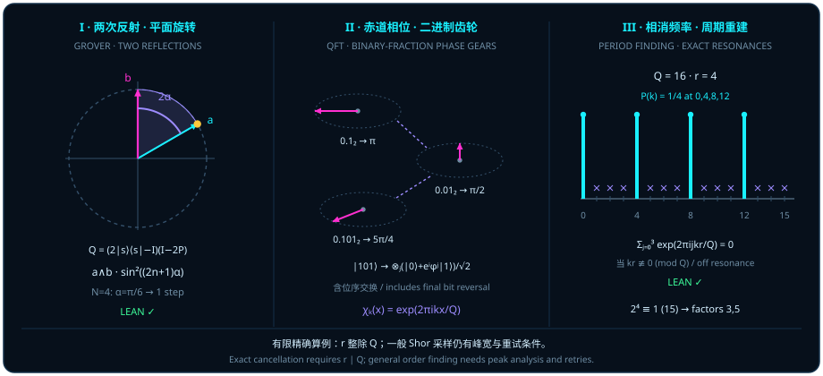

# 夹角平面旋转与赤道面积齿轮：Grover 搜索、QFT 与 Shor 大数分解

> *“这核心是各向同性如何从正交关系到达另外一个点,一个是正交一次,一个是正交两次,因为三元两两正交”*

在[第十三章](ch13-entanglement-and-chsh.md)与[第十四章](ch14-cloning-codes-and-braids.md)中，我们见证了高维球体如何接纳并保护量子信息。现在，我们要回答量子计算最激动人心的问题：**在这座指数级膨胀的高维球面上，量子算法究竟凭什么比经典枚举快得多？**

如果把近三十年来最重要的两大量子算法家族——以 Grover 为代表的**振幅放大（Amplitude Amplification）**与以 Shor 为代表的**量子傅里叶周期寻找（QFT Period Finding）**——剥去繁复的电路外衣，它们的几何内核正好对应题记中那句洗练的洞察：

- **Grover 搜索是“两次正交反射合成一次不变平面旋转”**：在各向同性的高维草堆里，初始叠加态与目标态之间张开一个二维公共平面；先对目标正交子空间作一次镜像反射（正交一次），再对初始子空间作第二次镜像反射（正交两次），两次反射自动把状态向量沿着这个二维平面向目标稳步拨转 $2\theta$ 角！
- **QFT 与周期寻找是“赤道相位齿轮上的正交字符干涉”**：通过有限 Weyl 位移算子的共轭相位反冲，把算术周期性刻进一套按二进制分母咬合的赤道相位齿轮；当对整个有限群求字符和时，非共振频率在单位圆上两两正交相消归零，唯独对偶零化子格点（共振频率）同相累加，一举锁定隐藏周期！

## Grover：两次反射的共同不变平面 {#sec-grover-invariant-plane}

想象在一座拥有 $l$ 个正交房间的巨大迷宫里寻找目标。经典搜寻者每次只能推开一扇门，平均要试 $O(l)$ 次；而量子搜索则从一开始就把单位 $\ell^2$ 范数均匀铺满所有房间（注意：量子态列向量的单位归一化始终是欧氏/希尔伯特 $\ell^2$ 范数 $\sum_i |\psi_i|^2 = 1$，而非函数空间上的上确界 $\sup$ 范数）。

为了将单目标 Grover 搜索与更一般的多列相干子空间放大统一收进同一座定理大厦，源码模块 `CoherentUniformAmplification` 采用了极为优美的块矩阵几何语言。设 $s$（源子空间指标）与 $l$（外部搜索空间指标）为有限可判等类型：

- $J \in M_{l \times s}(\mathbb{C})$ 为源子空间的等距嵌入矩阵（$J^* J = I_s$）；
- $C \in M_{l \times l}(\mathbb{C})$ 为幺正制备矩阵（$C^* C = I_l$），故制备后的源等距算子为 $U = C J \in M_{l \times s}(\mathbb{C})$（满足 $U^* U = J^* C^* C J = I_s$）；
- $P \in M_{l \times l}(\mathbb{C})$ 为标记目标子空间的自伴幂等正交投影矩阵（$P^* = P$，$P^2 = P$）。

何时不同源列在目标投影 $P$ 下享有完全均匀的初始命中率 $p \in (0, 1]$？当且仅当成功投影块 $P U = P(CJ)$ 的格拉姆（Gram）矩阵等于标量矩阵 $p I_s$：

$$
\bigl(P(CJ)\bigr)^* \bigl(P(CJ)\bigr) = (p : \mathbb{C}) \bullet I_s \qquad (0 < p \le 1).
$$

在此均匀成功条件下，我们将 $U = CJ$ 沿着目标投影 $P$ 与失败补投影 $I_l - P$ 分解为归一化成功等距块 $W$ 与归一化失败等距块 $B$：

$$
W = \mathrm{success}(U, P, p) = (\sqrt{p})^{-1}\,P U, \qquad
B = \mathrm{failure}(U, P, p) = (\sqrt{1 - p})^{-1}\,(I_l - P) U,
$$

并定义由“关于目标的相位反射 $I_l - 2P$”与“关于制备态的扩散反射 $2 U U^* - I_l$”复合而成的单步 Grover 迭代算子

$$
\mathrm{iterate}(U, P) = (2 U U^* - I_l)(I_l - 2P),
$$

记初始成功倾角为 $\theta = \arcsin(\sqrt{p})$（故 $\sin\theta = \sqrt{p}$，$\cos\theta = \sqrt{1 - p}$）。下面的定理证明：无论迭代多少步 $n \in \mathbb{N}$，甚至无论外部再张量耦合任何参考系统 $R$，演化始终严丝合缝地锁在由 $W$ 与 $B$ 张成的二维块平面内，每次精确旋转 $2\theta$ 角！

::: {.theorem #thm-grover-uniform-rotation title="相干均匀振幅放大的不变平面算子旋转定理" lean="D5/S3/Quantum/Recovery/CoherentUniformAmplification.uniform_operator_rotation"}
设 $s, l$ 为有限可判等指标类型，$J \in M_{l \times s}(\mathbb{C})$、$C, P \in M_{l \times l}(\mathbb{C})$、$p \in \mathbb{R}$，满足

$$
J^* J = 1, \quad C^* C = 1, \quad P^* = P, \quad P^2 = P, \quad
\bigl(P(CJ)\bigr)^* \bigl(P(CJ)\bigr) = (p : \mathbb{C}) \bullet (1 : M_s(\mathbb{C})), \quad 0 < p \le 1.
$$

令

$$
U := C J, \qquad W := \mathrm{success}(U, P, p), \qquad B := \mathrm{failure}(U, P, p), \qquad \theta := \arcsin(\sqrt{p}).
$$

若 $p = 1$，则 $U = W$；否则（当 $0 < p < 1$ 时），以下结论同时成立：

1. **成功块与失败块的正交等距性**：

   $$
   W^* W = 1, \qquad B^* B = 1, \qquad W^* B = 0;
   $$

2. **$n$ 步迭代的精确正弦—余弦旋转公式及克罗内克伴随不变性**：对一切自然数 $n \in \mathbb{N}$，

   $$
   \mathrm{iterate}(U, P)^n \cdot U = \bigl(\sin((2n + 1)\theta) : \mathbb{C}\bigr) \bullet W + \bigl(\cos((2n + 1)\theta) : \mathbb{C}\bigr) \bullet B,
   $$

   且对任意类型 $z$ 及任意复方阵 $R \in M_z(\mathbb{C})$，

   $$
   \bigl(\mathrm{iterate}(U, P)^n \cdot U\bigr) \otimes_{\mathrm{K}} R = \bigl(\sin((2n + 1)\theta) : \mathbb{C}\bigr) \bullet (W \otimes_{\mathrm{K}} R) + \bigl(\cos((2n + 1)\theta) : \mathbb{C}\bigr) \bullet (B \otimes_{\mathrm{K}} R).
   $$
:::

::: proof
当 $p = 1$ 时，$W = 1^{-1} P U = P U$，且失败块 $(I_l - P)U$ 的格拉姆矩阵为 $U^*(I_l - P)U = I_s - I_s = 0$，故 $(I_l - P)U = 0$，从而 $U = P U = W$。

当 $0 < p < 1$ 时，$\sqrt{p} > 0$ 且 $\sqrt{1 - p} > 0$。由 $(PU)^*(PU) = p I_s$ 立得 $W^* W = p^{-1}(PU)^*(PU) = I_s$；由 $U^* U = I_s$ 与 $P^* = P = P^2$ 得 $((I_l - P)U)^*((I_l - P)U) = U^* U - U^* P U = (1 - p)I_s$，除以 $1 - p$ 即得 $B^* B = I_s$；而 $P(I_l - P) = 0$ 直接给出 $W^* B = 0$（结论 1）。

注意到初始分解为 $U = P U + (I_l - P)U = \sin\theta\,W + \cos\theta\,B$（这对应 $n = 0$ 时 $(2n + 1)\theta = \theta$ 的基底情形）。因为 $P W = W$ 且 $P B = 0$，第一次反射 $(I_l - 2P)$ 将 $W$ 反号为 $-W$、保持 $B$ 不变；接着计算 $U^* W = \sin\theta\,I_s$ 与 $U^* B = \cos\theta\,I_s$，第二次反射 $(2U U^* - I_l)$ 将 $W$ 与 $B$ 变换为二倍角三角组合，合起来使单步算子 $Q = \mathrm{iterate}(U, P)$ 在 $\{W, B\}$ 上精确执行角度为 $2\theta$ 的平面旋转：

$$
Q W = \cos(2\theta)\,W - \sin(2\theta)\,B, \qquad Q B = \sin(2\theta)\,W + \cos(2\theta)\,B.
$$

对 $n \in \mathbb{N}$ 归纳并应用和角公式 $\sin((2n+1)\theta)\cos(2\theta) + \cos((2n+1)\theta)\sin(2\theta) = \sin((2n+3)\theta)$ 及余弦和角公式，即得 $Q^n U = \sin((2n+1)\theta)W + \cos((2n+1)\theta)B$。最后对等式两端右作 $\otimes_{\mathrm{K}} R$，由克罗内克积的线性分配律立即得出带参考矩阵 $R$ 的扩展恒等式（结论 2）。完整证明由 Lean 内核检查。
:::

::: {.viz src="grover-reflections" preset="mirrors" height="500"}
**两面镜子合成一次转动。** $N = 8$ 时 $\theta \approx 20.70^\circ$：琥珀色的箭头先在失败轴 $B$（镜 1）里照一次，箭头尖沿竖直虚线翻到轴下；再在 $\lvert s\rangle$ 那条虚线（镜 2）里照一次，翻回来时比出发处高了 $2\theta \approx 41.41^\circ$，紫色的弧就是这一转。青色的影子是在目标轴 $W$ 上的成功振幅，从 $0.354$ 长到 $0.884$（[@thm-grover-uniform-rotation]，$n = 1$）。
:::

请结合图 15 面板 I 体会 [@thm-grover-uniform-rotation] 的三条关键边界：

1. **必须保留 $p = 1$ 的独立分支**：当初始状态已经百分之百落在目标子空间内（$p = 1$）时，失败分母 $\sqrt{1 - p} = 0$，此时无须定义失败基向量 $B$，定理直接给出 $U = W$；而当 $0 < p < 1$ 时，$n = 0$ 自动还原初始正交分解 $U = \sin\theta\,W + \cos\theta\,B$。
2. **多源列时的块平面几何**：当源空间只有一列（$|s| = 1$，标准单初态 Grover 搜索）时，$W$ 与 $B$ 是两根正交单位列向量，张成一个二维平面；当 $|s| > 1$ 时，$W, B \in M_{l \times s}(\mathbb{C})$ 各自包含 $|s|$ 根正交列向量，第 $j$ 列的成功分量 $W_{\cdot, j}$ 与失败分量 $B_{\cdot, j}$ 张成属于该列的二维不变平面，全部 $|s|$ 个二维平面在 $\mathrm{iterate}(U, P)$ 下以完全相同的角速度 $2\theta$ 同步旋转（绝非把整个多列算子压进单一的二维希尔伯特空间）。
3. **整数步数 $n \in \mathbb{N}$ 的离散过冲（overshoot）**：因为步数 $n$ 只能取自然数，转角 $(2n + 1)\theta$ 是离散跳变的。当 $p = 1/N \ll 1$ 时，$\theta = \arcsin(1/\sqrt{N}) \approx 1/\sqrt{N}$，令 $(2n + 1)\theta \approx \pi/2$ 给出著名的 $n \approx \frac{\pi}{4}\sqrt{N}$ 步复杂度；但除 $N = 4$（$p = 1/4, \theta = \pi/6, n = 1$）等极少数特殊有理角外，整数步 $n$ 只能逼近 $\pi/2$ 而无法对任意 $N$ 精确命中 $\sin((2n+1)\theta) = 1$（如何在已知 $p$ 时借辅助硬币旋转彻底消除这一过冲残差，将在[第十六章](ch16-qsvt-walks-and-compilation.md) [@cor-exact-source-query-count] 中严格解决）。

::: {.viz src="grover-reflections" preset="over" height="500"}
**整数步会转过头。** $N = 8$ 再走第 $3$ 步：箭头转到 $7\theta \approx 144.9^\circ$，青色的影子缩回 $0.575$，成功概率从 $0.945$ 掉到 $0.330$；右边的柱子先升后降，第 $2$ 根最高。
:::

::: {.viz src="grover-reflections" preset="sqrt" height="500"}
**$\frac{\pi}{4}\sqrt{N}$ 步爬到顶。** $N = 256$ 时每一步只转 $2\theta \approx 7.17^\circ$，十二段紫色的小弧把琥珀色的箭头从 $3.6^\circ$ 送到 $89.6^\circ$，成功概率 $0.99995$；十二正是 $\frac{\pi}{4}\sqrt{256} \approx 12.57$ 附近的最佳步数。
:::

::: {.viz src="grover-reflections" height="560"}
Grover 两次反射的完整实验室：拖动镜 2 上的初始态改 $\theta$，换 $N$，用 ← → 一面一面地照镜子；右边的柱子是每一步之后的成功概率 $\sin^2((2n+1)\theta)$（[@thm-grover-uniform-rotation]）。查询下界 $\Omega(\sqrt{N})$ 是文献结果，未在本书形式化。
:::

## 相位反冲与 QFT 二进制齿轮 {#sec-qft-phase-gears}

如果说 Grover 搜索靠的是在实平面里一步旋转 $2\theta$，那么量子傅里叶变换（QFT）与相位估计靠的就是在复赤道圆周上拧转不同齿比的**相位齿轮**（见图 15 面板 II）。

在代数底层，一切离散相位反冲（phase kickback）都源于有限循环群 $\mathrm{ZMod}\,M$（$M \in \mathbb{N}$，带 `[NeZero M]`）上平移算子与时钟算子的共轭对易律。在源码模块 `WeylDisplacementConjugation` 中，记 $M$ 次本原单位根为 $\omega_M = \mathrm{windowRoot}(M) = \exp(2\pi i / M)$，在 $M_{\mathrm{Fin}\,M}(\mathbb{C})$ 上定义：

- **对角时钟矩阵** $\mathrm{clockMatrix}(M) = \operatorname{diag}\bigl(j \mapsto \omega_M^{j.\mathrm{val}}\bigr)$；
- **循环移位矩阵** $\mathrm{shiftMatrix}(M) = \mathrm{circulant}\bigl(i \mapsto \text{if } i = 1 \text{ then } 1 \text{ else } 0\bigr)$，其对列向量的作用为向下循环移位 $(X\psi)_i = \psi_{i - 1}$；
- **Weyl 位移算子** $\mathrm{displacement}(M, e, f) = \mathrm{shiftMatrix}(M)^{e.\mathrm{val}} \cdot \mathrm{clockMatrix}(M)^{f.\mathrm{val}}$（$e, f \in \mathrm{ZMod}\,M$）。

当我们用位移算子 $D(a, b) = \mathrm{displacement}(M, a, b)$ 去共轭另一个位移算子 $D(c, d) = \mathrm{displacement}(M, c, d)$ 时，会发生什么？下面的引理给出了精确的共轭相位反冲公式。

::: {.lemma #lemma-phase-kickback-weyl title="有限 Weyl 位移算子的共轭相位反冲引理" lean="D5/S3/Quantum/Algebra/WeylDisplacementConjugation.displacement_conjugation"}
设 $M \in \mathbb{N}$ 且满足 `[NeZero M]`。对任意四个模 $M$ 剩余类元素 $a, b, c, d \in \mathrm{ZMod}\,M$，恒有

$$
\begin{aligned}
&\mathrm{displacement}(M, a, b) \cdot \mathrm{displacement}(M, c, d) \cdot \mathrm{star}\bigl(\mathrm{displacement}(M, a, b)\bigr) \\
&= \mathrm{windowRoot}(M)^{(b \cdot c - a \cdot d).\mathrm{val}} \bullet \mathrm{displacement}(M, c, d).
\end{aligned}
$$
:::

::: proof
记 $X = \mathrm{shiftMatrix}(M)$、$Z = \mathrm{clockMatrix}(M)$。因为 $X$ 与 $Z$ 均为幺正矩阵，每个 $\mathrm{displacement}(M, a, b) = X^{a.\mathrm{val}} Z^{b.\mathrm{val}}$ 亦为幺正矩阵，满足 $D(a, b) \cdot \mathrm{star}(D(a, b)) = I_M$。利用基本 Weyl 交换关系 $Z^b X^c = \omega_M^{(b \cdot c).\mathrm{val}} X^c Z^b$ 与 $X^a Z^d = \omega_M^{(-a \cdot d).\mathrm{val}} Z^d X^a$，将左端内部的 $X^{c.\mathrm{val}} Z^{d.\mathrm{val}}$ 逐步移到最右侧的 $\mathrm{star}(D(a, b))$ 之后：跨过 $Z^{b.\mathrm{val}}$ 产生相位因子 $\omega_M^{(b \cdot c).\mathrm{val}}$，跨过 $X^{a.\mathrm{val}}$ 产生相位因子 $\omega_M^{(-a \cdot d).\mathrm{val}}$。两个相位在 $\mathrm{ZMod}\,M$ 中合并为 $\omega_M^{(b \cdot c - a \cdot d).\mathrm{val}}$，而左侧剩余的 $D(a, b) \cdot \mathrm{star}(D(a, b))$ 缩并为单位阵 $I_M$，留下 $\omega_M^{(b \cdot c - a \cdot d).\mathrm{val}} \bullet D(c, d)$。完整证明由 Lean 内核检查。
:::

在使用 [@lemma-phase-kickback-weyl] 时，请务必核对三处符号与边界细节：

1. **模 $M$ 减法先于 `.val` 取值**：指数 $(b \cdot c - a \cdot d).\mathrm{val}$ 是先在环 $\mathrm{ZMod}\,M$ 内部完成乘法与减法，再通过 `.val` 取出 $\{0, 1, \dots, M-1\}$ 中的代表元整数作为 $\mathrm{windowRoot}(M)$ 的自然数幂次。
2. **共轭转置 `star` 与相位正号规范**：式中的 $\mathrm{star}$ 表示矩阵共轭转置 $(\cdot)^*$；由于源码定义 $\mathrm{windowRoot}(M) = \exp(+2\pi i / M)$ 且移位作用为 $(X\psi)_i = \psi_{i-1}$、算子次序为 $X^{e.\mathrm{val}} Z^{f.\mathrm{val}}$，共轭后指数恰好是正号 $(b \cdot c - a \cdot d).\mathrm{val}$。
3. **代数核心与完整 QFT 电路的边界**：[@lemma-phase-kickback-weyl] 给出了有限 Weyl 代数中“用位移共轭提取辛相位”的精确算子恒等式；而多比特受控相位门与 Hadamard 门如何拼装成对数深度的量子傅里叶变换（QFT）电路，我们将在 [@ex-grover-four-shor-fifteen] 第二步中按显式二进制位序手算展开，并在 [@rem-grover-qft-shor-literature] 中说明其电路复杂度。

## 有限字符正交与非共振相消 {#sec-period-frequency-cancellation}

当第一寄存器通过模幂运算与相位反冲，把一个隐藏的周期子群 $H \le \mathrm{ZMod}\,m$（$m \in \mathbb{N}$，带 `[NeZero m]`）编码成等幅叠加态后，为什么做一次有限傅里叶变换就能把所有不属于对偶格点的杂散频率统统清零？

这就是有限阿贝尔群上最纯粹的几何干涉定律：**正交字符相消**（见图 15 面板 III）。在源码模块 `D5/S3/Fourier/FinitePoisson.lean` 中，对任意频率指标 $k \in \mathrm{ZMod}\,m$，加性特征标（character）定义为标准加性特征标 `ZMod.stdAddChar` 的平移 `character k = ZMod.stdAddChar.mulShift k`，其显式复数值为

$$
\mathrm{character}(k)(x) = \chi_k(x) = \exp\Bigl(+\frac{2\pi i k x}{m}\Bigr) \qquad (x \in \mathrm{ZMod}\,m).
$$

对 $\mathrm{ZMod}\,m$ 的任意加法子群 $H : \mathrm{AddSubgroup}(\mathrm{ZMod}\,m)$，定义其**零化子子群（annihilator / 对偶共振子群）**为全体在 $H$ 上恒取 $+1$ 的频率集合：

$$
\mathrm{annihilator}(H) = H^\perp = \bigl\{k \in \mathrm{ZMod}\,m \;\big|\; \forall h \in H,\; \mathrm{character}(k)(h) = 1\bigr\}.
$$

（源码为 $H$、商群及 $\mathrm{annihilator}(H)$ 构造了完备的 `Fintype` 与 `DecidableEq` 实例。）现在，对任意固定位置 $x \in \mathrm{ZMod}\,m$，把落入对偶子群 $\mathrm{annihilator}(H)$ 中的所有特征标 $\mathrm{character}(k.1)(x)$ 加起来，会发生什么？下面的命题给出了非此即彼的精确 dichotomy。

::: {.proposition #prop-finite-character-cancellation title="有限零化子子群上的特征标正交相消命题" lean="D5/S3/Fourier/FinitePoisson.sum_annihilator_character"}
设 $m \in \mathbb{N}$ 且满足 `[NeZero m]`，$H : \mathrm{AddSubgroup}(\mathrm{ZMod}\,m)$ 为 $\mathrm{ZMod}\,m$ 的任意加法子群，$x \in \mathrm{ZMod}\,m$。则对零化子子群 $\mathrm{annihilator}(H)$ 的全体元素求和恒有

$$
\sum_{k : \mathrm{annihilator}(H)} \mathrm{character}(k.1)(x) = \begin{cases} \bigl(\mathrm{Fintype.card}(\mathrm{annihilator}(H)) : \mathbb{C}\bigr) & \text{若 } x \in H, \\ 0 & \text{若 } x \notin H. \end{cases}
$$
:::

::: proof
分两种情形讨论：

1. **共振情形（$x \in H$）**：对每个 $k \in \mathrm{annihilator}(H)$，由零化子的定义直接有 $\mathrm{character}(k.1)(x) = 1$。将常数 $1$ 在有限类型 $\mathrm{annihilator}(H)$ 上求和，结果恰为其基数 $(\mathrm{Fintype.card}(\mathrm{annihilator}(H)) : \mathbb{C})$。
2. **非共振情形（$x \notin H$）**：映射 $k \mapsto \mathrm{character}(k.1)(x)$ 构成有限加法群 $\mathrm{annihilator}(H)$ 到复数乘法群 $\mathbb{C}^\times$ 的群同态。由有限循环群 $\mathrm{ZMod}\,m$ 上的对偶性（若 $x \notin H$，则存在 $k_0 \in \mathrm{annihilator}(H)$ 使得 $\mathrm{character}(k_0.1)(x) \neq 1$），在有限群 $\mathrm{annihilator}(H)$ 上对求和指标作平移双射 $k \mapsto k + k_0$，和式 $S = \sum_{k} \mathrm{character}(k.1)(x)$ 满足 $\mathrm{character}(k_0.1)(x) \cdot S = S$。移项得 $(\mathrm{character}(k_0.1)(x) - 1)S = 0$；因 $\mathrm{character}(k_0.1)(x) \neq 1$，必有 $S = 0$。完整证明由 Lean 内核检查。
:::

[@prop-finite-character-cancellation] 把波粒二象性在有限群上的运作机理展示得淋漓尽致：

- 当 $x \notin H$ 时，各频率分量 $\chi_k(x)$ 在复平面单位圆上均匀散开、两两抵消，合振幅精确归零（**相消干涉**）；
- 当 $x \in H$ 时，所有频率分量全部指向正实轴 $+1$，合振幅同相叠加为 $|\mathrm{annihilator}(H)|$（**相长干涉**）。

**重要规范提醒**：[@prop-finite-character-cancellation] 右端在 $x \in H$ 时给出的是**未归一化**的子群基数 $|\mathrm{annihilator}(H)|$，绝不能把这股未归一化的代数和直接称作“概率 $1$”！在实际量子电路中，必须除以初态归一化因子 $\sqrt{|H|}$ 与幺正 QFT 的归一化因子 $\sqrt{m}$，才能把振幅转化为满足玻恩法则的单位概率分布。

## 有限周期采样与 Shor 阶重建 {#sec-shor-order-reconstruction}

将 [@prop-finite-character-cancellation] 的正交筛子应用于 $\mathrm{ZMod}\,m$ 上的任意复值函数 $f : \mathrm{ZMod}\,m \to \mathbb{C}$，便立即导出调和分析与量子周期寻找的共同枢纽——**有限泊松求和公式（Finite Poisson Summation Formula）**。

在阅读下面的推论之前，必须严格对齐源码所使用的 Mathlib 离散傅里叶变换规范：`ZMod.dft f` 定义为**带负指数且不含 $1/\sqrt{m}$ 归一化因子**的离散傅里叶变换：

$$
(\mathrm{ZMod.dft}\,f)(k) = \sum_{x \in \mathrm{ZMod}\,m} \exp\Bigl(-\frac{2\pi i x k}{m}\Bigr)\,f(x) = \sum_{x \in \mathrm{ZMod}\,m} \mathrm{character}(-k)(x)\,f(x).
$$

这与物理教材中常见的正指数单位化 QFT $\mathcal{F}_+(f)(k) = \frac{1}{\sqrt{m}}\sum_x \exp(+2\pi i k x / m)f(x)$ 相差一个归一化系数 $1/\sqrt{m}$ 以及指数符号 $k \leftrightarrow -k$（注意由于 $\mathrm{annihilator}(H)$ 是加法子群，$k \in \mathrm{annihilator}(H) \iff -k \in \mathrm{annihilator}(H)$，因此在对整个 $\mathrm{annihilator}(H)$ 求和时正负指数集合完全重合，但在计算单个频点的值时绝不能把两套规范混为一谈）。

::: {.corollary #cor-finite-poisson-period title="ZMod m 子群与零化子上的有限泊松求和推论" lean="D5/S3/Fourier/FinitePoisson.finite_poisson_summation"}
设 $m \in \mathbb{N}$ 且满足 `[NeZero m]`，$H : \mathrm{AddSubgroup}(\mathrm{ZMod}\,m)$ 为 $\mathrm{ZMod}\,m$ 的加法子群，$f : \mathrm{ZMod}\,m \to \mathbb{C}$ 为任意复值函数。则 $f$ 在子群 $H$ 上的和恒等于其离散傅里叶变换 $\mathrm{ZMod.dft}\,f$ 在零化子 $\mathrm{annihilator}(H)$ 上的缩放和：

$$
\sum_{h : H} f(h.1) = \frac{(\mathrm{Fintype.card}\,H : \mathbb{C})}{(m : \mathbb{C})} \cdot \sum_{k : \mathrm{annihilator}(H)} \mathrm{ZMod.dft}\,f\,k.1.
$$
:::

::: proof
按 `ZMod.dft` 的定义将右端对 $k : \mathrm{annihilator}(H)$ 的求和展开，并交换有限求和次序（对 $x \in \mathrm{ZMod}\,m$ 与 $k \in \mathrm{annihilator}(H)$）：

$$
\sum_{k : \mathrm{annihilator}(H)} \mathrm{ZMod.dft}\,f\,k.1
= \sum_{x \in \mathrm{ZMod}\,m} f(x) \sum_{k : \mathrm{annihilator}(H)} \mathrm{character}(-k.1)(x).
$$

因为 $k \mapsto -k$ 是加法子群 $\mathrm{annihilator}(H)$ 上的双射，内层和式等于 $\sum_{k : \mathrm{annihilator}(H)} \mathrm{character}(k.1)(x)$。代入 [@prop-finite-character-cancellation]，所有 $x \notin H$ 的项全部归零，仅保留 $x \in H$ 的项，每项乘以常数 $|\mathrm{annihilator}(H)|$：

$$
\sum_{k : \mathrm{annihilator}(H)} \mathrm{ZMod.dft}\,f\,k.1 = \bigl(\mathrm{Fintype.card}(\mathrm{annihilator}(H)) : \mathbb{C}\bigr) \sum_{h : H} f(h.1).
$$

最后利用有限循环群子群与零化子的拉格朗日基数恒等式 $\mathrm{Fintype.card}(H) \cdot \mathrm{Fintype.card}(\mathrm{annihilator}(H)) = m$，两边同乘 $\frac{\mathrm{Fintype.card}(H)}{m}$ 消去因子 $\frac{|H| \cdot |H^\perp|}{m} = 1$，即得左端 $\sum_{h : H} f(h.1)$。完整证明由 Lean 内核检查。
:::

::: {.remark #rem-shor-divisibility-boundary-literature title="有限泊松求和与一般非整除 Shor 周期恢复的边界（文献结果，未在本书形式化）"}
**文献结果，未在本书形式化。** 在将 [@cor-finite-poisson-period] 与 Shor 大数分解算法对接时，下述两条边界——尤其是第 2 条中一般非整除情形（$r \nmid Q$）下的狄利克雷/费耶尔（Dirichlet/Fejér）核尖峰集中性与连分数有理逼近恢复定理——属于量子算法文献结论（详见下文 [@rem-grover-qft-shor-literature]），未在本书形式化：

1. **有限泊松恒等式不等于完整 Shor 算法的成功概率或多项式复杂度定理**：[@cor-finite-poisson-period] 是 $\mathrm{ZMod}\,m$ 上的精确调和分析恒等式，它本身并不包含模幂电路构造、连分数有理逼近恢复定理、欧拉函数互素概率下界或大数分解的多项式门复杂度（这些完整算法环节列于 [@rem-grover-qft-shor-literature]）。
2. **整除情形（$r \mid Q$）与一般非整除情形（$r \nmid Q$）的本质区别**：唯有当待求周期 $r$ 恰好整除量子寄存器容量 $m = Q$ 时，周期采样点才构成 $\mathrm{ZMod}\,Q$ 的真子群 $H$，使非共振频点按 [@prop-finite-character-cancellation] **精确为零**；而在 Shor 算法的一般情形中，$r$ 是未知奇偶整数而 $Q = 2^q$ 是 $2$ 的幂（通常 $r \nmid Q$），此时非共振频点的振幅并不精确为零，而是呈狄利克雷（Dirichlet / Fejér）核尖峰分布集中在最接近 $\frac{s Q}{r}$ 的整数频点周围，必须借助连分数展开（continued fractions）从有理逼近中还原分母 $r$。
:::

下面，让我们通过一个四步完整手算算例，把 $N=4$ 与 $N=8$ 的 Grover 搜索、$3$ 比特 QFT 的二进制相位齿轮、$N=15$ 的 Shor 周期寻找以及 $\mathrm{ZMod}\,16$ 上的字符和与泊松公式逐一验算到底。

::: {.example #ex-grover-four-shor-fifteen title="Grover N=4/N=8 搜索、3 比特 QFT 相位齿轮与 Shor N=15 阶寻找完整验算（含文献说明，未在本书形式化）"}
**文献结果，未在本书形式化。** 本例第一步与第四步具体验算本章经内核验证的 [@thm-grover-uniform-rotation]、[@prop-finite-character-cancellation] 与 [@cor-finite-poisson-period]；而第二步中含末端位反转 SWAP 门的二进制张量积 QFT 分解，以及第三步中 Shor 阶寻找与最大公因数分解归约 $\gcd(a^{r/2} \pm 1, N)$，均属量子算法文献内容（详见下文 [@rem-grover-qft-shor-literature]），未在本书形式化。

本例分四步完成本章全部核心公式的具体数值检验：

**第一步：Grover 搜索在 $N = 4$ 上的单步精确命中与 $N = 8$ 的整数步残差。**
取四维搜索空间 $l = \mathrm{Fin}\,4$、单列源 $s = \mathrm{Fin}\,1$，设唯一标记目标为 $|0\rangle$，即 $P = |0\rangle\langle 0|$。取源嵌入 $J = |0\rangle$，制备幺正阵 $C = H \otimes H$，故制备态为均匀叠加态

$$
U = C J = |s\rangle = \frac{1}{2}\bigl(|0\rangle + |1\rangle + |2\rangle + |3\rangle\bigr).
$$

计算成功格拉姆矩阵：$(PU)^*(PU) = |\langle 0\mid s\rangle|^2 = \frac{1}{4}$，故初始成功概率 $p = \frac{1}{4}$，初始倾角为

$$
\alpha = \arcsin\Bigl(\sqrt{\frac{1}{4}}\Bigr) = \arcsin\Bigl(\frac{1}{2}\Bigr) = \frac{\pi}{6} = 30^\circ.
$$

此时归一化成功块与失败块分别为 $W = |0\rangle$ 与 $B = \frac{1}{\sqrt{3}}(|1\rangle + |2\rangle + |3\rangle)$。作用一次 Grover 迭代算子 $Q = (2|s\rangle\langle s| - I_4)(I_4 - 2P)$（取 $n = 1$），由 [@thm-grover-uniform-rotation] 得：

$$
Q U = \sin(3\alpha)\,W + \cos(3\alpha)\,B = \sin\Bigl(\frac{\pi}{2}\Bigr)|0\rangle + \cos\Bigl(\frac{\pi}{2}\Bigr)B = 1 \cdot |0\rangle + 0 \cdot B = |0\rangle!
$$

仅需 $n = 1$ 步，状态向量从 $30^\circ$ 再转 $2\alpha = 60^\circ$，分毫不差地垂直立在目标 $|0\rangle$ 上（成功率 $100\%$）。

作为对比，若将搜索空间扩大到 $N = 8$（仍含 $1$ 个标记项），则 $p = \frac{1}{8}$，$\theta = \arcsin(1/\sqrt{8}) \approx 20.7048^\circ$。利用三倍角公式 $\sin(3\theta) = 3\sin\theta - 4\sin^3\theta = \frac{3}{\sqrt{8}} - \frac{4}{8\sqrt{8}} = \frac{5}{2\sqrt{8}} = \frac{5}{\sqrt{32}}$，迭代 $n = 1$ 步后的成功概率为

$$
P_{\mathrm{succ}}(N=8,\, n=1) = \sin^2\Bigl(3\arcsin\frac{1}{\sqrt{8}}\Bigr) = \frac{25}{32} = 0.78125,
$$

而迭代 $n = 2$ 步后的成功概率为 $\sin^2(5\theta) = \frac{121}{128} = 0.9453125 < 1$。这直观展示了当 $\frac{\pi}{4\theta} - \frac{1}{2} \notin \mathbb{N}$ 时，标准整数步 Grover 迭代必然留有非零的离散角度残差。

**第二步：$3$ 比特量子傅里叶变换（QFT）的位序规范与 $x = 5 = (101)_2$ 相位齿轮验算。**
在 $3$ 比特空间（$m = 8$）中，我们明确采用**输出从最高有效位（MSB）到最低有效位（LSB）排列**的张量因子顺序（即标准 QFT 电路末端显式包含位反转 SWAP 门）。将输入整数 $x \in \{0, \dots, 7\}$ 写为二进制 $x = x_2 x_1 x_0 = 4x_2 + 2x_1 + x_0$，并记二进制小数 $0.b_1 b_2 \cdots b_r = \sum_{j=1}^r b_j 2^{-j}$。则正指数单位化 QFT $\mathcal{F}_+|x\rangle = \frac{1}{\sqrt{8}}\sum_{k=0}^7 e^{+2\pi i k x / 8}|k_2 k_1 k_0\rangle$ 精确分解为三个单比特赤道态的张量积：

$$
\mathcal{F}_+|x_2 x_1 x_0\rangle = \frac{|0\rangle + e^{2\pi i (0.x_0)}|1\rangle}{\sqrt{2}} \otimes \frac{|0\rangle + e^{2\pi i (0.x_1 x_0)}|1\rangle}{\sqrt{2}} \otimes \frac{|0\rangle + e^{2\pi i (0.x_2 x_1 x_0)}|1\rangle}{\sqrt{2}}.
$$

请特别注意位序对应关系：各因子的相位由输入低位逐步向高位扩展（$0.x_0 \to 0.x_1 x_0 \to 0.x_2 x_1 x_0$），但**输出的第 1 个张量因子对应频率 $k = 4k_2 + 2k_1 + k_0$ 的最高位 $k_2$**（因为 $4k_2 \cdot x / 8 \equiv k_2 \cdot (0.x_0) \pmod 1$），绝不能把做完末端 SWAP 前后的相反位序画成同一个公式！

取具体输入 $x = 5 = (101)_2$（即 $x_2 = 1, x_1 = 0, x_0 = 1$），三只赤道相位齿轮的转角依次为：

1. **首因子（对应输出最高位 $k_2$）**：二进制小数 $0.x_0 = 0.1_2 = \frac{1}{2}$，相位角 $\phi_1 = 2\pi \cdot \frac{1}{2} = \pi$（$e^{i\pi} = -1$）；
2. **中因子（对应输出中位 $k_1$）**：二进制小数 $0.x_1 x_0 = 0.01_2 = \frac{1}{4}$，相位角 $\phi_2 = 2\pi \cdot \frac{1}{4} = \frac{\pi}{2}$（$e^{i\pi/2} = i$）；
3. **末因子（对应输出最低位 $k_0$）**：二进制小数 $0.x_2 x_1 x_0 = 0.101_2 = \frac{5}{8}$，相位角 $\phi_3 = 2\pi \cdot \frac{5}{8} = \frac{5\pi}{4}$；

三因子合并后总归一化因子恰为 $\frac{1}{\sqrt{2}} \cdot \frac{1}{\sqrt{2}} \cdot \frac{1}{\sqrt{2}} = \frac{1}{\sqrt{8}}$。

**第三步：Shor 阶寻找算例 $N = 15$、底数 $a = 2$、寄存器容量 $Q = 16$。**
考察待分解合数 $N = 15$，选与 $15$ 互素的底数 $a = 2$。模幂序列 $2^x \bmod 15$（$x = 0, 1, 2, 3, 4, \dots$）依次为

$$
1,\; 2,\; 4,\; 8,\; 1,\; 2,\; 4,\; 8,\; \dots,
$$

其乘法阶（最小正周期）为 $r = 4$。取第一寄存器大小 $Q = 16$（这是一个 $r \mid Q$ 的精确整除教学算例）。在制备均匀叠加 $\frac{1}{4}\sum_{x=0}^{15}|x\rangle|2^x \bmod 15\rangle$ 并条件测得第二寄存器函数值为 $1$ 后，第一寄存器坍缩到以 $r = 4$ 为步长的周期态：

$$
|\psi_{\mathrm{per}}\rangle = \frac{1}{2}\bigl(|0\rangle + |4\rangle + |8\rangle + |12\rangle\bigr).
$$

对其作用 $16$ 点单位化 QFT $\mathcal{F}_+$，输出在第 $k$ 个频点（$k \in \{0, \dots, 15\}$）上的振幅为

$$
\alpha_k = \frac{1}{2\sqrt{16}}\sum_{j=0}^3 e^{2\pi i k (4j) / 16} = \frac{1}{8}\sum_{j=0}^3 \bigl(e^{2\pi i k / 4}\bigr)^j = \begin{cases} \frac{1}{2} & \text{若 } k \in \{0, 4, 8, 12\}, \\ 0 & \text{若 } k \notin \{0, 4, 8, 12\}. \end{cases}
$$

于是测量仅以各 $\bigl|\frac{1}{2}\bigr|^2 = \frac{1}{4}$ 的概率落在四个共振频点 $k \in \{0, 4, 8, 12\}$ 上，其余 $12$ 个频点概率严格为 $0$。逐一核查这四个测量结果的后处理结局：

- **测得 $k = 4$ 或 $k = 12$（共占概率 $1/2$）**：频率比 $k/Q$ 分别为 $4/16 = 1/4$ 或 $12/16 = 3/4$，既约分母均直接给出真实阶 $r = 4$。因 $r = 4$ 为偶数且 $2^{r/2} = 2^2 = 4 \not\equiv -1 \pmod{15}$，计算最大公因数立即分解成功：

  $$
  \gcd(2^{4/2} - 1,\, 15) = \gcd(3, 15) = 3, \qquad \gcd(2^{4/2} + 1,\, 15) = \gcd(5, 15) = 5 \qquad (15 = 3 \times 5)!
  $$

- **测得 $k = 0$（概率 $1/4$）**：给出 $k/Q = 0$，不含周期信息，需重新采样；
- **测得 $k = 8$（概率 $1/4$）**：给出 $k/Q = 8/16 = 1/2$，既约分母为 $d = 2$（仅是真阶 $r = 4$ 的真因子）；代入验证 $2^2 = 4 \not\equiv 1 \pmod{15}$ 可发现 $d = 2$ 尚非完整周期，需倍增检验 $2d = 4$ 或重新运行采样。（因此绝不能声称单次量子采样以 $100\%$ 概率直接吐出周期 $r$！）

**第四步：用 [@prop-finite-character-cancellation] 与 [@cor-finite-poisson-period] 在 $\mathrm{ZMod}\,16$ 上交叉验算。**
在 $m = 16$ 的循环群 $\mathrm{ZMod}\,16$ 中，取加法子群 $H = \{0, 4, 8, 12\}$（基数 $|H| = 4$）。由于 $k \cdot 4 \equiv 0 \pmod{16} \iff 4 \mid k$，其零化子子群恰为自身：

$$
\mathrm{annihilator}(H) = H^\perp = \{0, 4, 8, 12\}, \qquad \mathrm{Fintype.card}\bigl(\mathrm{annihilator}(H)\bigr) = 4.
$$

1. **核对 [@prop-finite-character-cancellation]**：当 $x \in H$ 时，$\sum_{k \in H^\perp} \chi_k(x) = 1 + 1 + 1 + 1 = 4 = |H^\perp|$；当 $x \notin H$（例如 $x = 1$）时，$\sum_{k \in H^\perp} \chi_k(1) = 1 + i + (-1) + (-i) = 0$。
2. **核对 [@cor-finite-poisson-period]**：取子群示性函数 $f = \mathbf{1}_H$。按 Mathlib 负号未归一化定义，对每个 $k \in H^\perp$，有 $(\mathrm{ZMod.dft}\,\mathbf{1}_H)(k) = \sum_{h \in H} e^{-2\pi i h k / 16} = 4$（对 $k \notin H^\perp$ 则为 $0$）。代入 [@cor-finite-poisson-period]：左端为 $\sum_{h : H} \mathbf{1}_H(h.1) = 4$；右端为

   $$
   \frac{|H|}{16} \sum_{k : \mathrm{annihilator}(H)} (\mathrm{ZMod.dft}\,\mathbf{1}_H)(k.1) = \frac{4}{16} \times (4 + 4 + 4 + 4) = \frac{1}{4} \times 16 = 4,
   $$

   两侧分毫不差！
:::

::: {.viz src="grover-reflections" preset="four" height="500"}
**$N = 4$：一步立在目标上。** $\theta = 30^\circ$，一步转 $60^\circ$，琥珀色的箭头正好落在目标轴 $W$ 上：青色的影子长 $1$，品红的影子消失，第 $1$ 根柱子顶到 $1$。
:::

::: {.viz src="grover-reflections" preset="eight" height="500"}
**$N = 8$：两步之后还差一点。** 第 $1$ 步后成功概率 $\frac{25}{32}$，第 $2$ 步后 $\frac{121}{128}$：箭头停在 $5\theta \approx 103.5^\circ$，略过竖轴，品红的影子还剩 $-0.234$。
:::

::: {.remark #rem-grover-qft-shor-literature title="Grover 查询下界、QFT 电路分解与 Shor 大数分解完整算法定理（文献结果，未在本书形式化）"}
<!-- alias: #rem-shor-factoring-literature -->
**文献结果，未在本书形式化。** 本章的形式化定理严格覆盖了均匀振幅放大的不变平面旋转恒等式（[@thm-grover-uniform-rotation]）、有限 Weyl 位移算子的共轭相位反冲（[@lemma-phase-kickback-weyl]）、零化子特征标正交相消（[@prop-finite-character-cancellation]）与有限泊松求和公式（[@cor-finite-poisson-period]）。在量子算法文献中，围绕这四块基石建立的完整算法与复杂度结论如下：

1. **Grover 搜索与黑盒查询复杂度下界**（L. K. Grover, *A fast quantum mechanical algorithm for database search*, Proc. 28th ACM STOC, 212–219, 1996, doi:10.1145/237814.237866；G. Brassard, P. Høyer, M. Mosca, and A. Tapp, *Quantum amplitude amplification and estimation*, Contemp. Math. **305**, 53–74, 2002, arXiv:quant-ph/0005055）：在包含 $M$ 个解的 $N$ 元无结构搜索问题中，振幅放大以 $O(\sqrt{N/M})$ 次黑盒查询将成功概率提升至 $\ge 1 - M/N$；同时 Bennett–Bernstein–Brassard–Vazirani (1997) 证明了任何量子黑盒算法要以常数有界误差找到解都必须付出 $\Omega(\sqrt{N/M})$ 次查询，证实二次加速已达量子几何极限。
2. **量子傅里叶变换（QFT）的多项式门分解**：在 $q$ 比特寄存器（$Q = 2^q$）上，将正指数单位化 QFT 展开为 [@ex-grover-four-shor-fifteen] 第二步中的二进制乘积形式后，每一层输出比特仅需 $1$ 个 Hadamard 门与至多 $q - 1$ 个受控二进相位门 $R_k = \operatorname{diag}(1, e^{2\pi i / 2^k})$，加上末端 $\lfloor q/2\rfloor$ 个 SWAP 门，总门数为 $\frac{q(q+1)}{2} + \lfloor\frac{q}{2}\rfloor = O(q^2) = O((\log Q)^2)$，相比经典快速傅里叶变换（FFT）的 $O(Q \log Q)$ 实现了指数级电路规模压缩。
3. **Shor 大数分解与阶寻找的完整正确性条件**（P. W. Shor, *Polynomial-time algorithms for prime factorization and discrete logarithms on a quantum computer*, SIAM J. Comput. **26**, 1484–1509, 1997, doi:10.1137/S0097539795293172）：对于一般合数 $N$（非偶、非素数幂）与随机互素底数 $a$，乘法阶 $r$ 通常不整除 $Q = 2^q$。Shor 算法选取 $N^2 \le Q < 2N^2$，通过可逆模幂电路在 $O((\log N)^3)$ 基本门内制备周期叠加态，再经 QFT 采样频点 $k$。利用有限几何级数（Dirichlet 核）下界，落入满足 $\bigl|\frac{k}{Q} - \frac{s}{r}\bigr| \le \frac{1}{2Q} < \frac{1}{2r^2}$ 的最近整数频点 $k$ 的总概率满足常数下界，再由 Hardy–Wright 连分数逼近定理从 $k/Q$ 的渐近分数中唯一恢复既约分式 $s/r$；当 $\gcd(s, r) = 1$（其概率由欧拉函数下界 $\varphi(r)/r = \Omega(1/\log\log r)$ 保证）时即可获得真阶 $r$，结合经典数论引理（奇素因子幂相异时 $\Pr[r \text{ 为偶且 } a^{r/2} \not\equiv -1 \pmod N] \ge 1 - 2^{-(k-1)} \ge 1/2$）完成多项式时间随机化分解。（注：将周期提取比作“把无穷周期因式约分到 $1$”属于启发式几何直觉，绝非已形式化的数学结论。）
:::

看着 Grover 的二维平面旋转与 QFT 的傅里叶相消，一个更宏大的问题油然而生：**为什么这两类看似风马牛不相及的量子算法，背后都在反复交替调用“酉算子嵌入”与“相位反射/旋转”？有没有一套更高维的几何母框架，能够把搜索、相位估计、哈密顿量模拟乃至矩阵求逆统统收编为同一个二维块上的切比雪夫多项式递推？而在走下理想算法的云端、把连续旋转编译成有限个离散量子门 $\{H, T\}$ 时，我们手里的球体又会露出怎样棱角分明的多面体真相？** 让我们迈入第四部的收官之章——[第十六章](ch16-qsvt-walks-and-compilation.md)。
