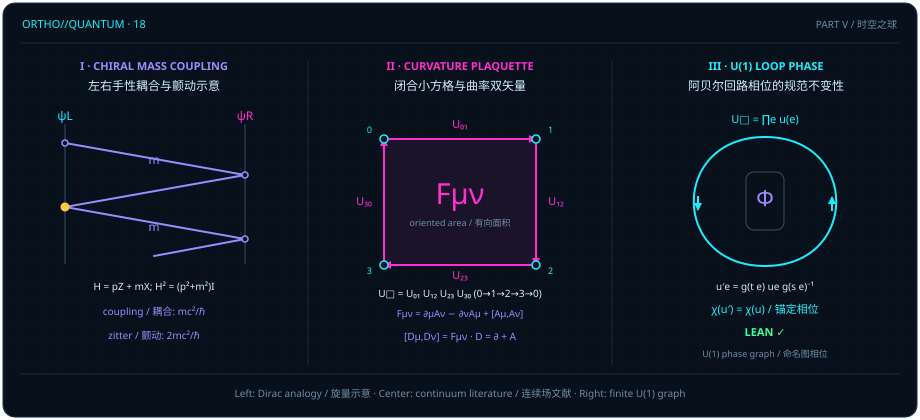

# 狄拉克旋量与规范场：为什么粒子要在球外绕行，为什么力是面积的曲率？

> *“那面积与线、波与粒子,本质上就是一种场呀”*

在[上一章](ch17-lorentz-geometry.md)中，我们看到光锥零线如何把时空二次型锁定为 $t^2 - \norm{w}^2$ 的标量倍（[@prop-null-cone-rigidity]），而双曲旋转器又如何在二维时空平面上保住间隔平方 $E^2 - p^2 = m^2$（自然单位制 $c = 1$）。现在，让我们把目光投向在这座相对论舞台上穿行的物质与相互作用，追问两个困扰了物理系学生整整一个世纪的核心问题：

1. **为什么有质量的自由狄拉克费米子不能像无质量手性外尔（Weyl）粒子那样将左、右手性分量彻底解耦，而必须由质量项 $m$ 在左右手性分量之间建立非对角线性耦合，使有质量的能量本征态成为左右手性的相干叠加（并在初始纯手性态或正负能叠加波包下展现出可计算的振荡与颤动）？**
2. **为什么规范相互作用（电磁力与杨—米尔斯规范力）在几何上既不是牛顿式的超距拉拽，也不是单根无锚开放线段上的孤立相位，而是沿着闭合小方格绕行一圈后（或跨越锚定参考端点之间）无法被规范变换抹去的相位不变量？**

章首题记点出了连接这两个问题的几何线索：当我们将“一维幂等判别线（粒子）”与“二维双矢量相位旋转（波与面积）”放到同一个时空网络上考察时，手性旋量耦合与规范联络曲率便显现为同一场论骨架的两个侧面。遵循全书的三层认识论契约，本章将从经 Lean 内核验证的二阶反交换对（[@lemma-qubit-clifford-pair]）与协变交换子恒等式（[@prop-covariant-commutator]）出发，严格证明任意命名图选定生成树上的 $U(1)$ 相位输运定理（[@thm-tree-phase-transport]）及有限图锚定回路相位分类定理（[@cor-anchored-phase-classification]），同时在文献注记中精确界定四维狄拉克方程颤动频率与非阿贝尔连续规范场的适用边界。

## 手性分解与反交换的手算起点 {#sec-chiral-factorization}

让我们从保罗·狄拉克（Paul Dirac）在 1928 年面对的那道代数难题算起。在相对论力学中，一颗静止质量为 $m$、动量为 $p$ 的自由粒子满足二次色散关系 $E^2 = p^2 + m^2$。然而，量子演化方程对时间是一阶导数——要想写出不含根号 $\sqrt{p^2 + m^2}$ 的一阶线性哈密顿量 $H = p\alpha + m\beta$，我们需要让一次式 $p\alpha + m\beta$ 的平方精确还原出二次平方和 $p^2 + m^2$：

$$
(p\alpha + m\beta)^2 = p^2 \alpha^2 + pm(\alpha\beta + \beta\alpha) + m^2 \beta^2 \stackrel{!}{=} (p^2 + m^2)I.
$$

如果 $\alpha$ 与 $\beta$ 只是普通的实数或复数，交叉项 $2pm\alpha\beta$ 永远消不掉（除非 $p=0$ 或 $m=0$）。怎样才能在保留 $\alpha^2 = I$ 与 $\beta^2 = I$ 的同时，让交叉项 $\alpha\beta + \beta\alpha$ 恒等于零？唯一出路是放弃乘法交换律，令 $\alpha$ 与 $\beta$ 成为一对**反交换**（anticommuting）的对合算子：$\alpha\beta = -\beta\alpha$！

在有限维复矩阵代数中，实现这一反交换对合关系的最小忠实载体，正是我们在[第一章](ch01-measurement.md)已经结识的单量子比特 $2\times 2$ 复矩阵代数 $\operatorname{QubitMatrix} = M_2(\mathbb{C})$ 中的泡利对 $\operatorname{qubitX}$ 与 $\operatorname{qubitZ}$。此处务必分清三个不同层次的维数：承载旋量态的复希尔伯特空间 $\mathbb{C}^2$ 具有**复维数 $2$**（对应 $4$ 个实振幅坐标）；生成空间旋转的李代数 $\mathfrak{su}(2) \simeq \mathbb{R}^3$（由无迹反厄米泡利生成元张成）具有**实维数 $3$**；而全部 $2\times 2$ 复矩阵构成的矩阵代数 $\operatorname{QubitMatrix} = M_2(\mathbb{C})$ 则具有**复维数 $4$** 与**实维数 $8$**（作为实代数同构于三维欧氏空间的 $8$ 维克利福德代数 $\mathrm{Cl}_{3,0}(\mathbb{R})$）。

::: {.lemma #lemma-qubit-clifford-pair title="二阶反交换对" lean="D5/S3/Quantum/FiniteDimensional.qubit_weyl_star"}
在作用于二维复希尔伯特空间 $\mathbb{C}^2$ 的二阶复矩阵代数 $\operatorname{QubitMatrix} = M_2(\mathbb{C})$（复维数为 $4$）中，固定矩阵

$$
\operatorname{qubitX} = \begin{pmatrix} 0 & 1 \\ 1 & 0 \end{pmatrix}, \qquad \operatorname{qubitZ} = \begin{pmatrix} 1 & 0 \\ 0 & -1 \end{pmatrix}.
$$

记 $\operatorname{star}(A) = A^*$ 为共轭转置，$1 = I_2$ 为二阶单位矩阵，则以下五项性质同时成立：

$$
\begin{aligned}
\operatorname{qubitZ} \cdot \operatorname{qubitX} &= -(\operatorname{qubitX} \cdot \operatorname{qubitZ}), \qquad
\operatorname{star}(\operatorname{qubitX}) = \operatorname{qubitX}, \qquad
\operatorname{star}(\operatorname{qubitZ}) = \operatorname{qubitZ}, \\
\operatorname{qubitX}^2 &= 1, \qquad
\operatorname{qubitZ}^2 = 1.
\end{aligned}
$$
:::

::: proof
在 $\operatorname{Fin} 2 \times \operatorname{Fin} 2$ 的四个矩阵元位置上直接展开乘法与共轭转置：$\operatorname{qubitZ}\cdot\operatorname{qubitX} = \begin{pmatrix} 0 & 1 \\ -1 & 0 \end{pmatrix}$，而 $\operatorname{qubitX}\cdot\operatorname{qubitZ} = \begin{pmatrix} 0 & -1 \\ 1 & 0 \end{pmatrix} = -\operatorname{qubitZ}\cdot\operatorname{qubitX}$；两矩阵均为实对称矩阵且对角平方和为 $1$，故自伴性与平方归一性逐项成立。完整证明由 Lean 内核检查。
:::

请留意 [@lemma-qubit-clifford-pair] 在本章中的精确角色：它是狄拉克线性化（将平方和 $p^2 + m^2$ 因式分解为一阶矩阵算子平方）在最简二维空间上的**有限维代数起点**，而不是四维时空连续狄拉克偏微分方程的形式化。利用这对二阶反交换矩阵，我们可以立即手算出一个透明的二维手性耦合模型。

::: {.example #ex-chiral-two-by-two title="二维手性哈密顿量 H = 3Z + 4X 的手算本征谱"}
在自然单位制（$\hbar = c = 1$）下，考虑一维空间中的二分量手性哈密顿量 $H = pZ + mX$（其中 $Z = \operatorname{qubitZ}$，$X = \operatorname{qubitX}$），取动量 $p = 3$、质量耦合参数 $m = 4$：

$$
H = 3Z + 4X = \begin{pmatrix} 3 & 4 \\ 4 & -3 \end{pmatrix}.
$$

无需解特征多项式，直接利用 [@lemma-qubit-clifford-pair] 的五条性质展开 $H^2$：

$$
H^2 = 3^2 Z^2 + 3\cdot 4(ZX + XZ) + 4^2 X^2 = 9I + 12(0) + 16I = 25I.
$$

由此当场读出本征能量平方为 $E^2 = 25$，即正负能级 $E = \pm 5$（恰为勾股三元组 $3^2 + 4^2 = 5^2$）！

观察 $H = \begin{pmatrix} 3 & 4 \\ 4 & -3 \end{pmatrix}$ 的矩阵结构：当质量 $m = 0$ 时，$H = 3Z = \operatorname{diag}(3, -3)$ 是对角矩阵，上分量（$Z = +1$ 手性本征模）与下分量（$Z = -1$ 手性本征模）各自独立传播、互不耦合；一旦引入非零质量 $m = 4$，副对角线上的算子 $mX$ 便在两个手性分量之间建立起非对角线性耦合（耦合角频率尺度为 $m/\hbar$）。需要严格区分**算子耦合**与**特定量子态的时间演化**：对于 $H = 3Z + 4X$ 的能量本征态（例如对应 $E = +5$ 的归一化本征矢 $\frac{1}{\sqrt{5}}(2, 1)^\top$ 与对应 $E = -5$ 的本征矢 $\frac{1}{\sqrt{5}}(1, -2)^\top$），左、右手性分量已被锁定为固定比例的平稳叠加，时间演化仅乘以全局相位 $e^{\mp 5it}$，其手性分量概率（分别为 $4/5$ 与 $1/5$）保持恒定不变；只有当系统初态制备在单一手性基矢（如 $(1, 0)^\top$，即正负能本征态的相干叠加）时，两个手性分量的布居数才会随时间发生周期振荡。在此教学模型中，我们只作精确的 $2\times 2$ 厄米矩阵演算，既不把 $m$ 无条件解释为随机测量反射率，也不把这一二维代数模型等同于完整的四维狄拉克旋量动力学。
:::

::: {.remark #rem-dirac-zitterbewegung-literature title="四维狄拉克方程与颤动频率辨析（文献结果，未在本书形式化）"}
**文献结果，未在本书形式化。** 在 $1 + 3$ 维闵可夫斯基时空中，由于三个空间动量分量 $(p_x, p_y, p_z)$ 与质量项 $m$ 需要四个两两反交换的算子，克利福德代数关系升级为四维狄拉克矩阵满足的

$$
\gamma^\mu \gamma^\nu + \gamma^\nu \gamma^\mu = 2\eta^{\mu\nu} I_4 \qquad (\mu, \nu \in \{0, 1, 2, 3\}),
$$

在手性（Weyl）表象下，质量项 $m$ 恰在二维左手 Weyl 旋量 $\psi_L$ 与二维右手 Weyl 旋量 $\psi_R$ 之间充当越野耦合桥梁。

在物理文献中，围绕狄拉克粒子的微观振荡存在三个必须严格区分、绝不可混为一谈的量：

1. **手性耦合角频率 $\omega_{\mathrm{couple}} = mc^2/\hbar$**：哈密顿量中质量项 $mc^2\beta$ 连接左右手性分量的矩阵元尺度；
2. **自由狄拉克颤动（Zitterbewegung）角频率 $\omega_{\mathrm{Z}} = 2mc^2/\hbar$**：同时包含正能分量（$+mc^2$）与负能分量（$-mc^2$）的自由狄拉克波包，因正负能级跨越能隙 $2mc^2$ 发生拍频干涉而在静止尺度上展现出的位置算子振荡角频率；
3. **费曼棋盘路径积分模型中的步进折返参数**：费曼在 $1+1$ 维晶格路径积分中用每步附加虚数折返幅 $i\varepsilon m c^2/\hbar$ 构造的离散教学模型，其复数权重并非经典马尔可夫随机反射概率。

参见 R. P. Feynman & A. R. Hibbs, *Quantum Mechanics and Path Integrals* (McGraw–Hill, 1965)；以及 D. Hestenes, *Space-Time Algebra* (Gordon and Breach, 1966)。
:::

## 小方格平行移动与交换子 {#sec-curvature-plaquette}

从手性旋量往前再走一步：当一个携带内部相位的量子态从空间中的一点移动到相邻一点时，我们怎样比较两个不同位置上的相位箭头？

这正是规范场论（gauge theory）的几何起点。在没有绝对外部坐标架的世界里，相邻两点之间的比较必须借助连接这两点的**平行移动算子**（parallel transporter）$U$。假设在某个结合环 $B$ 中，算子 $U$ 将现场量 $f$ 协变地推演（半共轭，[`SemiconjBy`](lean:D5/S3/Quantum/Algebra/CovariantCommutator.covariant_commutator_formula)）为推移后的量 $\mathit{translated}$：即先乘 $f$ 再走一步 $U$（$Uf$），等于先走一步 $U$ 再在目标端读取推移量 $\mathit{translated}$（$\mathit{translated}\cdot U$）。那么，“先作用 $f$ 再移动 $U$”与“先移动 $U$ 再在原处作用 $f$”之间的非对易差值 $Uf - fU$ 等于什么？

Lean 的 `CovariantCommutator` 模块证明了：这个交换子不需要任何微积分近似，在任意结合环上都精确分解为“推移前后之差 $(\mathit{translated} - f)$”左乘平行移动算子 $U$！

::: {.proposition #prop-covariant-commutator title="协变交换子的因式分解" lean="D5/S3/Quantum/Algebra/CovariantCommutator.covariant_commutator_formula"}
设 $B$ 为任意带单位元的环（`Ring B`，不要求交换性、拓扑或范数），$U, f, \mathit{translated} \in B$。若满足半共轭条件 $\operatorname{SemiconjBy}\;U\;f\;\mathit{translated}$（即 $U \cdot f = \mathit{translated} \cdot U$），则

$$
U \cdot f - f \cdot U = (\mathit{translated} - f) \cdot U.
$$
:::

::: proof
由半共轭假设 `hcov : SemiconjBy U f translated` 知 $U \cdot f = \mathit{translated} \cdot U$。在环 $B$ 中应用乘法对减法的右分配律（`sub_mul`）：

$$
(\mathit{translated} - f) \cdot U = \mathit{translated} \cdot U - f \cdot U = U \cdot f - f \cdot U.
$$

完整证明由 Lean 内核检查。
:::

[@prop-covariant-commutator] 的代数结构极其精炼：它不预设 $B$ 是微分子代数，也不把 $\mathit{translated}$ 自动解释为连续可微流形上的时空微分平移算子；它纯粹揭示了“交换子 $Uf - fU$ 就是沿 $U$ 输运产生的协变差分 $(\mathit{translated} - f)U$”这一普遍环论机制。当我们将两条不同方向的输运步进组合起来、沿着一个小方格（plaquette）的四条边绕行一圈时，局部相位的比较差就凝聚成了闭合回路的规范曲率。

::: {.remark #rem-gauge-holonomy-literature title="协变导数交换子、非阿贝尔和乐与阿哈罗诺夫—玻姆效应（文献结果，未在本书形式化）"}
**文献结果，未在本书形式化。** 在连续统微分几何与杨—米尔斯（Yang–Mills）规范场论中，若采用数学联络约定将协变导数写为 $D_\mu = \partial_\mu + A_\mu$，则两个方向协变导数的交换子直接给出规范场强（曲率二形式分量）：

$$
F_{\mu\nu} = [D_\mu, D_\nu] = \partial_\mu A_\nu - \partial_\nu A_\mu + [A_\mu, A_\nu].
$$

若采用电磁学与量子力学中的物理势约定 $D_\mu = \partial_\mu - \frac{iq}{\hbar} A^{\mathrm{phys}}_\mu$，则交换子为 $[D_\mu, D_\nu] = -\frac{iq}{\hbar} F^{\mathrm{phys}}_{\mu\nu}$（此时阿贝尔情形 $[A_\mu, A_\nu] = 0$，闭合环路积分为磁通量，对应阿哈罗诺夫—玻姆效应中的干涉相移 $\Delta\varphi = q\Phi_B/\hbar$）。在连续场的晶格离散化文献中，若光滑规范势沿由无穷小位移 $\Delta x^\mu$ 与 $\Delta x^\nu$（固定指标 $\mu, \nu$ 不求和）张成的正向（逆时针）小方格边界依次积分，其小方格闭合和乐在 $\Delta x \to 0$ 的渐近极限下展开为
$$
U_\square = \exp\left(\frac{iq}{\hbar} F^{\mathrm{phys}}_{\mu\nu}\Delta x^\mu \Delta x^\nu\right) + O\bigl(\norm{\Delta x}^3\bigr) \qquad (\text{连续小方格近似}).
$$

对于非阿贝尔规范群（如 $SU(N)$），沿闭合回路绕行一周的平行移动和乐（holonomy）在基点规范变换下按群共轭 $U_\square \mapsto g_0 U_\square g_0^{-1}$ 变换，因此只有其**共轭类**或威尔逊圈迹（Wilson loop trace，$\Tr U_\square$）才是规范不变量。必须明确：上述无穷小方格展开式属于连续统微积分近似，而本章随后两节经 Lean 验证的定理（[@thm-tree-phase-transport] 与 [@cor-anchored-phase-classification]）严格建立在命名图上的精确离散阿贝尔单位圆群 $\operatorname{Circle} = U(1)$ 相位之上，既不依赖任何连续极限近似，也不能直接提升为非阿贝尔连续规范场定理。参见 Y. Aharonov & D. Bohm, *Phys. Rev.* **115**, 485 (1959), DOI: `10.1103/PhysRev.115.485`；以及 K. G. Wilson, *Phys. Rev. D* **10**, 2445 (1974), DOI: `10.1103/PhysRevD.10.2445`。
:::

## 选定生成树上的相位输运 {#sec-tree-gauge-transport}

现在，让我们在无需任何连续统微积分近似的前提下，把图上的阿贝尔 $U(1)$ 规范场彻底算穿。

设有一张由顶点类型 $V$ 与命名有向边类型 $E$ 构成的图（注意：在本节中，$V$ 与 $E$ 可以是任意类型，**不需要任何有限性假设**），每条边 $e \in E$ 有起点 $s(e) \in V$ 与终点 $t(e) \in V$。每条有向边上附着一个单位圆相位 $u(e) \in \operatorname{Circle} = \{z \in \mathbb{C} \mid |z| = 1\}$；当顶点处发生局部规范变换 $g : V \to \operatorname{Circle}$ 时，边相位按标准配对规则变换为

$$
\operatorname{gauge}(s, t, g, u)(e) = g\bigl(t(e)\bigr) \cdot u(e) \cdot g\bigl(s(e)\bigr)^{-1}.
$$

为什么单个边相位 $u(e)$ 本身不是物理可观测量？因为只要调整端点 $s(e)$ 与 $t(e)$ 的局部相位基准 $g$，就能把一条孤立边上的相位拧成任意值！要在整张图上建立一套统一的相位参照系，最自然的几何操作是在图上选定一棵**命名生成树**（`NamedSpanningTree`）$T \subseteq E$ 与一个参考根顶点 $r \in V$：

- 树边集合 $T$ 中的每条边都不是自环（$\forall e \in T,\; s(e) \neq t(e)$）；
- 树边到无向边集合的映射 $e \mapsto \{s(e), t(e)\}$ 是单射（$T$ 内无平行重边）；
- 由 $T$ 诱导的简单支撑图 $\operatorname{treeSupport}(s, t, T)$ 是一棵连通无圈树（`IsTree`），而 $T$ 之外的弦边 $e \notin T$ 则完全允许包含平行重边与自环！

在选定生成树 $T$ 与根 $r$ 后，从根 $r$ 到任意顶点 $a \in V$ 在 $\operatorname{treeSupport}(s, t, T)$ 中存在唯一一条简单树路径 $\operatorname{rootPath}(ht, r, a)$。沿着这条唯一树路径把每一步的边相位（顺向乘 $u(e)$、逆向乘 $u(e)^{-1}$）累乘起来，就得到了顶点 $a$ 相对于根 $r$ 的**树输运相位** `rootPhase` $\operatorname{rootPhase}(ht, r, u, a) \in \operatorname{Circle}$。下面的定理一次性确立了树输运相位的六大核心性质。

::: {.theorem #thm-tree-phase-transport title="选定树上的相位输运" lean="D5/S3/Observer/AgencyHolonomy/NamedTreePhaseTransport.selected_tree_transport"}
设 $V, E$ 为任意类型，$s, t : E \to V$ 为起点与终点映射，$T \subseteq E$ 为选定边集，$ht : \operatorname{NamedSpanningTree}\;s\;t\;T$ 为命名生成树证明，$r \in V$ 为选定根顶点。则对单位圆群 $\operatorname{Circle}$ 上的边相位场，以下六项性质同时成立：

1. **根点归一性**：对所有 $u : E \to \operatorname{Circle}$，$\operatorname{rootPhase}\;ht\;r\;u\;r = 1$；
2. **树边重建恒等式**：对所有树边 $e \in T$ 与所有 $u : E \to \operatorname{Circle}$，

$$
\operatorname{rootPhase}\;ht\;r\;u\;\bigl(t(e)\bigr) = u(e) \cdot \operatorname{rootPhase}\;ht\;r\;u\;\bigl(s(e)\bigr);
$$

3. **端点规范协变性**：对所有顶点规范 $g : V \to \operatorname{Circle}$、所有边场 $u : E \to \operatorname{Circle}$ 与所有顶点 $a \in V$，

$$
\operatorname{rootPhase}\;ht\;r\;(\operatorname{gauge}\;s\;t\;g\;u)\;a = g(a) \cdot \operatorname{rootPhase}\;ht\;r\;u\;a \cdot g(r)^{-1};
$$

4. **连续性**：对所有顶点 $a \in V$，映射 $u \mapsto \operatorname{rootPhase}\;ht\;r\;u\;a$ 在乘积拓扑下连续；
5. **逐点乘法性**：对所有 $u, w : E \to \operatorname{Circle}$ 与所有 $a \in V$，

$$
\operatorname{rootPhase}\;ht\;r\;(u \cdot w)\;a = \operatorname{rootPhase}\;ht\;r\;u\;a \cdot \operatorname{rootPhase}\;ht\;r\;w\;a;
$$

6. **单位场保一性**：对所有顶点 $a \in V$，$\operatorname{rootPhase}\;ht\;r\;1\;a = 1$。
:::

::: proof
在树支撑图 $\operatorname{treeSupport}(s, t, T)$ 中，从 $r$ 到 $r$ 的唯一简单路径为空路径 `.nil`，故输运乘积为 $1$（性质 1）。对任意树边 $e \in T$，唯一树路径从 $r$ 到 $t(e)$ 与经由 $e$ 拼接的路径具有相同的无回溯简约形式，单步相位抵消给出 $\operatorname{rootPhase}(t(e)) = u(e)\operatorname{rootPhase}(s(e))$（性质 2）。在任意行走路径上对步进作归纳，中间顶点的规范因子 $g(v)^{-1} g(v) = 1$ 逐站望远镜相消，只剩首尾端点因子 $g(a)$ 与 $g(r)^{-1}$（性质 3）。由于每条固定树路径仅涉及有限步乘积与求逆，且 $\operatorname{Circle}$ 为阿贝尔拓扑群，乘积拓扑下的连续性、乘法同态性与常值 $1$ 保持性（性质 4–6）沿路径归纳直接成立。完整证明由 Lean 内核检查。
:::

## 闭合回路相位与锚定规范等价 {#sec-gauge-loop-coordinates}

仔细端详 [@thm-tree-phase-transport] 的第 3 条性质：当顶点规范变换发生时，从根 $r$ 到顶点 $a$ 的树路径相位变化为 $g(a)\cdot\operatorname{rootPhase}(u, a)\cdot g(r)^{-1}$。这意味着什么？

- 如果我们取一条**不在生成树中**的弦边（chord）$e \notin T$，把“从根 $r$ 沿树走到起点 $s(e)$”、“跨过弦边 $e$ 本身”、再“从终点 $t(e)$ 沿树倒退回根 $r$”这三段合成为一条**基本闭合回路**（fundamental cycle），那么起点与终点的局部规范因子 $g(s(e))$、$g(t(e))$ 就会与弦边自身的规范变换 $g(t(e))u(e)g(s(e))^{-1}$ 严丝合缝地全部抵消！
- 更进一步，如果观察者在顶点集合中指定了一组不允许随意拧动相位的**参考锚点集** $R \subseteq V$（包含根顶点 $r \in R$），并将允许的规范变换限制在固定所有锚点的子群

$$
\operatorname{anchoredGroup}(R) = \bigl\{\, g : V \to \operatorname{Circle} \;\big|\; \forall a \in R,\; g(a) = 1 \,\bigr\}
$$

之内，那么除了每条弦边 $e \notin T$ 对应的基本回路相位之外，从根 $r$ 沿树走到其余每个非根锚点 $a \in R \setminus \{r\}$ 的开放树路径相位 $\operatorname{rootPhase}\;ht\;r\;u\;a$ 也因为首尾两端 $g(a) = g(r) = 1$ 而成为严格的规范不变量！

在有限图（`[Fintype V] [Fintype E]`）情形下，模块 [`AnchoredPhaseClassification`](lean:D5/S3/Observer/AgencyHolonomy/AnchoredPhaseClassification.anchored_phase_classification) 将这两类不变量打包成乘积坐标空间

$$
\operatorname{Coordinates}(T, R, r) = \bigl(\{e : E \mid e \notin T\} \to \operatorname{Circle}\bigr) \times \bigl(\{x : V \mid x \in R \land x \neq r\} \to \operatorname{Circle}\bigr),
$$

由 `coordinateHom` 给出连续乘法同态 $\chi(u) = \bigl(e \mapsto \operatorname{rootPhase}(s(e))\,u(e)\,\operatorname{rootPhase}(t(e))^{-1},\; a \mapsto \operatorname{rootPhase}(a)\bigr)$，并由 `phaseSection` 构造标准截面 $\sigma(z) = \operatorname{gauge}\bigl(s, t, \operatorname{sectionPotential}(R, r, z), \operatorname{sectionLoops}(T, R, r, z)\bigr)$（其中 `sectionLoops` 将所有生成树边 $e \in T$ 置为 $1$、弦边 $e \notin T$ 赋为回路坐标 $z_1(e)$，而 `sectionPotential` 在非根锚点 $a \in R \setminus \{r\}$ 处赋为锚点坐标 $z_2(a)$、在根 $r$ 与非锚点处取 $1$）。下面的推论给出了有限图上锚定阿贝尔规范场的完整拓扑群分类与自由度计数。

::: {.corollary #cor-anchored-phase-classification title="锚定相位分类" lean="D5/S3/Observer/AgencyHolonomy/AnchoredPhaseClassification.anchored_phase_classification"}
设 $V, E$ 为有限类型（`[Fintype V] [Fintype E]`），$s, t : E \to V$，$T \subseteq E$，$ht : \operatorname{NamedSpanningTree}\;s\;t\;T$，$R \subseteq V$ 为锚点集，$r \in V$ 且满足 $r \in R$。令 $\chi = \operatorname{coordinateHom}\;ht\;R\;r$，$\sigma = \operatorname{phaseSection}\;s\;t\;T\;R\;r$，$N = \operatorname{range}(\operatorname{coboundary}\;s\;t\;R)$ 为锚定上边缘子群，并记基数 $c = |\{e : E \mid e \notin T\}|$、$a = |\{x : V \mid x \in R \land x \neq r\}|$、$n = |V|$、$m = |E|$、$k = |R|$。则以下结论同时成立：

1. **坐标规范不变性与轨道完全判据**：对所有 $g \in \operatorname{anchoredGroup}(R)$ 与 $u : E \to \operatorname{Circle}$，恒有 $\chi(\operatorname{gauge}\;s\;t\;g\;u) = \chi(u)$；且对任意 $u, w : E \to \operatorname{Circle}$，

$$
\chi(u) = \chi(w) \iff \exists g \in \operatorname{anchoredGroup}(R),\; \operatorname{gauge}\;s\;t\;g\;u = w;
$$

2. **连续乘法截面与核等于上边缘**：$\operatorname{RightInverse}\;\sigma\;\chi$（即 $\chi \circ \sigma = \mathrm{id}$），$\sigma$ 连续，且对所有 $z, z' \in \operatorname{Coordinates}(T, R, r)$ 有 $\sigma(z \cdot z') = \sigma(z) \cdot \sigma(z')$；同时 $\ker(\chi) = N$，且商群相等判据为

$$
[u]_N = [w]_N \iff \exists g \in \operatorname{anchoredGroup}(R),\; \operatorname{gauge}\;s\;t\;g\;u = w;
$$

3. **商拓扑群同构与紧 Hausdorff 性质**：存在拓扑群同构 $q : ((E \to \operatorname{Circle}) / N) \simeq_{\mathrm{t}*} \operatorname{Coordinates}(T, R, r)$，使得对所有 $u$ 有 $q([u]_N) = \chi(u)$、对所有 $z$ 有 $q^{-1}(z) = [\sigma(z)]_N$；商空间 $(E \to \operatorname{Circle}) / N$ 为紧空间（`CompactSpace`）、Hausdorff 空间（`T2Space`）与拓扑群（`IsTopologicalGroup`），且 $N$ 为闭集（`IsClosed`）；
4. **组合维数恒等式与环面同构**：

$$
\begin{aligned}
|T| + 1 &= n, \qquad c + |T| = m, \qquad a + 1 = k, \qquad c + a + n = m + k, \\
c + a &= m + k - n, \qquad c = m + 1 - n, \qquad c + a = c + k - 1,
\end{aligned}
$$

且坐标空间与 $(m + k - n)$ 维环面拓扑群同构：$\operatorname{Nonempty}\bigl(\operatorname{Coordinates}(T, R, r) \simeq_{\mathrm{t}*} (\operatorname{Fin}(m + k - n) \to \operatorname{Circle})\bigr)$。
:::

::: proof
由 [@thm-tree-phase-transport] 的端点规范协变性（性质 3），弦边回路坐标中 $g(s(e))$ 与 $g(t(e))$ 成对消去，而锚点 $a \in R$ 满足 $g(a) = g(r) = 1$，故对两分量应用函数外延性（`Prod.ext` 与 `funext`）知 $\chi$ 在锚定规范轨道上恒定；反之，若 $\chi(u) = \chi(w)$，定义以根 $r$ 为基准的顶点树势比值 $g(v) = \operatorname{rootPhase}(w, v) \cdot \operatorname{rootPhase}(u, v)^{-1}$，则由根归一性与非根锚点坐标相等知 $g \in \operatorname{anchoredGroup}(R)$，且在树边（由性质 2 `hedge`）与弦边上逐边（`funext e`）验证 $\operatorname{gauge}(s, t, g, u) = w$。对于截面 $\sigma(z)$，由于 `sectionLoops` 在生成树 $T$ 上恒取 $1$，树支撑图上的边差分核定理给出 $\operatorname{rootPhase}(\operatorname{sectionLoops}(z), v) = 1$，再由端点规范协变性知 $\operatorname{rootPhase}(\sigma(z), v) = \operatorname{sectionPotential}(z, v)$，从而 $\chi(\sigma(z)) = z$（`RightInverse`）且 $\ker(\chi) = N$（结论 1–2）。由于 $\chi$ 与 $\sigma$ 均为紧 Hausdorff 拓扑群之间的连续同态且 $\chi \circ \sigma = \mathrm{id}$，商群诱导双边连续的拓扑群同构 $q$（结论 3）。最后，连通生成树满足树边数 $|T| = n - 1$，弦边数（独立基本回路数）为 $c = m - |T| = m + 1 - n$，非根锚点数为 $a = k - 1$，两者相加即得独立环面坐标维数 $c + a = m + k - n$（结论 4）。完整证明由 Lean 内核检查。
:::

> 未受锚点锁定的自由树枝相位可由局部规范变换抹平；而基本闭合回路围出的回路相位与连接各参考锚点的树路径相对相位，则是任何锚定规范变换都无法擦除的不变量。

让我们用一个四顶点单方格闭合回路的具体算例，亲手体验 [@cor-anchored-phase-classification] 是如何把四条边上的冗余相位洗成唯一一个闭合回路不变量的。

::: {.example #ex-plaquette-phase title="四顶点单方格闭合回路的规范变换与坐标计数"}
考察由四个顶点 $V = \{0, 1, 2, 3\}$ 与四条有向边 $0 \xrightarrow{e_0} 1 \xrightarrow{e_1} 2 \xrightarrow{e_2} 3 \xrightarrow{e_3} 0$ 组成的单方格闭合回路（plaquette）。

1. **初始边场与方格和乐**：给定初始边相位场 $u = (u(e_0), u(e_1), u(e_2), u(e_3)) = (1, 1, 1, i) \in \operatorname{Circle}^4$，绕方格一周的闭合乘积为

$$
U_\square = u(e_0)u(e_1)u(e_2)u(e_3) = 1 \cdot 1 \cdot 1 \cdot i = i.
$$

2. **锚定顶点规范变换**：取单点锚定集 $R = \{0\}$ 与根 $r = 0$，施加满足 $g(0) = 1$ 的顶点规范变换 $g = (g(0), g(1), g(2), g(3)) = (1, i, -1, -i)$。按 $u'(e) = g(t(e))u(e)g(s(e))^{-1}$ 逐边计算变换后的边相位：

$$
\begin{aligned}
u'(e_0) &= g(1) u(e_0) g(0)^{-1} = i \cdot 1 \cdot 1 = i, \\
u'(e_1) &= g(2) u(e_1) g(1)^{-1} = (-1) \cdot 1 \cdot (-i) = i, \\
u'(e_2) &= g(3) u(e_2) g(2)^{-1} = (-i) \cdot 1 \cdot (-1) = i, \\
u'(e_3) &= g(0) u(e_3) g(3)^{-1} = 1 \cdot i \cdot i = -1.
\end{aligned}
$$

变换后的边场变成 $u' = (i, i, i, -1)$——原本集中在第四条边 $e_3$ 上的相位被均匀摊到了前三条边上，但绕行一周的回路乘积依然纹丝不动：$u'(e_0)u'(e_1)u'(e_2)u'(e_3) = i \cdot i \cdot i \cdot (-1) = i = U_\square$！

3. **生成树坐标分类与维数核对**：选前三条边 $T = \{e_0, e_1, e_2\}$ 作为生成树，唯一弦边为 $e_3 \notin T$。代入 [@cor-anchored-phase-classification] 的计数公式：顶点数 $n = 4$，边数 $m = 4$，锚点数 $k = 1$，树边数 $|T| = n - 1 = 3$，弦边数 $c = m + 1 - n = 1$，非根锚点数 $a = k - 1 = 0$，独立规范不变相位坐标总数为

$$
c + a = m + k - n = 4 + 1 - 4 = 1.
$$

在唯一弦边 $e_3$（从 $s(e_3) = 3$ 到 $t(e_3) = 0$）上，树输运给出 $\operatorname{rootPhase}(u, 3) = 1 \cdot 1 \cdot 1 = 1$ 与 $\operatorname{rootPhase}(u', 3) = i \cdot i \cdot i = -i$，从而坐标映射给出 $\chi(u)(e_3) = 1 \cdot i \cdot 1^{-1} = i$ 且 $\chi(u')(e_3) = (-i) \cdot (-1) \cdot 1^{-1} = i$，精确验证了 $\chi(u) = \chi(u')$。
:::

从二阶反交换矩阵的手性耦合（[@lemma-qubit-clifford-pair]）到闭合回路与参考锚点的相位分类（[@cor-anchored-phase-classification]），我们看到：未锚定顶点上的局部规范冗余可在生成树自由枝条上被抹平，而真正不可磨灭的规范不变内容，则完整驻留在跨越树外弦边的 $c = m + 1 - n$ 个基本闭合回路相位与连接非根参考锚点的 $a = k - 1$ 个根到锚点树路径相位之中（在单锚点 $k = 1$ 情形下，$a = 0$，全部不变量恰由闭合回路和乐给出）。那么，当无数个这样的局部量子态通过张量指标交织成一张庞大的纠缠网络时，网络的“最大信息流”与几何截面的“最小割面积”之间又会涌现出怎样的定量定律？让我们翻开[下一章](ch19-tensor-networks-and-holography.md)。
