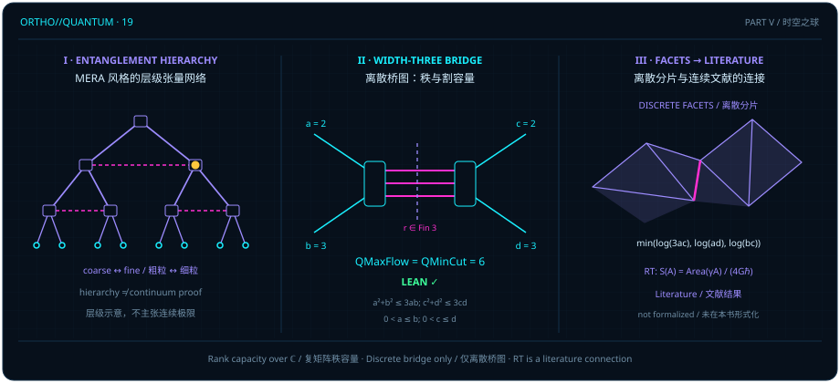

# 纠缠编织空间：张量网络、全息对偶与离散最小割定理

> *“其实点 C并不是一个已知量,而是一个相融点的投影,因为实际上一条确定的量子态只能确定一条线,一组量子态才能对应一个面积.”*

在[第二章](ch02-born-rule.md)与[第三章](ch03-projectors-and-duality.md)中，我们反复强调过一条最质朴的维度铁律：在全局希尔伯特空间中，**单个确定的纯量子态只决定一根秩为 $1$ 的全局幂等投影线**（$\rho = \lvert\Psi\rangle\langle\Psi\rvert$，$\operatorname{rank}\rho = 1$）。然而，一旦我们将复合系统沿着二分接口 $\mathcal{H}_L \otimes \mathcal{H}_R$ 切开，把振幅张量展平（tensor flattening）为从右子空间到左子空间的线性算子（或对一侧求偏迹得到约化密度矩阵 $\rho_L = \Tr_R\lvert\Psi\rangle\langle\Psi\rvert$），情况就发生了本质跃升：单根直积基矢 $\lvert 0\rangle_L \otimes \lvert 0\rangle_R$ 在接口上的施密特秩（Schmidt rank）仍为 $1$；要想在二分截面上撑开大于 $1$ 的施密特秩、传递多路并行的可区分通道，就必须让**一组**正交的局部通道态在接口两侧相干叠加交织（例如双比特贝尔态 $\lvert\Phi^+\rangle = \frac{1}{\sqrt{2}}(\lvert 00\rangle + \lvert 11\rangle)$ 的全局纯态投影秩为 $1$，但它由两组正交局部态跨切口配对而成，其二分展平算子秩与约化密度矩阵秩均为 $\operatorname{rank}\rho_L = 2$）。

章首题记正是从这一线性代数事实出发，直指现代量子信息与全息几何交汇处的核心直觉：当我们将考察对象从单根量子态射线升级为由多组张量指标拼接而成的**张量网络**（tensor network）时，跨越网络接口所能传递的“最大纠缠秩（流）”是如何受制于网络内部最窄瓶颈处的“割容量（截面）”的？

遵循全书的三层认识论契约与离散多面体粘接原则（R3），本章严格区分三个层次：

1. **Lean 内核验证的有限维桥图定理**：在 `BridgeGraph` 模块族中，针对宽度为 $3$（指标取 $\operatorname{Fin} 3$）的双节点克罗内克桥图收缩 $\operatorname{flow}(M, N) = \sum_{r \in \operatorname{Fin} 3} M_r \otimes N_r$，我们逐条证明最大流可达引理（[@lemma-bridge-flow-attained]）、最大流不超过最小割上界命题（[@prop-bridge-flow-cut-bound]）、二次锥域内的最小割简化推论（[@cor-bridge-cone-mincut]），以及锥域内的离散量子最大流最小割定理（[@thm-bridge-quantum-maxflow-mincut]）；
2. **离散对数容量分片与接缝粘接图像（R3）**：通过对数腿容量坐标下的三张仿射超平面下包络（[@ex-log-capacity-facets]），展示有限维矩阵秩上界如何在离散格点上拼出多面体分片与瓶颈转移接缝；
3. **连续统全息对偶的文献边界**：将多尺度纠缠重整化拟设（MERA）与连续统 AdS/CFT 中的 Ryu–Takayanagi（RT）极小曲面公式严格置于文献注记（[@rem-ryu-takayanagi-literature]）内，绝不把特定宽度三桥图的有限维矩阵秩定理夸大为任意张量网络或连续时空全息对偶的普遍证明。

## 纠缠层级与有限张量网络 {#sec-mera-hierarchy}

想象你手里有两块相互纠缠的多体量子区域：左边界输入端与右边界输出端。如果它们之间只靠一根一维标量线相连，那么无论两端各自的希尔伯特空间有多大，跨过这道接口的线性映射至多只有秩 $1$，相当于所有信息都被挤进了一根单模光纤。反之，如果接口处由多条内部张量腿（bond indices）并排桥接，跨越接口的算子秩（即施密特分解中非零奇异值的个数）就能够随内部腿维数的乘积而增长。

如上图左栏（Panel I）所示，在物理文献中，研究者常借助多尺度纠缠重整化拟设（MERA）等层级张量网络来示意边界区域与深层“体空间（bulk）”截面之间的瓶颈关系。然而，在一般张量网络中，量子最大流（跨网络收缩所能达到的最大矩阵秩）甚至**不一定**等于量子最小割（切开网络所需截断的最小腿维数乘积）！因此，要想得到经得起形式化内核检验的精确结论，我们必须先锚定一个结构完全显式、参数边界清清楚楚的有限维桥图模型。

在 Lean 的 `D5.S3.Quantum.TensorNetworks.BridgeGraph.QuantumMaxFlowBound` 模块中，这一模型由四个自然数维数参数 $a, b, c, d \in \mathbb{N}$ 与宽度为 $3$（指标 $r \in \operatorname{Fin} 3$）的桥接张量收缩给出：

- 设 $M : \operatorname{Fin} 3 \to M_{a\times b}(\mathbb{C})$ 为三个 $a\times b$ 复矩阵，$N : \operatorname{Fin} 3 \to M_{d\times c}(\mathbb{C})$ 为三个 $d\times c$ 复矩阵；
- 定义**宽度三桥图流矩阵** `flow` 为三项克罗内克积（Kronecker product）之和：

$$
\operatorname{flow}(M, N) = \sum_{r \in \operatorname{Fin} 3} M_r \otimes N_r \in M_{(a\times d)\times (b\times c)}(\mathbb{C}),
$$

其行指标取自乘积类型 $\operatorname{Fin} a \times \operatorname{Fin} d$（共 $ad$ 行），列指标取自 $\operatorname{Fin} b \times \operatorname{Fin} c$（共 $bc$ 列）；
- 定义可达秩集合 $\operatorname{attainable}(a, b, c, d) = \bigl\{\, r \in \mathbb{N} \;\big|\; \exists M, N,\; \operatorname{rank}(\operatorname{flow}(M, N)) = r \,\bigr\}$，并将**量子最大流** `QMaxFlow` 定义为可达秩的上确界：

$$
\operatorname{QMaxFlow}(a, b, c, d) = \sup\operatorname{attainable}(a, b, c, d) \in \mathbb{N}.
$$

由于 $\operatorname{flow}(M, N)$ 的秩是自然数且受行数 $ad$ 上界约束，该上确界不仅良定义，而且必定能被某对具体的复矩阵三元组 $(M, N)$ 精确达到。

::: {.lemma #lemma-bridge-flow-attained title="最大秩可达到" lean="D5/S3/Quantum/TensorNetworks/BridgeGraph/QuantumMaxFlowBound.QMaxFlow_attained"}
对任意自然数 $a, b, c, d \in \mathbb{N}$（允许取 $0$），存在复矩阵族 $M : \operatorname{Fin} 3 \to M_{a\times b}(\mathbb{C})$ 与 $N : \operatorname{Fin} 3 \to M_{d\times c}(\mathbb{C})$，使得

$$
\operatorname{rank}\bigl(\operatorname{flow}(M, N)\bigr) = \operatorname{QMaxFlow}(a, b, c, d).
$$
:::

::: proof
取全零矩阵族 $M = 0, N = 0$ 可知可达秩集合 $\operatorname{attainable}(a, b, c, d) \subseteq \mathbb{N}$ 非空；同时，由于 $\operatorname{flow}(M, N)$ 的行指标集为 $\operatorname{Fin} a \times \operatorname{Fin} d$，任意矩阵的秩都不超过其行数 $ad$，故 $\operatorname{attainable}(a, b, c, d)$ 在自然数集 $\mathbb{N}$ 中有上界。非空有上界的自然数子集必包含其上确界 $\sup\operatorname{attainable}(a, b, c, d)$，因此存在证人 $(M, N)$ 使 $\operatorname{rank}(\operatorname{flow}(M, N)) = \operatorname{QMaxFlow}(a, b, c, d)$。完整证明由 Lean 内核检查。
:::

在阅读 [@lemma-bridge-flow-attained] 时，请记住形式化陈述的诚实准则：该引理经由自然数良序与有界性证明了最大秩证人 $(M, N)$ 的**存在性**，但存在性本身并不等同于在一般张量网络中高效搜寻满秩参数的构造性多项式算法。

## 宽度三桥图的秩与割容量 {#sec-bridge-flow-cut}

现在我们来数一数：要想把 $\operatorname{flow}(M, N) = \sum_{r=0}^2 M_r \otimes N_r$ 从左输入端 $(\operatorname{Fin} b \times \operatorname{Fin} c)$ 到右输出端 $(\operatorname{Fin} a \times \operatorname{Fin} d)$ 的信息通道彻底切断，一共有哪几道候选切口（cuts）？

1. **左外边界割（行空间瓶颈）**：矩阵 $\operatorname{flow}(M, N)$ 只有 $|\operatorname{Fin} a \times \operatorname{Fin} d| = ad$ 行，因此其秩绝不可能超过 $ad$；
2. **右外边界割（列空间瓶颈）**：矩阵 $\operatorname{flow}(M, N)$ 只有 $|\operatorname{Fin} b \times \operatorname{Fin} c| = bc$ 列，因此其秩绝不可能超过 $bc$；
3. **中间三桥内部割（跨桥瓶颈）**：对每个桥指标 $r \in \operatorname{Fin} 3$，$M_r \in M_{a\times b}(\mathbb{C})$ 的秩至多为 $a$，$N_r \in M_{d\times c}(\mathbb{C})$ 的秩至多为 $c$，故单个克罗内克积 $M_r \otimes N_r$ 的秩至多为 $ac$；将 $r = 0, 1, 2$ 三路相加，由矩阵秩的次可加性知总秩至多为 $3ac$。

把这三道切口的容量取最小值，就是 Lean 模块中定义的**离散量子最小割容量** `QMinCut`：

$$
\operatorname{QMinCut}(a, b, c, d) = \min\bigl(3ac,\, \min(ad, bc)\bigr) \in \mathbb{N}.
$$

下面的命题证明了：无需任何额外参数限制，对一切自然数 $a, b, c, d \in \mathbb{N}$，宽度三桥图的量子最大流永远不超过这一最小割容量。

::: {.proposition #prop-bridge-flow-cut-bound title="秩不超过割容量" lean="D5/S3/Quantum/TensorNetworks/BridgeGraph/QuantumMaxFlowBound.QMaxFlow_le_QMinCut"}
对任意自然数 $a, b, c, d \in \mathbb{N}$，恒有

$$
\operatorname{QMaxFlow}(a, b, c, d) \le \operatorname{QMinCut}(a, b, c, d) = \min\bigl(3ac,\, \min(ad, bc)\bigr).
$$
:::

::: proof
由 [@lemma-bridge-flow-attained] 取达到最大流 $\operatorname{QMaxFlow}(a, b, c, d)$ 的矩阵对 $(M, N)$。一方面，矩阵 $\operatorname{flow}(M, N)$ 的维数为 $(ad)\times (bc)$，矩阵的秩不超过其行数 $ad$ 且不超过其列数 $bc$，故 $\operatorname{rank}(\operatorname{flow}(M, N)) \le \min(ad, bc)$（对应源码中的 `flow_rank_le_outer`）。另一方面，源码通过显式矩阵因式分解 $\operatorname{flow}(M, N) = \operatorname{cutLeft}(N) \cdot \operatorname{cutRight}(M)$（`flow_factor`）将桥流拆成经过中间指标集 $\operatorname{Fin} 3 \times (\operatorname{Fin} a \times \operatorname{Fin} c)$（维数恰为 $3ac$）的两个矩阵乘积，从而由乘积秩不等式得 $\operatorname{rank}(\operatorname{flow}(M, N)) \le 3ac$（对应源码中的 `flow_rank_le_inner`）。两项上界合并即得 $\operatorname{QMaxFlow}(a, b, c, d) \le \operatorname{QMinCut}(a, b, c, d) = \min(3ac, \min(ad, bc))$。完整证明由 Lean 内核检查。
:::

必须明确的是：[@prop-bridge-flow-cut-bound] 中的 $\operatorname{QMinCut}(a, b, c, d)$ 是纯粹的**有限维矩阵秩上界**，而不是连续弯曲时空中的微分几何面积。为了直观看到三路克罗内克积（各自秩不超过 $ac = 4$，具体秩分别为 $4, 1, 1$）如何协同撑满边界割容量 $\min(ad, bc) = 6$，让我们亲手构造一个 $a = c = 2, b = d = 3$ 的满秩算例。

::: {.example #ex-bridge-two-three title="a = c = 2、b = d = 3 时六阶满秩桥流的手算构造"}
取维数参数 $a = c = 2$，$b = d = 3$。首先核对二次锥不等式：

$$
a^2 + b^2 = c^2 + d^2 = 2^2 + 3^2 = 13 \le 3 \cdot 2 \cdot 3 = 18.
$$

此时三道候选割的容量分别为 $3ac = 12$、$ad = 6$、$bc = 6$，最小割容量为 $\operatorname{QMinCut}(2, 3, 2, 3) = \min(12, \min(6, 6)) = 6$。虽然单路张量积 $M_r \otimes N_r$ 的秩至多只有 $ac = 2 \times 2 = 4 < 6$，但把三路（$r = 0, 1, 2$）叠加起来，就能恰好拼出一张满秩的 $6\times 6$ 置换矩阵！显式取如下三对矩阵：

$$
\begin{aligned}
M_0 &= \begin{pmatrix} 1 & 0 & 0 \\ 0 & 1 & 0 \end{pmatrix}, \qquad
&N_0 &= \begin{pmatrix} 1 & 0 \\ 0 & 1 \\ 0 & 0 \end{pmatrix}, \\
M_1 &= \begin{pmatrix} 0 & 0 & 1 \\ 0 & 0 & 0 \end{pmatrix}, \qquad
&N_1 &= \begin{pmatrix} 0 & 0 \\ 0 & 0 \\ 1 & 0 \end{pmatrix}, \\
M_2 &= \begin{pmatrix} 0 & 0 & 0 \\ 0 & 0 & 1 \end{pmatrix}, \qquad
&N_2 &= \begin{pmatrix} 0 & 0 \\ 0 & 0 \\ 0 & 1 \end{pmatrix}.
\end{aligned}
$$

让我们直接核对三项克罗内克积之和 $\operatorname{flow}(M, N) = M_0 \otimes N_0 + M_1 \otimes N_1 + M_2 \otimes N_2$ 的作用：

- $M_0 \otimes N_0$ 将输入子空间 $\{0, 1\} \times \{0, 1\}$（共 $4$ 个基向量）恒等映射到输出行 $\{0, 1\} \times \{0, 1\}$，贡献秩 $4$；
- $M_1 \otimes N_1$ 仅在列指标 $(2, 0)$、行指标 $(0, 2)$ 处取 $1$，单独补上第 $5$ 个独立基方向；
- $M_2 \otimes N_2$ 仅在列指标 $(2, 1)$、行指标 $(1, 2)$ 处取 $1$，单独补上第 $6$ 个独立基方向。

将列指标 $\operatorname{Fin} 3 \times \operatorname{Fin} 2$ 与行指标 $\operatorname{Fin} 2 \times \operatorname{Fin} 3$ 的六个基配对逐一列出，即可一眼看清这三路桥通道是如何做到“零重叠、全覆盖”的：

| 通道指标 $r \in \operatorname{Fin} 3$ | 输入列指标 $(j, l) \in \operatorname{Fin} 3 \times \operatorname{Fin} 2$ | 输出行指标 $(i, k) \in \operatorname{Fin} 2 \times \operatorname{Fin} 3$ | 对应非零矩阵元 $(M_r)_{i,j}(N_r)_{k,l}$ |
| :---: | :---: | :---: | :---: |
| $r = 0$ | $(0, 0),\; (0, 1),\; (1, 0),\; (1, 1)$ | $(0, 0),\; (0, 1),\; (1, 0),\; (1, 1)$ | $(M_0)_{i,i}(N_0)_{k,k} = 1 \cdot 1 = 1$ |
| $r = 1$ | $(2, 0)$ | $(0, 2)$ | $(M_1)_{0,2}(N_1)_{2,0} = 1 \cdot 1 = 1$ |
| $r = 2$ | $(2, 1)$ | $(1, 2)$ | $(M_2)_{1,2}(N_2)_{2,1} = 1 \cdot 1 = 1$ |

三项之和共有 $6$ 个互不同行、互不同列的非零元 $1$，构成一个标准的 $6\times 6$ 置换矩阵，故 $\operatorname{rank}(\operatorname{flow}(M, N)) = 6 = \operatorname{QMinCut}(2, 3, 2, 3)$，结合 [@prop-bridge-flow-cut-bound] 当场证实 $\operatorname{QMaxFlow}(2, 3, 2, 3) = 6$！
:::

## 锥域与离散容量分片的拼接 {#sec-discrete-facet-stitching}

在 [@ex-bridge-two-three] 中，中间桥割容量 $3ac = 12$ 远大于两侧外边界割 $ad = bc = 6$，因此中间桥不会成为卡死流量的瓶颈。为什么二次锥条件 $a^2 + b^2 \le 3ab$ 与 $c^2 + d^2 \le 3cd$ 恰好是保证中间三桥不构成瓶颈的自然区域？

不妨做一步初等代数检验：当 $a > 0$ 时，不等式 $a^2 + b^2 \le 3ab$ 意味着 $b^2 < a^2 + b^2 \le 3ab$，消去正因子 $b$（若 $b > 0$）即得 $b < 3a$，同理 $c > 0$ 与 $c^2 + d^2 \le 3cd$ 意味着 $d < 3c$。换言之，两个外边界比值 $b/a$ 与 $d/c$ 都被严格关在宽度因子 $3$ 以内：一旦乘上桥宽 $3$，就有 $3ac > bc$ 且 $3ac > ad$！因此，只要参数 $(a, b)$ 与 $(c, d)$ 落在二次锥域 $a^2 + b^2 \le 3ab$ 与 $c^2 + d^2 \le 3cd$（且 $a > 0, c > 0$）之内，中间割 $3ac$ 就永远大于或等于外边界割 $\min(ad, bc)$，从而最小割公式自动脱去外层的 $3ac$！

::: {.corollary #cor-bridge-cone-mincut title="锥域内最小割" lean="D5/S3/Quantum/TensorNetworks/BridgeGraph/QuantumMaxFlowBound.cone_QMinCut"}
设自然数 $a, b, c, d \in \mathbb{N}$ 满足 $0 < a$、$0 < c$，且满足二次锥不等式

$$
a^2 + b^2 \le 3ab \qquad\text{与}\qquad c^2 + d^2 \le 3cd.
$$

则最小割容量化简为

$$
\operatorname{QMinCut}(a, b, c, d) = \min(ad, bc).
$$
:::

::: proof
按定义 $\operatorname{QMinCut}(a, b, c, d) = \min(3ac, \min(ad, bc))$，故只需证明 $\min(ad, bc) \le 3ac$。由假设 $a^2 + b^2 \le 3ab$ 与 $c^2 + d^2 \le 3cd$，结合自然数算术，若 $ad \le bc$ 且 $3ac < ad$，则 $3c < d$（由 $a > 0$ 消去 $a$），代入 $c^2 + d^2 \le 3cd$ 将导出 $c^2 + d^2 < d^2$ 的矛盾；同理若 $bc \le ad$ 且 $3ac < bc$，则 $3a < b$（由 $c > 0$ 消去 $c$），代入 $a^2 + b^2 \le 3ab$ 亦导出矛盾。故必有 $\min(ad, bc) \le 3ac$。完整证明由 Lean 内核检查。
:::

请注意 [@cor-bridge-cone-mincut] 的精确前提：本条推论只要求 $0 < a$、$0 < c$ 及两条二次锥不等式 $a^2 + b^2 \le 3ab$、$c^2 + d^2 \le 3cd$，**并不额外要求顺序条件 $a \le b$ 或 $c \le d$**（顺序条件将在下一节构造满秩下界时才引入）。

现在，让我们用本书的**离散分片与粘接视角（R3）**来审视 $\operatorname{QMinCut}(a, b, c, d) = \min(3ac, ad, bc)$ 的几何图景。对正整数维数 $a, b, c, d > 0$，取对数容量坐标

$$
u = \ln a, \qquad v = \ln b, \qquad w = \ln c, \qquad z = \ln d.
$$

由于对数函数严格单调递增，乘积变成加法，最小割的对数容量恰好化为**三张仿射超平面的下包络（lower envelope）**：

$$
\ln\operatorname{QMinCut}(a, b, c, d) = \min(\ln 3 + u + w,\; u + z,\; v + w).
$$

在四维参数空间 $(u, v, w, z)$ 中，这三张仿射平面像多面体的屋顶一样彼此交截，切出三片离散容量分片（facets）：当参数落在锥域内部时，屋顶的最高层 $\ln 3 + u + w$ 退居上方，下方由左边界分片 $u + z = \ln(ad)$ 与右边界分片 $v + w = \ln(bc)$ 沿**粘接接缝**（seam）$u + z = v + w$（即 $ad = bc$）拼接而成。

> 离散张量网络不直接生成光滑流形；它在对数容量的参数空间里切出一张张仿射多面体分片，而瓶颈割的跃迁正是跨越两张分片粘接接缝的折痕。

::: {.example #ex-log-capacity-facets title="对数容量多面体分片与接缝跨越（d = 2 → 3 → 4）"}
固定 $a = 2, b = 3, c = 2$（满足 $0 < a \le b$ 且 $a^2 + b^2 = 13 \le 3ab = 18$），让外腿维数 $d$ 依次取 $2 \to 3 \to 4$，追踪 $\operatorname{QMinCut}(a, b, c, d) = \min(3ac, \min(ad, bc))$ 从左边界分片穿过粘接接缝进入右边界分片的完整轨迹：

1. **左分片内部点 $(a, b, c, d) = (2, 3, 2, 2)$（$d = 2$）**：首先核对 $0 < c \le d$（$2 \le 2$）及二次锥条件 $c^2 + d^2 = 2^2 + 2^2 = 8 \le 3 \cdot 2 \cdot 2 = 12$。此时三道候选割容量为 $(3ac, ad, bc) = (12, 4, 6)$，对数坐标下三张仿射平面取值为 $(\ln 12, \ln 4, \ln 6)$，最小割容量为 $\operatorname{QMinCut}(2, 3, 2, 2) = \min(12, \min(4, 6)) = 4 = ad$。该格点严格落在 $ad < bc$（$4 < 6$）的左边界分片内部，全局最大秩由左边界割 $ad = 4$ 唯一控制。
2. **粘接接缝点 $(a, b, c, d) = (2, 3, 2, 3)$（$d = 3$）**：对数坐标为 $(u, v, w, z) = (\ln 2, \ln 3, \ln 2, \ln 3)$，三张仿射平面的取值分别为

$$
\ln 3 + u + w = \ln 12, \qquad u + z = \ln 6, \qquad v + w = \ln 6.
$$

此时 $(3ac, ad, bc) = (12, 6, 6)$，$ad = 6 = bc$，该格点恰好踩在左分片 $u + z$ 与右分片 $v + w$ 的粘接接缝 $ad = bc$ 上，最小割容量为 $\operatorname{QMinCut}(2, 3, 2, 3) = \min(12, \min(6, 6)) = 6$。

3. **跨越接缝进入右分片 $(a, b, c, d) = (2, 3, 2, 4)$（$d = 4$）**：将 $d$ 从 $3$ 增大到 $4$。首先核对 $(c, d) = (2, 4)$ 依然留在二次锥域内：

$$
c^2 + d^2 = 2^2 + 4^2 = 20 \le 3 \cdot 2 \cdot 4 = 24.
$$

此时三道候选割容量变为 $(3ac, ad, bc) = (12, 8, 6)$，对数容量下包络给出 $\operatorname{QMinCut}(2, 3, 2, 4) = \min(12, \min(8, 6)) = 6 = bc$。综观 $d = 2 \to 3 \to 4$ 的三步演进，候选割三元组依次走过 $(12, 4, 6) \to (12, 6, 6) \to (12, 8, 6)$，完整展示了格点如何从 $ad < bc$ 分片穿过接缝 $ad = bc$ 跃迁入 $ad > bc$ 分片，使控制全局最大秩的唯一瓶颈割由左边界割 $ad$ 切换为右边界割 $bc$。必须强调的是，本章的有限维秩定理只严格标定这些多面体分片上的离散整数维数格点，而不作连续实数维数插值。
:::

## 从离散桥图到 RT 文献边界 {#sec-rt-literature-bridge}

在确立了任意参数下的上界 $\operatorname{QMaxFlow} \le \operatorname{QMinCut}$（[@prop-bridge-flow-cut-bound]）以及锥域内的最小割化简 $\operatorname{QMinCut} = \min(ad, bc)$（[@cor-bridge-cone-mincut]）之后，最后一步硬骨头是反方向的下界：在有序锥域 $0 < a \le b$、$0 < c \le d$ 且 $a^2 + b^2 \le 3ab$、$c^2 + d^2 \le 3cd$ 内，能否总是显式构造出三对矩阵 $(M, N)$，使 $\operatorname{flow}(M, N)$ 的秩精确达到 $\min(ad, bc)$？

Lean 的 `D5.S3.Quantum.TensorNetworks.BridgeGraph.QuantumMaxFlowMinCut` 模块给出了肯定的形式化证明。在源码中，目标命题 `claim` 展开为对全部六个前提条件的全称蕴含，并由主定理 [`result`](lean:D5/S3/Quantum/TensorNetworks/BridgeGraph/QuantumMaxFlowMinCut.result) 彻底锁定。

::: {.theorem #thm-bridge-quantum-maxflow-mincut title="离散桥图量子最大流最小割" lean="D5/S3/Quantum/TensorNetworks/BridgeGraph/QuantumMaxFlowMinCut.result"}
对任意自然数 $a, b, c, d \in \mathbb{N}$，若同时满足正性与顺序条件 $0 < a$、$a \le b$、$0 < c$、$c \le d$ 以及二次锥条件

$$
a^2 + b^2 \le 3ab \qquad\text{与}\qquad c^2 + d^2 \le 3cd,
$$

则宽度三桥图的量子最大流与量子最小割相等，且同时等于外边界割容量：

$$
\operatorname{QMaxFlow}(a, b, c, d) = \operatorname{QMinCut}(a, b, c, d) \qquad\text{且}\qquad \operatorname{QMinCut}(a, b, c, d) = \min(ad, bc).
$$
:::

::: proof
第二项等式 $\operatorname{QMinCut}(a, b, c, d) = \min(ad, bc)$ 直接由 [@cor-bridge-cone-mincut] 给出，而上界 $\operatorname{QMaxFlow}(a, b, c, d) \le \operatorname{QMinCut}(a, b, c, d)$ 已由 [@prop-bridge-flow-cut-bound] 确立。为证核心等式 $\operatorname{QMaxFlow}(a, b, c, d) = \min(ad, bc)$，模块 [`QuantumMaxFlowMinCut.result`](lean:D5/S3/Quantum/TensorNetworks/BridgeGraph/QuantumMaxFlowMinCut.result) 中的 `claim_of_hypotheses` 对外腿维数之和 $n = b + d$ 施加强归纳法（`Nat.strong_induction_on`）：

1. **等宽与混合宽度区间的显式有理证人（`widthTwo_proved`）**：当 $a = b$ 或 $c = d$（`square_left`、`square_right`），或一侧处于大比值区间而另一侧处于小比值区间（$2a \le b \land d \le 2c$ 的 `mixed_left`，及由转置对偶 `witness_swap` 诱导的 $b \le 2a \land 2c \le d$ 的 `mixed_right`）时，直接用分块部分单位矩阵构造有理矩阵证人（`RationalWitness`），在 $\operatorname{flow}(M, N)$ 中嵌出阶数为 $\min(ad, bc)$ 的单位子矩阵；
2. **双小比值基底区间（`base_witness`）**：当 $a < b < 2a$ 且 $c < d < 2c$ 时，调用基底模块构造满秩有理证人；
3. **双大比值区间的二次锥同步无穷递降（`cone_descent` 与 `full_rank_of_descent`）**：当 $2a \le b$ 且 $2c \le d$ 时，利用整系数恒等式 $(3a - b)^2 + a^2 - 3(3a - b)a = a^2 + b^2 - 3ab \le 0$，将四元组映射为严格更小的锥域四元组 $(a', b', c', d') = (3a - b,\, a,\, 3c - d,\, c)$（其外腿和 $b' + d' = a + c < b + d$）。由归纳假设知较小四元组达到满秩 $\min((3a-b)c,\, a(3c-d))$，再结合移位易位亏格守恒恒等式（`castling_proved`：$u v - \operatorname{QMaxFlow}(u, x, v, y) = x(3y - v) - \operatorname{QMaxFlow}(x, 3x - u, y, 3y - v)$）与割容量平衡关系 $(3a - b)c + bc = a(3c - d) + ad$，推出原四元组 $(a, b, c, d)$ 的亏格为零，即 $\operatorname{QMaxFlow}(a, b, c, d) = \min(ad, bc)$。

完整证明由 Lean 内核检查。
:::

请务必看清 [@thm-bridge-quantum-maxflow-mincut] 的严格适用范围：

- 定理中的“桥图”并非附加的抽象几何类型，而是特指由三路克罗内克积求和定义的显式矩阵收缩 $\operatorname{flow}(M, N) = \sum_{r \in \operatorname{Fin} 3} M_r \otimes N_r$；
- 等式 $\operatorname{QMaxFlow} = \operatorname{QMinCut} = \min(ad, bc)$ 严格依赖于桥宽 $\operatorname{Fin} 3$ 以及显式列出的正性、顺序与二次锥不等式（$0 < a \le b$，$0 < c \le d$，$a^2 + b^2 \le 3ab$，$c^2 + d^2 \le 3cd$）；
- 该定理**不能**无条件推广到任意拓扑的张量网络、完整的 MERA 多尺度重整化树、连续统 AdS/CFT 对偶或 Ryu–Takayanagi 极小曲面公式。

为了将这一精确的有限维离散定理与高能物理文献中的连续统全息纠缠熵公式清晰对照而不越界，我们在下述文献注记中给出 Ryu–Takayanagi 公式的标准界定。

::: {.remark #rem-ryu-takayanagi-literature title="Ryu–Takayanagi 全息纠缠熵公式与适用边界（文献结果，未在本书形式化）"}
**文献结果，未在本书形式化。** 在静态、经典引力背景下的领先阶半经典反德西特/共形场论（AdS/CFT）全息对偶中（采用光速 $c = 1$ 的单位制），边界共形场论子区域 $A$ 的冯·诺依曼纠缠熵 $S(A) = -\Tr(\rho_A \ln\rho_A)$ 由著名的 **Ryu–Takayanagi（RT）公式**给出：

$$
S(A) = \frac{\operatorname{Area}(\gamma_A)}{4 G_N \hbar},
$$

其中 $G_N$ 为高维体时空（bulk）的牛顿引力常数，$\gamma_A$ 为体时空中以边界子区域边缘 $\partial A$ 为锚定边界（$\partial\gamma_A = \partial A$）、且与 $A$ 满足同调条件（homologous to $A$）的**极小面积余维二曲面**（minimal codimension-two surface）。体量子场纠缠修正（Faulkner–Lewkowycz–Maldacena 修正）以及非静态含时背景下的协变极值曲面推广（Hubeny–Rangamani–Takayanagi，简称 HRT 公式）均不在本章冻结陈述的范围之内。

在将本章的离散桥图定理与全息文献作启发式对比时，必须严守两条红线：

1. **绝不将纠缠熵写成双矢量外积 $S(A) = a \wedge b$**，也绝不宣称任意张量网络在任意参数下都普遍达到最小割饱和；
2. **严守 R3 离散分片边界**：本章从 [@thm-bridge-quantum-maxflow-mincut] 到全息几何的联系，仅限于 [@ex-log-capacity-facets] 所示的“离散对数容量多面体分片、最小割瓶颈与分片接缝粘接”的数学结构示意，并不证明张量网络的连续统极限或连续时空的全息对偶。

参见 S. Ryu & T. Takayanagi, *Phys. Rev. Lett.* **96**, 181602 (2006), DOI: `10.1103/PhysRevLett.96.181602`；B. Swingle, *Phys. Rev. D* **86**, 065007 (2012), DOI: `10.1103/PhysRevD.86.065007`；以及 J. D. Bekenstein, *Phys. Rev. D* **7**, 2333 (1973), DOI: `10.1103/PhysRevD.7.2333`。
:::

在宽度三桥图上，我们亲眼看到了一组量子态如何通过三路张量收缩撑满最小割容量 $\min(ad, bc)$（[@thm-bridge-quantum-maxflow-mincut]），并在对数容量空间里沿着接缝 $ad = bc$ 拼出离散的多面体截面。然而，当一个量子系统的边界纠缠熵已经达到最小割上限（热化饱和）之后，系统内部的量子电路结构是否就停止演化了？在全息图景与计算复杂性理论中，“电路深度与门计数”究竟遵循怎样的严格下界，又在哪道悬崖边上遇上了当今科学尚未攻克的三大开放猜想？让我们进入第五部的收官之章——[门复杂度即体积](ch20-complexity-and-spacetime.md)。
