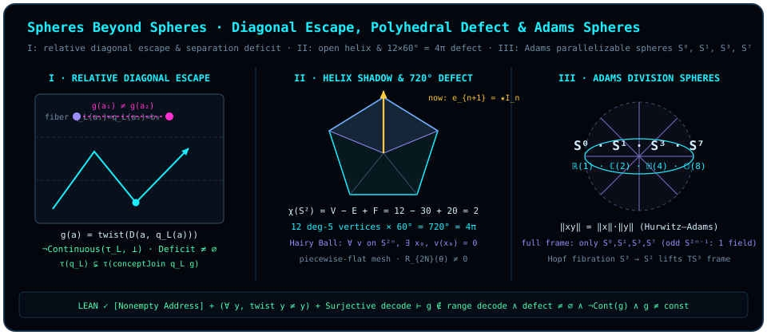

# 第二十一章 球外之球：康托尔对角线、哥德尔逃逸与毛球奇点

> *“为什么面积是存在,因为要表达这个存在, 必须在另外一个更大的存在的内部, 这就是哥德尔不完备, 没有人能得到整个球. 继续”*
>
> *“当我们以为我们得到一个球的时候, 实际上被一个更大的球包了进去”*

在走完前五部的二十章之后，我们已经沿着“点 $\to$ 线 $\to$ 面 $\to$ 球 $\to$ 多球纠缠与全息时空”的阶梯，把单比特投影、克利福德旋转器、多体贝尔关联乃至时空度规统统收拢进了一颗颗高维单位球面。此时此刻，一个最古老也最诱人的形而上学幻觉便会在心头浮现：既然我们已经掌握了球面几何的生成法则，难道我们不就可以画出一张包罗万象的“终极球面地图”，把宇宙间一切可定义的概念、一切可判定的命题、一切可观测的状态都严丝合缝地封印在同一颗闭球壳之内吗？

第六部《越界·球外之球》要做的，就是亲手打破这尊“全知闭球”的柏拉图偶像。

请回想[序曲](README.md)与[第三章](ch03-projectors-and-duality.md)揭示的那条基本几何铁律：当你在二维赤道平面 $\operatorname{span}\{\vv{e}_1, \vv{e}_2\}$ 内旋转了一块有向面积 $\vv{e}_1 \wedge \vv{e}_2$，并试图把这块“面积”指认为一根确凿无疑的一维“存在轴”（粒子态或已定命题）时，你的目光绝不可能停留在那张二维平面内部——因为平面内的任何向量都与该平面共面，无法充当它的法线。你之所以能把二维面积压缩为一根一维法向箭头 $\vv{e}_3 = \star_3(\vv{e}_1 \wedge \vv{e}_2)$，唯一的原因是你已经站在了**三维外围空间** $\mathbb{R}^3$ 的内部！同样地，在定向三维空间 $\mathbb{R}^3$ 内部，最高阶体积元 $I_3 = \vv{e}_1 \wedge \vv{e}_2 \wedge \vv{e}_3$ 的三维霍奇对偶只是一个零阶标量 $\star_3 I_3 = 1$；要想把整座三维系统本身指认为一根新的正交法向存在线 $\vv{e}_4 = \star_4 I_3$，数学迫使你必须先踏入包含它的**四维外围空间** $\mathbb{R}^4 = \mathbb{R}^3 \oplus \mathbb{R}\vv{e}_4$，从而把原有的二维球面 $S^2$ 变成三维超球面 $S^3$ 的赤道切片！

在本章中，我们将看到：这种“要表达当前系统的整体存在，就必须跳进更大外围空间”的法向逃逸现象，绝不仅是一则优美的微分几何比喻；在集合论与观测拓扑的底层，它的抽象骨架直接具象化为本书经 Lean 4 内核形式化验证的**相对语义对角线与观测拓扑加细四重奏**（`DiagonalTopologicalEscape`），并在经典元数学文献中与**康托尔（Georg Cantor）对角线构造**、**哥德尔（Kurt Gödel）第一不完备定理**及**塔斯基（Alfred Tarski）真值不可定义定理**遥相呼应（后两者在元数学中还需额外引入递归公理化算术编码、可证性谓词与相容性假设，属于经典文献与结构类比层）。只要一台完备解码器试图在非空地址集与固定潜坐标（latent coordinate）的纤维划分下穷尽所有输出映射，任何无不动点的翻转算子（twist）都会沿着相对语义对角线当场刺穿旧观测拓扑，强迫概念读出向“球外之球”严格加细！

## 21.1 为什么表达面积必须站在面外：概念读出与划分拓扑 {#sec-ch21-1}

让我们先把“在一层固定球壳内用有限坐标观察世界”翻译成最干净的集合与拓扑语言。

设 $X$（在形式化声明中记作地址类型 `Address`）是待辨识的对象或语句地址空间，$B$（记作坐标类型 `Coordinate`）是当前观察者手头掌握的**潜坐标读出空间**。在 Lean 模块 `ConceptFiberDecomposition` 中，一个**概念读出**（[`Concept`](lean:D5/S3/ConceptDynamics/ConceptFiberDecomposition.Concept) $X\ B$）就是一个从地址空间到坐标空间的映射 $q_L : X \to B$。每当观察者固定一把概念尺子 $q_L$，整个地址空间 $X$ 就被等值条件 $q_L(x) = b$ 切分成了一簇互不相交的**概念余纤维**（[`ConceptFiber`](lean:D5/S3/ConceptDynamics/ConceptFiberDecomposition.ConceptFiber) $q_L\ b = \{x \in X \mid q_L(x) = b\}$），并诱导出全空间的依值直和分解（[`concept_fiber_decomposition`](lean:D5/S3/ConceptDynamics/ConceptFiberDecomposition.concept_fiber_decomposition)）：

$$
X \;\simeq\; \sum_{b : B} \operatorname{ConceptFiber}(q_L, b).
$$

在几何上，你可以把 $q_L : X \to B$ 想象成将高维球面沿着某组选定主轴投射到低维赤道平面上的投影映射：凡是落在同一根垂直投影纤维 $q_L^{-1}(b)$ 上的两个地址 $x, y \in X$，由于满足 $q_L(x) = q_L(y) = b$，在当前坐标表 $B$ 下拥有一模一样的读数——对只看得到 $B$ 的内部观察者而言，它们是**拓扑不可区分**（topologically inseparable）的盲区同胞！

为了用严格的一般拓扑学刻画这种“内部视角分辨率”，我们在输出端赋予坐标空间 $B$ 最精细的**离散拓扑** $\bot$（在 Mathlib 的拓扑空间格序约定中，$\bot$ 表示每个子集皆为开集的离散拓扑，即坐标读数本身可以被精确分辨），然后将 $\bot$ 沿着读出映射 $q_L : X \to B$ 拉回到地址空间 $X$ 上，得到 $q_L$ 的**划分拓扑**（[`partitionTopology`](lean:D5/S3/ConceptDynamics/Epistemic/PartitionKnowledgeNegativeIntrospection.partitionTopology) $q_L = \operatorname{induced}(q_L, \bot)$）。在划分拓扑 $\tau(q_L)$ 中，一个子集 $U \subseteq X$ 是开集，当且仅当它是若干条完整余纤维的并集 $U = q_L^{-1}(S)$（$S \subseteq B$）。因此，两个地址 $x, y \in X$ 在 $\tau(q_L)$ 下拓扑不可分（记作 $\operatorname{Inseparable}_{\tau(q_L)}(x, y)$），当且仅当它们落在同一根余纤维上：$q_L(x) = q_L(y)$（[`partition_inseparable_iff_kernel`](lean:D5/S3/ConceptDynamics/ObservationTopology/PartitionTopologyKernel.partition_inseparable_iff_kernel)）。

现在，假设观察者试图判断另一个目标概念 $q_T : X \to \mathrm{Output}$ 能否被关进当前这层坐标壳 $q_L : X \to B$ 内部。在模块 `ConceptJoinUniversal` 中，称目标概念 $q_T$ **可由潜概念 $q_L$ 分解/加细表出**（[`Refines`](lean:D5/S3/ConceptDynamics/ConceptJoinUniversal.Refines) $q_T\ q_L$，亦即潜坐标对目标任务充分 [`TargetAdequate`](lean:D5/S3/ConceptDynamics/DefinitionEscape/LatentAdequacyCriterion.TargetAdequate)），如果存在一个纯由坐标 $B$ 决定的后处理函数 $f : B \to \mathrm{Output}$，使得

$$
q_T = f \circ q_L \qquad (\forall x \in X,\; q_T(x) = f(q_L(x))).
$$

在地址空间 $X$ **非空**（`[Nonempty X]`）的前提下，什么时候目标概念 $q_T$ 能够这样乖乖地被关进 $q_L$ 的坐标壳里？当且仅当 $q_T$ 作为从划分拓扑 $(X, \tau(q_L))$ 到离散输出空间 $(\mathrm{Output}, \bot)$ 的映射是**连续**的（[`target_factors_iff_continuous_partition`](lean:D5/S3/ConceptDynamics/ObservationTopology/TargetContinuityFactorization.target_factors_iff_continuous_partition)，其中非空假设 `[Nonempty X]` 保证了存在默认地址样本以在未被 $q_L(X)$ 命中的冗余坐标点上定义后处理函数 $f : B \to \mathrm{Output}$）！道理一目了然：连续性要求任何单点输出纤维 $q_T^{-1}(\{o\})$ 都是 $\tau(q_L)$ 中的开集（即由完整的 $q_L$-纤维拼成），这意味着凡是满足 $q_L(x) = q_L(y)$ 的同一纤维点对，必须同时满足 $q_T(x) = q_T(y)$。一旦存在某根旧纤维被新概念 $q_T$ 劈成了两半——即存在两个地址在旧坐标下完全重合，却在新概念下给出不同输出——连续性当场破裂，一条不可抹杀的**拓扑分离亏损**便暴露出来。

## 21.2 康托尔—哥德尔相对语义对角线：形式化逃逸四重奏 {#sec-ch21-2}

现在，让我们在地址空间 `Address`、潜坐标空间 `Coordinate` 与输出空间 `Output` 上，正式组装那台著名的“相对语义对角线自指逃逸机”。

设系统内部立起了一部号称“包罗万象”的**解码器目录**（`decoderCatalog : Address → Coordinate → Output`）：每一个地址 $a \in \mathrm{Address}$ 不仅是一个被观察的对象，同时还在这部目录里编码了一台候选解码器 $D_a : \mathrm{Coordinate} \to \mathrm{Output}$。如果这部目录真的是**完备的**（即 `Function.Surjective decoderCatalog`：宇宙间任何一个从潜坐标到输出的候选函数 $h : \mathrm{Coordinate} \to \mathrm{Output}$，都能在目录里找到某个地址 $a_h$ 使 $D_{a_h} = h$），并且输出空间上存在一个**无不动点的翻转变换** `twist : Output → Output`（满足 $\forall o,\; \operatorname{twist}(o) \neq o$，例如布尔真假翻转 $\neg : \{0, 1\} \to \{0, 1\}$、限制在计算基比特标签 $\{\lvert 0\rangle, \lvert 1\rangle\}$ 上的泡利 $X$ 比特翻转——注意在完整布洛赫球面 $S^2$ 上连续旋转 $X$ 会固定 $\pm x$ 轴极点 $\lvert \pm\rangle$，因此必取离散比特集或球面全局对跖映射 $\vv{n} \mapsto -\vv{n}$），会发生什么？

我们只需让每个地址 $a$ 读取**它自己的潜坐标** $q_L(a)$，送入**它自己名下的解码器** $D_a$，然后再拧上一次无不动点翻转 `twist`！

::: {.definition #def-relative-semantic-diagonal title="相对语义对角线" lean="D5/S3/ConceptDynamics/DefinitionEscape/RelativeSemanticDiagonal.relativeSemanticDiagonal"}
设 `Address`、`Coordinate`、`Output` 为任意类型，给定输出翻转映射 $\operatorname{twist} : \mathrm{Output} \to \mathrm{Output}$、潜概念读出 $\operatorname{latent} : \operatorname{Concept}\ \mathrm{Address}\ \mathrm{Coordinate}$ 以及解码器目录 $\operatorname{decoderCatalog} : \mathrm{Address} \to \mathrm{Coordinate} \to \mathrm{Output}$。定义**相对语义对角线**（Lean 中记作 `relativeSemanticDiagonal twist latent decoderCatalog`）为如下目标概念读出 $g : \operatorname{Concept}\ \mathrm{Address}\ \mathrm{Output}$：

$$
g(a) \;:=\; \operatorname{twist}\bigl(\operatorname{decoderCatalog}(a, \operatorname{latent}(a))\bigr) \qquad (a \in \mathrm{Address}).
$$
:::

为了度量这根对角线 $g$ 对原潜坐标划分拓扑 $\tau(\operatorname{latent})$ 造成的撕裂，我们同时引入拓扑分离亏损的精确定义。

::: {.definition #def-separation-deficit title="拓扑分离亏损" lean="D5/S3/ConceptDynamics/ObservationTopology/ResidualSeparationTopology.separationDeficit"}
设 `X`、`Current`、`Target` 为任意类型，$\operatorname{current} : \operatorname{Concept}\ X\ \mathrm{Current}$ 为当前概念读出，$\operatorname{target} : \operatorname{Concept}\ X\ \mathrm{Target}$ 为目标概念读出。定义 $\operatorname{current}$ 相对于 $\operatorname{target}$ 的**拓扑分离亏损**（Lean 中记作 `separationDeficit current target`）为地址乘积空间 $X \times X$ 中的点对集合：

$$
\begin{aligned}
\operatorname{separationDeficit}(\operatorname{current}, \operatorname{target})
\;:=\; \bigl\{\, (x, y) \in X \times X \;\big|\; &\operatorname{Inseparable}_{\tau(\operatorname{current})}(x, y) \\
&\land\; \neg\operatorname{Inseparable}_{\tau(\operatorname{target})}(x, y) \,\bigr\}.
\end{aligned}
$$
:::

请看 [@def-relative-semantic-diagonal] 与 [@def-separation-deficit] 联手设下的天罗地网：对任意地址 $a \in \mathrm{Address}$，因为 $\operatorname{twist}$ 无不动点，必有 $g(a) \neq \operatorname{decoderCatalog}(a, \operatorname{latent}(a))$（[`relative_semantic_diagonal_ne_listed_decode`](lean:D5/S3/ConceptDynamics/DefinitionEscape/RelativeSemanticDiagonal.relative_semantic_diagonal_ne_listed_decode)）——在第 $a$ 号地址自己头上，对角线 $g$ 的取值永远跟第 $a$ 号解码器算出的结果唱反调！

由此，在 Lean 模块 `DiagonalTopologicalEscape` 中，我们迎来了刻画“球内语言必然破裂、概念拓扑被迫升维”的四条核心形式化定理。

::: {.theorem #thm-complete-diagonal-not-continuous title="完备解码目录诱导的相对语义对角线必不连续" lean="D5/S3/ConceptDynamics/ObservationTopology/DiagonalTopologicalEscape.complete_diagonal_not_continuous"}
设 `Address`、`Coordinate`、`Output` 为类型，其中 `Address` 非空（`[Nonempty Address]`）。给定映射 $\operatorname{twist} : \mathrm{Output} \to \mathrm{Output}$、潜概念读出 $\operatorname{latent} : \operatorname{Concept}\ \mathrm{Address}\ \mathrm{Coordinate}$ 及解码器目录 $\operatorname{decoderCatalog} : \mathrm{Address} \to \mathrm{Coordinate} \to \mathrm{Output}$。若：

1. **无不动点性**：对任意 $o \in \mathrm{Output}$，$\operatorname{twist}(o) \neq o$；
2. **目录完备性（满射性）**：$\operatorname{decoderCatalog}$ 为满射（`Function.Surjective decoderCatalog`）；

则由 [@def-relative-semantic-diagonal] 定义的相对语义对角线 $g = \operatorname{relativeSemanticDiagonal}(\operatorname{twist}, \operatorname{latent}, \operatorname{decoderCatalog})$ 从潜划分拓扑 $\operatorname{partitionTopology}(\operatorname{latent})$ 到离散输出拓扑 $\bot$ **不连续**：

$$
\neg\,\operatorname{Continuous}_{\tau(\operatorname{latent}) \to \bot}(g).
$$
:::

::: proof
采用反证法。假设相对语义对角线 $g$ 从 $\tau(\operatorname{latent})$ 到离散拓扑 $\bot$ 连续。由连续性与因子分解等价定理 [`target_factors_iff_continuous_partition`](lean:D5/S3/ConceptDynamics/ObservationTopology/TargetContinuityFactorization.target_factors_iff_continuous_partition)，连续性蕴含 $\operatorname{Refines}(g, \operatorname{latent})$，即存在某个坐标解码函数 $h : \mathrm{Coordinate} \to \mathrm{Output}$ 使得对一切地址 $a$ 均有 $g(a) = h(\operatorname{latent}(a))$。因 $\operatorname{decoderCatalog}$ 满射，必存在某个地址 $a_0 \in \mathrm{Address}$ 使得 $\operatorname{decoderCatalog}(a_0) = h$。在地址 $a_0$ 处求值，一方面有 $g(a_0) = h(\operatorname{latent}(a_0)) = \operatorname{decoderCatalog}(a_0, \operatorname{latent}(a_0))$；另一方面按 $g$ 的定义又有 $g(a_0) = \operatorname{twist}(\operatorname{decoderCatalog}(a_0, \operatorname{latent}(a_0)))$。令 $o_0 = \operatorname{decoderCatalog}(a_0, \operatorname{latent}(a_0))$，两式合并即得 $\operatorname{twist}(o_0) = o_0$，直接违背无不动点假设 $\forall o,\; \operatorname{twist}(o) \neq o$（该矛盾在 Lean 中封装为 [`relative_semantic_diagonal_target_inadequate_of_surjective`](lean:D5/S3/ConceptDynamics/DefinitionEscape/RelativeSemanticDiagonal.relative_semantic_diagonal_target_inadequate_of_surjective)）。完整证明由 Lean 内核检查。
:::

[@thm-complete-diagonal-not-continuous] 揭示了一个震撼的拓扑事实：**完备性与内部连续性水火不容。** 只要你的解码目录足够丰富、能穷尽旧坐标上的所有函数，对角线概念 $g$ 就必然在旧划分拓扑下发生剧烈的“不连续撕裂”。这种撕裂绝不是抽象的逻辑幽灵，它必然在地址空间里留下实实在在的盲区裂痕——即非空的拓扑分离亏损。

::: {.lemma #lem-complete-diagonal-separation-deficit title="完备相对对角线在旧观测拓扑中必具非空分离亏损" lean="D5/S3/ConceptDynamics/ObservationTopology/DiagonalTopologicalEscape.complete_diagonal_separationDeficit_nonempty"}
在与 [@thm-complete-diagonal-not-continuous] 完全相同的假设下（`Address` 非空，$\operatorname{twist}$ 无不动点，$\operatorname{decoderCatalog}$ 满射），潜概念 $\operatorname{latent}$ 相对于相对语义对角线 $g = \operatorname{relativeSemanticDiagonal}(\operatorname{twist}, \operatorname{latent}, \operatorname{decoderCatalog})$ 的拓扑分离亏损非空：

$$
\bigl(\operatorname{separationDeficit}(\operatorname{latent},\; g)\bigr).\mathrm{Nonempty}.
$$
:::

::: proof
由 [`relative_semantic_diagonal_target_inadequate_of_surjective`](lean:D5/S3/ConceptDynamics/DefinitionEscape/RelativeSemanticDiagonal.relative_semantic_diagonal_target_inadequate_of_surjective)，在给定假设下 $g$ 不能通过 $\operatorname{latent}$ 分解，即 $\neg\operatorname{Refines}(g, \operatorname{latent})$。根据目标恢复判据 [`target_recovery_criterion`](lean:D5/S3/ConceptDynamics/Restoration/TargetRecoveryCriterion.target_recovery_criterion)，不可分解性等价于核缺陷关系 $\operatorname{defectRelation}(\operatorname{latent}, g) = \{(a_1, a_2) \mid \operatorname{latent}(a_1) = \operatorname{latent}(a_2) \land g(a_1) \neq g(a_2)\}$ 非空。再由恒等式 [`defectRelation_eq_separationDeficit`](lean:D5/S3/ConceptDynamics/ObservationTopology/ResidualSeparationTopology.defectRelation_eq_separationDeficit) 将核缺陷关系重写为拓扑分离亏损 $\operatorname{separationDeficit}(\operatorname{latent}, g)$，立得其非空性。完整证明由 Lean 内核检查。
:::

请仔细品味 [@lem-complete-diagonal-separation-deficit] 的几何含义：因为 $\operatorname{separationDeficit}(\operatorname{latent}, g)$ 非空，地址空间里**必然存在至少一对具体的地址 $(a_1, a_2)$**，它们在旧坐标尺下完全重叠（$\operatorname{latent}(a_1) = \operatorname{latent}(a_2)$，在旧球壳投影下缩成了同一个点），但对角线概念 $g$ 却在它们身上劈出了截然不同的值（$g(a_1) \neq g(a_2)$）！

面对这对在旧坐标里无法区分、却在新概念下分道扬镳的“孪生地址”，观察者唯一的出路是什么？**把逃逸出去的对角线 $g$ 本身立为一根新的正交坐标轴**，通过概念直积合并 [`conceptJoin`](lean:D5/S3/ConceptDynamics/ConceptJoinUniversal.conceptJoin) 将潜读出升级为二维联合读出

$$
\operatorname{conceptJoin}(\operatorname{latent}, g) : a \;\longmapsto\; \bigl(\operatorname{latent}(a),\; g(a)\bigr) \in \mathrm{Coordinate} \times \mathrm{Output}.
$$

下面的命题严格证明：这一步“引法线入场”的操作，必然使观测拓扑发生**严格加细**（[`StrictObservationRefinement`](lean:D5/S3/ConceptDynamics/ObservationTopology/PrimitiveEscapeStrictRefinement.StrictObservationRefinement)，即旧拓扑的每个开集在新拓扑中仍为开集，且新拓扑中存在旧拓扑所没有的真新开集）。

::: {.proposition #prop-complete-diagonal-strict-refinement title="并入相对语义对角线严格加细潜观测拓扑" lean="D5/S3/ConceptDynamics/ObservationTopology/DiagonalTopologicalEscape.complete_diagonal_strict_topology_refinement"}
在与 [@thm-complete-diagonal-not-continuous] 完全相同的假设下（`Address` 非空，$\operatorname{twist}$ 无不动点，$\operatorname{decoderCatalog}$ 满射），将相对语义对角线 $g = \operatorname{relativeSemanticDiagonal}(\operatorname{twist}, \operatorname{latent}, \operatorname{decoderCatalog})$ 与原潜概念 $\operatorname{latent}$ 合并后，新划分拓扑对原划分拓扑构成严格观测加细：

$$
\operatorname{StrictObservationRefinement}\Bigl(
  \operatorname{partitionTopology}(\operatorname{latent}),\;
  \operatorname{partitionTopology}\bigl(\operatorname{conceptJoin}(\operatorname{latent}, g)\bigr)
\Bigr).
$$
:::

::: proof
由等价定理 [`coordinate_inadequate_iff_strict_join_refinement`](lean:D5/S3/ConceptDynamics/ObservationTopology/RedundantCoordinateTopology.coordinate_inadequate_iff_strict_join_refinement)，联合读出 $\operatorname{conceptJoin}(\operatorname{latent}, g)$ 的划分拓扑严格加细 $\operatorname{partitionTopology}(\operatorname{latent})$，当且仅当目标 $g$ 对原潜坐标不充分（$\neg\operatorname{TargetAdequate}(\operatorname{latent}, g)$，即 $\neg\operatorname{Refines}(g, \operatorname{latent})$）。直接代入 [`relative_semantic_diagonal_target_inadequate_of_surjective`](lean:D5/S3/ConceptDynamics/DefinitionEscape/RelativeSemanticDiagonal.relative_semantic_diagonal_target_inadequate_of_surjective) 给出的不可分解性即得证。完整证明由 Lean 内核检查。
:::

最后，我们将“不可分解、拓扑不连续、分离亏损非空、并入后拓扑严格升维”这四重结论铸成一条完整的总结算定理。

::: {.corollary #cor-complete-diagonal-topological-settlement title="完备相对语义对角线的四重拓扑逃逸总结算定理" lean="D5/S3/ConceptDynamics/ObservationTopology/DiagonalTopologicalEscape.complete_diagonal_topological_settlement"}
设 `Address`、`Coordinate`、`Output` 为类型，`Address` 非空，$\operatorname{twist} : \mathrm{Output} \to \mathrm{Output}$ 满足 $\forall o,\; \operatorname{twist}(o) \neq o$，且 $\operatorname{decoderCatalog} : \mathrm{Address} \to \mathrm{Coordinate} \to \mathrm{Output}$ 满射。记 $g = \operatorname{relativeSemanticDiagonal}(\operatorname{twist}, \operatorname{latent}, \operatorname{decoderCatalog})$，则以下四项结论同时成立：

1. **不可因子分解（逃出旧概念闭包）**：$\neg\operatorname{Refines}(g, \operatorname{latent})$；
2. **旧拓扑下不连续**：$\neg\,\operatorname{Continuous}_{\tau(\operatorname{latent}) \to \bot}(g)$；
3. **存在非空分离亏损**：$\bigl(\operatorname{separationDeficit}(\operatorname{latent}, g)\bigr).\mathrm{Nonempty}$；
4. **并入新坐标后严格加细观测拓扑**：

   $$
   \operatorname{StrictObservationRefinement}\Bigl(
     \operatorname{partitionTopology}(\operatorname{latent}),\;
     \operatorname{partitionTopology}\bigl(\operatorname{conceptJoin}(\operatorname{latent}, g)\bigr)
   \Bigr).
   $$
:::

::: proof
将 [`relative_semantic_diagonal_target_inadequate_of_surjective`](lean:D5/S3/ConceptDynamics/DefinitionEscape/RelativeSemanticDiagonal.relative_semantic_diagonal_target_inadequate_of_surjective) 与 [@thm-complete-diagonal-not-continuous]、[@lem-complete-diagonal-separation-deficit]、[@prop-complete-diagonal-strict-refinement] 逐项合取即得。完整证明由 Lean 内核检查。
:::

为了让这四条抽象定理变成你指尖可以触摸的具体算术，让我们亲手在一个最小的有限布尔模型上把这张对角线逃逸表一格一格算出来。

::: {.example #ex-cantor-godel-diagonal-table title="四地址一比特潜坐标下的相对对角线逃逸与纤维劈裂手算"}
取潜坐标空间为单比特布尔集 $\mathrm{Coordinate} = \{0, 1\}$，输出空间亦为 $\mathrm{Output} = \{0, 1\}$，无不动点翻转取逻辑非 $\operatorname{twist}(o) = 1 - o$（满足 $\operatorname{twist}(0) = 1 \neq 0$，$\operatorname{twist}(1) = 0 \neq 1$）。从 $\mathrm{Coordinate}$ 到 $\mathrm{Output}$ 的函数共有 $2^2 = 4$ 个，故取四元地址集 $\mathrm{Address} = \{a_0, a_1, a_2, a_3\}$ 以构成满射解码目录：

| 地址 $a$ | 解码函数 $D_a(0)$ | 解码函数 $D_a(1)$ | 设定的潜坐标 $\operatorname{latent}(a)$ | 目录自身读数 $D_a(\operatorname{latent}(a))$ | 对角线输出 $g(a) = 1 - D_a(\operatorname{latent}(a))$ |
| :---: | :---: | :---: | :---: | :---: | :---: |
| $a_0$（常零函数） | $0$ | $0$ | $0$ | $D_{a_0}(0) = 0$ | $\mathbf{1}$ |
| $a_1$（恒等函数） | $0$ | $1$ | $0$ | $D_{a_1}(0) = 0$ | $\mathbf{1}$ |
| $a_2$（取反函数） | $1$ | $0$ | $0$ | $D_{a_2}(0) = 1$ | $\mathbf{0}$ |
| $a_3$（常一函数） | $1$ | $1$ | $1$ | $D_{a_3}(1) = 1$ | $\mathbf{0}$ |

现在逐条核对 [@cor-complete-diagonal-topological-settlement] 的四重断言：

1. **寻找具体的分离亏损点对**：观察地址 $a_1$ 与 $a_2$。在旧潜坐标下，它们落在同一根余纤维上：$\operatorname{latent}(a_1) = 0 = \operatorname{latent}(a_2)$，因此在原划分拓扑 $\tau(\operatorname{latent}) = \{\varnothing,\; \{a_0, a_1, a_2\},\; \{a_3\},\; \mathrm{Address}\}$ 中，$(a_1, a_2)$ 拓扑不可分。然而对角线 $g$ 在这两点给出 $g(a_1) = 1 \neq 0 = g(a_2)$！于是

   $$
   (a_1, a_2) \in \operatorname{separationDeficit}(\operatorname{latent}, g) \neq \varnothing.
   $$

2. **验证不连续性与不可分解性**：在离散输出拓扑下，单点集 $\{0\} \subseteq \mathrm{Output}$ 是开集，但它的原像 $g^{-1}(\{0\}) = \{a_2, a_3\}$ 既砍断了旧纤维 $\{a_0, a_1, a_2\}$，又不是 $\tau(\operatorname{latent})$ 中的开集，故 $g$ 不连续，也不可能写成 $h(\operatorname{latent}(a))$。
3. **验证并入新轴后的严格拓扑加细**：将 $g$ 并入潜坐标形成二维读出 $\operatorname{conceptJoin}(\operatorname{latent}, g)(a) = (\operatorname{latent}(a), g(a))$，四个地址的联合坐标分别为 $a_0 \mapsto (0, 1)$、$a_1 \mapsto (0, 1)$、$a_2 \mapsto (0, 0)$、$a_3 \mapsto (1, 0)$。原先粘成一团的三元盲区纤维 $\{a_0, a_1, a_2\}$ 被当场劈裂为 $\{a_0, a_1\}$ 与 $\{a_2\}$ 两块正交子纤维，观测拓扑从 $2$ 个非空原子开集严格升维为 $3$ 个非空原子开集！
:::

这正是康托尔对角线论证与 Lawvere 不动点模式在观测拓扑中的纯粹抽象骨架，也为理解经典元数学中的哥德尔第一不完备定理与塔斯基（Alfred Tarski）真值不可定义定理提供了清晰的几何类比（在经典数理逻辑文献中，哥德尔定理与塔斯基定理并不是直接假定任意语义函数目录满射，而是需要额外构造递归公理化算术、哥德尔配数编码、语法可证性谓词并在系统相容性假设下运作）。在我们的抽象拓扑框架中，每当一个系统把某类候选解码映射装进一部关于当前潜坐标满射的目录 `decoderCatalog`，并用无不动点算子 `twist` 构造自指对角线 $g$ 时，$g$ 必然劈开原系统的某根等价类余纤维。要想给 $g$ 赋予连续的因子分解坐标，就必须引入联合读出 $\operatorname{conceptJoin}(\operatorname{latent}, g)$；而若想在新坐标空间 $\mathrm{Coordinate}_{k+1} = \mathrm{Coordinate}_k \times \mathrm{Output}$ 上继续触发下一轮对角线逃逸 $g'$，则**必须以在新一轮（通常需要扩容的）地址空间 $\mathrm{Address}_{k+1}$ 上重新建立新的满射解码目录 $\operatorname{decoderCatalog}_{k+1} : \mathrm{Address}_{k+1} \twoheadrightarrow (\mathrm{Coordinate}_{k+1} \to \mathrm{Output})$ 为前提**——例如在 [@ex-cantor-godel-diagonal-table] 的四地址布尔模型中，合并后的坐标空间有 $4$ 个坐标对（对应 $2^4 = 16$ 个布尔函数，即便只看实际命中的 $3$ 根非空联合纤维也有 $2^3 = 8 > 4$ 个布尔函数），原来的 $4$ 个地址已不足以构成新阶段的满射目录，唯有连同地址空间一起向外扩容，才能开启下一层“球外之球”的攀升！

> 完备的目录必自裂其壳；凡想在球内穷尽一切者，必被对角线顺着法向顶出球外。

## 21.3 割圆多面体、泰勒截断裂缝与开口螺旋投影 {#sec-ch21-3}

既然没有任何固定维度的形式球壳能够一次性封死全部真理，让我们回过头来重新审视物理学与计算工程里的“球”本身。

在[序曲](README.md)末尾，我们曾提出全书最深沉的一条反柏拉图几何洞见：**“实际上球永远只是近似，我们以为我们得到了一个球，但实际只是近似得到一个球。”** 结合本章的对角线逃逸机制，这一反柏拉图视角在连续分析、量子门编译与维度投影三个层面上展现出惊人的一致性：

1. **有限阶泰勒多项式的截断余项裂缝 $R_{2N}(\theta) \neq 0$**：在经典或数字计算机内部，我们永远只能用有限步算术操作（多项式）去逼近连续球面上的余弦投影 $\cos\theta$。将 $\cos\theta$ 展开至第 $N$ 个偶次项（最高次数 $2N-2$），必留下一条有限截断余项裂缝：

   $$
   \cos\theta = \sum_{k=0}^{N-1} (-1)^k \frac{\theta^{2k}}{(2k)!} + R_{2N}(\theta), \qquad |R_{2N}(\theta)| \le \frac{|\theta|^{2N}}{(2N)!}.
   $$

   只要自变量 $\theta \in (0, 2]$ 非零，交错级数余项 $R_{2N}(\theta)$ 就严格非零！多项式代表“球内有限步代数语法所能表达的闭集”，而超越函数 $\cos\theta$ 与有限阶泰勒多项式之间那道永不归零的余项缝隙 $R_{2N}(\theta)$，正是分析学里的“哥德尔逃逸缝”——有限次代数加乘永远无法把超越圆弧焊死。
2. **有限门计数下的割圆凸多面体**：在容错量子计算中，工程师手里只有有限离散门集 $\mathcal{G}$（例如克利福德加 $T$ 门 $\{H, T\}$）。在任意有限电路深度（量子门计数）$L < \infty$ 下，从北极初态 $\lvert 0\rangle$ 出发所能抵达的状态集合 $\mathcal{S}_L \subset S^2$ 永远只是球面上的有限离散点集，其欧氏凸包 $\operatorname{conv}(\mathcal{S}_L)$ 仅仅是一颗**内接于布洛赫球的有限凸多面体**——就像刘徽与祖冲之用割圆多边形逼近圆周一样，多面体的每一张平坦切面与真实球皮之间，都留着一弯等待更高门计数去填补的弓形残差。
3. **开口螺旋的轴向投影意象**：如果把 [@prop-complete-diagonal-strict-refinement] 中每一次并入新对角线坐标 $\operatorname{conceptJoin}(\operatorname{latent}, g)$ 的拓扑加细，直观想象为沿着新增正交法向轴 $\vv{e}_{n+1} = \star I_n$ 的一次垂直抬升，那么低维观察者眼底那条看似首尾咬合、周而复始的闭合圆周 $(\cos t, \sin t)$，在并入了逃逸维度的外围空间里，其实是一条永不封口的**开口上升螺旋线** $(\cos t, \sin t, c\,t)$ 顺着法轴投下的平面阴影！你以为自己绕了一圈回到了原点 $(1, 0, 0)$，实际上高度坐标已经悄然跃迁到了 $(1, 0, 2\pi c)$。

## 21.4 毛球定理、笛卡尔 $720^\circ$ 角亏与 Adams 除法代数球面 {#sec-ch21-4}

甚至哪怕我们退一步，不去跨维度构造哥德尔对角线，而是老老实实待在三维空间里那颗光滑的二维单比特布洛赫球面 $S^2$ 上，拓扑学本身也在球皮表面埋下了一颗无法抚平的奇点——这就是大名鼎鼎的**毛球定理（Hairy Ball Theorem）**，以及它在离散多面体上的孪生兄弟**笛卡尔总角亏定理**与高维球面上的 **Adams 可平行化定理**。

为什么你在单比特布洛赫球面 $S^2$ 上无论怎样设计一套光滑的局部切向基准标架（比如想给球面上的每一个纯态 $\vv{a} \in S^2$ 都连续、无奇点地指定一根与之垂直的“默认正交相位起跑方向” $\vv{v}(\vv{a}) \perp \vv{a}$），到头来都必定会在球面某处撞上旋涡奇点（$\vv{v} = \vv{0}$）？为什么任何仅由度 $5$ 与度 $6$ 顶点拼成的分片欧氏等边三角剖分球面（或其对偶的封闭三价富勒烯球笼，如 $\mathrm{C}_{60}$），都**不多不少必须精准包含 $12$ 个度 $5$ 顶点（或 $12$ 个正五边形缺陷面）**？进而，如果我们不仅要求球面上存在**单根**处处非零的切向量场（所有奇数维球面 $S^{2n-1}$ 均满足），而且要求整座 $m$ 维切丛 $TS^m$ 拥有一套由 **$m$ 根处处线性无关切向量场组成的全局平行化标架（parallelization）**，为什么偏偏只有 $S^0, S^1, S^3, S^7$ 这四颗球面能够获此殊荣？

让我们在下面的经典文献注记中，把这三座横跨多面体组合学、微分拓扑与代数K理论的丰碑一次看清。

::: {.remark #rem-hairy-ball-adams-literature title="欧拉示性数、笛卡尔 720° 多面体总角亏、毛球定理与 Adams 可平行化球面定理（文献结果，未在本书形式化）"}
**文献结果，未在本书形式化。** 以下四项经典几何与拓扑定理从组合多面体、光滑切丛与赋范除法代数三个角度，严格锁定了球面内蕴标架的拓扑阻塞与维数奇迹：

1. **二维球面的欧拉示性数（Euler characteristic）**：对二维球面 $S^2$ 的任意凸多面体胞腔剖分（含 $V$ 个顶点、$E$ 条棱、$F$ 个面），欧拉公式恒给出拓扑不变量

   $$
   \chi(S^2) = V - E + F = 2.
   $$

   例如，正二十面体（icosahedron）拥有 $V = 12$ 个顶点、$E = 30$ 条棱与 $F = 20$ 个正三角形面，精确满足 $12 - 30 + 20 = 2$。
2. **笛卡尔总角亏定理与 $12 \times 60^\circ = 720^\circ = 4\pi$ 五边形缺陷锁（Descartes's total angular defect）**：需要严格区分**光滑圆球面上的球面测地线三角形**与**分片平坦（piecewise-Euclidean）多面体表面上的欧氏平面三角形**——在常曲率 $+1$ 的光滑圆球面 $S^2$ 上，非退化球面测地线三角形具有正的球面角盈 $\alpha + \beta + \gamma > \pi$（例如球面正二十面体剖分中每个球面正三角形内角为 $72^\circ$，$5$ 个角在光滑顶点处拼成 $5 \times 72^\circ = 360^\circ$，因为 $4\pi$ 的高斯曲率均匀分布在弯曲面片内部）；相反，考察同胚于 $S^2$ 的**封闭分片欧氏等边三角剖分多面体表面**，其每个面都是内角为 $\pi/3 = 60^\circ$ 的平坦欧氏等边三角形，所有高斯曲率都浓缩为顶点处的离散角亏。若某个顶点周围汇集了 $6$ 个平坦等边三角形（度为 $6$），其环绕内角和为 $6 \times 60^\circ = 360^\circ = 2\pi$，局部角亏（angular defect）为 $\delta_6 = 0$，因此纯由度 $6$ 顶点组成的平坦三角网格只能铺成欧氏平面或平坦环面（$\chi(T^2) = 0$），绝不可能合拢成封闭球面！若该封闭分片欧氏等边三角剖分球面仅含度 $5$ 与度 $6$ 顶点，则每个度为 $5$ 的顶点处环绕内角和为 $5 \times 60^\circ = 300^\circ$，留出局部正角亏

   $$
   \delta_5 = 2\pi - 5\times\frac{\pi}{3} = \frac{\pi}{3} = 60^\circ.
   $$

   由笛卡尔多面体总角亏定理（高斯—博内定理 $\int_{S^2} K\,dA = 2\pi\chi(S^2) = 4\pi$ 的离散原型），任何同胚于 $S^2$ 的封闭多面体所有顶点的角亏总和恒等于 $2\pi\chi(S^2) = 4\pi = 720^\circ$。既然度 $6$ 顶点角亏为 $0$，而每个度 $5$ 顶点贡献恰好 $60^\circ$ 角亏，整颗封闭分片平坦三角剖分球面上就**必须不多不少恰好存在 $720^\circ / 60^\circ = 12$ 个度 $5$ 角亏顶点**（$12 \times 60^\circ = 720^\circ = 4\pi$）！对偶地，在由正五边形（$F_5$ 个）与正六边形（$F_6$ 个）拼成的任意**封闭三价富勒烯多面体笼**（每个顶点度为 $3$，故 $3V = 2E = 5F_5 + 6F_6$）上，欧拉公式 $6(V - E + F) = 6F - 2E = (6-5)F_5 + (6-6)F_6 = 12$ 同样严格锁定**恰好存在 $F_5 = 12$ 个五边形面**。这正是[序曲](README.md)与本章“割圆多面体近似”在组合拓扑上的铁证：有限分片平坦多面体要想弯曲合拢成球，就必须把 $4\pi$ 的总曲率集中为离散顶点上的角亏接缝。
3. **庞加莱—布劳威尔毛球定理与奇偶维球面切向量场（Poincaré–Brouwer Hairy Ball Theorem）**：球面 $S^m$ 的欧拉示性数为 $\chi(S^m) = 1 + (-1)^m$。对任意**偶数维球面** $S^{2n}$，由于 $\chi(S^{2n}) = 2 \neq 0$（特别地 $\chi(S^2) = 2$），由庞加莱—霍普夫（Poincaré–Hopf）向量场指标定理，$S^{2n}$ 上的任何连续切向量场 $v : S^{2n} \to TS^{2n}$ 必然至少在一个奇点 $x_0 \in S^{2n}$ 处归零（$v(x_0) = 0$）；在量子力学中，这意味着单量子比特纯态流形 $S^2 \cong \mathbb{CP}^1$ 的切丛（以及其上的 $U(1)$ 霍普夫主丛 $S^3 \to S^2$）不存在全局连续无奇点的截面（狄拉克磁单极与贝里相位奇点的拓扑根源正在于此）。反之，对任意**奇数维球面** $S^{2n-1} \subset \mathbb{C}^n$，由于 $\chi(S^{2n-1}) = 0$，它总能容许**至少一根**处处非零的连续单位切向量场——例如将复坐标乘以虚数单位 $v(z) = iz$（在实坐标下即 $v(x_1, x_2, \dots, x_{2n-1}, x_{2n}) = (-x_2, x_1, \dots, -x_{2n}, x_{2n-1})$，如在 $S^5$ 上即无奇点）。
4. **Hurwitz 赋范除法代数与 Adams 可平行化球面定理（Adams, 1962）**：注意“存在**一根**无奇点切向量场”（所有奇数维球面 $S^{2n-1}$ 均具备）与“存在 **$m$ 根处处线性无关的全局切向量场标架**”（即切丛 $TS^m$ 全局平凡、流形**可平行化** parallelizable）之间的本质区别！例如 $S^5$ 虽有一根无奇点切场，却无法凑齐 $5$ 根处处线性无关的全局切标架。究竟哪些维数的单位球面 $S^m$ 是可平行化的？由 Hurwitz 定理，实数域 $\mathbb{R}$ 上的有限维赋范除法代数（满足乘积模长守恒 $\|xy\| = \|x\|\|y\|$）只有四个：**实数 $\mathbb{R}$（$1$ 维）、复数 $\mathbb{C}$（$2$ 维）、四元数 $\mathbb{H}$（$4$ 维）与八元数 $\mathbb{O}$（$8$ 维）**。它们的单位球面分别是零维球 $S^0 \subset \mathbb{R}^1$、一维圆周 $S^1 \subset \mathbb{C} \cong \mathbb{R}^2$、三维超球面 $S^3 \subset \mathbb{H} \cong \mathbb{R}^4$ 与七维超球面 $S^7 \subset \mathbb{O} \cong \mathbb{R}^8$，利用除法代数的虚部基元左乘即可直接构造出完备的全局正交切标架。J. Frank Adams（1960–1962）利用拓扑 K 理论解决了霍普夫不变量为一（Hopf invariant one）问题，严格证明：**在所有正维数球面中，唯有 $S^1, S^3, S^7$（连同零维伴侣 $S^0$）是可平行化的！**
:::

请把 [@rem-hairy-ball-adams-literature] 的第 3 条与第 4 条连起来看，你会立刻恍然大悟[第一章](ch01-measurement.md)留下的一个几何伏笔：**为什么单比特的观测球面 $S^2$（二维偶球面，$\chi(S^2) = 2$，不在 $\{0, 1, 3, 7\}$ 名单内）连一根无奇点切向量场都容不下，而一旦我们通过霍普夫纤维化把目光投向包裹它的外围三维超球面 $S^3 \cong \mathrm{SU}(2)$（四元数单位球面，恰在 Adams 可平行化名单 $\{S^0, S^1, S^3, S^7\}$ 之中！），整座三维切丛 $TS^3$ 立刻变得全局平凡可平行化？**

因为 $S^2$ 本身不具备除法代数群结构，它的 $4\pi$（$720^\circ$）总曲率角亏阻碍了任何全局无奇点切截面的存在；唯有借用更高一维的外围李群球面 $S^3$（注意 $S^3$ 的圆球黎曼度规本身仍具有常正截面曲率 $+1$，并非欧氏平坦度规，但它的切丛 $TS^3$ 借助四元数左乘标架获得了全局拓扑平凡化！），原本在 $S^2$ 底空间上刺破连续性的规范奇点，才在 $S^3$ 的全局左不变李代数标架里被彻底解开！无论是在多面体 $4\pi$ 角亏、毛球切丛，还是在相对语义对角线的拓扑逃逸（[@cor-complete-diagonal-topological-settlement]）中，大自然都在反复吟诵同一首几何诗篇：**球内的奇点与不完备，唯有借球外之球方能安顿。**

::: {.viz src="sphere-escape" height="640"}
交互可视化（四大画布面板同步联动）：（1）**多面体高斯—博内角亏与开口螺旋面板（`drawPoly`）**：切换 $V = 12, 42, 60, 162, 642$ 的球面内接测地多面体，实时核验 $V - E + F = 2$，对比分片欧氏等边组合模型下 12 个五度顶点集中承担 $12 \times 60^\circ = 720^\circ = 4\pi$ 的曲率角亏与实际径向投影内接网格上分摊于五度及六度顶点但总和仍严格等于 $4\pi = 720^\circ$ 的度量角亏，并同屏展示三维开口螺旋 $t \mapsto (\cos t, \sin t, \eta t)$ 的圆形投影；（2）**泰勒多项式截断与余项裂缝面板（`drawTaylor`）**：对比 $\cos\theta$ 的 $2N-2$ 阶偶次泰勒截断多项式与单位圆精确投影以及非零截断余项 $R_{2N}(\theta)$；（3）**Dottie 余弦蛛网面板（`drawCobweb`）**：演示自指投影迭代 $\theta_{k+1} = \cos\theta_k$ 向唯一超越不动点 $\theta^* \approx 0.739085$ 的蛛网螺旋收敛；（4）**收敛与收缩稳定化账本面板（`drawLedger`）**：定量并排对比 Dottie 几何压缩残差 $|\cos\theta_k - \theta_k|$、黄金倒数迭代 $x_{k+1} = 1 + 1/x_k \to \varphi$ 的收敛残差以及有限集合收缩更新的稳定化（`finite_contracting_updates_stabilize`），并由理论抽屉与 Lean 证据卡将四大面板同本章的 Lawvere–Cantor 对角线逃逸四元组及毛球拓扑相联结。
:::

那么，在这座无穷无尽的升维阶梯上，算术世界本身的那些“互不相干的正交坐标轴”究竟长什么模样？当我们用“两两比较、顺序无关”的几何眼光去打量全体自然数时，为什么每一个素数 $p = 2, 3, 5, 7, \dots$ 都自动站成了一根独立的正交基准轴？让我们推开[第二十二章](ch22-primes-euler-products-and-zeros.md)的大门。
