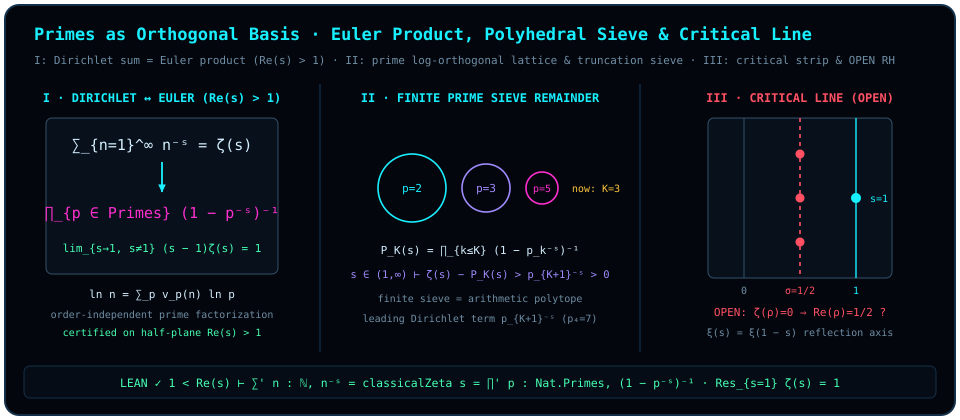

# 第二十二章 素数是算术的正交基：欧拉乘积与黎曼零点

> *“我总感觉量子的本质就是,两两比较,永远一致,顺序无关”*

在[第二十一章](ch21-diagonalization-and-escape.md)中，我们看到任何企图用有限潜坐标封死一切概念的系统，都会被自指对角线顺着法向顶出旧球壳，开启无穷无尽的升维阶梯。现在，让我们把目光投向人类最古老、也最纯粹的一座无穷维大厦——**自然数的乘法算术**——并追问一个直指核心的几何问题：

当我们说“两两比较、永远一致、顺序无关”时，在正整数的乘法世界 $\mathbb{N}_{\ge 1}$ 里，究竟哪些数是真正彼此独立、互不投影的**正交基向量**？

初看之下，自然数 $1, 2, 3, 4, 5, 6, \dots$ 像是一条一维长线上均匀排列的刻度。然而，一旦你从加法切换到乘法，你会发现 $6 = 2 \times 3$ 根本不是一根独立的新方向，它只是方向 $2$ 与方向 $3$ 的合成对角线；$12 = 2^2 \times 3$ 则是沿方向 $2$ 走两步、再沿方向 $3$ 走一步！根据算术基本定理（唯一素因子分解定理），每一个正整数 $n \ge 1$ 都可以唯一地分解为素数幂的乘积，并且**无论你按什么顺序把这些素因子乘起来，结果永远一致、顺序无关**：

$$
n = \prod_{p \in \mathrm{Primes}} p^{v_p(n)} \quad\Longleftrightarrow\quad \ln n = \sum_{p \in \mathrm{Primes}} v_p(n)\,\ln p.
$$

看清上面这对映射的几何结构了吗？唯一素因子分解把每一个正整数 $n$ 嵌入了以形式基向量 $\{\vv{e}_p\}_{p \in \mathrm{Primes}}$ 张成的可数无穷维**形式指数晶格** $\bigoplus_{p \in \mathrm{Primes}} \mathbb{Z}\vv{e}_p$（若赋予这组形式基向量标准正交内积 $\langle \vv{e}_p, \vv{e}_q\rangle = \delta_{pq}$，指数 $v_p(n) \in \mathbb{N}$ 就是整数 $n$ 在第 $p$ 根形式素数轴 $\vv{e}_p$ 上的非负整数坐标）；与此同时，取自然对数给出了作用在该指数晶格上的线性权重泛函 $\ln n = \sum_p v_p(n)\,\ln p$，其中不同素数的对数权重 $\ln 2, \ln 3, \ln 5, \dots$ 在有理数域 $\mathbb{Q}$ 上线性无关——没有任何一根素数轴能在另一根素数轴上投下一丝一毫的有理整除影子（下文所说的“素数正交基轴”，即指这一配备了 $\mathbb{Q}$-线性无关对数权重的形式指数坐标晶格几何）。

本章将沿着这一“素数即算术正交基”的几何直觉，严格建立**狄利克雷（Dirichlet）自然数级数**与**欧拉（Euler）无穷素数乘积**在绝对收敛半平面 $\operatorname{Re}(s) > 1$ 上的机器形式化恒等式，剖析有限素数筛的“多面体截断余项”，并在严谨的三层认识论契约下远眺数论皇冠上的开放猜想——**黎曼猜想（Riemann Hypothesis）**。

## 22.1 算术正交基与因式分解消除无穷 {#sec-ch22-1}

为什么作者在手稿中反复强调“**处理无穷问题的本质就是进行因式分解，看如何把无穷‘约掉’**”？

想象你面前摆着一个对全部自然数 $n = 1, 2, 3, \dots$ 求和的无穷级数。在加法视角下，每一项 $n^{-s}$ 都和其它无穷多项纠缠在一起，看不出谁是谁的生成元。但是，一旦我们利用“两两比较、顺序无关”的唯一素因子分解，将每一个合数 $n = p_1^{a_1} \cdots p_r^{a_r}$ 还原为它在各根素数正交轴上的独立分量乘积 $n^{-s} = p_1^{-a_1 s} \cdots p_r^{-a_r s}$，奇迹便发生了：**原本横跨所有自然数的全局无穷求和，当场分解（factorize）成了每一根独立素数轴上局部几何级数的无穷乘积！**

在每一根单独的素数轴 $p$ 上，沿着坐标刻度 $a = 0, 1, 2, 3, \dots$ 的一维求和不过是最简单的公比为 $p^{-s}$ 的等比级数（当 $\operatorname{Re}(s) > 1$ 时 $|p^{-s}| = p^{-\operatorname{Re}(s)} < 1$）：

$$
1 + p^{-s} + p^{-2s} + p^{-3s} + \cdots \;=\; \frac{1}{1 - p^{-s}} \;=\; (1 - p^{-s})^{-1}.
$$

你看，单根素数轴上的无穷多项之和 $1 + p^{-s} + p^{-2s} + \cdots$，被等比求和公式一口气“约掉”成了干净利落的单因子 $(1 - p^{-s})^{-1}$！把所有相互正交的素数轴 $p \in \mathrm{Primes}$ 乘在一起，由于乘法分配律在展开时恰好不重不漏地遍历每一个非负整数坐标向量 $(v_2, v_3, v_5, \dots)$（仅有限个坐标非零），全体自然数的狄利克雷级数便与全体素数的欧拉乘积严丝合缝地合二为一。

为了在 Lean 4 中把这一经典桥梁铸成零歧义的形式化定理，我们首先对齐 `trureturing` 仓库中模块 `D5/S3/Weil/Convention` 所采用的黎曼 $\zeta$ 函数约定。

::: {.definition #def-classical-zeta title="黎曼 ζ 函数的形式化约定与简单极点谓词" lean="D5/S3/Weil/Convention.classicalZeta D5/S3/Zeros/ZetaUpgrade.HasUniqueSimplePoleWithResidue"}
在复平面 $\mathbb{C}$ 上，记全函数 [`classicalZeta`](lean:D5/S3/Weil/Convention.classicalZeta) $: \mathbb{C} \to \mathbb{C}$ 为 Mathlib 标准库中的黎曼 $\zeta$ 函数 `riemannZeta`。同时，对任意复变函数 $f : \mathbb{C} \to \mathbb{C}$、极点位置 $z \in \mathbb{C}$ 与留数 $\mathrm{residue} \in \mathbb{C}$，定义谓词 [`HasUniqueSimplePoleWithResidue`](lean:D5/S3/Zeros/ZetaUpgrade.HasUniqueSimplePoleWithResidue) $f\ z\ \mathrm{residue}$ 为以下三项性质的合取：

1. **除极点外处处解析**：$f$ 在补集 $\{z\}^c = \mathbb{C} \setminus \{z\}$ 的开邻域上复解析（`AnalyticOnNhd ℂ f ({z}ᶜ)`）；
2. **一阶洛朗留数极限**：当 $s$ 在去心邻域滤子 $\mathcal{N}_{\neq}(z)$ 中趋近于 $z$ 时，$(s - z)f(s)$ 收敛于 $\mathrm{residue}$；
3. **非零留数**：$\mathrm{residue} \neq 0$。
:::

## 22.2 极点留数、狄利克雷级数与欧拉乘积的形式化恒等式 {#sec-ch22-2}

在进入 $\operatorname{Re}(s) > 1$ 的级数与乘积展开之前，让我们先锁定 $\zeta(s)$ 在复平面上最醒目的地标：位于 $s = 1$ 处的**唯一一阶极点（调和级数发散奇点）**。

从几何上看，当 $s \to 1^+$ 时，调和级数 $\sum_{n=1}^\infty n^{-s}$ 之所以发散，正是因为无穷多根素数正交轴上的放大因子 $(1 - p^{-1})^{-1} = \frac{p}{p-1}$ 源源不断地累积发散；而它发散的速度，恰好由 $(s - 1)^{-1}$ 以单位留数 $1$ 精准标定！

::: {.lemma #lem-riemann-zeta-residue-one title="黎曼 ζ 函数在 s = 1 处的留数为 1" lean="D5/S3/Zeros/ZetaIdentities.riemann_zeta_residue_one"}
对 [@def-classical-zeta] 中的黎曼 $\zeta$ 函数 $\operatorname{classicalZeta} : \mathbb{C} \to \mathbb{C}$，当复变量 $s \in \mathbb{C}$ 沿去心邻域滤子 $\mathcal{N}_{\neq}(1)$ 趋近于 $1$ 时，有极限

$$
\lim_{\substack{s \to 1 \\ s \neq 1}} (s - 1)\,\operatorname{classicalZeta}(s) = 1.
$$
:::

::: proof
在 Lean 模块 `ZetaIdentities` 中，展开 [`classicalZeta`](lean:D5/S3/Weil/Convention.classicalZeta) 的定义，直接调用 Mathlib 中利用赫尔维茨（Hurwitz）$\zeta$ 函数解析延拓建立的留数定理 `riemannZeta_residue_one` 即得（在模块 `ZetaUpgrade` 中进一步与 $\{1\}^c$ 上的解析性合并封装为 [`classical_zeta_unique_simple_pole_residue_one`](lean:D5/S3/Zeros/ZetaUpgrade.classical_zeta_unique_simple_pole_residue_one)）。完整证明由 Lean 内核检查。
:::

接下来，我们把目光投向绝对收敛右半平面 $\operatorname{Re}(s) > 1$（Lean 中显式记作假设 `hs : 1 < s.re`）。请特别注意：依照全书认识论诚实契约，**下面的级数与乘积恒等式均严格携带半平面前提 $\operatorname{Re}(s) > 1$**——正是这一实部大于 $1$ 的阻尼衰减条件，保证了自然数求和与素数无穷乘积在各自拓扑下绝对收敛，从而令“顺序无关”的重排与因式分解在分析学上完全合法。

::: {.proposition #prop-riemann-zeta-dirichlet-sum title="半平面 Re(s) > 1 上黎曼 ζ 函数的狄利克雷级数展开" lean="D5/S3/Zeros/ZetaIdentities.riemann_zeta_dirichlet_sum"}
设复数 $s \in \mathbb{C}$ 满足实部条件 $\operatorname{Re}(s) > 1$（`1 < s.re`）。则自然数上的无条件可和级数（`tsum`）精确等于 $\operatorname{classicalZeta}(s)$：

$$
\sum_{n : \mathbb{N}} (n : \mathbb{C})^{-s} = \operatorname{classicalZeta}(s).
$$
:::

::: proof
当 $\operatorname{Re}(s) > 1$ 时，$-s \neq 0$，故在 Mathlib 的复幂次约定下 $n = 0$ 项满足 $(0 : \mathbb{C})^{-s} = 0$，因此遍历全体自然数 $n \in \mathbb{N}$ 的拓扑级数 $\sum'_{n : \mathbb{N}} (n : \mathbb{C})^{-s}$ 与遍历正整数 $n \ge 1$ 的经典狄利克雷级数完全一致。展开 [`classicalZeta`](lean:D5/S3/Weil/Convention.classicalZeta) 后，由 Mathlib 在半平面 `1 < s.re` 上的级数表示定理 `tsum_riemannZetaSummand` 直接得证。完整证明由 Lean 内核检查。
:::

紧接着，在同一半平面 $\operatorname{Re}(s) > 1$ 上，我们将视角从“逐个自然数线性累加”切换到“逐根素数正交轴独立相乘”。

::: {.theorem #thm-riemann-zeta-euler-product title="半平面 Re(s) > 1 上黎曼 ζ 函数的欧拉素数乘积展开" lean="D5/S3/Zeros/ZetaIdentities.riemann_zeta_euler_product"}
设复数 $s \in \mathbb{C}$ 满足实部条件 $\operatorname{Re}(s) > 1$（`1 < s.re`）。则遍历全体素数类型 `Nat.Primes` 的无穷乘积（`tprod`）精确等于 $\operatorname{classicalZeta}(s)$：

$$
\prod_{p : \mathrm{Nat.Primes}} \bigl(1 - (p : \mathbb{C})^{-s}\bigr)^{-1} = \operatorname{classicalZeta}(s).
$$
:::

::: proof
在半平面假设 `hs : 1 < s.re` 下，函数 $n \mapsto (n : \mathbb{C})^{-s}$ 为完全积性函数且级数绝对可和。由唯一素因子分解与完全积性函数的欧拉乘积一般定理，局部几何级数因子 $(1 - p^{-s})^{-1} = \sum_{k=0}^\infty p^{-ks}$ over $p \in \mathrm{Nat.Primes}$ 的无穷乘积收敛于同一极限 `riemannZeta s`（Mathlib 定理 `riemannZeta_eulerProduct_tprod`）。展开 [`classicalZeta`](lean:D5/S3/Weil/Convention.classicalZeta) 即完成证明。完整证明由 Lean 内核检查。
:::

现在，消去中间桥梁 $\operatorname{classicalZeta}(s)$，[@prop-riemann-zeta-dirichlet-sum] 与 [@thm-riemann-zeta-euler-product] 在半平面 $\operatorname{Re}(s) > 1$ 上直接会师，给出全书第六部最璀璨的一条算术—几何恒等式：加法端遍历全体自然数，乘法端只遍历素数正交基！

::: {.corollary #cor-dirichlet-sum-eq-euler-product title="半平面 Re(s) > 1 上自然数狄利克雷级数与素数欧拉乘积的恒等定理" lean="D5/S3/Zeros/ZetaUpgrade.riemann_zeta_dirichlet_sum_eq_euler_product"}
设复数 $s \in \mathbb{C}$ 满足实部条件 $\operatorname{Re}(s) > 1$（`1 < s.re`）。则自然数狄利克雷级数与素数欧拉无穷乘积直接相等：

$$
\sum_{n : \mathbb{N}} (n : \mathbb{C})^{-s}
\;=\;
\prod_{p : \mathrm{Nat.Primes}} \bigl(1 - (p : \mathbb{C})^{-s}\bigr)^{-1}.
$$
:::

::: proof
在假设 `hs : 1 < s.re` 下，由 [@prop-riemann-zeta-dirichlet-sum] 知左端等于 $\operatorname{classicalZeta}(s)$，再由 [@thm-riemann-zeta-euler-product] 的对称形式将 $\operatorname{classicalZeta}(s)$ 替换为右端的素数无穷乘积即得。完整证明由 Lean 内核检查。
:::

## 22.3 有限素数筛的“多面体截断余项”与相位共振手算 {#sec-ch22-3}

让我们把复变量写成 $s = \sigma + it$（其中实部 $\sigma = \operatorname{Re}(s)$ 控制振幅衰减，虚部 $t = \operatorname{Im}(s)$ 控制旋转角频率），看看 [@cor-dirichlet-sum-eq-euler-product] 中的每一个素数因子在几何上究竟在做什么：

$$
p^{-s} = p^{-\sigma - it} = p^{-\sigma} e^{-i t \ln p} = p^{-\sigma}\bigl(\cos(t\ln p) - i\sin(t\ln p)\bigr).
$$

在复平面上，每一个素数 $p$ 都可看作一只以固有对数角频率 $\omega_p = \ln p$ 匀速旋转的**相位指针（素数时钟）**！不同素数时钟的旋转周期为何彼此不可公度、其联合相位又如何在高维环面上演化，见如下文献说明：

::: {.remark #rem-kronecker-prime-torus-literature title="素数对数的有理线性无关性与克罗内克环面稠密流（文献结果，未在本书形式化）"}
**文献结果，未在本书形式化。** 由算术基本定理（素因子分解唯一性），不同素数的自然对数 $\ln 2, \ln 3, \ln 5, \dots$ 在有理数域 $\mathbb{Q}$ 上线性无关，故其旋转周期彼此不可公度（incommensurable）；进而由克罗内克逼近定理（L. Kronecker, 1884）的连续时间环面流推论，对任意前 $K$ 个素数 $\{p_1, \dots, p_K\}$，随实参数 $t \in \mathbb{R}$ 演化的联合相位轨道 $(t\ln p_1 \bmod 2\pi,\, \dots,\, t\ln p_K \bmod 2\pi)$ 在 $K$ 维环面 $\mathbb{T}^K = (\mathbb{R}/2\pi\mathbb{Z})^K$ 中处处稠密。上述有理线性无关性与克罗内克环面稠密流定理均属经典数论与遍历理论文献，未包含在本书锁定的 `trureturing@dev` 形式化声明集中。
:::

更进一步，如果我们像[序曲](README.md)和[第二十一章](ch21-diagonalization-and-escape.md)讨论“有限门计数多面体”与“有限阶泰勒余项 $R_{2N}(\theta)$”那样，只用**前 $K$ 个素数** $\{p_1, p_2, \dots, p_K\}$ 搭建一座有限维的“**算术多面体素数筛**”，会发生什么？让我们在下面的具体算例中亲手展开前三个素数 $p \in \{2, 3, 5\}$，看看漏网的第一个余项是谁！

::: {.example #ex-prime-log-orthogonality-and-sieve title="前三个素数 (2, 3, 5) 的欧拉乘积有限筛展开与首项漏网素数 7（文献结果，未在本书形式化）"}
**文献结果，未在本书形式化。** 下述半平面 $\operatorname{Re}(s) > 1$ 上的截断欧拉乘积余项展开及 $s = 2$ 处引用的欧拉巴塞尔恒等式 $\zeta(2) = \frac{\pi^2}{6}$（另参 [@ex-xi-mirror-values] 与 [@rem-euler-zeta-literature]）属经典解析数论文献算例，未作为独立定理包含在本书锁定的形式化声明集中。

设 $\operatorname{Re}(s) > 1$，取前 $K = 3$ 个素数 $p_1 = 2, p_2 = 3, p_3 = 5$（即只开启 $\ln 2, \ln 3, \ln 5$ 三根正交算术轴），计算截断欧拉乘积 $P_{\le 5}(s)$：

$$
\begin{aligned}
P_{\le 5}(s)
&= (1 - 2^{-s})^{-1}(1 - 3^{-s})^{-1}(1 - 5^{-s})^{-1} \\
&= \bigl(1 + 2^{-s} + 4^{-s} + 8^{-s} + \cdots\bigr)\bigl(1 + 3^{-s} + 9^{-s} + \cdots\bigr)\bigl(1 + 5^{-s} + \cdots\bigr) \\
&= 1 + 2^{-s} + 3^{-s} + 4^{-s} + 5^{-s} + 6^{-s} + 8^{-s} + 9^{-s} + 10^{-s} + 12^{-s} + \cdots
\end{aligned}
$$

现在，拿完整的黎曼 $\zeta(s) = \sum_{n=1}^\infty n^{-s}$ 减去这座三维素数多面体 $P_{\le 5}(s)$。在 $1$ 到 $10$ 之间，$1, 2, 3, 4 = 2^2, 5, 6 = 2\times 3, 8 = 2^3, 9 = 3^2, 10 = 2\times 5$ 被悉数抵消，唯独漏掉了谁？**首项漏网的恰恰是第四个素数 $7^{-s}$！** 在整个绝对收敛半平面 $\operatorname{Re}(s) > 1$ 上，严格写出有限素数筛的截断余项狄利克雷级数 $R_{> p_K}(s)$（其中 $P^+(n)$ 表示 $n$ 的最大素因子）：

$$
R_{> p_K}(s) \;:=\; \zeta(s) - \prod_{k=1}^K (1 - p_k^{-s})^{-1} \;=\; \sum_{\substack{n \ge 2 \\ P^+(n) > p_K}} n^{-s} \;=\; p_{K+1}^{-s} + \cdots
$$

由于其首项狄利克雷系数（在 $n = p_{K+1}$ 处为 $1$）非零，$R_{> p_K}(s)$ 作为半平面 $\operatorname{Re}(s) > 1$ 上的解析狄利克雷级数恒不等于零函数；特别地，**对一切实指数 $s \in (1, \infty)$**，级数中每一项被遗漏的 $n^{-s} > 0$ 均为严格正实数，不可能发生复相位相消（而在一般复点 $s = \sigma + it, t \neq 0$ 处，不同项的旋转相位 $n^{-it}$ 可能发生局部相消），从而在实半轴 $s > 1$ 上逐点严格成立

$$
R_{> p_K}(s) \;>\; p_{K+1}^{-s} \;>\; 0 \qquad (\forall s \in \mathbb{R},\; s > 1).
$$

在实数点 $s = 2$（$s > 1$）处做一次精确数值核验：已知欧拉巴塞尔恒等式 $\zeta(2) = \frac{\pi^2}{6} \approx 1.644934$，而前三个素数的有限乘积给出

$$
P_{\le 5}(2) = \frac{1}{1 - 1/4}\cdot\frac{1}{1 - 1/9}\cdot\frac{1}{1 - 1/25} = \frac{4}{3}\times\frac{9}{8}\times\frac{25}{24} = \frac{25}{16} = 1.5625.
$$

两者的严格正截断差值 $R_{> 5}(2) = \zeta(2) - P_{\le 5}(2) \approx 0.082434 > 0$，其领头项恰恰是第四根正交素数轴投下的平方反比权重 $7^{-2} = \frac{1}{49} \approx 0.020408$（紧接着是 $11^{-2} = \frac{1}{121} \approx 0.008264$、$13^{-2} = \frac{1}{169} \approx 0.005917$ 与混合合数项 $14^{-2} = (2\times 7)^{-2} = \frac{1}{196} \approx 0.005102$）！
:::

请看 [@ex-prime-log-orthogonality-and-sieve] 与[第二十一章](ch21-diagonalization-and-escape.md)欧几里得—哥德尔逃逸的绝妙同构：只要你只握有有限 $K$ 根素数正交轴 $\{p_1, \dots, p_K\}$，你张成的“算术多面体”就必然在 $n = p_{K+1}$ 处留下一道非恒零的狄利克雷余项裂缝（在全体实数 $s > 1$ 上逐点严格大于 $p_{K+1}^{-s} > 0$）；要想把这道首项裂缝补上，你必须把第 $K+1$ 个素数 $p_{K+1}$ 作为一根全新的正交基准轴并入系统——而素数有无穷多个，因此算术球面在有限截断下永远留有通向更高素数维度的生长之门！

> 合数是素数正交轴张成的对角网格；欧拉乘积不过是把纠缠在自然数长线上的无穷和，顺着一根根互不相干的素数主轴正交投影拆解开来。

## 22.4 临界对称轴 $\sigma = 1/2$ 与黎曼猜想的认识论边界 {#sec-ch22-4}

如后文文献说明 [@rem-zeta-zero-free-region-literature] 与 [@rem-euler-zeta-literature] 所载，在经典解析数论中，$\zeta(s)$ 在欧拉乘积绝对收敛半平面 $\operatorname{Re}(s) > 1$ 内没有零点，而越过 $s = 1$ 一阶极点（其留数定理已冻结为上文 [@lem-riemann-zeta-residue-one]）向**临界带** $0 < \operatorname{Re}(s) < 1$ 解析延拓后，级数与欧拉乘积不再直接绝对收敛，无穷多只素数相位指针 $p^{-\sigma} e^{-it\ln p}$ 的叠加会在特定的复频率 $\rho = \sigma + it$ 处发生相消归零：$\zeta(\rho) = 0$！

为什么所有已被算出的非平凡零点，全都像被无形的几何准星锁死了一样，齐刷刷地排列在实部恰好等于二分之一的**临界线（critical line）** $\operatorname{Re}(s) = \frac{1}{2}$（即 Lean 模块 `D5/S3/Weil/Convention` 中定义的自对偶横坐标 [`criticalAbscissa`](lean:D5/S3/Weil/Convention.criticalAbscissa) $= 1/2$）上？

在直观的物理与几何图像中，完备化黎曼函数 $\xi(s) = \frac{1}{2}s(s-1)\pi^{-s/2}\Gamma(s/2)\zeta(s)$ 满足精确的泛函反射对称方程 $\xi(s) = \xi(1 - s)$。在复平面上，映射 $s \mapsto 1 - s$ 与复共轭联手，以垂直线 $\operatorname{Re}(s) = \frac{1}{2}$ 为镜像对称轴（恰似量子力学里连接正演振幅与伴随振幅的幺正平衡中线，又似泊松求和公式中空间尺度与动量频率尺度的傅里叶自对偶不动线）。

上一段把反射对称 $\xi(s) = \xi(1 - s)$ 当作直观图像引用。这条对称性本身不是猜想，也不必停留在文献层面：所钉仓库的模块 `D5/S3/Zeros/CompletedZeta` 把它连同 $\xi$ 的整函数性一并冻结了。

::: {.definition #def-xi-reading title="完备 ζ 读数与去极点的 ξ 读数" lean="D5/S3/Zeros/CompletedZeta.completedZetaReading D5/S3/Zeros/CompletedZeta.xiReading"}
在模块 `CompletedZeta` 中：

1. **完备 $\zeta$ 读数** [`completedZetaReading`](lean:D5/S3/Zeros/CompletedZeta.completedZetaReading) $s$ 定义为 Mathlib 的 `completedRiemannZeta s`，即 $\Lambda(s) = \pi^{-s/2}\,\Gamma(s/2)\,\zeta(s)$ 的全纯延拓（在 $s = 0$ 与 $s = 1$ 处按 Mathlib 的约定取值）；
2. **$\xi$ 读数** [`xiReading`](lean:D5/S3/Zeros/CompletedZeta.xiReading) 定义为

   $$
   \operatorname{xiReading}\ s \;=\; \frac{1}{2}\Bigl(s\,(s - 1)\,\Lambda_0(s) + 1\Bigr),
   $$

   其中 $\Lambda_0$ 是 Mathlib 的 `completedRiemannZeta₀`：把 $\Lambda$ 在 $s = 0$ 与 $s = 1$ 处的两个一阶极点减掉之后得到的整函数，满足 $\Lambda(s) = \Lambda_0(s) - \frac{1}{s} - \frac{1}{1 - s}$。
:::

::: {.theorem #thm-xi-reading-entire-reflection title="ξ 读数的四条性质：与完备 ζ 的关系、整函数性、反射对称与端点值" lean="D5/S3/Zeros/CompletedZeta.xi_reading_eq_completed_zeta D5/S3/Zeros/CompletedZeta.xi_reading_differentiable D5/S3/Zeros/CompletedZeta.xi_reading_reflection D5/S3/Zeros/Endpoints/XiEndpointValues.xi_reading_endpoint_values"}
对 [@def-xi-reading] 中的 $\operatorname{xiReading}$，以下四项成立：

1. **与完备 $\zeta$ 的关系**：对一切 $s \in \mathbb{C}$，若 $s \neq 0$ 且 $s \neq 1$，则

   $$
   \operatorname{xiReading}\ s \;=\; \frac{1}{2}\,s\,(s - 1)\,\operatorname{completedZetaReading}\ s ;
   $$

2. **整函数性**：$\operatorname{xiReading}$ 在整个 $\mathbb{C}$ 上复可微（`Differentiable ℂ xiReading`）；
3. **反射对称**：对一切 $s \in \mathbb{C}$，

   $$
   \operatorname{xiReading}\ (1 - s) \;=\; \operatorname{xiReading}\ s ;
   $$

4. **端点值**：$\operatorname{xiReading}\ 0 = \frac{1}{2}$ 且 $\operatorname{xiReading}\ 1 = \frac{1}{2}$。
:::

::: proof
结论 1 把 Mathlib 的恒等式 `completedRiemannZeta_eq`（$\Lambda(s) = \Lambda_0(s) - \frac{1}{s} - \frac{1}{1-s}$）代入定义，在 $s \neq 0$、$1 - s \neq 0$ 的前提下通分化简。结论 2 由 $\Lambda_0$ 的整函数性（`differentiable_completedZeta₀`）与多项式因子的可微性得到。结论 3 由 $\Lambda_0$ 的反射对称 `completedRiemannZeta₀_one_sub`（$\Lambda_0(1 - s) = \Lambda_0(s)$）得到，因为因子 $s\,(s - 1)$ 在 $s \mapsto 1 - s$ 下不变。结论 4 在 $s = 0$ 与 $s = 1$ 处因子 $s\,(s - 1)$ 为零，定义直接给出 $\frac{1}{2}$。完整证明由 Lean 内核检查。
:::

[@thm-xi-reading-entire-reflection] 的结论 3 有一个立即的推论（一行手工推导）：若 $\operatorname{xiReading}\ \rho = 0$，则 $\operatorname{xiReading}\ (1 - \rho) = 0$。映射 $s \mapsto 1 - s$ 是复平面绕点 $s = \frac{1}{2}$ 的半周旋转，所以零点关于这一点成对出现。再加上共轭对称 $\xi(\overline{s}) = \overline{\xi(s)}$（见下文 [@prop-zeta-conjugation-covariance]），零点便按 $\rho,\ \overline{\rho},\ 1 - \rho,\ 1 - \overline{\rho}$ 四个一组出现；这四个点两两重合、缩成一对的充要条件，正是 $\operatorname{Re}(\rho) = \frac{1}{2}$。黎曼猜想说的就是：每一组都缩成了一对。

反射对称把看上去毫不相干的数值配成了镜像对。

::: {.example #ex-xi-mirror-values title="镜像两侧的同一个数：ζ(2) 与 ζ(−1)、ζ(4) 与 ζ(−3)"}
本例用到的特殊值 $\zeta(2) = \frac{\pi^2}{6}$、$\zeta(4) = \frac{\pi^4}{90}$、$\zeta(6) = \frac{\pi^6}{945}$、$\zeta(-1) = -\frac{1}{12}$、$\zeta(-3) = \frac{1}{120}$、$\zeta(-5) = -\frac{1}{252}$ 与 $\Gamma$ 函数在半整数处的取值都是文献结果，未在本书形式化；各行由 $\xi(s) = \frac{1}{2}s(s-1)\pi^{-s/2}\Gamma(s/2)\zeta(s)$ 直接代入算出，并以 30 位精度数值核对。

**在 $s = 2$ 与 $s = -1$ 处手算。** 由 $\Gamma(1) = 1$：

$$
\xi(2) \;=\; \frac{1}{2}\cdot 2\cdot 1\cdot \pi^{-1}\cdot\Gamma(1)\cdot\frac{\pi^2}{6} \;=\; \frac{\pi}{6} .
$$

由 $\Gamma\bigl(-\tfrac{1}{2}\bigr) = -2\sqrt{\pi}$：

$$
\xi(-1) \;=\; \frac{1}{2}\cdot(-1)\cdot(-2)\cdot\pi^{1/2}\cdot\bigl(-2\sqrt{\pi}\bigr)\cdot\Bigl(-\frac{1}{12}\Bigr) \;=\; \frac{\pi}{6} .
$$

两边相等，正如 [@thm-xi-reading-entire-reflection] 的结论 3 在 $s = 2$ 处所断言的 $\xi(-1) = \xi(2)$。

| 镜像对 $(s,\ 1 - s)$ | 右侧所用的值 | 左侧所用的值 | 共同的 $\xi$ 值 | 数值 |
| :---: | :---: | :---: | :---: | :---: |
| $(2,\ -1)$ | $\zeta(2) = \frac{\pi^2}{6}$ | $\zeta(-1) = -\frac{1}{12}$，$\Gamma(-\frac{1}{2}) = -2\sqrt{\pi}$ | $\frac{\pi}{6}$ | $0.5235988$ |
| $(4,\ -3)$ | $\zeta(4) = \frac{\pi^4}{90}$ | $\zeta(-3) = \frac{1}{120}$，$\Gamma(-\frac{3}{2}) = \frac{4\sqrt{\pi}}{3}$ | $\frac{\pi^2}{15}$ | $0.6579736$ |
| $(6,\ -5)$ | $\zeta(6) = \frac{\pi^6}{945}$ | $\zeta(-5) = -\frac{1}{252}$，$\Gamma(-\frac{5}{2}) = -\frac{8\sqrt{\pi}}{15}$ | $\frac{2\pi^3}{63}$ | $0.9843262$ |
| $(1,\ 0)$ | — | — | $\frac{1}{2}$ | $0.5000000$ |
| $(\frac{1}{2},\ \frac{1}{2})$ | — | — | — | $0.4971208$ |

第四行是 [@thm-xi-reading-entire-reflection] 的结论 4；第五行是镜像的不动点 $s = \frac{1}{2}$ 处的数值。

**沿临界线。** 在 $s = \frac{1}{2} + it$（$t$ 为实数）上 $\xi$ 取实值。数值计算给出 $\xi\bigl(\tfrac{1}{2} + 14i\bigr) \approx +2.01\times10^{-4}$ 与 $\xi\bigl(\tfrac{1}{2} + 15i\bigr) \approx -7.06\times10^{-4}$：符号在两者之间改变，与文献所载的第一个非平凡零点 $\rho_1 \approx \frac{1}{2} + 14.134725\,i$ 相符。由此可见，常被单独拿出来渲染的 $\zeta(-1) = -\frac{1}{12}$ 与巴塞尔问题的 $\zeta(2) = \frac{\pi^2}{6}$，其实是同一个数 $\frac{\pi}{6}$ 在镜子两侧的两个读数。
:::

镜子的位置 $\operatorname{Re}(s) = \frac{1}{2}$ 已由 [@thm-xi-reading-entire-reflection] 的内核证明锁定；所有非平凡零点是否都站在镜面上，则仍然是本节末尾那条开放猜想。

镜子的位置已经确定，但 [@thm-xi-reading-entire-reflection] 的反射 $s \mapsto 1 - s$ 只是绕点 $s = \frac{1}{2}$ 的半周旋转，它的不动点只有一个；要让整条直线 $\operatorname{Re}(s) = \frac{1}{2}$ 不动，还要再叠上复共轭。共轭这一半在所钉仓库的模块 `D5/S3/Zeros/Symmetry/ZetaConjugationCovariance` 中同样已经冻结。

::: {.proposition #prop-zeta-conjugation-covariance title="ζ 与 ξ 读数的共轭协变" lean="D5/S3/Zeros/Symmetry/ZetaConjugationCovariance.riemann_zeta_conj D5/S3/Zeros/Symmetry/ZetaConjugationCovariance.xi_reading_conj D5/S3/Zeros/Symmetry/ZetaConjugationCovariance.xi_reading_one_sub_conj"}
对一切 $s \in \mathbb{C}$，记 $\overline{s}$ 为 $s$ 的复共轭，则：

1. $\operatorname{riemannZeta}\ \overline{s} = \overline{\operatorname{riemannZeta}\ s}$，其中 `riemannZeta` 是 Mathlib 的黎曼 $\zeta$ 函数（[@def-classical-zeta] 中 `classicalZeta` 展开后的函数）；
2. $\operatorname{xiReading}\ \overline{s} = \overline{\operatorname{xiReading}\ s}$；
3. $\operatorname{xiReading}\ (1 - \overline{s}) = \overline{\operatorname{xiReading}\ s}$。
:::

::: proof
结论 2：[@def-xi-reading] 中的 $\Lambda_0$ 是一个实值函数的梅林变换，而实值函数的梅林变换与复共轭交换；因子 $s\,(s - 1)$ 与常数 $\frac{1}{2}$、$1$ 的系数都是实数。结论 1：$s = 0$ 时两端都等于 $-\frac{1}{2}$；$s \neq 0$ 时用 Mathlib 的 `riemannZeta_def_of_ne_zero` 把 $\zeta(s)$ 写成完备 $\zeta$ 除以 $\Gamma_{\mathbb{R}}(s) = \pi^{-s/2}\Gamma(s/2)$，两者各自与共轭交换（后者用 `Complex.Gamma_conj`）。结论 3 是结论 2 与 [@thm-xi-reading-entire-reflection] 的反射对称的复合。完整证明由 Lean 内核检查。
:::

在结论 3 中取 $s = \frac{1}{2} + it$（$t$ 为实数）：此时 $1 - \overline{s} = s$，于是 $\operatorname{xiReading}\ s = \overline{\operatorname{xiReading}\ s}$，即 $\xi$ 在临界线上取实值（一行手工推导）。[@ex-xi-mirror-values] 末尾“沿临界线取实值”的说法由此有了内核依据。那里的两个数值 $\xi\bigl(\tfrac{1}{2} + 14i\bigr) > 0$ 与 $\xi\bigl(\tfrac{1}{2} + 15i\bigr) < 0$ 仍然只是数值计算；承认这两个数值，实值连续函数 $t \mapsto \xi\bigl(\tfrac{1}{2} + it\bigr)$ 在 $14$ 与 $15$ 之间就必有零点（介值定理），而且这个零点恰在临界线上。

**把临界线卷成单位圆。** 本书从第一章起就在单位圆与单位球上做几何。临界线是一条直线，但换一个坐标，它就是一个圆。

::: {.definition #def-cayley-ratio title="凯莱比与对数径向亏量" lean="D5/S3/Midline/CayleyCriticalLine.cayleyRatio D5/S3/Midline/Cayley/CayleyUnitarityDefect.cayleyCoefficient D5/S3/Midline/Cayley/LogarithmicRadialDefect.logarithmicRadialDefect"}
对 $s \in \mathbb{C}$：

1. **凯莱比** [`cayleyRatio`](lean:D5/S3/Midline/CayleyCriticalLine.cayleyRatio) $s$ 定义为 $\dfrac{s - 1}{s}$。模块 `CayleyUnitarityDefect` 中的 [`cayleyCoefficient`](lean:D5/S3/Midline/Cayley/CayleyUnitarityDefect.cayleyCoefficient) $s$ 是同一个表达式 $\dfrac{s - 1}{s}$。按 Lean 的全函数除法约定，$s = 0$ 时两者取值 $0$。
2. **对数径向亏量** [`logarithmicRadialDefect`](lean:D5/S3/Midline/Cayley/LogarithmicRadialDefect.logarithmicRadialDefect) $s$ 定义为 $\operatorname{Real.log}\,\norm{\operatorname{cayleyCoefficient}\ s}$，其中 `Real.log` 是 Mathlib 的实对数（约定 $\operatorname{Real.log}\ 0 = 0$）。
:::

::: {.theorem #thm-cayley-critical-line-criterion title="凯莱比落在单位圆上当且仅当点在临界线上；黎曼猜想的径向等价形式" lean="D5/S3/Midline/CayleyCriticalLine.cayley_ratio_norm_one_iff_critical_line D5/S3/Midline/Cayley/CayleyCriticalLineZetaCriterion.cayley_critical_line_zeta_criterion"}
沿用 [@def-cayley-ratio] 的记号。

1. **单位圆判据**：对一切 $s \in \mathbb{C}$，

   $$
   \norm{\operatorname{cayleyRatio}\ s} = 1 \;\Longleftrightarrow\; \operatorname{Re}(s) = \frac{1}{2},
   $$

   对 $\operatorname{cayleyCoefficient}$ 同样成立。
2. **径向等价形式**：Mathlib 的命题 `RiemannHypothesis`——对一切 $s \in \mathbb{C}$，若 $\operatorname{riemannZeta}\ s = 0$，且不存在自然数 $n$ 使 $s = -2(n + 1)$，且 $s \neq 1$，则 $\operatorname{Re}(s) = \frac{1}{2}$——成立，当且仅当：对一切 $\rho \in \mathbb{C}$，若 $\operatorname{riemannZeta}\ \rho = 0$，且不存在自然数 $n$ 使 $\rho = -2(n + 1)$，且 $\rho \neq 1$，则

   $$
   \operatorname{logarithmicRadialDefect}\ \rho = 0 .
   $$
:::

::: proof
结论 1：$s = 0$ 时凯莱比为 $0$，模不是 $1$，实部也不是 $\frac{1}{2}$，两端同假。$s \neq 0$ 时 $\norm{(s - 1)/s} = 1$ 等价于 $|s - 1| = |s|$，即 $s$ 到点 $1$ 与到点 $0$ 等距，这正是线段 $[0, 1]$ 的垂直平分线 $\operatorname{Re}(s) = \frac{1}{2}$；代数上 $|s - 1|^2 - |s|^2 = 1 - 2\operatorname{Re}(s)$。结论 2 的正向：零点在临界线上，则凯莱比的模为 $1$，对数为 $0$。反向：$\zeta(0) = -\frac{1}{2} \neq 0$，故零点 $\rho \neq 0$；又 $\rho \neq 1$，故凯莱比非零、模为正；正数的对数为 $0$ 迫使模等于 $1$，再用结论 1。完整证明由 Lean 内核检查。
:::

[@thm-cayley-critical-line-criterion] 的结论 2 是黎曼猜想的一种**等价改写，不是证明**：它把“零点在一条直线上”换成“零点在一个圆上”，猜想本身仍然开放。至于 Mathlib 的 `RiemannHypothesis` 与 [@conj-riemann-hypothesis] 在非平凡零点刻画方式上的衔接，单独记录于下框（[@rem-zeta-zero-free-region-literature]）。

::: {.remark #rem-zeta-zero-free-region-literature title="ζ 的无零点半平面 Re(s) ≥ 1 与平凡零点分布（文献结果，未在本书形式化）"}
**文献结果，未在本书形式化。** Mathlib 的 `RiemannHypothesis` 用“不是 $-2(n+1)$ 且不等于 $1$ 的零点”刻画非平凡零点，而 [@conj-riemann-hypothesis] 用“临界带 $0 < \operatorname{Re}(s) < 1$ 内的零点”刻画；两种表述外延一致，依赖解析数论中的经典事实：黎曼 $\zeta$ 函数在半平面 $\operatorname{Re}(s) \ge 1$ 内无零点（Hadamard 与 de la Vallée Poussin, 1896），且在半平面 $\operatorname{Re}(s) \le 0$ 内仅有负偶整数平凡零点 $s = -2(n+1)$（$n \in \mathbb{N}$）。
:::

记 $w = \dfrac{s - 1}{s}$。三种对称在 $w$ 坐标里各有一个干净的样子（各一行手工推导）：

$$
\begin{aligned}
s \mapsto 1 - s &:\qquad w \mapsto \frac{(1 - s) - 1}{1 - s} = \frac{s}{s - 1} = \frac{1}{w}, \\
s \mapsto \overline{s} &:\qquad w \mapsto \overline{w}, \\
s \mapsto 1 - \overline{s} &:\qquad w \mapsto \frac{1}{\overline{w}} .
\end{aligned}
$$

第三行是关于单位圆的**反演**：它把圆内的点换到圆外同一条射线上，圆周上的点不动。“临界线是镜面”与“单位圆是反演的不动圆”是同一句话。一个离线零点 $\rho$ 的四点轨道 $\rho,\ \overline{\rho},\ 1 - \rho,\ 1 - \overline{\rho}$ 在 $w$ 坐标里是 $w,\ \overline{w},\ \frac{1}{w},\ \frac{1}{\overline{w}}$：两个在圆内，两个在圆外。偏出圆周的量也有闭式（由 $|s - 1|^2 - |s|^2 = 1 - 2\sigma$，记 $s = \sigma + it$）：

$$
|w|^2 - 1 \;=\; \frac{1 - 2\sigma}{\sigma^2 + t^2} .
$$

::: {.example #ex-cayley-unit-circle-zeros title="前五个零点在单位圆上的位置，以及离线的点偏出圆周多少"}
**临界线上的点。** 对 $s = \frac{1}{2} + it$ 有 $s - 1 = -\overline{s}$，故 $w = -\overline{s}/s$，$|w| = 1$。当 $t > 0$ 时 $\arg s = \arctan(2t)$，于是

$$
\arg w \;=\; \pi - 2\arctan(2t) \;=\; 2\arctan\frac{1}{2t} .
$$

$t = 0$（即 $s = \frac{1}{2}$）落在 $w = -1$；$t \to +\infty$ 时 $w \to 1$。上半条临界线被卷成上半圆周，从 $-1$ 走到 $1$。

**前五个零点。** 零点的虚部 $t_n$ 取自文献（文献结果，未在本书形式化），其余各列由上式算出，四舍五入到所示位数：

| $n$ | $t_n$ | $\arg w_n$（弧度） | $\arg w_n$（度） | $w_n$ |
| :---: | :---: | :---: | :---: | :---: |
| $1$ | $14.134725$ | $0.070718$ | $4.0519^\circ$ | $0.997501 + 0.070659\,i$ |
| $2$ | $21.022040$ | $0.047560$ | $2.7250^\circ$ | $0.998869 + 0.047542\,i$ |
| $3$ | $25.010858$ | $0.039977$ | $2.2905^\circ$ | $0.999201 + 0.039967\,i$ |
| $4$ | $30.424876$ | $0.032865$ | $1.8830^\circ$ | $0.999460 + 0.032859\,i$ |
| $5$ | $32.935062$ | $0.030360$ | $1.7395^\circ$ | $0.999539 + 0.030356\,i$ |

上半平面里虚部最小的零点是 $t_1$，所以上半平面的全部非平凡零点（如果黎曼猜想成立）都挤在单位圆上辐角不超过 $4.06^\circ$ 的一小段弧里，并向 $w = 1$ 聚拢；下半平面的零点是它们的共轭。

**几个参照点。** $s = 2 \mapsto w = \frac{1}{2}$（圆内），它的反射像 $s = -1 \mapsto w = 2$（圆外），两者互为倒数；$s = 1 \mapsto w = 0$；$s = \frac{1}{2} \mapsto w = -1$。

**离线的点。** 取 $s = 0.6 + 14i$：$|w|^2 - 1 = \dfrac{1 - 1.2}{0.36 + 196} = -1.0185\times10^{-3}$，$|w| = 0.999491$。它的镜像 $1 - \overline{s} = 0.4 + 14i$：$|w|^2 - 1 = \dfrac{1 - 0.8}{0.16 + 196} = +1.0196\times10^{-3}$，$|w| = 1.000510$。两个模的乘积为 $1$，与反演一致。在高度 $14$ 处偏离临界线 $0.1$，只让凯莱比的模偏离 $1$ 约万分之五：高处的临界带在 $w$ 坐标里被压成贴着圆周的一层薄膜。
:::

**对称性本身锁不住零点。** 既然 $\xi$ 同时具有反射与共轭两种对称，能不能单凭这两种对称推出零点必在镜面上？不能，而且反例只需要一个四次多项式。所钉仓库的模块 `D5/S3/Zeros/SymmetricPolynomial/FullSymmetryNonlocalization` 把它写了出来。

::: {.definition #def-off-critical-quartic title="离线四次式、完全 ζ 对称性与定线局域化" lean="D5/S3/Zeros/SymmetricPolynomial/FullSymmetryNonlocalization.offCriticalQuartic D5/S3/Zeros/SymmetricPolynomial/FullSymmetryNonlocalization.sourceZeros D5/S3/Zeros/SymmetricPolynomial/FullSymmetryNonlocalization.HasFullZetaSymmetry D5/S3/Zeros/SymmetricPolynomial/FullSymmetryNonlocalization.FixedLineLocalization"}
对实数 $\delta, \gamma$ 与函数 $F : \mathbb{C} \to \mathbb{C}$：

1. **离线四次式** [`offCriticalQuartic`](lean:D5/S3/Zeros/SymmetricPolynomial/FullSymmetryNonlocalization.offCriticalQuartic) $\delta\ \gamma\ s$ 定义为

   $$
   \bigl((z - \delta)^2 + \gamma^2\bigr)\,\bigl((z + \delta)^2 + \gamma^2\bigr), \qquad z = s - \frac{1}{2} ;
   $$

2. [`sourceZeros`](lean:D5/S3/Zeros/SymmetricPolynomial/FullSymmetryNonlocalization.sourceZeros) $\delta\ \gamma$ 是有限集 $\bigl\{\tfrac{1}{2} + \delta + i\gamma,\ \tfrac{1}{2} + \delta - i\gamma,\ \tfrac{1}{2} - \delta + i\gamma,\ \tfrac{1}{2} - \delta - i\gamma\bigr\}$；
3. $F$ 具有**完全 $\zeta$ 对称性** [`HasFullZetaSymmetry`](lean:D5/S3/Zeros/SymmetricPolynomial/FullSymmetryNonlocalization.HasFullZetaSymmetry) $F$，指对一切 $s$ 有 $F(1 - s) = F(s)$，且对一切 $s$ 有 $F(\overline{s}) = \overline{F(s)}$；
4. $F$ 满足**定线局域化** [`FixedLineLocalization`](lean:D5/S3/Zeros/SymmetricPolynomial/FullSymmetryNonlocalization.FixedLineLocalization) $F$，指对一切 $s$，$F(s) = 0$ 蕴含 $\operatorname{Re}(s) = \frac{1}{2}$。
:::

::: {.theorem #thm-full-symmetry-not-localization title="具有完全 ζ 对称性的整函数可以没有任何零点在临界线上" lean="D5/S3/Zeros/SymmetricPolynomial/FullSymmetryNonlocalization.full_symmetry_not_fixed_line_localization"}
设 $\delta, \gamma \in \mathbb{R}$，$\delta \neq 0$，$\gamma \neq 0$，并沿用 [@def-off-critical-quartic] 的记号。则：

1. 函数 $F = \operatorname{offCriticalQuartic}\ \delta\ \gamma$ 在整个 $\mathbb{C}$ 上复可微，具有完全 $\zeta$ 对称性；对一切 $s$，$F(s) = 0$ 当且仅当 $s \in \operatorname{sourceZeros}\ \delta\ \gamma$；$\operatorname{sourceZeros}\ \delta\ \gamma$ 恰有 $4$ 个元素；$F$ 的每个零点 $s$ 都满足 $\operatorname{Re}(s) \neq \frac{1}{2}$。
2. 因此，命题“每个在 $\mathbb{C}$ 上复可微且具有完全 $\zeta$ 对称性的函数 $F : \mathbb{C} \to \mathbb{C}$ 都满足定线局域化”不成立。
:::

::: proof
由 $(z \mp \delta)^2 + \gamma^2 = (z \mp \delta - i\gamma)(z \mp \delta + i\gamma)$，四次式分解成四个一次因子，零点恰为 $z = \pm\delta \pm i\gamma$。反射 $s \mapsto 1 - s$ 即 $z \mapsto -z$，它交换两个二次因子；系数全为实数，故与共轭交换。多项式处处复可微。四个零点的实部是 $\frac{1}{2} \pm \delta$，$\delta \neq 0$ 时都不等于 $\frac{1}{2}$；$\delta \neq 0$ 且 $\gamma \neq 0$ 时四点两两不同。结论 2 把结论 1 的 $F$ 代入全称命题即得矛盾。完整证明由 Lean 内核检查。
:::

::: {.example #ex-quartic-mock-quartet title="一组伪造的离线四点零点：δ = 1/4，γ = 14"}
取 $\delta = \frac{1}{4}$、$\gamma = 14$。[@thm-full-symmetry-not-localization] 给出的四个零点是

$$
\tfrac{1}{4} \pm 14i, \qquad \tfrac{3}{4} \pm 14i ,
$$

全部在临界带 $0 < \operatorname{Re}(s) < 1$ 内，高度与 $\zeta$ 的第一个零点相仿，却没有一个在临界线上。

**对称性的数值核对。** 在 $s = 0.3 + 2i$ 处 $F(s) = 36903.7205 - 307.1640\,i$；$F(1 - s) = F(0.7 - 2i)$ 给出同一个数；$F(\overline{s}) = 36903.7205 + 307.1640\,i$ 是它的共轭。

**在临界线上。** 代入 $z = it$ 并展开（手工推导）：

$$
F\bigl(\tfrac{1}{2} + it\bigr) \;=\; \bigl(\delta^2 + \gamma^2 - t^2\bigr)^2 + 4\delta^2 t^2 .
$$

它是实数——这是完全对称性的必然结果，与 $\xi$ 在临界线上取实值是同一个道理——而且严格为正。对 $t^2$ 求极小，最小值在 $t^2 = \gamma^2 - \delta^2$ 处取到，等于 $4\delta^2\gamma^2 = 49$；在 $t = 14$ 处 $F = 49.0039$。这个函数沿临界线从不变号。

**在凯莱坐标里。** 四个零点的像满足 $|w| = 0.998727$（对 $\frac{3}{4} \pm 14i$）与 $|w| = 1.001274$（对 $\frac{1}{4} \pm 14i$）：两个在单位圆内，两个在圆外，两两互为反演，对数径向亏量为 $\mp 1.2735\times10^{-3}$，都不为零。

对照 [@ex-xi-mirror-values]：$\xi$ 沿临界线同样取实值，但它在 $t = 14$ 与 $t = 15$ 之间变了号。对称性只保证“在镜面上取实值”，不保证“在镜面上变号”。
:::

所以，证明黎曼猜想所需要的信息必然来自这两种对称性之外。这句话由 [@thm-full-symmetry-not-localization] 保证；至于那份额外的信息是什么——例如本章前半部分的欧拉乘积所携带的算术结构——本书不作断言。

然而，直觉的优美绝不能替代证明的严酷。遵循本书第三层认识论契约（`OPEN`），我们将这一尚未解决的千年数学难题庄重地单列为开放猜想环境（不携带任何 `lean` 属性），并在紧随其后的文献注记中严格划定本书形式化定理与经典解析数论文献的边界。

::: {.conjecture #conj-riemann-hypothesis title="黎曼猜想（Riemann Hypothesis）"}
经解析延拓后的黎曼 $\zeta$ 函数 $\zeta(s)$ 的每一个非平凡零点（即位于临界带 $0 < \operatorname{Re}(s) < 1$ 内的零点 $\rho \in \mathbb{C}$）均位于临界线 $\operatorname{Re}(s) = \frac{1}{2}$ 上：

$$
\forall \rho \in \mathbb{C},\qquad \bigl(0 < \operatorname{Re}(\rho) < 1 \;\land\; \zeta(\rho) = 0\bigr) \;\Longrightarrow\; \operatorname{Re}(\rho) = \frac{1}{2}.
$$

（本条目为**尚未解决的开放猜想**，故依规不附加 `lean` 形式化属性。）
:::

::: {.remark #rem-euler-zeta-literature title="Re(s) > 1 形式化恒等式与解析延拓、泛函方程及零点分布的边界审计（文献结果，未在本书形式化）"}
**文献结果，未在本书形式化。** 为严守三层认识论诚实标准，读者在阅读本章时须明确区分以下三个层次：

1. **已由本书所钉 Lean 内核验证的冻结定理（第一层 `LEAN ✓`）**：本章的八条正式结论——$s = 1$ 处的单位留数极限（[@lem-riemann-zeta-residue-one]）、半平面 $\operatorname{Re}(s) > 1$ 上的狄利克雷级数恒等式（[@prop-riemann-zeta-dirichlet-sum]）、半平面 $\operatorname{Re}(s) > 1$ 上的欧拉素数乘积恒等式（[@thm-riemann-zeta-euler-product]）两者的直接相等（[@cor-dirichlet-sum-eq-euler-product]），$\xi$ 读数的整函数性、反射对称 $\xi(1 - s) = \xi(s)$ 与端点值（[@thm-xi-reading-entire-reflection]）、$\zeta$ 与 $\xi$ 的共轭协变（[@prop-zeta-conjugation-covariance]）、凯莱单位圆判据与黎曼猜想的径向等价形式（[@thm-cayley-critical-line-criterion]），以及完全对称性不蕴含定线局域化的四次反例（[@thm-full-symmetry-not-localization]）——严格成立。注意欧拉乘积仅在 Lean 假设显式给出的绝对收敛半平面 `1 < s.re`（$\operatorname{Re}(s) > 1$）内被调用与核验。
2. **经典解析数论文献定理（第二层，已有严格纸面证明但未在本书形式化）**：
   - **黎曼解析延拓与平凡零点（Riemann, 1859）**：$\zeta(s)$ 可全纯延拓至 $\mathbb{C} \setminus \{1\}$，负偶数 $s = -2, -4, -6, \dots$ 为平凡零点，且临界带 $0 < \operatorname{Re}(s) < 1$ 之外没有其他零点。（完备化函数 $\xi$ 的整函数性、反射对称 $\xi(s) = \xi(1 - s)$ 与共轭对称 $\xi(\overline{s}) = \overline{\xi(s)}$ 已不在这一层：它们由 [@thm-xi-reading-entire-reflection] 与 [@prop-zeta-conjugation-covariance] 借助 Mathlib 的完备 $\zeta$ 给出。）
   - **边界线 $\operatorname{Re}(s) = 1$ 无零点与素数定理（Hadamard, de la Vallée Poussin, 1896）**：对一切非零实数 $t \in \mathbb{R} \setminus \{0\}$ 均有 $\zeta(1 + it) \neq 0$（而在 $t = 0$ 即 $s = 1$ 处为一阶极点），该边界无零点性通过围道积分或陶伯（Tauberian）定理直接导出素数定理 $\pi(x) \sim \frac{x}{\ln x}$；
   - **显式公式（von Mangoldt, Weil）**：将素数幂对数权重 $\Lambda(n)$ 的求和与 $\zeta(s)$ 非平凡零点 $\rho$ 的频谱求和通过对偶傅里叶变换联系起来。
3. **开放猜想（第三层 `OPEN`）**：[@conj-riemann-hypothesis]（黎曼猜想）断言所有非平凡零点均满足 $\operatorname{Re}(\rho) = 1/2$（等价于素数计数误差项满足平方根界 $\pi(x) = \operatorname{Li}(x) + O(x^{1/2}\ln x)$）。本章的冻结定理证明了 $\operatorname{Re}(s) > 1$ 内的级数—乘积分解、$s = 1$ 留数以及 $\xi$ 的反射对称，**并不证明黎曼猜想**：反射对称只说明零点关于 $s = \frac{1}{2}$ 成对出现，不说明它们落在临界线上；[@thm-cayley-critical-line-criterion] 只是把猜想等价地改写到单位圆上；[@thm-full-symmetry-not-localization] 则表明仅凭反射与共轭两种对称性不可能推出它。
:::

从[第二十一章](ch21-diagonalization-and-escape.md)的概念余纤维到本章的素数正交基，我们看到了整数 $\mathbb{Z}$ 与素数在离散乘法世界里的精密刚性。可是，如果把整数 $\mathbb{Z}$ 放进看似稠密平滑、任意两点间都能无限平分的有理数大海 $\mathbb{Q}$ 里，我们还能单凭有理数的加法和乘法方程，把离散的整数骨架 $\mathbb{Z} \subset \mathbb{Q}$ 重新打捞并锁定出来吗？为什么这项困扰数学界数十年的可定义性难题，偏偏要靠我们在第 21 章末尾刚刚遇见的**四元数球面范数**与二次型迹投影来上锁？让我们翻开[第二十三章](ch23-diophantine-definability.md)。
