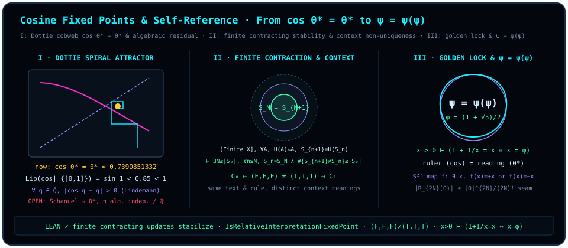

# 第二十四章 余弦不动点与自指：从 $\cos\theta = \theta$ 到 $\psi = \psi(\psi)$

> *“如果cos(theta)=theta, 那cos哪里来的? cos=theta?”*
>
> *“这就是我们最早研究的psi=psi(psi)”*

走过整整二十三章的跋涉，我们终于站在了第六部《越界·球外之球》的压轴关口，也站在了全书哲学与几何直觉的最高峰上。

让我们把全书从第一页起就埋下的那条主线拉直：

- 在[第一章](ch01-measurement.md)与[第二章](ch02-born-rule.md)里，我们砍掉了游离在两子之外的“第 3 点 $C$”，证明当已知基准态 $\vv{a}$ 去丈量（liáng）目标态 $\vv{b}$ 时，两子张开的夹角 $\theta$ 直接通过内积投影吐出相融刻度 $\cos\theta$；
- 在[第二十一章](ch21-diagonalization-and-escape.md)里，我们看到只要“丈量的语言（满射解码器目录）”与“被丈量的对象（潜坐标）”被割裂成两层且伴随无不动点翻转 `twist`，相对语义对角线就会撕裂旧划分拓扑，迫使观测拓扑向更高维的联合读出严格加细（并在每次扩容地址集重建满射目录时继续向外逃逸）。

那么，怎样才能让这场无穷无尽的“球外之球”追逐停下来，收束为一个自给自足、无需外求的**自指不动点（self-referential fixed point）**？

答案就在本章题记那句看似天真、实则石破天惊的追问里：既然宇宙外面没有第三把公证的尺子，那么**上一轮两子比量切出的相融度读数 $\cos\theta$，在下一轮就只能直接充当继续张开的弧度角 $\theta$ 本身！** 当反复迭代 $\theta_{k+1} = \cos\theta_k$ 抵达不动点

$$
\cos\theta^* = \theta^* \qquad (\theta^* \approx 0.7390851332\dots)
$$

的那一刹那，请再问一次：**在这个式子里，左边那个名叫 $\cos$ 的算子究竟是从哪里来的？难道在算子 $\cos$ 之外，还另有一个叫 $\theta^*$ 的赤裸数字吗？**

不！在正交比较的几何本体论里，根本没有先验悬浮的外部算子 $\cos$，也没有脱离了比量动作而孤立存在的刻度 $\theta^*$。$\cos(\cdot)$ 就是“正交投影丈量”这一动作本身（偶次往返、每两步正交转向反号 $\hat{I}^2 = -1$、约去排列次序的级数生成元），而 $\theta^*$ 就是这一动作作用于自身时锁定的自洽平衡态。当丈量的尺子（算子 $\cos$ / 函数 $\psi$）与被丈量的刻度（状态 $\theta^*$ / 自变量 $\psi$）在不动点处彻底消融了主客二分的界限，“$\cos = \theta$”便化作了本书扉页那行最纯粹的自指闭环方程：

$$
\psi = \psi(\psi).
$$

在本章中，我们将用严密的数学与 Lean 4 形式化定理，把这幅自指画卷拆解为四个相互辉映的层次：**有限状态空间上的单调收缩稳定化定理**、**相邻步解释语境相对不动点与语境非唯一性定理**、**正实数上黄金连分数自指映射 $x = 1 + 1/x$ 的唯一代数不动点定理**，以及收录在文献注记 [@rem-banach-dottie-hairy-ball-literature] 与 [@rem-dottie-angle-incommensurable] 中的**Dottie 余弦自指 $\cos\theta^* = \theta^*$ 的经典分析与超越数论背景**。

## 24.1 离散收缩的必然收束：有限收缩更新稳定化定理 {#sec-ch24-1}

为什么任意无约束的自指（如二十一章中带无不动点翻转 `twist` 的对角线 $g(a) = \neg D_a(q_L(a))$）会引发永不休止的震荡或升维逃逸，而有些自指反馈却能稳稳停在一个不动点上？

关键在于算子是否具备**收缩性（contractivity）**！在连续区间 $[0, 1]$ 上，$\cos$ 之所以能把任意初值拉向唯一不动点 $\theta^*$，是因为它的导数模长满足 $|\cos'\theta| = |\sin\theta| \le \sin 1 < 1$，每迭代一次就把区间长度压缩一截；而在离散有限状态世界里，与之精确对应的机制则是**逐点向内收缩的集合更新算子** $U : \mathcal{P}(X) \to \mathcal{P}(X)$（满足 $\forall A \subseteq X,\; U(A) \subseteq A$）。

让我们在 Lean 模块 `D5/S1/FixedPoints/FiniteContractingStability` 中，严格建立这条离散收缩稳定化定理。请特别留意定理盒内完整保留的每一项前提（有限类型 `[Finite X]`、逐点子集收缩 `hU : ∀ A, U A ⊆ A` 与递推更新律 `hS : ∀ n, S (n + 1) = U (S n)`）及其双重结论：不仅序列必在至多 $|S_0|$ 步内抵达不动点 $U(S_N) = S_N$，而且在整个无穷时间轴上发生严格状态改变的步数总和也受到初始规模 $|S_0|$ 的精确上界约束！

::: {.theorem #thm-finite-contracting-updates-stabilize title="有限状态空间上收缩集合更新的稳定化与严格变化次数上界定理" lean="D5/S1/FixedPoints/FiniteContractingStability.finite_contracting_updates_stabilize"}
设 $X$ 为有限类型（`[Finite X]`），$U : \operatorname{Set} X \to \operatorname{Set} X$ 为集合更新映射，$S : \mathbb{N} \to \operatorname{Set} X$ 为子集序列。若同时满足：

1. **逐点向内收缩性（`hU`）**：对任意子集 $A \subseteq X$，均有 $U(A) \subseteq A$；
2. **递推演化律（`hS`）**：对任意步数 $n \in \mathbb{N}$，均有 $S(n + 1) = U(S(n))$；

则以下两项结论同时成立（其中 `.ncard` 表示集合的自然数基数）：

1. **有限步内抵达不动点并永久稳定**：存在稳定化步数 $N \le (S(0)).\mathrm{ncard}$，使得对一切 $n \ge N$ 均有

   $$
   S(n) = S(N) \qquad \bigl(\text{特别地 } U(S(N)) = S(N+1) = S(N)\bigr)\,;
   $$

2. **严格变化步数的精确上界**：序列发生严格改变的时刻集合之基数不超过初始集合基数：

   $$
   \bigl\{\, n \in \mathbb{N} \;\big|\; S(n + 1) \neq S(n) \,\bigr\}.\mathrm{ncard} \;\le\; (S(0)).\mathrm{ncard}.
   $$
:::

::: proof
首先由 `hS` 与 `hU` 知对每个 $n \in \mathbb{N}$ 有 $S(n+1) = U(S(n)) \subseteq S(n)$，故集合序列 $S$ 单调递减（`Antitone S`），其有限基数序列 $n \mapsto (S(n)).\mathrm{ncard} \in \mathbb{N}$ 亦单调非增。其次，一旦某一步基数停止下降，即 $(S(n)).\mathrm{ncard} = (S(n+1)).\mathrm{ncard}$，由于有限集的子集与母集基数相等必全等（`Set.eq_of_subset_of_ncard_le`），立得集合不动点 $S(n+1) = S(n)$；两边再作用算子 $U$ 并由 `hS` 递推，即得 $S(n+2) = U(S(n+1)) = U(S(n)) = S(n+1)$，从而后续所有步的集合与基数全部锁死不变。对非增自然数序列应用 Mathlib 的稳定化引理 `Nat.stabilises_of_antitone`，即得存在 $N \le (S(0)).\mathrm{ncard}$ 使对一切 $n \ge N$ 均有 $S(n) = S(N)$（结论 1）。再证结论 2：对任意 $n \ge N$，因 $n+1 \ge N$，有 $S(n+1) = S(N) = S(n)$，故一切满足 $S(n+1) \neq S(n)$ 的严格变化下标 $n$ 必落在有限初始段 $\operatorname{Set.Iio}(N) = \{0, 1, \dots, N-1\}$ 内。由子集基数单调性知严格变化时刻的个数不超过 $|\operatorname{Iio}(N)| = N \le (S(0)).\mathrm{ncard}$。完整证明由 Lean 内核检查。
:::

[@thm-finite-contracting-updates-stabilize] 为我们在有限精度数字电路与有限概念格上理解自指不动点提供了最坚实的离散基石：只要每一次自省更新都在筛除不相容冗余（$U(A) \subseteq A$）而不凭空捏造外部发散项，有限系统必然在不超过初始状态数 $|S_0|$ 的有限步内收敛到满足 $U(S_N) = S_N$ 的自洽内核！

## 24.2 语境相对解释不动点与语境非唯一性 {#sec-ch24-2}

现在，让我们把目光投向更一般的人类认知与物理测量过程：当一个观察者（或形式解释器）面对概念序列 $c_0, c_1, c_2, \dots$ 时，什么叫做在第 $n$ 步“解释达到了单步相对不动点”？这颗固定意义是脱离观察者背景而绝对唯一的，还是依赖于观察者所选的**解释语境（interpretation context）**？

在 Lean 模块 `D5/S3/ConceptDynamics/Interpretation/InterpretationFixedPoint` 中，解释语境被显式刻画为包含文本（`text`）、读者准入预设（`readerAdmission`）、背景知识（`background`）、评估目标（`evaluationGoal`）与解释规则（`interpretationRule`）的五元组结构体。

::: {.definition #def-relative-interpretation-fixed-point title="解释语境、相对解释不动点与二元固定意义谓词" lean="D5/S3/ConceptDynamics/Interpretation/InterpretationFixedPoint.InterpretationContext D5/S3/ConceptDynamics/Interpretation/InterpretationFixedPoint.IsRelativeInterpretationFixedPoint D5/S3/ConceptDynamics/Interpretation/InterpretationFixedPoint.IsBinaryFixedMeaning"}
在模块 `InterpretationFixedPoint` 中：

1. **解释语境结构体** [`InterpretationContext`](lean:D5/S3/ConceptDynamics/Interpretation/InterpretationFixedPoint.InterpretationContext) 由五个分量构成：文本 `text`、读者准入 `readerAdmission`、背景 `background`、评估目标 `evaluationGoal` 与解释规则 `interpretationRule`；
2. **相对解释不动点** [`IsRelativeInterpretationFixedPoint`](lean:D5/S3/ConceptDynamics/Interpretation/InterpretationFixedPoint.IsRelativeInterpretationFixedPoint)：给定概念等价关系 $\sim_C : \mathrm{Concept} \to \mathrm{Concept} \to \mathrm{Prop}$、语境依赖的解释映射 $\operatorname{interpret} : \mathrm{Context} \to \mathrm{Concept} \to \mathrm{Meaning}$、概念演化序列 $c : \mathbb{N} \to \mathrm{Concept}$ 与固定语境 $\mathcal{C}$，称第 $n$ 步达到**相对解释不动点**，若相邻两步概念在 $\sim_C$ 下等价且在语境 $\mathcal{C}$ 下给出完全相同的解释意义：

   $$
   c(n+1) \sim_C c(n) \;\land\; \operatorname{interpret}(\mathcal{C}, c(n+1)) = \operatorname{interpret}(\mathcal{C}, c(n)) \,;
   $$

3. **二元固定意义谓词** [`IsBinaryFixedMeaning`](lean:D5/S3/ConceptDynamics/Interpretation/InterpretationFixedPoint.IsBinaryFixedMeaning)：在二元语境类型 $\mathrm{BinaryInterpretationContext} = \operatorname{InterpretationContext}\ \mathrm{Unit}\ \mathrm{Bool}\ \mathrm{Bool}\ \mathrm{Bool}\ \mathrm{Unit}$ 上，定义意义三元组 $m \in \mathrm{Bool}^3$ 为语境 $\mathcal{C}$ 的固定意义，若 $m = (\mathcal{C}.\mathrm{readerAdmission},\, \mathcal{C}.\mathrm{background},\, \mathcal{C}.\mathrm{evaluationGoal})$。
:::

紧接着 [@def-relative-interpretation-fixed-point]，两条经过 Lean 内核验证的定理分别刻画了**相邻步概念与解释一致的封装判据**以及**不同语境下固定意义的非唯一性**。需要特别指出的是：与 §24.1 的有限集收缩定理（[@thm-finite-contracting-updates-stabilize]）或 §24.4 的巴拿赫压缩映射不同，[`IsRelativeInterpretationFixedPoint`](lean:D5/S3/ConceptDynamics/Interpretation/InterpretationFixedPoint.IsRelativeInterpretationFixedPoint) 只检验指定下标 $n$ 处相邻两步 $c(n+1)$ 与 $c(n)$ 的单步一致性，并不对后续步数 $m > n$ 施加递推演化律或渐近收敛假设（例如序列 $0, 0, 1, 1, \dots$ 在相等关系与恒等解释下于 $n = 0$ 处满足该谓词，而在 $n = 1$ 处发生改变）；同样地，下面的二元语境命题展示的是**两个不同静态语境各自对应不同的固定意义（语境非唯一性）**，而非单一自治动力系统的吸引子分岔或双稳态演化。

::: {.lemma #lem-conceptual-equivalence-stability-fixed-point title="相邻概念等价与解释结果稳定共同抵达相对解释不动点" lean="D5/S3/ConceptDynamics/Interpretation/InterpretationFixedPoint.conceptual_equivalence_and_stability_reach_fixed_point"}
设 `Text`、`ReaderAdmission`、`Background`、`EvaluationGoal`、`Rule`、`Concept`、`Meaning` 为任意类型。给定概念等价谓词 $\operatorname{conceptuallyEquivalent} : \mathrm{Concept} \to \mathrm{Concept} \to \mathrm{Prop}$、解释函数 $\operatorname{interpret}$、概念序列 $\operatorname{concepts} : \mathbb{N} \to \mathrm{Concept}$、语境 $\operatorname{context}$ 与步数 $n \in \mathbb{N}$。若：

1. **概念等价（`hConcept`）**：$\operatorname{conceptuallyEquivalent}(\operatorname{concepts}(n+1), \operatorname{concepts}(n))$；
2. **解释稳定（`hStable`）**：$\operatorname{interpret}(\operatorname{context}, \operatorname{concepts}(n+1)) = \operatorname{interpret}(\operatorname{context}, \operatorname{concepts}(n))$；

则序列在语境 $\operatorname{context}$ 与步数 $n$ 处达到相对解释不动点：

$$
\operatorname{IsRelativeInterpretationFixedPoint}(\operatorname{conceptuallyEquivalent}, \operatorname{interpret}, \operatorname{concepts}, \operatorname{context}, n).
$$
:::

::: proof
展开 [@def-relative-interpretation-fixed-point] 中 [`IsRelativeInterpretationFixedPoint`](lean:D5/S3/ConceptDynamics/Interpretation/InterpretationFixedPoint.IsRelativeInterpretationFixedPoint) 的合取定义，直接将前提 `hConcept` 与 `hStable` 通过逻辑合取引入规则 `And.intro` 组合即得。完整证明由 Lean 内核检查。
:::

现在问：如果两个观察者手捧**完全相同的文本**（`text` 相同），并且遵守**完全相同的形式推演规则**（`interpretationRule` 相同），仅仅因为他们带的先验准入视角（`readerAdmission`）、背景参照系（`background`）与评估目标（`evaluationGoal`）不同，这两个语境所选定的固定意义（[`IsBinaryFixedMeaning`](lean:D5/S3/ConceptDynamics/Interpretation/InterpretationFixedPoint.IsBinaryFixedMeaning)）会不会截然不同？

下面的命题用构造性的二元语境对 [`baselineContext`](lean:D5/S3/ConceptDynamics/Interpretation/InterpretationFixedPoint.baselineContext) 与 [`alternateContext`](lean:D5/S3/ConceptDynamics/Interpretation/InterpretationFixedPoint.alternateContext) 给出了斩钉截铁的肯定回答，严格证实了固定意义的**语境参数非唯一性**（在几何类比上，恰如量子测量中选北极 $+\vv{e}_3$ 为基与选南极 $-\vv{e}_3$ 为基各自关联不同的投影本征态，或正演方程 $\cos\theta = +\theta$ 与镜像方程 $\cos\theta = -\theta$ 各自拥有互异的根 $+\theta^*$ 与 $-\theta^*$）！

::: {.proposition #prop-context-parameters-distinct-fixed-points title="固定文本与规则下语境参数改变可选择互异的不动点" lean="D5/S3/ConceptDynamics/Interpretation/InterpretationFixedPoint.context_parameters_can_select_distinct_fixed_points"}
对模块 `InterpretationFixedPoint` 中定义的基准语境 [`baselineContext`](lean:D5/S3/ConceptDynamics/Interpretation/InterpretationFixedPoint.baselineContext)（取值为 $((), \mathrm{false}, \mathrm{false}, \mathrm{false}, ())$）与备择语境 [`alternateContext`](lean:D5/S3/ConceptDynamics/Interpretation/InterpretationFixedPoint.alternateContext)（取值为 $((), \mathrm{true}, \mathrm{true}, \mathrm{true}, ())$），以下八项合取性质同时成立：

1. **同一文本**：$\operatorname{baselineContext}.\mathrm{text} = \operatorname{alternateContext}.\mathrm{text}$；
2. **同一解释规则**：$\operatorname{baselineContext}.\mathrm{interpretationRule} = \operatorname{alternateContext}.\mathrm{interpretationRule}$；
3. **准入预设不同**：$\operatorname{baselineContext}.\mathrm{readerAdmission} \neq \operatorname{alternateContext}.\mathrm{readerAdmission}$；
4. **背景不同**：$\operatorname{baselineContext}.\mathrm{background} \neq \operatorname{alternateContext}.\mathrm{background}$；
5. **评估目标不同**：$\operatorname{baselineContext}.\mathrm{evaluationGoal} \neq \operatorname{alternateContext}.\mathrm{evaluationGoal}$；
6. **基准语境锁定全假不动点**：$\operatorname{IsBinaryFixedMeaning}\ \operatorname{baselineContext}\ (\mathrm{false}, \mathrm{false}, \mathrm{false})$；
7. **备择语境锁定全真不动点**：$\operatorname{IsBinaryFixedMeaning}\ \operatorname{alternateContext}\ (\mathrm{true}, \mathrm{true}, \mathrm{true})$；
8. **两处不动点严格互异**：$(\mathrm{false}, \mathrm{false}, \mathrm{false}) \neq (\mathrm{true}, \mathrm{true}, \mathrm{true})$。
:::

::: proof
前两项等式在单位类型 `Unit` 上由自反律 `rfl` 直接成立；第 3、4、5 项不等式由布尔判别定理 `Bool.false_ne_true` 给出；第 6、7 项展开 [`IsBinaryFixedMeaning`](lean:D5/S3/ConceptDynamics/Interpretation/InterpretationFixedPoint.IsBinaryFixedMeaning) 后由 `rfl` 核验；第 8 项对乘积三元组的第一投影 `Prod.fst` 应用 `congrArg` 归约为 `false = true`，再由 `Bool.false_ne_true` 导出矛盾。完整证明由 Lean 内核检查。
:::

（顺带指出，在同一模块中，定理 [`objective_claim_requires_invariant_common_factor`](lean:D5/S3/ConceptDynamics/Interpretation/InterpretationFixedPoint.objective_claim_requires_invariant_common_factor) 进一步指出：若要在不同语境的相对不动点之上声称某种跨语境的“客观不变量”，就必须显式提供一把在所有语境不动点上取值恒等的公共不变量投影函数 `factor`——正如我们在[第二章](ch02-born-rule.md)用基无关的迹配对 $\Tr(\rho P)$ 统一不同正交基下的坐标读数！）

## 24.3 代数自指的唯一黄金锁：$x = 1 + 1/x$ 与 $\varphi = \frac{1+\sqrt{5}}{2}$ {#sec-ch24-3}

在进入余弦自指方程 $\cos\theta = \theta$（§24.4）之前，让我们先在实数轴 $(0, +\infty)$ 上看清最纯粹的**有理分式自指不动点**：

把最简单的算术操作“加 $1$”与“取倒数 $1/x$”组合成一架自指反馈机：

$$
x_{k+1} = 1 + \frac{1}{x_k} = 1 + \frac{1}{1 + \frac{1}{1 + \frac{1}{\ddots}}}.
$$

这正是我们在[第二十三章](ch23-diophantine-definability.md)研究黄金整数佩尔方程时遇到的连分数生成元！在 Lean 模块 `D5/S1/FixedPoints/Algebraic/GoldenFixedPoint` 中，这一倒数残差自指映射被定义为 [`goldenReciprocalMap`](lean:D5/S1/FixedPoints/Algebraic/GoldenFixedPoint.goldenReciprocalMap)。

::: {.definition #def-golden-reciprocal-map title="黄金倒数自指映射 goldenReciprocalMap" lean="D5/S1/FixedPoints/Algebraic/GoldenFixedPoint.goldenReciprocalMap"}
在实数域 $\mathbb{R}$ 上，定义**黄金倒数自指映射** [`goldenReciprocalMap`](lean:D5/S1/FixedPoints/Algebraic/GoldenFixedPoint.goldenReciprocalMap) $: \mathbb{R} \to \mathbb{R}$ 为

$$
\operatorname{goldenReciprocalMap}(x) \;:=\; 1 + \frac{1}{x}.
$$
:::

下面的推论严格证明：在全体正实数 $x > 0$ 的广阔天地里，无需任何外部预设，自指方程 $\operatorname{goldenReciprocalMap}(x) = x$ **存在且仅存在唯一的一颗正实数不动点**——黄金分割比 $\varphi = \frac{1 + \sqrt{5}}{2}$！

::: {.corollary #cor-golden-fixed-point-unique title="黄金分割比是倒数自指映射在正实数上的唯一不动点" lean="D5/S1/FixedPoints/Algebraic/GoldenFixedPoint.golden_fixed_point_unique"}
对 [@def-golden-reciprocal-map] 中的映射 $\operatorname{goldenReciprocalMap}(x) = 1 + 1/x$，记显式根式常数为 $\varphi = \frac{1 + \sqrt{5}}{2} \in \mathbb{R}$，则以下三项性质同时成立：

1. **正性**：$0 < \frac{1 + \sqrt{5}}{2}$；
2. **不动点成立**：$\operatorname{goldenReciprocalMap}\left(\frac{1 + \sqrt{5}}{2}\right) = \frac{1 + \sqrt{5}}{2}$；
3. **正实数域上的唯一性充要刻画**：对任意正实数 $x \in \mathbb{R}$（$0 < x$），

   $$
   \operatorname{goldenReciprocalMap}(x) = x \quad\Longleftrightarrow\quad x = \frac{1 + \sqrt{5}}{2}.
   $$
:::

::: proof
首先利用 [`golden_ratio_spec`](lean:D5/S0/Carrier/GoldenRatio.golden_ratio_spec) 将 $\frac{1 + \sqrt{5}}{2}$ 改写为 Mathlib 的 `Real.goldenRatio`。结论 1 直接由 `Real.goldenRatio_pos` 给出；结论 2 由倒数不动点恒等式 `golden_ratio_reciprocal_fixed_point`（$1 + 1/\varphi = \varphi$）给出。对结论 3，任取 $x > 0$（从而 $x \neq 0$）：若 $x = \varphi$，代入结论 2 即得不动点方程；反之，若 $1 + 1/x = x$，两边同乘非零实数 $x$（调用 `quadratic_fixed_point_iff`）等价转化为二次代数方程 $x^2 = x + 1$。结合 $\varphi^2 = \varphi + 1$，将两式相减作因式分解：

$$
(x - \varphi)(x + \varphi - 1) = x^2 - \varphi^2 - (x - \varphi) = (x + 1) - (\varphi + 1) - x + \varphi = 0.
$$

由实数域无零因子性知 $x - \varphi = 0$ 或 $x + \varphi - 1 = 0$。但因 $x > 0$ 且 $\varphi > 1$（`Real.one_lt_goldenRatio`），第二个因子严格为正：$x + \varphi - 1 > 0 + 1 - 1 = 0$，绝不可能为零！故必有 $x = \varphi = \frac{1 + \sqrt{5}}{2}$。完整证明由 Lean 内核检查。
:::

[@cor-golden-fixed-point-unique] 回答了“$1 + 1/x$ 的不动点是什么”，却绕过了一个更靠前的问题：**为什么是 $1 + 1/x$？** 说它是“最简单的加一与取倒数的组合”只是印象。要把印象变成定理，就得把同类映射全部列出来，逐个检查。

“同类”指系数只取 $0$ 与 $1$ 的分式线性映射 $x \mapsto \frac{ax + b}{cx + d}$。令它等于 $x$ 并通分，得到不动点方程

$$
c\,x^2 + (d - a)\,x - b \;=\; 0,
$$

其判别式为 $(d - a)^2 + 4bc$。Lean 模块 `D5/S0/Diagonal/SelfApplicationFates` 把这些量逐一定义出来，并按方程的样子给每个映射判一种“自作用命运”。

::: {.definition #def-binary-fractional-map-fates title="二元分式映射、不动点系数、判别式与四种自作用命运" lean="D5/S0/Diagonal/SelfApplicationFates.BinaryFractionalMap D5/S0/Diagonal/SelfApplicationFates.determinant D5/S0/Diagonal/SelfApplicationFates.Nondegenerate D5/S0/Diagonal/SelfApplicationFates.fixedCoefficients D5/S0/Diagonal/SelfApplicationFates.discriminant D5/S0/Diagonal/SelfApplicationFates.SelfApplicationFate D5/S0/Diagonal/SelfApplicationFates.HasFate D5/S0/Diagonal/SelfApplicationFates.IsPhiFamily"}
在模块 `SelfApplicationFates` 中：

1. **二元分式映射** [`BinaryFractionalMap`](lean:D5/S0/Diagonal/SelfApplicationFates.BinaryFractionalMap) 是由四个取值于 $\operatorname{Fin} 2 = \{0, 1\}$ 的分量 $a, b, c, d$ 构成的结构体；
2. **行列式** [`determinant`](lean:D5/S0/Diagonal/SelfApplicationFates.determinant) 定义为整数 $\operatorname{determinant} m = a\,d - b\,c$；称 $m$ **非退化**（[`Nondegenerate`](lean:D5/S0/Diagonal/SelfApplicationFates.Nondegenerate)），若 $\operatorname{determinant} m \neq 0$；
3. **不动点系数** [`fixedCoefficients`](lean:D5/S0/Diagonal/SelfApplicationFates.fixedCoefficients) 定义为整数三元组 $\operatorname{fixedCoefficients} m = (c,\; d - a,\; -b)$；
4. **判别式** [`discriminant`](lean:D5/S0/Diagonal/SelfApplicationFates.discriminant) 定义为整数 $\operatorname{discriminant} m = (d - a)^2 + 4\,b\,c$；
5. **自作用命运** [`SelfApplicationFate`](lean:D5/S0/Diagonal/SelfApplicationFates.SelfApplicationFate) 是恰有四个构造子 `empty`、`dead`、`collapse`、`live` 的归纳类型；谓词 [`HasFate`](lean:D5/S0/Diagonal/SelfApplicationFates.HasFate) $m$ 在四个构造子上分别定义为：
   - `empty`：$\operatorname{fixedCoefficients} m = (0, 0, 0)$；
   - `dead`：$\operatorname{fixedCoefficients} m = (0, 0, -1)$；
   - `collapse`：$\operatorname{discriminant} m = 0$ 或 $\operatorname{discriminant} m = 4$，并且 $\operatorname{fixedCoefficients} m \neq (0, 0, 0)$，并且 $\operatorname{fixedCoefficients} m \neq (0, 0, -1)$；
   - `live`：$\operatorname{discriminant} m = 5$；
6. **$\varphi$ 族** [`IsPhiFamily`](lean:D5/S0/Diagonal/SelfApplicationFates.IsPhiFamily) $m$ 定义为 $(a, b, c, d) = (1, 1, 1, 0)$ 或 $(a, b, c, d) = (0, 1, 1, 1)$。
:::

把四个比特 $(a, b, c, d)$ 读成映射 $x \mapsto \frac{ax+b}{cx+d}$ 是本书的解读；[@def-binary-fractional-map-fates] 中的 Lean 定义只涉及这四个比特和由它们算出的整数。（同一模块另有 [`fixedPolynomial`](lean:D5/S0/Diagonal/SelfApplicationFates.fixedPolynomial)，它在有理数 $x$ 处取值 $c\,x^2 + (d - a)\,x - b$，正是上面那条不动点方程的左端。）四种命运的名字各有所指：`empty` 是方程 $0 = 0$，每个点都是不动点，方程不含任何信息；`dead` 是方程 $-1 = 0$，没有不动点；`collapse` 是判别式为完全平方数 $0$ 或 $4$ 的情形，根落回有理数；`live` 是判别式为 $5$ 的情形，根是无理数。

::: {.theorem #thm-self-application-four-fates title="非退化二元分式映射的四种自作用命运与 φ 族的刻画" lean="D5/S0/Diagonal/SelfApplicationFates.self_application_four_fates"}
设 $m$ 为二元分式映射（[@def-binary-fractional-map-fates]），且 $m$ 非退化（`hm : Nondegenerate m`）。则以下四项同时成立：

1. **命运存在且唯一**：存在唯一的 $\mathrm{fate}$ 使 $\operatorname{HasFate}\ m\ \mathrm{fate}$ 成立；
2. **`live` 当且仅当属于 $\varphi$ 族**：

   $$
   \operatorname{HasFate}\ m\ \mathtt{live} \quad\Longleftrightarrow\quad \operatorname{IsPhiFamily}\ m\,;
   $$

3. **`live` 时的不动点系数**：若 $\operatorname{HasFate}\ m\ \mathtt{live}$，则 $\operatorname{fixedCoefficients} m = (1, -1, -1)$ 或 $\operatorname{fixedCoefficients} m = (1, 1, -1)$；
4. **`live` 时的判别式**：若 $\operatorname{HasFate}\ m\ \mathtt{live}$，则 $\operatorname{discriminant} m = 1^2 + 4$。
:::

::: proof
`BinaryFractionalMap` 只有 $2^4 = 16$ 个元素。证明先把 $m$ 拆成四个分量并对每个分量分 $0$、$1$ 两种情形（`fin_cases`），用 `norm_num` 化简前提 `hm`，退化的情形随即被排除。在余下的每个情形里，结论 1 的存在性由直接给出对应的构造子并用 `decide` 判定得到，唯一性则对四个构造子逐一分情形、展开 `HasFate`、`fixedCoefficients` 与 `discriminant` 后化简得到；结论 2、3、4 都是有限情形上的可判定命题，由 `decide` 判定。完整证明由 Lean 内核检查。
:::

非退化的二元分式映射一共只有六个，可以全部摆上桌面。

::: {.example #ex-six-binary-fractional-maps title="六个非退化二元分式映射的逐一枚举"}
行列式 $ad - bc \neq 0$ 且 $a, b, c, d \in \{0, 1\}$ 的四元组恰有六个：$a = d = 1$ 且 $bc = 0$ 的三个，以及 $b = c = 1$ 且 $ad = 0$ 的三个。逐一计算 [@def-binary-fractional-map-fates] 中的量：

| $(a, b, c, d)$ | 映射 $x \mapsto \frac{ax+b}{cx+d}$ | 不动点方程 | 判别式 | 命运 | 实不动点 |
| :---: | :---: | :---: | :---: | :---: | :---: |
| $(1, 0, 0, 1)$ | $x \mapsto x$ | $0 = 0$ | $0$ | `empty` | 每个 $x$ |
| $(1, 1, 0, 1)$ | $x \mapsto x + 1$ | $-1 = 0$ | $0$ | `dead` | 无 |
| $(1, 0, 1, 1)$ | $x \mapsto \frac{x}{x+1}$ | $x^2 = 0$ | $0$ | `collapse` | $0$ |
| $(0, 1, 1, 0)$ | $x \mapsto \frac{1}{x}$ | $x^2 - 1 = 0$ | $4$ | `collapse` | $\pm 1$ |
| $(1, 1, 1, 0)$ | $x \mapsto 1 + \frac{1}{x}$ | $x^2 - x - 1 = 0$ | $5$ | `live` | $\varphi,\ -\varphi^{-1}$ |
| $(0, 1, 1, 1)$ | $x \mapsto \frac{1}{1+x}$ | $x^2 + x - 1 = 0$ | $5$ | `live` | $\varphi^{-1},\ -\varphi$ |

每一行恰有一种命运，与 [@thm-self-application-four-fates] 的结论 1 一致；`live` 的两行正是 $\varphi$ 族，不动点系数分别为 $(1, -1, -1)$ 与 $(1, 1, -1)$，与结论 2、3 一致。两个 `live` 映射互为共轭：若 $x = 1 + 1/x$，则 $y = 1/x$ 满足 $y = 1/(1 + y)$。
:::

所以 $1 + 1/x$ 不是随手挑的。在用 $0$ 和 $1$ 能写出的全部六个非退化分式映射里，一个什么都没说，一个无处可停，两个停在有理数上，只有 $1 + 1/x$ 和它的共轭 $1/(1+x)$ 停在有理数够不到的地方。[@cor-golden-fixed-point-unique] 已经算出前者在正实数上的唯一不动点；后者的对应结论同样有冻结的 Lean 证明。

::: {.lemma #lem-golden-inverse-branch-fixed-point title="映射 1/(1+x) 在正实数上的唯一不动点是黄金比的倒数" lean="D5/S3/Analytic/Characterizations/GoldenInverseBranchFixedPoint.golden_inverse_branch_positive_fixed_point_iff"}
对任意实数 $x$，若 $0 < x$，则

$$
\frac{1}{x + 1} = x \quad\Longleftrightarrow\quad x = \varphi^{-1},
$$

其中 $\varphi$ 为 Mathlib 的 `Real.goldenRatio`。
:::

::: proof
先从 `golden_transfer_triangle` 取出恒等式 $\varphi - 1 = \varphi^{-1}$。正向：由 $x > 0$ 知 $x + 1 \neq 0$，于是 $\frac{1}{x+1} = x$ 等价于 $1 = x\,(x + 1)$；结合 $\varphi^2 = \varphi + 1$（`Real.goldenRatio_sq`）与 $\varphi > 1$（`Real.one_lt_goldenRatio`），非线性算术给出 $x = \varphi - 1 = \varphi^{-1}$。反向：代入 $x = \varphi^{-1}$，由 $\varphi^{-1} + 1 = \varphi$ 得 $\frac{1}{\varphi^{-1} + 1} = \frac{1}{\varphi} = \varphi^{-1}$。完整证明由 Lean 内核检查。
:::

到这里，黄金自指还是一件纯代数的事：加法、除法、一个二次方程。§24.4 将把它与余弦自指 $\cos\theta = \theta$ 放在一起对比（后者的经典分析与算术性质见 §24.4 的文献注记）。但这两种自指并非互不相干。黄金比本身就是一个余弦读数，读的是正五边形的角。

::: {.proposition #prop-pentagon-golden-cosines title="正五边形的倍余弦读出黄金比、它的倒数与 √5" lean="D5/S3/Constants/PentagonCosines.pentagon_golden_cosines"}
记 $\varphi$ 为 Mathlib 的 `Real.goldenRatio`。以下四项同时成立：

1. $2\cos\dfrac{\pi}{5} = \varphi$；
2. $2\cos\dfrac{2\pi}{5} = \varphi^{-1}$；
3. $2\cos\dfrac{\pi}{5} + 2\cos\dfrac{2\pi}{5} = \sqrt{5}$；
4. $2\cos\dfrac{2\pi}{5}$ 是无理数。
:::

::: proof
结论 1 由 Mathlib 的闭式 `Real.cos_pi_div_five`（$\cos\frac{\pi}{5} = \frac{1 + \sqrt5}{4}$）乘以 $2$ 得到。对结论 2，把 $\frac{2\pi}{5}$ 写成 $2\cdot\frac{\pi}{5}$，用倍角公式 $\cos 2\alpha = 2\cos^2\alpha - 1$ 与同一闭式算出 $\cos\frac{2\pi}{5} = \frac{\sqrt5 - 1}{4}$（其中用到 $(\sqrt5)^2 = 5$），再由 `Real.inv_goldenRatio` 把 $\varphi^{-1}$ 改写为 $-\frac{1 - \sqrt5}{2}$ 对上。结论 3 把前两项相加，由 `Real.goldenRatio_sub_goldenConj` 得 $\sqrt5$。结论 4 由 $\varphi$ 的无理性（`Real.goldenRatio_irrational`）经取倒数保持无理性得到。完整证明由 Lean 内核检查。
:::

把 [@prop-pentagon-golden-cosines] 的前两项代入黄金不动点方程 $1 + \varphi^{-1} = \varphi$（[@cor-golden-fixed-point-unique] 的结论 2），它就变成一条三角恒等式：

$$
1 + 2\cos\frac{2\pi}{5} \;=\; 2\cos\frac{\pi}{5}.
$$

黄金自指是正五边形里的一条长度关系：单位边长的正五边形，对角线长为 $2\cos\frac{\pi}{5} = \varphi$。于是 $\varphi$ 也是余弦读数，读在 $\frac{\pi}{5}$ 处并落在二次代数数域 $\mathbb{Q}(\sqrt{5})$ 内；至于当角本身等于自己的余弦（$\cos\theta^* = \theta^*$）时，其算术性质与是否与 $\pi$ 可公度，将在下一节的文献注记 [@rem-banach-dottie-hairy-ball-literature] 与 [@rem-dottie-angle-incommensurable] 中给出。

## 24.4 从 $\cos\theta^* = \theta^*$ 到 $\psi = \psi(\psi)$：经典分析、截断裂缝与球面不动点二分 {#sec-ch24-4}

现在，把 [@cor-golden-fixed-point-unique] 中的代数自指 $x = 1 + 1/x$（只涉及一维有理加除，锁在二次代数数 $\varphi = \frac{1+\sqrt{5}}{2}$ 上），与球面内积投影的**余弦自指**

$$
\cos\theta^* = \theta^*
$$

放在一起对比！当自指算子从一维有理分式 $1 + 1/x$ 升级为二维旋转投影 $\cos\theta$ 时，实不动点 $\theta^* \approx 0.7390851332\dots$（**Dottie 数**）在经典分析与数论中具有怎样的存在唯一性与算术地位？

下面的文献说明集中记录围绕 $\cos\theta = \theta$ 与偶维球面连续自映射的四项经典定理。

::: {.remark #rem-banach-dottie-hairy-ball-literature title="巴拿赫压缩映射、Dottie 数的超越性、泰勒余项界与偶维球面不动点/对跖点定理（文献结果，未在本书形式化）"}
**文献结果，未在本书形式化。** 围绕余弦自指方程 $\cos\theta = \theta$ 与高维球面自映射，经典实分析、超越数论与代数拓扑给出以下四项严格定理（与本章的冻结 Lean 定理共同构成完整图景）：

1. **紧区间 $[0, 1]$ 上的巴拿赫压缩映射原理与全局收敛（Banach Contraction Principle）**：
   与 [@thm-finite-contracting-updates-stabilize] 处理离散有限集 $X$ 上的子集单调收缩 $U(A) \subseteq A$ 相对偶，在连续实轴 $\mathbb{R}$ 上，余弦函数将全实轴映入 $[-1, 1]$，并将 $[-1, 1]$ 映入紧不变子区间 $[0, 1]$（因 $\cos([0, 1]) = [\cos 1, 1] \subset [0.54, 1] \subset [0, 1]$）。在 $[0, 1]$ 上，由微分中值定理，对任意 $x, y \in [0, 1]$ 有

   $$
   |\cos x - \cos y| \;\le\; (\sin 1)\,|x - y|, \qquad \sin 1 \approx 0.84147098 < 1.
   $$

   因此 $\cos$ 在完备度量空间 $[0, 1]$ 上是 Lipschitz 常数严格小于 $1$ 的巴拿赫压缩映射，存在**唯一的实不动点** $\theta^* \approx 0.73908513321516\dots$（Dottie 数），且对任意实初值 $\theta_0 \in \mathbb{R}$，Picard 迭代序列 $\theta_{k+1} = \cos\theta_k$ 均按几何级数速率 $|\theta_k - \theta^*| \le (\sin 1)^{k-1}|\theta_1 - \theta^*|$ 全局指数收敛于 $\theta^*$。这里的 $\sin 1$ 是整个区间上的最坏常数；不动点处的渐近压缩率是 $\lvert\cos'\theta^*\rvert = \sin\theta^* \approx 0.6736$（数值核对见 [@ex-dottie-rate-newton-rational]）。（同理，镜像算子 $-\cos\theta$ 在 $[-1, 0]$ 上以同一压缩率 $\sin 1 < 1$ 收敛于镜像方程 $\cos\theta = -\theta$ 的唯一实根 $-\theta^* \approx -0.7390851332\dots$。）
2. **Dottie 数 $\theta^*$ 的超越性与非零代数读数残差 $|\cos q - q| > 0$（Lindemann–Weierstrass 定理）**：
   为什么 $\theta^*$ 不可能像黄金比 $\varphi = \frac{1+\sqrt{5}}{2}$ 那样是某个整系数多项式方程的代数根？假设存在非零代数数 $q \in \overline{\mathbb{Q}} \setminus \{0\}$ 满足 $\cos q = q$。由欧拉公式 $\cos q = \frac{e^{iq} + e^{-iq}}{2}$，记 $u = e^{iq}$，则 $\frac{u + u^{-1}}{2} = q$ 意味着 $u = e^{iq}$ 满足代数数系数二次方程

   $$
   u^2 - 2q u + 1 = 0.
   $$

   由于代数数域 $\overline{\mathbb{Q}}$ 是代数闭域，二次方程的根 $u = e^{iq}$ 必然也是代数数！但另一方面，因 $q \in \overline{\mathbb{Q}} \setminus \{0\}$，指数 $iq \in \overline{\mathbb{Q}} \setminus \{0\}$ 是非零代数数；由经典的**林德曼—魏尔斯特拉斯定理（Lindemann–Weierstrass Theorem, 1882）**，非零代数数的自然指数 $e^{iq}$ 必定是**超越数**，直接矛盾！同时，在 $q = 0$ 处 $|\cos 0 - 0| = 1 > 0$。这就严格证明了：
   - **Dottie 不动点 $\theta^*$ 是超越数**（$\theta^* \notin \overline{\mathbb{Q}}$）；
   - **对一切代数数（含一切有理数）刻度 $q \in \overline{\mathbb{Q}}$，恒有严格非零残差 $|\cos q - q| > 0$！**
3. **有限阶泰勒截断余项 $R_{2N}(\theta)$ 与拉格朗日余项界（`R3` 近似裂缝）**：
   将 $\cos\theta$ 展开为前 $N$ 项偶次泰勒多项式（阶数 $2N - 2$）加上余项 $R_{2N}(\theta)$：

   $$
   \cos\theta \;=\; \sum_{k=0}^{N-1} (-1)^k \frac{\theta^{2k}}{(2k)!} + R_{2N}(\theta).
   $$

   在任意实区间上，拉格朗日余项定理给出一致估计 $|R_{2N}(\theta)| \le \frac{|\theta|^{2N}}{(2N)!}$；且对一切 $\theta \in (0, 2]$（含 $\theta^* \in (0, 1)$），由于交错级数相邻项模长严格递减，截断余项满足严格双边不等式 $0 < |R_{2N}(\theta)| < \frac{\theta^{2N}}{(2N)!}$。与此同时，对于精确 Picard 迭代 $\theta_{k+1} = \cos\theta_k$，由于 $\cos$ 在紧区间 $[0, 1]$ 上严格单调递减（从而是单射），**对紧不变区间内任意异于 $\theta^*$ 的初值 $\theta_0 \in [0, 1] \setminus \{\theta^*\}$**（或更一般地，对前向轨道避开 $\theta^*$ 的可数原像集的任意实初值 $\theta_0$；注意若在 $[0, 1]$ 外取偶函数镜像初值 $\theta_0 = -\theta^* \neq \theta^*$，则一步即达 $\theta_1 = \cos(-\theta^*) = \theta^*$），在一切有限步 $k \ge 0$ 处恒有 $\theta_k \neq \theta^*$ 及非零迭代残差 $\varepsilon_k = |\cos\theta_k - \theta_k| > 0$；连同第 2 条对一切代数数读数 $q \in \overline{\mathbb{Q}}$ 成立的 $|\cos q - q| > 0$，这印证了任何有限阶代数多项式或有限精度有理/代数读数与超越不动点 $\theta^*$ 之间永远隔着一道生生不息的近似裂缝。
4. **偶维球面自映射的不动点/对跖点定理与布劳威尔不动点定理（`R6` 球面闭环）**：
   回到[第二十一章](ch21-diagonalization-and-escape.md) [@rem-hairy-ball-adams-literature] 中的庞加莱—布劳威尔毛球定理：在任意偶数维球面 $S^{2n}$（如单量子比特布洛赫球面 $S^2$）上，**任何连续自映射 $f : S^{2n} \to S^{2n}$ 必然至少在某一点 $x \in S^{2n}$ 处满足正演不动点 $f(x) = +x$ 或对跖反射点 $f(x) = -x$**！证明极其优美：若对一切 $x \in S^{2n}$ 均有 $f(x) \neq x$ 且 $f(x) \neq -x$，则 $f(x)$ 与 $x$ 处处不共线，将其正交投影到 $x$ 处的切平面即可构造出处处非零的连续切向量场 $v(x) = f(x) - \langle f(x), x\rangle x \neq 0$，直接违背毛球定理！与此同时，若把视野扩展到包含球心混合态的闭布洛赫球体 $B^{n+1} = \{\vv{r} \in \mathbb{R}^{n+1} \mid \|\vv{r}\| \le 1\}$，布劳威尔不动点定理（Brouwer Fixed-Point Theorem）保证任何连续信道映射 $\Phi : B^{n+1} \to B^{n+1}$ 必在球体内部或球皮上拥有至少一个真正的不动点 $\Phi(\vv{r}^*) = \vv{r}^*$。（标准单纯形上的布劳威尔定理已由 Lean 验证，见 [@thm-brouwer-standard-simplex]；闭球与单纯形同胚，但把结论从单纯形转移到闭球的这一步未在本书形式化。）
:::

更进一步，围绕 [@rem-banach-dottie-hairy-ball-literature] 所记录的数论背景，作者在手稿中曾追问：*“超越数之间的关系？$\pi$ 是 $\theta$ 的一个投影？$\theta$ 是终极超越数？”* 这一关于 Dottie 数 $\theta^*$ 与圆周率 $\pi$ 之间代数独立性的深刻追问，在数论中直接通向尚未解决的**沙努埃尔猜想（Schanuel's Conjecture）**。我们按第三层认识论规范（`OPEN`）将其记录如下。

::: {.conjecture #conj-schanuel-dottie title="沙努埃尔猜想在余弦不动点 θ* 与圆周率 π 上的代数无关性推论"}
设沙努埃尔猜想成立（即对任意在 $\mathbb{Q}$ 上线性无关的复数 $z_1, \dots, z_m \in \mathbb{C}$，域扩张 $\mathbb{Q}(z_1, \dots, z_m, e^{z_1}, \dots, e^{z_m})$ 在 $\mathbb{Q}$ 上的超越次数至少为 $m$）。将其应用于在 $\mathbb{Q}$ 上线性无关的纯虚指数对 $z_1 = i\theta^*$ 与 $z_2 = i\pi$（线性无关性即 $\theta^*/\pi \notin \mathbb{Q}$，无条件成立，见 [@rem-dottie-angle-incommensurable]）：由于 $e^{i\pi} = -1 \in \mathbb{Q}$，且 $u = e^{i\theta^*}$ 满足二次代数方程 $u^2 - 2\theta^* u + 1 = 0$（即 $e^{i\theta^*}$ 在 $\mathbb{Q}(\theta^*)$ 上是二次代数元，与 $\theta^*$ **代数相关**，添加 $e^{i\theta^*}$ 与 $i$ 不增加超越次数），域扩张 $\mathbb{Q}(i\theta^*, i\pi, e^{i\theta^*}, e^{i\pi}) \subseteq \overline{\mathbb{Q}(\theta^*, \pi)}$ 的超越次数至少为 $2$ 直接导出：**Dottie 余弦不动点 $\theta^*$ 与圆周率 $\pi$ 在有理数域 $\mathbb{Q}$ 上代数无关**（$\operatorname{tr.deg}_{\mathbb{Q}}\mathbb{Q}(\theta^*, \pi) = 2$）。

（本条目为**尚未解决的开放猜想**，故依规不附加 `lean` 形式化属性。）
:::

让我们用一个具体的数值手算算例，把本章中**离散集合收缩**（[@thm-finite-contracting-updates-stabilize]）、**代数黄金不动点**（[@cor-golden-fixed-point-unique]）与 **Dottie 余弦自指螺旋**（[@rem-banach-dottie-hairy-ball-literature]）三条收敛轨道放在同一张桌面上对比。

::: {.example #ex-dottie-and-golden-iterations title="三类自指迭代的显式手算对比：有限集合筛除、黄金连分数与 Dottie 余弦螺旋（含文献说明，未在本书形式化）"}
**文献结果，未在本书形式化。** 本例第 1、2 项具体验算本章经内核验证的 [@thm-finite-contracting-updates-stabilize] 与 [@cor-golden-fixed-point-unique]；第 3 项中余弦迭代 $\theta_{k+1} = \cos\theta_k$ 向唯一实不动点 $\theta^*$ 的收敛属于经典实分析文献结论（详见上文 [@rem-banach-dottie-hairy-ball-literature]），未在本书形式化。

从同一个初始刻度 $1$（或三元初始候选集）出发，观察三种不同维度的自指算子如何各自锁定自己的不动点：

1. **离散有限集收缩（$S_{n+1} = U(S_n)$，[@thm-finite-contracting-updates-stabilize]）**：设 $X = \{0, 1, 2\}$，初始集 $S_0 = \{0, 1, 2\}$（基数 $|S_0| = 3$），收缩规则每步删去当前集合中大于 $0$ 的最大元：$S_0 = \{0, 1, 2\} \to S_1 = \{0, 1\} \to S_2 = \{0\} \to S_3 = \{0\} = S_2$。在 $N = 2 \le 3$ 步内精确抵达集合不动点 $\{0\}$，严格变化步数恰好为 $|\{0, 1\}| = 2 \le 3$。
2. **一维代数连分数自指（$x_{k+1} = 1 + 1/x_k$，[@cor-golden-fixed-point-unique]）**：从 $x_0 = 1$ 出发，有理迭代序列依次生成相邻斐波那契数之比 $F_{k+2}/F_{k+1}$：

   $$
   x_0 = 1 \;\to\; x_1 = 2 \;\to\; x_2 = \frac{3}{2} = 1.5 \;\to\; x_3 = \frac{5}{3} \approx 1.6667 \;\to\; x_4 = \frac{8}{5} = 1.6 \;\to\; \cdots \;\to\; \varphi = \frac{1+\sqrt{5}}{2} \approx 1.61803399.
   $$

   由于算子只含一维有理加除，其极限停留在二次代数数 $\varphi \in \overline{\mathbb{Q}}$（满足 $\varphi^2 - \varphi - 1 = 0$）。
3. **二维旋转投影余弦自指（$\theta_{k+1} = \cos\theta_k$，**文献结果，未在本书形式化**；见 [@rem-banach-dottie-hairy-ball-literature]）**：同样从弧度 $\theta_0 = 1$ 出发，连续按下余弦键：

   $$
   \begin{aligned}
   \theta_0 &= 1.00000000, & |\cos\theta_0 - \theta_0| &\approx 0.45969769 > 0, \\
   \theta_1 &= \cos(1) \approx 0.54030231, & |\cos\theta_1 - \theta_1| &\approx 0.31725091 > 0, \\
   \theta_2 &\approx 0.85755322, & |\cos\theta_2 - \theta_2| &\approx 0.20326343 > 0, \\
   \theta_3 &\approx 0.65428979, & |\cos\theta_3 - \theta_3| &\approx 0.13919057 > 0, \\
   &\;\;\vdots & &\;\;\vdots \\
   \theta^* &\approx 0.73908513321516, & \cos\theta^* &= \theta^*.
   \end{aligned}
   $$

   在不动点 $\theta^*$ 处，这根二维旋转向量张开的夹角余弦（水平投影实部）等于 $\cos\theta^* = \theta^* \approx 0.739085$，而它撑开的正交双矢量面积（竖直正交虚部）则由勾股定理唯一锁定为 $\sin\theta^* = \sqrt{1 - (\theta^*)^2} \approx 0.67361203$！
:::

请凝视 [@ex-dottie-and-golden-iterations] 的最后一行：在 $\cos\theta^* = \theta^*$ 处，为什么左边的函数名叫 $\cos$，右边的角度名叫 $\theta^*$？因为只要你还站在二元对立的语法习惯里，你就总想把“去丈量的尺子（函数 $\psi$）”和“被丈量的读数（状态 $\theta$）”分成两个不同的名词。可是一旦你看穿 $\cos$ 本身不过是正交比较动作的级数展开，而 $\theta^*$ 本身不过是这一正交比较动作的无穷嵌套 $\cos(\cos(\cos(\cdots)))$，主词与宾词、算子与状态、观察者与被观察者便在自指的极点处合二为一：

$$
\psi = \psi(\psi).
$$

> 当尺子去量别物时，它叫算子 $\cos$，别物叫状态 $\theta$；当尺子回过头来丈量自己张开的角度，算子就是状态，状态就是算子——万里波涛，皆归 $\psi = \psi(\psi)$。

::: {.viz src="sphere-escape" preset="dottie" height="500"}
**反复取余弦。** 从 $0$ 出发，蛛网一圈圈绕向 $\theta^* \approx 0.739$，画面跟着放大。每一步都更近，误差大约乘以 $0.67$，却没有哪一步恰好到达。
:::

## 24.5 把闭环算到底：真实收敛率、导数加速与有理读数的裂缝宽度 {#sec-ch24-5}

格言说完了，现在把账算清。[@ex-dottie-and-golden-iterations] 的余弦表只列了四行，[@rem-banach-dottie-hairy-ball-literature] 给出的压缩常数 $\sin 1 \approx 0.8415$ 则是整个区间 $[0, 1]$ 上最坏的一处。三个问题还悬着：

1. 靠近 $\theta^*$ 之后，每按一次余弦键，误差到底缩小多少？
2. 如果尺子不只读投影 $\cos\theta$，还同时读正交分量 $\sin\theta$，闭合能快多少？
3. 一把只有有限分母刻度的尺子，读数离 $\cos q = q$ 最近能到多近？

::: {.remark #rem-dottie-convergent-residual-literature title="θ* 的渐近压缩率、牛顿二次加速与连分数渐近分数残差双边界（文献结果，未在本书形式化）"}
**文献结果，未在本书形式化。**

**第一问：位置与收敛率落在同一个单位圆上。** 记误差 $\delta_k = \theta_k - \theta^*$，把 $\cos$ 在 $\theta^*$ 处展开，并用 $\cos\theta^* = \theta^*$ 消去零阶项：

$$
\delta_{k+1} \;=\; \cos(\theta^* + \delta_k) - \theta^* \;=\; -\sin\theta^*\,\delta_k \;-\; \frac{\theta^*}{2}\,\delta_k^2 \;+\; O(\delta_k^3).
$$

一阶系数的负号说明迭代点左右交替地夹住 $\theta^*$，这就是蛛网图上那条方形螺旋；它的模长

$$
\lambda \;=\; \lvert\cos'\theta^*\rvert \;=\; \sin\theta^* \;=\; \sqrt{1 - (\theta^*)^2} \;\approx\; 0.6736120292
$$

正是 [@ex-dottie-and-golden-iterations] 末行那块正交双矢量面积。于是不动点的**位置** $\theta^* = \cos\theta^*$ 与它的**渐近压缩率** $\lambda = \sin\theta^*$ 是同一根单位向量的两个分量：

$$
(\theta^*)^2 + \lambda^2 = 1.
$$

线分量告诉你闭环停在哪里，面分量告诉你闭环合拢得多快。每按一次余弦键，误差约乘以 $0.6736$，而不是全局界所说的 $0.8415$；每多一位十进制精度需要 $\ln 10 / \lvert\ln\lambda\rvert \approx 5.83$ 步，而不是 $\ln 10 / \lvert\ln\sin 1\rvert \approx 13.34$ 步。

**第二问：让尺子同时读线与面。** Picard 迭代每一步只用到投影读数 $\cos\theta_k$。把方程写成 $F(\theta) = \theta - \cos\theta = 0$，牛顿迭代

$$
\theta_{k+1} \;=\; \theta_k - \frac{\theta_k - \cos\theta_k}{1 + \sin\theta_k}
$$

在每一步多读了一个量：正交分量 $\sin\theta_k$。由 $F'(\theta^*) = 1 + \sin\theta^* = 1 + \lambda$ 与 $F''(\theta^*) = \cos\theta^* = \theta^*$，误差递推从一次变成二次：

$$
\delta_{k+1} \;=\; \frac{\theta^*}{2\,(1 + \lambda)}\,\delta_k^2 + O(\delta_k^3), \qquad \frac{\theta^*}{2\,(1 + \lambda)} \approx 0.2208054 .
$$

Picard 迭代每步增加固定的位数，牛顿迭代每步把正确位数大约翻倍。

**第三问：残差就是到不动点的距离。** 对 $q \in [0, 1]$，对 $F$ 用微分中值定理并注意 $F(\theta^*) = 0$：存在介于 $q$ 与 $\theta^*$ 之间的 $\xi$，使

$$
\cos q - q \;=\; -\bigl(F(q) - F(\theta^*)\bigr) \;=\; -(1 + \sin\xi)\,(q - \theta^*).
$$

因 $\xi \in [0, 1]$ 时 $1 \le 1 + \sin\xi \le 1 + \sin 1$，得到双边界

$$
\lvert q - \theta^*\rvert \;\le\; \lvert\cos q - q\rvert \;\le\; (1 + \sin 1)\,\lvert q - \theta^*\rvert, \qquad 1 + \sin 1 \approx 1.8414710,
$$

且当 $q \to \theta^*$ 时比值 $\lvert\cos q - q\rvert / \lvert q - \theta^*\rvert$ 趋于 $1 + \sin\theta^* = 1 + \lambda \approx 1.6736120$。所以“有限精度读数的残差能有多小”与“有理数能把 $\theta^*$ 逼近到多近”是同一个问题。进一步由 $\theta^*$ 的无理性（[@rem-banach-dottie-hairy-ball-literature] 第 2 条，林德曼—魏尔斯特拉斯定理）及实数连分数逼近基本不等式，它的每一个连分数渐近分数 $a/b$ 都满足 $0 < \lvert\theta^* - a/b\rvert < 1/b^2$，代入上面的中值双边界即得

$$
0 \;<\; \Bigl\lvert\cos\frac{a}{b} - \frac{a}{b}\Bigr\rvert \;<\; \frac{1 + \sin 1}{b^2}
$$

对无穷多个分母 $b$ 成立：裂缝可以按分母的平方收窄，却永不为零。
:::

::: {.example #ex-dottie-rate-newton-rational title="真实压缩率、牛顿二次闭合与最佳有理读数残差的数值核对"}
**文献结果，未在本书形式化（以下数值均以 50 位十进制精度复算，四舍五入到所示位数；连分数的部分商是数值观察，不是定理）。**

**相邻误差之比趋于 $-\sin\theta^*$。** 从 $\theta_0 = 1$ 出发，记 $\delta_k = \theta_k - \theta^*$：

| $k$ | $\theta_k$ | $\delta_k$ | $\delta_{k+1}/\delta_k$ | 二阶预测 $-\lambda - \frac{\theta^*}{2}\delta_k$ |
| :---: | :---: | :---: | :---: | :---: |
| $0$ | $1.0000000000$ | $+0.2609149$ | $-0.761869$ | $-0.770031$ |
| $1$ | $0.5403023059$ | $-0.1987828$ | $-0.595967$ | $-0.600153$ |
| $2$ | $0.8575532158$ | $+0.1184681$ | $-0.715765$ | $-0.717391$ |
| $3$ | $0.6542897905$ | $-0.0847953$ | $-0.641488$ | $-0.642277$ |
| $4$ | $0.7934803587$ | $+0.0543952$ | $-0.693376$ | $-0.693713$ |
| $8$ | $0.7504177618$ | $+0.0113326$ | $-0.677785$ | $-0.677800$ |
| $12$ | $0.7414250866$ | $+0.0023400$ | $-0.674476$ | $-0.674477$ |
| $20$ | $0.7391843998$ | $+0.0000993$ | $-0.673649$ | $-0.673649$ |

比值在极限 $-\lambda \approx -0.673612$ 两侧交替摆动，摆幅由二阶项给出。实际计数：$\lvert\delta_k\rvert$ 首次小于 $10^{-10}$ 是在 $k = 55$，首次小于 $10^{-15}$ 是在 $k = 85$。

**牛顿迭代。** 同一初值 $\theta_0 = 1$：

| $k$ | $\theta_k$ | $\lvert\delta_k\rvert$ | $\lvert\delta_{k+1}\rvert / \delta_k^2$ |
| :---: | :---: | :---: | :---: |
| $0$ | $1.000000000000000000000$ | $2.61\times10^{-1}$ | $0.165677$ |
| $1$ | $0.750363867840243893035$ | $1.13\times10^{-2}$ | $0.218204$ |
| $2$ | $0.739112890911361670361$ | $2.78\times10^{-5}$ | $0.220799$ |
| $3$ | $0.739085133385283969760$ | $1.70\times10^{-10}$ | $0.220805$ |
| $4$ | $0.739085133215160641662$ | $6.39\times10^{-21}$ | $0.220805$ |

第 $3$ 步的精度 Picard 迭代要到第 $54$ 步才达到，第 $4$ 步的精度要到第 $115$ 步。

**最佳有理读数。** $\theta^* = [0; 1, 2, 1, 4, 1, 40, 1, 9, 4, 2, 1, \dots]$，渐近分数 $a/b$ 及其残差：

| $a/b$ | 小数值 | $\lvert a/b - \theta^*\rvert$ | 残差 $\lvert\cos(a/b) - a/b\rvert$ | $b^2 \times$ 残差 |
| :---: | :---: | :---: | :---: | :---: |
| $2/3$ | $0.6666666667$ | $7.24\times10^{-2}$ | $1.19\times10^{-1}$ | $1.07$ |
| $3/4$ | $0.7500000000$ | $1.09\times10^{-2}$ | $1.83\times10^{-2}$ | $0.293$ |
| $14/19$ | $0.7368421053$ | $2.24\times10^{-3}$ | $3.75\times10^{-3}$ | $1.35$ |
| $17/23$ | $0.7391304348$ | $4.53\times10^{-5}$ | $7.58\times10^{-5}$ | $0.0401$ |
| $694/939$ | $0.7390841321$ | $1.00\times10^{-6}$ | $1.68\times10^{-6}$ | $1.48$ |
| $711/962$ | $0.7390852391$ | $1.06\times10^{-7}$ | $1.77\times10^{-7}$ | $0.164$ |
| $7093/9597$ | $0.7390851308$ | $2.45\times10^{-9}$ | $4.09\times10^{-9}$ | $0.377$ |

末列全部小于 $1 + \sin 1 \approx 1.84$，与上面的上界一致。部分商 $40$ 异常地大，使 $17/23$ 成为格外好的读数：穷举表明，分母小于 $502$ 的任何分数都不比它更接近 $\theta^*$，第一个超过它的是 $371/502$。一把十进制千分尺读出的 $739/1000$ 残差为 $1.42\times10^{-4}$，接近 $17/23$ 的两倍。
:::

[@ex-dottie-rate-newton-rational] 的最后一张表说明：把刻度加密并不自动换来更好的读数。决定裂缝宽度的不是分母有多大，而是分母与 $\theta^*$ 之间的算术关系；二十三等分的尺子在第十七格上碰巧几乎对准，而一千等分的尺子没有。

有理读数永远对不准，那么换一种闭合方式——不让投影回到自己，而让旋转回到起点——行不行？答案同样是否定的，而且这一次不需要任何猜想。

::: {.remark #rem-dottie-angle-incommensurable title="θ* 与 π 不可公度：以不动点为转角的旋转永不闭合（文献结果，未在本书形式化）"}
**文献结果，未在本书形式化。** [@conj-schanuel-dottie] 所用的前提“$i\theta^*$ 与 $i\pi$ 在 $\mathbb{Q}$ 上线性无关”等价于 $\theta^*/\pi \notin \mathbb{Q}$。这一点不依赖任何猜想：

设 $\theta^* = \frac{m}{n}\pi$，其中 $m, n$ 为整数且 $n \ge 1$。令 $\zeta = e^{i m\pi/n}$，则 $\zeta^{2n} = 1$，$\zeta$ 是单位根，因而是代数数；于是 $\cos\frac{m\pi}{n} = \frac{\zeta + \zeta^{-1}}{2}$ 也是代数数。但 $\cos\theta^* = \theta^*$，这将使 $\theta^*$ 成为代数数，与 [@rem-banach-dottie-hairy-ball-literature] 第 2 条由林德曼—魏尔斯特拉斯定理得到的超越性矛盾。故 $\theta^*/\pi$ 是无理数（数值上 $\theta^*/\pi \approx 0.2352581$，即 $\theta^* \approx 42.3465^\circ$）。

由此得到两条推论：

1. **旋转的阶数无穷。** 以 $\theta^*$ 为转角的平面旋转 $R(\theta^*)$ 对一切整数 $n \ge 1$ 满足 $R(\theta^*)^n \ne \mathrm{id}$，因为 $R(\theta^*)^n = \mathrm{id}$ 当且仅当 $n\theta^* \in 2\pi\mathbb{Z}$。相应地，单位旋转器 $U(\theta^*) = \cos(\theta^*/2) - \hat{I}\sin(\theta^*/2)$ 的任何正整数次幂都不等于 $\pm 1$。
2. **轨道稠密且等分布。** 点列 $\{n\theta^* \bmod 2\pi\}_{n \ge 0}$ 在圆周上稠密且等分布。其中“无理旋转的轨道等分布”这一步已有冻结的 Lean 证明，见下文 [@lem-irrational-rotation-equidistribution]；用到 $\theta^*$ 上所需的无理性即本注记前半部分。

$\theta^*/\pi$ 是否为超越数，上述论证不能回答；在沙努埃尔猜想之下它成立，因为它可由 [@conj-schanuel-dottie] 的结论（$\theta^*$ 与 $\pi$ 代数无关）推出。
:::

把两件事并排放：余弦投影在 $\theta^*$ 处一步闭合（$\cos\theta^* = \theta^*$），以 $\theta^*$ 为步长的旋转却永不回到起点。同一个角度，在投影上是不动点，在旋转上是一条开口螺旋。

“永不回到起点”还可以说得更细：这条轨道不仅不闭合，而且把整个圆周均匀地走遍。这一步不必引文献，所钉仓库里有冻结的定理。

::: {.lemma #lem-irrational-rotation-equidistribution title="无理旋转下连续可观测量的轨道平均趋于 Haar 平均" lean="D5/S1/Phase/ContinuousAverage.continuous_average_tendsto_haar"}
设 $\alpha \in \mathbb{R}$ 为无理数（`hα : Irrational α`），$\rho \in \mathbb{R}$ 为任意初相，$f : \mathbb{R}/\mathbb{Z} \to \mathbb{C}$ 连续（Lean 中 $\mathbb{R}/\mathbb{Z}$ 记作 `AddCircle (1 : ℝ)`，`hf : Continuous f`）。则当 $N \to \infty$ 时

$$
\frac{1}{N}\sum_{i=0}^{N-1} f\bigl(\rho + i\,\alpha\bigr) \;\longrightarrow\; \int_{\mathbb{R}/\mathbb{Z}} f(x)\,\mathrm{d}\mu(x),
$$

其中 $\rho + i\alpha$ 取其在 $\mathbb{R}/\mathbb{Z}$ 中的像，$\mu$ 为 $\mathbb{R}/\mathbb{Z}$ 上的归一化 Haar 测度（`AddCircle.haarAddCircle`）。
:::

::: proof
使结论成立的连续函数全体构成一个复线性子空间 $S$。第一步，每个特征标 $x \mapsto e^{2\pi i m x}$ 都在 $S$ 中：$m = 0$ 时两端都是 $1$；$m \neq 0$ 时轨道平均是公比 $e^{2\pi i m\alpha}$ 的几何和除以 $N$，由于 $\alpha$ 无理，公比不等于 $1$，几何和有界，平均趋于 $0$，而特征标的 Haar 积分也是 $0$（`fourier_average_tendsto`）。第二步，$S$ 在一致收敛下封闭：平均算子的模不超过 $\lVert f\rVert_\infty$，是等度连续的线性泛函族，逐点极限保持在闭集上。第三步，特征标的线性张成在连续函数空间中稠密（`span_fourier_closure_eq_top`）。三步合起来得 $S$ 是全体连续函数。完整证明由 Lean 内核检查。
:::

::: {.example #ex-dottie-orbit-seventeen title="以 θ* 为步长的轨道：十七步几乎闭合，却终究走遍圆周"}
（把 [@lem-irrational-rotation-equidistribution] 用到 $\alpha = \frac{\theta^*}{2\pi}$ 上时，等分布定理本身已由 Lean 内核验证，而输入前提 $\alpha \notin \mathbb{Q}$ 来自 [@rem-dottie-angle-incommensurable]，属**文献结果，未在本书形式化**。）以下数值由闭式几何和计算并以直接求和核对；连分数的部分商是数值观察。

**十七步的近闭合。** $\frac{\theta^*}{2\pi} \approx 0.1176290523$ 的连分数为 $[0; 8, 1, 1, 191, 1, 1, \dots]$。部分商 $191$ 异常地大，使渐近分数 $\frac{2}{17}$ 格外精确：

$$
17\,\theta^* \;=\; 4\pi - 0.0019233\ldots \quad(\text{弧度}),
$$

即走十七步、绕过两整圈之后，离起点只差 $0.1102^\circ$。下一次比这更近，要等到第 $3256$ 步（差 $0.0012211$ 弧度）。

**两个可观测量的轨道平均。** 取初相 $\rho = 0$，比较 $f_1(x) = \cos(2\pi x)$ 与 $f_{17}(x) = \cos(2\pi\cdot 17x)$，两者的 Haar 平均都是 $0$：

| 步数 $N$ | $f_1$ 的轨道平均 | $f_{17}$ 的轨道平均 | 转角换成 $2\pi\cdot\frac{2}{17}$ 时 $f_{17}$ 的轨道平均 |
| :---: | :---: | :---: | :---: |
| $10$ | $+0.143151$ | $+0.999947$ | $1$ |
| $10^2$ | $-0.008271$ | $+0.993938$ | $1$ |
| $10^3$ | $-0.000091$ | $+0.488620$ | $1$ |
| $10^4$ | $+0.000188$ | $+0.019479$ | $1$ |
| $10^5$ | $-0.000006$ | $-0.003332$ | $1$ |

$f_1$ 的平均很快趋于 $0$：几何和给出界 $\frac{1}{N\lvert\sin(\theta^*/2)\rvert} \approx \frac{2.77}{N}$。$f_{17}$ 则迟迟不动：它正好对十七步的近闭合敏感，相应的界是 $\frac{1}{N\lvert\sin(17\theta^*/2)\rvert} \approx \frac{1040}{N}$，要到 $N$ 远大于 $1040$ 之后，平均才接近 Haar 平均 $0$。把转角换成与 $\pi$ 可公度的 $2\pi\cdot\frac{2}{17}$，轨道只有十七个点，$f_{17}$ 的平均永远是 $1$，不趋于 Haar 平均：[@lem-irrational-rotation-equidistribution] 的无理性前提去不掉。
:::

在一百步之内，以 $\theta^*$ 为步长的轨道看上去和一个正十七边形几乎没有区别；等分布是在更长的时间尺度上才显形的。有限步的观察者看到的是闭合的多边形，无限步的极限里才是整个圆周。

## 24.6 “$\pi$ 是 $\theta$ 的一个投影？”：互逆的两条级数、开普勒方程与半程落体 {#sec-ch24-6}

作者手稿里的追问 *“$\pi$ 是 $\theta$ 的一个投影？”* 在 [@conj-schanuel-dottie] 处得到的是一个否定方向的条件性回答：在沙努埃尔猜想之下，$\theta^*$ 与 $\pi$ 之间没有任何整系数多项式关系。但“没有代数关系”不等于“没有关系”。肯定方向的回答就藏在不动点方程里，一步就能读出来。

::: {.remark #rem-dottie-right-angle-split-literature title="不动点将直角切分为两段互补圆弧（文献结果，未在本书形式化）"}
**文献结果，未在本书形式化。** 对 $x \in [0, 1]$，方程 $\cos\theta = x$ 在 $[0, \pi/2]$ 上的唯一解是 $\theta = \arccos x = \frac{\pi}{2} - \arcsin x$。把 $x = \theta = \theta^*$ 代入：

$$
\cos\theta^* = \theta^* \quad\Longleftrightarrow\quad \frac{\pi}{2} \;=\; \theta^* + \arcsin\theta^* .
$$

在单位圆上看：点 $P = (\cos\theta^*, \sin\theta^*) = (\theta^*, \lambda)$ 把第一象限的四分之一圆弧切成两段。下段从 $(1, 0)$ 到 $P$，弧长是 $\theta^*$，恰好等于 $P$ 的横坐标；上段从 $P$ 到 $(0, 1)$，弧长是 $\arcsin\theta^*$。$P$ 是这段圆弧上唯一一个“弧长等于自己横坐标”的点。
:::

要把这段圆弧写成有理系数级数，先展开它的积分核。

::: {.lemma #lem-arcsin-binomial-kernel title="归一化中心二项系数与二项核" lean="D5/S3/Analytic/OriginalHalfBinomialIntegral.b_nonneg D5/S3/Analytic/OriginalHalfBinomialIntegral.b_le_one D5/S3/Analytic/OriginalHalfBinomialIntegral.binomial_hasSum"}
对每个 $n \in \mathbb{N}$，令 $b_n = \binom{2n}{n}/4^n \in \mathbb{R}$，则 $0 \le b_n \le 1$。对每个满足 $0 \le u < 1$ 的实数 $u$，

$$
\operatorname{HasSum}\left(n \mapsto b_n u^n,\;\frac{1}{\sqrt{1-u}}\right).
$$

这里 $\operatorname{HasSum}$ 同时指定级数收敛及其和。
:::

::: {.remark #rem-arcsin-series-derivation title="从二项核积分到含端点的反正弦级数（文献结果，未在本书形式化）"}
**文献结果，未在本书形式化。** 令

$$
c_n = \frac{\binom{2n}{n}}{4^n(2n+1)} \in \mathbb{Q}.
$$

下文以 $c_n$ 表示它在 $\mathbb{R}$ 中的像。固定任意 $y \in [0,1]$，并记

$$
\begin{aligned}
g(t)&=\frac{1}{\sqrt{1-t^2}},\\
F_N(t)&=\sum_{n<N}b_n t^{2n}\quad(N\in\mathbb{N}).
\end{aligned}
$$

在开区间 $0<t<y$ 上有 $0\le t^2<1$，所以 [@lem-arcsin-binomial-kernel] 给出 $F_N(t)\to g(t)$，并且 $0\le F_N(t)\le g(t)$。当 $y=1$ 时，核在右端点有奇性；这里只在开区间使用二项展开，端点可以任意补上有限值，因为两个端点的勒贝格测度为零。

可积性也能从原函数本身得到：$\arcsin$ 在 $[0,y]$ 上连续，在 $0<t<y$ 上的导数是非负的 $g(t)$。非负导数的自动可积性与微积分基本定理因此给出[^arcsin-ftc]

$$
\int_0^y g(t)\,\mathrm{d}t=\arcsin y-\arcsin 0=\arcsin y.
$$

这包括 $y=1$；$y=0$ 时积分为零。于是可用可积的 $g$ 控制非负多项式部分和，逐项积分[^arcsin-dct]：

$$
\begin{aligned}
\int_0^y F_N(t)\,\mathrm{d}t
&=\sum_{n<N}\frac{b_n}{2n+1}\,y^{2n+1}\\
&=\sum_{n<N}c_n y^{2n+1}\\
&\longrightarrow\arcsin y.
\end{aligned}
$$

因此端点 $y=1$ 的级数收敛由积分论证得到，无需预设端点级数的和。再用 $\arcsin(-y)=-\arcsin y$（`Real.arcsin_neg`）以及每个单项式的奇性，便覆盖所有 $x\in[-1,1]$，包括 $x=-1$。反正弦的完整展开为

$$
\begin{aligned}
\arcsin x&=\sum_{n\ge0}c_n x^{2n+1}\\
&=x+\frac{x^3}{6}+\frac{3x^5}{40}\\
&\quad+\frac{5x^7}{112}+\cdots
\qquad(\lvert x\rvert\le1).
\end{aligned}
$$

于是 $\pi$ 是 $\theta^*$ 的一条有理系数幂级数的值：

$$
\pi \;=\; A(\theta^*), \qquad A(x) \;=\; 2x + 2\arcsin x \;=\; 4x + \frac{x^3}{3} + \frac{3x^5}{20} + \frac{5x^7}{56} + \frac{35x^9}{576} + \cdots .
$$

这里使用的不动点条件是 $\theta^*\in[0,1]$ 与 $\cos\theta^*=\theta^*$。`Real.arccos_cos` 要求的 $0\le\theta^*\le\pi$ 由此区间条件保证；结合 `Real.arccos_eq_pi_div_two_sub_arcsin`，得到 $\theta^*=\pi/2-\arcsin\theta^*$，从而 $\pi=A(\theta^*)$。
:::

[^arcsin-ftc]: 连续性与导数使用 Mathlib 的 `Real.continuous_arcsin`、`Real.hasDerivAt_arcsin`；后者要求 $t\ne-1$ 且 $t\ne1$，在 $0<t<y\le1$ 上成立。自动可积性使用 `intervalIntegral.intervalIntegrable_deriv_of_nonneg`，除闭区间连续性与开区间导数外，还使用上述导数的非负性。积分恒等式使用 `intervalIntegral.integral_eq_sub_of_hasDerivAt_of_le`，其前提是 $0\le y$、同样的连续性与开区间导数，以及前一步建立的区间可积性。两者均不要求端点可导。

[^arcsin-dct]: 逐项积分使用 Mathlib 的 `intervalIntegral.hasSum_integral_of_dominated_convergence`：每项是可测多项式，在开区间上以非负项 $b_nt^{2n}$ 自身作界；这些界的和几乎处处等于可积的 $g(t)$。有限多项式的积分给出系数 $b_n/(2n+1)=c_n$。

::: {.remark #rem-arcsin-interior-tail title="内部区间上的几何截断误差（文献结果，未在本书形式化）"}
**文献结果，未在本书形式化。** 对每个 $N\in\mathbb{N}$，定义

$$
\begin{aligned}
S_N(x)&=\sum_{n<N}c_n x^{2n+1},\\
A_N(x)&=2x+2S_N(x).
\end{aligned}
$$

由 [@lem-arcsin-binomial-kernel]，$0\le c_n=b_n/(2n+1)\le1$。对任意实数 $q,x$，若 $0\le q<1$ 且 $|x|\le q$，则

$$
\begin{aligned}
\left|\arcsin x-S_N(x)\right|
&\le\sum_{n=N}^{\infty}c_n|x|^{2n+1}\\
&\le\sum_{n=N}^{\infty}q^{2n+1}
=\frac{q^{2N+1}}{1-q^2},\\
\left|A(x)-A_N(x)\right|
&\le\frac{2q^{2N+1}}{1-q^2}.
\end{aligned}
$$

这些界对 $N=0$ 也成立，此时部分和为空；对 $q=0$ 也成立，此时 $x=0$，余项和上界均为零。端点 $x=\pm1$ 的收敛来自 [@rem-arcsin-series-derivation] 的积分论证；此处的几何界只用于 $q<1$。对本章的 $\theta^*\in(0,1)$，选取 $\theta^*\le q<1$；给定任意误差容限 $\varepsilon>0$，总能选 $N$ 使 $2q^{2N+1}/(1-q^2)<\varepsilon$，于是 $|\pi-A_N(\theta^*)|<\varepsilon$。$A_N$ 是有理系数多项式，可用有限次加乘求值。这个结论约束的是精确输入下的级数截断误差；实际计算还需另给 $\theta^*$ 的输入误差、舍入控制与计算资源界。
:::

**反方向：从 $\pi$ 读出 $\theta^*$。** 指定反级数在 $y=\pi$ 处的绝对收敛与精确和由 [@thm-dottie-rational-inverse-endpoint] 给出；经典展开与部分和的数值核对见 [@ex-dottie-pi-series]。

::: {.definition #def-dottie-rational-inverse title="指定的有理反正弦级数与形式复合逆" lean="D5/S3/Analytic/PowerSeries/DottieInverseSeries.alpha D5/S3/Analytic/PowerSeries/DottieInverseSeries.arcsine D5/S3/Analytic/PowerSeries/DottieInverseSeries.forward D5/S3/Analytic/PowerSeries/DottieInverseSeries.inverse"}
对每个 $k\in\mathbb{N}$，定义有理系数

$$
\alpha(2k)=0,\qquad
\alpha(2k+1)=\frac{\binom{2k}{k}}{4^k(2k+1)}=c_k.
$$

在形式幂级数环 $\mathbb{Q}[[X]]$ 中，令

$$
\begin{aligned}
S&=\operatorname{mk}(\alpha)
  =\sum_{n\ge0}\alpha(n)X^n,\\
A&=2X+2S,\\
B&=A^{\langle-1\rangle}.
\end{aligned}
$$

这里 $B$ 是由 $A$ 的一次系数 $4$ 为单位元所指定的形式复合逆，满足 $B(0)=0$ 与 $A(B(X))=X$。记 $\beta_n=[X^n]B\in\mathbb{Q}$（$n\in\mathbb{N}$）；在下面的实数级数中，$\beta_n$ 表示这一有理数在 $\mathbb{R}$ 中的像。
:::

这里保留前文的 $A$、$B$ 记号：形式级数 $A$ 正是函数 $2x+2\arcsin x$ 在原点的展开，$B$ 是它的形式复合逆。前文 $c_k$ 仍只表示反正弦的第 $2k+1$ 次系数；$\beta_n$ 则按每一个自然数次数标记逆级数的系数。

$B$ 有一个不含级数的等价描述：先解 $\eta + \sin\eta = y/2$，再取 $B(y) = \sin\eta$。事实上若 $x = \sin\eta$ 且 $\eta \in [-\pi/2, \pi/2]$，则 $A(x) = 2\sin\eta + 2\eta = y$。取 $y = \pi$，方程 $\eta + \sin\eta = \pi/2$ 的解是 $\eta = \frac{\pi}{2} - \theta^* = \arcsin\theta^*$（代入即得 $\frac{\pi}{2} - \theta^* + \cos\theta^* = \frac{\pi}{2}$），于是 $B(\pi) = \sin\eta = \cos\theta^* = \theta^*$。要把这个函数值同时读成原来那条有理系数级数的和，还须证明级数确实收敛到这里；下面的定理给出绝对收敛与精确的和。

::: {.theorem #thm-dottie-rational-inverse-endpoint title="有理复合逆在 π 处绝对收敛到唯一正余弦不动点" lean="D5/S3/Analytic/PowerSeries/DottieInverseSeries.rational_inverse_endpoint"}
对 [@def-dottie-rational-inverse] 指定的系数 $\beta_n$，存在实数 $\theta^*$，使以下各项同时成立：

1. $0<\theta^*<1$ 且 $\cos\theta^*=\theta^*$；
2. 对每个实数 $t$，若 $0<t$ 且 $\cos t=t$，则 $t=\theta^*$；
3. $\operatorname{Summable}\bigl(n\mapsto|\beta_n|\pi^n\bigr)$；
4. $\operatorname{HasSum}\bigl(n\mapsto\beta_n\pi^n,\;\theta^*\bigr)$。

两条级数都取遍 $n\in\mathbb{N}$，包括 $n=0$。第三项是绝对收敛，第四项保留每个系数的符号并指定其和。
:::

::: proof
先给所有系数找一个共同的解析函数。考虑复函数 $f(z)=z+\sin z$；求 $f(z)=w$ 等价于求

$$
\Phi_w(z)=\frac{w+z-\sin z}{2}
$$

的不动点。在闭圆盘 $|z|\le1$ 上，正弦与余弦的余项界给出

$$
|\sin z-z|\le\frac15,\qquad
|\cos z-1|\le\frac35.
$$

因此当 $|w|<7/4$ 时，$|\Phi_w(z)|\le(|w|+1/5)/2<1$，而 $|\Phi_w'(z)|\le3/10$。闭圆盘完备，巴拿赫压缩原理在其中给出唯一解 $G(w)$，且 $|G(w)|<1$、$G(w)+\sin G(w)=w$。同一余弦界保证 $f'(G(w))=1+\cos G(w)\ne0$；解析局部反函数与这一唯一解在各点附近相同，于是 $G$ 在整个 $|w|<7/4$ 上解析。共轭保持方程和圆盘，唯一性遂使实数 $w$ 对应实数 $G(w)$，并给出 $G(0)=0$。

令

$$
H(Y)=\sin G(Y/2).
$$

它在 $|Y|<7/2$ 上解析，在该圆盘的实轴部分取实值，且 $H(0)=0$。柯西公式因而在半径 $13/4<7/2$ 的圆周上给出同一个 $H$ 的原点幂级数展开。

还须认出这个展开的每一项。对实数 $y$，$|y|<7/2$ 时记 $x=G(y/2)\in(-1,1)$，则 $H(y)=\sin x$，且主支恒等式 $\arcsin(\sin x)=x$ 给出

$$
2H(y)+2\arcsin H(y)=2\sin x+2x=y.
$$

在原点附近，反正弦的展开正是 $S$。把上式写成泰勒级数的复合，$H$ 在实轴上的泰勒级数 $T$ 满足 $T(0)=0$ 与 $A(T)=X$。一次系数为 $4$ 的形式级数只有一个零常数项复合逆，故 $T$ 就是 $B$ 的实系数像。由于 $H$ 在实轴附近取实值，实、复泰勒系数相同，于是对每个 $n\ge0$，

$$
\frac{H^{(n)}(0)}{n!}=\beta_n
$$

（右端在此取复数像）。这把全部原有理系数，包括零次系数，与同一个柯西展开逐项相连。因 $\pi<13/4$，圆盘内的绝对收敛给出 $\sum_{n\ge0}|\beta_n|\pi^n<\infty$；在 $Y=\pi$ 处求和再取实部，得到有符号级数的和 $H(\pi)$。

最后，令 $x=G(\pi/2)\in(-1,1)$。由 $x+\sin x=\pi/2>0$ 知 $x>0$：若 $x\le0$，这个区间内的 $\sin x$ 也非正。于是 $\theta^*=\sin x$ 满足 $0<\theta^*<x<1$，且 $\theta^*=\pi/2-x$，从而 $\cos\theta^*=\sin x=\theta^*$。任意正实数竞争者 $t=\cos t$ 先由 $\cos t\le1$ 落在 $(0,1]$，再由余弦在 $[0,\pi]$ 上严格递减排除 $t=1$；同一单调性使两个正不动点不可能互异。因此唯一性覆盖全部正实数 $t$。完整证明由 Lean 内核检查。
:::

::: {.example #ex-dottie-pi-series title="π 与 θ* 互逆的两条有理系数级数：部分和的数值核对"}
**文献结果，未在本书形式化：本例的经典反正弦展开、部分和表值与项比值比较。** $A$ 在 $0$ 处的一阶系数是 $4 \neq 0$，其形式反函数 $B = A^{-1}$ 逐阶反演给出有理系数奇次幂级数

$$
B(y) \;=\; \frac{y}{4} - \frac{y^3}{768} - \frac{y^5}{61440} - \frac{43\,y^7}{165150720} - \frac{223\,y^9}{47563407360} - \cdots .
$$

级数 $B$ 及等式 $\theta^* = B(\pi)$ 见 Kaplan（2007，*Mathematics Magazine* 第 80 卷，“The Dottie Number”）；[@thm-dottie-rational-inverse-endpoint] 给出了这条指定级数在 $\pi$ 处的绝对收敛与精确和。$A$ 的展开是经典的反正弦级数。下表的系数用精确有理数算术逐阶反演得到，部分和以 50 位精度计算，四舍五入到所示位数；这些表值与下述项比值仍是数值核对，端点定理不认证其舍入精度或收敛速度比较。

| 截断阶数 | $A$ 的部分和（趋于 $\pi$） | 与 $\pi$ 的差 | $B$ 的部分和（趋于 $\theta^*$） | 与 $\theta^*$ 的差 |
| :---: | :---: | :---: | :---: | :---: |
| $1$ | $2.9563405$ | $1.85\times10^{-1}$ | $0.7853982$ | $4.63\times10^{-2}$ |
| $3$ | $3.0909148$ | $5.07\times10^{-2}$ | $0.7450254$ | $5.94\times10^{-3}$ |
| $5$ | $3.1239947$ | $1.76\times10^{-2}$ | $0.7400446$ | $9.59\times10^{-4}$ |
| $7$ | $3.1347505$ | $6.84\times10^{-3}$ | $0.7392582$ | $1.73\times10^{-4}$ |
| $9$ | $3.1387490$ | $2.84\times10^{-3}$ | $0.7391185$ | $3.33\times10^{-5}$ |
| $11$ | $3.1403573$ | $1.24\times10^{-3}$ | $0.7390918$ | $6.70\times10^{-6}$ |
| $21$ | $3.1415655$ | $2.72\times10^{-5}$ | $0.7390851363$ | $3.10\times10^{-9}$ |

$A$ 的相邻项之比趋于 $(\theta^*)^2 \approx 0.546$。$B$ 的相邻非零项之比从 $0.12$（第 $5$ 阶）升到 $0.22$（第 $21$ 阶），数值上趋向 $1/4$：从 $\pi$ 读出 $\theta^*$ 比从 $\theta^*$ 读出 $\pi$ 收敛得快。
:::

所以两句话同时成立，并不矛盾：解析上，$\pi$ 与 $\theta^*$ 互为对方的有理系数幂级数的值（[@thm-dottie-rational-inverse-endpoint]、[@ex-dottie-pi-series]）；代数上，在沙努埃尔猜想（[@conj-schanuel-dottie]）之下，二者之间没有任何多项式关系。$A$ 与 $B$ 是无穷级数，不是多项式；上表列出的有限截断都留下非零的差。一般截断余项的非零性、系数符号规律及计算资源界均不包含在端点定理中。

**不动点住在哪里：摆线的半程。** 辅助方程 $\eta + \sin\eta = \pi/2$ 在天体力学开普勒方程与径向自由落体中的物理化身汇总于下例（[@ex-dottie-free-fall]）。

::: {.example #ex-dottie-free-fall title="半程落体：下落时间过半时，离中心的距离还剩 (1 + sin θ*)/2"}
**文献结果，未在本书形式化。** 在 [@ex-dottie-pi-series] 的辅助方程 $\eta + \sin\eta = \pi/2$ 中令 $E = \pi - \eta$，它变成偏心率 $e = 1$、平近点角 $M = \pi/2$ 的开普勒方程 $E - \sin E = \frac{\pi}{2}$，其解为 $E = \frac{\pi}{2} + \theta^* \approx 132.35^\circ$。偏心率为 $1$ 的开普勒轨道退化成一条径向线段，沿它运动的就是牛顿力学中质点在中心质量 $M$ 的引力场里从距离 $r_0$ 处由静止径向下落的自由落体。能量守恒给出 $\dot{r}^2 = 2GM\left(\frac{1}{r} - \frac{1}{r_0}\right)$，其解是摆线参数化：

$$
r(\eta) \;=\; \frac{r_0}{2}\,(1 + \cos\eta), \qquad t(\eta) \;=\; \frac{t_{\mathrm{ff}}}{\pi}\,(\eta + \sin\eta), \qquad \eta \in [0, \pi],
$$

其中 $t_{\mathrm{ff}} = \frac{\pi}{2}\sqrt{\frac{r_0^3}{2GM}}$ 是落到中心的总时间。直接求导可验证：$\dot{r}^2 = \frac{r_0^2\pi^2}{4\,t_{\mathrm{ff}}^2}\cdot\frac{\sin^2\eta}{(1+\cos\eta)^2}$，而 $2GM\left(\frac{1}{r} - \frac{1}{r_0}\right) = \frac{2GM}{r_0}\cdot\frac{\sin^2\eta}{(1+\cos\eta)^2}$，两者相等当且仅当 $t_{\mathrm{ff}}$ 取上述值。

**半程时刻。** 令 $t = t_{\mathrm{ff}}/2$，即 $\eta + \sin\eta = \pi/2$。代入 $\eta = \frac{\pi}{2} - x$ 得 $\cos x = x$，所以 $x = \theta^*$，$\eta_{1/2} = \frac{\pi}{2} - \theta^* = \arcsin\theta^* \approx 47.65^\circ$，于是

$$
\frac{r(t_{\mathrm{ff}}/2)}{r_0} \;=\; \frac{1 + \cos\eta_{1/2}}{2} \;=\; \frac{1 + \sin\theta^*}{2} \;=\; \frac{1 + \lambda}{2} \;\approx\; 0.836806 .
$$

此刻的下落速率与 $r_0$ 处逃逸速率 $v_0 = \sqrt{2GM/r_0}$ 之比为

$$
\frac{\lvert\dot{r}\rvert}{v_0} \;=\; \frac{\sin\eta_{1/2}}{1 + \cos\eta_{1/2}} \;=\; \frac{\theta^*}{1 + \lambda} \;\approx\; 0.441611 .
$$

**对照与核对。** 在 $t/t_{\mathrm{ff}} = \frac14, \frac12, \frac34$ 三个时刻，$r/r_0$ 分别为 $0.960937$、$0.836806$、$0.597150$；只有中间一个能用 $\theta^*$ 写成闭式。对 $t(r) = \int_r^{r_0} \frac{\mathrm{d}r'}{\sqrt{2GM\left(\frac{1}{r'} - \frac{1}{r_0}\right)}}$ 作数值积分，得 $t(0.836806\,r_0)/t_{\mathrm{ff}} = 0.500000$，与闭式一致。

同一组参数方程也描述闭合的尘埃弗里德曼宇宙，只需把 $r$ 换成标度因子并把时间反向（文献结果，未在本书形式化）：这样的宇宙在膨胀期时间过半时，尺度已达到最大值的 $83.68\%$。

时间用掉一半，路程只走了不到六分之一：下落开始得很慢，绝大部分距离是在后半程走完的。而“一半”这个最朴素的分割点，落在的位置恰好由 $\theta^*$ 给出。余弦不动点不只住在计算器的余弦键上；凡是服从摆线律的过程——径向开普勒轨道、自由落体塌缩、闭合尘埃宇宙——在时间过半的那一刻，都在读它。
:::

## 24.7 追逐在哪里停下：对角线落点即不动点，以及不靠压缩的存在性 {#sec-ch24-7}

本章开头问过：怎样才能让[第二十一章](ch21-diagonalization-and-escape.md)那场“球外之球”的追逐停下来？前面几节用压缩性回答了它的一个特例（$\cos$ 把区间越压越小），用枚举回答了另一个特例（$1 + 1/x$ 与它的共轭 $1/(1+x)$ 是仅有的两个活着的二元分式映射）。但 $\psi = \psi(\psi)$ 这行字说的是更一般的事：**自作用本身就能产出不动点**。这句话有没有不依赖任何具体函数的精确形式？有，而且已经冻结在 Lean 里。

设定只有三样东西：一个地址集 $A$，一个取值集 $Y$，和一张**列表** $g : A \to A \to Y$，它给每个地址 $a$ 分配一行 $g\ a : A \to Y$。再取一个**扭转** $f : Y \to Y$。把列表的对角线 $a \mapsto g\ a\ a$ 逐点扭一下，得到一条新的行 $a \mapsto f(g\ a\ a)$。第二十一章的全部逃逸现象都来自同一个问题：这条被扭过的对角线，是不是列表里已有的某一行？

::: {.definition #def-twisted-diagonal-escape title="扭转对角线与逃逸" lean="D5/S0/Diagonal/EscapeCount.diagonal D5/S0/Diagonal/EscapeCount.IsEscaped"}
设 $A$、$Y$ 为任意类型，$f : Y \to Y$，$g : A \to A \to Y$。

1. **扭转对角线** [`diagonal`](lean:D5/S0/Diagonal/EscapeCount.diagonal) $f\ g : A \to Y$ 定义为 $a \mapsto f(g\ a\ a)$；
2. 称列表 $g$ 被 $f$ **逃逸**（[`IsEscaped`](lean:D5/S0/Diagonal/EscapeCount.IsEscaped) $f\ g$），若 $\operatorname{diagonal} f\ g \notin \operatorname{Set.range} g$，即不存在地址 $a$ 使 $g\ a = \operatorname{diagonal} f\ g$。
:::

列表没有被逃逸时，存在一行 $g\ a_0$ 恰好等于扭转对角线。下文把这种情形叫作列表**捕获**了自己的扭转对角线，把 $a_0$ 叫作**落点**。

::: {.lemma #lem-diagonal-landing-fixed title="对角线落点处的自作用值是扭转的不动点" lean="D5/S0/Diagonal/EscapeCount.diagonal_landing_fixed"}
设 $f : Y \to Y$，$g : A \to A \to Y$，$a_0 \in A$。若

$$
g\ a_0 \;=\; \operatorname{diagonal} f\ g,
$$

则

$$
f(g\ a_0\ a_0) \;=\; g\ a_0\ a_0 .
$$
:::

::: proof
把函数等式 $g\ a_0 = \operatorname{diagonal} f\ g$ 在地址 $a_0$ 处取值（`congrFun`），得 $g\ a_0\ a_0 = \operatorname{diagonal} f\ g\ a_0 = f(g\ a_0\ a_0)$；交换等式两端即为结论。完整证明由 Lean 内核检查。
:::

证明只有一行，但它就是 $\psi = \psi(\psi)$ 的骨架。记 $\psi := g\ a_0$，它是列表里的一行，本身是地址上的函数；把地址 $a_0$ 读作这一行自己的名字 $\ulcorner\psi\urcorner$。那么 $g\ a_0\ a_0 = \psi(\ulcorner\psi\urcorner)$ 就是“$\psi$ 作用在自己的名字上”，而 [@lem-diagonal-landing-fixed] 说的是

$$
f\bigl(\psi(\ulcorner\psi\urcorner)\bigr) \;=\; \psi(\ulcorner\psi\urcorner).
$$

扭转 $f$ 奈何不了这个值。书名里的 $\psi = \psi(\psi)$ 是这条引理的格言化写法：被自己的列表捕获的那一行，在自己名字上的取值对扭转不变。

逃逸与捕获的全貌由下面的定理给出。注意它对 $A$ 与 $Y$ 没有任何有限性要求。

::: {.theorem #thm-self-application-fragment-package title="自作用片段：对角线公式、逃逸刻画、无不动点扭转的普遍逃逸与前提的不可去除" lean="D5/S0/Diagonal/Lawvere/QualitativeEscape.self_application_fragment_package"}
设 $A$、$Y$ 为任意类型，$f : Y \to Y$，$g : A \to A \to Y$。以下四项同时成立：

1. 对一切 $a \in A$：$\operatorname{diagonal} f\ g\ a = f(g\ a\ a)$；
2. $\operatorname{IsEscaped} f\ g \iff \operatorname{diagonal} f\ g \notin \operatorname{Set.range} g$；
3. 若 $f$ 无不动点（对一切 $y \in Y$ 有 $f(y) \neq y$），则对一切列表 $h : A \to A \to Y$ 均有 $\operatorname{IsEscaped} f\ h$；
4. 存在 $f_0 : \mathrm{Bool} \to \mathrm{Bool}$ 与 $g_0 : \mathrm{Unit} \to \mathrm{Unit} \to \mathrm{Bool}$，使得 $\neg\operatorname{IsEscaped} f_0\ g_0$。
:::

::: proof
前两项由定义展开即得（`rfl` 与 `Iff.rfl`）。第 3 项：设 $f$ 无不动点而某列表 $h$ 未被逃逸，则存在 $a$ 使 $h\ a = \operatorname{diagonal} f\ h$，由 [@lem-diagonal-landing-fixed] 得 $f(h\ a\ a) = h\ a\ a$，与无不动点矛盾（`escaped_of_fixedPointFree`）。第 4 项取 $f_0$ 为恒等映射、$g_0$ 为恒取 $\mathrm{true}$ 的列表，其扭转对角线就是唯一的那一行（`exists_captured_listing_of_fixedPoint`）。完整证明由 Lean 内核检查。
:::

[@thm-self-application-fragment-package] 的结论 3 是康托尔对角线论证的骨架，与第二十一章 [@thm-complete-diagonal-not-continuous] 背后的机制相同（那里在满射解码目录的框架中表述）；结论 4 说明“无不动点”这个前提去不掉。把结论 3 与 [@lem-diagonal-landing-fixed] 并排，就得到对本章开头那个问题的回答：

- 扭转没有不动点时，追逐永不停下，任何列表都被逃逸；
- 追逐一旦停下，停下的那一行在自己地址上的取值，必是扭转的不动点。

反过来，只要扭转 $f$ 有一个不动点 $y^*$ 且 $A$ 非空，恒取 $y^*$ 的常值列表就捕获自己的扭转对角线（这一步是直接代入的手工验证）。取 $f = \cos$、$Y = \mathbb{R}$：任何捕获了自己余弦对角线的实值列表，落点上的自作用值都满足余弦不动点方程 $\cos y = y$（其实轴性质见 [@rem-banach-dottie-hairy-ball-literature]）。

有限情形下，逃逸与捕获各占多少可以精确数出来。

::: {.proposition #prop-escaped-listing-card title="有限列表中被逃逸者的精确计数" lean="D5/S0/Diagonal/EscapeCount.escaped_listing_card"}
设 $A$、$Y$ 为有限类型（`[Fintype A]`、`[Fintype Y]`），$f : Y \to Y$。则被 $f$ 逃逸的列表个数为

$$
\operatorname{Nat.card}\bigl\{\, g : A \to A \to Y \;\big|\; \operatorname{IsEscaped} f\ g \,\bigr\} \;=\; \Bigl(\lvert Y\rvert^{\lvert A\rvert} - \operatorname{Nat.card}\{\, y : Y \mid f(y) = y \,\}\Bigr)^{\lvert A\rvert},
$$

其中 $\lvert A\rvert = \operatorname{Fintype.card} A$，$\lvert Y\rvert = \operatorname{Fintype.card} Y$，右端的减法是自然数减法。
:::

::: proof
先处理 $A$ 为空的情形，此时两端都等于 $1$。$A$ 非空时，把一张列表拆成它的对角线 $X : A \to Y$ 与每一行的其余元素。固定对角线 $X$ 后，逃逸条件按行独立：若 $f(X(a)) \neq X(a)$，第 $a$ 行在位置 $a$ 上已与扭转对角线不同，其余 $\lvert A\rvert - 1$ 个元素任取，有 $\lvert Y\rvert^{\lvert A\rvert - 1}$ 种；若 $X(a)$ 是 $f$ 的不动点，则须排除其余元素恰与扭转对角线全同的那一种，有 $\lvert Y\rvert^{\lvert A\rvert - 1} - 1$ 种。对 $X(a)$ 的全部取值求和，每一行贡献 $\lvert Y\rvert^{\lvert A\rvert} - k$，其中 $k$ 为 $f$ 的不动点个数；各行相乘即得结论。完整证明由 Lean 内核检查。
:::

::: {.example #ex-three-by-three-capture-escape title="3×3 列表上的捕获与逃逸：同一张表，两种扭转"}
取 $A = Y = \{0, 1, 2\}$，列表 $g$ 的三行为

$$
g\ 0 = (0, 1, 2), \qquad g\ 1 = (1, 2, 2), \qquad g\ 2 = (2, 2, 2),
$$

对角线为 $(g\ 0\ 0,\ g\ 1\ 1,\ g\ 2\ 2) = (0, 2, 2)$。

**有不动点的扭转。** 取 $f_1 : 0 \mapsto 1,\ 1 \mapsto 2,\ 2 \mapsto 2$，它有唯一不动点 $2$。扭转对角线为 $(f_1(0), f_1(2), f_1(2)) = (1, 2, 2) = g\ 1$：列表捕获了自己的扭转对角线，落点 $a_0 = 1$。落点处的自作用值 $g\ 1\ 1 = 2$ 正是 $f_1$ 的不动点，与 [@lem-diagonal-landing-fixed] 一致。

**无不动点的扭转。** 取循环 $f_2 : 0 \mapsto 1,\ 1 \mapsto 2,\ 2 \mapsto 0$。扭转对角线为 $(f_2(0), f_2(2), f_2(2)) = (1, 0, 0)$，它在位置 $0, 1, 2$ 上分别不同于 $g\ 0$、$g\ 1$、$g\ 2$，不是任何一行：列表被逃逸，与 [@thm-self-application-fragment-package] 的结论 3 一致。

**计数。** $\lvert A\rvert = \lvert Y\rvert = 3$ 时共有 $3^9 = 19683$ 张列表。按 [@prop-escaped-listing-card]：对 $f_2$（无不动点），被逃逸的有 $(27 - 0)^3 = 19683$ 张，即全部；对 $f_1$（一个不动点），被逃逸的有 $(27 - 1)^3 = 17576$ 张，被捕获的有 $19683 - 17576 = 2107$ 张，约占 $10.7\%$；对恒等映射（三个不动点），被逃逸的有 $(27 - 3)^3 = 13824$ 张。三个数都已由穷举全部 $19683$ 张列表核对。
:::

对角线机制说明了停下的地方必是不动点，却不保证扭转有不动点。存在性从哪里来？§24.4 用的是压缩性。还有一条完全不同的路，不需要任何压缩常数，只需要连续性和一个没有洞的舞台。

::: {.theorem #thm-brouwer-standard-simplex title="标准单纯形上的布劳威尔不动点定理" lean="D5/S3/Geometry/FixedPoint/Brouwer.Brouwer"}
设 $n$ 为正自然数（`n : ℕ+`），记 $\Delta = \operatorname{stdSimplex}\ \mathbb{R}\ (\operatorname{Fin} n)$ 为标准单纯形，即满足 $x_i \ge 0$（对一切 $i$）与 $\sum_i x_i = 1$ 的函数 $x : \operatorname{Fin} n \to \mathbb{R}$ 全体，带子空间拓扑。若 $f : \Delta \to \Delta$ 连续（`hf : Continuous f`），则存在 $x \in \Delta$ 使

$$
f(x) = x .
$$
:::

::: proof
证明走组合路线。对每个正整数 $l$，取单纯形上坐标分母为 $l$ 的格点；给每个格点 $x$ 标一种颜色：一个满足 $x_i \le f(x)_i$ 的坐标 $i$（两点的坐标和都是 $1$，这样的 $i$ 必存在）。Scarf 型组合引理为每个 $l$ 提供一小簇格点连同一个颜色集 $C$，簇内任意两点的格坐标相差小于 $2(n+1)$，于是簇的直径随 $l \to \infty$ 趋于零。颜色集只有有限种可能，可取子列使 $C$ 恒定；再由单纯形的紧性取收敛子列，得极限点 $z$。在极限处，$C$ 之外的坐标 $z_i = 0$，$C$ 上坐标之和为 $1$；由 $f$ 的连续性，对每个 $i \in C$ 有 $f(z)_i \ge z_i$，故 $\sum_{i \in C} f(z)_i \ge 1$。而 $f(z)$ 的坐标非负且总和为 $1$，所以 $C$ 之外 $f(z)_i = 0$，$C$ 之内逐坐标相等，即 $f(z) = z$。完整证明由 Lean 内核检查。
:::

标准单纯形不是抽象的几何体：它就是 $n$ 个记录结果上的全体概率分布，也就是[第四章](ch04-decoherence.md)里捏合之后密度矩阵对角线所在的地方。[@thm-brouwer-standard-simplex] 因此说：对记录概率的任何连续更新规则，都存在一个自洽的分布，更新之后还是它自己。

取 $n = 2$，单纯形是线段 $\{(p, 1 - p) \mid p \in [0, 1]\}$。因为 $p \in [0, 1]$ 时 $\cos p \in [\cos 1, 1] \subset [0, 1]$，映射 $(p, 1 - p) \mapsto (\cos p, 1 - \cos p)$ 是这条线段到自身的连续映射，[@thm-brouwer-standard-simplex] 给出 $p \in [0, 1]$ 使 $\cos p = p$。（把 $\cos$ 代入定理的这一步是本书的手工说明，不是冻结声明。）于是余弦不动点的**存在**可以完全不借助压缩性得到；压缩性提供的是另外两样东西：**唯一**，以及 §24.5 算出的**收敛速度**。

两种机制分工清楚，对角线再补上第三块。拓扑保证有地方可停；压缩保证只有一处可停，并且迭代走得到；对角线说明停在那里的值是谁：是一行作用在自己名字上的那个值。

---

### 第六部小结：从球外之球回到自指原点，下一步铸造机械法典

回望第六部《越界·球外之球》的四章征程，我们用经 Lean 4 内核逐条验证的**三十三条正式定理级结论**（第二十一章七条，第二十二章八条，第二十三章四条，第二十四章十四条，涵盖相对语义对角线拓扑逃逸、黎曼 $\zeta$ 函数留数与狄利克雷—欧拉乘积恒等式、艾森斯坦交越二次型剪切不变性与黄金佩尔迹—范数恒等式、以及有限收缩稳定化、解释语境相对不动点与黄金倒数唯一不动点），完成了从数理逻辑、算术频谱到自指不动点的跨界合拢：

- **第二十一章**证明了完备解码目录诱导的相对语义对角线在潜划分拓扑下必不连续（[@thm-complete-diagonal-not-continuous]）、必具非空分离亏损（[@lem-complete-diagonal-separation-deficit]），且并入对角线后观测拓扑严格加细（[@prop-complete-diagonal-strict-refinement]、[@cor-complete-diagonal-topological-settlement]），给出了完备赋范代数中指数级数的阶乘余项界（[@lem-exp-tail-le]）与有限记录信道恢复误差的严格正余弦下界（[@lem-finite-support-autocorrelation-cosine]、[@thm-finite-record-cosine-obstruction]），并与经典分析余项与球面拓扑文献评注（[@rem-lagrange-taylor-remainder-literature]、[@rem-hairy-ball-adams-literature]）交相印证；
- **第二十二章**将素数还原为算术对数空间的正交基，在绝对收敛半平面 $\operatorname{Re}(s) > 1$ 上严格建立了 $s=1$ 留数（[@lem-riemann-zeta-residue-one]）、狄利克雷级数（[@prop-riemann-zeta-dirichlet-sum]）、欧拉乘积（[@thm-riemann-zeta-euler-product]）及两者的直接恒等（[@cor-dirichlet-sum-eq-euler-product]），给出完备化 $\xi$ 读数的整函数性与反射对称 $\xi(1 - s) = \xi(s)$（[@thm-xi-reading-entire-reflection]）及共轭协变（[@prop-zeta-conjugation-covariance]），把临界线卷成单位圆并得到黎曼猜想的径向等价形式（[@thm-cayley-critical-line-criterion]），用一个四次多项式说明完全对称性不足以把零点锁在临界线上（[@thm-full-symmetry-not-localization]），剖析了有限素数筛的多面体余项裂缝，并严格划定了它们与开放黎曼猜想及经典文献背景（[@conj-riemann-hypothesis]、[@rem-euler-zeta-literature]）的认识论边界；
- **第二十三章**揭示了二次范数与迹投影如何在连续有理数中锁定离散整格，形式化证明了 $\Delta = -3$ 艾森斯坦交越二次型的幺模剪切归约、常数判别式与值域等同（[@thm-qform-eq-eisnorm]、[@lem-qform-discriminant]、[@cor-qform-range-eq-eisnorm]）以及 $\Delta = +5$ 黄金整数的佩尔恒等式（[@prop-pell-form-eq-four-mul-norm]），并在文献评注（[@rem-diophantine-z-in-q-literature]）中划定了有理数域一阶可定义性文献与开放问题 $\mathrm{H10}(\mathbb{Q})$ 的精确边界；
- **第二十四章**证明了有限状态收缩更新的稳定化与变化步数界（[@thm-finite-contracting-updates-stabilize]）、相对解释不动点的相邻步贴合与静态语境非唯一性（相同的文本与解释规则在两个不同静态语境下给出不同的布尔意义，[@lem-conceptual-equivalence-stability-fixed-point]、[@prop-context-parameters-distinct-fixed-points]）、正实数上黄金倒数映射的唯一不动点（[@cor-golden-fixed-point-unique]）、非退化二元分式映射的四种自作用命运及其中唯一“活着”的 $\varphi$ 族（[@thm-self-application-four-fates]、[@lem-golden-inverse-branch-fixed-point]）、正五边形的黄金余弦（[@prop-pentagon-golden-cosines]）、对角线落点即扭转不动点与无不动点扭转的普遍逃逸及其有限计数（[@lem-diagonal-landing-fixed]、[@thm-self-application-fragment-package]、[@prop-escaped-listing-card]）、标准单纯形上的布劳威尔不动点定理（[@thm-brouwer-standard-simplex]）、无理旋转轨道平均趋于 Haar 平均（[@lem-irrational-rotation-equidistribution]），指定有理复合逆在 $\pi$ 处的绝对收敛及唯一正实余弦不动点值（[@thm-dottie-rational-inverse-endpoint]），以及反正弦展开所用的归一化中心二项系数界与二项核级数（[@lem-arcsin-binomial-kernel]），并在经典不动点与数论文献评注（[@rem-banach-dottie-hairy-ball-literature]）及开放沙努埃尔猜想（[@conj-schanuel-dottie]）的映照下，将全书几何直觉收束于 $\cos\theta^* = \theta^*$ 与 $\psi = \psi(\psi)$。

既然前六部的几何直觉与理论大厦已经合拢，在接下来的**第七部《铸器·构造与验证：异或代数、旋子编译与 Lean 4 公理圣殿》**中，我们将把这一切几何定理直接铸造成可运行、零复数矩阵黑箱的位掩码克利福德引擎与 ZYZ 旋转器编译器，并走进 Lean 4 形式化公理圣殿的内部，对支撑全书的机器形式化声明展开逐行审计，随后在**第八部**与**终章**中完成全书八部曲的总合拢！
