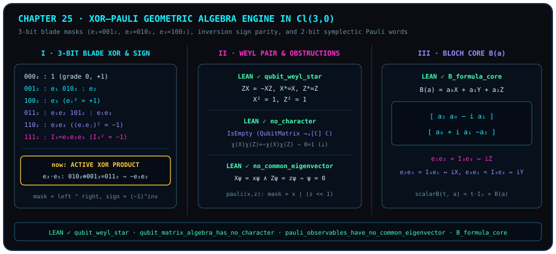

# 把矩阵还原为异或：3 比特刀片与 XOR–Pauli 几何代数引擎

> *“量子=两子=量(测量)子....”*

在前六部二十四章的旅途中，我们沿着“点 $\to$ 线 $\to$ 面 $\to$ 球 $\to$ 多球交织 $\to$ 光锥与拓扑 $\to$ 球外之球”的几何阶梯拾级而上，把量子力学从神秘的“微观粒子玄学”还原成了正交投影、双矢量有向面积与三维球面旋量几何。从本章开始，本书进入**第七部《构造与验证》**：我们不再只停留在纸面公式与物理图像上，而是要把整套几何结构亲手锻造成两样可以随时在计算机上运行并逐行核验的硬核构件——**零外部依赖的 Python 3 几何代数与旋转器编译引擎**（第二十五、二十六章），以及**直通 Lean 4 内核源码的公理圣殿审计**（第二十七、二十八章）。

让我们从最基础的计算问题出发：当你在计算机里模拟单量子比特的泡利算符 $X, Y, Z$ 或三维欧氏克利福德代数 $\mathcal{Cl}_{3,0}(\mathbb{R})$ 时，真的需要去分配一堆 $2\times 2$ 复矩阵、做八次复数乘法和四次复数加法吗？

完全不需要！一旦看穿“量子 = 两子 = 比量关系”的代数骨架，你会发现：

1. 在二维复希尔伯特空间中，泡利生成元 `qubitX` 与 `qubitZ` 的全部非交换量子性，都浓缩在三条代数规则里：**平方为一**（$X^2 = I, Z^2 = I$）、**自伴**（$X^* = X, Z^* = Z$）与**反对易**（$ZX = -XZ$）；
2. 在三维克利福德代数 $\mathcal{Cl}_{3,0}(\mathbb{R})$ 中，八维基刀片（blades）$\{1, e_1, e_2, e_1 e_2, e_3, e_1 e_3, e_2 e_3, e_1 e_2 e_3\}$ 与 3 比特整数掩码 $m \in \{000_2, \dots, 111_2\}$ 一一对应：同方向平方 $e_i^2 = +1$ 恰恰就是二进制同位清零的**按位异或（XOR，`left ^ right`）**，而异方向反对易 $e_j e_i = -e_i e_j$（$i < j$）不过是统计比特对跨越次数的**逆序对奇偶号（inversion parity）**！

本章先呈现单比特外尔（Weyl）星代数、无特征标定理、无公共特征向量定理与无迹布洛赫算符核四条经 Lean 4 内核验证的冻结定理，随后给出完整的零依赖 Python 3 `GeometricState` 引擎实现。



## 外尔对、反对易与无特征标定理 {#sec-weyl-pair-no-character}

在 Lean 4 模块 `D5/S3/Quantum/FiniteDimensional.lean` 中，单量子比特算符代数被定义为 $2\times 2$ 复矩阵代数 $\mathrm{QubitMatrix} = M_2(\mathbb{C})$（`Matrix (Fin 2) (Fin 2) ℂ`），其中两个基本生成元分别为泡利翻转矩阵与相位矩阵：

$$
\operatorname{qubitX} = \begin{pmatrix} 0 & 1 \\ 1 & 0 \end{pmatrix}, \qquad
\operatorname{qubitZ} = \begin{pmatrix} 1 & 0 \\ 0 & -1 \end{pmatrix}.
$$

为什么只需要写出 `qubitX` 与 `qubitZ` 这一对矩阵，整座单量子比特非交换代数的结构就已经被完全锁定了？下面的第一条冻结定理将它们满足的五条星代数性质——反对易性、各自的星自伴性以及各自的平方归一性——打包为一条零前提的合取定理。

::: {.theorem #thm-qubit-weyl-star title="单比特泡利外尔对的反对易、自伴与对合恒等式" lean="D5/S3/Quantum/FiniteDimensional.qubit_weyl_star"}
在单比特复矩阵代数 $\mathrm{QubitMatrix} = M_2(\mathbb{C})$ 中，标准泡利生成元 $\operatorname{qubitX}$ 与 $\operatorname{qubitZ}$ 同时满足以下五条代数恒等式：

$$
\begin{aligned}
\operatorname{qubitZ} \cdot \operatorname{qubitX} &= -(\operatorname{qubitX} \cdot \operatorname{qubitZ}), \\
\operatorname{star}(\operatorname{qubitX}) &= \operatorname{qubitX}, \qquad
\operatorname{star}(\operatorname{qubitZ}) = \operatorname{qubitZ}, \\
\operatorname{qubitX}^2 &= 1, \qquad\qquad\;\;
\operatorname{qubitZ}^2 = 1.
\end{aligned}
$$
:::

::: proof
在 Lean 4 源码 `D5/S3/Quantum/FiniteDimensional.lean:24` 中，证明通过三次 `constructor` 将五个合取项依次拆开，对每一条矩阵等式调用外延性策略 `ext i j`，并对有限指标 `i, j : Fin 2` 施行穷举分析 `fin_cases i <;> fin_cases j`，最后由 `simp [qubitX, qubitZ, pow_two, Matrix.mul_apply, Fin.sum_univ_two]` 直接展开 $2\times 2$ 矩阵乘法与共轭转置完成检验。用显式矩阵计算写出：

$$
\operatorname{qubitZ}\cdot\operatorname{qubitX} = \begin{pmatrix} 1 & 0 \\ 0 & -1 \end{pmatrix}\begin{pmatrix} 0 & 1 \\ 1 & 0 \end{pmatrix} = \begin{pmatrix} 0 & 1 \\ -1 & 0 \end{pmatrix} = -\begin{pmatrix} 0 & -1 \\ 1 & 0 \end{pmatrix} = -(\operatorname{qubitX}\cdot\operatorname{qubitZ}),
$$

而实对称矩阵 $\operatorname{qubitX}, \operatorname{qubitZ}$ 的共轭转置等于自身，对角平方均为单位矩阵 $I_2$。完整证明由 Lean 内核检查。
:::

紧接着 [@thm-qubit-weyl-star]，一个深刻的代数推论立刻浮现：**为什么量子力学不能像经典力学那样，在同一个状态点上给所有可观测量同时赋予满足乘法同态的确定复数值？**

在代数语言中，给每个矩阵 $A \in \mathrm{QubitMatrix}$ 赋予一个保持加法、乘法与单位元的标量读数，就是一个保单位元的复代数同态（character，特征标）$\chi : \mathrm{QubitMatrix} \to_{\mathrm{alg}[\mathbb{C}]} \mathbb{C}$。下面的冻结引理仅凭 [@thm-qubit-weyl-star] 中的反对易与平方归一两条性质，就在五步之内证明了此类特征标类型严格为空（`IsEmpty`）！

::: {.lemma #lemma-qubit-no-character title="单比特矩阵代数不存在保单位元复代数特征标" lean="D5/S3/Quantum/FiniteDimensional.qubit_matrix_algebra_has_no_character"}
从单比特复矩阵代数 $\mathrm{QubitMatrix} = M_2(\mathbb{C})$ 到复数域 $\mathbb{C}$ 的保单位元 $\mathbb{C}$-代数同态类型为空类型：

$$
\operatorname{IsEmpty}\bigl(\mathrm{QubitMatrix} \to_{\mathrm{alg}[\mathbb{C}]} \mathbb{C}\bigr).
$$
:::

::: proof
设存在保单位元的复代数同态 $\chi : \mathrm{QubitMatrix} \to_{\mathrm{alg}[\mathbb{C}]} \mathbb{C}$。由 [@thm-qubit-weyl-star] 的反对易等式 $\operatorname{qubitZ}\cdot\operatorname{qubitX} = -(\operatorname{qubitX}\cdot\operatorname{qubitZ})$，在同态 $\chi$ 下两边取像得 $\chi(\operatorname{qubitZ})\chi(\operatorname{qubitX}) = -\chi(\operatorname{qubitX})\chi(\operatorname{qubitZ})$。但目标域 $\mathbb{C}$ 上的复数乘法满足交换律 `mul_comm`，故

$$
\chi(\operatorname{qubitX})\chi(\operatorname{qubitZ}) = \chi(\operatorname{qubitZ})\chi(\operatorname{qubitX}) = -\chi(\operatorname{qubitX})\chi(\operatorname{qubitZ}),
$$

两边乘以 $\frac{1}{2}$（`linear_combination (1 / 2 : ℂ) * hSelfNegating`）即得 $\chi(\operatorname{qubitX})\chi(\operatorname{qubitZ}) = 0$。由整环性质 `mul_eq_zero.mp`，必有 $\chi(\operatorname{qubitX}) = 0$ 或 $\chi(\operatorname{qubitZ}) = 0$。然而由 [@thm-qubit-weyl-star] 的平方归一性 $\operatorname{qubitX}^2 = 1$ 与 $\operatorname{qubitZ}^2 = 1$，又有 $\chi(\operatorname{qubitX})^2 = 1$ 且 $\chi(\operatorname{qubitZ})^2 = 1$；无论哪一个因子为 $0$，代入平方等式均导出 $0 = 1$ 的矛盾。完整证明由 Lean 内核检查。
:::

## 无公共特征向量与无迹布洛赫算符核 {#sec-no-common-eigenvector-bloch-core}

[@lemma-qubit-no-character] 在算符代数层面封死了全局乘法特征标；如果退一步，不要求对整个矩阵代数保乘法，只追问：**是否存在哪怕一根非零量子态列向量 $\psi \in \mathrm{QubitState} = (\operatorname{Fin} 2 \to \mathbb{C})$，使它在泡利算符 $\operatorname{qubitX}$ 与 $\operatorname{qubitZ}$ 下同时成为特征向量？**

在 Lean 模块 `D5/S3/Quantum/QubitWitnesses.lean` 中，下面的冻结命题证明：任何同时满足 $\operatorname{qubitX}\psi = x\psi$ 与 $\operatorname{qubitZ}\psi = z\psi$ 的二维复向量 $\psi$，必定恒等于零向量 $\psi = 0$！

::: {.proposition #prop-pauli-no-common-eigenvector title="泡利 X 与 Z 算符不存在非零公共特征向量" lean="D5/S3/Quantum/QubitWitnesses.pauli_observables_have_no_common_eigenvector"}
设 $\psi : \mathrm{QubitState} = (\operatorname{Fin} 2 \to \mathbb{C})$ 为二维复向量，$x, z \in \mathbb{C}$ 为任意复标量。若 $\psi$ 同时满足本征方程

$$
\operatorname{mulVec}(\operatorname{qubitX}, \psi) = x \bullet \psi \qquad\text{且}\qquad \operatorname{mulVec}(\operatorname{qubitZ}, \psi) = z \bullet \psi,
$$

则必有

$$
\psi = 0.
$$
:::

::: proof
在 `D5/S3/Quantum/QubitWitnesses.lean:18` 中，对两个向量等式分别在坐标 $0$ 与 $1$ 处展开（`congrFun hX 0`、`congrFun hX 1`、`congrFun hZ 0`、`congrFun hZ 1`），得到四条标量分量方程：

$$
\psi_1 = x\psi_0, \qquad \psi_0 = x\psi_1, \qquad \psi_0 = z\psi_0, \qquad -\psi_1 = z\psi_1.
$$

首先用反证法（`by_contra hPsi0`）证明 $\psi_0 = 0$：假设 $\psi_0 \neq 0$，则由 $\psi_0 = x\psi_1$ 知 $\psi_1 \neq 0$（否则 $\psi_0 = x\cdot 0 = 0$ 矛盾）；又由 $(z - 1)\psi_0 = z\psi_0 - \psi_0 = 0$ 及 $\psi_0 \neq 0$ 消去得 $z = 1$；将 $z = 1$ 代入第四式 $-\psi_1 = z\psi_1$ 得 $-\psi_1 = \psi_1$，线性组合乘以 $-\frac{1}{2}$ 得 $\psi_1 = 0$，与 $\psi_1 \neq 0$ 矛盾！故必有 $\psi_0 = 0$。再将 $\psi_0 = 0$ 代入第一式 $\psi_1 = x\psi_0$ 立得 $\psi_1 = 0$。最后由函数外延性 `funext i` 与 `fin_cases i` 证得 $\psi = 0$。完整证明由 Lean 内核检查。
:::

既然 $X$ 与 $Z$（连同 $Y = iXZ$）不能共享任何非零特征向量，它们在三维实欧氏空间 $\mathbb{R}^3$（`EuclideanSpace ℝ (Fin 3)`）中张成的线性组合究竟长什么样？在 Lean 模块 `D5/S3/Quantum/Measurement/Bloch/QubitBloch.lean` 中，对任意三维实向量 $a = (a_0, a_1, a_2) \in \mathbb{R}^3$，无迹布洛赫算符 `B a` 定义为三枚泡利矩阵的实系数线性组合：

$$
B(a) = (a_0 : \mathbb{C})\bullet \sigma_X + (a_1 : \mathbb{C})\bullet \sigma_Y + (a_2 : \mathbb{C})\bullet \sigma_Z,
$$

（模块同时定义了带实标量单位阵偏移的算符 $\operatorname{scalarB}(t, a) = (t : \mathbb{C})\bullet I_2 + B(a)$）。下面的冻结推论给出 $B(a)$ 的显式 $2\times 2$ 复矩阵核公式。

::: {.corollary #cor-bloch-operator-core title="三维实向量到无迹布洛赫算符的显式 2×2 矩阵核公式" lean="D5/S3/Quantum/Measurement/Bloch/QubitBloch.B_formula_core"}
对三维实欧氏空间中的任意向量 $a \in \operatorname{EuclideanSpace}\,\mathbb{R}\,(\operatorname{Fin} 3)$，无迹布洛赫算符 $B(a)$ 恒等于如下 $2\times 2$ 复矩阵：

$$
B(a) = \begin{pmatrix} (a_2 : \mathbb{C}) & (a_0 : \mathbb{C}) - i\,(a_1 : \mathbb{C}) \\ (a_0 : \mathbb{C}) + i\,(a_1 : \mathbb{C}) & -(a_2 : \mathbb{C}) \end{pmatrix}.
$$
:::

::: proof
在 `D5/S3/Quantum/Measurement/Bloch/QubitBloch.lean:31` 中，证明对矩阵指标调用 `ext i j` 与 `fin_cases i <;> fin_cases j`，将 `B`、`pauliMatrix`（其中 $\sigma_X = \operatorname{qubitX}$，$\sigma_Z = \operatorname{qubitZ}$，$\sigma_Y = i\operatorname{qubitX}\operatorname{qubitZ}$）、`qubitX` 与 `qubitZ` 的定义代入展开，并由 `ring` 逐分量核实 $(0,0)$、$(0,1)$、$(1,0)$、$(1,1)$ 四个矩阵元恒等。完整证明由 Lean 内核检查。
:::

## 三比特刀片掩码、逆序符号与两比特辛泡利字 {#sec-three-bit-blade-masks-and-symplectic-pauli}

现在，把 [@thm-qubit-weyl-star] 与 [@cor-bloch-operator-core] 放在一起看：为什么三维实向量 $a = (a_0, a_1, a_2) \in \mathbb{R}^3$ 一旦写进 $2\times 2$ 矩阵，就必须借助虚数单位 $i$ 把第一、二分量耦合在副对角线 $a_0 \mp i a_1$ 上，而把第三分量放在主对角线 $\pm a_2$ 上？

正如我们在第二部中所揭示的，这是因为单比特泡利算符代数是**三维欧氏克利福德几何代数 $\mathcal{Cl}_{3,0}(\mathbb{R})$ 的复化矩阵表示**！在纯实数的 $\mathcal{Cl}_{3,0}(\mathbb{R})$ 中，三根正交单位基向量 $e_1, e_2, e_3$ 满足克利福德乘法公理：

$$
e_i^2 = +1 \quad (i \in \{1, 2, 3\}), \qquad e_i e_j = -e_j e_i \quad (i \neq j).
$$

由这三根基向量生成的实代数共有 $2^3 = 8$ 个基刀片（basis blades）。在计算机里，我们根本不需要存储任何矩阵：只需用一个 **3 比特整数掩码（blade mask）** $m = b_2 b_1 b_0 \in \{0, 1, \dots, 7\}$，其中第 $0$ 位（权值 `1 << 0 = 1`）代表 $e_1$ 是否出席，第 $1$ 位（权值 `1 << 1 = 2`）代表 $e_2$ 是否出席，第 $2$ 位（权值 `1 << 2 = 4`）代表 $e_3$ 是否出席！

| 掩码 $m$（十进制） | 二进制 $b_2 b_1 b_0$ | 基刀片（Blade） | 阶数 $k = \operatorname{popcount}(m)$ | 平方 $(E_m)^2$ | 逆序共轭号 $\widetilde{E}_m = (-1)^{k(k-1)/2} E_m$ | 泡利算符复化对应 |
| :---: | :---: | :---: | :---: | :---: | :---: | :---: |
| `0` | `000₂` | $1$ | $0$（标量） | $+1$ | $+1$ | $I_2$ |
| `1` | `001₂` | $e_1$ | $1$（向量） | $+1$ | $+e_1$ | $X$ |
| `2` | `010₂` | $e_2$ | $1$（向量） | $+1$ | $+e_2$ | $Y$ |
| `3` | `011₂` | $e_1 e_2$ | $2$（双矢量） | $-1$ | $-e_1 e_2$ | $I_3 e_3 \leftrightarrow iZ$ |
| `4` | `100₂` | $e_3$ | $1$（向量） | $+1$ | $+e_3$ | $Z$ |
| `5` | `101₂` | $e_1 e_3$ | $2$（双矢量） | $-1$ | $-e_1 e_3$ | $-I_3 e_2 \leftrightarrow -iY$ |
| `6` | `110₂` | $e_2 e_3$ | $2$（双矢量） | $-1$ | $-e_2 e_3$ | $I_3 e_1 \leftrightarrow iX$ |
| `7` | `111₂` | $I_3 = e_1 e_2 e_3$ | $3$（伪标量） | $-1$ | $-I_3$ | $i I_2$ |

在这套 3 比特编码下，$\mathcal{Cl}_{3,0}(\mathbb{R})$ 的全部乘法规则退化为两条极简的位运算定律（图 25 左栏）：

1. **输出刀片掩码 = 按位异或（XOR）**：当左刀片 $E_{\mathrm{left}}$ 与右刀片 $E_{\mathrm{right}}$ 相乘时，同时出现在两边的基向量 $e_i$ 因 $e_i^2 = +1$ 成对湮灭，只出现一次的基向量保留下来。因此乘积刀片的 3 比特掩码精确等于
   $$
   \mathrm{mask} = \mathrm{left} \oplus \mathrm{right} = \texttt{left \^{} right}!
   $$
2. **输出正负号 = 跨位逆序对奇偶性（Inversion Parity）**：要把 $E_{\mathrm{left}} E_{\mathrm{right}}$ 中乱序的基向量按标准升序 $e_1 e_2 e_3$ 排好，左掩码 $\mathrm{left}$ 中每一个为 $1$ 的第 $i$ 位（$i \in \{0, 1, 2\}$），都需要跨过右掩码 $\mathrm{right}$ 中所有下标严格小于 $i$（即落在低位掩码 `(1 << i) - 1` 内）的 $1$ 位。每跨过一次就触发一次反对易变号 $e_i e_j = -e_j e_i$（$j < i$）！因此总交换次数与符号函数 `_blade_sign(left, right)` 为：
   $$
   \operatorname{inv}(\mathrm{left}, \mathrm{right}) = \sum_{i=0}^{2} \bigl((\mathrm{left} \gg i)\,\&\,1\bigr)\cdot \operatorname{popcount}\!\bigl(\mathrm{right}\,\&\,(2^i - 1)\bigr), \qquad
   \operatorname{sign}(\mathrm{left}, \mathrm{right}) = (-1)^{\operatorname{inv}(\mathrm{left}, \mathrm{right})}.
   $$

请特别注意表中两处最容易混淆的对应关系，我们在代码与正文中将它们严格区分、保持百分之百自洽：

- **三维克利福德基刀片（3-bit masks `1, 2, 4`）与伪标量 $I_3$**：在 $\mathcal{Cl}_{3,0}(\mathbb{R})$ 中，三个正交向量方向 $e_1, e_2, e_3$ 分别占据独立比特位 `001₂ = 1`、`010₂ = 2`、`100₂ = 4`。体积伪标量 $I_3 = e_1 e_2 e_3$（掩码 `111₂ = 7`）与所有元素对易，且满足
  $$
  I_3^2 = (e_1 e_2 e_3)(e_1 e_2 e_3) = (-1)^3 e_1^2 e_2^2 e_3^2 = -1!
  $$
  在复化矩阵表示 $e_1 \mapsto X, e_2 \mapsto Y, e_3 \mapsto Z, I_3 \mapsto i I_2$ 下，赤道双矢量 $e_1 e_2$ 恰等于 $I_3 e_3 \leftrightarrow iZ$（同理 $e_2 e_3 = I_3 e_1 \leftrightarrow iX$，$e_3 e_1 = -e_1 e_3 = I_3 e_2 \leftrightarrow iY$）。
- **两比特辛泡利字（2-bit symplectic Pauli encoding `pauli(x, z, phase)`）**：在第四部稳定子码与本章 [@thm-qubit-weyl-star] 的外尔对语言里，人们常把由两个反对易对合生成元（记作 $X_{\mathrm{sym}}$ 与 $Z_{\mathrm{sym}}$）生成的二元泡利词编码为两比特辛向量 $(x, z) \in \{0, 1\}^2$。在下面的 `GeometricState.pauli(x, z, phase)` 方法中，我们将辛比特 $x \in \{0,1\}$ 绑定到第 $0$ 位（刀片 $e_1$，掩码 `1`），将辛比特 $z \in \{0,1\}$ 绑定到第 $1$ 位（刀片 $e_2$，掩码 `2`），即
  $$
  \mathrm{mask}(x, z) = x \;\texttt{|}\; (z \ll 1) \in \{0, 1, 2, 3\}.
  $$
  当 $x = 1, z = 1$ 同时出席时，掩码 `011₂ = 3` 自动落在该对生成元张成的双矢量方向 $e_1 e_2$ 上，从而无须任何额外分支判断就天然满足外尔反对易律：
  $$
  \operatorname{pauli}(1, 0) \cdot \operatorname{pauli}(0, 1) = e_1 e_2 = -\operatorname{pauli}(0, 1) \cdot \operatorname{pauli}(1, 0)!
  $$

此外，对任意 $k$-阶刀片（$k = \operatorname{popcount}(m)$），把因子顺序完全颠倒的**逆序共轭（reversion）** $\widetilde{E}_m$ 需要做 $\frac{k(k-1)}{2}$ 次相邻对换，符号为 $(-1)^{k(k-1)/2}$：对 $k \in \{0, 1\}$ 为 $+1$，对 $k \in \{2, 3\}$ 为 $-1$。

## 零依赖 Python 3 几何代数引擎实现与自检 {#sec-geometric-state-python-engine}

下面是完整、可直接运行的零外部依赖 Python 3 `GeometricState` 实现（取自本书配套验证脚本 `part7_engine.py` 的前半部分）：

```python
from __future__ import annotations

from dataclasses import dataclass
from typing import Dict, Mapping


def _blade_sign(left: int, right: int) -> int:
    """Sign of e_left * e_right in Cl(3,0), with e_i^2 = 1."""
    inversions = 0
    for i in range(3):
        if (left >> i) & 1:
            inversions += (right & ((1 << i) - 1)).bit_count()
    return -1 if inversions % 2 else 1


@dataclass(frozen=True)
class GeometricState:
    """Sparse multivector in the eight-dimensional Cl(3,0) basis."""

    terms: Mapping[int, complex]

    def __post_init__(self) -> None:
        clean = {int(k): complex(v) for k, v in self.terms.items() if abs(v) > 1e-14}
        if any(k < 0 or k > 7 for k in clean):
            raise ValueError("a Cl(3,0) blade mask must use three bits")
        object.__setattr__(self, "terms", clean)

    @staticmethod
    def zero() -> "GeometricState":
        return GeometricState({})

    @staticmethod
    def scalar(value: complex) -> "GeometricState":
        return GeometricState({0: value})

    @staticmethod
    def basis(index: int) -> "GeometricState":
        if index not in (0, 1, 2):
            raise ValueError("basis index must be 0, 1, or 2")
        return GeometricState({1 << index: 1})

    @staticmethod
    def pauli(x: int, z: int, phase: int = 0) -> "GeometricState":
        """Binary Pauli word, encoded by the X/Z symplectic bits."""
        if x not in (0, 1) or z not in (0, 1):
            raise ValueError("Pauli bits must be 0 or 1")
        mask = (1 if x else 0) | (2 if z else 0)
        return GeometricState({mask: (1j) ** phase})

    def __add__(self, other: "GeometricState") -> "GeometricState":
        out: Dict[int, complex] = dict(self.terms)
        for mask, value in other.terms.items():
            out[mask] = out.get(mask, 0j) + value
        return GeometricState(out)

    def __neg__(self) -> "GeometricState":
        return GeometricState({m: -v for m, v in self.terms.items()})

    def __sub__(self, other: "GeometricState") -> "GeometricState":
        return self + (-other)

    def __rmul__(self, scalar: complex) -> "GeometricState":
        return GeometricState({m: scalar * v for m, v in self.terms.items()})

    def __mul__(self, other: "GeometricState") -> "GeometricState":
        out: Dict[int, complex] = {}
        for left, a in self.terms.items():
            for right, b in other.terms.items():
                mask = left ^ right
                value = a * b * _blade_sign(left, right)
                out[mask] = out.get(mask, 0j) + value
        return GeometricState(out)

    def reverse(self) -> "GeometricState":
        out = {}
        for mask, value in self.terms.items():
            grade = mask.bit_count()
            out[mask] = value * (-1 if grade * (grade - 1) // 2 % 2 else 1)
        return GeometricState(out)

    def scalar_part(self) -> complex:
        return self.terms.get(0, 0j)

    def norm_squared(self) -> float:
        value = (self * self.reverse()).scalar_part()
        return float(value.real)

    def close(self, other: "GeometricState", tol: float = 1e-10) -> bool:
        return all(abs((self - other).terms.get(m, 0j)) <= tol
                   for m in set(self.terms) | set(other.terms))
```

让我们通过下面的手算与代码对照实例，逐项检验这套异或引擎如何精确复现克利福德乘法表与布洛赫算符平方。

::: {.example #ex-xor-pauli-table title="3 比特刀片异或乘法、伪标量平方与布洛赫算符平方核验"}
1. **逆序符号 `_blade_sign` 的逐位追踪**：
   - 计算 $e_1 \cdot e_2$：左掩码 $\mathrm{left} = 001_2 = 1$，右掩码 $\mathrm{right} = 010_2 = 2$。异或掩码为 $1 \oplus 2 = 011_2 = 3$（代表 $e_1 e_2$）。在 `_blade_sign(1, 2)` 中，仅 $i = 0$ 位满足 `(left >> 0) & 1 == 1`，此时低位掩码 `(1 << 0) - 1 = 0`，故 $\operatorname{inv}(1, 2) = 0$，符号为 $(-1)^0 = +1$，即 $e_1 \cdot e_2 = +e_1 e_2$。
   - 计算 $e_2 \cdot e_1$：$\mathrm{left} = 010_2 = 2$，$\mathrm{right} = 001_2 = 1$。异或掩码仍为 $2 \oplus 1 = 3$。但在 `_blade_sign(2, 1)` 中，$i = 1$ 位满足 `(2 >> 1) & 1 == 1`，低位掩码 `(1 << 1) - 1 = 1` 与 $\mathrm{right} = 1$ 按位与为 $1$（`bit_count() == 1`），故 $\operatorname{inv}(2, 1) = 1$，符号为 $(-1)^1 = -1$，给出 $e_2 \cdot e_1 = -e_1 e_2$！
2. **伪标量 $I_3 = e_1 e_2 e_3$ 的平方**：取 $\mathrm{left} = \mathrm{right} = 111_2 = 7$。异或掩码为 $7 \oplus 7 = 000_2 = 0$（标量 $1$）。在 `_blade_sign(7, 7)` 中，$i = 0, 1, 2$ 分别贡献 $0, 1, 2$ 次跨位逆序，总逆序数 $\operatorname{inv}(7, 7) = 0 + 1 + 2 = 3$ 为奇数，故 $I_3^2 = (-1)^3 \cdot 1 = -1$，在纯实三维几何中内生出虚数平方 $-1$。
3. **无迹布洛赫向量 $v = a_0 e_1 + a_1 e_2 + a_2 e_3$ 的几何乘积平方**：取实向量 $a = (3, 4, 12) \in \mathbb{R}^3$，在 `GeometricState` 中构造 $v = 3e_1 + 4e_2 + 12e_3$（`terms = {1: 3, 2: 4, 4: 12}`）。计算 $v \cdot v$：由于异方向交叉项 $a_i a_j (e_i e_j + e_j e_i) = 0$ 全部因逆序奇偶号反号相消，只剩下同掩码异或归零项 $000_2$：
   $$
   v^2 = (3^2 + 4^2 + 12^2)\cdot 1 = (9 + 16 + 144)\cdot 1 = 169 = 13^2,
   $$
   这与 [@cor-bloch-operator-core] 中 $2\times 2$ 复矩阵平方
   $$
   B(3, 4, 12)^2 = \begin{pmatrix} 12 & 3 - 4i \\ 3 + 4i & -12 \end{pmatrix}^2 = \begin{pmatrix} 144 + (9+16) & 0 \\ 0 & (9+16) + 144 \end{pmatrix} = 169\,I_2
   $$
   完全一致！
:::

::: {.remark #rem-clifford-stabilizer-literature title="克利福德代数的博特周期性与稳定子辛编码（文献结果，未在本书形式化）"}
**文献结果，未在本书形式化。** 关于实克利福德代数 $\mathcal{Cl}_{p,q}(\mathbb{R})$ 的矩阵同构分类及多比特泡利群的二元辛表示，其经典文献归属与本书冻结定理的职责边界如下：

1. **$\mathcal{Cl}_{3,0}(\mathbb{R}) \cong M_2(\mathbb{C})$ 与实克利福德代数分类**（参见 P. Lounesto, *Clifford Algebras and Spinors*, 2nd Ed., Cambridge University Press, 2001, Ch. 3 & Ch. 16；以及 H. B. Lawson & M.-L. Michelsohn, *Spin Geometry*, Princeton University Press, 1989, Ch. I）：三维欧氏实克利福德代数 $\mathcal{Cl}_{3,0}(\mathbb{R})$ 作为 8 维实结合代数同构于 $2\times 2$ 复矩阵代数 $M_2(\mathbb{C})$（其中心由 $\{1, I_3 = e_1 e_2 e_3\}$ 张成，同构于 $\mathbb{C}$），而其 4 维偶子代数 $\mathcal{Cl}^+_{3,0}(\mathbb{R})$ 同构于哈密顿四元数代数 $\mathbb{H}$。
2. **多比特泡利群的二元辛向量空间表示与 Gottesman–Knill 定理**（参见 D. Gottesman, *Stabilizer Codes and Quantum Error Correction*, PhD thesis, Caltech, 1997, arXiv:quant-ph/9705052；以及 S. Aaronson & D. Gottesman, *Improved simulation of stabilizer circuits*, Phys. Rev. A **70**, 052328, 2004, DOI `10.1103/PhysRevA.70.052328`）：$n$ 比特泡利群模去中心相位后同构于二元域上的 $2n$ 维辛向量空间 $\mathbb{F}_2^{2n}$，群乘法化为按位异或（XOR），交换/反对易关系由辛内积决定。
3. **冻结定理的精确边界**：本章经 Lean 4 内核验证的四条定理分别是单比特外尔星恒等式（[@thm-qubit-weyl-star]）、单比特矩阵代数无特征标定理（[@lemma-qubit-no-character]）、泡利 $X, Z$ 无非零公共特征向量定理（[@prop-pauli-no-common-eigenvector]）以及无迹布洛赫算符 $2\times 2$ 矩阵展开核（[@cor-bloch-operator-core]）。正文中给出的 Python 3 `GeometricState` 3 比特刀片引擎用于展示 $\mathcal{Cl}_{3,0}(\mathbb{R})$ 的可执行计算构造，并不把 $\mathcal{Cl}_{3,0}(\mathbb{R}) \cong M_2(\mathbb{C})$ 的泛性质同构或一般 $n$ 比特 Gottesman–Knill 复杂性定理声明为本章的 Lean 冻结定理。
:::

既然 3 比特刀片与异或乘法已经把 $\mathcal{Cl}_{3,0}(\mathbb{R})$ 装进了三十行 Python 代码，下一步自然是：**如何在这个偶子代数 $\mathcal{Cl}^+_{3,0}(\mathbb{R})$ 里，把任意单量子比特门 $( \alpha, \beta, \gamma )$ 编译成单位旋转器（rotor），并用双侧夹心积 $v \mapsto R v \widetilde{R}$ 驱动三维布洛赫球面上的精确转向？** 让我们进入[第二十六章](ch26-single-qubit-rotor-compilation.md)。
