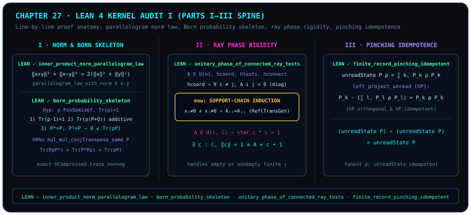

# 走进 Lean 4 公理圣殿（上）：从平行四边形恒等式到有限记录挤压

> *“构建命题证明通用机器学术理论,定义定理证明”*

在传统数学与理论物理专著里，“证明”往往依赖作者与审稿人的肉眼默契：一句“显然可得”、一处隐去边界条件的指标缩并，或者把“局部连通”悄悄当成“全局常相位”，就可能让整座理论大厦埋下隐蔽的裂缝。而本书自[第一章](ch01-measurement.md)立下的最高契约，正是题记中的这十六个字：**构建命题证明通用机器学术理论，定义、定理、证明**——全书每一条标有绿色 `LEAN ✓` 徽章的 `theorem / lemma / proposition / corollary`，都逐一锚定在 `the-omega-institute/trureturing@dev`（所钉提交 `1d9bf98cab8306e67ec38a739359f2cdae63877a`）中被 Lean 4 类型检查内核验证并冻结的真实声明上！

本章与[第二十八章](ch28-reading-frozen-proofs-ii.md)将带领读者直接走进这座 Lean 4 形式化公理圣殿的源码深处：

1. 在本章（上篇）中，我们逐行解剖支撑起第一部至第三部的四块基石证明：**实内积空间的平行四边形范数恒等式**、**正半定迹一矩阵的玻恩概率三公理骨架**、**支撑连通射线测试下的幺正全局相位刚性定理**，以及**有限完备正交记录测量的挤压算符幂等定理**；
2. 我们将真实源码中的每一条策略（`parallelogram_law_with_norm`、`mul_mul_conjTranspose_same`、`Relation.ReflTransGen` 传递闭包归纳、`Finset.sum_eq_single` 正交块消去）摊开在阳光下，并给出一张覆盖第一至三部核心冻结声明的**源码行号、语句摘要哈希（`statement_id`）与形式化职责边界全景审计表**。

::: {.viz src="lean-declaration-map" preset="bedrock" height="500"}
**第二十七章解剖的四条，回到它们出场的地方。** 青色的线从第二十七章的柱脚连回四个绿色实心格，它们第一次出场都在第一至第三章；琥珀色框住的是平行四边形恒等式（[@thm-audit-parallelogram-law]），琥珀色的线连到另外引用它的几章。
:::



## 定义、定理与证明：走进 Lean 4 内核审计 {#sec-lean-kernel-audit-architecture}

在 `trureturing` 仓库的冻结验证体系中，一个数学命题要想成为本书可引用的绿色定理，必须跨越三道机器铁门槛：

1. **定义（Define）**：所有参与陈述的对象——如赋范内积空间 `InnerProductSpace ℝ E`、复方阵 `Matrix n n ℂ`、正半定谓词 `Matrix.PosSemidef`、记录测量结构 `IsRecordMeasurement P`——都必须在依值类型论（dependent type theory）中具备无歧义的类型构造；
2. **定理（State）**：定理头部声明（signature）精确列出每一项类型类约束与显式前提，生成唯一的 SHA-256 语句摘要 `statement_id` 并写入 `Golden/Frozen/state/<module>.lean.json`；
3. **证明（Prove）**：证明项经 Lean 4 内核完整归约检验，严禁包含任何未证占位符 `sorry` 或非标准临时公理（源码中常以 `#print axioms` 显式核查其仅依赖标准公理 `propext`、`Classical.choice`、`Quot.sound`）。

让我们先审计第一部前两章的两座基石定理：实内积平行四边形定律与有限维玻恩概率骨架（图 27 左栏）。

::: {.theorem #thm-audit-parallelogram-law title="实内积空间范数的平行四边形恒等式（内核审计版）" lean="D5/S3/QuantumContext/ParallelogramNormLaw.inner_product_norm_parallelogram_law"}
设 $E$ 为配备实内积结构的赋范交换群（`[NormedAddCommGroup E] [InnerProductSpace ℝ E]`）。则对任意两个向量 $x, y \in E$，恒有

$$
\norm{x + y}^2 + \norm{x - y}^2 = 2\bigl(\norm{x}^2 + \norm{y}^2\bigr).
$$
:::

::: proof
在源码文件 `D5/S3/QuantumContext/ParallelogramNormLaw.lean:22` 中，完整证明脚本仅有一行精确项构造：

```lean
theorem inner_product_norm_parallelogram_law {E : Type*} [NormedAddCommGroup E]
    [InnerProductSpace ℝ E] (x y : E) :
    ‖x + y‖ ^ 2 + ‖x - y‖ ^ 2 = 2 * (‖x‖ ^ 2 + ‖y‖ ^ 2) := by
  exact parallelogram_law_with_norm ℝ x y
```

在 Mathlib 的 `Mathlib.Analysis.InnerProductSpace.Basic` 中，`parallelogram_law_with_norm` 通过将和差范数平方分别按 `norm_add_sq_real` 与 `norm_sub_sq_real` 展开为 $\norm{x}^2 + 2\langle x, y\rangle_{\mathbb{R}} + \norm{y}^2$ 与 $\norm{x}^2 - 2\langle x, y\rangle_{\mathbb{R}} + \norm{y}^2$，再将正负交叉内积项 $\pm 2\langle x, y\rangle_{\mathbb{R}}$ 成对抵消，并把指数 `^ 2` 与乘法形式对齐。源码末尾紧接着执行 `#print axioms inner_product_norm_parallelogram_law`，确认无任何外部未证假设。完整证明由 Lean 内核检查。
:::

为什么 `parallelogram_law_with_norm` 与 `norm_add_sq_real` 必须先将一维向量“平方”升维到二次型，才能消去正交方向的交叉项？这里恰恰凝聚着作者在本书构思笔记中提出的深层几何综合：

> **作者原话**：“毕达哥拉斯 万物皆数 勾股定理”

**从一维线段的不可直加性到 0 阶面积度规与 2 阶双向量正反抵消**：设正定欧氏内积空间中两个正交向量 $\vv{a} \perp \vv{b}$ 的标量模长为 $a = \norm{\vv{a}}, b = \norm{\vv{b}}, c = \norm{\vv{a} + \vv{b}}$。当 $\vv{a}$ 与 $\vv{b}$ 互相垂直时，一维长度标量绝不能线性相加（$a + b \neq c$），因为它们指向彼此独立的维度。而在正定欧氏克利福德几何代数中，将合成向量 $\vv{c} = \vv{a} + \vv{b}$ 与自身作几何乘积：

$$
\vv{c}^2 = (\vv{a} + \vv{b})(\vv{a} + \vv{b}) = \vv{a}^2 + \vv{b}^2 + (\vv{a}\vv{b} + \vv{b}\vv{a}) = a^2 + b^2 + 2(\vv{a}\cdot\vv{b}) + (\vv{a}\wedge\vv{b} + \vv{b}\wedge\vv{a}).
$$

这里，$\vv{a}^2 = a^2$、$\vv{b}^2 = b^2$ 与 $\vv{c}^2 = c^2$ 是带有平方长度（面积）量纲的 **0 阶标量**，而 $\vv{a}\wedge\vv{b}$ 与 $\vv{b}\wedge\vv{a}$ 是 **2 阶有向面积双向量**。由于正交向量内积 $\vv{a}\cdot\vv{b} = 0$，且一正一反的 2 阶有向面积元满足反对称律 $\vv{b}\wedge\vv{a} = -\vv{a}\wedge\vv{b}$，两个相反旋向的双向量面积 $(\vv{a}\wedge\vv{b} + \vv{b}\wedge\vv{a}) = 0$ 自动相消，遂归约为 0 阶标量勾股定理 $c^2 = a^2 + b^2$！这正是 Mathlib 中 `norm_add_sq_real` 在正交条件 $2\langle x, y\rangle_{\mathbb{R}} = 0$（或 [@thm-audit-parallelogram-law] 中 $\norm{x+y}^2$ 与 $\norm{x-y}^2$ 两支相反交叉项相消）背后的几何本质。至于该二次恒等式在单位整数格点上引发的数论与概念演进，见如下文献说明：

::: {.remark #rem-ch27-pell-transcendence-literature title="希帕索斯 √2 奇偶矛盾、佩尔最佳连分数渐近与四阶段数系演进（文献结果，未在本书形式化）"}
**文献结果，未在本书形式化。** 下述 $\sqrt{2}$ 的 $2$-进赋值奇偶无理性证明、佩尔（Pell）连分数最佳有理渐近序列以及 $\pi$ 与余弦不动点 $\theta^*$ 的超越性（另参 [@rem-lean-kernel-trust-boundary-literature]、[第二十四章](ch24-cosine-fixed-points-and-self-reference.md) [@rem-banach-dottie-hairy-ball-literature] 与[第二十九章](ch29-timeless-causality-and-gram-space.md) [@rem-ch29-pell-convergents-literature]）均属经典数论文献与本书概念综合（`MODEL`），未包含在本章逐行审计的冻结定理中。不过佩尔渐近分数的单位余项已不只是文献结果：记 $m_k = Q_k$、$n_k = P_k$（第二十九章 [@def-ch29-pell-silver-slope] 中的伴随佩尔数与佩尔数），下文的 $m_k^2 - 2n_k^2 = (-1)^k$ 与 $m_k + n_k\sqrt{2} = (1 + \sqrt{2})^k$ 可由该章经 Lean 验证的 [@thm-ch29-silver-pell-remainder] 经手工推导得到，[@thm-ch29-silver-best-approximation] 还给出最佳逼近下界；仍属文献的是这些分数与 $\sqrt{2}$ 连分数渐近分数的识别，以及一般的最佳逼近理论。

一旦在单位离散格点上取最简单的正交等腰边 $a = 1, b = 1$，勾股面积守恒立即给出 $c^2 = 1^2 + 1^2 = 2$，即对角线长度 $c = \sqrt{2}$。若假设存在正整数 $m, n \in \mathbb{Z}_{>0}$（$n \neq 0$）使有理分数 $\frac{m}{n} \in \mathbb{Q}$ 满足 $m^2 = 2n^2$，则两边关于素数 $2$ 的 $2$-进赋值（2-adic valuation）满足：左端 $v_2(m^2) = 2v_2(m)$ 恒为**偶数**，而右端 $v_2(2n^2) = 2v_2(n) + 1$ 恒为**奇数**——奇偶性正面相撞（$2v_2(m) \neq 2v_2(n) + 1$），彻底击碎了静态有理数网格 $\mathbb{Q}$！虽然十进制截断分数（如 $\lfloor 10^k\sqrt{2}\rfloor / 10^k$）也能在实数拓扑下逼近 $\sqrt{2}$，但在连分数理论中，由 $m_k + n_k\sqrt{2} = (1 + \sqrt{2})^k$（$k \ge 1, n_k > 0$）生成的**佩尔渐近分数（canonical best continued-fraction approximants）**

$$
\frac{m_k}{n_k} = \frac{1}{1},\; \frac{3}{2},\; \frac{7}{5},\; \frac{17}{12},\; \frac{41}{29},\; \frac{99}{70},\; \dots
$$

给出了同等分母规模下逼近 $\sqrt{2}$ 的典范最优有理序列，且严格满足交替单位裂隙佩尔方程：

$$
m_k^2 - 2n_k^2 = (-1)^k = \pm 1 \qquad\Longleftrightarrow\qquad \left(\frac{m_k}{n_k}\right)^2 = 2 + \frac{(-1)^k}{n_k^2}.
$$

无论 $k$ 推演到多大，离散整数平方 $m_k^2$ 与 $2n_k^2$ 之间永远横亘着一道不可磨灭的单位算术裂隙 $(-1)^k = \pm 1$！在本书的概念与哲学综合（`MODEL`）中，正是这道 $\pm 1$ 裂隙，促使汉字“**数**”从离散计数的动词算子“**数**（shǔ，$\mathbb{N} \to \mathbb{Q}$）”升华为连续几何坐标的名词“**数**（shù）”，并勾勒出四阶段概念演进图景（注：此四阶段为几何概念的层级演进，而非数域的集合包含链 $\pi \subset \theta^*$；其中满足 $\varphi = 1 + 1/\varphi$ 的代数黄金比 $\varphi = \frac{1+\sqrt{5}}{2} \in \overline{\mathbb{Q}}$ 已属于第二阶段代数数，而第四阶段的 $\theta^* \approx 0.739085$ 特指满足 $\cos\theta^* = \theta^*$ 的超越自指余弦不动点）：

$$
\begin{aligned}
&\mathbb{Q}\text{（有理网格）} \\
&\longrightarrow\; \overline{\mathbb{Q}}\text{（代数数：$\sqrt{2}$ 勾股对角线与黄金比 $\varphi$）} \\
&\longrightarrow\; \pi\text{（圆周超越旋转）} \\
&\longrightarrow\; \theta^*\text{（自指余弦不动点 $\cos\theta^* = \theta^*$）}.
\end{aligned}
$$
:::

接下来看 `D5/S3/Quantum/FiniteDimensional.lean:78` 中的玻恩概率骨架引理。源码首先对任意有限类型 `n`（`[Fintype n]`）与复方阵 $\rho, P \in M_n(\mathbb{C})$ 定义迹配对映射：

$$
\operatorname{bornProbability}(\rho, P) = \Tr(\rho \cdot P) \in \mathbb{C}.
$$

当 $\rho$ 满足正半定条件 `hRho : rho.PosSemidef` 与迹归一化条件 `hTrace : Matrix.trace rho = 1` 时，下面的冻结引理在一个三合取命中同时证明了**单位算符归一化**、**算符加法可加性**与**自伴幂等投影算符上的非负性**（其中 $\mathbb{C}$ 上的偏序 `0 ≤ z` 来自 `open scoped ComplexOrder`，即 $\operatorname{Re} z \ge 0$ 且 $\operatorname{Im} z = 0$）。

::: {.lemma #lemma-audit-born-skeleton title="正半定迹一状态诱导的玻恩概率三公理骨架（内核审计版）" lean="D5/S3/Quantum/FiniteDimensional.born_probability_skeleton"}
设 $n$ 为具有可判等性的有限指标类型（`[Fintype n] [DecidableEq n]`），$\rho \in M_n(\mathbb{C})$ 为满足正半定性 `hRho : rho.PosSemidef` 与单位迹 `hTrace : Matrix.trace rho = 1` 的复方阵。则同时成立以下三条性质：

1. **全空间归一化**：$\operatorname{bornProbability}(\rho, 1) = 1$；
2. **算符有限可加性**：对任意 $P, Q \in M_n(\mathbb{C})$，
   $$
   \operatorname{bornProbability}(\rho, P + Q) = \operatorname{bornProbability}(\rho, P) + \operatorname{bornProbability}(\rho, Q);
   $$
3. **自伴幂等投影上的非负性**：对任意 $P \in M_n(\mathbb{C})$，若 $\operatorname{star}(P) = P$ 且 $P \cdot P = P$，则
   $$
   0 \le \operatorname{bornProbability}(\rho, P).
   $$
:::

::: proof
在 `D5/S3/Quantum/FiniteDimensional.lean:78` 中：

- 第一合取项由 `simpa [bornProbability] using hTrace` 直接利用 $\rho \cdot 1 = \rho$ 与 $\Tr(\rho) = 1$ 证毕；
- 第二合取项对任意 $P, Q$ 调用 `simp [bornProbability, Matrix.mul_add]`，由矩阵左分配律 $\rho(P+Q) = \rho P + \rho Q$ 与迹的线性性 $\Tr(A + B) = \Tr(A) + \Tr(B)$ 证毕；
- 第三合取项是全证明的核心技艺：要证 $\Tr(\rho P) \ge 0$，不能直接从非厄米乘积 $\rho P$ 下手，而是利用自伴性 $P^* = P$（`hConjTranspose`）与幂等性 $P^2 = P$（`hIdempotent`），构造**双侧三明治压缩矩阵** $P \rho P^*$！由 Mathlib 定理 `hRho.mul_mul_conjTranspose_same P`，正半定矩阵 $\rho$ 经任意矩阵 $P$ 共轭压缩后仍正半定（`hCompressed : (P * rho * Pᴴ).PosSemidef`）。再利用迹的循环置换律 `Matrix.trace_mul_cycle` 建立四步 `calc` 链：
  $$
  \Tr(P \rho P^*) = \Tr(P^* P \rho) = \Tr(P P \rho) = \Tr(P \rho) = \Tr(\rho P),
  $$
  最后由正半定矩阵的迹非负定理 `exact hCompressed.trace_nonneg` 一举证得 $0 \le \operatorname{bornProbability}(\rho, P)$！

完整证明由 Lean 内核检查。
:::

## 支撑链射线相位刚性与有限记录挤压幂等 {#sec-audit-ray-rigidity-and-pinching}

现在我们转向两道在几何与观察者条件化中最具代表性的结构性定理（图 27 中栏与右栏）。

第一道来自 `D5/S3/Quantum/Foundation/RayPhaseRigidity.lean:97`。在量子基础中，如果一个幺正算符 $A \in U(\iota, \mathbb{C})$ 把所有坐标基向量 $\vv{e}_i = \operatorname{Pi.single}\,i\,1$ 都留在各自的复射线上（`PreservesRay A x` 定义为 $A *_{v} x \in \operatorname{Submodule.span}\,\mathbb{C}\,\{x\}$），那么 $A$ 必然是对角矩阵；但怎样保证所有对角元 $A_{ii}$ 都等于**同一个**单位模长全局相位 $c \in \mathbb{C}$（$\norm{c} = 1$，$A = c \bullet I$）？

很多非形式化文献粗糙地要求“提供一根所有分量全不为零的满支撑测试态”，但真实物理耦合图往往是稀疏的！`RayPhaseRigidity.lean` 给出了一个远为精炼的图论充分条件——**支撑连通性（`RaySupportConnected tests`）**：只要测试态集合 `tests` 中两两同时非零的坐标对 $(i, j)$（即 $\exists x \in \mathrm{tests},\; x_i \neq 0 \land x_j \neq 0$）生成的自反传递闭包 `Relation.ReflTransGen` 连通了所有坐标，哪怕没有任何一根测试态具有满支撑，幺正矩阵 $A$ 也必然刚性坍缩为单一全局相位倍乘算子 $c \bullet I$（甚至在零维空指标类型 $\iota = \varnothing$ 下也无懈可击）！

::: {.proposition #prop-audit-ray-phase-rigidity title="坐标射线与支撑连通测试族下的幺正全局相位刚性定理" lean="D5/S3/Quantum/Foundation/RayPhaseRigidity.unitary_phase_of_connected_ray_tests"}
设 $\iota$ 为具有可判等性的有限指标类型（`[Fintype ι] [DecidableEq ι]`），$A \in M_\iota(\mathbb{C})$ 为幺正矩阵（`hA : A ∈ Matrix.unitaryGroup ι ℂ`），$\mathrm{tests} \subseteq (\iota \to \mathbb{C})$ 为一组测试向量族。若同时满足：

1. **坐标射线保持**（`hcoord`）：对一切 $i \in \iota$，$\operatorname{PreservesRay}\bigl(A, \operatorname{Pi.single}\,i\,1\bigr)$；
2. **测试射线保持**（`htests`）：对一切 $x \in \mathrm{tests}$，$\operatorname{PreservesRay}(A, x)$；
3. **测试支撑图连通**（`hconnect`）：$\operatorname{RaySupportConnected}(\mathrm{tests})$；

则存在单位模长复标量 $c \in \mathbb{C}$，使得

$$
\norm{c} = 1 \qquad\text{且}\qquad A = c \bullet (1 : M_\iota(\mathbb{C})).
$$
:::

::: proof
在 `D5/S3/Quantum/Foundation/RayPhaseRigidity.lean:97` 中，证明分两阶段推进：

1. **私有核心引理 `coordinate_shape_of_connected_ray_tests`**：
   - 先证非对角元全为零（`hoff : ∀ i j, i ≠ j → A i j = 0`）：对任意 $j \in \iota$，由 `hcoord j` 知存在 $d \in \mathbb{C}$ 使 $A *_{v} \vv{e}_j = d\vv{e}_j$；取第 $i \neq j$ 分量得 $A_{ij} = d \cdot 0 = 0$。
   - 再证单步支撑重叠传递（`hstep`）：若存在 $x \in \mathrm{tests}$ 使 $x_i \neq 0$ 且 $x_j \neq 0$，由 `htests x hx` 知存在 $d \in \mathbb{C}$ 使 $A *_{v} x = d x$。因 $A$ 已是对角阵（非对角项由 `Finset.sum_eq_single k` 与 `hoff` 消去），第 $k$ 分量满足 $A_{kk} x_k = d x_k$；当 $x_k \neq 0$ 时由右消去律 `mul_right_cancel₀` 得 $A_{kk} = d$，故 $A_{ii} = d = A_{jj}$！
   - 随后对传递闭包 `Relation.ReflTransGen` 施行归纳（`induction hij with | refl => rfl | @tail j k _ hjk ih => exact ih.trans (hstep j k hjk)`），证得对一切 $i, j \in \iota$ 均有 $A_{ii} = A_{jj}$。
2. **主定理组装与空类型分支防御**：调用 `cases isEmpty_or_nonempty ι`：
   - 若 $\iota$ 为空类型（`inl hempty`），直接取 $c = 1$，由 `norm_one` 与空矩阵唯一性 `Subsingleton.elim _ _` 证毕；
   - 若 $\iota$ 非空（`inr hnonempty`），用 `Classical.choice hnonempty` 选出一个基准坐标 `base : ι`，令 $c = A_{\mathrm{base},\mathrm{base}}$。由对角元全相等与非对角元全为零证得 `hscalar : A = c • 1`。最后将其代入幺正群条件 $A^* A = 1$（`Matrix.mem_unitaryGroup_iff'.mp hA`），在 `(base, base)` 分量处取出 $\bar{c} c = 1$，两边取范数由 `norm_mul, norm_star, norm_one` 与 `nlinarith [norm_nonneg c]` 推出 $\norm{c} = 1$。

完整证明由 Lean 内核检查。
:::

第二道结构定理来自 `D5/S3/Observer/Conditioning/FiniteRecordPinchingIdempotence.lean:30`，它把[第三章](ch03-projectors-and-duality.md)与[第四章](ch04-decoherence.md)中的“未读测量（吕德斯挤压信道）做两次等于做一次”提升为任意有限结果集 $\kappa$ 上的算子函数复合等式。

在母模块 `D5/S3/Observer/Conditioning.lean` 中，记录测量 `IsRecordMeasurement P` 包含四条公理：`selfAdjoint`（$\forall k, P_k^* = P_k$）、`idempotent`（$\forall k, P_k^2 = P_k$）、`orthogonal`（$\forall k \neq l, P_k P_l = 0$）与 `complete`（$\sum_k P_k = 1$）；未读测量映射定义为

$$
\operatorname{unreadState}(P, \rho) = \sum_{k \in \kappa} P_k \rho P_k.
$$

::: {.corollary #cor-audit-pinching-idempotent title="有限完备正交记录测量挤压映射的函数复合幂等定理" lean="D5/S3/Observer/Conditioning/FiniteRecordPinchingIdempotence.finite_record_pinching_idempotent"}
设 $n$ 为具有可判等性的有限指标类型（`[Fintype n] [DecidableEq n]`），$\kappa$ 为有限结果类型（`[Fintype kappa]`），$P : \kappa \to M_n(\mathbb{C})$ 满足记录测量条件 `hP : IsRecordMeasurement P`。则未读状态映射作为 $M_n(\mathbb{C})$ 上的自映射满足函数复合幂等恒等式：

$$
\operatorname{Function.comp}\bigl(\operatorname{unreadState}(P),\; \operatorname{unreadState}(P)\bigr) = \operatorname{unreadState}(P).
$$
:::

::: proof
在 `FiniteRecordPinchingIdempotence.lean:30` 中，证明通过函数外延性 `funext rho` 直接调用 `Conditioning.lean:100` 的逐点幂等定理 `exact unreadState_idempotent hP rho`。而在 `Conditioning.lean` 中，`unreadState_idempotent` 的证明依赖私有引理 `left_project_unread`：

$$
P_k \cdot \operatorname{unreadState}(P, \rho) = P_k \cdot \Bigl(\sum_{l \in \kappa} P_l \rho P_l\Bigr) = \sum_{l \in \kappa} (P_k P_l)\rho P_l.
$$

由 `Finset.sum_eq_single k`，当 $l \neq k$ 时正交性 `hP.orthogonal k l` 使 $(P_k P_l)\rho P_l = 0$ 整项消失；仅剩 $l = k$ 项 $(P_k P_k)\rho P_k$，再由幂等性 `hP.idempotent k` 化为 $P_k \rho P_k$。随后在 `unreadState_idempotent` 中右乘 $P_k$ 并再次应用 `hP.idempotent k`，即得

$$
\sum_{k \in \kappa} P_k \cdot \operatorname{unreadState}(P, \rho) \cdot P_k = \sum_{k \in \kappa} (P_k \rho P_k) P_k = \sum_{k \in \kappa} P_k \rho P_k = \operatorname{unreadState}(P, \rho).
$$

完整证明由 Lean 内核检查。
:::

## 逐行源码解剖：从 Mathlib 引理到图归纳与矩阵块消去 {#sec-line-by-line-proof-anatomy-i}

为了帮助读者养成直接阅读 Lean 4 源码的能力，我们将上面四条定理在 `trureturing@dev` 中的核心证明机制总结为四条通用证明设计模式：

1. **有限维矩阵与向量的情形穷举模式（`ext i j; fin_cases i <;> fin_cases j`）**：在 `FiniteDimensional.lean`、`QubitBloch.lean` 与 `ActualPureQubitGeometry.lean` 中，凡涉及具体固定维数（如 `Fin 2` 或 `Fin 3`）的代数恒等式，全部先通过外延性 `ext` 化归到矩阵元，再由 `fin_cases` 展开有限求和 `Fin.sum_univ_two` / `Fin.sum_univ_three`，最后交由交换环规范化决策过程 `ring` 完成零误差代数相消；
2. **正半定性的三明治共轭传递模式（`hRho.mul_mul_conjTranspose_same P`）**：在证明玻恩概率非负性（[@lemma-audit-born-skeleton]）与条件态正半定性（下一章 [@prop-audit-conditional-state]）时，从不直接对非自伴乘积 $\rho P$ 作谱分解，而是利用幂等自伴性 $P = P^* P$ 与迹的循环律 `Matrix.trace_mul_cycle` 将 $\Tr(\rho P)$ 改写为对称压缩矩阵 $\Tr(P \rho P^*)$，从而直接援引正半定锥在共轭压缩 $X \mapsto P X P^*$ 下的封闭性；
3. **有限和式的单点筛除模式（`Finset.sum_eq_single k`）**：在 `RayPhaseRigidity.lean`（对角矩阵乘向量）与 `Conditioning.lean`（正交投影块相乘）中，每当需要将有限求和 $\sum_{l} F(k, l)$ 坍缩为对角单点项 $F(k, k)$ 时，一律调用 `Finset.sum_eq_single k`，将证明拆分为两条干净的子目标：其一是异指标消去 `∀ l ≠ k, F(k, l) = 0`，其二是荒谬边界排除 `k ∉ Finset.univ → F(k, k) = 0`；
4. **稀疏连通图的自反传递闭包归纳模式（`Relation.ReflTransGen`）**：在 [@prop-audit-ray-phase-rigidity] 中，局部两两重叠关系 `∃ x ∈ tests, x i ≠ 0 ∧ x j ≠ 0` 通过 `Relation.ReflTransGen` 提升为全局连通性，证明只需对 `refl`（自反步 `rfl`）与 `tail`（单步延拓 `ih.trans (hstep j k hjk)`）做两行结构归纳，就将局部对角元相等 $A_{jj} = A_{kk}$ 传遍整张连通图！

## 第一至三部冻结声明全景审计表 {#sec-parts-i-to-iii-frozen-audit-table}

下面的审计表列出了本书第一部至第三部所引用的代表性冻结声明在 `trureturing@dev`（提交 `1d9bf98cab8306e67ec38a739359f2cdae63877a`）中的精确源码路径、行号、语句摘要哈希前缀（`statement_id`）以及形式化契约边界。表中任何中文/英文散文标题（如“平行四边形定律”“玻恩概率骨架”“挤压幂等”）仅作导读说明，不附加超出冻结签名本身的额外形式化声明。

| 所属章节 | 冻结声明 GID | 源码路径与行号 | `statement_id` 前缀 | 精确形式化范围与契约边界 |
| :---------: | ---------------------------- | ---------------------------- | :------------------: | ----------------------------------------------------- |
| Ch 1 / Ch 27 | [`D5/S3/QuantumContext/ParallelogramNormLaw.inner_product_norm_parallelogram_law`](lean:D5/S3/QuantumContext/ParallelogramNormLaw.inner_product_norm_parallelogram_law) | `D5/S3/QuantumContext/ParallelogramNormLaw.lean:22` | `sha256:b5f8dcc9` | 实内积空间 $\norm{x+y}^2+\norm{x-y}^2=2(\norm{x}^2+\norm{y}^2)$ |
| Ch 1 / Ch 18 / Ch 25 | [`D5/S3/Quantum/FiniteDimensional.qubit_weyl_star`](lean:D5/S3/Quantum/FiniteDimensional.qubit_weyl_star) | `D5/S3/Quantum/FiniteDimensional.lean:24` | `sha256:8448b695` | `qubitX` 与 `qubitZ` 反对易、自伴、平方为 $1$ |
| Ch 1 / Ch 25 | [`D5/S3/Quantum/FiniteDimensional.qubit_matrix_algebra_has_no_character`](lean:D5/S3/Quantum/FiniteDimensional.qubit_matrix_algebra_has_no_character) | `D5/S3/Quantum/FiniteDimensional.lean:46` | `sha256:8448b695` | $\operatorname{IsEmpty}(\mathrm{QubitMatrix} \to_{\mathrm{alg}[\mathbb{C}]} \mathbb{C})$ |
| Ch 1 / Ch 27 | [`D5/S3/Quantum/Foundation/RayPhaseRigidity.unitary_phase_of_connected_ray_tests`](lean:D5/S3/Quantum/Foundation/RayPhaseRigidity.unitary_phase_of_connected_ray_tests) | `D5/S3/Quantum/Foundation/RayPhaseRigidity.lean:97` | `sha256:33a591cb` | 坐标射线+支撑连通测试下幺正阵 $A = c\bullet 1$（$\norm{c}=1$） |
| Ch 2 / Ch 27 | [`D5/S3/Quantum/FiniteDimensional.born_probability_skeleton`](lean:D5/S3/Quantum/FiniteDimensional.born_probability_skeleton) | `D5/S3/Quantum/FiniteDimensional.lean:78` | `sha256:8448b695` | 正半定迹一态在单位元、加法与自伴幂等投影上的玻恩三性质 |
| Ch 3 / Ch 27 | [`D5/S3/Observer/Conditioning/FiniteRecordPinchingIdempotence.finite_record_pinching_idempotent`](lean:D5/S3/Observer/Conditioning/FiniteRecordPinchingIdempotence.finite_record_pinching_idempotent) | `D5/S3/Observer/Conditioning/FiniteRecordPinchingIdempotence.lean:30` | `sha256:aa98f3d9` | $(\operatorname{unreadState} P)\circ(\operatorname{unreadState} P) = \operatorname{unreadState} P$ |
| Ch 3 | [`D5/S3/Quantum/Tomography/ComplementaryContextProbabilityPythagoras.complementary_context_probability_pythagoras`](lean:D5/S3/Quantum/Tomography/ComplementaryContextProbabilityPythagoras.complementary_context_probability_pythagoras) | `D5/S3/Quantum/Tomography/ComplementaryContextProbabilityPythagoras.lean:33` | `sha256:6cae4dbc` | 对复矩阵 `rho : Matrix d d ℂ`、完备实内积空间 `E`（`[NormedAddCommGroup E] [InnerProductSpace ℝ E] [CompleteSpace E]`）中的抽象希尔伯特空间向量 `state : E`（严格区分复矩阵 `rho` 与抽象向量 `state`）、`probability : L → d → ℝ`（`[Fintype d] [Nonempty d] [Fintype L]`）以及闭实子模 `visible : Submodule ℝ E`（`[IsClosed (visible : Set E)]`），在校准假设 `hpurity : (Matrix.trace (rho * rho)).re - (Fintype.card d : ℝ)⁻¹ = ‖state‖ ^ 2` 与 `hcoordinates : ‖visible.starProjection state‖ ^ 2 = ∑ l, ∑ j, (probability l j - (Fintype.card d : ℝ)⁻¹) ^ 2` 下，成立 `(Matrix.trace (rho * rho)).re - (Fintype.card d : ℝ)⁻¹ = (∑ l, ∑ j, (probability l j - (Fintype.card d : ℝ)⁻¹) ^ 2) + residualMass visible state` |
| Ch 3 | [`D5/S3/Quantum/Measurements/FiniteMemoryHistoryCapacity.finite_memory_history_capacity`](lean:D5/S3/Quantum/Measurements/FiniteMemoryHistoryCapacity.finite_memory_history_capacity) | `D5/S3/Quantum/Measurements/FiniteMemoryHistoryCapacity.lean:62` | `sha256:b941b8f9` | $N$ 个密度矩阵被 $N$ 结果 POVM 完美区分（$\Tr(E_j\rho_i)=\delta_{ij}$）则 $N \le d$ |
| Ch 3 | [`D5/S3/QuantumBounds/CollisionEntropyUncertainty.collision_entropy_uncertainty`](lean:D5/S3/QuantumBounds/CollisionEntropyUncertainty.collision_entropy_uncertainty) | `D5/S3/QuantumBounds/CollisionEntropyUncertainty.lean:31` | `sha256:0855b96a` | $d+1$ 个 $d$ 结果分布的碰撞和为 $1+P$ 时 $\sum_b H(p_b) \ge (d+1)\ln\frac{d+1}{1+P}$ |
| Ch 4 | [`D5/S3/Quantum/Decoherence/NonselectiveMarginalization.nonselective_recording_marginal`](lean:D5/S3/Quantum/Decoherence/NonselectiveMarginalization.nonselective_recording_marginal) | `D5/S3/Quantum/Decoherence/NonselectiveMarginalization.lean:32` | `sha256:645a742c` | 非选择性记录边缘态与对角退相干混合态恒等 |
| Ch 4 | [`D5/S3/HilbertOperators/Stinespring.stinespring_dilation`](lean:D5/S3/HilbertOperators/Stinespring.stinespring_dilation) | `D5/S3/HilbertOperators/Stinespring.lean:725` | `sha256:8b1f001f` | 完全正映射 `φ : A →CP (H →L[ℂ] H)` 存在希尔伯特空间 $K$、保幺 \*-同态 $\pi$ 与有界算子 $V$，使 $\varphi(a)x = V^{\dagger}\pi(a)Vx$ |
| Ch 4 | [`D5/S3/Quantum/Foundation/FiniteTraceDistance.traceDistance`](lean:D5/S3/Quantum/Foundation/FiniteTraceDistance.traceDistance) | `D5/S3/Quantum/Foundation/FiniteTraceDistance.lean:463` | `sha256:89528cf6` | 定义：$\operatorname{traceDistance}(\rho,\sigma)=\tfrac12\operatorname{traceNorm}(\rho-\sigma)$ |
| Ch 4 | [`D5/S3/Quantum/Foundation/FiniteTraceDistance.traceDistance_nonneg`](lean:D5/S3/Quantum/Foundation/FiniteTraceDistance.traceDistance_nonneg) | `D5/S3/Quantum/Foundation/FiniteTraceDistance.lean:466` | `sha256:89528cf6` | $0 \le \operatorname{traceDistance}(\rho,\sigma)$ |
| Ch 4 | [`D5/S3/Quantum/Foundation/FiniteTraceDistance.traceDistance_symm`](lean:D5/S3/Quantum/Foundation/FiniteTraceDistance.traceDistance_symm) | `D5/S3/Quantum/Foundation/FiniteTraceDistance.lean:469` | `sha256:89528cf6` | $\operatorname{traceDistance}(\rho,\sigma)=\operatorname{traceDistance}(\sigma,\rho)$ |
| Ch 4 | [`D5/S3/Quantum/Foundation/FiniteTraceDistance.traceDistance_triangle`](lean:D5/S3/Quantum/Foundation/FiniteTraceDistance.traceDistance_triangle) | `D5/S3/Quantum/Foundation/FiniteTraceDistance.lean:476` | `sha256:89528cf6` | 迹距离的三角不等式 |
| Ch 4 | [`D5/S3/Quantum/Foundation/FiniteTraceDistance.traceDistance_le_one`](lean:D5/S3/Quantum/Foundation/FiniteTraceDistance.traceDistance_le_one) | `D5/S3/Quantum/Foundation/FiniteTraceDistance.lean:485` | `sha256:89528cf6` | $\operatorname{traceDistance}(\rho,\sigma)\le 1$ |
| Ch 4 | [`D5/S3/Quantum/Foundation/FiniteTraceDistance.traceDistance_contract`](lean:D5/S3/Quantum/Foundation/FiniteTraceDistance.traceDistance_contract) | `D5/S3/Quantum/Foundation/FiniteTraceDistance.lean:505` | `sha256:89528cf6` | 任意 `QuantumChannel ι ι` 下迹距离不增 |
| Ch 5 | [`D5/S3/ConceptDynamics/Topology/CircleDoubleCoverHistoryLift.circle_double_cover_history_lift`](lean:D5/S3/ConceptDynamics/Topology/CircleDoubleCoverHistoryLift.circle_double_cover_history_lift) | `D5/S3/ConceptDynamics/Topology/CircleDoubleCoverHistoryLift.lean:36` | `sha256:ccc9572b` | 圆上平方映射：路径提升存在且唯一、无连续整体截面、整圈回路的提升从 $1$ 到 $-1$ |
| Ch 5 | [`D5/S3/ConceptDynamics/Topology/CircleDoubleCoverNoSection.no_continuous_global_section`](lean:D5/S3/ConceptDynamics/Topology/CircleDoubleCoverNoSection.no_continuous_global_section) | `D5/S3/ConceptDynamics/Topology/CircleDoubleCoverNoSection.lean:28` | `sha256:f5e0857a` | 不存在连续 $s : S^1 \to S^1$ 使 $s(z)^2 = z$ |
| Ch 6 | [`D5/S3/QuantumBounds/LagrangeGramIdentity.lagrange_gram_identity`](lean:D5/S3/QuantumBounds/LagrangeGramIdentity.lagrange_gram_identity) | `D5/S3/QuantumBounds/LagrangeGramIdentity.lean:17` | `sha256:ce9562e5` | 二维向量拉格朗日—格拉姆面积平方恒等式 |
| Ch 6 | [`D5/S3/Quantum/PureState/RecordCoherenceComplementarity.pure_record_distinguishability_coherence_complementarity`](lean:D5/S3/Quantum/PureState/RecordCoherenceComplementarity.pure_record_distinguishability_coherence_complementarity) | `D5/S3/Quantum/PureState/RecordCoherenceComplementarity.lean:29` | `sha256:b1bcaba2` | 纯态记录可区分度与相干性范数的毕达哥拉斯互补律 |
| Ch 6 | [`D5/S3/QuantumBounds/Designs/MixedStateRobertson.mixed_state_robertson_uncertainty`](lean:D5/S3/QuantumBounds/Designs/MixedStateRobertson.mixed_state_robertson_uncertainty) | `D5/S3/QuantumBounds/Designs/MixedStateRobertson.lean:68` | `sha256:a2d45f27` | 密度态 $\rho$ 与厄米 $A,B$：$\norm{(A-\langle A\rangle)\sqrt\rho}\,\norm{(B-\langle B\rangle)\sqrt\rho} \ge \tfrac12\lvert\Tr(\rho(AB-BA))\rvert$ |
| Ch 4 / Ch 6 | [`D5/S3/QuantumChannels/PinchingProjection.pinching_hilbert_schmidt_pythagorean`](lean:D5/S3/QuantumChannels/PinchingProjection.pinching_hilbert_schmidt_pythagorean) | `D5/S3/QuantumChannels/PinchingProjection.lean:68` | `sha256:89589cff` | 挤压信道在希尔伯特—施密特范数下的正交勾股分解 |
| Ch 8 | [`D5/S3/Quantum/Dynamics/EntropyProductionCoherenceDeletionIdentity.entropy_production_coherence_deletion_identity`](lean:D5/S3/Quantum/Dynamics/EntropyProductionCoherenceDeletionIdentity.entropy_production_coherence_deletion_identity) | `D5/S3/Quantum/Dynamics/EntropyProductionCoherenceDeletionIdentity.lean:383` | `sha256:5c5eb2ec` | 相对熵产生与相干性抹除的精确等式 |
| Ch 7 | [`D5/S3/QuantumChannels/ProjectionDiagnostics/MonitoredReturnConservation.monitored_return_conservation`](lean:D5/S3/QuantumChannels/ProjectionDiagnostics/MonitoredReturnConservation.monitored_return_conservation) | `D5/S3/QuantumChannels/ProjectionDiagnostics/MonitoredReturnConservation.lean:71` | `sha256:ae75c01f` | 受监测返回协议：$s_0 = 1$、$p_{n+1} = s_n - s_{n+1}$、$\sum_{n<N} p_{n+1} + s_N = 1$ |
| Ch 8 | [`D5/S3/DivergenceSupport/LandauerIdentity.landauer_identity_from_balances`](lean:D5/S3/DivergenceSupport/LandauerIdentity.landauer_identity_from_balances) | `D5/S3/DivergenceSupport/LandauerIdentity.lean:23` | `sha256:e5cd8297` | 实数层面：热浴平衡与幺正平衡推出 $\beta Q = -\Delta S_{\mathrm{sys}} + I + D$ |
| Ch 8 | [`D5/S3/DivergenceSupport/LandauerSaturation.landauer_saturation_iff`](lean:D5/S3/DivergenceSupport/LandauerSaturation.landauer_saturation_iff) | `D5/S3/DivergenceSupport/LandauerSaturation.lean:60` | `sha256:21cfbcef` | 平衡式与 $I, D \ge 0$ 之下：$-\Delta S = \beta Q \iff I = 0 \land D = 0$ |
| Ch 9 / Ch 16 | [`D5/S3/Geometry/TwoAxisFiniteRotation.two_axis_finite_word`](lean:D5/S3/Geometry/TwoAxisFiniteRotation.two_axis_finite_word) | `D5/S3/Geometry/TwoAxisFiniteRotation.lean:327` | `sha256:d9ac7833` | 任意两不共线轴连续旋转圆生成 $\mathrm{SO}(3)$ 有限字 |
| Ch 9 | [`D5/S3/Geometry/Orthogonality/RationalSixAxisCover.rational_six_axis_open_cover`](lean:D5/S3/Geometry/Orthogonality/RationalSixAxisCover.rational_six_axis_open_cover) | `D5/S3/Geometry/Orthogonality/RationalSixAxisCover.lean:127` | `sha256:eeeafc5d` | 单位球面 $S^2$ 的显式有理六轴无正交对开覆盖 |
| Ch 10 | [`D5/S3/Quantum/Algebra/GramUnitaryExtension.exists_unitary_mul_eq_of_conjTranspose_mul_eq`](lean:D5/S3/Quantum/Algebra/GramUnitaryExtension.exists_unitary_mul_eq_of_conjTranspose_mul_eq) | `D5/S3/Quantum/Algebra/GramUnitaryExtension.lean:43` | `sha256:70b7fbd2` | $B^*B = A^*A \Rightarrow \exists U \in U(m),\; B = UA$ |
| Ch 7 / Ch 11 | [`D5/S3/Quantum/Dynamics/EnergyEigenstateStationarity.energy_eigenstate_stationary`](lean:D5/S3/Quantum/Dynamics/EnergyEigenstateStationarity.energy_eigenstate_stationary) | `D5/S3/Quantum/Dynamics/EnergyEigenstateStationarity.lean:54` | `sha256:d5563afe` | 厄米哈密顿量本征纯态的幺正演化与密度算子定态性 |
| Ch 12 | [`D5/S3/Geometry/Riemannian/GradientDissipation.S2_dissipation`](lean:D5/S3/Geometry/Riemannian/GradientDissipation.S2_dissipation) | `D5/S3/Geometry/Riemannian/GradientDissipation.lean:157` | `sha256:d2d84f9a` | 黎曼流形负梯度流速率平方可积与势能精确耗散积分 |

::: {.viz src="lean-declaration-map" preset="table27" height="500"}
**审计表把第一至三部重新点了一遍。** 第二十七章（连同上面的审计表）引用的 32 条声明都描了青边，青色的线从第二十七章的柱脚伸回第一至第十二章，没有一条越出第三部。
:::

让我们用一个具体算例演示：当定理前提中的某一条假设被故意破坏时，Lean 4 的证明脚本会在哪一行精确拦截错误。

::: {.example #ex-lean-audit-part1-3 title="前提变异测试：当测试支撑图断开时，相位刚性定理在哪一步失效？"}
考察 [@prop-audit-ray-phase-rigidity] 在二维空间 $\iota = \operatorname{Fin} 2 = \{0, 1\}$ 上的情形：

1. **当 `RaySupportConnected tests` 成立时**：取单元素测试集 $\mathrm{tests} = \{x\}$，其中 $x = (1, 1)$ 满足 $x_0 = 1 \neq 0$ 且 $x_1 = 1 \neq 0$。若幺正矩阵 $A \in U(2, \mathbb{C})$ 保持两根坐标射线 $\vv{e}_0 = (1, 0)$ 与 $\vv{e}_1 = (0, 1)$，则 `hoff` 先迫使 $A = \operatorname{diag}(c_0, c_1)$；接着 `hstep 0 1` 将 $A *_{v} (1, 1) = (c_0, c_1) = d(1, 1)$ 的两个分量通过右消去律 `mul_right_cancel₀` 锁在一起，给出 $c_0 = d = c_1$，故 $A = c_0 I_2$（$|c_0| = 1$）。
2. **当 `RaySupportConnected tests` 被移除或断开时**：设 $\mathrm{tests} = \{\vv{e}_0, \vv{e}_1\}$，没有任何一个测试向量在坐标 $0$ 与 $1$ 处**同时非零**。此时 `Relation.ReflTransGen (fun i j => ∃ x ∈ tests, x i ≠ 0 ∧ x j ≠ 0) 0 1` 不成立！在物理上，相位门 $A = \operatorname{diag}(1, i) \in U(2, \mathbb{C})$ 保持 $\vv{e}_0$ 与 $\vv{e}_1$ 的射线不变，但它显然不是标量矩阵 $c I_2$。源码中的 `hconnect : RaySupportConnected tests` 恰恰在 `hchain (hconnect i j)` 这一行严丝合缝地堵住了“不连通子空间各自携带独立相对相位”的反例漏洞！
:::

::: {.remark #rem-lean-kernel-trust-boundary-literature title="依值类型论内核、德布鲁因准则与物理语义边界（文献结果，未在本书形式化）"}
**文献结果，未在本书形式化。** 关于交互式定理证明器 Lean 4 的逻辑基础与形式化信任边界，其计算机科学文献归属如下：

1. **构造演算与 Lean 4 内核架构**（参见 L. de Moura & S. Ullrich, *The Lean 4 Theorem Prover and Programming Language*, CADE-28, LNAI **12699**, 625–635, 2021, DOI `10.1007/978-3-030-79876-5_37`；以及 M. Carneiro, *The Type Theory of Lean*, MS thesis, Carnegie Mellon University, 2019）：Lean 4 基于带归纳类型的依值类型论（Calculus of Inductive Constructions），遵循**德布鲁因准则（de Bruijn criterion）**：无论外部自动化策略（如 `simp`、`ring`、`linarith`、`nlinarith`）多么复杂，它们生成的底层证明项都必须交由极小、独立的类型检查内核（kernel）逐项归约核验。
2. **形式化数学与物理诠释的诚实分界**：Lean 4 内核百分之百担保的是**从定义与显式前提（hypotheses）到定理结论（conclusion）的形式逻辑必然性**；至于“物理实验中的超导量子比特是否满足无退相干孤立二能级近似”或“经典散文标签如何类比日常经验”，则属于物理建模与教学解释层，绝不冒充内核定理本身。
3. **勾股定理、$\sqrt{2}$ 无理性、佩尔方程与超越数定理的经典文献归属 vs. 哲学综合边界**：
   - **经典数学定理**：勾股定理与 $\sqrt{2}$ 的不可公度性见 Euclid, *Elements*, Book I Prop. 47 & Book X；$m^2 = 2n^2$ 的 $2$-进赋值奇偶矛盾与佩尔方程 $m_k^2 - 2n_k^2 = (-1)^k$ 的最佳连分数渐近分数见 G. H. Hardy & E. M. Wright, *An Introduction to the Theory of Numbers*, 6th ed., Oxford University Press, 2008, Ch. 4 & Ch. 10；圆周率 $\pi$ 与非零代数数余弦（从而包括满足 $\cos\theta^* = \theta^*$ 的多蒂（Dottie）余弦不动点 $\theta^* \approx 0.739085$）的超越性由林德曼—魏尔斯特拉斯定理（F. Lindemann, *Math. Ann.* **20**, 213–225, 1882；参见 T. Y. Chow, *Amer. Math. Monthly* **106**(5), 440–448, 1999）给出。
   - **本书概念与哲学综合**：正文中关于汉字“数”从计数动词算子（`shǔ`）到连续几何名词坐标（`shù`）的诠释，以及 $\mathbb{Q} \to \overline{\mathbb{Q}} \to \pi \to \theta^*$ 的四阶段概念演进图景，属于作者围绕 [@thm-audit-parallelogram-law] 提出的几何哲学综合，不声称为数域包含链或本章冻结 GID 的形式化内容。
:::

完成了第一至三部的内核证明审计后，现在让我们迈入全书形式化主线的收官篇章——[第二十八章](ch28-reading-frozen-proofs-ii.md)，审计从秩一纯态玻恩模方归约、三合取配对桥、吕德斯条件态完备性，直到“未读态不动点当且仅当非对角干涉块归零”的终极自指闭环 $\psi = \psi(\psi)$！
