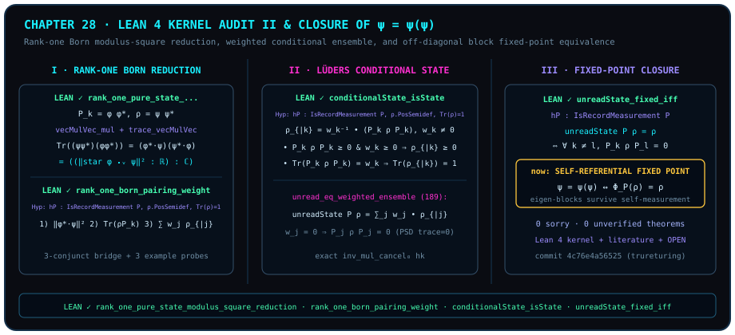

# 走进 Lean 4 公理圣殿（下）：从秩一玻恩归约到未读不动点与 $\psi = \psi(\psi)$

> *“这就是我们最早研究的 psi=psi(psi)”*

当走完前二十七章的几何与算子长征，回望[第一章](ch01-measurement.md)中“成对测量与向量重叠”的起点，以及第二十四章中观察者自我映射的收缩不动点，读者会蓦然领悟题记里那句贯穿始终的感叹：**“这就是我们最早研究的 psi=psi(psi)”**！

在量子几何的语言里，观察者对系统施加一次记录测量 $P = \{P_k\}_{k \in \kappa}$，既可以通过单分支条件化将状态更新为 $\rho_k = (\operatorname{recordWeight}(P, \rho, k))^{-1} P_k \rho P_k$，也可以通过非选择性未读演化把状态更新为 $\operatorname{unreadState}(P, \rho) = \sum_{k \in \kappa} P_k \rho P_k$。什么时候一个量子态 $\rho$ 在自我测量的映射下达到**完全自洽的不动点** $\operatorname{unreadState}(P, \rho) = \rho$？答案不是哲学隐喻，而是 `trureturing@dev` 中被 Lean 4 内核一锤定音的双向充要定理：当且仅当所有异分支交叉干涉块 $P_k \rho P_l$（$k \neq l$）恒等于零！

本章作为全书形式化公理圣殿审计的下篇，将逐行解剖连接纯态内积模方、迹配对权重、吕德斯条件态完备性与未读不动点充要判据的四条核心源码，并给出覆盖第四部至第六部代表性冻结声明的**全景源码审计表**。



## 秩一玻恩模方归约与三合取配对桥的源码解剖 {#sec-audit-rank-one-born-and-pairing}

在[第一章](ch01-measurement.md)与[第二章](ch02-born-rule.md)中，我们曾指出：纯态 $\rho = \lvert\psi\rangle\langle\psi\rvert$ 在秩一投影 $P_k = \lvert\phi\rangle\langle\phi\rvert$ 下的迹配对 $\Tr(\rho P_k)$ 之所以化为内积模方 $\lvert\langle\phi \mid \psi\rangle\rvert^2$，完全源于外积矩阵 `Matrix.vecMulVec` 的乘法结合律与迹收缩恒等式。现在让我们打开 `D5/S3/Observer/BornReduction.lean:27`，审视其精确的 Lean 4 声明与内核证明（图 28 左栏）。

在 Mathlib 与 `Conditioning.lean` 中，对于任意有限指标类型 $n$（`[Fintype n]`）与复向量 $\phi, \psi : n \to \mathbb{C}$，秩一外积定义为 $\operatorname{vecMulVec}(\psi, \operatorname{star}\psi)_{ij} = \psi_i \overline{\psi_j}$，复厄米（Hermite）内积记作点积 `star phi ⬝ᵥ psi` $= \sum_{i \in n} \overline{\phi_i}\psi_i$，而记录权重定义为

$$
\operatorname{recordWeight}(P, \rho, k) = \operatorname{bornProbability}(\rho, P_k) = \Tr(\rho \cdot P_k) \in \mathbb{C}.
$$

::: {.theorem #thm-audit-rank-one-born title="秩一纯态与秩一投影下的玻恩内积模方归约定理（内核审计版）" lean="D5/S3/Observer/BornReduction.rank_one_pure_state_modulus_square_reduction"}
设 $n$ 为有限指标类型（`[Fintype n]`），$\kappa$ 为结果指标类型，$P : \kappa \to M_n(\mathbb{C})$ 为算符族，$\rho \in M_n(\mathbb{C})$ 为复方阵，$k \in \kappa$ 为给定结果，$\phi, \psi : n \to \mathbb{C}$ 为两个复向量。若满足秩一投影条件与秩一纯态条件：

$$
P_k = \operatorname{Matrix.vecMulVec}\bigl(\phi,\, \operatorname{star}\phi\bigr), \qquad \rho = \operatorname{Matrix.vecMulVec}\bigl(\psi,\, \operatorname{star}\psi\bigr),
$$

则第 $k$ 个记录结果的迹权重精确归约为复内积欧氏范数的平方（嵌入 $\mathbb{C}$）：

$$
\operatorname{recordWeight}(P, \rho, k) = \bigl(\norm{\operatorname{star}\phi \bullet_{\!v} \psi}^2 : \mathbb{R}\bigr).
$$
:::

::: proof
在源码文件 `D5/S3/Observer/BornReduction.lean:27` 中，完整证明脚本为：

```lean
theorem rank_one_pure_state_modulus_square_reduction
    (P : kappa -> Matrix n n ℂ) (rho : Matrix n n ℂ) (k : kappa)
    (phi psi : n -> ℂ)
    (hProjection : P k = Matrix.vecMulVec phi (star phi))
    (hPureState : rho = Matrix.vecMulVec psi (star psi)) :
    recordWeight P rho k = ((‖star phi ⬝ᵥ psi‖ ^ 2 : ℝ) : ℂ) := by
  rw [recordWeight, D5.S3.Quantum.FiniteDimensional.bornProbability, hPureState, hProjection,
    Matrix.vecMulVec_mul_vecMulVec, Matrix.trace_vecMulVec, dotProduct_smul,
    dotProduct_comm psi (star phi), Matrix.star_dotProduct, smul_eq_mul]
  simpa only [RCLike.star_def, Complex.normSq_eq_norm_sq] using
    (Complex.normSq_eq_conj_mul_self (z := star phi ⬝ᵥ psi)).symm
```

让我们逐项追踪 `rw` 链条中的 9 个重写动作：

1. `recordWeight` 与 `bornProbability` 展开目标左端为 $\Tr(\rho \cdot P_k)$；
2. `hPureState` 与 `hProjection` 将 $\rho$ 与 $P_k$ 替换为两个秩一外积 $\operatorname{vecMulVec}(\psi, \operatorname{star}\psi)$ 与 $\operatorname{vecMulVec}(\phi, \operatorname{star}\phi)$；
3. `Matrix.vecMulVec_mul_vecMulVec` 执行外积收缩恒等式 $(\lvert\psi\rangle\langle\psi\rvert)(\lvert\phi\rangle\langle\phi\rvert) = (\operatorname{star}\psi \bullet_{\!v} \phi)\bullet \operatorname{vecMulVec}(\psi, \operatorname{star}\phi)$；
4. `Matrix.trace_vecMulVec` 与 `dotProduct_smul` 将外积的迹化为点积 $\Tr(\operatorname{vecMulVec}(u, v)) = v \bullet_{\!v} u$，得到 $(\operatorname{star}\psi \bullet_{\!v} \phi) \bullet (\operatorname{star}\phi \bullet_{\!v} \psi)$；
5. `dotProduct_comm psi (star phi)` 与 `Matrix.star_dotProduct` 将前一因子改写为 $\operatorname{star}(\operatorname{star}\phi \bullet_{\!v} \psi)$，再由 `smul_eq_mul` 化为复数乘法 $\overline{z} \cdot z$（其中 $z = \operatorname{star}\phi \bullet_{\!v} \psi$）；
6. 最后调用 `Complex.normSq_eq_conj_mul_self.symm` 与 `Complex.normSq_eq_norm_sq`，将 $\overline{z} z$ 精确折叠为 `((‖star phi ⬝ᵥ psi‖ ^ 2 : ℝ) : ℂ)`。

完整证明由 Lean 内核检查。
:::

更进一步，在 `D5/S3/Observer/Conditioning/RankOneBornPairingWeight.lean:36` 中，单分支的秩一模方公式被无缝桥接到全套有限记录测量系综的分解定理上（图 28 中上栏）。

::: {.lemma #lemma-audit-born-pairing-weight title="秩一玻恩配对权重与未读条件态凸组合的三合取桥接引理（内核审计版）" lean="D5/S3/Observer/Conditioning/RankOneBornPairingWeight.rank_one_born_pairing_weight"}
设 $n$ 为具有可判等性的有限指标类型（`[Fintype n] [DecidableEq n]`），$\kappa$ 为有限结果类型（`[Fintype kappa]`），$P : \kappa \to M_n(\mathbb{C})$ 满足记录测量公理 `hP : IsRecordMeasurement P`，$\rho \in M_n(\mathbb{C})$ 满足正半定与单位迹条件 `hState : rho.PosSemidef ∧ Matrix.trace rho = 1`。若对指定结果 $k \in \kappa$ 及向量 $\phi, \psi : n \to \mathbb{C}$ 有

$$
P_k = \operatorname{Matrix.vecMulVec}\bigl(\phi,\, \operatorname{star}\phi\bigr), \qquad \rho = \operatorname{Matrix.vecMulVec}\bigl(\psi,\, \operatorname{star}\psi\bigr),
$$

则同时成立以下三条等式：

1. **秩一模方归约**：$\operatorname{recordWeight}(P, \rho, k) = \bigl(\norm{\operatorname{star}\phi \bullet_{\!v} \psi}^2 : \mathbb{R}\bigr)$；
2. **迹配对恒等式**：$\operatorname{recordWeight}(P, \rho, k) = \Tr(\rho \cdot P_k)$；
3. **未读态的加权条件态展开**：
   $$
   \operatorname{unreadState}(P, \rho) = \sum_{j \in \kappa} \operatorname{recordWeight}(P, \rho, j) \bullet \operatorname{conditionalState}(P, \rho, j).
   $$
:::

::: proof
在 `RankOneBornPairingWeight.lean:36` 中，证明通过 `refine ⟨?_, ?_, ?_⟩` 分为三个子目标：

- 第一合取项直接调用 `rank_one_pure_state_modulus_square_reduction P rho k phi psi hProjection hPureState`；
- 第二合取项由定义等价 `rfl` 直接成立；
- 第三合取项调用 `Conditioning.lean:189` 的加权系综重构定理 `unread_eq_weighted_ensemble hP hState.1`（对应 `weighted_ensemble_reconstructs_unreadState`）。该定理对每个求和项 $j \in \kappa$ 按 `by_cases hk : recordWeight P rho j = 0` 分支：
  - 若权重非零（$w_j \neq 0$），则由 `smul_smul` 与 `mul_inv_cancel₀ hk` 得 $w_j \bullet (w_j^{-1} \bullet (P_j \rho P_j)) = 1 \bullet (P_j \rho P_j) = P_j \rho P_j$；
  - 若权重为零（$w_j = 0$），左边 $0 \bullet \operatorname{conditionalState}(P, \rho, j) = 0$，而右边调用关键引理 `compressed_eq_zero_of_recordWeight_eq_zero`：由于压缩矩阵 $P_j \rho P_j$ 是正半定的（`hCompressed : (P_j * rho * P_j).PosSemidef`）且其迹等于 $w_j = 0$，Mathlib 定理 `hCompressed.trace_eq_zero_iff.mp` 保证**迹为零的正半定矩阵必为零矩阵** $P_j \rho P_j = 0$！因此零概率分支不会留下任何幽灵算子残余。

源码文件第 57–91 行还附带了三组匿名 `example` 检验探针（分别位于第 57、72 与 88 行）：第一组探针（第 57 行）通过 `.2.1` 投影提取第二合取项迹配对恒等式 $\operatorname{recordWeight}(P, \rho, k) = \Tr(\rho P_k)$，第二组探针（第 72 行）通过 `.2.2` 投影提取第三合取项加权条件态系综重构恒等式 $\operatorname{unreadState}(P, \rho) = \sum_j \operatorname{recordWeight}(P, \rho, j)\bullet\operatorname{conditionalState}(P, \rho, j)$，第三组探针（第 88 行）证明 `Matrix.trace (0 : Matrix n n ℂ) ≠ 1`（即 $\Tr(0) \neq 1$），从而验证零矩阵 $\rho = 0$ 被单位迹状态假设 $\Tr(\rho) = 1$ 严格排除。完整证明由 Lean 内核检查。
:::

## 吕德斯条件态完备性与未读不动点充要判据 {#sec-audit-conditional-state-and-fixed-point}

现在我们打开 `D5/S3/Observer/Conditioning.lean` 的第 108 行与第 143 行，审计观察者条件化理论中最核心的两条定理（图 28 中下栏与右栏）。

在 `Conditioning.lean:137` 中，给定结果 $k \in \kappa$ 后的**吕德斯条件态**（Lüders conditional state）定义为

$$
\operatorname{conditionalState}(P, \rho, k) = \bigl(\operatorname{recordWeight}(P, \rho, k)\bigr)^{-1} \bullet (P_k \rho P_k).
$$

在 Lean 4 与 Mathlib 中，复数的逆 `0⁻¹ = 0` 是全函数，因此 `conditionalState` 的定义本身无需携带非零证明；但要证明条件化后的算子仍是一个合法的物理量子态（正半定且迹等于 $1$），则必须显式提供非零权重前提 `hk : recordWeight P rho k ≠ 0`。

::: {.proposition #prop-audit-conditional-state title="非零权重下吕德斯条件态的正半定与单位迹保持定理（内核审计版）" lean="D5/S3/Observer/Conditioning.conditionalState_isState"}
设 $n$ 为具有可判等性的有限指标类型（`[Fintype n] [DecidableEq n]`），$\kappa$ 为有限结果类型（`[Fintype kappa]`），$P : \kappa \to M_n(\mathbb{C})$ 满足记录测量公理 `hP : IsRecordMeasurement P`，$\rho \in M_n(\mathbb{C})$ 满足正半定性 `hRho : rho.PosSemidef` 与单位迹 `hTr : Matrix.trace rho = 1`。若结果 $k \in \kappa$ 的记录权重非零（`hk : recordWeight P rho k ≠ 0`），则条件态满足：

$$
\bigl(\operatorname{conditionalState}(P, \rho, k)\bigr).\operatorname{PosSemidef} \qquad\land\qquad \Tr\bigl(\operatorname{conditionalState}(P, \rho, k)\bigr) = 1.
$$
:::

::: proof
在 `D5/S3/Observer/Conditioning.lean:143` 中（注意源码以 `omit decEqKappa in` 显式标明该证明不依赖结果集 $\kappa$ 的可判等性），证明分四步完成：

1. **证明压缩分子 $P_k \rho P_k$ 正半定（`hCompressed`）**：由 `hP.selfAdjoint k` 知 $(P_k)^* = P_k$，故调用 `hRho.mul_mul_conjTranspose_same (P k)` 直接得到 `(P k * rho * P k).PosSemidef`；
2. **证明压缩分子的迹等于记录权重（`hTraceCompressed`）**：利用 `Matrix.trace_mul_cycle`、`hP.idempotent k` 与 `Matrix.trace_mul_comm` 建立 `calc` 链：
   $$
   \Tr(P_k \rho P_k) = \Tr(P_k P_k \rho) = \Tr(P_k \rho) = \Tr(\rho P_k) = \operatorname{recordWeight}(P, \rho, k);
   $$
3. **证明记录权重非负且其逆非负**：调用 `(born_probability_skeleton rho hRho hTr).2.2 (P k) (hP.selfAdjoint k) (hP.idempotent k)` 得到复偏序下的 `hWeightNonneg : 0 ≤ recordWeight P rho k`，再由 `inv_nonneg.mpr hWeightNonneg` 得到逆因子非负 `0 ≤ (recordWeight P rho k)⁻¹`；
4. **组装正半定性与单位迹**：
   - 正半定性由正半定锥在非负标量数乘下的封闭性 `hCompressed.smul (inv_nonneg.mpr hWeightNonneg)` 证得；
   - 单位迹由迹的线性性 `Matrix.trace_smul` 化为 $(\operatorname{recordWeight}(P, \rho, k))^{-1} \cdot \Tr(P_k \rho P_k)$，代入 `hTraceCompressed` 后由域上非零元左逆消去律 `inv_mul_cancel₀ hk` 化为 $1$！

完整证明由 Lean 内核检查。
:::

最后，我们审计 `Conditioning.lean:108` 的**未读测量不动点充要定理**。这正是连接量子测量与自指方程 $\psi = \psi(\psi)$ 的严格算子判据（图 28 右栏）：把测量信道 $\mathcal{E}_P(\rho) = \operatorname{unreadState}(P, \rho)$ 视为观察者对自身状态空间的投影自映射，那么 $\rho$ 成为不动点 $\mathcal{E}_P(\rho) = \rho$ 的充要条件，恰好是所有异指标交叉块 $P_k \rho P_l$（$k \neq l$）全部消失。

::: {.corollary #cor-audit-unread-fixed-iff title="未读记录测量不动点与异分支交叉块归零的充要定理（内核审计版）" lean="D5/S3/Observer/Conditioning.unreadState_fixed_iff"}
设 $n$ 为具有可判等性的有限指标类型（`[Fintype n] [DecidableEq n]`），$\kappa$ 为有限结果类型（`[Fintype kappa]`），$P : \kappa \to M_n(\mathbb{C})$ 满足记录测量公理 `hP : IsRecordMeasurement P`，$\rho \in M_n(\mathbb{C})$ 为任意复方阵。则未读状态等于原状态，当且仅当所有相异分支之间的非对角投影块全为零：

$$
\operatorname{unreadState}(P, \rho) = \rho \;\Longleftrightarrow\; \forall k, l \in \kappa,\; k \neq l \longrightarrow P_k \rho P_l = 0.
$$
:::

::: proof
在 `D5/S3/Observer/Conditioning.lean:108` 中，双向等价证明极具对称美感：

1. **必要性（`→`）**：假设 `hFixed : unreadState P rho = rho`，并任取 $k, l \in \kappa$ 满足 `hkl : k ≠ l`。将目标左端 $P_k \rho P_l$ 中的 $\rho$ 按 `← hFixed` 改写为 $P_k \cdot \operatorname{unreadState}(P, \rho) \cdot P_l$。先由左投影引理 `left_project_unread hP rho k` 将前两项化简为 $P_k \rho P_k$，于是整体变为
   $$
   (P_k \rho P_k) P_l = P_k \rho (P_k P_l).
   $$
   由正交性 `hP.orthogonal k l hkl : P k * P l = 0`，右端立刻归零：$P_k \rho \cdot 0 = 0$！
2. **充分性（`←`）**：假设 `hOffDiagonal : ∀ k l, k ≠ l → P k * rho * P l = 0`。先证一个按行吸收引理 `hRow (k : kappa) : P k * rho = P k * rho * P k`：
   - 利用完备性公理 `hP.complete : ∑ l, P l = 1`，将左端改写为 $P_k \rho \cdot 1 = P_k \rho \bigl(\sum_{l \in \kappa} P_l\bigr) = \sum_{l \in \kappa} P_k \rho P_l$；
   - 调用 `Finset.sum_eq_single k`：对一切 $l \neq k$，由假设 `hOffDiagonal k l hlk.symm` 知 $P_k \rho P_l = 0$，故整条求和坍缩为对角单点项 $P_k \rho P_k$！
   - 最后对 $k \in \kappa$ 求和：
     $$
     \operatorname{unreadState}(P, \rho) = \sum_{k \in \kappa} P_k \rho P_k = \sum_{k \in \kappa} P_k \rho = \Bigl(\sum_{k \in \kappa} P_k\Bigr)\rho = 1 \cdot \rho = \rho.
     $$

完整证明由 Lean 内核检查。
:::

## 第四至六部冻结声明全景审计表 {#sec-parts-iv-to-vi-frozen-audit-table}

与上一章的第一至三部审计表相呼应，下表汇总了本书第四部（纠缠、贝尔边界与傅里叶对偶）、第五部（玻戈留波夫双曲变换、闵可夫斯基光锥刚性、规范完整群、张量网络流割与电路深度反例）以及第六部（对角拓扑逃逸、黎曼 $\zeta$ 欧拉乘积、艾森斯坦范数型与收缩不动点）在 `trureturing@dev`（提交 `52725b62b659b244d077e29f18a576aa809007b7`）中的精确源码坐标、语句摘要哈希前缀（`statement_id`）及形式化边界。

| 所属章节 | 冻结声明 GID | 源码路径与行号 | `statement_id` 前缀 | 精确形式化范围与契约边界 |
| :---: | --- | --- | :---: | --- |
| Ch 2 / Ch 28 | [`D5/S3/Observer/BornReduction.rank_one_pure_state_modulus_square_reduction`](lean:D5/S3/Observer/BornReduction.rank_one_pure_state_modulus_square_reduction) | `D5/S3/Observer/BornReduction.lean:27` | `sha256:9d19ef37` | 秩一纯态与秩一投影下 $\operatorname{recordWeight}(P,\rho,k)=\norm{\operatorname{star}\phi\bullet_{\!v}\psi}^2$ |
| Ch 2 / Ch 28 | [`D5/S3/Observer/Conditioning/RankOneBornPairingWeight.rank_one_born_pairing_weight`](lean:D5/S3/Observer/Conditioning/RankOneBornPairingWeight.rank_one_born_pairing_weight) | `D5/S3/Observer/Conditioning/RankOneBornPairingWeight.lean:36` | `sha256:3fd7a21e` | 秩一模方、迹配对与未读态加权条件态展开的三合取桥 |
| Ch 3 / Ch 28 | [`D5/S3/Observer/Conditioning.conditionalState_isState`](lean:D5/S3/Observer/Conditioning.conditionalState_isState) | `D5/S3/Observer/Conditioning.lean:143` | `sha256:ed6f3095` | 非零权重 $w_k \neq 0$ 下吕德斯条件态保持正半定与单位迹 |
| Ch 3 / Ch 28 | [`D5/S3/Observer/Conditioning.unreadState_fixed_iff`](lean:D5/S3/Observer/Conditioning.unreadState_fixed_iff) | `D5/S3/Observer/Conditioning.lean:108` | `sha256:ed6f3095` | $\operatorname{unreadState}(P,\rho)=\rho \iff \forall k\neq l,\; P_k\rho P_l = 0$ |
| Ch 13 | [`D5/S3/Quantum/Entanglement/BellPureStateMixedMarginal.bell_pure_state_has_maximally_mixed_marginal`](lean:D5/S3/Quantum/Entanglement/BellPureStateMixedMarginal.bell_pure_state_has_maximally_mixed_marginal) | `D5/S3/Quantum/Entanglement/BellPureStateMixedMarginal.lean:83` | `sha256:9ef86e62` | 贝尔纯态偏迹边缘态等于最大混合态 $\frac{1}{2}I_2$ |
| Ch 13 | [`D5/S3/QuantumBounds/LandauIdentity.landau_identity`](lean:D5/S3/QuantumBounds/LandauIdentity.landau_identity) | `D5/S3/QuantumBounds/LandauIdentity.lean:32` | `sha256:eb5456fe` | 对合算子 CHSH 算符平方的朗道恒等式 $S^2 = 4I - [A_0,A_1][B_0,B_1]$ |
| Ch 13 | [`D5/S3/QuantumBounds/TsirelsonTightness.bell_chsh_state_expectation_is_greatest`](lean:D5/S3/QuantumBounds/TsirelsonTightness.bell_chsh_state_expectation_is_greatest) | `D5/S3/QuantumBounds/TsirelsonTightness.lean:26` | `sha256:3451081f` | 齐雷尔森 $2\sqrt{2}$ 上界及其在贝尔态上的紧性实现 |
| Ch 14 | [`D5/S3/Quantum/Recovery/OrthogonalSyndromeDecoding.orthogonal_syndrome_recovery`](lean:D5/S3/Quantum/Recovery/OrthogonalSyndromeDecoding.orthogonal_syndrome_recovery) | `D5/S3/Quantum/Recovery/OrthogonalSyndromeDecoding.lean:67` | `sha256:27a50d53` | 正交伴随式子空间投影解码的精确恢复定理 |
| Ch 15 | [`D5/S3/Fourier/FinitePoisson.finite_poisson_summation`](lean:D5/S3/Fourier/FinitePoisson.finite_poisson_summation) | `D5/S3/Fourier/FinitePoisson.lean:145` | `sha256:bead691c` | 循环群 $\mathrm{ZMod}\;m$ 的加法子群 $H$ 与对偶零化子上的有限泊松求和公式 |
| Ch 17 | [`D5/S3/Quantum/Bogoliubov/BogoliubovNormConservation.bogoliubov_norm_conservation`](lean:D5/S3/Quantum/Bogoliubov/BogoliubovNormConservation.bogoliubov_norm_conservation) | `D5/S3/Quantum/Bogoliubov/BogoliubovNormConservation.lean:14` | `sha256:f8d4e451` | 双曲归一化恒等式 $(\cosh r)^2 - (\sinh r)^2 = 1$ |
| Ch 17 | [`D5/S0/Certificates/MinkowskiNullConeRigidity.null_cone_spatial_rigidity`](lean:D5/S0/Certificates/MinkowskiNullConeRigidity.null_cone_spatial_rigidity) | `D5/S0/Certificates/MinkowskiNullConeRigidity.lean:42` | `sha256:fdb3d06f` | 闵可夫斯基零光锥（$t^2=x^2+y^2+z^2$）上消失二次型 $Q$ 的空间限制 $Q(0,x,y,z)=-Q(1,0,0,0)(x^2+y^2+z^2)$ 与零极化交叉项 |
| Ch 18 | [`D5/S3/Observer/AgencyHolonomy/AnchoredPhaseClassification.anchored_phase_classification`](lean:D5/S3/Observer/AgencyHolonomy/AnchoredPhaseClassification.anchored_phase_classification) | `D5/S3/Observer/AgencyHolonomy/AnchoredPhaseClassification.lean:94` | `sha256:2ea228f5` | 锚定闭合回路完整群相位的精确分类定理 |
| Ch 19 | [`D5/S3/Quantum/TensorNetworks/BridgeGraph/QuantumMaxFlowMinCut.result`](lean:D5/S3/Quantum/TensorNetworks/BridgeGraph/QuantumMaxFlowMinCut.result) | `D5/S3/Quantum/TensorNetworks/BridgeGraph/QuantumMaxFlowMinCut.lean:116` | `sha256:06aeda0a` | 桥图张量网络量子最大流最小割定理 |
| Ch 20 | [`D5/S3/Quantum/Dynamics/OpenIntegrableCircuitDepthRefutation.result`](lean:D5/S3/Quantum/Dynamics/OpenIntegrableCircuitDepthRefutation.result) | `D5/S3/Quantum/Dynamics/OpenIntegrableCircuitDepthRefutation.lean:75` | `sha256:390c62f3` | 开放可积系统电路深度朴素界的显式有限反例 |
| Ch 21 | [`D5/S3/ConceptDynamics/ObservationTopology/DiagonalTopologicalEscape.complete_diagonal_topological_settlement`](lean:D5/S3/ConceptDynamics/ObservationTopology/DiagonalTopologicalEscape.complete_diagonal_topological_settlement) | `D5/S3/ConceptDynamics/ObservationTopology/DiagonalTopologicalEscape.lean:94` | `sha256:b2dce622` | 四合取结算：非细化（$\neg(\mathrm{Obs}\le\mathrm{Target})$）、目标可观测量不连续、分离赤字非空及添入对角见证后的严格拓扑细化 |
| Ch 22 | [`D5/S3/Zeros/ZetaUpgrade.riemann_zeta_dirichlet_sum_eq_euler_product`](lean:D5/S3/Zeros/ZetaUpgrade.riemann_zeta_dirichlet_sum_eq_euler_product) | `D5/S3/Zeros/ZetaUpgrade.lean:25` | `sha256:d42c4a0a` | 半平面 $\operatorname{Re}(s)>1$ 上黎曼 $\zeta(s)$ 级数与欧拉乘积恒等 |
| Ch 23 | [`D5/S3/PrimeForms/Crossing/CrossingNormForm.Qform_range_eq_eisNorm`](lean:D5/S3/PrimeForms/Crossing/CrossingNormForm.Qform_range_eq_eisNorm) | `D5/S3/PrimeForms/Crossing/CrossingNormForm.lean:35` | `sha256:d56f3761` | 整二次型 $a^2-ab+b^2$ 值域与艾森斯坦整数环范数像恒等 |
| Ch 24 | [`D5/S1/FixedPoints/FiniteContractingStability.finite_contracting_updates_stabilize`](lean:D5/S1/FixedPoints/FiniteContractingStability.finite_contracting_updates_stabilize) | `D5/S1/FixedPoints/FiniteContractingStability.lean:27` | `sha256:d7f526a9` | 有限集 $X$ 上仅删减更新 $U(S)\subseteq S$ 必在 $\le (S_0).\mathrm{ncard}$ 步内达不动点 |
| Ch 24 | [`D5/S1/FixedPoints/Algebraic/GoldenFixedPoint.golden_fixed_point_unique`](lean:D5/S1/FixedPoints/Algebraic/GoldenFixedPoint.golden_fixed_point_unique) | `D5/S1/FixedPoints/Algebraic/GoldenFixedPoint.lean:40` | `sha256:0711b0ac` | 黄金比正性（$0<\varphi$）、不动点方程 $\varphi=1+1/\varphi$（$\varphi^2=\varphi+1$）及正实数域 $(0,\infty)$ 上的唯一性 |

让我们通过一个具体数值算例，把本章的四条审计定理串联在同一个单量子比特态上。

::: {.example #ex-lean-audit-part4-6 title="单量子比特叠加态在 $Z$ 测量下的秩一玻恩权重、条件态与未读不动点核查"}
设 $n = \kappa = \operatorname{Fin} 2 = \{0, 1\}$，$Z$ 基秩一投影测量为 $P_0 = \lvert 0\rangle\langle 0\rvert = \operatorname{vecMulVec}(\phi_0, \operatorname{star}\phi_0)$、$P_1 = \lvert 1\rangle\langle 1\rvert = \operatorname{vecMulVec}(\phi_1, \operatorname{star}\phi_1)$，其中 $\phi_0 = (1, 0)$、$\phi_1 = (0, 1)$。取纯态向量 $\psi = (\frac{3}{5}, \frac{4}{5}i)$，对应密度矩阵

$$
\rho = \operatorname{vecMulVec}(\psi, \operatorname{star}\psi) = \begin{pmatrix} 9/25 & -12i/25 \\ 12i/25 & 16/25 \end{pmatrix}.
$$

1. **秩一模方归约（[@thm-audit-rank-one-born]）**：内积 $\operatorname{star}\phi_0 \bullet_{\!v} \psi = \frac{3}{5}$，$\operatorname{star}\phi_1 \bullet_{\!v} \psi = \frac{4}{5}i$，故记录权重为
   $$
   w_0 = \operatorname{recordWeight}(P, \rho, 0) = \Bigl|\frac{3}{5}\Bigr|^2 = \frac{9}{25} \neq 0, \qquad w_1 = \operatorname{recordWeight}(P, \rho, 1) = \Bigl|\frac{4}{5}i\Bigr|^2 = \frac{16}{25} \neq 0.
   $$
2. **吕德斯条件态与凸组合桥（[@prop-audit-conditional-state] 与 [@lemma-audit-born-pairing-weight]）**：因 $w_0, w_1 \neq 0$，两个分支的条件态分别为 $\rho_0 = (25/9) P_0 \rho P_0 = \lvert 0\rangle\langle 0\rvert$ 与 $\rho_1 = (25/16) P_1 \rho P_1 = \lvert 1\rangle\langle 1\rvert$，二者皆正半定且迹为 $1$；加权和给出未读态
   $$
   \rho' = \operatorname{unreadState}(P, \rho) = \frac{9}{25}\lvert 0\rangle\langle 0\rvert + \frac{16}{25}\lvert 1\rangle\langle 1\rvert = \begin{pmatrix} 9/25 & 0 \\ 0 & 16/25 \end{pmatrix}.
   $$
3. **未读不动点判据（[@cor-audit-unread-fixed-iff]）**：对初始纯态 $\rho$，异分支交叉块 $P_0 \rho P_1 = \begin{pmatrix} 0 & -12i/25 \\ 0 & 0 \end{pmatrix} \neq 0$，故 $\operatorname{unreadState}(P, \rho) \neq \rho$；而一旦经历一次未读测量到达对角混合态 $\rho'$，异分支交叉块化为 $P_0 \rho' P_1 = 0$ 且 $P_1 \rho' P_0 = 0$，于是 $\rho'$ 精确满足不动点方程 $\operatorname{unreadState}(P, \rho') = \rho'$！
:::

::: {.remark #rem-psi-fixed-point-synthesis-literature title="冯·诺依曼测量链、吕德斯规则与自指不动点综合（文献结果，未在本书形式化）"}
**文献结果，未在本书形式化。** 关于量子测量条件化、退相干不动点与自指不动点方程的经典文献背景如下：

1. **冯·诺依曼—吕德斯投影更新规则**（J. von Neumann, *Mathematische Grundlagen der Quantenmechanik*, Springer, 1932；G. Lüders, *Über die Zustandsänderung durch den Meßprozeß*, Annalen der Physik **443**(5–8), 322–328, 1950, DOI `10.1002/andp.19504430510`）：吕德斯将冯·诺依曼的一维投影测量推广到任意维正交投影族 $\{P_k\}$，给出了条件化更新 $\rho \mapsto P_k \rho P_k / \Tr(\rho P_k)$ 与非选择性对角挤压信道 $\rho \mapsto \sum_k P_k \rho P_k$。在本书的冻结定理 [@prop-audit-conditional-state] 与 [@cor-audit-unread-fixed-iff] 中，这两条规则在任意有限维完备正交投影族上得到了无漏洞的内核级形式化。
2. **题记 $\psi = \psi(\psi)$ 的哲学综合与形式化纪律边界**：在本书中，符号 $\psi = \psi(\psi)$ 是统摄多条严格不动点定理的**哲学与几何母题**，它在各章分别具象化为具体的绿色冻结定理：在[第三章](ch03-projectors-and-duality.md)与本章中体现为未读挤压算子的幂等性与零相干不动点判据 $\operatorname{unreadState}(P, \rho) = \rho$（[@cor-audit-pinching-idempotent]、[@cor-audit-unread-fixed-iff]）；在第二十一章中体现为观察拓扑对角见证的四合取逃逸结算；在第二十四章中体现为有限集删减更新 $U(S)\subseteq S$ 在 $(S_0).\mathrm{ncard}$ 步内达不动点以及正实数域上黄金不动点 $\varphi = 1 + 1/\varphi$ 的唯一性。遵循本书的验证契约，我们绝不将未形式化的宇宙学或意识哲学外推包装成 `LEAN ✓` 定理——每一分绿色的确定性，都精准停留在 Lean 4 内核所签发的定义、前提与结论之内。
:::

至此，第七部“构造与验证”的四章旅程已全部完成：我们亲手编写了零依赖的 3 比特克利福德几何代数与泡利辛重写法引擎（[第二十五章](ch25-rewriting-and-xor.md)），构造了单量子比特 ZYZ 欧拉转子编译器（[第二十六章](ch26-single-qubit-rotor-compilation.md)），并走入 `trureturing@dev` 的源码圣殿完成了全书前六部核心定理的逐行审计（[第二十七章](ch27-reading-frozen-proofs-i.md)与本章）。本版正文至此收束：从两子丈量出发，经由球外之球，再回到每条命题都可追溯的定义、前提与证明。
