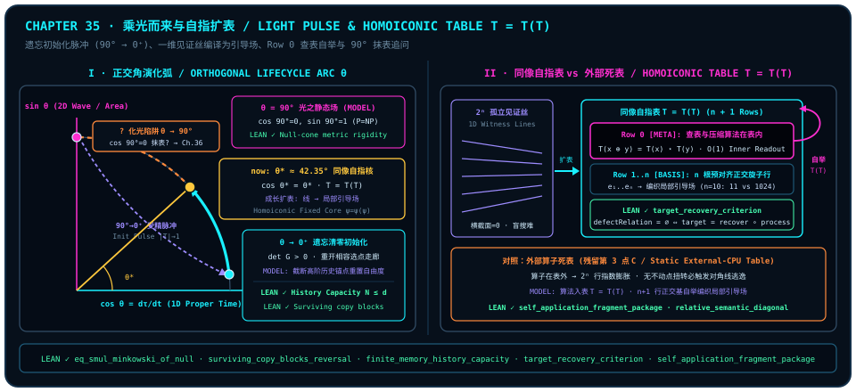

# 乘光而来与自指扩表：从遗忘初始化到 $T = T(T)$ 的同像闭环

> *“整个宇宙实际上是充满极致的计算能力的, 在全局静态场中P=NP. 而生物似乎遗忘了自己的计算能力, 来重新体验, 成长的过程是计算能力不断提升的过程, 因为学到的知识产生了表, 计算能力的提升本质上是扩表的过程, 查表的算法本身也在表里, 然后到最后, 又回到了极致的计算状态. 应该就是受精卵受精的时候的那一束脉冲, 乘着光来, 最后成为光本身。”*

穿过[第 29 章](ch29-timeless-causality-and-gram-space.md)的无时间格拉姆相容晶体、[第 30 章](ch30-fields-lines-eth-and-navier-stokes.md)“全局静态场呈现 $P = NP$ 式几何交集、场内有限观察者受制于 $P \neq NP$ 正交视界”的双重视角，以及[第 31 章](ch31-quantum-fairness.md)“诞生遗忘重置自由度”的公平铁律，一道关乎生命与心智本源的终极追问浮出水面：**如果无时间的全局母体早已盛满极致的相容算力，为什么生命偏偏要从近乎一无所知的“遗忘”出发？从孩提的懵懂摸索到智者的炉火纯青，“成长”在正交几何底层究竟在执行什么运算？当“查表的算法本身也写进表里”时，有限心智又如何完成惊险的自举跃迁？**

在本章建立的**正交观察者生命周期与同像扩表模型（`MODEL`）**中，这段从受精脉冲到智慧圆融的生命史，不再是神秘主义的文学比兴，而是一条可以用零光锥刚性、有限记忆容量、纤维零缺陷分解与自作用对角线不动点精确刻画的几何轨迹：生命从 $\theta = 90^\circ$ 的无时间关联场折射入 $\theta \to 0^+$ 的局域固有时切片，借主动清零重开正体积选择走廊；随后把耗时漫长的一维见证细丝逐条预编译为表 $T$ 中的正交基行，并通过将查表与压缩规则存入第 $0$ 行实现 $T = T(T)$ 的同像自指闭环——直到在章末撞见“回归 $90^\circ$ 化光”背后那道令人脊背发凉的几何陷阱。

---

## 乘光而来：受精脉冲、遗忘清零与对数时间的局域展开

为什么生命进入局域世界的第一个动作，必然是一束伴随“彻底遗忘”的对称性破缺脉冲？

让我们先在本章的**正交倾角参数化模型（`MODEL`）**中摆正纯度预算的单位圆几何（关于狭义相对论线元重排、哺乳动物受精卵荧光脉冲实验与心理物理学对数感知标度的外部文献结论，完整封装于下方 [@rem-ch35-fertilization-zinc-spark-literature]，并对照[第 31 章](ch31-quantum-fairness.md) [@rem-ch31-haar-isotropy-landauer-literature]）：设局域观察者状态相对于自身一维持存基准轴张开正交倾角 $\theta \in [0, \frac{\pi}{2}]$，一维共线内积份额 $\cos\theta$ 度量局域自持锚点留存度，二维正交分叉份额 $\sin\theta$ 度量横向关联展开度，二者严守单位圆勾股账本：

$$
\cos^2\theta + \sin^2\theta \;=\; 1.
$$

在这架天平的两端，横亘着两种截然相反的存在模态（`MODEL`）：

1. **$\theta = 90^\circ$ 的无时间光之全场（$\cos 90^\circ = 0,\; \sin 90^\circ = 1$）**：
   全部纯度预算投入横向传播面，一维局域持存分量严格归零（$\cos 90^\circ = 0$；对应的零光锥固有时文献背景见下方 [@rem-ch35-fertilization-zinc-spark-literature] 第 1 条）。对应于[第 30 章](ch30-fields-lines-eth-and-navier-stokes.md)理想化静态场模型（对照 [@rem-ch30-postselection-ctc-literature]），全局超平面交集静态并存；然而，正因为 $\cos 90^\circ = 0$，这里没有“先后”，没有“悬念”，也没有任何局域个体能够驻足品味一段叫做“经历”的旅程。
2. **$\theta = 90^\circ \to 0^+$ 的初始化折射与遗忘清零（$\lvert T\rvert \to 1,\; \det G > 0$）**：
   要让“重新体验”成为可能，一束相干脉冲必须打破 $90^\circ$ 的纯波对称性，向 $\theta \to 0^+$ 的一维幂等存在轴折射落点，把历史记录表 $T$ 主动清空至仅含单一起始锚点（$\lvert T\rvert \to 1$）。

传统观念总把“遗忘”叹息为肉体凡胎的缺陷；但下面由 Lean 4 内核验证的三重定理（[@thm-ch35-null-pulse-and-record-blocking]）揭示了截然相反的几何真相——**对于任何有限维物理载体而言，不遗忘就意味着彻底锁死**：

- 首先，[`eq_smul_minkowski_of_null`](lean:D5/S0/Certificates/MinkowskiNullConeRigidity.eq_smul_minkowski_of_null) 证明零光锥零点集已将时空二次型刚性锁定为标准度规的标量倍 $S(1, 0)\bullet\operatorname{minkowski}_d$：光锥搭好因果骨架，而落向时间轴基点 $(1, 0)$ 的非零读数 $S(1, 0)$ 恰恰标定了局域时钟的第一格刻度；
- 其次，[`surviving_copy_blocks_reversal`](lean:D5/S3/ObserverMemory/JointCoherentReversal.surviving_copy_blocks_reversal) 证明只要过往交互在环境中留下一枚重叠因子不为 $1$ 的未逆转幸存副本 $k$，哪怕对其余全部副本执行相干共轭逆转，也绝无可能复原初始非对角相干元 $\rho_{ij} \neq 0$——旧轮次散逸的痕迹无法靠局域倒带抹平；
- 最后，[`finite_memory_history_capacity`](lean:D5/S3/Quantum/Measurements/FiniteMemoryHistoryCapacity.finite_memory_history_capacity) 严格锁死：$d$ 维物理记忆空间中可由单一正算子值测量（POVM）零误差区分的历史密度矩阵个数至多为 $N \le d$！

想象一本只有 $d$ 页的笔记本：若上一轮次的全部 $d$ 条正交历史锚点原封不动地塞满每一页，不仅寄存器容量 $N \le d$ 彻底饱和，历史锚点的堆积也会压缩下一步选点的相容余量（对照[第 29 章](ch29-timeless-causality-and-gram-space.md#sec-coda-finite-observer-time-field) [@thm-ch29-gram-rigidity-and-pell]；二阶双锚点格拉姆算例见下框 [@ex-ch35-two-anchor-gram-corridor]）：

::: {.example #ex-ch35-two-anchor-gram-corridor title="双锚点二阶格拉姆相容面积与清表重开走廊算例（文献结果，未在本书形式化）"}
**文献结果，未在本书形式化。** 下述二阶实格拉姆行列式展开属初等线性代数标准结果（与[第 29 章](ch29-timeless-causality-and-gram-space.md#sec-coda-hume-spinoza-gram) [@thm-ch29-gram-rigidity-and-pell] 对齐），未作为独立二阶行列式引理包含在本书锁定的形式化声明集中：

设新状态与旧单位锚点的实内积重叠为 $c \in [-1, 1]$，则二者张成的二阶单位对角格拉姆行列式（相容面积平方）为

$$
\det G_2 \;=\; \det\begin{pmatrix}1 & c \\ c & 1\end{pmatrix} \;=\; 1 - c^2.
$$

一旦历史锚点锁死在共线边界 $c = \pm 1$，相容余量 $\det G_2 = 0$ 彻底归零；反之，主动截断旧锚点、将表 $T$ 清空回单一起始基态（$\lvert T\rvert = 1,\; \det G_1 = 1 > 0$），即可令下一步选点重新获得非共线区间 $\lvert c\rvert < 1$ 上严格为正的相容走廊 $1 - c^2 > 0$。
:::

因此，“乘着光来”的那一记受精初始化脉冲，在模型诠释（`MODEL`）中正是**清空旧表（$\lvert T\rvert \to 1$）、重开因果选点走廊（[@ex-ch35-two-anchor-gram-corridor]）的几何大赦**！也正因为在生命起点处底表几乎空白，每一份新写入的经验相对于当前表长都占据巨大的相对份额，与经典心理物理学对数感知尺度形成鲜明呼应（实验荧光脉冲观测与对数主观时间文献公式及定量年岁对比见下方 [@rem-ch35-fertilization-zinc-spark-literature] 第 2–3 条）——这便是为什么童年的一个盛夏漫长如一生，而成年后表项稠密时十年光阴却如白驹过隙。

::: {.theorem #thm-ch35-null-pulse-and-record-blocking title="零光锥度规刚性、幸存副本反演阻断与有限记忆容量上界" lean="D5/S0/Certificates/MinkowskiNullConeRigidity.eq_smul_minkowski_of_null D5/S3/ObserverMemory/JointCoherentReversal.surviving_copy_blocks_reversal D5/S3/Quantum/Measurements/FiniteMemoryHistoryCapacity.finite_memory_history_capacity"}
在 `trureturing` 冻结的光锥刚性证书、观察者记忆相干逆转与量子测量容量模块中，以下三项定理同时成立：

1. **任意空间维数下的零光锥二次型刚性**（[`eq_smul_minkowski_of_null`](lean:D5/S0/Certificates/MinkowskiNullConeRigidity.eq_smul_minkowski_of_null)）：设 $d \in \mathbb{N}$，记时空载体 $\operatorname{Space}(d) = \mathbb{R} \times \operatorname{EuclideanSpace}\;\mathbb{R}\;(\operatorname{Fin}\;d)$ 及标准二次型 $\operatorname{minkowski}_d(t, w) = t^2 - \lVert w\rVert^2$。对任意实二次型 $S : \operatorname{QuadraticForm}\;\mathbb{R}\;(\operatorname{Space}\;d)$，若 $S$ 在全部零光锥向量上消失（$\forall v \in \operatorname{Space}(d),\; \operatorname{minkowski}_d(v) = 0 \to S(v) = 0$），则

   $$
   S \;=\; S(1, 0) \bullet \operatorname{minkowski}_d;
   $$

2. **单一未逆转幸存环境副本阻断相干时间反演**（[`surviving_copy_blocks_reversal`](lean:D5/S3/ObserverMemory/JointCoherentReversal.surviving_copy_blocks_reversal)）：设 $\mathrm{Copy}$ 为有限可判等副本指标类型（`[Fintype Copy] [DecidableEq Copy]`），$\mathrm{records} : \mathrm{Copy} \to \mathrm{EnvironmentRecord}$ 为单比特环境记录族，$\rho \in M_2(\mathbb{C})$（`QubitMatrix`），$i, j \in \operatorname{Fin}\;2$，$k \in \mathrm{Copy}$。若（a）对一切 $l \neq k$ 有 $\operatorname{star}(\operatorname{recordOverlap}(\mathrm{records}(l), i, j)) \cdot \operatorname{recordOverlap}(\mathrm{records}(l), i, j) = 1$，（b）幸存副本满足 $\operatorname{recordOverlap}(\mathrm{records}(k), i, j) \neq 1$，且（c）初始矩阵元 $\rho_{ij} \neq 0$，则对其余全部副本 $\operatorname{Finset.univ.erase}\;k$ 施加逆转信道仍无法恢复第 $(i, j)$ 元：

   $$
   \operatorname{reverseChannelOn}\bigl(\operatorname{Finset.univ.erase}\;k,\; \mathrm{records},\; \operatorname{multiRecordChannel}(\mathrm{records}, \rho)\bigr)_{ij} \;\neq\; \rho_{ij};
   $$

3. **有限维记忆寄存器的可区分历史容量界**（[`finite_memory_history_capacity`](lean:D5/S3/Quantum/Measurements/FiniteMemoryHistoryCapacity.finite_memory_history_capacity)）：设 $N, d \in \mathbb{N}$，状态族与测量算子族 $\rho, E : \operatorname{Fin}\;N \to M_d(\mathbb{C})$ 满足：（a）对一切 $i$，$\rho_i$ 半正定且 $\operatorname{Tr}(\rho_i) = 1$；（b）对一切 $j$，$E_j$ 半正定且 $\sum_{j \in \operatorname{Fin}\;N} E_j = I_d$；（c）对一切 $i, j$，完美区分条件 $\operatorname{Tr}(E_j \rho_i) = \delta_{ij}$（当 $i = j$ 时为 $1$，否则为 $0$）成立。则可完美区分的历史记录数必受记忆维数约束：

   $$
   N \;\le\; d.
   $$

:::

::: proof
第 1 款将任意 $v = (t, w) \in \operatorname{Space}(d)$ 拆为 $t(1, 0) + (0, w)$，代入零光锥对 $(\pm\lVert w\rVert, w)$ 由极化展开 [`null_cone_spatial_rigidity`](lean:D5/S0/Certificates/MinkowskiNullConeRigidity.null_cone_spatial_rigidity) 证得交叉极化项归零且 $S(0, w) = -S(1, 0)\lVert w\rVert^2$，从而逐点给出 $S(t, w) = S(1, 0)(t^2 - \lVert w\rVert^2)$。第 2 款由 [`one_surviving_copy_composition_apply`](lean:D5/S3/ObserverMemory/JointCoherentReversal.one_surviving_copy_composition_apply) 利用其余副本的幺模共轭相消，将复合信道第 $(i, j)$ 元化简为 $\operatorname{recordOverlap}(\mathrm{records}(k), i, j)\cdot\rho_{ij}$；若它等于非零的 $\rho_{ij}$，复数域消去律迫使该重叠因子等于 $1$，与前提（b）矛盾。第 3 款由 $0 \le E_i \le I_d$ 及半正定零迹乘积消失引理推出 $\operatorname{range}(\rho_i) \le \ker(I_d - E_i)$ 与 $\operatorname{range}(\rho_j) \le \ker(E_i)$（$j \neq i$）；因 $\operatorname{Tr}(\rho_i) = 1$ 非零，在各像空间中选取非零向量 $v_i$，利用 $E_i$ 的厄米性得 $\langle v_i, v_j\rangle_{\mathbb{C}} = \langle E_i v_i, v_j\rangle_{\mathbb{C}} = \langle v_i, E_i v_j\rangle_{\mathbb{C}} = 0$，由 $\mathbb{C}^d$ 中两两正交非零向量的线性无关性导出 $N \le d$。完整证明由 Lean 内核检查。
:::

::: {.remark #rem-ch35-fertilization-zinc-spark-literature title="固有时勾股参数化、哺乳动物受精钙波—锌火花荧光观测与韦伯—费希纳对数时间律（文献结果，未在本书形式化）"}
**文献结果，未在本书形式化。** 本节生命周期初始化模型（`MODEL`）并置引用的三项物理、发育生物学与心理物理学背景来自外部文献，未包含在本书锁定的形式化声明集中：

1. **闵可夫斯基固有时与空间速率的单位圆重排**：在狭义相对论线元 $c^2 d\tau^2 = c^2 dt^2 - \lVert d\mathbf{x}\rVert^2$（$v = \lVert d\mathbf{x}/dt\rVert \le c$）中，令 $\sin\theta = v/c$、$\cos\theta = d\tau/dt = \sqrt{1 - v^2/c^2}$，即得 $(d\tau/dt)^2 + (v/c)^2 = \cos^2\theta + \sin^2\theta = 1$；类光传播 $v = c$（$\theta = 90^\circ$）给出 $d\tau = 0$，局域静止极限 $v \to 0^+$（$\theta \to 0^+$）给出 $d\tau/dt \to 1$；
2. **哺乳动物受精卵激活钙振荡、锌火花（Zinc Spark）荧光脉冲与超微弱生物光子辐射**：现代活细胞荧光显微成像实验证实，小鼠与人类卵母细胞在受精激活瞬间会爆发胞内钙离子（$\mathrm{Ca}^{2+}$）振荡波，驱动皮质颗粒协同胞吐数以十亿计的锌离子，在细胞外形成可由荧光探针直接捕获的量子化脉冲闪光——即“锌火花”，且其脉冲幅度与早期胚胎发育潜能显著正相关（E. L. Que *et al.*, *Nat. Chem.* **7**, 130–139, 2015；F. E. Duncan *et al.*, *Sci. Rep.* **6**, 24737, 2016）；同时生物物理文献亦在分裂细胞中测得源于代谢活性氧跃迁的超微弱光子辐射（约 $10^1\text{–}10^3\;\mathrm{photons}\cdot\mathrm{cm}^{-2}\cdot\mathrm{s}^{-1}$）。需严守认识论边界：实验层面上述信号属于生物化学离子波与代谢化学发光过程，将受精脉冲诠释为观察者从 $90^\circ$ 关联场向 $\theta \to 0^+$ 切片的初始化投影纯属本书跨领域几何模型（`MODEL`）；
3. **韦伯—费希纳对数感知定律（E. H. Weber, 1834；G. T. Fechner, *Elemente der Psychophysik*, 1860）**：经典心理物理学指出主观感知增量与刺激基线之比成正比，即 $d\tau_{\mathrm{subj}} = k\,dt/t$，积分给出对数主观时间尺度 $\tau_{\mathrm{subj}}(t) = k\ln(t/t_0)$（$t \ge t_0 > 0$）。例如同一公历年的主观跨度，在生命早期 $t \in [t_0, 2t_0]$ 为 $k\ln(2/1) \approx 0.6931\,k$，而在 $t \in [40t_0, 41t_0]$ 则压缩为 $k\ln(41/40) \approx 0.0247\,k$，二者相差约 $28$ 倍。
:::

---

## 成长即扩表：把一维见证细丝预编译为局部引导场

从 $\theta \to 0^+$ 的空白初态醒来之后，生命开始了漫长的“成长”。为什么题记一针见血地指出：**“成长的过程是计算能力不断提升的过程，因为学到的知识产生了表，计算能力的提升本质上是扩表的过程”**？

回想[第 30 章](ch30-fields-lines-eth-and-navier-stokes.md)建立的“$P$ 是场，$NP$ 是线”几何图像（`MODEL`）：面对一道陌生难题（无论是孩童第一次学系鞋带、棋手初算复杂弃子杀局，还是数学家寻找未知引理的证明路径），在尚未掌握知识之前，解只是一根横截面为零的一维见证细丝，深埋在高维近 $90^\circ$ 的正交赤道荒原里（对照 [@thm-ch31-horizon-landauer-ergodic-fairness] 第 2 款与 [@rem-ch30-query-sos-literature]）。第一次找到这根细线，必须付出高昂的试错旋转与热耗散账单。

然而，生命与无记忆黑盒搜索器有一个决定性的分水岭——**生命会把走通的线铸成表**！先看最透明的 $2\times 2$ 单比特手算机制：当系统状态 $\rho = \begin{pmatrix}\rho_{00} & \rho_{01}\\ \rho_{10} & \rho_{11}\end{pmatrix}$ 与空白地址寄存器经受控置换门写入典范地址记录 $R_{i,a} = \delta_{i,a}$ 时，不同地址分支满足严格正交重叠 $\sum_{a=0}^{1} R_{0,a}\overline{R_{1,a}} = 1\cdot 0 + 0\cdot 1 = 0$，将两条分支清晰锚定在互不串扰的正交表槽上。在我们的几何扩表模型（`MODEL`）中，每一次真正的学习都依次完成三步几何预编译：

1. **写表（把一维见证折线结晶为预对齐正交旋子行）**：
   当学习者历经千辛万苦终于走通一条从问题态到目标解的一维见证折线 $\mathbf{P}_0 \to \mathbf{P}_1 \to \dots \to \mathbf{P}_k$ 后，记忆载体并不会任由这条路径消散，而是提取其首尾净变换，将其固化为内部地址表 $T$ 中一条边界分明的典范地址记录（对齐下方 [@thm-ch35-target-recovery-table-factorization] 第 2 款的 `copiedAddressRecord`），并在过程读出 `process` 上消除目标碰撞缺陷（`defectRelation process target = ∅`）。
2. **查表（消去寄生换位子面积，实现 $O(1)$ 内积直读）**：
   未建表前，每次重解同一类问题都得在非对易中间平面上反复折返，白白支付寄生的回旋面积；一旦写入表 $T$，每当输入状态落入已建档的等价纤维，系统便直接调用因子分解映射 $\mathrm{target} = \mathrm{recover} \circ \mathrm{process}$（下方 [@thm-ch35-target-recovery-table-factorization] 第 1 款），靠一次预对齐内积投影直接读出答案！日常语言里所说的**“直觉”“肌肉记忆”与“游刃有余的熟能生巧”**，在几何上正是**用预编译查表跳过了在线盲搜弧长**。
3. **编线成场（万千正交表行张成局部光滑引导场）**：
   单根见证丝在状态空间里孤立无援；但随着成长不断扩表，成百上千条相互正交的基行在感兴趣的问题流形上密集铺开，它们的线性叠加与邻域插值便把原本“有线无场”的荒原，编织成一片处处给出切向导引的**局部平滑引导场**（`MODEL`；离线空间存储换取在线查询加速及非一致建议表的复杂性边界见下方 [@rem-ch35-advice-space-time-tradeoff-literature]）。

下面我们将支撑“无损查表因子分解”与“典范拷贝地址表项外延唯一性”的两条形式化定理精确锁定如下。

::: {.theorem #thm-ch35-target-recovery-table-factorization title="目标无损查表恢复的四重充要判据与典范拷贝地址记录恒等式" lean="D5/S3/ConceptDynamics/Restoration/TargetRecoveryCriterion.target_recovery_criterion D5/S3/Quantum/Decoherence/CanonicalRecordAccessRecovery.canonical_copied_address_record_eq_prior"}
在 `trureturing` 冻结的概念动力学目标恢复与量子退相干典范记录模块中，以下两项定理同时成立：

1. **非空状态空间上查表恢复映射存在的四重充要刻画**（[`target_recovery_criterion`](lean:D5/S3/ConceptDynamics/Restoration/TargetRecoveryCriterion.target_recovery_criterion)）：设 $X, \mathrm{ProcessState}, \mathrm{Target}$ 为任意类型且状态空间 $X$ 非空（`[Nonempty X]`），给定表索引过程读出 $\mathrm{process} : \operatorname{Concept}\;X\;\mathrm{ProcessState}$ 与目标读出 $\mathrm{target} : \operatorname{Concept}\;X\;\mathrm{Target}$，记碰撞缺陷关系为 $\operatorname{defectRelation}(\mathrm{process}, \mathrm{target}) = \{(x, y) \in X \times X \mid \mathrm{process}(x) = \mathrm{process}(y) \land \mathrm{target}(x) \neq \mathrm{target}(y)\}$。则以下四组等价式同时成立：
   - **（a）因子分解与纤维常值性等价**：$(\exists\,\mathrm{recover} : \mathrm{ProcessState} \to \mathrm{Target},\; \mathrm{target} = \mathrm{recover} \circ \mathrm{process}) \iff (\forall x, y \in X,\; \mathrm{process}(x) = \mathrm{process}(y) \to \mathrm{target}(x) = \mathrm{target}(y))$；
   - **（b）纤维常值性与零碰撞缺陷等价**：$(\forall x, y \in X,\; \mathrm{process}(x) = \mathrm{process}(y) \to \mathrm{target}(x) = \mathrm{target}(y)) \iff \operatorname{defectRelation}(\mathrm{process}, \mathrm{target}) = \emptyset$；
   - **（c）零碰撞缺陷与查表恢复存在性等价**：$\operatorname{defectRelation}(\mathrm{process}, \mathrm{target}) = \emptyset \iff (\exists\,\mathrm{recover} : \mathrm{ProcessState} \to \mathrm{Target},\; \mathrm{target} = \mathrm{recover} \circ \mathrm{process})$；
   - **（d）不可查表恢复与非空碰撞缺陷等价**：$(\neg\exists\,\mathrm{recover} : \mathrm{ProcessState} \to \mathrm{Target},\; \mathrm{target} = \mathrm{recover} \circ \mathrm{process}) \iff (\operatorname{defectRelation}(\mathrm{process}, \mathrm{target})).\mathrm{Nonempty}$；
2. **典范拷贝地址记录的外延相等桥接**（[`canonical_copied_address_record_eq_prior`](lean:D5/S3/Quantum/Decoherence/CanonicalRecordAccessRecovery.canonical_copied_address_record_eq_prior)）：观察者测量边缘模块定义的典范地址表记录 $\operatorname{MeasurementMarginal.copiedAddressRecord}(i, a) = (\text{if } i = a \text{ then } 1 \text{ else } 0)$ 与受控置换拷贝模块定义的地址记录 $\operatorname{ReducedRecordAccessDefect.copiedAddressRecord}(i, a) = (\text{if } a = i \text{ then } 1 \text{ else } 0)$ 作为 $\operatorname{Fin}\;2 \to \operatorname{Fin}\;2 \to \mathbb{C}$ 类型的环境记录严格全等：

   $$
   \operatorname{MeasurementMarginal.copiedAddressRecord} \;=\; \operatorname{ReducedRecordAccessDefect.copiedAddressRecord}.
   $$

:::

::: proof
第 1 款由 `[Nonempty X]` 选取基准锚点 $x_0 \in X$（为 $\mathrm{process}$ 值域外的未命中表项提供默认目标值 $\mathrm{target}(x_0)$），调用商集可答性判据 `answerability_criterion`：存在查表解码函数 $\mathrm{recover}$ 使 $\mathrm{target} = \mathrm{recover} \circ \mathrm{process}$ 当且仅当同一过程纤维上目标值恒定，展开 `defectRelation` 定义即等价于碰撞缺陷集为空集 $\emptyset$；再对（c）两端取逻辑否定并应用 `Set.nonempty_iff_ne_empty` 即得（d）。第 2 款对指标 $i, a \in \operatorname{Fin}\;2$ 应用双参数函数外延性 `funext i a`，并由等号对称性 `eq_comm`（$i = a \iff a = i$）逐点化简即得全等。完整证明由 Lean 内核检查。
:::

::: {.remark #rem-ch35-advice-space-time-tradeoff-literature title="姚期智查表时空权衡定理与卡普—利普顿非一致建议类 P/poly 边界（文献结果，未在本书形式化）"}
**文献结果，未在本书形式化。** 将“扩表提升计算能力”置于经典数据结构与计算复杂性理论中审视时，以下两项定量边界属外部经典文献结论，未包含在本书锁定的形式化声明集中：

1. **预计算查表的单元探针（Cell-Probe）时空权衡（A. C. Yao, *J. ACM* **28**, 615–628, 1981；A. C. Yao, *FOCS*, 379–384, 1990）**：在单元探针模型下，面对规模为 $N$ 的静态字典查询或黑盒置换求逆问题，离线预存容量为 $S$ 个存储单元的查找表可将在线查询探针步数压缩至 $T$，但二者受严格时空权衡下界制约（例如通用黑盒置换求逆满足乘积下界 $S \cdot T \ge \Omega(N)$），定量刻画了“以空间记忆摊销在线搜索时间”的物理机制；
2. **非一致建议复杂度类 $\mathrm{P}/\mathrm{poly}$ 与卡普—利普顿坍缩定理（R. M. Karp & R. J. Lipton, *STOC*, 302–309, 1980；*Enseign. Math.* **28**, 191–209, 1982）**：若允许为每个输入长度 $n$ 预先附带一张多项式规模 $|\alpha_n| \le \operatorname{poly}(n)$ 的外部静态查找表（等价于多项式规模布尔电路族 $\mathrm{P}/\mathrm{poly}$），Karp 与 Lipton 证明：一旦 $\mathrm{NP} \subseteq \mathrm{P}/\mathrm{poly}$，整座多项式谱系将坍缩至第二层 $\mathrm{PH} = \Sigma_2^{\mathrm{P}} \cap \Pi_2^{\mathrm{P}}$。这说明多项式容量的静态死表极不可能在最坏情形下穷尽全部 $\mathrm{NP}$-完全实例（对照开放猜想 [@conj-p-neq-np]）；有限心智之所以能靠扩表获得惊人跃升，关键不在于堆砌指数级死表，而在于捕捉具有共同代数对称性的任务分布并引入下一节的“表内自举压缩规则”。
:::

::: {.remark #rem-ch35-light-pulse-table-figure title="正交角生命周期弧与同像自举表 T = T(T) 图解（文献结果，未在本书形式化）"}
**文献结果，未在本书形式化。** 下图左栏结合受精光子与对数时间感知文献背景（[@rem-ch35-fertilization-zinc-spark-literature]）及余弦不动点（[@rem-banach-dottie-hairy-ball-literature]）展示正交角生命周期模型（`MODEL`）；右栏结合同像性与自反域同构文献（[@rem-ch35-homoiconicity-scott-domain-literature]）及对角线逃逸定理（[@thm-ch35-lawvere-diagonal-and-homoiconic-closure]，`LEAN ✓`）展示第 $0$ 行自举表 $T = T(T)$：

:::

---

## 查表算法亦在表内：$T = T(T)$ 与同像自举闭环

顺着 [@rem-ch35-advice-space-time-tradeoff-literature] 的复杂度警示往下追问：如果“扩表”仅仅是把一条条死数据往静态表格里硬塞，而负责翻阅、检索与拼接表格的“查表引擎”始终悬在表格外面，会发生什么？

立刻会撞上两堵绝壁（`MODEL`）：

- **第一堵墙（外部点 $C$ 复活与指数容量爆炸）**：把查表引擎留在表 $T$ 之外，等于在心智内部偷偷供奉起一座[第二章](ch02-born-rule.md)早已砍掉的“外部第 3 点 $C$”。面对 $n$ 个二元特征组合出的 $2^n$ 种情境，没有内部生成律的扁平死表必须逐行硬存 $N = 2^n$ 条记录：在将每条表行编码为固定 $d$ 维寄存器内两两完美可区分量子态的模型（`MODEL`）下，一旦寄存器维数预算满足 $d < 2^n$（例如任意多项式维数预算 $d \le \operatorname{poly}(n)$），便直接触犯 [@thm-ch35-null-pulse-and-record-blocking] 第 3 款的区分上限 $N \le d$，且顺序检索耗时亦随表长指数膨胀。
- **第二堵墙（算子与表分离时的对角线逃逸）**：只要解码目录与潜坐标读出分裂为上下两层，任何无不动点修饰算子（`twist`）都会立刻沿自作用对角线刺穿整张表（下方 [@thm-ch35-lawvere-diagonal-and-homoiconic-closure]），迫使旧表永远漏掉对角线上的新问题。

而本章题记中最具天才洞察的一笔，恰恰在这里劈开了死结：**“查表的算法本身也在表里”**！

把原本悬浮在表外的查表、寻址与组合压缩算法直接编码进**表 $T$ 的第 $0$ 行（Row $0$）**，让算子（读表的动词）与数据（被读的表项）住进同一块可寻址几何载体（`MODEL`；存储程序架构、同像性与自反域同构的计算机科学文献背景见下方 [@rem-ch35-homoiconicity-scott-domain-literature]）。刹那间，两场质变同时引爆：

1. **秩塌缩与元学习跃迁（学会“如何建表与查表”）**：
   第 $0$ 行不再是一条孤立的事实，而是统摄全表的**双线性合成与约化算子**！只要第 $0$ 行写下了正交基的群乘法或异或合成律，表 $T$ 就无需愚蠢地罗列 $2^n$ 条死记录，而只需保留 $n$ 条正交生成元基行，在线按第 $0$ 行的规则瞬间拼出指数级状态空间的任意答卷（下方 [@ex-ch35-self-indexing-table-rank-collapse] 给出了毫不含糊的有限代数手算账本）。更妙的是，每当心智优化了第 $0$ 行的查表/压缩算法，整张表里成千上万条旧知识的检索效率都会在同一瞬间被集体点亮——这就是人类认知从“死记硬背”跃迁到“融会贯通（元学习）”的几何真容！
2. **消解外部解释器无穷倒退，合拢 $T = T(T) \iff \psi = \psi(\psi)$**：
   请细读下方 [@thm-ch35-lawvere-diagonal-and-homoiconic-closure] 第 1 款的四个合取项：当修饰映射 $f$ **没有不动点**时，自作用对角线 $\operatorname{diagonal}(f, h)(a) = f(h(a, a))$ 必然逃逸一切列表 $h$（第 3 项）；反之，第 4 项用显式二元见证证明“无不动点”假设绝不可省——**一旦表内捕获了自身的对角线行，落点地址上的自作用值就必然锁定在不动点上**！当表 $T$ 不再外求更高一层的元解释器，而是用自己第 $0$ 行的查表算子直接索引并重写表 $T$ 自身，并在正交投影收缩机制（[第 32 章](ch32-unified-field-and-meta-unification.md) [@thm-ch32-generative-self-reference-and-zeckendorf] 与[第 24 章](ch24-cosine-fixed-points-and-self-reference.md) [@rem-banach-dottie-hairy-ball-literature]）的阻尼下收敛稳定时，无穷倒退彻底收束为**同像自指闭环**：

$$
T \;=\; T(T) \;\Longleftrightarrow\; \psi \;=\; \psi(\psi).
$$

在实轴一维投影模型（`MODEL`）中，这一算子与表合一的自洽平衡态正对应[第 24 章](ch24-cosine-fixed-points-and-self-reference.md)的自指余弦平衡角（连续迭代与实根背景见 [@rem-banach-dottie-hairy-ball-literature]）：在那里，查表的尺子与被查的表再无主客之分。

::: {.theorem #thm-ch35-lawvere-diagonal-and-homoiconic-closure title="自作用对角线四元包与相对语义对角线逐址逃逸定理" lean="D5/S0/Diagonal/Lawvere/QualitativeEscape.self_application_fragment_package D5/S3/ConceptDynamics/DefinitionEscape/RelativeSemanticDiagonal.relative_semantic_diagonal_ne_listed_decode"}
在 `trureturing` 冻结的自作用定性对角线与概念定义逃逸模块中，无需任何有限性假设，以下两项定理同时成立：

1. **自作用片段四元结构包**（[`self_application_fragment_package`](lean:D5/S0/Diagonal/Lawvere/QualitativeEscape.self_application_fragment_package)）：对任意宇宙层级中的类型 $A, Y$、自映射 $f : Y \to Y$ 与二元表 $g : A \to A \to Y$，以下四项同时成立：
   - **（a）对角线逐点自作用公式**：对一切地址 $a \in A$，$\operatorname{diagonal}(f, g)(a) = f\bigl(g(a, a)\bigr)$；
   - **（b）逃逸的值域刻画**：$\operatorname{IsEscaped}(f, g) \iff \operatorname{diagonal}(f, g) \notin \operatorname{Set.range}(g)$；
   - **（c）无不动点扭转的普遍逃逸**：若 $\forall y \in Y,\; f(y) \neq y$，则对一切二元表 $h : A \to A \to Y$ 均有 $\operatorname{IsEscaped}(f, h)$；
   - **（d）不动点存在时的表内捕获见证（无不动点前提不可删去）**：存在有不动点的映射 $f_0 : \mathrm{Bool} \to \mathrm{Bool}$ 与表 $g_0 : \mathrm{Unit} \to \mathrm{Unit} \to \mathrm{Bool}$，使得 $\neg\operatorname{IsEscaped}(f_0, g_0)$；
2. **相对语义对角线逐址异于一切在册解码读出**（[`relative_semantic_diagonal_ne_listed_decode`](lean:D5/S3/ConceptDynamics/DefinitionEscape/RelativeSemanticDiagonal.relative_semantic_diagonal_ne_listed_decode)）：设 $\mathrm{Address}, \mathrm{Coordinate}, \mathrm{Output}$ 为任意类型，给定无不动点扭转 $\mathrm{twist} : \mathrm{Output} \to \mathrm{Output}$（满足 $\forall o \in \mathrm{Output},\; \mathrm{twist}(o) \neq o$）、潜坐标读出 $\mathrm{latent} : \operatorname{Concept}\;\mathrm{Address}\;\mathrm{Coordinate}$ 及解码器表目录 $\mathrm{decoderCatalog} : \mathrm{Address} \to \mathrm{Coordinate} \to \mathrm{Output}$。记 [`relativeSemanticDiagonal`](lean:D5/S3/ConceptDynamics/DefinitionEscape/RelativeSemanticDiagonal.relativeSemanticDiagonal) 为 $a \mapsto \mathrm{twist}\bigl(\mathrm{decoderCatalog}(a, \mathrm{latent}(a))\bigr)$，则对任意地址 $\mathrm{address} \in \mathrm{Address}$，恒有函数不等式：

   $$
   \operatorname{relativeSemanticDiagonal}(\mathrm{twist}, \mathrm{latent}, \mathrm{decoderCatalog}) \;\neq\; \mathrm{decoderCatalog}(\mathrm{address}) \circ \mathrm{latent}.
   $$

:::

::: proof
第 1 款中，（a）与（b）直接由 `diagonal` 与 `IsEscaped` 的定义自反展开得出（`rfl` 与 `Iff.rfl`）；对（c），若某张表 $h$ 未被逃逸，则存在地址 $a \in A$ 使第 $a$ 行 $h(a) = \operatorname{diagonal}(f, h)$，在地址 $a$ 处求值得 $h(a, a) = f(h(a, a))$，即 $h(a, a)$ 成为 $f$ 的不动点，与 $\forall y,\; f(y) \neq y$ 矛盾；对（d），取恒等映射 $f_0 = \mathrm{id}_{\mathrm{Bool}}$ 与常值表 $g_0(\_, \_) = \mathrm{true}$，其自作用对角线恰等于唯一表行 $g_0(())$，故 $\neg\operatorname{IsEscaped}(f_0, g_0)$。第 2 款用反证法：若对某个 $\mathrm{address}$ 两端函数相等，在点 $\mathrm{address}$ 处取函数值（`congrFun`）即得 $\mathrm{twist}\bigl(\mathrm{decoderCatalog}(\mathrm{address}, \mathrm{latent}(\mathrm{address}))\bigr) = \mathrm{decoderCatalog}(\mathrm{address}, \mathrm{latent}(\mathrm{address}))$，直接违背无不动点假设 `fixedPointFree`。完整证明由 Lean 内核检查。
:::

::: {.remark #rem-ch35-homoiconicity-scott-domain-literature title="冯·诺依曼存储程序架构、同像性（代码即数据）与斯科特自反域 D_∞ 同构（文献结果，未在本书形式化）"}
**文献结果，未在本书形式化。** “查表的算法本身也在表里”在计算机体系结构、程序设计语言与指称语义学中对应三项里程碑式的经典文献结果（未包含在本书锁定的形式化声明集中）：

1. **存储程序计算机架构（J. von Neumann, *First Draft of a Report on the EDVAC*, 1945；渊源于 A. M. Turing, 1936 通用图灵机编码）**：废除“运算器硬连线在存储器之外”的物理藩篱，将指令（算子）与操作数（表项）以同一种二进制字格式存放在同一线性可寻址内存表内，使程序能够像读取和改写数据一样读取、编译与优化程序自身；
2. **同像性（Homoiconicity，“代码即数据”）与元循环求值器（J. McCarthy, *Commun. ACM* **3**, 184–195, 1960；C. N. Mooers & L. P. Deutsch, 1965）**：在 Lisp 等同像符号系统中，程序语法树与基础表结构（S-表达式）拥有完全相同的内部表示，整套求值器 $\operatorname{eval}$ 本身可作为首行表项存入表内实现自举（meta-circular bootstrapping）；
3. **斯科特（Dana Scott）自反域同构定理 $D_\infty \cong [D_\infty \to D_\infty]$（D. S. Scott, *Proc. 4th Ann. Princeton Conf. Inf. Sci. Syst.*, 169–176, 1970；*Lect. Notes Math.* **274**, 97–136, 1972）**：在朴素集合论中，只要 $|D| \ge 2$，全函数集基数 $|D^D| > |D|$ 严格禁止集合同构 $D \cong (D \to D)$；Scott 通过完备偏序集（$\omega$-cpo）上的嵌入—投影对序列构造投射极限 $D_\infty = \lim_{\leftarrow} (D_n, p_n)$，严格证明 $D_\infty$ 与其上全体 Scott 连续自映射构成的连续函数空间序同构：

   $$
   D_\infty \;\cong\; [D_\infty \to D_\infty],
   $$

   从而为无类型 $\lambda$-演算确立了首个非平凡数学模型——其中每一项 $T \in D_\infty$ 既是“被查的数据表”，又是“作用于任意表的连续查表算子”，且一切连续泛函 $F$ 均拥有最小不动点 $\operatorname{fix}(F) = \bigsqcup_{m=0}^\infty F^m(\bot)$，使自指方程 $T = T(T)$ 在连续域拓扑下严格良定。
:::

为了把“第 $0$ 行存入合成规则如何引发指数级表长压缩”算得清清楚楚，下面的归属算例逐项核验有限奇偶查询与平面旋子族的表结构对比：

::: {.example #ex-ch35-self-indexing-table-rank-collapse title="n 维奇偶与平面旋子族的自索引秩塌缩：从 2^n 行死表到 n + 1 行同像表（文献结果，未在本书形式化）"}
**文献结果，未在本书形式化。** 下述二阶平面正交旋转群同态律 $R(\alpha)R(\beta) = R(\alpha + \beta)$ 与 $\mathbb{F}_2^n$ 线性奇偶基展开属标准线性代数与初等群表示论结果，未作为独立同像表压缩定理包含在本书锁定的形式化声明集中：

考察 $n$ 比特查询空间 $X = \{0, 1\}^n$ 上的线性奇偶目标 $f_w(x) = \bigoplus_{r=1}^n w_r x_r \in \{0, 1\}$（固定权重 $w \in \{0, 1\}^n$），以及二维实平面上对应的正交旋转矩阵乘积族

$$
U_\theta(x) \;=\; \prod_{r=1}^n R(\theta_r)^{x_r}, \qquad R(\alpha) := \begin{pmatrix}\cos\alpha & -\sin\alpha \\ \sin\alpha & \cos\alpha\end{pmatrix}.
$$

由于二维旋转矩阵满足群同态律 $R(\alpha)R(\beta) = R(\alpha + \beta)$，复合旋子严格化简为转角内积 $U_\theta(x) = R\bigl(\sum_{r=1}^n x_r \theta_r\bigr)$。比较两种建表架构：

1. **方案甲（算子在外的扁平死表）**：若表格只允许静态存放“输入键 $x \mapsto$ 输出值”而无表内合成规则，为零误差覆盖全部查询，必须显式存储 $|X| = 2^n$ 行。例如先看 $n = 3$、秘密权重 $w = (1, 0, 1)$ 的小样本：死表不得不逐行写满 $(000)\mapsto 0, (001)\mapsto 1, (010)\mapsto 0, (011)\mapsto 1, (100)\mapsto 1, (101)\mapsto 0, (110)\mapsto 1, (111)\mapsto 0$ 共 $2^3 = 8$ 行；当维数升至 $n = 10$ 时需存 $2^{10} = 1024$ 行；升至 $n = 100$ 时需存 $N = 2^{100} \approx 1.27 \times 10^{30}$ 行——若在编码模型（`MODEL`）下要求将这 $N = 2^{100}$ 条记录表示为同一寄存器中两两完美可区分的密度态，则由 [@thm-ch35-null-pulse-and-record-blocking] 第 3 款（$N \le d$）必强迫寄存器希尔伯特空间维数满足 $d \ge 2^{100}$，在任何固定维数预算 $d < 2^{100}$ 的有限维寄存器内均无法无损装载。
2. **方案乙（第 $0$ 行存放合成规则的同像表 $T$）**：
   - **Row $0$（元规则行）**：存入双线性同态查表律——将任意输入按单位正交基展开为 $x = \bigoplus_{r=1}^n x_r \mathbf{e}_r$，并规定读出规则 $T(x) := \bigoplus_{r=1}^n x_r \cdot T(\mathbf{e}_r)$（对平面旋子族则为 $T(x) := R\bigl(\sum_{r=1}^n x_r \theta_r\bigr)$）；
   - **Rows $1, \dots, n$（正交基行）**：仅存放 $n$ 个标准基向量 $\mathbf{e}_1, \dots, \mathbf{e}_n$ 上的基准响应 $T(\mathbf{e}_r) = w_r$（或基准转角 $\theta_r$）。在 $n = 3, w = (1, 0, 1)$ 特例中，只需存 Row $0$ 规则加 $T(\mathbf{e}_1)=1, T(\mathbf{e}_2)=0, T(\mathbf{e}_3)=1$ 共 $4$ 行，查询 $x = (1, 1, 1)$ 时直接算得 $1\cdot 1 \oplus 1\cdot 0 \oplus 1\cdot 1 = 0$。
3. **定量对比与零缺陷核验**：

   $$
   \text{扁平死表行数 } 2^n \quad \xrightarrow{\text{Row } 0\text{ 同态自举}} \quad \text{同像表行数 } n + 1.
   $$

   在 $n = 10$ 时，表体积从 $1024$ 行骤降至 $1 + 10 = 11$ 行（压缩逾 $93$ 倍）；在 $n = 100$ 时，仅需 $101$ 行即可零误差覆盖全部 $2^{100}$ 种输入！更进一步，将 Rows $1\dots n$ 打包为单一机器字 $W = (w_1, \dots, w_n)$ 后，Row $0$ 的查表直接化为单次按位与后的奇偶内积 $\langle W, x\rangle \bmod 2$（或单次角度内积 $R(\langle\boldsymbol{\theta}, x\rangle)$）。由于完整坐标读出 $\mathrm{process}(x) = x$ 在 $X$ 上单射，碰撞缺陷集满足 $\operatorname{defectRelation}(\mathrm{process}, f_w) = \emptyset$，严格符合 [@thm-ch35-target-recovery-table-factorization] 第 1 款的无损恢复判据。
:::

---

## 光之闭环与它的隐秘陷阱：通往第三十六章的追问

至此，题记所描绘的那条壮丽生命弧线——**“乘着光来，在遗忘中重新体验，借扩表与表内查表算法不断跃升算力，最后又回到极致的计算状态、成为光本身”**——似乎已经合拢成一幅首尾对称的四阶演化长卷。让我们先将这幅**表观生命周期图景（`MODEL`）**收束于下框四行对照总表：

::: {.remark #rem-ch35-lifecycle-table-synthesis title="四阶表观生命周期对照总表（文献结果，未在本书形式化）"}
**文献结果，未在本书形式化。** 下表汇总全局超平面文献（[@rem-ch30-postselection-ctc-literature]）、受精与对数感知文献（[@rem-ch35-fertilization-zinc-spark-literature]）、余弦不动点文献（[@rem-banach-dottie-hairy-ball-literature]）同本书 `MODEL` 及形式化内核锚点（`LEAN ✓`）的四阶对应关系：

| 演化阶段（`MODEL`） | 正交倾角与三角份额 | 表结构 $T$ 与形式化机制锚点 | 主观时间体验与局部算力状态（`MODEL`） |
| :--- | :--- | :--- | :--- |
| **一、先验光之全场** | $\theta = 90^\circ$（$\cos 90^\circ = 0,\; \sin 90^\circ = 1$） | 无局域表项边界；零光锥度规骨架（[@thm-ch35-null-pulse-and-record-blocking] 第 1 款）与全局超平面交集（[@rem-ch30-postselection-ctc-literature]） | 固有时流逝 $d\tau/dt = 0$；全局静态相容如 $P = NP$，但无局域个体体验 |
| **二、受精脉冲初始化** | $\theta : 90^\circ \to 0^+$（$\cos\theta \to 1,\; \sin\theta \to 0^+$） | 主动清零旧锚点 $\lvert T\rvert \to 1$，避开 $N \le d$ 饱和与幸存副本锁死（[@thm-ch35-null-pulse-and-record-blocking] 第 2–3 款） | 重开 $\det G > 0$ 选择走廊；对数主观时间 $\tau_{\mathrm{subj}} \propto \ln(t/t_0)$ 极度舒展（[@rem-ch35-fertilization-zinc-spark-literature]） |
| **三、成长扩表与同像自举** | $\theta : 0^+ \to \theta^* \approx 42.35^\circ$（$\cos\theta^* = \theta^*$） | 见证丝铸入正交基行（[@thm-ch35-target-recovery-table-factorization]），Row $0$ 存入查表算法实现秩塌缩与 $T = T(T)$（[@thm-ch35-lawvere-diagonal-and-homoiconic-closure]、[@ex-ch35-self-indexing-table-rank-collapse]） | 孤立细线编织为局部引导场；从在线盲搜跃升为 $O(1)$ 内积直觉与元学习圆融 |
| **四、表观满秩化光闭环（待审视！）** | $\theta : \theta^* \to 90^\circ$？（$\cos\theta \to 0,\; \sin\theta \to 1$？） | 假想将全部表行完全融回纯横向波面，令局域表边界彻底消融于全局光场 | 看似回归“极致计算状态、成为光本身”——**但此处暗藏致命的几何悖论！** |
:::

请把目光牢牢停在 [@rem-ch35-lifecycle-table-synthesis] 第四行那个刺眼的问号上，拿起全书最锋利的勾股手术刀再切一刀！

“乘着光来，最后成为光本身”在诗意上完美无瑕；但如果顺着线性直觉，以为“成为光本身”就是让倾角 $\theta$ 越过自指平衡核一路继续推回 **$\theta = 90^\circ$**，请算一算那一瞬间会发生什么可怕的灾变：

我们在第二节与第三节刚刚看到，整张自指表 $T = T(T)$ 之所以能够存住知识、区分不同地址纤维（$\operatorname{defectRelation} = \emptyset$，[@thm-ch35-target-recovery-table-factorization]）并让第 $0$ 行的查表算子准确命中第 $r$ 行的基向量，全部依赖于**一维共线内积投影骨架 $\cos\theta > 0$**（即非零的幂等存在线 $P^2 = P$；对应的固有时文献参数化见 [@rem-ch35-fertilization-zinc-spark-literature] 第 1 条）！

一旦某个心智或文明真的把自己的倾角推到了 $\theta = 90^\circ$，三角恒等式会冷酷地宣判：

$$
\cos 90^\circ \;=\; 0 \;!
$$

当 $\cos 90^\circ = 0$ 时，所有一维幂等刻度线瞬间归零，表行与表行之间的地址边界灰飞烟灭，连第 $0$ 行里的查表算法本身也会随同整张表 $T$ 一道**彻底蒸发回无记忆的纯辐射白光**！那根本不是带着满身智慧抵达终极圆满，而是**亲手抹掉了整本用一生心血写就的同像之表**，让自己再度失忆、再度跌回下一场盲目的 $90^\circ \to 0^+$ 轮回！

**难道生命苦苦扩表、把查表算法都写进表里的全部修行，到头来只是为了在 $\theta = 90^\circ$ 处把表烧成灰烬吗？如果不去 $90^\circ$ 毁表灭迹，“最后成为光本身”在严格的正交几何里究竟指向哪一颗既能完整保住 $T = T(T)$ 的自指骨架、又能像光一样无碍照彻全场的终极不动点？**

带着这道生死攸关的几何悬念，我们推开第九部收官之章——[第 36 章](ch36-hyperbolic-steps-and-quotienting-reincarnation.md)的大门。
