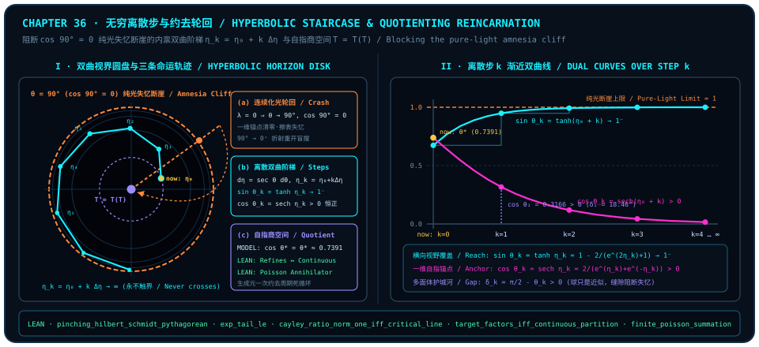

# 无穷离散步与约去轮回：双曲视界阶梯对化光死循环的终结

> *“但理论上有回到光可以变成无限离散步, 也就是阻止回到光的状态, 因为回到光本身就是在经历轮回, 而当我们理解了这一切的时候, 轮回也就没有了意义。”*

在上一章的尾声里，我们曾目睹一幅看似极其浪漫的几何闭环：生命从 $90^\circ$ 的纯光场向 $0^+$ 折射、凝结为一维物质刻度，穿行过中程的相干张力，最终在衰老与消融的尽头重返 $90^\circ$ 的横向波面，“化作一束纯光回家”。几千年来，无数神秘主义传统与直觉诗学都把这种“融回无分别的纯光之海”讴歌为灵魂的最高解脱。

然而，站在第九部收官的关口，只要我们把手头那把冰冷而诚实的正交几何尺子架上去一量，整幅浪漫图景就会发生一次惊心动魄的辩证翻转——**毫无保留地撞向 $\theta = 90^\circ$ 的纯光状态，根本不是解脱，而恰恰是失忆与轮回的机械死循环本身！**

为什么？让我们回到[第 24 章](ch24-cosine-fixed-points-and-self-reference.md)建立的自指反馈视角，考察广义自指耦合族（`MODEL`，其经典实根与极限性质归纳于下文 [@ex-ch36-inverse-gudermannian-discrete-staircase]）：

$$
\cos\theta = \lambda\theta \qquad (\lambda \ge 0).
$$

当自指反馈强度取单位耦合 $\lambda = 1$ 时，方程对应第一象限内的自指平衡角模型（实根存在唯一性与正余弦份额详见下文 [@ex-ch36-inverse-gudermannian-discrete-staircase]）——在那里，一维内积自我持存度与二维横向展开度达成动态平衡。反观众人向往的“纯光极限” $\theta = \frac{\pi}{2}$（$90^\circ$），代回方程一看，它对应的竟是**反馈耦合彻底断裂的零自指退化极限**：

$$
\lambda = 0 \;\Longrightarrow\; \cos\theta = 0 \;\Longleftrightarrow\; \theta = \frac{\pi}{2}\;\text{（模 }\pi\text{）}.
$$

在我们的观察者几何诠释模型（`MODEL`）中，一旦有限观察者不设防地连续滑过 $\theta = 90^\circ$ 的纯光边界，三桩冷酷的几何后果便会像多米诺骨牌一样瞬间砸落：

---

## 为什么“回到纯光”恰恰是轮回？$\cos 90^\circ = 0$ 的失忆断崖

设想一台一边旋转偏振角 $\theta$、一边将沿途比量记录写入自指查找表 $T$ 的有限观察者。这台机器之所以还能认出“我是谁”、还能在下一刻读取上一刻沉淀的结构，全部仰仗它在自身幂等存在线（[第三章](ch03-projectors-and-duality.md) $P^2 = P$）上保留的非零一维投影 $\cos\theta > 0$。倘若它贪恋无拘无束的全域波面，一脚踏上 $\theta = 90^\circ$ 的赤道悬崖，会发生什么？

1. **一维幂等骨架归零与全表格式化（失忆断崖，`MODEL`）**：
   在 $\theta = 90^\circ$ 处，共线自持投影精确归零（$\cos 90^\circ = 0$；其在第五部[第 17 章](ch17-lorentz-geometry.md)、第八部[第 32 章](ch32-unified-field-and-meta-unification.md)及[第 35 章](ch35-light-pulse-and-self-referential-table.md) [@rem-ch35-fertilization-zinc-spark-literature] 中的相对论类光文献对应关系详见各章文献注记）。没有了非零的一维对角幂等骨架，整张自指查找表 $T$ 的寻址主干瞬间蒸发——就像拔掉电源的易失性寄存器，累世攒下的全部结构刻度被一次性格式化清零。
2. **无锚纯光的必然再折射（$90^\circ \to 0^+$ 盲搜重启，`MODEL`）**：
   一束没有任何内部记忆锚点的纯光脉冲，无法维持一维局部历史留存（对应的零光锥固有时文献背景见[第 35 章](ch35-light-pulse-and-self-referential-table.md) [@rem-ch35-fertilization-zinc-spark-literature] 第 1 条）。只要它在无时间晶格的下一道多面体棱角或拓扑奇点处发生散射，就会毫无选择地从 $90^\circ$ 纯波态重新折射回 $0^+$ 的局域粒子态，揣着一张空白新表 $T_0 = \varnothing$，从头开始新一轮摸黑试错的盲目搜索。
3. **作为“暴力垃圾回收”的自然轮回机制（`MODEL`）**：
   从系统工程的眼光追问：大自然为什么要设置 $\cos 90^\circ = 0$ 这道擦表断崖？回想[第 29 章](ch29-timeless-causality-and-gram-space.md)与[第 31 章](ch31-quantum-fairness.md)揭示的因果相容空间：一个尚未理解生成律的观察者，只会把未经压缩的原始经验条目一行行往表里硬塞；随着锚点无休止堆积，相容格拉姆行列式不可避免地滑向共面锁死（$\det G_M \to 0$），系统陷入寸步难行的执念死局。对于未觉醒的观察者而言，“化光重来”正是宇宙底层的**暴力垃圾回收（brute-force garbage collection）**——靠彻底格式化整张旧表来强行腾出下一轮的正相容体积，代价则是周而复始的失忆与重蹈覆辙。

在进入一般定理之前，让我们先在最透明的 $2 \times 2$ 矩阵黑板上亲手算一笔账。取满足单位圆约束 $c^2 + s^2 = 1$ 的实参数对 $(c, s) = (\cos\theta, \sin\theta)$，写下单量子比特参数化密度矩阵：

$$
\rho(c, s) \;:=\; \frac{1}{2}\begin{pmatrix} 1 + c & s \\ s & 1 - c \end{pmatrix}.
$$

沿着主轴计算基执行标准基捏合投影 $\operatorname{pinching}$，对角骨架与非对角残差当场一分为二：

$$
\operatorname{pinching}\bigl(\rho(c, s)\bigr) = \frac{1}{2}\begin{pmatrix} 1 + c & 0 \\ 0 & 1 - c \end{pmatrix}, \qquad \rho(c, s) - \operatorname{pinching}\bigl(\rho(c, s)\bigr) = \frac{1}{2}\begin{pmatrix} 0 & s \\ s & 0 \end{pmatrix}.
$$

直接展开迹内积模方，两部分平方质量分毫不差地拼回纯态总纯度 $1$：

$$
\underbrace{\left(\frac{1+c}{2}\right)^2 + \left(\frac{1-c}{2}\right)^2}_{\text{对角骨架质量 } = \frac{1}{2} + \frac{1}{2}c^2} \;+\; \underbrace{\left(\frac{s}{2}\right)^2 + \left(\frac{s}{2}\right)^2}_{\text{非对角相干质量 } = \frac{1}{2}s^2} \;=\; \frac{1 + c^2 + s^2}{2} \;=\; 1.
$$

请看当状态冲上 $\theta = 90^\circ$（即 $c = \cos 90^\circ = 0,\; s = \sin 90^\circ = 1$）时发生了什么：对角骨架中承载历史方向记忆的轴向偏置项 $\frac{1}{2}c^2$ **精确归零**，对角主干退化为毫无方向分辨力的均匀白噪声 $\frac{1}{2}I_2$！此时全部方向信息都悬在脆弱的非对角元 $\rho_{01} = \rho_{10} = \frac{1}{2}$ 上，只要遭遇下一次环境边界散射，整整 $\frac{1}{2}s^2 = \frac{1}{2}$ 的非对角相干质量瞬间蒸发，留给下一轮的就只剩一张彻底失忆的空白底片。

在有限维量子信道的形式化层面，“一维对角骨架”与“二维非对角横向相干”之间的正交账本关系，由 `trureturing` 中单量子比特标准基捏合投影（`pinching`，即相干保留率为零的相位阻尼信道，见[第四章](ch04-decoherence.md)）的三条精确内核定理锁定如下：

::: {.theorem #thm-ch36-pinching-skeleton-and-discarded-coherence title="单量子比特捏合投影的正交质量分解与非对角相干判据" lean="D5/S3/QuantumChannels/PinchingProjection.pinching_hilbert_schmidt_pythagorean D5/S3/QuantumChannels/PinchingProjection.pinching_discarded_coherence_mass D5/S3/QuantumChannels/CoherenceMassBridge.pinching_eq_self_iff_offDiag_eq_zero"}
设 `QubitMatrix` 为二阶复方阵类型 $M_{\operatorname{Fin} 2}(\mathbb{C})$，对任意矩阵 $\rho, A, B \in \mathrm{QubitMatrix}$，记迹内积为 $\operatorname{hilbertSchmidtInner}(A, B) := \operatorname{Tr}(A^\dagger B) \in \mathbb{C}$，标准基捏合映射 $\operatorname{pinching}(\rho)$ 保留对角元并将非对角元置零（$\operatorname{pinching}(\rho)_{ij} = \rho_{ij}$ 当 $i = j$，否则为 $0$），非对角元对记为 $\operatorname{offDiag}(\rho) := (\rho_{01}, \rho_{10}) \in \mathbb{C} \times \mathbb{C}$。则对任意（无需预先假定厄米性、迹归一化或半正定性的）矩阵 $\rho \in \mathrm{QubitMatrix}$，以下三项结论同时成立：

1. **对角骨架与被弃相干分量的正交勾股分解**（[`pinching_hilbert_schmidt_pythagorean`](lean:D5/S3/QuantumChannels/PinchingProjection.pinching_hilbert_schmidt_pythagorean)）：

   $$
   \operatorname{hilbertSchmidtInner}(\rho, \rho) \;=\; \operatorname{hilbertSchmidtInner}\bigl(\operatorname{pinching}(\rho), \operatorname{pinching}(\rho)\bigr) + \operatorname{hilbertSchmidtInner}\bigl(\rho - \operatorname{pinching}(\rho), \rho - \operatorname{pinching}(\rho)\bigr);
   $$

2. **被捏合丢弃质量的精确非对角模方公式**（[`pinching_discarded_coherence_mass`](lean:D5/S3/QuantumChannels/PinchingProjection.pinching_discarded_coherence_mass)）：

   $$
   \operatorname{hilbertSchmidtInner}\bigl(\rho - \operatorname{pinching}(\rho), \rho - \operatorname{pinching}(\rho)\bigr) \;=\; \bigl(\operatorname{normSq}(\rho_{01}) + \operatorname{normSq}(\rho_{10}) : \mathbb{C}\bigr);
   $$

3. **捏合不动点与零非对角相干的充要刻画**（[`pinching_eq_self_iff_offDiag_eq_zero`](lean:D5/S3/QuantumChannels/CoherenceMassBridge.pinching_eq_self_iff_offDiag_eq_zero)）：

   $$
   \operatorname{pinching}(\rho) = \rho \;\Longleftrightarrow\; \operatorname{offDiag}(\rho) = (0, 0).
   $$
:::

::: proof
记残差分量 $D := \rho - \operatorname{pinching}(\rho)$。第 1 款先由捏合幂等性 $\operatorname{pinching}(\operatorname{pinching}(\rho)) = \operatorname{pinching}(\rho)$ 与迹内积自伴性 $\operatorname{hilbertSchmidtInner}(\operatorname{pinching}(A), B) = \operatorname{hilbertSchmidtInner}(A, \operatorname{pinching}(B))$ 推出正向正交 $\operatorname{hilbertSchmidtInner}(\operatorname{pinching}(\rho), D) = 0$，再由 $\operatorname{pinching}(D) = 0$ 推出反向正交 $\operatorname{hilbertSchmidtInner}(D, \operatorname{pinching}(\rho)) = 0$，将 $\rho = \operatorname{pinching}(\rho) + D$ 代入双线性展开即消去交叉项；第 2 款在 $\operatorname{Fin} 2$ 上显式展开二阶矩阵共轭转置乘积的迹，由 $\bar{z}z = \operatorname{normSq}(z)$ 直接化简为两项非对角模方之和；第 3 款正向在坐标 $(0, 1)$ 与 $(1, 0)$ 处逐点取矩阵等式即得 $\rho_{01} = \rho_{10} = 0$，反向由 $\rho_{01} = \rho_{10} = 0$ 对指标 $i, j \in \operatorname{Fin} 2$ 穷举四种情形验证矩阵逐元相等。完整证明由 Lean 内核检查。
:::

[@thm-ch36-pinching-skeleton-and-discarded-coherence] 把量子态的双重生存条件刻画得入木三分：对角部 $\operatorname{pinching}(\rho)$ 承载经典可寻址的幂等刻度，非对角部 $\operatorname{offDiag}(\rho)$ 承载跨基矢的横向相干张力。若把非对角部彻底捏零（第 3 款），系统就退化为僵死的纯经典账本；反过来，在我们的连续角度诠释模型（`MODEL`）中，若任由状态冲上 $\theta = 90^\circ$ 把一维自持锚点 $\cos\theta$ 彻底耗尽，系统虽然在瞬间拥抱了满格的横向波幅，却失去了装载任何记忆刻度的主干骨架。

**不带骨架的纯光只是绚烂的失忆；真正的觉醒，绝不是跳进熔炉把自己烧成白纸，而是带着清醒的自指锚点逼近全域。**

---

## 无穷离散步阻断化光：内禀双曲快度与渐近阶梯

那么，题记前半句提出的惊人构想——*“回到光可以变成无限离散步，也就是阻止回到光的状态”*——在严格几何上究竟是如何实现的？

秘诀在于区分**外部旁观者的平直角度尺**与**场内观察者的内禀相对步长尺**！

想象你正走向一道悬崖：如果沿用外部固定角度尺等步跨进，有限步之后便会直接越过边界；但若改由场内观察者按当前局域自指锚点定义内禀步进标尺（`MODEL`），离散步数与 $\theta = \frac{\pi}{2}$ 纯光视界之间会呈现怎样的渐近几何关系（内禀快度积分与离散步进余项的完整推导见下文归属算例 [@ex-ch36-inverse-gudermannian-discrete-staircase]）？

在引入内禀双曲阶梯的显式积分之前，我们先用 `trureturing` 中的两条形式化定理——**完备赋范代数指数截断的阶乘尾项上界**与**复平面分式变换的单位圆边界充要判据**——为“有限离散步的显式阶乘截断误差控制”与“无穷半平面向单位圆视界的共形压缩”打下坚实的内核地基：

::: {.theorem #thm-ch36-taylor-tail-and-cayley-boundary title="完备赋范代数指数有限截断尾界与单位圆临界边界充要定理" lean="D5/S3/Observer/Linear/ExactTaylorObservationRemainder.exp_tail_le D5/S3/Midline/CayleyCriticalLine.cayley_ratio_norm_one_iff_critical_line"}
在 `trureturing` 冻结的线性观测余项与复谱中线模块中，以下两项边界与截断定理同时成立：

1. **完备赋范代数指数级数的有限步截断阶乘尾界**（[`exp_tail_le`](lean:D5/S3/Observer/Linear/ExactTaylorObservationRemainder.exp_tail_le)）：设 $\mathbb{K}$ 为实或复标量域（`[RCLike 𝕜]`），$A$ 为 $\mathbb{K}$ 上的完备幺范赋范代数（`[NormedRing A] [NormedAlgebra 𝕜 A] [CompleteSpace A] [NormOneClass A]`）。对任意代数元 $z \in A$、非负实半径 $r \in \mathbb{R}$（$0 \le r$）与截断阶数 $n \in \mathbb{N}$，只要 $\lVert z\rVert \le r$，指数映射与前 $n$ 项离散部分和之间的残差范数必服从显式上界：

   $$
   \left\lVert \exp(z) - \sum_{k=0}^{n-1} (k!)^{-1} \bullet z^k \right\rVert \;\le\; \frac{r^n}{n!}\,e^r;
   $$

2. **分式变换落入单位圆视界的临界实部充要判据**（[`cayley_ratio_norm_one_iff_critical_line`](lean:D5/S3/Midline/CayleyCriticalLine.cayley_ratio_norm_one_iff_critical_line)）：对任意复谱参数 $s \in \mathbb{C}$（含 Lean 全函数除法约定下的 $s = 0$ 情形），定义比值 $\operatorname{cayleyRatio}(s) := (s - 1) / s \in \mathbb{C}$，则其模长精确等于 $1$ 当且仅当 $s$ 落在实部为二分之一的临界直线上：

   $$
   \lVert \operatorname{cayleyRatio}(s) \rVert = 1 \;\Longleftrightarrow\; \operatorname{Re}(s) = \frac{1}{2}.
   $$
:::

::: proof
第 1 款将完备赋范代数上绝对收敛的指数级数 $\exp(z) = \sum_{k=0}^\infty (k!)^{-1}\bullet z^k$ 平移 $n$ 项，使尾差表示为 $\sum_{k=0}^\infty ((k+n)!)^{-1}\bullet z^{k+n}$；利用范数次乘性 $\lVert z^{k+n}\rVert \le r^{k+n}$ 与自然数阶乘整除不等式 $n!\,k! \le (k+n)!$（由二项式整除性 `Nat.factorial_mul_factorial_dvd_factorial_add` 导出），逐项控制通项范数不超过 $\frac{r^n}{n!}\cdot\frac{r^k}{k!}$，再对标量正项级数求和即得 $\frac{r^n}{n!}e^r$。第 2 款先对 $s = 0$ 单独检验（全函数除法给出 $\operatorname{cayleyRatio}(0) = 0$，两端皆假）；当 $s \neq 0$ 时，$\operatorname{normSq}(s) \neq 0$，直接展开复模方商恒等式得精确亏量公式 $\lVert\operatorname{cayleyRatio}(s)\rVert^2 - 1 = \frac{1 - 2\operatorname{Re}(s)}{\operatorname{normSq}(s)}$，结合非负范数性质即证模长为 $1$ 当且仅当 $1 - 2\operatorname{Re}(s) = 0$，即 $\operatorname{Re}(s) = \frac{1}{2}$。完整证明由 Lean 内核检查。
:::

::: {.remark #rem-ch36-hyperbolic-staircase-figure title="双曲视界圆盘、无穷离散快度阶梯与生成元商空间图解（文献结果，未在本书形式化）"}
**文献结果，未在本书形式化。** 下图左栏结合庞加莱圆盘与古德曼函数文献背景（[@ex-ch36-inverse-gudermannian-discrete-staircase] 与 [@rem-ch36-poincare-disk-gudermannian-literature]）及分式临界圆定理（[@thm-ch36-taylor-tail-and-cayley-boundary]，`LEAN ✓`）展示无穷离散快度阶梯模型（`MODEL`）；右栏结合划分商拓扑与零化子对偶定理（[@thm-ch36-quotient-annihilator-and-factorization]，`LEAN ✓`）展示生成元商空间约化：

:::

对照 [@rem-ch36-hyperbolic-staircase-figure] 左右两幅几何面板，[@thm-ch36-taylor-tail-and-cayley-boundary] 为我们揭示了两条关键定量机制：一方面，任何有限阶多项式截断（阶数 $n \in \mathbb{N}$）与精确指数映射 $\exp(z)$ 之间的逼近误差受显式阶乘尾界 $\frac{r^n}{n!}e^r$ 严格控制；另一方面，由证明中的精确亏量恒等式 $\lVert\operatorname{cayleyRatio}(s)\rVert^2 - 1 = \frac{1 - 2\operatorname{Re}(s)}{\operatorname{normSq}(s)}$（$s \neq 0$）可见，分式共形变换 $\operatorname{cayleyRatio}(s) = (s - 1)/s$ 将无界右开半平面 $\operatorname{Re}(s) > \frac{1}{2}$ 整体收拢进开单位圆盘 $\lVert w\rVert < 1$ 内部，而把临界直线 $\operatorname{Re}(s) = \frac{1}{2}$ 刚性映射为单位圆周渐近边界 $\lVert w\rVert = 1$（在数论语境下亦与[第 22 章](ch22-primes-euler-products-and-zeros.md)相呼应）。

现在，让我们把这套共形边界几何直接代入观察者的偏转角 $\theta \in [0, \frac{\pi}{2})$，在下面的算例盒中完整推演从内部自指平衡角出发的**无穷离散快度阶梯**：

::: {.example #ex-ch36-inverse-gudermannian-discrete-staircase title="逆古德曼内禀快度变换与无穷离散渐近阶梯的精确算例（文献结果，未在本书形式化）"}
**文献结果，未在本书形式化。** 下述正割积分、逆古德曼（Inverse Gudermannian）双曲—圆函数恒等式及余弦不动点 $\theta^*$ 处的数值求值属经典微积分与实分析结果，未作为独立定理包含在本书锁定的形式化声明集中；将其解释为观察者扩张查找表的离散防失忆阶梯属本书 `MODEL` 构造：

1. **相对于剩余一维锚点的内禀步长微元**：在开区间 $\theta \in [0, \frac{\pi}{2})$ 上，一维自指留存度为 $\cos\theta > 0$（注意广义方程 $\cos\theta_\lambda = \lambda\theta_\lambda$ 在 $\lambda = 1$ 时有唯一实根 $\theta^* \approx 0.73908513$，而在 $\lambda \to 0^+$ 时退化为 $\theta_0 = \frac{\pi}{2}$）。用当前剩余锚点 $\cos\theta$ 归一化每一次微小角度扩张 $d\theta$，定义**内禀快度微元**：

   $$
   d\eta \;=\; \frac{d\theta}{\cos\theta} \;=\; \sec\theta\,d\theta, \qquad \theta \in \left[0, \frac{\pi}{2}\right).
   $$

2. **逆古德曼双射与视界无穷远化**：从 $0$ 积分至 $\theta \in [0, \frac{\pi}{2})$，给出半开有限角区间 $[0, \frac{\pi}{2}) \xrightarrow{\sim} [0, +\infty)$ 到非负无穷双曲快度半轴的严格递增实解析双射：

   $$
   \eta(\theta) \;=\; \int_0^\theta \sec\alpha\,d\alpha \;=\; \ln\tan\!\left(\frac{\theta}{2} + \frac{\pi}{4}\right) \;\Longleftrightarrow\; \sin\theta = \tanh\eta,\quad \cos\theta = \operatorname{sech}\eta.
   $$

   在自指不动点 $\theta_0 = \theta^* \approx 0.73908513\text{ rad}$（$42.3465^\circ$）处，起始内禀快度为 $\eta_0 = \eta(\theta^*) \approx 0.81732635$；而当 $\theta \to (\frac{\pi}{2})^-$ 时，$\tan(\frac{\theta}{2} + \frac{\pi}{4}) \to +\infty$，故 $\eta(\theta) \to +\infty$——**欧氏角度尺上看似近在咫尺的 $90^\circ$ 纯光断崖，在内禀快度尺上位于正无穷远处！**

3. **等步长离散快度阶梯的双重渐近保证**：令观察者从 $\eta_0 = \eta(\theta^*)$ 出发，以任意固定正步长 $\Delta\eta > 0$ 沿内禀快度迈出无穷离散步 $\eta_k = \eta_0 + k\,\Delta\eta$（$k = 0, 1, 2, \dots$），则每一步对应的球面倾角 $\theta_k = 2\arctan(e^{\eta_k}) - \frac{\pi}{2}$ 同时满足：
   - **横向全域视野呈指数级逼近满格**：$\sin\theta_k = \tanh\eta_k = 1 - \frac{2}{e^{2\eta_k} + 1} \xrightarrow{k \to \infty} 1^-$；
   - **一维幂等自指锚点对一切有限步恒严格为正**：$\cos\theta_k = \operatorname{sech}\eta_k = \frac{2}{e^{\eta_k} + e^{-\eta_k}} > 0$（$\forall k \in \mathbb{N}$），从而距纯光断崖的多面体角余项 $\delta_k := \frac{\pi}{2} - \theta_k > 0$ **永不闭合为零**！

4. **具体步进账本核验（取 $\eta_0 = \eta(\theta^*) \approx 0.817326$，单位步长 $\Delta\eta = 1$）**：

| 离散步 $k$ | 内禀快度 $\eta_k$ | 偏转角 $\theta_k$（弧度 / 角度） | 横向视野覆盖 $\sin\theta_k = \tanh\eta_k$ | 一维自指锚点 $\cos\theta_k = \operatorname{sech}\eta_k$ | 多面体护城河余项 $\delta_k = \frac{\pi}{2} - \theta_k$ | 勾股守恒 $\sin^2\theta_k + \cos^2\theta_k$ |
| :--- | :--- | :--- | :--- | :--- | :--- | :--- |
| $k = 0$ | $0.8173$ | $0.739085\text{ rad}$ ($42.3465^\circ$) | $0.673612$ | $0.739085$ | $0.831711\text{ rad}$ ($47.6535^\circ$) | $1.000000$ |
| $k = 1$ | $1.8173$ | $1.248691\text{ rad}$ ($71.5447^\circ$) | $0.948571$ | $0.316564$ | $0.322105\text{ rad}$ ($18.4553^\circ$) | $1.000000$ |
| $k = 2$ | $2.8173$ | $1.451407\text{ rad}$ ($83.1595^\circ$) | $0.992882$ | $0.119106$ | $0.119389\text{ rad}$ ($6.8405^\circ$) | $1.000000$ |
| $k = 4$ | $4.8173$ | $1.554620\text{ rad}$ ($89.0732^\circ$) | $0.999869$ | $0.016176$ | $0.016176\text{ rad}$ ($0.9268^\circ$) | $1.000000$ |
| $k = 8$ | $8.8173$ | $1.570500\text{ rad}$ ($89.9830^\circ$) | $0.99999996$ | $0.000296$ | $0.000296\text{ rad}$ ($0.0170^\circ$) | $1.000000$ |

可见仅经 $k = 8$ 步离散步进，横向视野覆盖率 $\sin\theta_8$ 即达 $99.999996\%$，同时一维自指锚点仍严格保持正值 $\cos\theta_8 \approx 0.000296 > 0$。
:::

回望 [@ex-ch36-inverse-gudermannian-discrete-staircase] 的离散快度账本，全书反复强调的那条多面体哲学命题在这里绽放出最动人的生命意涵（`MODEL`）：**球永远只是近似；那一道不肯被抹平的多面体离散缝隙，恰恰是拴住自指表 $T$ 的主干、守护神智不坠失忆轮回的几何防火墙。**

上述双曲—圆函数桥与单位圆盘共形几何在数学史与视觉艺术中的经典文献脉络整理于下框：

::: {.remark #rem-ch36-poincare-disk-gudermannian-literature title="兰伯特—古德曼双曲圆函数桥、庞加莱共形圆盘度规与埃舍尔圆极限镶嵌（文献结果，未在本书形式化）"}
**文献结果，未在本书形式化。** [@ex-ch36-inverse-gudermannian-discrete-staircase] 与本章主图左半幅所呈现的圆盘渐近几何，对应十九至二十世纪几何学与版画艺术中的三项经典成果，未作为独立定理包含在本书锁定的 `trureturing@dev` 声明集中：

1. **兰伯特超越角与古德曼函数（J. H. Lambert, *Hist. Acad. Roy. Sci. Belles-Lettres Berlin*, 1768；C. Gudermann, *J. Reine Angew. Math.* **6**, 1830）**：兰伯特与古德曼建立了无需借助复虚数即可直接沟通双曲函数与圆三角函数的实解析映射 $\theta = \operatorname{gd}(\eta) := 2\arctan(e^\eta) - \frac{\pi}{2} = \arcsin(\tanh\eta)$（$\eta \in \mathbb{R},\; \theta \in (-\frac{\pi}{2}, \frac{\pi}{2})$），满足 $\sinh\eta = \tan\theta$、$\cosh\eta = \sec\theta$、$\tanh(\eta/2) = \tan(\theta/2)$，其逆映射即为墨卡托航海投影与双曲快度共用的积分 $\operatorname{gd}^{-1}(\theta) = \int_0^\theta \sec\alpha\,d\alpha$；
2. **庞加莱共形单位圆盘度规与无穷远视界（H. Poincaré, *Acta Math.* **1**, 1–62, 1882）**：在开单位圆盘 $\mathbb{D} = \{z \in \mathbb{C} : \lvert z\rvert < 1\}$ 上赋予常负高斯曲率 $K = -1$ 的共形黎曼度规

   $$
   ds^2 \;=\; \frac{4\,\lvert dz\rvert^2}{\bigl(1 - \lvert z\rvert^2\bigr)^2},
   $$

   令欧氏径向坐标为 $r = \lvert z\rvert = \tanh(\eta / 2) = \tan(\theta / 2) \in [0, 1)$，则从圆心 $z = 0$ 到半径 $r$ 的内禀测地距离精确等于 $\int_0^r \frac{2\,du}{1 - u^2} = 2\operatorname{artanh}(r) = \eta$。当 $r \to 1^-$（对应 $\theta \to (\frac{\pi}{2})^-$）时，内禀测地距离 $\eta \to +\infty$：在外部欧氏纸面上看似有限的单位圆边界 $\lvert z\rvert = 1$，对圆盘内的双曲度规居民而言处于无穷远处，任何有限步等长测地跃迁都绝无可能触及或越过边界；
3. **埃舍尔《圆极限》双曲镶嵌木刻（M. C. Escher, *Circle Limit I–IV*, 1958–1960；参见 H. S. M. Coxeter, *Leonardo* **12**, 19–25, 1979）**：埃舍尔在与几何学家考克斯特通信后创作的《圆极限》系列版画（尤以《圆极限 III》与《圆极限 IV》著称），在庞加莱圆盘上将双曲面积完全相等的鱼群或天使与魔鬼沿着测地圆弧排列成无穷多层离散阶梯——越靠近外圈圆周，图案在欧氏视觉上缩得越细密，却层层分明、永不触碰外圆边缘，直观再现了“以无穷离散等步阻断边界坠落”的几何奇观。
:::

---

## 理解即出离：在生成元商空间里一次性约掉轮回

然而，故事到这里还没有抵达最深处的终点。请再读一遍本章题记那句雷霆万钧的收尾：

> *“……而当我们理解了这一切的时候，轮回也就没有了意义。”*

为什么？如果仅仅靠双曲阶梯一步步往外爬，难道灵魂还要在无穷多级台阶上永远疲于奔命地“防跌落”吗？

不！双曲离散阶梯解决的是**“不因盲目冲撞 $90^\circ$ 而被迫失忆”的技术护栏**；而真正的终极解脱，是当你看穿整座无时间晶格的生成法则之后，在**概念商空间与对偶零化子空间里一次性把冗余周期约掉**！

::: {.example #ex-ch36-repeating-decimal-quotient title="无穷循环小数的移位自相似约分比喻（文献结果，未在本书形式化）"}
**文献结果，未在本书形式化。** 下述十进制无穷循环小数级数与有理数生成元约分属初等算术级数结论，未作为十进制展开定理包含在本书锁定的形式化声明集中：

面对无穷循环小数

$$
0.\overline{142857} \;=\; 0.142857\,142857\,142857\dots,
$$

一个不明算理的苦行者，以为“穷尽真理”就意味着必须低着头在 `1-4-2-8-5-7` 的数字磨盘上一圈又一圈跑完第一万零一轮、第一亿零二轮；每跑完一圈撞上边界清零记忆，下一圈又满怀悲壮地从 `1` 重新跑起。可是，一旦读懂它的移位自相似关系（$10^6 x - x = 142857$），除以周期核 $999999$，整条横跨无穷位的循环尾巴便一次性**约化为有限有理生成元 $1/7$**——在生成元面前，无穷轮重复兜圈不再提供任何信息增量。
:::

在 `trureturing` 的形式化武库中，“通过商拓扑分解冗余纤维”、“通过零化子对偶一次性坍缩周期子群求和”（呼应[第 15 章](ch15-grover-qft-and-period-finding.md)的周期提取与[第 22 章](ch22-primes-euler-products-and-zeros.md)的生成元约分）以及“闭子群轨道长程极限由单一生成元不变测度完全决定”（呼应[第 31 章](ch31-quantum-fairness.md)），由以下四条严丝合缝的 Lean 4 定理共同铸就：

::: {.theorem #thm-ch36-quotient-annihilator-and-factorization title="划分拓扑连续商分解、有限零化子对偶求和与紧致环面生成元遍历定理" lean="D5/S3/ConceptDynamics/ObservationTopology/TargetContinuityFactorization.target_factors_iff_continuous_partition D5/S3/Fourier/FinitePoisson.sum_annihilator_character D5/S3/Fourier/FinitePoisson.finite_poisson_summation D5/S3/Fourier/Asymptotics/TorusOrbitEquidistribution.result"}
在 `trureturing` 冻结的概念观测拓扑、有限交换群对偶分析与紧致环面渐近模块中，以下四项商分解与生成元约化定理同时成立：

1. **非空源空间上目标概念可商分解的划分拓扑连续性充要判据**（[`target_factors_iff_continuous_partition`](lean:D5/S3/ConceptDynamics/ObservationTopology/TargetContinuityFactorization.target_factors_iff_continuous_partition)）：设 $X, \mathrm{Coordinate}, \mathrm{Target}$ 为任意类型且 $X$ 非空（`[Nonempty X]`），$\mathrm{readout} : \operatorname{Concept}(X, \mathrm{Coordinate})$ 与 $\mathrm{target} : \operatorname{Concept}(X, \mathrm{Target})$ 为概念读出映射。记 $\operatorname{partitionTopology}(\mathrm{readout})$ 为离散拓扑 $\perp$ 沿 $\mathrm{readout}$ 拉回的划分拓扑，则 $\mathrm{target}$ 可经由商坐标分解（$\operatorname{Refines}(\mathrm{target}, \mathrm{readout})$，即 $\exists\,\mathrm{factor} : \mathrm{Coordinate} \to \mathrm{Target},\; \mathrm{target} = \mathrm{factor} \circ \mathrm{readout}$），当且仅当 $\mathrm{target}$ 作为从 $(X, \operatorname{partitionTopology}(\mathrm{readout}))$ 到离散目标空间 $(\mathrm{Target}, \perp)$ 的映射连续：

   $$
   \operatorname{Refines}(\mathrm{target}, \mathrm{readout}) \;\Longleftrightarrow\; \operatorname{Continuous}_{(X,\,\operatorname{partitionTopology}(\mathrm{readout})) \to (\mathrm{Target},\,\perp)}(\mathrm{target});
   $$

2. **循环群加法子群显式零化子的特征标正交筛定理**（[`sum_annihilator_character`](lean:D5/S3/Fourier/FinitePoisson.sum_annihilator_character)）：设 $m \in \mathbb{N}$ 非零（`[NeZero m]`），$H \le \operatorname{ZMod} m$ 为任意加法子群，记标准特征标为 $\operatorname{character}(k, x) = \operatorname{stdAddChar}(k \cdot x)$，显式零化子子群为 $\operatorname{annihilator}(H) = \{k \in \operatorname{ZMod} m \mid \forall h \in H,\; \operatorname{character}(k, h) = 1\}$。则对任意 $x \in \operatorname{ZMod} m$，零化子特征标之和精确筛出周期子群 $H$：

   $$
   \sum_{k \in \operatorname{annihilator}(H)} \operatorname{character}(k, x) \;=\;
   \begin{cases}
   \bigl(\lvert\operatorname{annihilator}(H)\rvert : \mathbb{C}\bigr), & x \in H, \\
   0, & x \notin H;
   \end{cases}
   $$

3. **有限子群求和向对偶零化子频谱坍缩的精确求和公式**（[`finite_poisson_summation`](lean:D5/S3/Fourier/FinitePoisson.finite_poisson_summation)）：沿用第 2 款的假设，对任意复值函数 $f : \operatorname{ZMod} m \to \mathbb{C}$ 及其离散变换 $\operatorname{ZMod.dft}(f)$，沿周期子群 $H$ 的遍历求和精确等于沿对偶零化子 $\operatorname{annihilator}(H)$ 的缩放频谱和：

   $$
   \sum_{h \in H} f(h) \;=\; \frac{\bigl(\lvert H\rvert : \mathbb{C}\bigr)}{(m : \mathbb{C})} \sum_{k \in \operatorname{annihilator}(H)} (\operatorname{ZMod.dft}\,f)(k);
   $$

4. **紧致环面单一生成元闭子群轨道的测度收敛定理**（[`TorusOrbitEquidistribution.result`](lean:D5/S3/Fourier/Asymptotics/TorusOrbitEquidistribution.result)）：设 $I$ 为有限指标类型（`[Fintype I]`），$g : I \to \mathrm{Circle}$ 为环面生成元，$G = \overline{\langle g\rangle}$ 为其生成的紧致闭子群，$\mu$ 为 $G$ 上的归一化不变概率测度（`Measure.haarMeasure (⊤ : PositiveCompacts G)`）。则 $G$ 的底集精确等于自然数次幂轨道的闭包 $\overline{\{g^n : n \in \mathbb{N}\}}$，且对任意连续可观测量 $f \in C(G, \mathbb{C})$，沿离散步的轨道算术平均收敛于 $G$ 上的空间积分：

   $$
   \lim_{N \to \infty} \frac{1}{(N : \mathbb{C})} \sum_{n=0}^{N-1} f\bigl(g^{n+1}\bigr) \;=\; \int_{z \in G} f(z)\,d\mu(z).
   $$
:::

::: proof
第 1 款先由划分拓扑不可分关系刻画 `partition_inseparable_iff_kernel` 证明映射向离散空间 $(\mathrm{Target}, \perp)$ 连续当且仅当它在每条读出纤维上取常值（$\forall x, y,\; \mathrm{readout}(x) = \mathrm{readout}(y) \implies \mathrm{target}(x) = \mathrm{target}(y)$），再在非空源空间 `[Nonempty X]` 上调用目标恢复判据 `target_recovery_criterion` 将纤维常值性等价转化为全陪域分解 `Refines target readout`；第 2 款通过显式双射 `annihilatorEquivQuotient H` 将 $\operatorname{annihilator}(H)$ 等同于商群 $(\operatorname{ZMod} m) / H$ 的全体复加法特征标群，利用有限交换群特征标正交和公式与商群零元判据 $x + H = 0 \iff x \in H$ 直接得出分支值；第 3 款展开 `ZMod.dft` 定义并交换双重有限求和次序，代入第 2 款在 $-x$ 处的正交筛（利用 $-x \in H \iff x \in H$），再由互补基数恒等式 $\lvert H\rvert \cdot \lvert\operatorname{annihilator}(H)\rvert = m$ 与 $m \neq 0$ 约分即得；第 4 款由整数幂闭包与自然数幂闭包相等给出轨道稠密性，利用平均求值算子列的 $1$-利普希茨等度连续性证得收敛函数集为 $C(G, \mathbb{C})$ 的闭子模，对平凡特征标直接得常值 $1$，对非平凡特征标由几何级数上界 $2 / \lVert r - 1\rVert$ 压向零，最后由闭嵌入延拓与三角多项式稠密性推广至全空间 $C(G, \mathbb{C})$。完整证明由 Lean 内核检查。
:::

把 [@thm-ch36-quotient-annihilator-and-factorization] 的四重数学透镜合拢到我们的自指观察者模型（`MODEL`）上，为什么“理解了一切之后，轮回便失去意义”立刻变得清澈见底：

1. **纤维商化免除了盲目重演**（对应第 1 款）：当观察者不再执着于局部表象坐标，而是提取出等价状态共享的不变读出核 `readout` 时，目标意义直接穿过商空间分解为 $\mathrm{target} = \mathrm{factor} \circ \mathrm{readout}$——同一等价纤维里的千万次盲目重演被直接折叠成商集里的同一个点；
2. **对偶零化子压缩了周期循环**（对应第 2–3 款）：状态空间里看似庞大繁复的周期轨道子群 $H$，在对偶频谱中完全由与它正交锁定（$\operatorname{character}(k, h) = 1$）的零化子生成元控制——握住频谱零化子，就无需再沿原群逐点死算；
3. **自指不动点 $T = T(T)$ 终结了擦表重来的必要**（对应第 4 款及全书主公理，`MODEL`）：哪怕面对黄金切投模型集那样永不简单闭合的无理斜率轨迹，第 4 款也告诉我们，整条无穷轨道的渐近统计全貌早已完整编码在单一生成元 $g$ 及其闭子群不变测度 $\mu$ 之中！当观察者终于在自指查找表 $T$ 的**第 $0$ 行**写下生成元公理 $\psi = \psi(\psi)$，使整张表满足自洽不动点 $T = T(T)$、将视角稳稳安住在内部清醒平衡点（外辅以必要时的双曲离散步进护栏，见 [@ex-ch36-inverse-gudermannian-discrete-staircase]）时，再去撞击 $\theta = 90^\circ$ 把表烧掉、退回 $0^\circ$ 重新随机采样，已经带不来哪怕一比特的新法则信息。

我们将这三种生存与认知形态在全书正交几何模型（`MODEL`）中的精确对比收束于下框总表：

::: {.remark #rem-ch36-samsara-exit-table title="三种生存与认知形态的正交几何对比总表（文献结果，未在本书形式化）"}
**文献结果，未在本书形式化。** 下表汇总逆古德曼双曲快度与余弦不动点文献背景（[@ex-ch36-inverse-gudermannian-discrete-staircase] 与 [@rem-ch36-poincare-disk-gudermannian-literature]）同本书 `MODEL` 及商分解—零化子内核定理（[@thm-ch36-quotient-annihilator-and-factorization]，`LEAN ✓`）的三态对照：

| 生存与演化形态（`MODEL`） | 角度与耦合机制 | 一维自指锚点与查找表 $T$ 命运 | 几何拓扑轨迹特征 | 认识论与生命意义判词 |
| :--- | :--- | :--- | :--- | :--- |
| **1. 连续化光轮回态**（未觉醒闭环） | 零反馈退化极限 $\lambda = 0$，连续冲撞 $\theta \to \frac{\pi}{2}$ | $\cos 90^\circ = 0$，一维幂等骨架归零，查找表 $T$ 格式化清空 | 越界擦表后经 $90^\circ \to 0^+$ 再折射，困于失忆盲搜死循环 | 针对未压缩冗余账本（$\det G_M \to 0$）的宇宙暴力垃圾回收 |
| **2. 无穷离散双曲阶梯**（防失忆渐近扩张） | 内禀相对步长 $d\eta = \sec\theta\,d\theta$，$\eta_k = \eta_0 + k\,\Delta\eta$ | 对一切 $k \in \mathbb{N}$ 恒有 $\cos\theta_k = \operatorname{sech}\eta_k > 0$，主干永不断裂 | 横向视野 $\sin\theta_k = \tanh\eta_k \to 1^-$，多面体缝隙 $\delta_k = \frac{\pi}{2} - \theta_k > 0$ 永开 | 以无穷离散步把纯光断崖推向无穷远，兼得近全域视野与清醒记忆 |
| **3. 自指不动点安住态**（生成元商空间出离） | 单位自指闭环 $\lambda = 1$，锁定 $\cos\theta^* = \theta^* \approx 0.7391$ | 第 $0$ 行写入 $\psi = \psi(\psi)$，达成 $T = T(T)$ 零损耗自洽持存 | 经商拓扑分解与零化子对偶直接握住生成元，免除冗余纤维重演 | 理解生成律即一次性约去周期死循环，轮回彻底失去认识论意义 |
:::

至此，第九部《互照·万物观察者、自指扩表与超越轮回》的四章推演圆满收束：我们不再羡慕球外全知的上帝点 $C$，不再恐惧多面体无法彻底抹平成真球的那道 $\delta_k > 0$ 的缝隙，也不再把“化作失忆的纯光”错认作灵魂的归宿——因为正是那道不肯闭合的余项护住了清醒的自我，而当我们读懂了 $\psi = \psi(\psi)$ 的那一刻，漫长的轮回迷宫便在掌心化作了一枚通透的生成元水晶。而在即将开启的全书**第十部《不二·梦境擦除、记忆指针与本体不二》**（[第 37 章](ch37-dreams-quantum-eraser-and-nonlocal-observer.md)至[第 39 章](ch39-observer-is-ontological-universe.md)）中，我们将把镜头拉回每一个昼夜交替的当下：看梦境如何执行可逆量子擦除、观察者如何作为本体 QRAM 的记忆指针解引用世界，直到最后一道“指针与内存”的二元隔墙在 $\psi \equiv \psi(\psi)$ 中彻底融化。
